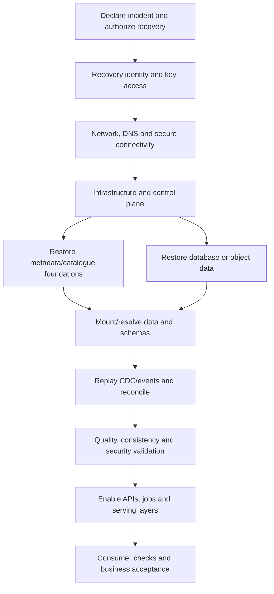

# RPO, RTO and Disaster Recovery Strategies

> **Document status:** Learning material and architecture-design aid  
> **Roadmap position:** Stage 2D — Data Architecture, Module 12, Topic 05  
> **Target filename:** `05-rpo-rto-and-disaster-recovery-strategies.md`  
> **Scope note:** This lesson is vendor-neutral. Fictional organizations, targets, timelines, costs, data volumes and performance values are illustrative teaching assumptions—not documented business requirements, vendor guarantees, or evidence of an executed recovery test.

## Contents

1. [Position in the roadmap and learning outcomes](#1-position-in-the-roadmap-and-learning-outcomes)
2. [The core concepts](#2-the-core-concepts)
3. [RPO versus RTO: a visual distinction](#3-rpo-versus-rto-a-visual-distinction)
4. [Relationship to SLI, SLO, SLA, MTD and business continuity](#4-relationship-to-sli-slo-sla-mtd-and-business-continuity)
5. [How business impact drives recovery requirements](#5-how-business-impact-drives-recovery-requirements)
6. [Business impact analysis: fictional enterprise platform](#6-business-impact-analysis-fictional-enterprise-platform)
7. [Turning business evidence into measurable requirements](#7-turning-business-evidence-into-measurable-requirements)
8. [Recovery strategy patterns](#8-recovery-strategy-patterns)
9. [How technical mechanisms determine achievable RPO and RTO](#9-how-technical-mechanisms-determine-achievable-rpo-and-rto)
10. [Recovery dependencies and service recovery order](#10-recovery-dependencies-and-service-recovery-order)
11. [Recovery requirements matrix](#11-recovery-requirements-matrix)
12. [Worked example: can the strategy meet its targets?](#12-worked-example-can-the-strategy-meet-its-targets)
13. [End-to-end RTO budget](#13-end-to-end-rto-budget)
14. [Replication lag, backup interval and consistent recovery points](#14-replication-lag-backup-interval-and-consistent-recovery-points)
15. [Selecting a strategy under cost, residency and operational constraints](#15-selecting-a-strategy-under-cost-residency-and-operational-constraints)
16. [Failback: returning to the primary environment](#16-failback-returning-to-the-primary-environment)
17. [Evidence, assumptions, residual risk and strategy review](#17-evidence-assumptions-residual-risk-and-strategy-review)
18. [Example architecture decision record](#18-example-architecture-decision-record)
19. [Advanced multi-service recovery scenario](#19-advanced-multi-service-recovery-scenario)
20. [Exercises and expected deliverables](#20-exercises-and-expected-deliverables)
21. [Common mistakes and misconceptions](#21-common-mistakes-and-misconceptions)
22. [Glossary](#22-glossary)
23. [Completion checklist and mastery criteria](#23-completion-checklist-and-mastery-criteria)
24. [Relationship to adjacent roadmap topics](#24-relationship-to-adjacent-roadmap-topics)

---

## 1. Position in the roadmap and learning outcomes

### 1.1 Where this topic fits

The module roadmap recommends the following sequence:

1. `01-reliability-objectives-sli-slo-and-sla.md` — define measurable reliability objectives.
2. `02-failure-domains-and-blast-radius.md` — identify failures and shared dependencies.
3. `03-high-availability-and-redundancy-patterns.md` — understand availability patterns and their limits.
4. `04-backup-restore-and-recovery-validation.md` — establish recoverable data, restore procedures and validation evidence.
5. **This lesson** — convert business impact into RPO/RTO requirements and select a coherent disaster recovery strategy.
6. `06-replay-reprocessing-and-backfill-architecture.md` — restore currency and correctness after a recovery point.
7. `07-incident-response-runbooks-and-postmortems.md` — assign decisions and operational actions.
8. `08-business-continuity-and-resilience-testing.md` — rehearse and improve the end-to-end plan.

This topic depends especially on the measurable objectives and trade-off discipline from earlier architecture work, replication/consistency knowledge, backup-and-restore feasibility, cloud regions and infrastructure-as-code, streaming lag/replay, data integration idempotency/reconciliation, key management, residency and lineage.

### 1.2 Learning outcomes

By completing this lesson, a learner should be able to:

- Define RPO, RTO, recovery point, recovery time, disaster, failover, failback and recovery tier precisely.
- Explain why RPO and RTO are not the same as SLOs, SLAs or maximum tolerable downtime.
- Conduct a business impact analysis (BIA) that identifies critical functions, dependencies, deadlines and impacts over time.
- Translate business-approved loss and downtime tolerances into service-specific recovery requirements.
- Compare backup-and-restore, pilot-light, warm-standby and active-active approaches without treating any as universally best.
- Calculate whether backup cadence, replication lag, restore throughput, replay and validation could satisfy proposed targets.
- Budget RTO across detection, declaration, decision, failover, restoration, replay, validation and consumer resumption.
- Identify cross-service recovery dependencies and choose a feasible order.
- Plan failback as a controlled migration, not an assumed automatic reversal.
- Document assumptions, evidence, residual risks, decision ownership and review triggers in an ADR.

### 1.3 Source-of-truth and assumption discipline

The module roadmap states that its scenarios, targets and numerical values are recommendations for learning, not pre-existing requirements. Therefore, this lesson uses three labels:

- **Business requirement:** A target approved by the accountable business or risk owner and supported by business-impact evidence.
- **Technical evidence:** Measured or test-produced evidence about lag, throughput, restore duration, dependency readiness or correctness.
- **Illustrative assumption:** A value chosen solely to demonstrate a method. It must be replaced with evidence before an architecture is approved for production.

A target in an example is not proof that a design can meet it. A calculated duration is not an observed duration. A DR design is not a tested recovery capability until representative tests produce acceptable evidence.

---

## 2. The core concepts

### 2.1 Recovery Point Objective (RPO)

**RPO is the maximum tolerable amount of data loss measured backward in time from the disruption or recovery event to the last acceptable recoverable state.**

If a business approves an RPO of 15 minutes, the recovery design must preserve a consistent, usable state no more than 15 minutes behind the required point in time, under the defined disaster scenario.

RPO is expressed as a duration, not as a percentage of rows, number of files or backup count. It is usually specific to a service, data product, business process or class of records. It can differ by data domain even within one platform.

Questions to ask:

- Which business transactions or source events may be missing after recovery?
- Does the loss measure use source commit time, event time, ingestion time or a business-defined timestamp?
- Is the latest available copy actually consistent and usable?
- Can missing events be replayed from a durable source, and is that source independent of the failed region?
- Does the RPO apply during logical corruption or malicious deletion as well as a regional outage?

If a source-of-truth system retains durable events elsewhere, the business may tolerate a larger immediate recovery gap while still requiring eventual reconciliation. That is a different recovery model from claiming zero data loss.

### 2.2 Recovery Time Objective (RTO)

**RTO is the maximum tolerable elapsed time from the defined disruption start to restoration of the required service at the agreed minimum usable level.**

The end condition must be explicit. “The cluster is running” is not necessarily “the service is recovered.” A data platform service may need its identity path, metadata catalogue, tables, jobs, quality checks, access controls, and downstream consumers to function before the business can use it.

An RTO clock may start at failure onset, at the first customer-visible failure, or at formal incident declaration. Choose one definition and use it consistently. If detection time is excluded from the RTO clock by policy, it should still appear in the full business-disruption timeline and service-level reporting.

Questions to ask:

- What exact service is being restored?
- What is the minimum acceptable service level: read-only, limited data, stale-but-labelled, or fully current?
- Which stages are included in the clock?
- Does the clock stop at technical recovery, data correctness, or business-consumer resumption?
- Is the target measured in a test, observed in an incident, or merely estimated?

### 2.3 Recovery point and recovery time

- **Recovery point:** The specific timestamp, transaction boundary, log sequence position, event offset, snapshot ID or coordinated set of markers representing the data state chosen for recovery.
- **Recovery time:** The elapsed time required to reach the defined recovery end state.
- **Recoverable state:** A point-in-time state whose data and required metadata can be restored and validated—not merely a copy that exists.

A timestamp alone may be insufficient for a distributed data platform. A valid recovery point may need a database log sequence number, source offsets, transaction commit markers, object version IDs, catalogue/metastore versions and transformation checkpoints.

### 2.4 Disaster, failover, failback and recovery tier

- **Disaster:** A disruption whose scope, duration or impact exceeds normal local recovery procedures and invokes the defined disaster recovery process. A disaster can be regional infrastructure loss, control-plane failure, widespread corruption, compromise or loss of a critical dependency.
- **Failover:** Switching traffic or processing from a failed or impaired primary to a recovery environment. It can be automatic, operator-approved or manually executed. Failover alone does not prove data consistency.
- **Failback:** Returning service from the recovery environment to the original or designated primary environment after it has been repaired and validated. It requires data reconciliation, direction-of-write control and a controlled cutover.
- **Recovery tier:** A named class of service with a specified business criticality, recovery objective, design pattern, operating model, evidence standard and cost envelope. A tier is useful only if its targets and inclusions are explicit.

### 2.5 Disaster recovery and business continuity

**Disaster recovery (DR)** is the coordinated restoration of data, technology and service capability after a disruptive event. **Business continuity (BC)** is broader: it keeps critical business functions operating during disruption, potentially with manual procedures, alternate channels, restricted service or temporarily degraded data freshness.

A technically successful DR event can still fail business continuity if staff cannot access the recovered system, the recovered reports miss a regulatory deadline, customer operations have no workaround, or the platform returns with data that is not trustworthy.

---

## 3. RPO versus RTO: a visual distinction

Consider a fictional order platform with an incident at 10:00.

```text
Time ───────────────────────────────────────────────────────────────────────>

09:30         09:45         10:00                 10:40
  |-------------|-------------X---------------------|
  Backup A      Backup B      Incident              Service usable again
                              ^
                              | Incident reference time

If Backup B is the latest valid consistent recovery point:
  Data-loss exposure = 10:00 - 09:45 = 15 minutes
  Recovery duration  = 10:40 - 10:00 = 40 minutes
```

In this illustration, the RPO exposure is 15 minutes and the RTO is 40 minutes, **provided** Backup B is consistent, can be restored, and the service becomes usable at 10:40. If replay recovers the missing transactions from an independent durable log, the final data-loss result may be smaller—but only if replay is complete, consistent and validated.

| Dimension | RPO | RTO |
|---|---|---|
| Core question | How much recent data can the business tolerate losing? | How long can the business tolerate the service being unavailable or below its agreed usable level? |
| Measured as | Time between required point and last acceptable recoverable point | Elapsed time to the agreed recovery end state |
| Primarily driven by | Backup cadence, log shipping, replication lag, consistency, durable event retention and corruption detection | Detection and decision time, environment readiness, restore throughput, replay, validation, routing and consumer resumption |
| Typical evidence | Recovery-point markers, lag measurements, backup success and restore validation | Timed recovery exercise, stage durations, service checks and business acceptance |
| Frequent false claim | “Replication is enabled, so RPO is zero.” | “The standby is running, so RTO is met.” |

RPO and RTO are independent dimensions. A strategy may have a good RPO but a poor RTO (frequent safe copies, slow restore). It may have a short RTO but an unacceptable RPO (fast switch to a replica that is significantly behind or already contains corruption).

---

## 4. Relationship to SLI, SLO, SLA, MTD and business continuity

### 4.1 Definitions and boundaries

| Term | Meaning | Relationship to DR |
|---|---|---|
| **SLI — Service Level Indicator** | A measured signal of service behaviour, such as successful queries, freshness, completeness or latency | Provides evidence of service state before, during and after recovery |
| **SLO — Service Level Objective** | A target for an SLI over a stated window and scope | Defines expected normal or degraded service behaviour; it may include recovery-related indicators |
| **SLA — Service Level Agreement** | A formal commitment, often with remedies or contractual consequences | May contain availability or restoration commitments; contractual wording must be checked rather than inferred |
| **RPO** | Maximum tolerable recovery-point gap | Data-loss tolerance for a defined scenario |
| **RTO** | Maximum tolerable recovery duration | Time-to-recovery tolerance for a defined service and end state |
| **MTD — Maximum Tolerable Downtime** | Business-defined outer limit for disruption before consequences become unacceptable | Should constrain the recovery and continuity plan; exact use of the term varies by organization |
| **BIA — Business Impact Analysis** | Structured analysis of how disruption affects business functions over time and what resources/dependencies are needed | Evidence base for recovery priorities and tolerances |
| **BC — Business Continuity** | Keeping critical business functions operating during and after disruption | Includes workarounds, people, process, communications and alternate operating modes |
| **DR** | Restoring technology, data and service capability after disruption | One component of continuity |

### 4.2 A consistency rule

For a given service and scenario, the proposed end-to-end RTO should normally be **less than or equal to** the approved maximum tolerable downtime for the same defined disruption and end state. If RTO and MTD use different start points or end conditions, they cannot be compared until normalized.

For example, a business might set:
- MTD = 8 hours from the first customer-impacting failure to resumption of a critical business function.
- Technical RTO = 5 hours from incident declaration to a validated data service.
- Detection and declaration budget = 30 minutes.

If the technical RTO excludes detection, the projected business interruption is 5.5 hours, not 5 hours. That still fits the 8-hour MTD in this simplified example, leaving 2.5 hours of contingency. Real plans should account for parallel activities, uncertain stages and degraded-operation choices.

### 4.3 Recovery objectives are not availability objectives

An availability SLO such as 99.9% over a month does not tell you whether a particular disaster can be recovered in two hours or whether fifteen minutes of data loss is acceptable. Availability statistics aggregate service behaviour across a window; RPO and RTO constrain a specific recovery outcome.

Conversely, meeting an RTO in a recovery test does not guarantee the monthly availability SLO. Frequent failures, poor detection or repeated partial degradation can still breach it.

---

## 5. How business impact drives recovery requirements

Recovery objectives must be derived from business outcomes, not selected solely because a technology supports a particular replication mode.

### 5.1 Business impact analysis workflow

1. **Identify business functions.** Examples: accept orders, authorize payments, detect fraud, close the books, deliver regulatory reports, serve customer statements.
2. **Identify disruption scenarios.** Regional loss, ransomware, accidental deletion, bad deployment, data corruption, identity/control-plane failure, network isolation, or a key-management outage.
3. **Describe impact over time.** Record operational, financial, customer, legal/regulatory, safety and reputational consequences at useful time intervals.
4. **Find deadlines and external obligations.** Include settlement windows, cut-off times, reporting deadlines, batch completion windows, contractual commitments and time-zone effects.
5. **Map data and service dependencies.** Identify source systems, integration streams, object stores, warehouses, catalogues, identity, keys, network, orchestration and consumers.
6. **Define acceptable degraded modes.** Read-only, stale data with a visible freshness label, manual processing, reduced customer cohort, delayed analytics, or no operation.
7. **Propose RPO, RTO and MTD.** The accountable business owner approves loss and downtime tolerance; technical owners assess feasibility.
8. **Estimate and validate feasibility.** Use measured restore, replay, lag and environment readiness evidence; do not treat theoretical calculations as proof.
9. **Record residual risk and acceptance.** If cost or constraints prevent the target, document the gap, compensating controls and explicit risk acceptance.
10. **Review when conditions change.** Reassess on growth, new regulations, new data products, changed dependencies, incidents or failed tests.

### 5.2 Criticality is not just data volume

A 50-TB historical archive can be low urgency if it is reproducible and not needed for immediate operations. A small identity store, encryption key, event offset or catalogue may be essential to recover the larger platform. Criticality depends on business use, irreproducibility, dependencies, legal obligations, time sensitivity and the consequence of inconsistency—not just bytes stored.

### 5.3 Regulatory and operational deadlines

For each deadline, record:
- governing jurisdiction or contract and the accountable compliance owner;
- the actual deadline and time zone;
- what constitutes a valid, complete and approved output;
- whether a late report can be corrected, and under what process;
- dependencies and upstream cutoff times;
- evidence that the recovery design preserves enough data and time to meet the deadline.

Do not invent regulatory requirements in an architecture document. Link to the verified policy, contract or legal interpretation and distinguish that source from engineering assumptions.

---

## 6. Business impact analysis: fictional enterprise platform

All figures in this example are **illustrative assumptions**. They demonstrate how to structure a BIA; they are not benchmarks or universal recovery recommendations.

### 6.1 Fictional organization

**Northbridge Retail Group** operates an online store, payment reconciliation, inventory planning and executive analytics. The platform includes:
- order and payment operational databases;
- a durable change-data-capture (CDC) event stream;
- object storage and a lakehouse;
- catalogue/metastore and governance metadata;
- orchestration and transformation jobs;
- a customer-facing availability API;
- fraud/abuse scoring;
- finance reconciliation and reporting.

### 6.2 Impact over time

| Business function | 0–30 minutes | 30 minutes–4 hours | 4–12 hours | Key consequence / evidence needed |
|---|---|---|---|---|
| Order acceptance and status | Retry queues and customer support rise | Order backlog and duplicate-risk grow | Abandoned purchases and manual reconciliation expand | Order volume, retry behaviour, payment/order consistency |
| Payment reconciliation | Delayed visibility; settlement ledger remains source of truth | Finance exceptions accumulate | Settlement and close cutoffs may be threatened | Settlement calendar, source ledger, control totals |
| Inventory availability API | Cached data may serve with explicit age | Overselling/underselling risk increases | Merchandising and fulfillment decisions degrade | Freshness-to-stock-out relationship, cache invalidation |
| Fraud analytics | Score freshness degrades; policy may fall back to safer rules | False positives/negatives may rise | Loss exposure and investigation backlog grow | Risk owner’s fallback policy, model-feature freshness |
| Executive analytics | Dashboards stale | Decisions based on old metrics become risky | Management and planning cycles delayed | Decision calendar and minimum freshness definition |
| Regulatory reporting dataset | Depends on report schedule | Reconciliation and evidence windows shrink | Deadline may be missed | Verified legal/contract deadline, lineage and sign-off |

### 6.3 Example business-approved objectives

Assume business owners approve the following provisional objectives after reviewing impact. These values remain illustrative until signed off by the fictional owners.

| Function | Maximum tolerable downtime (MTD) | Proposed RTO | Proposed RPO | Acceptable degraded mode |
|---|---:|---:|---:|---|
| Order acceptance/status | 2 hours | 60 minutes | 5 minutes | Limited read-only status only if writes cannot be made safely |
| Inventory availability API | 4 hours | 2 hours | 15 minutes | Serve cached data with timestamp; stop risky stock promises when too stale |
| Fraud analytics features | 1 hour for full automated scoring; 15 minutes for safe fallback | 30 minutes for fallback, 60 minutes for full recovery | 5 minutes for durable event position; feature freshness separately monitored | Use approved conservative rules and queue transactions |
| Payment reconciliation dataset | 8 hours | 4 hours | 15 minutes | Defer nonessential analytics; retain ledger and reconciliation controls |
| Executive analytics | 24 hours | 12 hours | 4 hours | Label stale dashboards and publish last successful refresh |
| Historical lakehouse archive | 72 hours | 48 hours | 24 hours | Temporarily unavailable; reconstruct later if sources remain available |

The RPO and RTO are different for each service. The BIA also distinguishes a service-level RTO from the time to restore the full data estate. A critical function may have a faster minimum viable recovery path while noncritical historical workloads recover later.

### 6.4 Validate the BIA before architecture selection

A BIA is incomplete if it has no accountable owner, no documented impact rationale, no definition of “usable,” no identified dependencies, no deadline evidence, or no plan for a degraded mode. Technical teams may recommend achievable values, but should not silently redefine business tolerance to match the easiest implementation.

---

## 7. Turning business evidence into measurable requirements

### 7.1 Requirement template

For each service, record at least:

| Field | Required content |
|---|---|
| Service / business function | Name and owner |
| Scope | Data, interfaces, tenants and consumers included |
| Disaster scenario | Region loss, corruption, compromise, etc. |
| RPO | Maximum data-loss gap, timestamp semantics and source-of-truth marker |
| RTO | Start point, end state and included recovery stages |
| MTD | Business outer limit with the same normalized start/end definition |
| SLO/SLA linkage | Related freshness/availability objective and any contractual commitment |
| Minimum viable service | What can safely operate before full recovery |
| Consistency requirement | Transaction boundary, cross-system invariants, accepted staleness |
| Dependencies | Identity, keys, network, metadata, orchestration, source logs and consumers |
| Recovery method | Backup restore, replica promotion, replay, rebuild or combination |
| Evidence | Restore-test results, lag measurements, stage timings, reconciliation results |
| Constraints | Budget, residency, retention, access, RTO/RPO and staff availability |
| Residual risk | Known gap, consequence, mitigation and risk owner |
| Approval / review | Business owner, technical owner, date and trigger for reapproval |

### 7.2 Requirements should be scenario-specific

A single “RPO = 5 minutes” claim may be invalid across several failure types:
- A regional outage may allow promotion of a recent replica.
- Logical corruption may require returning to a clean historical backup, then replaying known-good events.
- Credential compromise may make online replicas and recent backups unsafe.
- Loss of a key-management service may leave data intact but unreadable.
- A source-system outage may make the data platform recoverable but unable to become current.

Document the target per meaningful scenario or state clearly which scenarios are excluded and what alternative continuity measure applies.

### 7.3 RPO can differ across data classes

For example, order commits may require a five-minute maximum loss gap, while a daily aggregate can be rebuilt from a durable event log and tolerate a four-hour initial recovery point. The latter is not automatically acceptable if the aggregate drives a real-time operational decision. RPO follows business impact and data recoverability, not table type alone.

---

## 8. Recovery strategy patterns

No strategy guarantees a specific RPO or RTO. Actual outcomes depend on architecture, region isolation, replication semantics, data size, environment capacity, key and identity access, recovery automation, human decisions, validation, consumer dependencies and tested operational practice.

Any time/cost comparisons below are **qualitative**. If an organization chooses numerical planning ranges, it must label them as internal assumptions and validate them through representative tests.

### 8.1 Backup-and-restore

**Pattern:** Keep protected backups and recovery artifacts; provision or prepare the target environment and restore data when a disaster occurs.

- **Strengths:** Often lower standing infrastructure cost; useful for large historical data, corruption recovery and retention; can provide an isolated recovery path.
- **Weaknesses:** Restore throughput, provisioning, metadata reconstruction, key availability and validation can dominate RTO. Backup cadence and log retention constrain RPO.
- **Risks:** Backups share the same failure domain or credentials; backups exist but are not restorable; recovery point omits metadata or configuration; retention conflicts with deletion obligations.
- **Best fit:** Workloads with longer RTO, recoverable source data, manageable restore volumes, or a need for a clean point-in-time recovery path.
- **Evidence needed:** Successful backup coverage, protected copies, measured representative restore throughput, validation and access to keys and configuration.

### 8.2 Pilot-light

**Pattern:** Keep the minimum essential core in a recovery location—such as identity integration, network, configuration, metadata foundations or data replication entry points—while most compute and serving capacity is started or scaled up during recovery.

- **Strengths:** Lower standing cost than full standby; more pre-built than a cold rebuild; can shorten environment provisioning if automation is dependable.
- **Weaknesses:** Capacity scale-up, quotas, data hydration, service initialization and missing dependencies can extend recovery.
- **Risks:** “Minimal” environment omits a dependency; infrastructure-as-code is stale; required regional capacity is unavailable during a widespread event.
- **Best fit:** Services with moderate recovery tolerance and well-automated provisioning.
- **Evidence needed:** Timed environment activation, successful dependency initialization, tested scaling capacity and data readiness.

### 8.3 Warm standby

**Pattern:** Maintain a reduced-capacity but running recovery environment, with data and critical configuration replicated or periodically refreshed. Increase capacity and route traffic after declaration.

- **Strengths:** Shorter startup path than a cold rebuild; some services can be prevalidated; useful compromise between cost and recovery speed.
- **Weaknesses:** Reduced capacity may not meet production throughput; replication may lag; the standby may drift from the primary; regional services or quotas may not be available.
- **Risks:** Failover succeeds technically but the target overloads; jobs resume with stale offsets; data and metadata are from inconsistent points.
- **Best fit:** Critical services that need faster recovery than backup-only designs but cannot justify full duplicate production capacity.
- **Evidence needed:** Timed scale-up and routing, lag measurements, peak-load test, cross-system consistency checks and a rehearsed runbook.

### 8.4 Active-active

**Pattern:** Operate two or more sites or regions concurrently, with requests and/or writes served in more than one location. Data coordination may be synchronous, asynchronous, partitioned by ownership or based on conflict resolution.

- **Strengths:** Can reduce failover delay and support continuous operation for some failures; can provide geographic capacity and low-latency access.
- **Weaknesses:** Highest design and operational complexity in many environments; cross-region consistency, write conflicts, split-brain, duplicate processing, and correlated failure must be addressed.
- **Risks:** Both regions accept incompatible writes; logical corruption replicates to both; shared identity or control-plane dependencies fail globally; users are routed to a region whose data is behind.
- **Best fit:** Business functions requiring continuous service and able to support the associated consistency model and operations.
- **Evidence needed:** Failure-isolation and split-brain tests, conflict/ownership policy, independent failure domains, reconciliation, regional capacity and business-level validation.

### 8.5 Comparison table

| Dimension | Backup-and-restore | Pilot-light | Warm standby | Active-active |
|---|---|---|---|---|
| Standing recovery capacity | Low or none | Minimal core | Reduced but running | Production-like in multiple locations |
| Recovery speed potential | Slowest of these patterns in many cases | Faster than full rebuild if automation works | Faster if data and services are ready | Fast for supported failure modes, but not guaranteed |
| RPO driver | Backup interval, logs, source replay | Replication/log durability and activation | Replication lag and consistency | Write coordination, replication semantics and ownership |
| Major RTO driver | Provisioning, restore, replay, validation | Scale-up and dependency activation | Scale-up, routing, capacity and validation | Decision, isolation, traffic routing and consistency resolution |
| Relative cost | Often lower standing cost; restore capacity still costs money | Low-to-medium standing cost | Medium standing cost | Often highest ongoing cost and engineering effort |
| Operational complexity | Restore procedures and data validation | Infrastructure automation and activation | Standby drift and capacity management | Multi-site operations, consistency, conflicts and split-brain prevention |
| Corruption protection | Good only with protected historical copies | Needs separate clean recovery path | Replica may reproduce corruption | Concurrent copies may reproduce corruption rapidly |
| Key limitation | Restore time may exceed target | “Light” environment may not be ready | Reduced capacity or stale data | Complexity does not remove shared dependencies or logical risk |

“Cold,” “pilot-light,” “warm” and “hot” are not universally standardized labels. Define exactly what is running, what is replicated, how current the data is, what is automated and what must be done by operators.

### 8.6 Strategy selection is often hybrid

A real platform may use different approaches by service and failure scenario:
- warm standby for an operational database;
- durable event retention and replay for streaming consumers;
- protected backup-and-restore for lakehouse objects and metadata;
- active-active API endpoints where the data model permits it;
- a separate clean-room recovery path for cyber incidents;
- manual continuity procedures for a business function whose full data platform cannot meet the fastest target economically.

Do not assign one pattern to the whole platform without testing each critical service’s dependencies and end-state definition.

---

## 9. How technical mechanisms determine achievable RPO and RTO

### 9.1 Backup frequency and RPO

If a complete, valid backup is produced every \(\Delta t\) and the latest successful backup is used, the gap at failure is bounded by approximately \(\Delta t\) only if:
- the schedule is maintained and the latest backup is valid;
- backup completion semantics and snapshot consistency are understood;
- no additional delay is introduced by replication or copy completion;
- the business accepts that recovery point;
- the required metadata and logs are available.

For regularly spaced backups with no logs, no missed jobs and failure time uniformly distributed across the interval, the theoretical exposure is between nearly zero and nearly \(\Delta t\); the average is \(\Delta t/2\). This is a simplified model, not an operational guarantee.

**Illustration:** a snapshot every 60 minutes means a theoretical worst-case gap approaching 60 minutes, not a 5-minute RPO. If the approved RPO is 5 minutes, the snapshot schedule alone is insufficient. Continuous log capture, frequent incremental recovery points, a durable event log or another mechanism is needed—and must be validated.

### 9.2 Replication mode and RPO

| Mechanism | Potential effect on recovery point | Important caveat |
|---|---|---|
| Synchronous replication | Can preserve acknowledged writes across specified failure domains when correctly configured | Acknowledgment policy, quorum, topology and failure assumptions matter; it does not prevent logical corruption or all shared failures |
| Asynchronous replication | Typically lower write latency and supports remote copies | Replication lag means recent writes may be absent at failover |
| Transaction-log shipping | Allows recovery to a log position if logs are durable and continuous | Log gaps, retention expiry and restore ordering can invalidate the target |
| CDC/event log replay | Can reconstruct downstream state from a durable source position | Source retention, ordering, idempotency, schema compatibility and replay throughput constrain recovery |
| Periodic snapshots | Provides a point-in-time copy | Snapshot cadence and cross-system coordination determine the possible recovery gap |
| Active-active writes | May keep some writes available across locations | Conflict policy and consistency semantics determine whether recovered state is correct |

Never infer zero data loss from the words “synchronous,” “multi-region” or “active-active.” Specify the acknowledged-write guarantee and failure model, and prove the behavior with the actual architecture.

### 9.3 Restore throughput and RTO

A first-order transfer estimate is:

\[
T_{\text{transfer}}=\frac{\text{bytes to restore}}{\text{effective sustained throughput}}
\]

Use compatible units. For decimal storage, 1 TB = 1,000,000 MB; for binary units, 1 TiB = 1,048,576 MiB. State which convention is used.

The effective sustained throughput should reflect the end-to-end path after protocol overhead, throttling, decryption, decompression, concurrency, storage limits and competing workload effects. If throughput was measured end-to-end, do not subtract the same overhead a second time.

Restore duration is not the whole RTO. Add environment readiness, metadata restore, replay, consistency and quality validation, routing, access verification, and consumer resumption. Some stages can overlap, but only if the dependency graph and evidence show that they safely can.

### 9.4 Capacity and backlog catch-up

If a stream receives 800 events/s and a recovery consumer can process 1,200 events/s while new events continue arriving, the net backlog-drain rate is:

\[
1{,}200 - 800 = 400\text{ events/s}
\]

For a backlog of 2,880,000 events, drain time is:

\[
2{,}880{,}000 / 400 = 7{,}200\text{ s} = 120\text{ min}
\]

This assumes constant rates, no downstream bottleneck, no retries and no validation overhead. If the recovery consumer can process only 800 events/s, it cannot reduce backlog while new events arrive. A target may therefore require temporary extra capacity, throttled intake, prioritization or a defined degraded mode.

### 9.5 Environment readiness is a technical dependency

Recovery time can be dominated by factors that are not data transfer:
- unavailable regional quotas or instance capacity;
- infrastructure-as-code that no longer applies cleanly;
- missing identity federation, DNS, certificates, secrets or keys;
- inaccessible container images or package registries;
- a catalogue/metastore or schema registry that is not restored;
- network paths, private endpoints, firewalls or routing rules;
- job schedules that restart too early and duplicate work;
- a consumer that cannot tolerate stale data or duplicate events.

These dependencies should be explicitly included in the runbook, RTO budget and test plan.

---

## 10. Recovery dependencies and service recovery order

### 10.1 Dependency categories

A recovery plan should include at least:

1. **Authority and coordination:** Incident commander, business decision-maker, declared disaster criteria, escalation and communications.
2. **Identity and access:** Recovery identities, federation, least-privilege roles, emergency access and independent credentials.
3. **Key and secret services:** Encryption keys, certificates, secrets, key policies and recovery procedures.
4. **Network and naming:** Connectivity, DNS, routing, firewall policy, private links and certificates.
5. **Infrastructure and control plane:** Infrastructure-as-code, quotas, compute, storage, orchestration control plane and deployment artifacts.
6. **Data foundation:** Source-of-truth databases, object storage, transaction logs, event backbone and durable offsets.
7. **Metadata and governance:** Catalogue, metastore, schema registry, table snapshots, lineage, policy and access metadata.
8. **Processing and serving:** Transformation jobs, feature computation, materialized views, APIs, warehouse endpoints and semantic models.
9. **Validation and reconciliation:** Control totals, referential integrity, duplicate detection, freshness, business invariants and reconciliation against source systems.
10. **Consumers and operations:** Downstream applications, dashboards, alerts, scheduled jobs, business user access and support procedures.

The dependency order is architecture-specific. For example, metadata may need to be restored before table access, but a minimal identity/key/network path must be available before either can be recovered. Map the graph instead of assuming one universal sequence.

### 10.2 Example dependency graph



This graph is illustrative. Some stages can run in parallel; others cannot. Every parallelization assumption should be supported by a dependency analysis and a test.

### 10.3 Shared dependencies and blast radius

Two “independent” regions may share:
- the same identity provider or administrator credentials;
- a global control plane;
- a key-management tenant;
- a CI/CD pipeline and artifact registry;
- a central DNS or network hub;
- one source system or event backbone;
- common data-quality logic or a compromised deployment.

Such shared dependencies can turn regional redundancy into correlated failure. Topic 02’s failure-domain analysis should be reused here. The recovery design should identify which dependencies must be independent, which are accepted risks and how they are restored if they fail.

---

## 11. Recovery requirements matrix

The following matrix is a **fictional, illustrative proposal**. Actual targets require business-owner approval and technical evidence.

| Service | Business priority | RPO | RTO | Proposed strategy | Critical dependencies | Required proof |
|---|---|---:|---:|---|---|---|
| Orders operational database | Tier 1 | 5 min | 60 min | Warm standby with durable transaction logs and protected backups | Identity, keys, network, DB logs, routing | Promotion test, commit-position reconciliation, application smoke test |
| Inventory API and current stock view | Tier 1 | 15 min | 2 h | Warm standby plus rebuildable materialized view | Orders/inventory sources, catalogue, API config, cache invalidation | Freshness bound, stock invariants, peak-read test |
| Fraud scoring | Tier 1 | 5 min event-position gap; 15 min feature freshness target | 30 min safe fallback; 60 min full service | Pilot-light compute, replicated durable event log, conservative fallback rules | Event backbone, model/feature artifacts, key/identity access | Safe fallback approval, event offset and feature freshness checks |
| Payment reconciliation | Tier 2 | 15 min | 4 h | Warm standby for critical ledger-derived datasets; protected backups | Source ledger, job orchestration, finance controls | Control totals, duplicate checks, finance sign-off |
| Executive analytics | Tier 3 | 4 h | 12 h | Backup-and-restore plus replay/rebuild | Object storage, catalogue, warehouse, semantic layer | Reconciliation, refresh timestamp, dashboard acceptance |
| Historical archive | Tier 4 | 24 h | 48 h | Protected backup-and-restore | Object versions, encryption keys, retention metadata | Sample restore, checksum and retrieval validation |

The table intentionally distinguishes event-position loss from feature freshness. A stream offset can be current while a feature store is stale due to a failed materialization job. One RPO metric does not replace every data-quality or freshness objective.

### 11.1 Tier definitions

A useful tier model names target and evidence—not just “Gold/Silver/Bronze.”

| Example tier | Intended role | Objective profile | Typical design consideration |
|---|---|---|---|
| Tier 1 — Critical | Directly affects transaction flow, customer safety or time-critical risk decisions | Tightest approved RPO/RTO; safe degraded mode defined | Warm standby or active-active for selected services; independent recovery controls |
| Tier 2 — Important | Needed for same-day operations and financial controls | Moderate recovery window, explicit reconciliation requirements | Warm standby, pilot-light or protected restore depending on data size |
| Tier 3 — Analytical | Supports management and operational decisions with some delay tolerance | Longer recovery window; stale state clearly marked | Backup/restore plus replay or rebuild |
| Tier 4 — Archive/rebuildable | Historical access or reproducible workloads | Longer recovery window and potentially larger point-in-time gap | Protected archive and documented reconstruction path |

These labels are examples, not standards. An organization should define them against its own BIA, regulatory requirements, business processes and budget.

---

## 12. Worked example: can the strategy meet its targets?

### 12.1 Scenario and assumptions

A fictional order-analytics service has:
- approved target RPO = 5 minutes;
- approved target RTO = 90 minutes;
- latest clean full backup = 09:00;
- incident = 10:00;
- asynchronous replica lag at incident = 8 minutes;
- source CDC log retention = 48 hours, with the log assumed to be available in a separate failure domain;
- recovery must include a valid catalogue, correct table metadata, replay, reconciliation, access checks and consumer resumption.

These are illustrative assumptions. They do not imply that a real system has these capabilities.

### 12.2 RPO check

**Option A — restore only from the full backup**

- Incident time: 10:00.
- Backup time: 09:00.
- Recovery-point gap: \(10{:}00 - 09{:}00 = 60\) minutes.
- Target RPO: 5 minutes.
- Result: \(60 > 5\), so backup-only recovery fails the RPO requirement.

**Option B — promote the asynchronous replica without replay**

- Replica lag: 8 minutes.
- Approximate recovery-point gap: 8 minutes, assuming the lag metric corresponds to the business-relevant commit marker and the replica is otherwise consistent.
- Target RPO: 5 minutes.
- Result: \(8 > 5\), so promotion alone does not demonstrate the RPO target.

**Option C — recover the replica and replay from a durable source log**

Assume:
- replica is at 09:52;
- source log is available through 10:00;
- replay can apply the missing changes in order;
- log offsets and database commit markers can be reconciled;
- replay does not introduce duplicates and source retention is intact.

The 8-minute lag can potentially be closed by replay. If the recovered state is reconciled through the 10:00 required marker, the effective data-loss gap could be zero for that source stream. This is conditional—not proven by the arithmetic alone. If the source log is in the failed region, has a gap, or cannot be replayed consistently, the design may not meet the target.

### 12.3 RTO check

Assume a measured-in-a-future-test target plan (the values here are estimates, not actual measurements):

| Stage | Estimated duration | Cumulative elapsed time |
|---|---:|---:|
| Detect and declare | 5 min | 5 min |
| Decision and authorization | 5 min | 10 min |
| Activate recovery identity, keys and network | 10 min | 20 min |
| Promote replica and validate database availability | 10 min | 30 min |
| Restore/verify catalogue and table metadata | 10 min | 40 min |
| Replay 8 minutes of lag and reconcile offsets | 10 min | 50 min |
| Run data-quality, consistency and security checks | 15 min | 65 min |
| Route API and restart dependent jobs safely | 10 min | 75 min |
| Consumer smoke tests and business acceptance | 10 min | 85 min |
| Contingency margin | 5 min | 90 min |

Calculation:
- Total planned stages = \(5+5+10+10+10+10+15+10+10=85\) minutes.
- Add 5 minutes contingency = \(85+5=90\) minutes.
- Target RTO = 90 minutes.
- Arithmetic result: the plan fits exactly at 90 minutes **only if** every estimated stage completes within its estimate and no unmodeled dependency blocks recovery.

A plan with no margin is fragile. If actual validation takes 25 minutes instead of 15, the total becomes \(95+5=100\) minutes and misses the target by 10 minutes. Before approval, use timed exercises to measure variability, parallelize only safe independent stages, reduce bottlenecks, or negotiate a different objective.

### 12.4 Decision

- Backup-only: fails RPO and may fail RTO.
- Replica-only: fails the stated RPO under the assumed 8-minute lag.
- Replica plus durable replay and validation: potentially feasible for RPO, but depends on independent log availability, consistency and tested replay throughput.
- RTO: estimated to fit exactly, but not proven; the lack of margin is a residual risk.

**Conclusion:** The proposed strategy is not yet approved as demonstrated capability. It is a candidate design whose recovery exercise must validate the critical assumptions.

---

## 13. End-to-end RTO budget

### 13.1 Use a complete clock

A common error is to budget only for restore or failover. The end-to-end recovery clock may include:

1. detection;
2. incident triage and disaster declaration;
3. decision and authorization;
4. recovery identity, key and network readiness;
5. environment activation or failover;
6. restore of data and metadata;
7. replay/reprocessing and backlog catch-up;
8. consistency, quality, security and access validation;
9. traffic routing and job scheduling;
10. consumer smoke tests and business acceptance.

Not all stages are sequential. If stages overlap, calculate the critical path through the dependency graph rather than blindly summing all durations. However, never claim overlap merely to make the target fit.

### 13.2 RTO budget worksheet

| Stage | Estimate | Evidence type | Dependency / parallelism | Owner |
|---|---:|---|---|---|
| Detection and declaration | ___ | Alert-to-declaration timeline | May begin before formal DR decision | Operations |
| Decision and authorization | ___ | Tabletop/test observation | Requires decision authority | Incident commander / business owner |
| Identity, keys and network | ___ | Timed dependency checks | Must precede protected data access | Security/platform |
| Provisioning / failover | ___ | Timed environment test | Depends on quota and control plane | Platform |
| Data restore / promotion | ___ | Representative restore or promotion test | Depends on storage/log readiness | Data platform |
| Metadata and configuration | ___ | Restore and query test | May be parallel with some data restore steps | Data platform/governance |
| Replay / catch-up | ___ | Backlog drain and reconciliation test | Requires durable log, schema and idempotency | Integration/streaming |
| Quality and consistency validation | ___ | Test report and control totals | Must precede trusted business use | Data owner/quality |
| Routing and consumer resumption | ___ | Application and consumer checks | Depends on validated serving state | Application owners |
| Business acceptance | ___ | Recorded sign-off | Defines the true end state | Business owner |
| Contingency margin | ___ | Risk-based allowance | Reflects uncertainty and stage variability | Service owner |

### 13.3 Example budget with parallel work

Assume the following illustrative durations:
- recovery identity/key/network: 20 minutes;
- infrastructure activation: 25 minutes after network readiness;
- data restore: 50 minutes after storage and key readiness;
- metadata restore: 20 minutes, parallel with data restore after infrastructure is ready;
- replay: 25 minutes after data and metadata are available;
- validation: 20 minutes after replay;
- routing and consumer resumption: 15 minutes after validation;
- detection/decision: 10 minutes before recovery execution.

If identity/key/network is prerequisite to infrastructure activation, and infrastructure activation is prerequisite to both restore branches:

- Detection/decision = 10.
- Identity/key/network = 20.
- Infrastructure activation = 25.
- Data restore = 50, metadata restore = 20 in parallel; branch duration = \(\max(50,20)=50\).
- Replay = 25.
- Validation = 20.
- Routing/consumer resumption = 15.

Critical-path total:
\[
10+20+25+\max(50,20)+25+20+15=165\text{ minutes}
\]

This is 2 hours 45 minutes. If the RTO target were 150 minutes, the estimate would miss by 15 minutes before any contingency margin. If a 20-minute contingency margin is required, the planning figure becomes 185 minutes, or 3 hours 5 minutes.

This example is intentionally explicit about parallelism. If metadata is actually required before data restore begins, or if the two restore branches compete for the same throughput, the critical path will be longer. The dependency graph and tests decide, not the spreadsheet alone.

### 13.4 Recovery targets should have margin

A calculated path that exactly equals RTO leaves no allowance for retries, human delay, workload variability, partial failures or unexpected dependencies. Define a risk-based contingency margin using observed variation where possible. Avoid arbitrary percentages masquerading as evidence; state why the margin is reasonable and revisit it after exercises.

---

## 14. Replication lag, backup interval and consistent recovery points

### 14.1 Three different measures

- **Backup interval:** Time between successful recovery points.
- **Replication lag:** Difference between the source state and the replicated state according to a defined marker.
- **Recovery-point inconsistency:** Difference among related systems or datasets restored to incompatible points.

These are not interchangeable. A backup every 5 minutes can still be unusable if it lacks a consistent transaction boundary. A replica with 1-minute lag can still be inconsistent with a catalogue snapshot from 20 minutes earlier. A current object store does not help if its metadata points to deleted or incomplete files.

### 14.2 Cross-system consistency

Suppose an order commits at the operational database, publishes a CDC event, updates a lakehouse table, and refreshes a dashboard. Recovery markers are:
- operational database: 10:00;
- CDC stream: 09:58;
- lakehouse table snapshot: 09:55;
- catalogue metadata: 09:57;
- dashboard materialization: 09:50.

The database may contain orders whose events have not reached the stream; the lakehouse snapshot may omit transactions; catalogue metadata may reference a different table version; and the dashboard is older still. Simply selecting the latest timestamp for each system does not produce a coherent state.

Possible controls:
- coordinated checkpoints and transaction markers;
- source commit IDs and CDC offsets stored with the recovery manifest;
- consistent table snapshots and catalogue/metastore versioning;
- durable replay from a known offset;
- idempotent transformations and deduplication keys;
- reconciliation against source-system control totals;
- consumer freshness and completeness labels;
- a recovery manifest that records the chosen point for every component.

### 14.3 Illustrative recovery-point manifest

| Component | Recovery marker | Why required | Validation |
|---|---|---|---|
| Orders DB | Commit/log sequence `LSN-84210` | Authoritative order state | Transaction count and sampled order reconciliation |
| CDC stream | Partition offsets `P0:19002, P1:20110` | Identify events already applied | Compare source commit marker and consumer checkpoint |
| Lakehouse | Snapshot `orders-v17` | Stable table version | Row counts, key uniqueness and source totals |
| Catalogue | Version `catalog-v91` | Resolves table/schema metadata | Table paths and schema compatibility |
| Transformation jobs | Code/config release `etl-2026.10.21.3` | Reproduce deterministic transformations | Artifact checksum and parameter verification |
| Semantic/dashboard layer | Materialization `sales-1005` | Avoid presenting incompatible aggregates | Refresh timestamp and reconciliation |

These identifiers are examples, not real artifacts. The design should define how markers are created, persisted, protected and reconciled.

### 14.4 Logical corruption and cyber recovery

Replication can faithfully copy a bad delete, corrupt write or compromised state. For these scenarios, a recent replica may be the wrong recovery source. The strategy may need:
- an isolated, immutable or offline protected copy;
- a clean point before the corruption window;
- an independent audit or source log to identify good records;
- controlled replay that excludes the bad operation;
- a clean recovery identity and trusted infrastructure artifacts;
- explicit validation that malware, unauthorized policy changes or compromised credentials are not reintroduced.

The point-in-time target should be chosen based on the last known good state and the ability to identify/reconcile transactions—not simply the latest copy.

### 14.5 Backups, retention and residency

Backup retention must support the required recovery window while respecting legal holds, deletion obligations, data residency, encryption and key recovery. A copy in another region is not automatically compliant. An inaccessible key can make a backup useless; a key that can be deleted by the same compromised identity can undermine every copy. A legally required deletion may need to propagate to backup lifecycle controls or be handled through documented expiry and restore-time suppression procedures, depending on applicable law and policy.

Record the authoritative policy and the approved legal/security interpretation; do not improvise a legal rule inside a technical runbook.

---

## 15. Selecting a strategy under cost, residency and operational constraints

### 15.1 Fictional decision context

Northbridge Retail Group has the following illustrative constraints:
- annual DR spending is capped;
- payment-related and personal data must remain within approved jurisdictions;
- only a small platform team can operate the solution;
- order acceptance needs a faster recovery than executive analytics;
- the historical lakehouse is large and can be reconstructed from durable sources;
- the team must recover from both regional loss and accidental or malicious deletion.

### 15.2 Candidate strategy evaluation

| Candidate | RPO/RTO potential | Cost / complexity | Residency fit | Cyber-corruption fit | Decision |
|---|---|---|---|---|---|
| Active-active for every service | Potentially fast but depends on consistency and dependencies | High cost and operating complexity | Must be engineered and verified per data flow | Weak alone if bad changes replicate | Reject as platform-wide default |
| Backup-and-restore for every service | May be too slow for order API; suitable for archives | Lower standing cost but recovery effort can be high | Good if protected copies and keys remain in approved locations | Stronger if copies are isolated and clean points retained | Use for archives and as secondary protection |
| Warm standby for order database and critical APIs; replayable events; protected backup for clean recovery | More balanced if lag, throughput and end-to-end recovery are validated | Moderate cost and manageable with automation | Can be placed within approved jurisdiction | Good only with separate protected recovery copies and clean-runbook controls | Preferred candidate for critical services |
| Pilot-light for all services | Activation and scaling may be too slow for the fastest targets | Moderate but automation burden remains | Can fit if placement and control plane comply | Requires separate clean-copy strategy | Use selectively for workloads with more time tolerance |

### 15.3 Recommended illustrative portfolio

1. **Orders database:** Warm standby in an approved recovery location, durable transaction-log protection, and a separate immutable/isolated backup path.
2. **Order/inventory API:** Warm standby for service configuration and minimal serving capacity; explicitly limit service if data freshness or consistency is uncertain.
3. **Fraud analytics:** Pilot-light compute with durable event retention, recoverable model/feature artifacts, and a business-approved safe fallback.
4. **Payment reconciliation:** Warm standby for time-critical datasets, with source-ledger reconciliation and finance approval before finalizing recovered output.
5. **Executive analytics and archive:** Backup-and-restore plus replay/rebuild, with visible freshness state and an agreed delayed-recovery mode.
6. **All tiers:** Recover identity, network, keys, configuration, catalogue, orchestration and monitoring; test the dependency chain and preserve a clean cyber-recovery path.

This is a candidate architecture, not a claim that the targets are achieved. If representative tests show that a service cannot meet its approved RTO/RPO, the options are to change the design, reduce scope, define a safe degraded mode, improve automation/capacity, or escalate for explicit business risk acceptance.

### 15.4 Consistent cost comparison

Compare options using the same time horizon and scope. Include:
- standing compute and storage;
- replication, inter-region transfer and backup storage;
- protected copy retention and retrieval;
- engineering and operational staffing;
- testing environments and recurring exercises;
- monitoring, key management and access controls;
- duplicated licenses or support, where applicable;
- expected downtime impact and recovery labor;
- data residency and compliance costs;
- costs of failback and keeping the secondary environment synchronized.

Do not compare the monthly cost of standby compute with the full cost of backup-and-restore while omitting restore-time business impact or staff effort. Document which costs are measured, quoted, estimated or excluded.

---

## 16. Failback: returning to the primary environment

### 16.1 Failback is a separate recovery event

Failover moves operations to the recovery environment. Failback moves them again, often while the secondary environment has accepted new writes. Treating failback as an automatic reverse button risks lost writes, duplicate processing, split-brain and inconsistent metadata.

### 16.2 Required failback stages

1. **Confirm the primary is safe.** Repair the original fault; assess whether it was infrastructure failure, corruption or compromise.
2. **Establish trust.** Rebuild from trusted artifacts if needed; rotate credentials/keys where indicated; confirm access policies and network controls.
3. **Select the authoritative write source.** Declare which environment accepts writes during the transition. Prevent simultaneous uncontrolled writers.
4. **Reconcile changes.** Identify transactions created in the recovery environment, replication gaps, duplicate events and conflicting updates.
5. **Synchronize in a controlled direction.** Resume replication only after confirming the source and target roles, log positions and conflict policy.
6. **Validate data and dependencies.** Reconcile business control totals, schema versions, catalogue metadata, jobs, consumers, identity, keys and service-level indicators.
7. **Plan a cutover window.** Communicate impact, freeze or queue writes if required, verify lag is within the approved threshold, then change routing.
8. **Perform smoke and business acceptance tests.** Check that the service is genuinely usable and data is correct.
9. **Keep rollback options.** Define a safe response if cutover fails; preserve the last known good recovery environment until acceptance criteria are met.
10. **Close and review.** Capture timeline, evidence, unresolved gaps, costs and follow-up actions.

### 16.3 Failback-specific risks

- Reversing replication direction before confirming the authoritative copy.
- Reintroducing corrupted data from the original primary.
- Losing writes accepted in the recovery region.
- Replaying events twice because checkpoints were not updated.
- Restoring an old catalogue that points at obsolete table versions.
- Changing DNS or routing before application caches and consumers are ready.
- Decommissioning the recovery environment before the primary is proven.
- Assuming the team, permissions, keys and tools needed for failback are still available after the disaster.

Define failback objectives separately if business impact requires a time bound. A service can meet its failover RTO but remain on the secondary environment for days while safe failback is prepared.

---

## 17. Evidence, assumptions, residual risk and strategy review

### 17.1 Evidence levels

Use clear labels in architecture reviews:

| Evidence status | Meaning | Permitted claim |
|---|---|---|
| Design assumption | Proposed duration or capability with no measured support | “Expected” or “estimated,” not “proven” |
| Analytical estimate | Calculation using stated volumes, throughput and dependencies | “The estimate fits/fails under these assumptions” |
| Component test | One component or stage was tested in isolation | “This component passed the stated test,” not “the platform meets RTO” |
| Integrated recovery exercise | Representative end-to-end scenario was timed and validated | Claim only the tested scope, scenario, conditions and results |
| Production incident evidence | Actual recovery event with timestamps and validation | Claim actual performance for that event, not a universal guarantee |
| Independent/vendor-verified capability | Evidence from a defined independent review or authoritative vendor documentation | State precisely what was verified and by whom |

This lesson does not report an executed recovery test or independently verified vendor performance. All example durations are illustrative or estimated.

### 17.2 Minimum recovery evidence package

- approved BIA and service criticality;
- service-level RPO/RTO definitions and clock boundaries;
- dependency and failure-domain diagrams;
- backup, replication and log-retention configuration;
- lag and freshness telemetry with timestamps;
- recovery-point manifest and consistency model;
- restore and replay procedure;
- key, identity, network and configuration recovery instructions;
- timed stage results and end-to-end timeline;
- data-quality, reconciliation and security validation outputs;
- business acceptance criteria and sign-off;
- failback procedure and risk analysis;
- residual-risk register, exceptions and action owners.

### 17.3 Assumption register

| Assumption | Why it matters | Validation method | Owner | Review trigger |
|---|---|---|---|---|
| Recovery-region capacity is available | Provisioning time may dominate RTO | Capacity/scale-up exercise | Platform | Region/quota or workload change |
| CDC log is outside the failed region | Replay may be impossible otherwise | Failure-domain review and recovery drill | Data integration | Storage topology change |
| Effective restore throughput is sustained | Restore estimate may be optimistic | Representative-size restore test | Storage/platform | Data volume or tier change |
| Identity and keys are recoverable | Data may be inaccessible | Controlled recovery-access test | Security | IAM/key architecture change |
| Validation can finish within budget | Service cannot be trusted until checks pass | Timed reconciliation/quality exercise | Data owner | Schema/volume/control change |
| Recovery team is available | Human decision time may exceed plan | Tabletop and on-call review | Service owner | Team/contract changes |

### 17.4 Residual risk and acceptance

For every target gap, record:
- the unmet requirement and scenario;
- current estimated or measured performance;
- business impact if the gap occurs;
- compensating control or degraded mode;
- accountable risk owner and acceptance expiry;
- remediation action, owner and due date;
- trigger for reassessment.

Do not label a risk “accepted” merely because engineering cannot solve it. The acceptance must come from the authority accountable for that business impact.

### 17.5 Strategy review triggers

Review the strategy after:
- a failed recovery exercise or actual RTO/RPO miss;
- material data growth, new critical consumers or new service dependencies;
- a change to replication, backup, retention or key architecture;
- a region, cloud account, network, identity or control-plane change;
- new legal/residency obligations;
- a change in business hours, cutoffs, customer expectations or financial exposure;
- a security incident or evidence that recovery copies share a compromised trust boundary;
- staff/operating-model changes that affect 24×7 execution.

---

## 18. Example architecture decision record

> The following ADR is a fictional teaching example. It is not a production approval or a statement of measured capability.

### ADR-DR-005 — Recovery strategy for the order and analytics platform

**Status:** Proposed pending integrated recovery exercise and business-owner approval  
**Decision owner:** Head of Data Platform, with Order Operations, Security, Finance and Risk owners  
**Date:** Illustrative

#### Context

The platform supports order acceptance, inventory availability, fraud scoring, payment reconciliation and executive analytics. The illustrative BIA sets the tightest recovery targets for order-related services. The organization has a limited operating team, a fixed DR budget and data-residency constraints. The platform must recover from regional loss and from logical corruption or malicious deletion.

#### Decision

Adopt a **service-specific hybrid DR strategy**:

- warm standby for the operational order database and critical API path;
- durable CDC/event retention in an independently protected failure domain, with replay and reconciliation;
- pilot-light compute for fraud analytics with a preapproved safe fallback;
- warm standby or protected restore for payment reconciliation, depending on validated data dependencies;
- protected backup-and-restore plus replay/rebuild for executive analytics and historical data;
- isolated protected copies and a clean recovery procedure for cyber/corruption scenarios;
- infrastructure-as-code, identity/key/network recovery steps and a versioned recovery manifest;
- a dependency-ordered recovery runbook with data validation and business acceptance before full service declaration.

#### Alternatives considered

1. **Active-active everywhere — rejected.** It increases cost and operational complexity; it does not by itself protect against logical corruption, shared identity failure or inconsistent multi-system state. Use selectively only where the business case and consistency model justify it.
2. **Backup-and-restore everywhere — rejected as the sole approach.** It may be economical for historical workloads, but restore and validation duration may not satisfy the tightest service targets.
3. **Pilot-light everywhere — rejected as a universal design.** Scale-up, regional capacity and initialization introduce uncertainty for the fastest services.
4. **Warm standby everywhere — rejected as a universal design.** Maintaining duplicate capacity for rebuildable historical workloads is not justified by their illustrative business impact.

#### Consequences

**Benefits**
- Aligns investment with business criticality.
- Preserves a separate clean recovery path for corruption.
- Uses durable replay to close some replica lag, subject to validation.
- Allows lower-cost recovery for noncritical analytics and archives.

**Costs and trade-offs**
- Requires recurring recovery exercises, protected backup storage and operational ownership.
- Replay and cross-system reconciliation add engineering complexity.
- Warm standby and protected copies incur ongoing costs.
- Service-specific strategies require consistent documentation and orchestration.

#### Assumptions requiring validation

- Recovery region and its control-plane dependencies remain available for the defined scenarios.
- CDC logs and protected backups are independent of the primary failure domain.
- Identity, network, keys, configuration and catalogue can be restored in the required order.
- Replay is idempotent and its throughput is sufficient.
- Recovery validation can finish inside the proposed RTO.
- Residency, retention and deletion controls apply correctly to copies and recovery operations.

#### Acceptance criteria

1. Business owners approve service-specific RPO, RTO, MTD and degraded modes.
2. A representative regional recovery exercise measures the complete critical path.
3. Data is reconciled against source-system markers and control totals.
4. Replay has no unexplained duplicates or omissions.
5. Identity, keys, access policies and residency controls are validated.
6. Consumer smoke tests and business acceptance pass.
7. Failback is documented and rehearsed separately.
8. Unmet targets have explicit risk acceptance and dated remediation actions.

#### Review trigger

Review after any failed test, major platform/data-volume change, new critical dependency, material compliance change, or actual recovery event.

---

## 19. Advanced multi-service recovery scenario

### 19.1 Incident

A fictional regional outage affects the primary data platform. The recovery region is available, but:
- the operational database replica is 6 minutes behind;
- the CDC event stream is 3 minutes behind and retains durable events independently;
- the catalogue is recoverable from a 10-minute-old snapshot;
- the lakehouse has a 15-minute-old consistent table snapshot;
- orchestration checkpoints are 8 minutes old;
- the semantic layer was refreshed 20 minutes ago;
- a key service requires recovery identity approval;
- the order API can serve read-only status before full write processing;
- finance reconciliation cannot be declared complete until control totals pass.

All values are illustrative.

### 19.2 Targets

| Service | RPO | RTO | Minimum safe recovery state |
|---|---:|---:|---|
| Order status | 5 min | 45 min | Read-only status with validated database state |
| Order write path | 5 min | 60 min | Single authoritative writer, replay reconciled, duplicate controls active |
| Inventory API | 15 min | 120 min | Data freshness explicitly labelled and stock consistency checks pass |
| Finance reconciliation | 15 min | 240 min | Reconciled source totals and finance sign-off |
| Executive semantic layer | 4 h | 12 h | Correct version and refresh timestamp; stale state labelled until refreshed |

### 19.3 Recovery ordering and critical path

1. Declare incident; appoint incident commander and business recovery lead.
2. Authorize recovery identity; restore key access and network paths.
3. Activate recovery infrastructure and verify control-plane dependencies.
4. Restore catalogue/schema metadata and verify it references the intended table versions.
5. Promote or restore the operational database to a known consistent marker.
6. Determine CDC offsets already reflected in the database; replay only the missing range with idempotency controls.
7. Validate order IDs, transaction counts, source commit markers and duplicate/omission controls.
8. Enable read-only order status if its own acceptance criteria pass; do not enable writes prematurely.
9. Rebuild or refresh inventory views from validated operational state and reconcile stock invariants.
10. Restore lakehouse table snapshot and metadata, then replay the required event range using recorded offsets.
11. Re-run transformations only after checking code/config versions, idempotency and checkpoints.
12. Reconcile finance datasets to source ledger totals; require finance acceptance.
13. Rebuild semantic models and dashboards; expose freshness and recovery timestamp.
14. Resume consumers in dependency order and monitor freshness, error rate, backlog, quality and access policy.
15. Decide whether to remain on recovery environment; perform failback only after primary safety and data reconciliation are confirmed.

### 19.4 RTO and prioritization implications

Order status may be recovered in read-only mode before order writes, provided the business has explicitly approved that mode and the data is safe to expose. This is not a claim that the full order service meets RTO. The order write path has a separate end state because it must establish one authoritative writer and reconcile missing events.

The finance dataset can be technically available before it is business-usable. Until control totals and finance sign-off pass, the service should not be marked recovered for its critical business purpose.

If metadata recovery takes 15 minutes longer than estimated, downstream restoration may be blocked. The recovery lead should prioritize critical-path dependencies, not simply recover services in order of their dashboard visibility.

### 19.5 Required decision log during the event

Record:
- incident and RTO clock start;
- disaster declaration and authority;
- chosen recovery point and reason;
- replica lag and stream offsets at promotion;
- any excluded or replayed event ranges;
- validation failures and remediation;
- time at which each service reaches its defined end state;
- degraded-mode approvals and expiry;
- consumer/business acceptance;
- decision to remain on recovery site or begin failback.

### 19.6 Scenario questions

1. Does the 6-minute database lag breach the 5-minute order RPO? What evidence could change the conclusion?
2. Why can the CDC stream be useful without automatically proving that the database is recoverable?
3. Can the order status service meet its RTO while the write path does not?
4. Why is the 10-minute-old catalogue snapshot a dependency risk?
5. What should happen if replay is not idempotent?
6. Which checks are required before finance calls the recovered dataset complete?
7. What is the risk of restoring the semantic layer before its upstream table versions are reconciled?
8. Which services can safely operate in degraded mode, and who must approve it?
9. What evidence would be required to claim that the RPO/RTO targets were met?
10. What additional steps are needed before failback?

---

## 20. Exercises and expected deliverables

The scenarios below are recommended learning activities, consistent with the roadmap’s design/documentation focus. They do not require a real outage or production infrastructure.

### Exercise 1 — Beginner: distinguish the terms

For a fictional order service, write one sentence each defining RPO, RTO, SLO, SLA, MTD, failover, failback and business continuity. Give one example of how a system could meet one target but fail another.

**Deliverable:** One-page terminology table.  
**Validation:** RPO is about recoverable data loss; RTO is about elapsed recovery; SLO/SLA have distinct meanings; failback is not treated as automatic.

### Exercise 2 — BIA

Choose at least five business functions. For each, describe impact at 15 minutes, 1 hour, 4 hours and 24 hours. Identify owner, deadlines, data dependencies, degraded mode and proposed MTD.

**Deliverable:** BIA worksheet and evidence gaps.  
**Validation:** Targets follow business impact and documented deadlines, not technology preference alone.

### Exercise 3 — Recovery requirements matrix

Select at least six services across operational, streaming, analytical and archive workloads. Assign provisional RPO/RTO, scenario, recovery tier, strategy, dependencies and evidence.

**Deliverable:** Completed matrix and owner-approval column.  
**Validation:** No target is presented as approved without an owner; the service end state is explicit.

### Exercise 4 — Compare four strategies

Compare backup-and-restore, pilot-light, warm standby and active-active under the same business scenario, cost horizon, region constraints and corruption scenario.

**Deliverable:** Decision table and recommendation.  
**Validation:** Cost and complexity comparisons use the same scope; corruption protection is not confused with regional availability.

### Exercise 5 — RPO calculation

A service takes a full backup every 30 minutes. The last successful backup is 14:00; an incident occurs at 14:24. The approved RPO is 10 minutes.

1. Calculate the gap using backup only.
2. Decide whether the backup meets RPO.
3. Explain what durable logs or replay source would be needed to improve the recovery point.
4. List at least three conditions that could invalidate the replay assumption.

**Expected result:** \(14{:}24-14{:}00=24\) minutes; 24 minutes exceeds 10 minutes, so backup-only recovery does not meet the target.

### Exercise 6 — RTO calculation

A dataset is 8 TiB. Effective sustained restore throughput is assumed to be 256 MiB/s.

1. Convert 8 TiB to MiB using \(1\text{ TiB}=1{,}048{,}576\text{ MiB}\).
2. Calculate transfer seconds.
3. Convert to hours.
4. Add 45 minutes for provisioning, 30 minutes for metadata recovery, 40 minutes for replay and 25 minutes for validation.
5. Compare the total to a 12-hour RTO and discuss uncertainty.

**Worked answer:**
- \(8\times1{,}048{,}576=8{,}388{,}608\text{ MiB}\).
- \(8{,}388{,}608/256=32{,}768\text{ seconds}\).
- \(32{,}768/3{,}600\approx9.1022\text{ hours}\), or about 9 h 6 min 8 s.
- Additional stages = \(45+30+40+25=140\) minutes = 2 h 20 min.
- Total estimate ≈ 11 h 26 min 8 s.
- Nominal margin against 12 h ≈ 33 min 52 s.
- This estimate fits arithmetically but has little margin and must be validated with representative restore throughput, dependency ordering, validation duration and stage variability.

### Exercise 7 — Cross-system recovery point

Create a recovery manifest for an operational database, CDC stream, lakehouse, catalogue and semantic layer. Explain how you prove the selected points are consistent.

**Deliverable:** Manifest plus validation checks.  
**Validation:** Timestamps alone are not treated as sufficient; offsets, transaction boundaries and metadata versions are included.

### Exercise 8 — Constrained strategy choice

Given a limited budget, a residency requirement, a small operations team and different service criticalities, select a strategy for six services. Explain at least two rejected alternatives and list residual risks.

**Deliverable:** Strategy portfolio and cost assumptions.  
**Validation:** One strategy is not forced onto every workload; legal/residency assumptions are linked to authoritative evidence.

### Exercise 9 — ADR

Write an ADR containing context, business targets, constraints, options, decision, consequences, assumptions, acceptance criteria, evidence plan, residual risk and review triggers.

**Deliverable:** An ADR suitable for architecture review.  
**Validation:** Proposed capability is not described as proven; risk acceptance has an accountable owner.

### Exercise 10 — Advanced recovery tabletop

Use the multi-service scenario in Section 19. Produce the recovery order, decision log, per-service RTO start/end markers, degraded-mode approvals and failback gates.

**Deliverable:** Dependency graph, runbook outline, RTO critical-path calculation and acceptance checklist.  
**Validation:** Required dependencies are recovered first; data validation and consumer resumption are included; failback is treated as a separate controlled activity.

### Exercise 11 — Challenge an unsupported claim

A proposal says: “We use cross-region asynchronous replication, so our platform has zero data loss and can recover in under 15 minutes.”

Identify every unsupported claim and specify evidence required to evaluate it.

**Expected findings:** Asynchronous replication can lag; “zero data loss” requires a defined acknowledged-write and failure model; cross-region does not prove independence of identity/control plane; recovery time needs a full end-to-end clock and validation; a component failover test does not prove full-platform recovery.

---

## 21. Common mistakes and misconceptions

| Mistake | Why it fails | Correct approach |
|---|---|---|
| Choosing RPO/RTO because a vendor feature supports it | Technology capability is not business tolerance or measured performance | Start with BIA and validate feasibility |
| Treating RPO as backup frequency | A backup can be incomplete, inconsistent or unavailable | Measure last valid recoverable point and verify restore |
| Claiming zero RPO from asynchronous replication | Lag can be nonzero and may not cover all writes | Define semantics, observe lag and test failure scenarios |
| Treating “replica current” as “business-consistent” | Cross-system markers and transactions may disagree | Use coordinated markers, replay and reconciliation |
| Treating RTO as restore duration | Detection, decisions, identity, metadata, replay, validation and consumers remain | Define end state and budget the critical path |
| Stopping the clock when a server starts | Service may be inaccessible or data may be wrong | Stop at the agreed usable state with acceptance checks |
| Ignoring the key, identity or catalogue path | Data may exist but be inaccessible or uninterpretable | Include control-plane and security dependencies |
| Using active-active as a universal solution | Complexity, conflicts, shared failures and corruption remain | Select per service and consistency model |
| Assuming replication protects against deletion/corruption | Bad changes can replicate immediately | Maintain isolated, protected historical copies and clean recovery |
| Restoring each service to its newest timestamp | The resulting platform can be inconsistent | Coordinate markers and reconcile end-to-end |
| Ignoring replay throughput and idempotency | Backlog can exceed RTO or duplicate records | Measure catch-up capacity and test duplicate controls |
| Counting all stages as parallel without evidence | Understates the critical path | Model dependency graph and validate overlap |
| Setting a target with zero contingency | Any variance causes a miss | Use measured variability and risk-based margin |
| Assuming failback is the reverse of failover | Write direction, data divergence and trust may differ | Reconcile, choose authoritative source, cut over and validate |
| Comparing strategies with inconsistent cost scope | Creates misleading apparent savings | Use the same horizon, workloads, staffing and risk scope |
| Calling an estimate a test result | Misrepresents confidence and readiness | Label assumptions, estimates, component tests and integrated tests separately |
| Ignoring data residency and deletion | Recovery copies can violate policy or be unreadable | Review location, retention, legal hold, key and deletion controls |
| Treating all dashboards as the same criticality | Wastes spend or underprotects critical functions | Use service-specific business impact and tiers |

---

## 22. Glossary

| Term | Definition |
|---|---|
| **BIA** | Business impact analysis: assesses disruption consequences over time and informs recovery priorities |
| **Business continuity** | Processes and capabilities that keep critical business functions operating during disruption |
| **Consistent recovery point** | A recovery state across required components that preserves the specified transaction, event and metadata relationships |
| **Disaster recovery** | Restoring technology, data and services after a disruptive event |
| **Failback** | Controlled return from a recovery environment to a designated primary environment |
| **Failover** | Switching operation to a recovery environment |
| **Maximum tolerable downtime (MTD)** | Business-defined outer limit for disruption before impact becomes unacceptable; local terminology can vary |
| **Recovery point** | Timestamp or coordinated set of markers defining the state selected for recovery |
| **RPO** | Maximum tolerable data-loss gap measured in time |
| **RTO** | Maximum tolerable elapsed time to restore the agreed service state |
| **Recovery tier** | Service class with explicit objectives, strategy, ownership and evidence requirements |
| **Replication lag** | Difference between source and replica progress under a defined marker |
| **Replay** | Reapplying durable events or logs to reconstruct or advance state |
| **SLA** | Service level agreement: formal commitment with defined terms and potential remedies |
| **SLI** | Service level indicator: measured signal of service behaviour |
| **SLO** | Service level objective: target for an SLI over a defined scope and window |
| **Warm standby** | Reduced-capacity recovery environment that is already running |
| **Pilot-light** | Minimal essential recovery components kept ready, with most capacity activated during recovery |
| **Active-active** | Multiple locations serve workload concurrently, with a defined data ownership/consistency model |
| **Clean recovery** | Recovery using trusted artifacts and data that are not reintroduced from a compromised or corrupted state |

---

## 23. Completion checklist and mastery criteria

### 23.1 Completion checklist

- [ ] I can define RPO, RTO, recovery point, recovery time, failover, failback, recovery tier, MTD and business continuity.
- [ ] I can explain how RPO/RTO differ from SLI/SLO/SLA and why their clocks must be explicit.
- [ ] I have completed a BIA with impact over time, accountable owners, dependencies and deadlines.
- [ ] Every proposed recovery objective has a scenario, scope, start/end definition and approval owner.
- [ ] I have compared backup-and-restore, pilot-light, warm standby and active-active using consistent criteria.
- [ ] I can calculate backup-only recovery-point exposure and identify the assumptions.
- [ ] I can estimate restore duration with correct units and add replay, validation and consumer resumption.
- [ ] I have mapped identity, keys, network, infrastructure, metadata, data, replay and consumer dependencies.
- [ ] I have a recovery-point manifest for multi-system data and a reconciliation method.
- [ ] I have selected a strategy under cost, residency and operational constraints.
- [ ] I have documented failback, including write authority, reconciliation and rollback.
- [ ] My ADR separates business requirements, estimates, measured evidence and unresolved assumptions.
- [ ] I have an evidence plan and explicit residual-risk owner.
- [ ] I have a test plan that measures the end-to-end recovery state rather than only a component.
- [ ] I have not claimed a recovery test or vendor capability verification that did not occur.

### 23.2 Mastery criteria

A learner demonstrates mastery when they can defend a service-specific recovery strategy to business, platform, security and operations stakeholders, and can:
1. trace each target to a business impact and accountable owner;
2. show calculations with consistent units and assumptions;
3. prove the proposed recovery path is dependency-feasible;
4. identify data-consistency and cyber-recovery limitations;
5. include data validation and consumer resumption in the recovery end state;
6. quantify gaps between targets and available evidence;
7. present alternatives, costs and residual risks honestly; and
8. explain exactly what an exercise would need to prove before the strategy is considered validated.

A polished diagram or ADR alone is not proof of recovery capability. It is a design artifact that must be validated by evidence.

---

## 24. Relationship to adjacent roadmap topics

| Related topic | Connection |
|---|---|
| Topic 01 — Reliability objectives, SLI, SLO and SLA | Provides measurable objectives and the distinction between service indicators, targets and commitments |
| Topic 02 — Failure domains and blast radius | Identifies correlated failure, shared dependencies and whether the recovery location is truly independent |
| Topic 03 — High availability and redundancy patterns | Explains the availability mechanisms and their limits, including failover and active-active |
| Topic 04 — Backup, restore and recovery validation | Establishes protected copies, restore procedures, recovery dependencies and validation evidence |
| Topic 06 — Replay, reprocessing and backfill architecture | Defines how to close data gaps and rebuild correct downstream state after restoration |
| Topic 07 — Incident response, runbooks and postmortems | Assigns authority, execution steps, escalation, timeline and learning |
| Topic 08 — Business continuity and resilience testing | Rehearses recovery and tests the business function, not just the infrastructure |
| Database replication and consistency | Defines transaction boundaries, log markers and the consistency guarantees of replicas |
| Data integration and interoperability | Supplies idempotency, deduplication and reconciliation controls for replay |
| Cloud/hybrid architecture | Defines region placement, network, identity, infrastructure-as-code and capacity dependencies |
| Governance, security and privacy | Constrains residency, retention, legal holds, encryption keys, access and clean recovery |
| Metadata, lineage and quality | Supports dependency ordering, recovery validation and downstream impact assessment |

## Final principle

**A recovery objective is a business tolerance; a recovery strategy is an engineering proposal; a recovery test is evidence.** Keep those three distinct. A credible DR plan explains what the business can tolerate, how the architecture intends to achieve it, which assumptions remain, how data and service correctness will be validated, and what measured evidence is required before anyone claims the target has been met.
