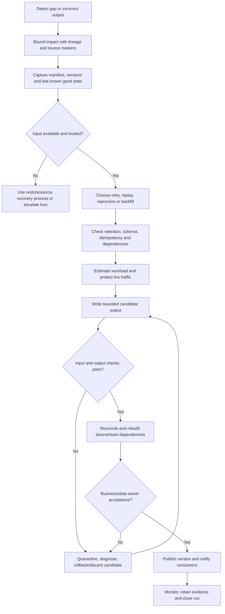

# Replay, Reprocessing and Backfill Architecture

> **Document status:** Learning material and architecture-design aid  
> **Roadmap position:** Stage 2D — Data Architecture, Module 12, Topic 06  
> **Target filename:** `06-replay-reprocessing-and-backfill-architecture.md`  
> **Scope discipline:** The module roadmap defines the topic's intent and dependencies. Scenarios, code, targets, data volumes and performance figures in this lesson are illustrative, not repository requirements or production test evidence. No production infrastructure or real outage is required to complete the exercises.

## Contents

1. [Position in the roadmap and learning outcomes](#1-position-in-the-roadmap-and-learning-outcomes)
2. [Core terminology and when to use each recovery method](#2-core-terminology-and-when-to-use-each-recovery-method)
3. [Why pipelines need replay and backfill](#3-why-pipelines-need-replay-and-backfill)
4. [Batch and streaming recovery mechanics](#4-batch-and-streaming-recovery-mechanics)
5. [Offsets, checkpoints, watermarks, ordering and retention](#5-offsets-checkpoints-watermarks-ordering-and-retention)
6. [Idempotency, deduplication and deterministic processing](#6-idempotency-deduplication-and-deterministic-processing)
7. [Delivery semantics and exactly-once boundaries](#7-delivery-semantics-and-exactly-once-boundaries)
8. [Transactions, checkpoints, partial writes and cross-system consistency](#8-transactions-checkpoints-partial-writes-and-cross-system-consistency)
9. [Destination strategy: in-place, staging and versioned outputs](#9-destination-strategy-in-place-staging-and-versioned-outputs)
10. [Planning bounded backfills](#10-planning-bounded-backfills)
11. [Capacity planning and protecting live workloads](#11-capacity-planning-and-protecting-live-workloads)
12. [Validation, reconciliation, lineage and publication](#12-validation-reconciliation-lineage-and-publication)
13. [Security, retention and deletion implications](#13-security-retention-and-deletion-implications)
14. [Worked calculations: backlog and catch-up duration](#14-worked-calculations-backlog-and-catch-up-duration)
15. [Eight-hour interruption: recovery plan](#15-eight-hour-interruption-recovery-plan)
16. [Multi-day historical correction](#16-multi-day-historical-correction)
17. [Advanced scenario: schema change, late events and partial writes](#17-advanced-scenario-schema-change-late-events-and-partial-writes)
18. [Replay/backfill workflow and example runbook](#18-replaybackfill-workflow-and-example-runbook)
19. [Code examples: idempotency and replay simulation](#19-code-examples-idempotency-and-replay-simulation)
20. [Recovery validation checklist and evidence](#20-recovery-validation-checklist-and-evidence)
21. [Exercises and expected deliverables](#21-exercises-and-expected-deliverables)
22. [Common mistakes and misconceptions](#22-common-mistakes-and-misconceptions)
23. [Glossary](#23-glossary)
24. [Completion gate and mastery criteria](#24-completion-gate-and-mastery-criteria)
25. [Relationship to adjacent roadmap topics](#25-relationship-to-adjacent-roadmap-topics)

---

## 1. Position in the roadmap and learning outcomes

### 1.1 Where this topic fits

The module roadmap recommends this sequence:

1. Reliability objectives, SLI, SLO and SLA.
2. Failure domains and blast radius.
3. High availability and redundancy.
4. Backup, restore and recovery validation.
5. RPO, RTO and disaster recovery strategies.
6. **Replay, reprocessing and backfill architecture — this lesson.**
7. Incident response, runbooks and postmortems.
8. Business continuity and resilience testing.

The roadmap says Topic 06 follows Topics 04–05 because a restored platform may still need to catch up or correct its data. The main prerequisite dependencies are:

- **Database/storage architecture:** replication, consistency, transaction boundaries, retention, archival and storage lifecycle.
- **Integration and interoperability:** idempotency, deduplication, reconciliation and failure handling.
- **Streaming:** CDC, event backbones, replay, late events, backpressure and stream failure modes.
- **Metadata/lineage/quality:** upstream-downstream impact analysis, observability and quality service levels.
- **Reliability and DR:** backup/restore, recovery points, RPO/RTO, failure domains and recovery dependencies.

The roadmap’s expected evidence for this topic is a **backfill plan with validation steps**. This lesson expands that into an architecture and operating method without asserting that the other lesson files contain additional requirements.

### 1.2 Learning outcomes

After completing this lesson, a learner should be able to:

1. Distinguish retry, replay, reprocessing, backfill, catch-up processing and restore.
2. Select an appropriate method for an outage, missed events, late data, logic defect or schema change.
3. Recover batch and streaming pipelines using explicit time ranges, offsets, checkpoints and dependency order.
4. Design idempotent processing and duplicate handling with defined business keys and transaction boundaries.
5. Explain at-most-once, at-least-once and exactly-once semantics without overstating guarantees.
6. Bound and schedule backfills without starving live workloads.
7. Handle event ordering, late arrival, watermark changes, partial writes and cross-system inconsistency.
8. Validate results with control totals, source reconciliation, quality checks and lineage.
9. Publish corrected data safely with versioning, rollback and consumer communication.
10. Produce a runbook, evidence package, estimate and completion decision.

### 1.3 What this lesson does not replace

- **Backup/restore** establishes which data and metadata can be recovered and from what point.
- **RPO/RTO strategy** defines tolerated data loss and recovery duration, and selects a strategy.
- **Replay/reprocessing/backfill** restores missing progress or corrects outputs after a valid recovery point has been chosen.
- **Incident response** governs people, authority, escalation and communications during an event.
- **Resilience testing** verifies the end-to-end plan and turns findings into improvements.

A replay job does not repair a missing backup, recover an expired event log, or automatically prove that an RPO/RTO target was met.

---

## 2. Core terminology and when to use each recovery method

### 2.1 Comparison table

| Method | Meaning | Input source | Typical trigger | Main safety question |
|---|---|---|---|---|
| **Retry** | Attempt the same failed operation again, usually for a transient error | The same request, batch or message | Timeout, temporary network failure, rate limit | Could the first attempt have committed before the timeout? |
| **Replay** | Read and process retained events or log records again from a defined position/range | Event log, CDC log, durable queue, journal | Consumer outage, recovery gap, new subscriber, corrected consumer | Are offsets, order, duplicates and sink writes controlled? |
| **Reprocessing** | Re-run transformation logic over previously captured or landed inputs | Raw/bronze data, retained events, source extracts | Transformation bug, rule change, code correction | Which code/config version and reference data should be applied? |
| **Backfill** | Populate missing or corrected historical time partitions, records or entities | Historical source, raw archive, replayable log, prior snapshot | Pipeline outage, new feed, missing dates, historical correction | Is the requested range complete, bounded and safe to publish? |
| **Catch-up processing** | Process accumulated backlog until current progress approaches the live head | Backlog plus ongoing arrivals | Outage ended; consumer is behind | Is processing faster than incoming traffic after accounting for bottlenecks? |
| **Restore** | Recover data/system state from backup, snapshot, log or replica | Protected recovery artifact | Data loss, corruption, deletion, infrastructure failure | Is the selected recovery point consistent, readable and trusted? |

These activities can be combined. For example, a region restore can be followed by replay of retained CDC events, then a backfill of derived tables, then catch-up until freshness is within target.

### 2.2 Why retry is not replay

Retry usually repeats a failed unit of work. Replay deliberately re-reads a known range from durable history. A timeout may occur after a sink committed but before the caller received the acknowledgment; retrying that operation can duplicate the effect unless it is idempotent or transactionally protected.

A replay plan also needs a bounded source range and a checkpoint policy. It is not simply “run the job again.”

### 2.3 Why reprocessing is not always backfill

Reprocessing focuses on **re-applying transformation logic** to existing inputs. Backfill focuses on **filling a historical gap or replacing a historical range**. A backfill may require reprocessing, but a source extraction backfill may simply reload records that never arrived. A logic correction may reprocess all raw data in a time range even though no source records were missing.

### 2.4 A practical decision guide

- **Transient failure, no confirmed commit:** retry with bounded attempts and backoff.
- **Consumer missed a retained event range:** replay from a verified offset.
- **Output is wrong because transformation logic was defective:** reprocess from trusted raw inputs with corrected, versioned logic.
- **A day of ingestion never happened:** backfill that date range from the source or durable archive.
- **A restored pipeline is behind current traffic:** replay and catch up, then validate.
- **The only copy is corrupt or unavailable:** use the backup/restore and DR process first; do not expect replay to recreate data that no longer exists.

### 2.5 Beginner exercise: identify the method

| Failure | Primary approach | Additional safeguards |
|---|---|---|
| A request times out; commit status is unknown | Retry only after checking commit semantics or using an idempotency key | Query operation status or use a unique transaction key |
| Stream consumer was stopped for 90 minutes; event log retains all offsets | Replay | Verify start/end offsets, consumer group and sink idempotency |
| A discount rule was wrong for the last four days | Reprocess affected raw inputs; publish a bounded backfill | Version logic, stage output, reconcile totals |
| Daily source extract for Tuesday was never delivered | Backfill Tuesday | Confirm source completeness and partition boundary |
| A pipeline is back online with 12 million queued events | Catch-up processing via replay | Capacity plan, throttle, lag monitoring |
| A table was deleted and no durable source or backup exists | Restore/recovery investigation; data may be unrecoverable | Escalate loss and document residual risk |

---

## 3. Why pipelines need replay and backfill

### 3.1 Common causes

1. **Pipeline outage:** scheduler, compute, network or credentials fail; inputs accumulate or are missed.
2. **Source outage:** the source is unavailable or fails to deliver a batch; the platform needs a later extraction.
3. **Missed events:** offsets are advanced incorrectly, a subscription is created late, or a consumer group is reset.
4. **Late-arriving data:** source events arrive after the expected processing window.
5. **Transformation defect:** a calculation, join, filter, currency conversion, timezone conversion or business rule is wrong.
6. **Schema change:** a field is renamed, type changes, an enum gains a value, or an event contract changes.
7. **Reference-data correction:** a dimension, mapping or master-data record is fixed and historical outputs need recalculation.
8. **Recovery after restore:** the chosen recovery point is valid but behind the required current state.
9. **Partial write:** a job wrote some partitions or tables before failing.
10. **New consumer or product:** retained raw data must be used to create a new dataset or historical feature set.

### 3.2 Diagnose before running recovery

First identify whether the problem is missing input, incorrect logic, incorrect state, partial output, or downstream freshness. These problems require different operations.

Ask:
- What is the earliest known bad or missing source position?
- What is the latest confirmed good output?
- Which source is authoritative?
- Is raw input immutable and complete?
- Does the event retention window cover the gap?
- Which transformations and reference-data versions produced the output?
- What downstream consumers read the affected range?
- Are any outputs already published or acted upon?
- Can the repair be done in an isolated destination?
- What is the accepted RPO/RTO or freshness objective for recovery?

Do not start by resetting all checkpoints. That may reprocess more data than necessary, skip records, duplicate side effects or destroy evidence of the last known good state.

### 3.3 Preserve a recovery manifest

Before recovery, capture a small manifest containing:
- incident/change ID and owner;
- affected source(s), datasets and consumers;
- start/end timestamps and their timezone;
- source offsets, partition IDs, batch IDs and checkpoints;
- last known good and first known bad output;
- transformation code/configuration version;
- schema and reference-data version;
- retention expiry date;
- output partitions and tables to replace;
- validation thresholds and rollback procedure.

This manifest is the reproducibility contract for the recovery run.

---

## 4. Batch and streaming recovery mechanics

### 4.1 Batch pipelines

Batch systems typically operate on bounded windows, files, partitions or extraction IDs. Safe recovery requires clear boundaries and a way to identify a complete batch.

Typical controls:
- stable batch/run ID;
- explicit inclusive/exclusive time boundaries;
- source extract completion marker or manifest;
- immutable raw landing;
- deterministic transformation version;
- output partition overwrite or staged publication semantics;
- row counts, control totals and quality checks;
- a checkpoint that advances only after the output commit is confirmed.

**Example:** A daily job processes `event_date=2026-10-19`. If it fails after writing three of five output tables, rerunning only the failed table may leave the overall data product inconsistent. The recovery unit may need to be the complete partition or a coordinated version of all five outputs.

### 4.2 Streaming pipelines

Streaming systems process continuous events, often from partitioned logs. Recovery needs:
- a durable source and retention long enough to cover outage plus recovery;
- a defined start offset per partition;
- a checkpoint representing committed progress;
- handling for records that are delivered more than once;
- ordering semantics within and across partitions;
- event-time and processing-time rules;
- a plan for late events and watermark state;
- capacity to drain the backlog while live traffic continues;
- a sink commit/checkpoint protocol.

A consumer group offset alone may not prove that a sink commit completed. If the checkpoint advances before the sink write is durable, records can be lost. If the sink commits and the checkpoint fails to advance, records may be replayed. The design must handle both sides of this boundary.

### 4.3 Hybrid pipeline

Many data products combine batch and streaming:
- a database CDC stream updates a raw event table;
- a micro-batch job transforms events;
- a lakehouse table stores results;
- a scheduled aggregation refreshes a semantic model.

Recovery should identify the correct unit at each stage. Replaying events into the raw layer may not refresh the aggregation if its watermark or partition manifest is unchanged. Rebuilding a semantic model before upstream recovery finishes may publish an inconsistent version.

### 4.4 Recovery after restore

After restoring to a selected point:
1. record the restored snapshot/version and log position;
2. verify data and metadata are consistent at that point;
3. identify durable events after the recovery marker;
4. replay missing events with idempotent sink handling;
5. recompute derived outputs in dependency order;
6. validate source-to-target reconciliation;
7. catch up to the live head;
8. resume consumers only after their acceptance criteria pass.

The restore point and replay start position must be coordinated. Starting replay before the restored point can duplicate records; starting after it can create a gap.

---

## 5. Offsets, checkpoints, watermarks, ordering and retention

### 5.1 Offset

An **offset** identifies a position in an ordered log partition. It is usually meaningful only within that topic/partition or log incarnation. Offsets are not globally comparable across partitions and are not necessarily timestamps.

For a partition with offsets 100–109:
- replaying from 100 may include all ten records if the end boundary is exclusive at 110;
- replaying from 110 starts after those records;
- replaying from 105 may intentionally re-read 105–109.

Always document whether start/end offsets are inclusive or exclusive and verify the broker or source API semantics. A recreated topic may have a new identity even if its visible name is unchanged.

### 5.2 Checkpoint

A **checkpoint** records progress and sometimes operator state needed to resume processing. Depending on the framework, it may include offsets, window state, watermark, timers, state-store snapshots and sink commit metadata.

A checkpoint is only safe if it corresponds to a coherent committed output state. It is unsafe to assume that “checkpoint saved” means all output writes are durable unless the sink integration and commit protocol establish that guarantee.

### 5.3 Watermark

A **watermark** is a system’s estimate or policy boundary for event-time completeness. It helps determine when a window can be finalized or when late events are considered too late for normal processing.

Watermarks do not mean that no earlier event can ever arrive. A late event may:
- update a still-open window;
- trigger a correction or retraction;
- be routed to a late-event side output;
- be dropped under an explicit policy;
- require a historical backfill if it arrives beyond the supported lateness window.

If a backfill resets or changes watermark state, it can alter window outputs and downstream aggregates. The recovery design must specify whether historical results are recomputed, merged or published as corrections.

### 5.4 Event time and processing time

- **Event time:** When the event is said to have occurred in the source/business domain.
- **Ingestion time:** When the platform received or persisted the event.
- **Processing time:** When computation processed it.

These timestamps answer different questions. An outage can produce a large delay between event time and processing time. Partitioning solely by ingestion date can miss business dates if late events belong to older event-time partitions. Define which timestamp controls extraction boundaries, partition assignment, deduplication windows and SLA/freshness metrics.

### 5.5 Event ordering

Ordering may be guaranteed only within a partition or key. If related events are split across partitions, a replay can interleave them differently from the original live run.

Controls include:
- partition by the entity or key whose order matters;
- use source sequence numbers or transaction log positions;
- apply version checks so older updates cannot overwrite newer state;
- detect gaps in sequence numbers;
- buffer or reconcile when cross-partition order is required;
- avoid assuming global ordering where the source does not provide it.

For a current-state table, “last event processed wins” is dangerous if replay order differs. Prefer a source version/sequence comparison or deterministic conflict policy.

### 5.6 Retention and the replay horizon

Replay is possible only while the required source material remains available. Retention must cover:
- expected detection delay;
- time to diagnose;
- recovery execution duration;
- retry/recovery margin;
- legal or operational hold requirements.

An illustrative retention equation is:

\[
\text{Required replay retention} \geq \text{detection delay} + \text{diagnosis delay} + \text{recovery duration} + \text{safety margin}
\]

If the event log retains 48 hours but an incident is detected after 36 hours and takes 18 hours to resolve, the recovery may run beyond the retention boundary. The team needs a protected archive or an alternate source. Retention should not be set from the normal outage duration alone.

### 5.7 Checkpoint reset policy

Do not reset checkpoints casually. Before resetting:
1. record current offsets and state;
2. determine whether sink writes for the range committed;
3. select the replay start point;
4. establish deduplication or overwrite behavior;
5. validate source retention and schema compatibility;
6. create a new recovery run ID;
7. ensure old and new workers cannot concurrently commit the same range without coordination.

---

## 6. Idempotency, deduplication and deterministic processing

### 6.1 Idempotency

An operation is **idempotent** when applying it repeatedly with the same logical input and relevant state produces the same final effect as applying it once.

For example, setting `account_balance = 100` from an authoritative versioned state can be idempotent. Incrementing `account_balance += 10` is not idempotent if the same event is applied twice.

Idempotency matters because retry and replay often deliver the same logical event more than once. It is not a promise that every side effect is automatically safe.

### 6.2 Common patterns

- **Stable event ID:** deduplicate by a source-generated immutable identifier.
- **Idempotency key:** assign a stable key to a logical operation and reject repeat effects.
- **Upsert/merge:** write the current state by a stable business key with a source-version condition.
- **Partition overwrite:** recompute a complete bounded partition and replace it atomically where the storage system supports it.
- **Transactional outbox/inbox:** coordinate event publication or record processed event IDs within a transaction boundary.
- **Unique constraint:** let the sink enforce uniqueness for the correct key.
- **Deduplication ledger:** record processed event IDs and commit them consistently with output state.

The correct pattern depends on whether the output is an append-only fact table, a current-state table, an aggregate, a payment-like side effect or a rebuildable derived dataset.

### 6.3 Deduplication key design

A deduplication key must represent the logical identity of an event. Common choices:
- source event ID;
- `(source_system, source_primary_key, source_version)`;
- `(entity_id, source_sequence_number)`;
- a documented composite business key.

Avoid using only a timestamp or a hash of noncanonical JSON. Timestamps can collide, precision may differ, and JSON field order/formatting can change. Hashes are useful only when canonicalization, null semantics and collision handling are defined.

### 6.4 Current-state upsert example

Assume each source event contains:
`customer_id`, `source_version`, `email`, `event_id`.

Rule:
- one current-state row per `customer_id`;
- accept an incoming event only if `source_version` is greater than the stored version;
- if the version is equal and payload is equal, treat it as a duplicate;
- if the version is equal but payload differs, quarantine as a conflict;
- if the version is lower, ignore it as stale replay.

This protects current state from older events being applied after newer ones. It does not replace source reconciliation, and it is not appropriate for every event model (for example, a fact ledger may need to retain every valid event).

### 6.5 Determinism

A transformation is deterministic when the same input, code, configuration and reference data produce the same output. Sources of nondeterminism include:
- current wall-clock time;
- random values;
- unordered iteration or unstable tie-breaking;
- mutable lookup tables;
- external API responses that change over time;
- timezone or locale defaults;
- floating-point order effects;
- non-versioned model artifacts.

For reproducible reprocessing, pin:
- transformation code/image version;
- schema version;
- configuration and feature flags;
- reference-data snapshot;
- timezone/calendar assumptions;
- model/artifact version;
- random seed where applicable;
- source range and input manifest.

If business logic intentionally depends on current reference data, document that the backfill is a restatement under current rules, not a reproduction of what was known historically.

### 6.6 Deduplication window caveat

A streaming deduplication state store may expire event IDs after a configured interval. If replay occurs outside that window, duplicates may no longer be recognized. Options include a durable sink-level uniqueness rule, an archived deduplication ledger, a bounded partition replacement, or a documented business rule that tolerates and reconciles duplicates.

---

## 7. Delivery semantics and exactly-once boundaries

### 7.1 At-most-once

An event is processed zero or one times by the defined processing boundary. The system may advance progress before a durable sink commit or may discard on failure. This avoids duplicate processing in that boundary but can lose records.

Use only where loss is explicitly acceptable or where another durable source can reconstruct the missing state.

### 7.2 At-least-once

The system retries until processing is acknowledged, so a record may be processed more than once. This is common and often robust, but duplicates must be safe.

At-least-once plus idempotent writes can produce an effectively-once final state for a particular sink operation, provided the idempotency key, transaction boundary and side effects are correctly implemented.

### 7.3 Exactly-once

“Exactly-once” must name its boundary:
- exactly-once state updates inside one transactional stream processor;
- exactly-once writes to a particular sink under a supported transaction protocol;
- or exactly-once business effect across source, processor, database, external API and downstream consumers.

The last is much harder. A framework feature cannot make an unrelated external API transactionally atomic unless the end-to-end design supports it.

To make a credible end-to-end claim, specify:
1. stable source identity and durable input;
2. deterministic processing or a controlled state model;
3. atomic relationship between checkpoint and output commit, or replay-safe sink behavior;
4. idempotent external side effects or an outbox/inbox protocol;
5. recovery behavior after a crash at every commit boundary;
6. deduplication state retention and recovery;
7. validation that no logical omissions or duplicate business effects occurred.

### 7.4 A failure-boundary table

| Failure point | Risk | Required control |
|---|---|---|
| Before sink write | Record likely retried | Durable input and retry policy |
| Sink committed, acknowledgment lost | Duplicate on retry | Idempotency key, upsert or transactional sink |
| Checkpoint advanced before sink commit | Lost output | Atomic commit protocol or sink-before-checkpoint ordering with safe retry |
| Sink committed, checkpoint not advanced | Replayed output | Idempotent write or transactional coordination |
| Output table updated, audit ledger not updated | State and evidence disagree | Commit them together or reconcile with a durable operation ID |
| External API side effect succeeds but response times out | Duplicate side effect on retry | API idempotency key or reconciliation workflow |
| Deduplication state expired before historical replay | Old event may be applied again | Durable ledger or bounded overwrite/rebuild |

### 7.5 Never infer correctness from delivery labels

A platform can advertise exactly-once processing for a specific transaction domain and still duplicate effects in an external database or omit records if source retention expires. Document the guarantee, its supported configuration, sink integration and failure assumptions. Then test the boundary relevant to the business outcome.

---

## 8. Transactions, checkpoints, partial writes and cross-system consistency

### 8.1 The partial-write problem

Suppose a job publishes:
- `orders_daily`;
- `payments_daily`;
- `customer_sales_daily`.

If the first two tables commit and the third fails, consumers may observe a mixed generation. Retrying only the third table may not repair inconsistent shared aggregates or audit totals.

A recovery unit should match the consistency requirement. That might be a partition, a set of tables, a transaction group, a data-product version or a publication manifest.

### 8.2 Safer write patterns

- **Atomic transaction:** appropriate when the sink supports a transaction spanning all required writes.
- **Partition overwrite:** recompute a bounded partition and atomically replace it if the storage system guarantees that behavior.
- **Staging then publish:** write a candidate version, validate it, then switch a pointer/manifest/alias.
- **Versioned table/output:** keep current and candidate generations, with an explicit active version.
- **Manifest-based publication:** consumers read only files/partitions listed in a committed manifest, not arbitrary files in a directory.
- **Saga/compensation:** for multi-system workflows that cannot use one transaction, define forward recovery and compensating actions; compensation is not always a true rollback.

Do not assume a rename, pointer swap or table transaction is atomic across all systems. Verify the actual storage/catalog/consumer semantics.

### 8.3 Checkpoint and sink coordination

A safe replay design must answer:
- When is an input considered processed?
- When is output considered committed?
- What happens if the process crashes between those moments?
- Can a recovered worker overlap with the original worker?
- How is the checkpoint tied to the output version?
- Can a checkpoint be restored independently of the sink state?
- How are partial output files or temporary partitions identified and cleaned?

A practical approach is to record a run ID, input range, code version and output generation. A generation is not publishable until all required writes and validations succeed.

### 8.4 Cross-system consistency

A database, event log, lakehouse, catalogue and semantic layer may each have their own version markers. Replaying one component does not automatically move all downstream components to the same logical state.

Use a recovery manifest containing:
- source transaction/CDC position;
- event partition offsets;
- raw landing manifest;
- transformation version;
- output table/partition generation;
- catalogue/schema version;
- downstream materialization version;
- validation status and publication timestamp.

Then reconcile across the boundaries that matter to the business. Do not compare timestamps alone when transaction markers, sequence IDs or table versions are available.

---

## 9. Destination strategy: in-place, staging and versioned outputs

### 9.1 In-place repair

Write corrected output directly into the live destination.

**Appropriate when:** the operation is naturally idempotent; the write scope is bounded; sink transactions or atomic partition replacement are available; consumer-visible partial state is acceptable or prevented.

**Risks:** readers see a mix of old and new results; partial retries overwrite good data; rollback may be hard; live and recovery jobs race.

### 9.2 Isolated staging

Write into a separate schema, table, path, topic or namespace. Validate before publication.

**Advantages:** isolates consumers from incomplete work, allows comparison to current output, supports repeatable validation and easier discard of a failed candidate.

**Costs/risks:** requires extra storage/compute, access policy management, consumer cutover and a defined retention policy for staged data.

### 9.3 Versioned outputs and publication pointer

Write a new immutable generation, e.g. `sales_v42`, and publish it through a controlled pointer/manifest/alias after validation.

Publication sequence:
1. allocate generation ID and run ID;
2. write all expected partitions/tables;
3. validate completeness and correctness;
4. record evidence;
5. atomically switch the consumer-visible pointer if supported;
6. monitor consumers;
7. retain the previous generation through a rollback window;
8. garbage-collect only after acceptance and retention checks.

If the pointer switch is not atomic across consumers, use a coordinated cutover or make each consumer version-aware.

### 9.4 Rollback versus roll-forward

- **Rollback:** return consumers to the last known good output generation.
- **Roll-forward:** correct the candidate and publish a new generation.
- **Compensation:** issue corrective business operations where a prior side effect cannot simply be undone.

A rollback of a table does not reverse a downstream email, payment, customer notification or external API call. Keep analytical publication and irreversible business side effects separate, or use explicit compensation/reconciliation workflows.

---

## 10. Planning bounded backfills

### 10.1 Define the scope before execution

A backfill plan must define:
- affected source systems and output datasets;
- exact start/end boundaries and timezone;
- event-time versus ingestion-time semantics;
- partition selection and any overlapping partitions;
- source completeness and retention;
- logic/schema/reference-data versions;
- expected row/byte counts or other baselines;
- dependencies and downstream impact;
- write/publish strategy;
- concurrency and rate limits;
- validation and rollback criteria.

Use half-open intervals where possible, e.g. `[2026-10-01T00:00:00Z, 2026-10-08T00:00:00Z)`, to avoid boundary duplication between adjacent windows. Confirm how the source system interprets the interval.

### 10.2 Partition selection

Backfill by the smallest complete unit that preserves correctness:
- source date partition;
- business date;
- entity range;
- source sequence range;
- CDC offset range;
- table snapshot/version;
- explicit list of missing batch IDs.

Do not partition by a convenient timestamp if business records can arrive late into earlier dates. If partition keys differ across layers, build a mapping from source event IDs/markers to affected target partitions.

### 10.3 Dependency order

A common order is:

1. validate source/raw input and schema;
2. recover dimensions/reference data required by facts;
3. reprocess base facts or event-derived state;
4. rebuild dependent aggregates/materialized views;
5. refresh semantic models/features;
6. publish downstream datasets;
7. run consumer acceptance checks.

This order is illustrative, not universal. A lineage graph and data contracts should define the real order. Some branches can run in parallel if they share no mutable dependencies and have independent capacity.

### 10.4 Bounded execution

Prefer small, restartable work units with:
- deterministic partition IDs;
- bounded concurrency;
- durable progress manifest;
- checkpoint per completed unit;
- idempotent writes;
- per-unit validation;
- retry policy and dead-letter/quarantine path;
- explicit pause/resume controls.

Avoid one enormous uncheckpointed job where a late failure forces a complete restart.

### 10.5 Safe concurrency

Two jobs should not concurrently publish the same output partition unless the sink explicitly supports that concurrency model. Use a lease/lock, orchestration-level exclusivity, generation-specific output, or a compare-and-swap publication step.

If backfill and live processing share a destination, decide whether to:
- pause live publication for the affected range;
- write backfill to staging and merge after catch-up;
- use versioned output and reconcile by source version;
- isolate partitions so live and backfill writes cannot conflict.

### 10.6 Estimate and track work

Estimate records, bytes, partitions, expected processing throughput, downstream rebuild cost and validation time. Track:
- completed units / total units;
- input records and bytes;
- output records and bytes;
- lag/backlog;
- retry/error count;
- duplicate/conflict count;
- quality failures;
- rate limit responses;
- live workload latency and freshness;
- remaining time and retention expiry.

An ETA based on the first minute of a backfill is fragile if the workload becomes I/O-bound, hits skew, or competes with live processing. Use a representative sample and update estimates as real progress arrives.

---

## 11. Capacity planning and protecting live workloads

### 11.1 Catch-up condition

Let:
- \(\lambda\) = incoming live event rate, events/s;
- \(\mu\) = effective processing rate during recovery, events/s;
- \(B_0\) = backlog at recovery start, events.

If \(\mu > \lambda\) and rates are stable, net drain rate is \(\mu-\lambda\), so:

\[
T_{\text{drain}} = \frac{B_0}{\mu-\lambda}
\]

If \(\mu \leq \lambda\), the backlog will not drain while live traffic continues at that rate. Increasing parallelism may help only until another bottleneck—source throughput, partition count, sink capacity, network, locks or rate limits—dominates.

### 11.2 Workload protection controls

- reserve a minimum compute/storage/network budget for live processing;
- cap backfill concurrency and parallel partitions;
- throttle at the source and/or consumer;
- use queue depth, lag, error rate and freshness to pause/resume;
- prioritize critical partitions and consumers;
- use separate compute pools or workload classes where possible;
- limit expensive joins and full scans;
- stagger downstream refreshes;
- respect source API and database rate limits;
- apply exponential backoff with jitter for throttled requests;
- use circuit breakers for persistent dependency failure;
- stop automatic retries when they amplify an outage.

### 11.3 Backpressure

Backpressure is a mechanism by which downstream congestion slows upstream production or consumption. It protects components from overload but can increase lag. Recovery plans should set thresholds and behavior:
- warning threshold: reduce backfill concurrency;
- critical threshold: pause backfill or shed noncritical work;
- recovery threshold: resume gradually after metrics stabilize.

The values are service-specific. Avoid thresholds that oscillate every minute; use hysteresis, cooldown periods or a stable controller.

### 11.4 Rate limits and fairness

A backfill may use the same source database or API as production traffic. If it exhausts connections or request quota, the recovery can create a second outage. Agree with the source owner on a rate budget, time window and stop condition. Track the impact on live query latency, transaction throughput and freshness.

### 11.5 Operational isolation

Separate compute is helpful but not sufficient. Backfill and live workloads may still share:
- source database;
- object storage request quotas;
- catalog/metastore;
- network egress;
- credentials;
- table locks;
- orchestration control plane;
- downstream consumer capacity.

The workload design should explicitly map these shared resources and define protective limits.

---

## 12. Validation, reconciliation, lineage and publication

### 12.1 Validation layers

1. **Input completeness:** all expected files, source partitions, offsets or batch IDs are present.
2. **Schema/contract:** types, required fields, enum values, nullability and compatibility meet the expected contract.
3. **Structural integrity:** row counts, uniqueness, keys, referential integrity and partition coverage.
4. **Business invariants:** totals, balances, quantity constraints, state transitions and domain rules.
5. **Reconciliation:** compare output with authoritative source totals, event IDs, sequence markers or control accounts.
6. **Freshness and event-time correctness:** ensure late events, windows and timestamps are handled as designed.
7. **Duplicate/omission checks:** identify repeated event IDs, missing sequence ranges and unexplained differences.
8. **Downstream correctness:** refresh and validate aggregates, features, semantic models and consumers.
9. **Security and policy:** verify access controls, masking, residency, deletion suppression and audit evidence.
10. **Publication readiness:** confirm all required checks pass before switching consumer-visible output.

### 12.2 Control totals

Control totals are summary checks that detect discrepancies. Examples:
- source row count versus landed row count;
- sum of transaction amounts by currency and business date;
- distinct event IDs;
- min/max source sequence;
- count of rejected/quarantined records;
- per-partition count and checksum;
- aggregate balance reconciled to a source ledger.

A matching total does not prove record-level correctness: missing and duplicated rows can offset. Combine totals with uniqueness, key-level reconciliation, sampled records and domain invariants.

### 12.3 Lineage-based impact analysis

Before reprocessing, trace the affected dataset to:
- downstream tables and materialized views;
- dashboards, APIs and model features;
- extracts and partner deliveries;
- scheduled jobs;
- business processes and reports;
- consumers that cached or copied the old output.

Lineage helps answer “what must be recomputed?” and “who must be told?” It may be incomplete or stale, so validate it with dataset owners and runtime orchestration metadata.

### 12.4 Acceptance gates

Define pass/fail thresholds before execution. Example illustrative gates:
- all expected partitions exist;
- zero unexplained missing source IDs;
- zero unresolved duplicate business keys;
- amount totals reconcile within a documented tolerance;
- no schema contract violation;
- all critical downstream outputs have been refreshed;
- freshness meets the target or is explicitly marked degraded;
- no unauthorized access or residency violation;
- business/data owner signs off.

Do not relax thresholds after seeing a failed result without recording a reason, risk owner and approval.

### 12.5 Publication and consumer communication

A corrected dataset can change historical values. Communicate:
- affected dataset and time range;
- reason for correction;
- old and new version identifiers;
- whether numbers changed materially;
- downstream refresh requirements;
- freshness/recovery status;
- consumer action required;
- rollback/forward plan and owner.

For consumer-facing products, expose a version or publication timestamp where useful. Never imply that the new generation is authoritative before acceptance criteria pass.

---

## 13. Security, retention and deletion implications

### 13.1 Replay can reintroduce data that should no longer be present

Historical sources may contain records that were later deleted, masked, restricted or subject to a retention change. Replaying raw events can recreate those records in a downstream table if deletion/tombstone events or policy checks are omitted.

Controls:
- include deletion and tombstone events in the replay range;
- maintain an authoritative deletion/suppression ledger where required;
- reapply current policy filters during historical processing;
- ensure legal holds and access restrictions are represented correctly;
- check data residency before writing recovered outputs;
- validate masking/tokenization rules and encryption/key access;
- restrict staging outputs and clean up temporary artifacts after the approved retention period;
- audit who initiated the replay, what range was read, and which output generation was published.

### 13.2 Historical correctness versus historical policy

Sometimes a reprocessing run must reproduce the result that would have existed under old business rules. In other cases, the requirement is to restate history under current rules. These are different objectives.

For sensitive data, current legal deletion or access policy may override the desire to reproduce a historical dataset. The correct behavior must follow the applicable approved policy, not a default assumption that “reprocessing should be identical.”

### 13.3 Least privilege and separation of duties

Use scoped permissions for source reads, staging writes and publication. Where risk warrants, separate the person who initiates a backfill from the approver who publishes it. Protect logs and manifests because they may contain identifiers, source offsets or operational details.

---

## 14. Worked calculations: backlog and catch-up duration

All figures in this section are **illustrative assumptions**. Calculations describe a simplified steady-state model, not a performance guarantee.

### 14.1 Eight-hour outage backlog

Assume:
- incoming rate = 800 events/second;
- pipeline is unavailable for 8 hours;
- events are retained durably;
- all events during the outage are eligible for processing.

Convert outage to seconds:

\[
8\text{ hours}\times60\text{ min/hour}\times60\text{ s/min}=28{,}800\text{ s}
\]

Backlog:

\[
B_0=800\text{ events/s}\times28{,}800\text{ s}
=23{,}040{,}000\text{ events}
\]

So the initial backlog is **23.04 million events**.

### 14.2 Catch-up with ongoing arrivals

Assume the recovered consumer sustains 1,200 events/second while new traffic continues at 800 events/second.

Net drain rate:

\[
\mu-\lambda=1{,}200-800=400\text{ events/s}
\]

Drain time:

\[
T=\frac{23{,}040{,}000}{400}=57{,}600\text{ s}
\]

Convert to hours:

\[
57{,}600/3{,}600=16\text{ hours}
\]

Under these assumptions, it takes **16 hours** to remove the backlog while continuing to process live arrivals. Processing rate is 1.5 times the live arrival rate, but net spare capacity is only 400 events/s.

### 14.3 Catch-up at a higher rate

If effective processing rate can safely reach 2,000 events/s:

\[
\text{Net drain}=2{,}000-800=1{,}200\text{ events/s}
\]

\[
T=23{,}040{,}000/1{,}200=19{,}200\text{ s}
\]

\[
19{,}200/3{,}600=5.333\text{ h}=5\text{ h }20\text{ min}
\]

This is a 5 h 20 min idealized drain estimate, excluding startup, validation, retries, rate limits, skew and downstream bottlenecks.

### 14.4 What if processing equals live traffic?

If \(\mu=800\) events/s and \(\lambda=800\) events/s:

\[
\mu-\lambda=0
\]

The backlog does not drain. The service may appear healthy because it processes new events, but its lag remains constant. To recover freshness, capacity must exceed incoming traffic for long enough, incoming traffic must be reduced, or the workload must be handled with a different recovery plan.

### 14.5 Data volume estimate

Suppose the 23.04 million events average 1.5 KiB each at the relevant serialized representation. A rough raw payload estimate is:

\[
23{,}040{,}000\times1.5\text{ KiB}=34{,}560{,}000\text{ KiB}
\]

Using \(1\text{ GiB}=1{,}048{,}576\text{ KiB}\):

\[
34{,}560{,}000/1{,}048{,}576\approx32.96\text{ GiB}
\]

This excludes indexes, metadata, replication, compression effects, intermediate shuffle data and output expansion. The payload average must be measured, not guessed, for a production capacity plan.

### 14.6 RTO implications

A 16-hour backlog drain may be incompatible with a service's freshness target even if the platform becomes technically available quickly. The recovery plan should define:
- whether the RTO ends at service availability or at acceptable freshness;
- whether a safe degraded mode is allowed;
- which events/data products receive priority;
- how much temporary capacity is feasible;
- whether consumers can tolerate a labelled stale state;
- whether the replay source remains available for the entire catch-up period.

Connect this analysis to Topic 05’s RPO/RTO requirements, but keep the replay plan responsible for the concrete offsets, work units, idempotency and validation.

---

## 15. Eight-hour interruption: recovery plan

### 15.1 Scenario

A fictional retail order-events pipeline has been unavailable for eight hours. The durable event log contains the missing records. A downstream customer-order table and daily sales aggregate are stale. Live events continue arriving. The business requires the customer-order table to catch up within a target agreed by its owner; the example does not assume a universal deadline.

### 15.2 Pre-execution checks

1. Confirm source retention covers the outage, diagnosis and expected catch-up duration.
2. Capture consumer group offsets and last confirmed sink commit.
3. Identify the first missing source offset per partition.
4. Confirm the output table's last valid generation and any partial writes.
5. Verify schema compatibility for the full replay range.
6. Confirm stable event IDs and sink idempotency/merge behavior.
7. Estimate backlog and catch-up capacity using measured rates.
8. Identify dependent aggregates and dashboards through lineage.
9. Reserve capacity for live traffic and define pause thresholds.
10. Define reconciliation thresholds, rollback generation and owner approval.

### 15.3 Execution sequence

1. Restore/repair the consumer and its dependencies.
2. Keep consumer-visible output on the last known good version if partial output is possible.
3. Start replay at the verified offset for each partition.
4. Use bounded concurrency; monitor lag, throughput, sink latency, duplicates and live freshness.
5. Write to an isolated generation or use a proven idempotent sink transaction.
6. Reconcile processed offsets with output commit markers.
7. Once replay has caught up, run source-to-target control totals and duplicate/omission checks.
8. Rebuild dependent daily aggregates only after the base table passes validation.
9. Publish the new generation and notify consumers.
10. Monitor post-publication freshness, error rates and business invariants.

### 15.4 Success conditions

- All required source offsets have been processed or explicitly quarantined with owner approval.
- No unexplained gaps or duplicate business effects remain.
- Base table and aggregates are internally consistent.
- Live processing remains within its protection thresholds.
- Freshness meets the target or is clearly declared degraded.
- The new generation is published only after acceptance.
- Evidence includes offsets, run IDs, code/schema versions, counts, reconciliation and owner sign-off.

### 15.5 If replay cannot catch up

If the measured effective rate is not greater than arrivals, do not continue indefinitely while claiming recovery. Options:
- temporarily increase safe processing capacity;
- pause noncritical consumers or derived refreshes;
- prioritize business-critical event classes;
- reduce source load through a negotiated throttle;
- run bounded batch backfill from an alternate archive;
- keep a clearly labelled degraded mode;
- escalate if the agreed RTO/freshness target is no longer feasible.

---

## 16. Multi-day historical correction

### 16.1 Scenario

A fictional pricing transformation incorrectly applied a discount rule for five days. Raw events are retained and trusted; the source data are complete. The target is a daily sales fact table and a customer-level aggregate. The old outputs have already been consumed by dashboards and exports.

This is primarily **reprocessing**, executed as a bounded **backfill** over the affected five-day range. It is not a restore unless the underlying stored data also need recovery.

### 16.2 Plan

1. **Stop further propagation:** fix or disable the defective transformation so live output does not continue to be wrong.
2. **Identify the affected range:** use lineage, deployment history, code/config versions and business-date semantics to identify all affected partitions.
3. **Define the correction:** document the old rule, new rule, expected business effect and owner approval.
4. **Freeze inputs:** select the authoritative raw data snapshot/event range and reference-data version.
5. **Create a new generation:** do not overwrite the live table until the candidate output passes validation.
6. **Bound work:** process one business-date partition at a time with deterministic run IDs and resumable checkpoints.
7. **Recompute dependencies:** rebuild customer aggregates after base facts are complete and validated.
8. **Compare old and new:** compute changed row counts, totals by currency/date, affected customer count and distribution shifts.
9. **Validate business invariants:** reconcile to source totals and verify no unrelated dates changed.
10. **Publish:** switch the active version only after data owner approval.
11. **Communicate:** tell dashboard/export owners which dates changed and whether downstream copies need refresh.
12. **Retain rollback evidence:** keep old version according to policy and delete staging outputs when permitted.

### 16.3 Why versioning matters

If a multi-day backfill overwrites production one partition at a time, consumers can see a mix of old-rule and new-rule dates. If the product requires a coherent historical view, publish the entire corrected generation or use a consumer-visible version marker that prevents mixing. Where the platform cannot atomically publish the full range, document the partial-publication window and secure explicit business acceptance.

### 16.4 Expected deliverable

A backfill plan should include:
- affected dates and partition mapping;
- root cause and corrected code/config version;
- source/reference data version;
- dependency order;
- capacity and live-workload plan;
- staging/publication design;
- reconciliation and acceptance criteria;
- rollback plan;
- consumer communication;
- evidence and post-run review.

---

## 17. Advanced scenario: schema change, late events and partial writes

### 17.1 Incident details

A fictional event producer changes `amount` from an integer number of minor units to a decimal major-unit amount, and adds `currency`. During rollout:
- some events use the old schema and some use the new schema;
- a consumer fails on the new field type;
- the consumer checkpoint stops advancing on two partitions;
- a sink commits a subset of records before the process crashes;
- events continue arriving and some late events belong to prior business dates;
- a downstream daily aggregate has already refreshed;
- the raw event retention window is finite.

### 17.2 Risks

1. Replaying all events with one schema assumption can multiply amounts by 100 or divide them incorrectly.
2. Resetting the checkpoint to the latest position can skip unprocessed events.
3. Replaying from the last checkpoint can repeat records already committed to the sink.
4. Processing late events by ingestion date can update the wrong business-day partition.
5. Updating base facts but not the daily aggregate leaves a mixed state.
6. A partial output commit may make the table appear complete when it is not.
7. Old and new producers may assign different semantics to the same field name.
8. A watermark or deduplication state reset may change late-event and duplicate behavior.
9. Retention expiry may remove the earliest records before recovery completes.

### 17.3 Recovery method

- Freeze schema/producer contract assumptions and capture versions.
- Define a normalization function that maps both event versions into a canonical representation.
- Record raw input unchanged and retain original schema version.
- Identify the last committed output range for each partition, not just the last checkpoint.
- Use stable event IDs and a sink-side idempotency or versioned staging design.
- Replay a small sample range first and verify amounts, currency and business dates.
- Replay the bounded affected offset range; quarantine unknown schema versions.
- Handle late events using event-time partition mapping and an explicit lateness policy.
- Rebuild daily aggregates only after the base facts pass reconciliation.
- Publish the candidate generation after validation and communicate changed historical values.
- Verify source retention covers the complete replay and retry window.

### 17.4 Canonical schema example

Illustrative input versions:

```json
{"schema_version": 1, "event_id": "e-101", "amount_minor": 1250, "currency": "USD"}
{"schema_version": 2, "event_id": "e-102", "amount": "12.50", "currency": "USD"}
```

A canonical representation might be:

```json
{"event_id": "e-101", "amount_minor": 1250, "currency": "USD"}
{"event_id": "e-102", "amount_minor": 1250, "currency": "USD"}
```

This conversion is valid only if the schema contract explicitly states the currency precision and decimal parsing rules. Do not infer currency minor units from the field name alone; currencies and business domains can have different precision requirements. Invalid values should be quarantined with an observable reason, not silently rounded.

### 17.5 Decision gates

- **Gate A — input validity:** all supported schema versions are recognized; unknown versions are quarantined.
- **Gate B — sink safety:** partial writes and duplicate delivery are handled deterministically.
- **Gate C — base data correctness:** event IDs, amounts, currencies and business dates reconcile.
- **Gate D — dependent correctness:** aggregates and downstream views match the corrected base generation.
- **Gate E — publication:** owners approve the candidate and consumers are notified.

If a gate fails, do not advance to the next gate simply to meet a schedule. Record the failure, preserve evidence and return to the relevant repair step.

---

## 18. Replay/backfill workflow and example runbook

### 18.1 Workflow



### 18.2 Runbook template

**Run ID:**  
**Incident/change ID:**  
**Service/data product:**  
**Owner/operator:**  
**Approver:**  
**Start time / timezone:**  
**Target completion / RTO or freshness objective:**  
**Affected source(s), tables, partitions and consumers:**  
**Recovery method:** retry / replay / reprocessing / backfill / combination  
**Input range:**  
**Source offsets/checkpoints/batch IDs:**  
**Last known good output version:**  
**Code/schema/config/reference-data versions:**  
**Retention expiry:**  
**Output generation/staging location:**  
**Expected input and output counts/totals:**  
**Live workload protection thresholds:**  
**Acceptance criteria:**  
**Rollback/abort condition:**  

#### Preflight
- [ ] Confirm source completeness and trust.
- [ ] Verify retention covers the entire run and retry window.
- [ ] Capture offsets, checkpoints, manifests and last known good output.
- [ ] Verify schema compatibility and code/config versions.
- [ ] Confirm idempotency, deduplication and sink commit behavior.
- [ ] Map dependencies and consumers.
- [ ] Estimate duration and capacity.
- [ ] Confirm access, residency, deletion and retention controls.
- [ ] Approve the scope and publication plan.

#### Execute
- [ ] Create a unique run/generation ID.
- [ ] Execute a small sample or first partition.
- [ ] Validate sample output and event ordering.
- [ ] Start bounded processing at the approved range.
- [ ] Monitor lag, rate, errors, duplicates, conflicts and live impact.
- [ ] Record completed units and durable progress.
- [ ] Pause on stop conditions; do not silently skip failed units.
- [ ] Reconcile output to input/source markers.

#### Validate and publish
- [ ] Verify partition/range completeness.
- [ ] Run uniqueness, referential integrity and business-invariant checks.
- [ ] Reconcile control totals and source event IDs.
- [ ] Rebuild dependent outputs in lineage order.
- [ ] Verify freshness and consumer readiness.
- [ ] Obtain required data/business approval.
- [ ] Publish the candidate version.
- [ ] Notify downstream consumers and monitor post-publication signals.

#### Close
- [ ] Record actual duration, throughput, backlog and resource use.
- [ ] Record unresolved rejects, gaps, duplicates and accepted exceptions.
- [ ] Confirm rollback generation remains available as required.
- [ ] Clean up staging artifacts according to policy.
- [ ] Update runbook/lineage/retention assumptions if needed.
- [ ] Link evidence and assign follow-up actions.

### 18.3 Stop conditions

Stop or pause if:
- source retention is about to expire before the gap is recovered;
- the event range or schema version is ambiguous;
- duplicate/conflict rate exceeds the approved threshold;
- live service latency/freshness crosses a critical threshold;
- source rate limits or production database health degrade;
- partial output cannot be isolated or rolled back;
- validation fails or control totals diverge;
- a deletion/residency/access control is violated;
- the run is about to publish an unapproved candidate.

---

## 19. Code examples: idempotency and replay simulation

The following examples use **Python 3.10+ standard library only**. No external packages or production infrastructure are required. They are small instructional simulations, not connectors to a real message broker or database. The code is presented for careful review; it has **not been executed in this lesson**. Output shown is derived by manual tracing of the small input examples, not by a claimed runtime test.

### 19.1 Example A — Idempotent current-state update

**Input model:** each event has an immutable `event_id`, a `customer_id`, a monotonically increasing `source_version`, and a payload. The sink stores one current row per customer.

**Rule:** apply a higher version; ignore an exact duplicate; ignore an older version; quarantine a conflicting payload at the same version.

```python
from dataclasses import dataclass
from typing import Dict, List, Tuple

@dataclass(frozen=True)
class CustomerEvent:
    event_id: str
    customer_id: str
    source_version: int
    email: str

def apply_events(
    current: Dict[str, CustomerEvent],
    events: List[CustomerEvent],
) -> Tuple[Dict[str, CustomerEvent], List[str]]:
    """Return a new current-state map and a list of conflicts."""
    state = dict(current)
    conflicts: List[str] = []

    for event in events:
        existing = state.get(event.customer_id)

        if existing is None:
            state[event.customer_id] = event
            continue

        if event.source_version > existing.source_version:
            state[event.customer_id] = event
        elif event.source_version < existing.source_version:
            # Stale replay: do not overwrite newer state.
            continue
        elif event.event_id == existing.event_id and event.email == existing.email:
            # Exact repeat: no state change.
            continue
        elif event.email == existing.email:
            # Same version and same business value: semantically equivalent.
            continue
        else:
            # Same version but conflicting payload: do not guess.
            conflicts.append(
                f"conflict:{event.customer_id}:version={event.source_version}"
            )

    return state, conflicts


events = [
    CustomerEvent("e-1", "C-7", 1, "old@example.com"),
    CustomerEvent("e-2", "C-7", 2, "new@example.com"),
    CustomerEvent("e-2", "C-7", 2, "new@example.com"),  # duplicate
    CustomerEvent("e-1", "C-7", 1, "old@example.com"),  # stale replay
]

state, conflicts = apply_events({}, events)
print(state["C-7"].email, state["C-7"].source_version, conflicts)
```

**Expected output from manual tracing:**

```text
new@example.com 2 []
```

**Why it is idempotent for this model:** applying the same `events` list again leaves the final customer row at version 2 with `new@example.com`. The repeated event and stale version do not overwrite it.

**Important limitations and edge cases:**
- This is an in-memory model, not a durable transaction. A process crash after a real sink write but before a checkpoint still needs sink/checkpoint coordination.
- The code assumes `source_version` is monotonic and comparable for one customer.
- It does not maintain a permanent ledger of every processed `event_id`; it models current state, not an immutable event ledger.
- A same-version event with a different `event_id` but the same email is accepted as semantically equivalent. A real system may instead require a stricter source-version/event-ID rule.
- Events with `None`, malformed versions or invalid email values are not validated here. Production code should validate schema and quarantine invalid records.
- Concurrent writers require database constraints, transactions or compare-and-swap semantics; a local dictionary does not prove concurrency safety.
- The `current` map is not mutated by this function because it creates a shallow copy. `CustomerEvent` is frozen, so the sample values are immutable.

### 19.2 Example B — Bounded replay with duplicate event IDs

This simplified example processes a bounded list of events into a sink that deduplicates by event ID.

```python
from typing import Dict, Iterable

def replay_once(
    events: Iterable[dict],
    sink: Dict[str, dict],
) -> int:
    """Insert unseen event IDs; return count of newly applied events."""
    applied = 0
    for event in events:
        event_id = event["event_id"]
        if event_id in sink:
            # A repeat delivery does not apply a second business effect.
            continue
        sink[event_id] = dict(event)
        applied += 1
    return applied


source_range = [
    {"event_id": "evt-100", "order_id": "O-1", "amount": 20},
    {"event_id": "evt-101", "order_id": "O-2", "amount": 30},
    {"event_id": "evt-100", "order_id": "O-1", "amount": 20},  # duplicate
]

sink = {}
first_count = replay_once(source_range, sink)
second_count = replay_once(source_range, sink)

print(first_count, second_count, len(sink))
```

**Expected output from manual tracing:**

```text
2 0 2
```

First execution inserts `evt-100` and `evt-101`; the duplicate `evt-100` is skipped. Second execution inserts nothing because both IDs already exist.

**State changes and failure behavior:**
- The sink dictionary is mutated as each new event is applied.
- Repeated execution is safe for this insert-only demonstration.
- If the process crashes after one insert, rerunning the same range skips that ID and continues with the remaining records.
- In a real database, the uniqueness constraint on `event_id` must be durable and concurrent-safe; a read-then-insert without a unique constraint can race.
- If an event ID is reused with a different payload, this code silently skips it. Production code should detect payload mismatch and quarantine the conflict.
- This approach is not suitable for corrected payloads unless an explicit version/replace policy exists.
- Event ordering is not addressed; a current-state table may need source-version comparison rather than first-seen wins.
- This example does not demonstrate atomicity between sink commit and source checkpoint.

### 19.3 Example C — Safe interval boundaries

Use half-open intervals to prevent overlap between adjacent backfill windows. The following pseudocode assumes UTC timestamps and an event-time field already normalized to timezone-aware UTC.

```python
def in_window(event_time, start, end):
    # Half-open interval: start <= event_time < end
    return start <= event_time < end
```

For adjacent windows `[00:00, 01:00)` and `[01:00, 02:00)`, an event exactly at 01:00 belongs only to the second window. Before using this in production, normalize all timestamps to the same timezone and precision. Naive timestamps, daylight-saving transitions and source-specific inclusive end semantics can invalidate a boundary assumption.

### 19.4 What these examples do not prove

They do not prove end-to-end exactly-once behavior, transaction coordination, source retention, ordering across partitions, high concurrency safety, external side-effect safety or production throughput. They illustrate the logic that must be supported by durable sink guarantees, source markers and recovery tests.

---

## 20. Recovery validation checklist and evidence

### 20.1 Before recovery

- [ ] Incident/change scope and owner are documented.
- [ ] The last known good and first known bad points are identified.
- [ ] Source data are complete, trusted and retained for the planned range.
- [ ] Offset/checkpoint semantics and boundary inclusivity are explicit.
- [ ] Code, schema, configuration and reference-data versions are pinned.
- [ ] Replay/reprocessing/backfill method is justified.
- [ ] Idempotency and duplicate/conflict policy are documented.
- [ ] Partial writes and concurrent-run risks are addressed.
- [ ] Downstream dependencies and consumers are mapped.
- [ ] RTO/freshness target and live-workload protection limits are known.
- [ ] Security, deletion, residency and retention controls are checked.
- [ ] Validation and rollback criteria are approved before execution.

### 20.2 During recovery

- [ ] A unique run ID and output generation are used.
- [ ] Progress is durable at the chosen work-unit boundary.
- [ ] Input offsets/batch IDs and output commits are recorded.
- [ ] Lag, throughput, errors, retries and duplicates are monitored.
- [ ] Live workload latency/freshness remains within protective limits.
- [ ] Failed/unknown-schema records are quarantined with a reason.
- [ ] Checkpoints are advanced only according to the sink commit protocol.
- [ ] Partial output cannot be mistaken for a complete publication.
- [ ] The run can pause and resume without corrupting progress.

### 20.3 After recovery

- [ ] All expected partitions, batches or offsets are accounted for.
- [ ] Input and output counts/control totals reconcile.
- [ ] Duplicate and missing-event checks pass or exceptions are approved.
- [ ] Business invariants and referential integrity pass.
- [ ] Late events and event-time partition mapping are checked.
- [ ] Downstream aggregates and consumers are rebuilt in dependency order.
- [ ] Freshness meets the target or degraded status is explicit.
- [ ] Candidate output is published only after acceptance.
- [ ] Consumer owners are notified of material historical changes.
- [ ] Rollback generation and evidence are retained according to policy.
- [ ] Temporary data are disposed of according to retention/deletion rules.
- [ ] Actual duration, throughput and gaps are documented honestly.

### 20.4 Minimum evidence package

- Recovery manifest and runbook version.
- Input source range, offsets, checkpoint and batch IDs.
- Code/schema/config/reference-data versions.
- Start/end timestamps and per-stage durations.
- Input/output counts, bytes and control totals.
- Duplicate, conflict, quarantine and omission results.
- Quality and business-invariant report.
- Lineage impact list and consumer notifications.
- Publication version and rollback reference.
- Approvals, exceptions, residual risks and follow-up actions.

---

## 21. Exercises and expected deliverables

The exercises are recommended learning activities aligned to the module roadmap. They do not require a real outage, production access or a real message broker.

### Exercise 1 — Beginner: choose the recovery method

Classify six failures using retry, replay, reprocessing, backfill, catch-up and/or restore. Explain why the chosen method fits and name the most important safety check.

**Deliverable:** Failure-to-method table.  
**Validation:** You distinguish missing input from incorrect transformation and do not use retry as a substitute for bounded replay.

### Exercise 2 — Intermediate: plan an eight-hour interruption

Use the Section 15 scenario. Calculate backlog for an incoming rate of 800 events/s, choose a catch-up rate, estimate drain time, map downstream dependencies, and specify validation and rollback gates.

**Deliverable:** Backfill/replay plan with calculation, offsets, owners and acceptance criteria.  
**Validation:** Calculation includes live arrivals; the plan does not publish before reconciliation.

### Exercise 3 — Historical logic correction

Use the five-day discount-rule scenario. Define affected partitions, code/reference-data versions, staging strategy, dependency order, reconciliation metrics and consumer communication.

**Deliverable:** Versioned historical correction plan.  
**Validation:** It avoids mixed old/new generations unless the business explicitly accepts partial publication.

### Exercise 4 — Idempotency and deduplication

Choose an event schema and a sink model. Define the logical idempotency key, duplicate policy, stale-version policy, same-version conflict behavior, retention of deduplication state and transaction boundary.

**Deliverable:** Pseudocode or schema plus failure-boundary table.  
**Validation:** Repeated input produces the intended final state, and the design covers a sink commit followed by a lost acknowledgment.

### Exercise 5 — Checkpoint and partial-write analysis

A batch job writes three tables. Two commit, the process crashes, and the checkpoint is not updated. Describe the possible failure modes and select a safe recovery unit.

**Deliverable:** Commit timeline, chosen recovery method and publication strategy.  
**Validation:** The plan does not assume the checkpoint alone proves output state.

### Exercise 6 — Late events and watermark

Events arrive after the expected event-time window. Define the policy for events within the lateness allowance and beyond it. Explain which partitions and aggregates must be recomputed.

**Deliverable:** Event-time policy and lineage-based impact list.  
**Validation:** Event time is not confused with ingestion time, and late data are not silently dropped.

### Exercise 7 — Capacity and live-workload protection

Use:
- backlog = 18,000,000 events;
- live arrivals = 600 events/s;
- candidate recovery throughput = 1,500 events/s.

Calculate net drain rate and drain time. Then explain why the estimate may fail under skew, retries, source rate limits or sink contention.

**Worked answer:**
- Net drain = \(1{,}500-600=900\) events/s.
- Drain time = \(18{,}000{,}000/900=20{,}000\) seconds.
- Hours = \(20{,}000/3{,}600\approx5.5556\) hours = 5 h 33 min 20 s.
- This is an idealized steady-state estimate, not a guaranteed ETA.

### Exercise 8 — Advanced schema migration

Use Section 17. Design a canonical schema adapter, quarantine behavior, offset recovery, partial-write handling, base-table validation and aggregate rebuild.

**Deliverable:** Recovery workflow, data contract mapping and acceptance gates.  
**Validation:** Both schema versions have explicit semantics; unknown versions are not silently coerced.

### Exercise 9 — Code review

Review the code examples in Section 19. Identify what is idempotent, which assumptions are hidden, and what would be required to move the logic into a concurrent transactional sink.

**Deliverable:** Code-review findings and production-hardening plan.  
**Validation:** Do not claim the snippets prove exactly-once or production concurrency safety.

### Exercise 10 — Retention and deletion

Assume an event log retains 48 hours, diagnosis takes 18 hours, recovery is expected to take 20 hours and a 12-hour safety margin is desired. Calculate required replay retention and decide whether 48 hours is sufficient.

**Worked answer:**
- Required retention = \(18+20+12=50\) hours, excluding any additional detection delay.
- 48 hours is 2 hours short under these assumptions.
- The plan needs a protected archive/alternate source, shorter recovery time, faster detection/diagnosis, or an explicitly accepted risk. Do not assume retention can be extended retroactively.

### Exercise 11 — Publication and rollback

Design a versioned-output publication plan for a backfill that changes five days of financial metrics and has three downstream consumers.

**Deliverable:** Candidate generation, validation gates, consumer cutover, rollback and communications plan.  
**Validation:** A table rollback is not treated as reversing already delivered external reports or side effects.

---

## 22. Common mistakes and misconceptions

| Mistake | Why it fails | Correct approach |
|---|---|---|
| Treating retry, replay, reprocessing and backfill as synonyms | Each has different source, scope and failure semantics | Choose the method based on the diagnosed gap |
| Resetting all checkpoints immediately | Can skip data, duplicate output or lose diagnostic evidence | Capture state and select a bounded start position |
| Assuming a checkpoint means sink commit | Output and checkpoint may be separate transactions | Define and test the commit boundary |
| Claiming exactly-once from a framework label | External sinks and side effects may not share the transaction | State guarantee boundary and sink protocol |
| Deduplicating only by timestamp | Collisions, precision and event-time semantics make identity ambiguous | Use stable source/business identity and version policy |
| Applying old events after newer events | Current state can regress | Compare source versions/sequence markers |
| Reprocessing with current mutable reference data accidentally | Results may not be reproducible or match the intended correction | Pin reference data or explicitly choose restatement semantics |
| Using ingestion date for every backfill | Late events may belong to earlier business dates | Define event-time and partition mapping |
| Replaying after dedup state expires | Old duplicates may reapply | Use durable ledger, idempotent sink or partition rebuild |
| Writing directly to production during a long backfill | Consumers may observe mixed generations | Stage, version or atomically replace bounded output |
| Running replay at maximum possible concurrency | Can starve live traffic or overload sources/sinks | Budget capacity, throttle and monitor |
| Assuming backlog drains when processing is healthy | If throughput ≤ arrival rate, backlog remains | Calculate net drain rate |
| Ignoring source retention | Required events may expire mid-recovery | Include detection, diagnosis, execution and safety margin |
| Rebuilding only the base table | Aggregates/features/dashboards remain stale | Follow lineage and rebuild dependencies |
| Treating matching row counts as proof | Missing and duplicate rows can cancel out | Combine totals with key, sequence and business checks |
| Silently skipping invalid schema versions | Creates unreported data loss | Quarantine, alert and define a resolution path |
| Forgetting deletion/tombstone policy | Replay can resurrect deleted or restricted records | Reapply authoritative suppression and policy controls |
| Assuming rollback reverses external effects | Emails, payments, exports and cached copies may persist | Define compensation/reconciliation and consumer communication |
| Claiming estimated throughput is measured | Overstates confidence and can breach RTO | Label assumptions and validate representative workloads |
| Publishing before acceptance | Incomplete or incorrect data becomes consumer-visible | Use explicit gates and owner approval |

---

## 23. Glossary

| Term | Definition |
|---|---|
| **Backfill** | Populate missing or corrected historical data for a bounded range |
| **Backpressure** | Mechanism that slows upstream work when downstream capacity is constrained |
| **Catch-up processing** | Process accumulated backlog while progressing toward the live source head |
| **Checkpoint** | Saved processing progress and/or state used for recovery |
| **Control total** | Summary measure used to reconcile input and output, such as counts or monetary totals |
| **Deduplication** | Detect and suppress repeated logical records/events under a defined identity rule |
| **Deterministic transformation** | Same pinned inputs and logic produce the same output |
| **Event time** | Time an event represents in the business/source domain |
| **Ingestion time** | Time the platform receives or persists the event |
| **Idempotency** | Repeating an operation does not change its final effect beyond the first successful application |
| **Late event** | Event arriving after the expected event-time processing window |
| **Offset** | Position in a partitioned log or stream |
| **Replay** | Re-read and process retained events/log records from a defined range |
| **Reprocessing** | Re-run transformation logic on previously captured inputs |
| **Retry** | Attempt a failed operation again |
| **Restore** | Recover a data/system state from a backup, snapshot, log or replica |
| **Watermark** | Event-time progress/completeness estimate used to manage windows and late data |
| **At-least-once** | Processing can repeat records but aims not to omit them within the defined guarantee |
| **At-most-once** | Processing applies a record zero or one times; loss may occur |
| **Exactly-once** | A guarantee scoped to a defined processing/output boundary; end-to-end business effect needs additional guarantees |
| **Staging output** | Candidate data written separately from the consumer-visible version |
| **Publication generation** | Version of a dataset that passes acceptance and is exposed to consumers |
| **Reconciliation** | Compare source and target using identifiers, totals, sequence markers or business invariants |
| **Recovery manifest** | Record of ranges, versions, markers, outputs and validation for a recovery run |

---

## 24. Completion gate and mastery criteria

### 24.1 Completion checklist

- [ ] I can distinguish retry, replay, reprocessing, backfill, catch-up and restore.
- [ ] I can diagnose whether a failure is missing input, wrong logic, partial output or a stale downstream product.
- [ ] I can define bounded source ranges with correct timestamp/offset semantics.
- [ ] I understand checkpoint and sink commit boundaries.
- [ ] I can design idempotent handling and explain the deduplication key.
- [ ] I can explain at-most-once, at-least-once and exactly-once with the correct scope.
- [ ] I have a policy for event ordering, late data and watermarks.
- [ ] I can estimate backlog and catch-up duration including live arrivals.
- [ ] I have a plan to protect live workloads during recovery.
- [ ] I have selected in-place, staging or versioned publication and defined rollback.
- [ ] I have mapped downstream dependencies using lineage.
- [ ] I have validation, reconciliation and owner acceptance criteria.
- [ ] I have considered retention, deletion, sensitive data and access controls.
- [ ] I have a runbook and a recoverable progress manifest.
- [ ] I distinguish manually reasoned code examples from code that was actually executed.
- [ ] I have not claimed production or external-system testing that did not occur.

### 24.2 Mastery criteria

A learner demonstrates mastery when they can:
1. select a recovery method from a precise failure diagnosis;
2. define source ranges and checkpoint boundaries without gaps or unintended overlap;
3. show how duplicate delivery and partial commits are handled;
4. explain which exactly-once guarantees apply and where they stop;
5. estimate backlog drain under ongoing arrivals and identify the bottleneck;
6. keep live workload within an agreed protection envelope;
7. validate both base data and downstream outputs;
8. publish a corrected generation with a rollback or compensation plan;
9. preserve deletion, residency, access and retention controls;
10. produce evidence that distinguishes assumptions, estimates, validation results and unresolved risk.

### 24.3 Completion gate

Before declaring the learning task complete, review:
- the recovery manifest;
- bounded replay/backfill plan;
- idempotency and failure-boundary analysis;
- duration and capacity calculations;
- validation and reconciliation criteria;
- publication/rollback strategy;
- consumer impact and communication;
- security/retention review;
- evidence and follow-up actions.

The learner should be able to explain the plan to a data owner, platform operator and downstream consumer without relying on the phrase “just rerun the pipeline.”

---

## 25. Relationship to adjacent roadmap topics

| Related topic | How it connects |
|---|---|
| Topic 04 — Backup, restore and recovery validation | Supplies the valid recovery point, protected data and restore evidence |
| Topic 05 — RPO, RTO and DR strategies | Defines tolerated loss/downtime and the recovery strategy; this topic operationalizes how to catch up or correct data |
| Topic 07 — Incident response, runbooks and postmortems | Provides incident authority, execution coordination, communications and post-event learning |
| Topic 08 — Business continuity and resilience testing | Rehearses the integrated recovery and verifies business outcomes |
| Database/storage replication and consistency | Defines transaction boundaries, source versions and recovery consistency |
| Data integration and interoperability | Provides idempotency, deduplication, reconciliation and failure-handling patterns |
| Streaming and CDC | Provides event offsets, durable logs, replay, late-event and backpressure semantics |
| Metadata, lineage and quality | Identifies downstream impact and validates data correctness and service levels |
| Governance, security and privacy | Constrains access, retention, deletion, legal holds and residency during replay |
| Cloud/hybrid architecture | Affects source availability, network paths, storage throughput and recovery capacity |

## Final principle

**A successful replay is not merely a job that finishes.** It is a bounded and reproducible operation that processes the intended inputs, handles duplicates and partial commits, protects live workloads, restores downstream consistency, passes validation, respects security and retention rules, and publishes only an accepted result. The recovery manifest, idempotency contract, dependency order and evidence make that outcome reviewable rather than assumed.
