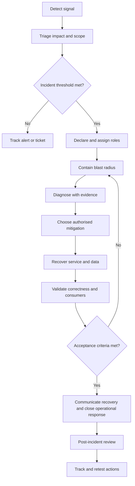

# Incident Response, Runbooks and Postmortems

> **Document status:** Learning material and architecture/operations design aid  
> **Roadmap position:** Stage 2D — Data Architecture, Module 12, Topic 07  
> **Target filename:** `07-incident-response-runbooks-and-postmortems.md`  
> **Scope discipline:** The module roadmap defines this topic's intent and dependencies. All organisations, service names, deadlines, severity thresholds, event volumes and timelines below are illustrative. They are not repository requirements, contractual targets or production test evidence. No production system or real outage is required to complete this lesson.

## Contents

1. [Position in the roadmap and learning outcomes](#1-position-in-the-roadmap-and-learning-outcomes)
2. [What is an incident?](#2-what-is-an-incident)
3. [Severity, impact and escalation](#3-severity-impact-and-escalation)
4. [Incident lifecycle and decision gates](#4-incident-lifecycle-and-decision-gates)
5. [Roles, command and decision authority](#5-roles-command-and-decision-authority)
6. [Observability and evidence-led diagnosis](#6-observability-and-evidence-led-diagnosis)
7. [Safe troubleshooting and evidence preservation](#7-safe-troubleshooting-and-evidence-preservation)
8. [Runbook engineering](#8-runbook-engineering)
9. [Runbook A: critical data-delivery deadline missed](#9-runbook-a-critical-data-delivery-deadline-missed)
10. [Runbook B: source outage and growing backlog](#10-runbook-b-source-outage-and-growing-backlog)
11. [Runbook C: suspected corrupted or incorrect data](#11-runbook-c-suspected-corrupted-or-incorrect-data)
12. [Runbook D: restore or failover fails](#12-runbook-d-restore-or-failover-fails)
13. [Recovery coordination: RPO/RTO, restore, replay and validation](#13-recovery-coordination-rpoto-restore-replay-and-validation)
14. [Worked scenario: critical report misses its deadline](#14-worked-scenario-critical-report-misses-its-deadline)
15. [Second scenario: corrupted data and an unavailable dependency](#15-second-scenario-corrupted-data-and-an-unavailable-dependency)
16. [Incident communications](#16-incident-communications)
17. [Post-incident review and blameless analysis](#17-post-incident-review-and-blameless-analysis)
18. [Completed illustrative postmortem](#18-completed-illustrative-postmortem)
19. [Operational metrics and their limitations](#19-operational-metrics-and-their-limitations)
20. [Corrective-action management](#20-corrective-action-management)
21. [Readiness, runbook review and exercises](#21-readiness-runbook-review-and-exercises)
22. [Common mistakes and how to avoid them](#22-common-mistakes-and-how-to-avoid-them)
23. [Templates and operator checklists](#23-templates-and-operator-checklists)
24. [Glossary](#24-glossary)
25. [Mastery criteria and completion gate](#25-mastery-criteria-and-completion-gate)
26. [Relationship to adjacent roadmap topics](#26-relationship-to-adjacent-roadmap-topics)

---

## 1. Position in the roadmap and learning outcomes

### 1.1 Why this topic exists

Technology only recovers as effectively as the people and procedures operating it. Incident response coordinates detection, decisions, containment, recovery and communication. Runbooks make repeatable actions understandable to an operator who did not write them. Post-incident reviews turn evidence into improvements rather than leaving the organisation to repeat the same failure.

The module roadmap positions this topic after **Topic 05 — RPO, RTO and disaster recovery strategies** and **Topic 06 — Replay, reprocessing and backfill architecture**. Topic 05 establishes the recovery objectives and strategy; Topic 06 explains how data can be restored, replayed or corrected safely. Topic 07 defines how people coordinate those mechanisms under pressure. Topic 08 then tests the end-to-end plan through business continuity and resilience exercises.

### 1.2 Roadmap-derived scope

The module roadmap explicitly expects the learner to:

- Describe an incident lifecycle and roles.
- Define severity levels and escalation paths.
- Write usable runbooks.
- Plan incident communication and coordination.
- Conduct a blameless postmortem and track follow-up actions.
- Measure incident response effectiveness.

The roadmap's expected evidence is a **runbook and postmortem outline**. This lesson provides a more complete practice package to make those outputs operationally useful. The roadmap identifies prerequisites around RPO/RTO, replay/backfill, observability and ownership. The detailed examples below are teaching recommendations, not claims that empty lesson files prescribed additional requirements.

### 1.3 Learning outcomes

After this lesson, you should be able to:

1. Distinguish events, alerts, incidents, problems and changes.
2. Classify incidents using business impact, data correctness, affected consumers, SLOs and recovery objectives.
3. Run a coordinated lifecycle from detection to verified recovery and learning.
4. Assign incident command, technical execution, communications and evidence capture.
5. Investigate using logs, metrics, traces, pipeline state, data-quality signals, lineage and dependency health.
6. Preserve evidence and avoid making a problem worse while diagnosing it.
7. Write runbooks with explicit preconditions, permissions, steps, decision branches, expected results, rollback and abort criteria.
8. Coordinate restore, failover, replay/backfill and downstream validation without treating service availability as proof of data correctness.
9. Communicate confirmed facts, uncertainty, impact and next update times to stakeholders.
10. Produce a blameless postmortem with a defensible timeline, contributing factors and traceable corrective actions.
11. Interpret incident metrics without hiding scope, sampling or measurement limitations.
12. Demonstrate readiness through tabletop exercises and retest evidence.

### 1.4 Assumptions and safety boundaries

All examples use a fictional enterprise data platform. Severity labels, response cadences and business deadlines are illustrative; each organisation must approve its own policy. Commands are either pseudocode or explicitly labelled examples. Replace placeholders with approved environment-specific commands and links before operational use.

**Never run a recovery command in production solely because it appears in a learning document.** Confirm change authority, target environment, identity, scope, blast radius, data retention, replay semantics, rollback feasibility and required approvals. If an operation is destructive, irreversible or can publish incorrect data, stop until an authorised decision-maker approves the plan.

---

## 2. What is an incident?

### 2.1 Definition

A **data-platform incident** is an unplanned interruption, degradation, integrity failure, security event or loss of control that materially affects—or credibly threatens—a data service, data product, consumer, business process or required control. Examples include a late regulatory report, silent row loss, duplicated financial events, a failed restore, an unavailable source, incorrect access permissions, or a failover that serves stale data.

An incident is not defined only by whether a server is down. A pipeline can report success while producing incomplete or incorrect data. Conversely, a warning may be an event worth tracking but not an incident if no material service impact or credible risk exists.

### 2.2 Related terms

| Term | Meaning | Example | Operational implication |
|---|---|---|---|
| **Event** | A recorded state change or observation | A job takes 20 minutes instead of 10 | Record and evaluate; not every event needs response mobilisation |
| **Alert** | A notification generated by a rule or detection mechanism | Freshness threshold exceeded | Triage signal; alert quality depends on threshold and context |
| **Incident** | An unplanned impact or credible threat requiring coordinated response | A critical report is likely to miss its delivery commitment | Declare, assign authority, coordinate, communicate and track |
| **Problem** | An underlying cause or recurring condition that explains one or more incidents | A scheduler repeatedly starts overlapping backfills | Investigate and prevent recurrence; may outlive incident closure |
| **Change** | An authorised modification to software, configuration, data, infrastructure or process | A schema mapping is deployed | Assess risk and approvals; a change can trigger an incident but is not itself necessarily one |
| **Service request** | A routine, planned request handled through normal workflow | Grant an approved analyst role | Use standard fulfilment unless unexpected risk or impact turns it into an incident |
| **Near miss** | A condition that could have caused material impact but did not | A replay almost sends duplicate customer notifications but is stopped in staging | Capture learning; absence of impact does not mean absence of risk |

### 2.3 Incident dimensions in data systems

Assess more than infrastructure availability:

- **Availability:** can the producer, pipeline, storage layer or serving endpoint be reached?
- **Freshness and timeliness:** is data available before the consumer's required time?
- **Completeness:** are expected records, partitions, files or business entities present?
- **Accuracy and validity:** are values correct and within accepted business constraints?
- **Consistency:** do related tables, aggregates, snapshots and downstream products agree?
- **Security and governance:** was data exposed to an unauthorised party, or did processing violate retention, residency or purpose constraints?
- **Recoverability:** can the team restore to a known-good point and meet the approved recovery objectives?
- **Consumer impact:** which reports, decisions, applications, regulatory obligations or customer experiences depend on the affected data?

A green pipeline status is only one signal. It is not proof that the data is fit for use.

### 2.4 Why the distinctions matter

If every alert is declared a major incident, responders become overloaded and important incidents compete with noise. If only infrastructure outages count, silent corruption can remain undetected. A useful incident policy links a signal to impact, urgency, ownership and a clear next action.

---

## 3. Severity, impact and escalation

### 3.1 Severity is impact, not effort

Severity describes the magnitude and urgency of harm, not how difficult the technical fix looks. A simple permissions correction can be critical if sensitive data was exposed; a complicated non-critical batch delay may remain moderate if a safe workaround exists.

Use an approved severity matrix. The following four-level matrix is illustrative and must be adapted to the organisation's business calendar, regulatory obligations, service-level objectives (SLOs), support model and contractual service-level agreements (SLAs).

| Severity | Illustrative criteria | Example | Response and escalation |
|---|---|---|---|
| **SEV-1 / Critical** | Critical business service unavailable; material data corruption; credible security/privacy incident; regulatory or financial deadline at risk with no safe workaround; RPO/RTO likely breached | Critical regulatory report will be late and data correctness is uncertain | Immediate declaration; incident commander; dedicated technical lead; executive/business owner notification; security/privacy/legal involvement when relevant; frequent updates |
| **SEV-2 / High** | Critical pipeline or data product degraded; limited workaround; broad consumer impact; SLO likely to be breached | Primary source unavailable but approved fallback may meet deadline | Immediate on-call response; incident lead; affected product owner; escalate if workaround fails or impact expands |
| **SEV-3 / Moderate** | Limited scope or non-critical product; impact contained; workaround available; no immediate regulatory deadline | One departmental dashboard is stale | Assigned on-call or business-hours responder according to policy; track impact and escalate if conditions change |
| **SEV-4 / Low** | Minor issue, low impact, no immediate customer or business consequence | Non-critical metadata refresh is delayed | Ticket or backlog item; monitor if risk could grow |

### 3.2 Severity decision method

1. **Identify the business service and deadline.** Name the report, data product, decision process, consumer and delivery commitment.
2. **Establish data correctness.** Unknown correctness in a high-impact dataset is itself a risk; do not assume success from job status.
3. **Estimate affected scope.** Count consumers, partitions, records, regions, tenants, time windows and downstream products where possible.
4. **Compare with objectives.** Determine time remaining to the SLO/SLA, RTO, RPO and business deadline. Do not invent an objective during the incident; use the approved one or state that it is unknown.
5. **Evaluate workaround safety.** A workaround is only valid if authorised, documented, reversible where possible, and does not create an unacceptable correctness, privacy or compliance risk.
6. **Assign provisional severity.** Declare early when the potential impact is high and evidence is incomplete. Lower severity later with recorded rationale; do not delay declaration while seeking perfect certainty.
7. **Reassess at decision points.** Severity may rise when impact spreads, a recovery dependency fails, data corruption is confirmed or a deadline becomes unattainable.

### 3.3 Example: severity and escalation

**Assumptions:** fictional bank; a daily risk report is contractually due at 07:00 local time; the current time is 05:50; the report depends on a failed ingestion pipeline; no pre-approved substitute has yet been confirmed.

- Initial signal: ingestion completion alert fires. This is an alert, not automatically a SEV-1.
- Triage finds that the source extract is missing and the risk report is unlikely to finish before 07:00. The report supports a critical business process. Declare **provisional SEV-1** under the illustrative matrix and appoint an incident commander.
- The report owner confirms an approved prior-day fallback is allowed for internal monitoring but **not** for the regulatory submission. That workaround does not remove the SEV-1 risk for the regulatory deliverable.
- If the source recovers and validated replay can meet the deadline, the commander may lower severity only after checking the actual risk and notifying stakeholders. The incident remains open until the affected output is validated and the business owner accepts the delivery outcome.

The principle is to base severity on consequences and deadline risk, not on optimism about the fix.

### 3.4 Escalation triggers

Escalate immediately when any of the following applies:

- Critical data is known or suspected to be wrong, missing or exposed.
- A regulatory, contractual, financial-close or customer-impacting deadline is at risk.
- RPO/RTO or a service SLO may be breached.
- The recovery path is untested, destructive, or requires an authority the responder does not have.
- A key dependency is unavailable or recovery is blocked beyond the agreed threshold.
- The incident crosses teams, regions, tenants or trust boundaries.
- A mitigation increases duplicate, data-loss, privacy or downstream-consistency risk.
- The responder cannot reach the required decision-maker within the escalation window.

Keep an escalation directory with primary and secondary contacts, role-based channels, out-of-hours procedures, vendor/support routes where applicable, and a periodic verification date. Do not put credentials or secret tokens in a runbook.

---

## 4. Incident lifecycle and decision gates

The lifecycle is iterative. Teams may return to triage or containment when new evidence changes the picture.



### 4.1 Detection

Signals may come from automated alerts, data consumers, business control checks, a support ticket, a source provider, security monitoring or a scheduled deadline monitor. Record the detection timestamp and source. A consumer report may detect a correctness failure that infrastructure monitoring cannot see.

**Decision gate:** Is there credible impact or a material risk that warrants triage? If the signal is ambiguous, investigate safely; do not silently discard it.

### 4.2 Triage and declaration

Confirm service identity, time window, last-known-good run, expected delivery, current state, scope and data correctness. Compare the likely impact with the approved severity matrix. Declare an incident when the threshold is met and assign an incident identifier.

**Decision gate:** Who owns coordination, what severity is provisionally assigned, and who must be notified now? Record unknowns explicitly.

### 4.3 Containment

Stop the impact from expanding. Examples include pausing a faulty publication, quarantining a suspect partition, disabling a replay side effect, isolating a broken consumer, or preventing a known-bad dataset from being served. Containment is not necessarily a permanent fix.

**Decision gate:** Is the proposed action authorised and is its blast radius understood? If the action could delete, overwrite or publish data, require explicit approval and a recovery plan.

### 4.4 Diagnosis

Build and test hypotheses using timestamps, job/run identifiers, logs, metrics, traces, checkpoints, lineage, schema versions, source manifests and quality checks. Find the earliest failing or divergent stage, not merely the last visible error.

**Decision gate:** Is there enough evidence to select a mitigation, or is a safe containment action still required? Do not block urgent containment while pursuing a perfect root-cause explanation.

### 4.5 Mitigation and recovery

Mitigation reduces impact; recovery restores the service and its data to an accepted state. Depending on the failure, the approved action may be failover, rollback, restore from a known-good backup, replay retained events, backfill a bounded interval, or publish a corrected version. Select the action using the approved RPO/RTO, data retention and consistency constraints.

**Decision gate:** Are source and destination states understood? Are idempotency, duplicate handling, ordering, downstream side effects and publication boundaries explicit? If not, pause the recovery operation and escalate.

### 4.6 Validation and acceptance

Verify both service health and data correctness. Check source-to-target control totals, expected time/partition coverage, duplicate and gap detection, business invariants, lineage, consumer freshness, downstream refresh completion and permissions. Obtain acceptance from the designated business/data owner for high-impact outputs.

**Decision gate:** Are the agreed acceptance criteria met and the residual risk understood? If not, the incident remains active or enters a clearly labelled degraded state.

### 4.7 Communication and closure

Send recovery status with the scope, validation evidence, remaining limitations and consumer actions. Record when the service returned, when data was verified, and when business acceptance occurred; these may be different times. Close the active response only when ownership transfers are explicit and no unresolved critical risk is hidden.

### 4.8 Post-incident learning

Reconstruct the timeline, analyse contributing conditions and detection gaps, identify systemic changes, assign owners and due dates, and verify that actions reduce risk. A postmortem is not a blame exercise and should not be reduced to a list of individual mistakes.

---

## 5. Roles, command and decision authority

### 5.1 Typical roles

Small teams may combine roles, but they should still name who is performing each function. For high-severity incidents, separating coordination from hands-on troubleshooting reduces confusion.

| Role | Primary responsibility | Should not silently assume |
|---|---|---|
| **Incident commander (IC)** | Owns coordination, severity, priorities, decision log, escalation and handoffs | Does not need to personally diagnose every technical issue |
| **Technical/operations lead** | Directs investigation and approved technical mitigation; coordinates engineers | Cannot unilaterally bypass data-owner, security or change approvals |
| **Data product/service owner** | Explains business criticality, consumer expectations, acceptance criteria and approved workarounds | Does not declare data correct without evidence |
| **Communications lead** | Maintains internal/external updates, audience list and update cadence | Does not speculate or promise an unverified recovery time |
| **Scribe / incident recorder** | Captures timestamps, hypotheses, decisions, commands/actions, results and owners | Does not substitute personal interpretation for recorded evidence |
| **Subject-matter expert (SME)** | Supplies specialist knowledge of source, storage, orchestration, lineage, security or downstream consumers | Does not change incident priority without coordinating with IC |
| **Security/privacy/legal liaison** | Assesses security, privacy, retention, notification and legal obligations when implicated | Must not be bypassed because the technical service has recovered |
| **Executive/business decision-maker** | Makes defined risk, deadline, continuity and exception decisions | Should not direct unreviewed low-level changes outside the agreed command structure |

### 5.2 Decision authority matrix

Document local authority in advance. The table below is a suggested pattern, not a universal policy.

| Decision | Proposes | Approves / decides | Consulted |
|---|---|---|---|
| Declare or raise severity | Any responder; IC coordinates | IC under incident policy | Service owner, security as relevant |
| Pause a pipeline or quarantine output | Technical lead | Pre-authorised runbook operator or IC per policy | Data owner, downstream owners |
| Fail over a service | Technical lead | Named DR decision authority / IC under approved DR plan | Platform owner, data owner |
| Restore or overwrite production data | Recovery lead | Explicit authorised change/data owner; dual approval if policy requires | Security, storage owner, downstream owners |
| Replay/backfill a bounded interval | Data engineer/recovery lead | Designated operator under approved replay plan | Data owner, consumer owners |
| Publish corrected data | Technical lead proposes | Data product owner or designated acceptance authority | Consumers, governance/control owners |
| Notify regulators or affected customers | Communications/legal prepares | Named legal/compliance/business authority | Security/privacy and executives as required |
| Close high-severity incident | IC recommends | IC after acceptance criteria and handoff are met | Data/service owner; security/legal if applicable |

### 5.3 Handoffs and fatigue management

A handoff must include severity, current impact, last-known-good state, known facts, hypotheses, actions already attempted, exact command/job identifiers, outstanding approvals, next decision deadline and next stakeholder update. The incoming person should read back the current state and explicitly accept ownership. Rotating responders without a structured handoff can cause duplicate work or contradictory changes.

---

## 6. Observability and evidence-led diagnosis

### 6.1 Evidence sources

| Evidence | Questions answered | Typical failure mode if ignored |
|---|---|---|
| **Logs** | What operation failed, with what error and correlation/run ID? | Searching uncorrelated logs or losing the first error among retries |
| **Metrics** | Is latency, throughput, error rate, freshness, volume or backlog outside expected range? | Looking only at averages; missing tail latency or partition-specific failures |
| **Traces / execution graph** | Which dependency consumed time or failed across a multi-stage operation? | Treating the last stage's timeout as the root cause |
| **Orchestrator state** | Which run, task, retry, checkpoint or schedule is blocked? | Re-running a task that is still active or may have partially committed |
| **Data quality** | Are row counts, null rates, distributions, keys and business invariants acceptable? | Declaring recovery because the job status is green |
| **Freshness and completeness** | Is the expected data interval present and available by its deadline? | Confusing recent activity with complete data coverage |
| **Lineage and ownership** | Which upstream source first diverged and which consumers are affected? | Fixing downstream symptoms while leaving the source failure unresolved |
| **Source manifests / control totals** | What did the producer claim to deliver, and what landed? | Accepting silent truncation or missing files |
| **Dependency health** | Is identity, network, key management, catalog, schema registry, storage or a source unavailable? | Repeatedly restarting a healthy pipeline blocked by a dependency |
| **Change/audit history** | What changed before the incident? Who approved it? Which version was deployed? | Blaming a recent change without evidence, or overlooking configuration drift |

### 6.2 Hypothesis-driven troubleshooting

Use a repeatable loop:

1. **State the symptom precisely.** Example: “Partition `business_date=2026-10-20` has 0.6 million rows versus the expected 1.0 million; the report deadline is 07:00.”
2. **Record the observation and source.** Include time, environment, run ID, query/version, dashboard and any known measurement delay.
3. **Write a falsifiable hypothesis.** Example: “The source extract is incomplete because its manifest reports fewer files than expected.”
4. **Choose the lowest-risk discriminating check.** Read the manifest and compare it with the landed-file inventory before restarting ingestion.
5. **Record the result.** Confirm, reject or leave the hypothesis unresolved. Preserve exact evidence references.
6. **Update the next action.** Do not run several unrelated interventions simultaneously if doing so destroys causal clarity.

### 6.3 Start at the first divergence

Use lineage to walk upstream from the failed consumer: report → curated dataset → transformation → landed source → producer. Find the earliest point where observed state differs from expected state. The final report failure may simply be the downstream symptom of an upstream extract gap.

### 6.4 Evidence quality

Prefer immutable or time-stamped evidence: run logs, source manifests, audit records, query results, configuration versions, checkpoint positions, checksums, validation outputs and communication timestamps. Store evidence in the approved incident record or evidence store with access controls and retention rules. Redact credentials, tokens, personal data and unrelated sensitive content. Do not paste secrets into tickets or chat.

---

## 7. Safe troubleshooting and evidence preservation

### 7.1 Safety rules

- **Observe before changing state.** Read current job status, checkpoints, target partition versions and source manifests before restarting or replaying.
- **Confirm the environment.** Make it explicit whether the command targets development, staging or production. Check account/project/cluster, dataset, date range and tenant scope.
- **Use least privilege.** Request the minimum approved role; do not share personal credentials or broaden permissions “temporarily” without approval.
- **Prefer bounded actions.** Specify exact run IDs, partitions, time windows and records. Avoid unbounded `all`, wildcard deletion or full-table overwrite unless the approved plan explicitly requires it.
- **Preserve the last-known-good state.** Capture snapshots, version IDs, manifests, offsets and control totals before recovery when feasible.
- **Do not erase evidence.** Avoid log cleanup, checkpoint resets, ad hoc data edits or repeated retries that overwrite the failure state before it is captured.
- **Avoid concurrent recovery writers.** Ensure only one authorised recovery operation owns the target scope unless the design explicitly supports concurrency.
- **Control side effects.** Replay may trigger notifications, payments, exports, API calls or downstream workflows. Use a tested replay mode that suppresses or deduplicates external side effects.
- **Stop on unexpected results.** If row counts, schema, target scope, permissions or command output differ from the runbook's expected results, abort and escalate.
- **Keep a decision log.** Record who approved an action, why it was selected, the intended effect and the rollback/containment path.

### 7.2 Actions requiring explicit authorisation

Treat these as high-risk unless local policy explicitly pre-authorises a tightly bounded procedure:

- Deleting or overwriting production data.
- Resetting offsets/checkpoints or dropping a state store.
- Restoring a backup over a live target.
- Promoting a replica whose data correctness or lag is unknown.
- Replaying a large interval or enabling high-throughput catch-up.
- Disabling quality gates, access controls, audit logging or security monitoring.
- Publishing data that has not passed required reconciliation.
- Changing retention, encryption keys, legal holds or data residency settings.

If the action is irreversible and no safe rollback exists, define a compensating recovery strategy and require the designated approval before execution.

### 7.3 Command patterns

Commands in this lesson are intentionally expressed as pseudocode rather than as runnable vendor-specific commands. A real runbook must name the actual tool, supported flags, version, target context and exact expected output. Never infer a production command from a placeholder.

Example read-only diagnostic pattern:

```text
# PSEUDOCODE — not an executable command
inspect_run(
  environment = "<explicit environment>",
  pipeline_id = "<approved pipeline identifier>",
  run_id = "<specific run identifier>"
)

Expected: run state, start/end timestamps, task status, source interval,
checkpoint/offset, target partition/version, error summary.
If run_id or environment does not match the incident record: STOP.
```

Before any write action, document the intended write scope, preconditions, approvals, idempotency, concurrency protection, rollback and post-action reconciliation. If the platform cannot guarantee those controls, use a safer staging/versioned-output path or escalate.

---

## 8. Runbook engineering

A runbook is an operational interface. It should be usable under time pressure by a competent operator unfamiliar with the original implementation. It is not a design essay or a list of dashboard links.

### 8.1 Required structure

| Field | What to write | Quality test |
|---|---|---|
| Identifier and version | Unique ID, version, owner, approver, last-reviewed date, last-tested date | Can the operator tell whether this is current and approved? |
| Purpose and scope | Service, environment, failure modes covered and excluded | Is the target unambiguous? |
| Trigger | Alert names, symptoms, threshold, manual declaration condition | Can the operator recognise when to start? |
| Severity | Initial severity rule and escalation triggers | Is the impact-based decision explicit? |
| Roles | IC, technical lead, approver, business owner, communications owner | Are people/role-based routes named? |
| Preconditions | Access, dependencies, source/target state, backup/checkpoint, change window | Does the operator know when not to proceed? |
| Safety controls | Blast radius, data protection, idempotency, side effects, approvals | Are destructive operations identified? |
| Steps | Numbered actions, one main action per step, commands or UI path | Can a second operator follow without guessing? |
| Expected result | Concrete state, output, count, status or evidence | Does each important step have a testable outcome? |
| Branches | If result A, do X; if result B, stop/escalate | Are failures and unexpected outputs handled? |
| Abort criteria | Conditions that require stopping immediately | Can the operator recognise an unsafe state? |
| Rollback/containment | Exact supported reversal or safe holding state | Is rollback feasible and bounded? |
| Validation | Service health, data quality, reconciliation, lineage and consumer acceptance | Is correctness proved, not assumed? |
| Communications | Audience, channel, cadence and approved wording | Who sends what, and when? |
| Evidence | What to capture, where to store it, identifiers | Can the incident be reconstructed later? |
| Escalation | Role, backup route, wait threshold, information to provide | What if the procedure does not work? |

### 8.2 Writing steps that can be executed

Weak instruction: “Fix the pipeline and rerun it.”

Operational instruction:

1. In the approved orchestration console, open the failed run identified in the incident record. Confirm the environment, pipeline ID, run ID and business-date interval match the incident scope.
2. Read the source manifest and compare the expected file count and control total with the landed inventory. Save the manifest and comparison output to the incident evidence record.
3. If the source is incomplete, do **not** rerun the transform. Contact the source owner using the escalation route in the service directory and request a corrected manifest or source replay.
4. If the source is complete and the target has no partial write, continue to Step 5. If partial-write state is unknown, stop and involve the technical lead before writing again.
5. Execute the approved bounded retry procedure for that run ID only. Do not reset checkpoints or widen the date range.
6. Confirm the run completes and compare source/target control totals and required quality checks. If any check fails, quarantine the output and escalate; do not publish it.

The second version defines identity, scope, evidence, branch conditions, a forbidden action and a validation gate.

### 8.3 Versioning and maintenance

Review a runbook after incidents, material architecture or schema changes, access-policy changes, a failed tabletop, a tool upgrade or an escalation-route change. Assign an owner and review date. A “last tested” date means a defined test was actually performed; it is not a promise that production was tested. Record whether the check was a desk review, simulation, staging test or approved production exercise.

### 8.4 Runbook quality scoring

Score each dimension from 0 to 2: 0 = missing/unsafe; 1 = partial/ambiguous; 2 = explicit and verifiable.

- Trigger and scope.
- Prerequisites and permissions.
- Ordered steps and expected results.
- Decision branches and abort criteria.
- Rollback/containment.
- Validation and consumer acceptance.
- Escalation and communications.
- Evidence capture and ownership/versioning.

Maximum = 16. A high score is not a substitute for a safety gate: any score of 0 for destructive-action controls, rollback/containment or validation means the runbook is **not approved for operational use** until repaired.

---

## 9. Runbook A: critical data-delivery deadline missed

> **Status:** Illustrative template. Replace every placeholder and obtain local approval before operational use. The pseudocode below is not executable against any real platform.

### 9.1 Runbook header

| Field | Value (illustrative) |
|---|---|
| Runbook ID | RB-DATA-DELIVERY-001 |
| Purpose | Diagnose and recover a critical scheduled data product that may miss its delivery deadline |
| Trigger | Delivery monitor predicts lateness, expected partition is absent, or delivery deadline is missed |
| Scope | One named pipeline and one bounded business-date interval |
| Initial severity | SEV-1 if a critical/regulatory deadline or correctness is at risk; otherwise use approved matrix |
| Roles | IC; pipeline technical lead; source owner; data product owner; communications lead; scribe |
| Required access | Read-only orchestration, source manifest, target metadata, lineage and quality results; approved recovery role only if needed |
| Safety rule | Do not publish an incomplete or unvalidated dataset merely to meet the deadline |
| Abort condition | Target scope mismatch, unknown partial write, suspected corruption, missing approval, or inability to preserve a known-good version |

### 9.2 Preconditions

Before recovery, confirm:

- The incident record identifies the exact service, environment, business date, expected delivery time and consumers.
- The current severity and incident commander are recorded.
- The last-known-good output and its version/partition are identified, where one exists.
- Source manifest, expected record/file counts, source watermark or equivalent, and current target status are available.
- The relevant SLO/SLA, RPO/RTO and business fallback policy can be found. If unknown, record the gap and escalate; do not invent targets.
- The run is not still executing in a way that would conflict with the recovery attempt.
- The technical lead has identified whether the operation is retry, replay, restore or backfill and has checked idempotency and side effects.
- Required change/recovery approvals are granted and recorded.

### 9.3 Procedure

**Step 1 — Declare and bound the incident.** Record the delivery, deadline, time detected, current state and affected consumers. Appoint roles and set the next update time.

Expected result: one incident record with a provisional severity, named owners and bounded business-date scope.

If scope or business criticality is unclear, contact the data product owner immediately. Do not run recovery on an inferred date range.

**Step 2 — Inspect the pipeline state (read-only).** Retrieve the exact run ID, task status, start/end times, retry history, source interval, checkpoint/offset, target version and error summary. Capture outputs before changing state.

Expected result: the team can state the last completed stage and whether a partial target write may exist.

If the run is still active, determine whether it is progressing or stuck using approved signals. Do not start a second writer simply because the first is slow.

**Step 3 — Compare source and landed evidence.** Compare expected source manifest/control totals with landed objects/records. Check source availability, schema version, freshness and any source-side incident notice.

Branch:

- **Source incomplete/unavailable:** move to Runbook B; notify source owner; do not rerun downstream transformations on incomplete input.
- **Source complete, transformation failed before writing:** continue to Step 4 after confirming the retry is safe.
- **Partial write or uncertain commit:** stop. Determine transaction/publication state and use the approved partial-write recovery procedure; do not assume the job failed before committing.
- **Output completed but quality failed:** move to Runbook C; quarantine or suppress publication under approved policy.

**Step 4 — Choose a bounded recovery method.** The technical lead records why retry, replay, restore or backfill is appropriate. Verify retained input/checkpoint availability, code/config version, deduplication key, side-effect suppression and target write semantics.

Expected result: an approved recovery plan stating exact interval, source, destination, estimated duration, concurrency control, expected counts and abort conditions.

If the required input is no longer retained, do not invent or silently substitute missing data. Escalate to the data owner and business decision-maker for an approved alternate source or explicit degraded-service decision.

**Step 5 — Execute one controlled attempt.** Use the organisation's approved, environment-specific command or console action for the named run and bounded interval. Record operator, approval, command/action identifier, start time and output. Avoid resetting offsets/checkpoints unless the approved plan explicitly requires it.

Expected result: the bounded run reaches a known terminal state and writes only to its intended target scope.

Abort if the command targets the wrong environment/date/partition, unexpected rows are overwritten, a duplicate writer appears, or resource pressure threatens live services.

**Step 6 — Validate the output before publication.** Check:

- Expected date/partition coverage and source-to-target control totals.
- Duplicate business keys and missing keys within the agreed scope.
- Required schema and critical data-quality rules.
- Business invariants and reconciliation with authoritative sources.
- Correct code/config/rule version and lineage metadata.
- Downstream refresh status and consumer-visible freshness.
- No unintended side effects such as duplicate notifications or external calls.

Expected result: recorded pass/fail results with query/rule versions and evidence links. A successful job status alone is insufficient.

If validation fails, prevent publication, preserve the candidate output for diagnosis, and escalate to Runbook C. Do not overwrite the known-good version until the acceptance authority approves publication.

**Step 7 — Publish and confirm.** Publish using the approved atomic/versioned publication mechanism. Confirm the consumer-facing pointer/version and downstream refresh. Obtain data product owner acceptance for critical outputs.

Expected result: the correct version is discoverable, consumers can access it, and the business owner acknowledges whether the deadline was met or missed.

**Step 8 — Close the active response or hand off.** Send a status update with impact, actual delivery time, validation evidence and remaining limitations. Record service-restored time separately from data-verified and business-accepted times. Open corrective actions for gaps found.

### 9.4 Rollback and containment

- If the candidate version fails validation, keep it unpublished/quarantined and retain the last-known-good version.
- If an incorrect version was published and the platform supports safe version-pointer rollback, obtain the required approval, switch back to the identified known-good version, and verify consumers now read that version. A rollback of a pointer does not undo external side effects or downstream copies; enumerate and remediate those separately.
- If no safe rollback exists, stop further writes, restrict serving under the approved policy, and escalate to the data owner and incident commander.
- Never delete the only copy of the candidate or original data while evidence is required.

### 9.5 Escalation package

Provide the incident ID; business impact/deadline; exact environment, pipeline and date range; run ID and target version; last-known-good state; source/target control totals; actions already attempted; known risks; required decision; and next update time.

---

## 10. Runbook B: source outage and growing backlog

### 10.1 Trigger and objective

Trigger when an upstream producer is unavailable, source extracts stop arriving, CDC/event ingestion falls behind, or backlog growth threatens the consumer freshness SLO or business deadline. Objective: contain downstream impact, establish whether the source data is recoverable, and resume processing without gaps, duplicates or unsafe catch-up load.

### 10.2 Preconditions

- Identify the producer, affected partitions/tenants, event time range and consumers through lineage.
- Capture current watermark, last committed offset/checkpoint, backlog size/age, arrival rate and processing rate.
- Confirm source/event retention window and whether required records remain available.
- Confirm whether the consumer can safely pause, buffer or serve a clearly labelled stale snapshot.
- Establish approved throttling limits and capacity headroom before catch-up.

### 10.3 Procedure

1. **Verify the failure domain.** Check source health, network/identity dependencies, schema or contract changes, credentials expiry signals (without copying secrets), and producer-side delivery manifests. Distinguish a source outage from a consumer failure.
2. **Bound the impact.** Use lineage to identify affected downstream datasets, reports and APIs. Suppress publication of incomplete critical data and communicate the freshness state.
3. **Protect evidence and progress markers.** Record the last confirmed source sequence/offset, watermark, partition and checkpoint. Do not reset or advance the checkpoint manually to “skip” the gap.
4. **Estimate the backlog.** Use a stated measurement window and distinguish queued records from unproduced records. Estimate catch-up using net drain rate: `recovery processing rate − ongoing arrival rate`, provided both are measured in the same units and the recovery rate exceeds arrival rate.
5. **Choose a recovery source.** Prefer the original source replay, retained event log or authoritative extract. If retention has expired, identify an approved alternate source and quantify the gap/uncertainty; do not fabricate completeness.
6. **Resume with bounded throughput.** Follow the approved replay/backfill plan, throttle to protect live workloads, and ensure idempotency and side-effect handling. Monitor backlog, error rate, lag, resource saturation and downstream latency.
7. **Validate continuity.** Check sequence/offset continuity, source manifests, control totals, duplicates, gaps, ordering constraints, late events and business rules. Confirm the consumer's watermark has advanced to the expected point.
8. **Declare recovery only after acceptance.** Source availability is not enough: confirm the backlog is within the agreed operational target, critical datasets are current, and downstream consumers have validated outputs.

### 10.4 Decision branches and abort conditions

- **Source is back but retention is sufficient:** follow the approved replay/backfill plan.
- **Source is back but retention is insufficient:** pause claims of full recovery; escalate for alternate source, explicit data-loss decision and consumer/regulatory impact assessment.
- **Backlog grows despite catch-up:** stop increasing load blindly; investigate capacity, poison records, partition skew or downstream bottlenecks. Escalate before live workloads are starved.
- **Schema/contract changed:** hold affected records or route through the approved compatibility path; do not drop fields or coerce types without owner approval.
- **Duplicates or ordering errors appear:** pause publication and use the idempotency/deduplication procedure; do not reset checkpoints as a shortcut.
- **RPO/RTO threatened:** notify IC and recovery authority immediately; compare measured recovery progress with the approved objectives and invoke the relevant DR plan if necessary.

### 10.5 Rollback/containment

Prefer pausing replay and preserving offsets, staging output or retaining a versioned candidate. If a recovery writer creates invalid output, stop it, quarantine the affected range and reconcile from the last known-good checkpoint. Avoid “rewind and rerun” until sink commit semantics and duplicate handling are known.

---

## 11. Runbook C: suspected corrupted or incorrect data

### 11.1 Trigger

Use when a quality rule fails, consumers report inconsistent results, source-to-target totals diverge, a transformation defect is suspected, a schema mismatch silently changes meaning, or a dataset may have been published incorrectly.

### 11.2 Immediate response

1. Declare severity based on the business consequences and uncertainty. If critical data correctness is unknown, treat it as a risk, not as proof of correctness.
2. Identify the smallest defensible affected scope: dataset, version, partitions, time interval, keys, consumers and publication timestamps.
3. Preserve evidence: source snapshot/manifest, candidate output version, code/config version, quality failures, query results and audit history.
4. Prevent additional harm. Under approved policy, pause publication, quarantine affected partitions, revoke a faulty materialisation or label the product as degraded. Do not destroy or overwrite evidence.
5. Trace lineage upstream to the first divergence. Compare raw/landed data, transformation outputs, reference data and downstream aggregates.
6. Decide whether the issue is incomplete input, duplicate input, schema/semantic drift, bad transformation logic, reference-data defect, partial write or consumer interpretation.
7. Prepare a bounded correction plan. Include source of truth, affected range, logic version, idempotency, side effects, staging/versioning, expected control totals and rollback.
8. Obtain approval for reprocessing/backfill and publication. If downstream reports or external submissions used the bad output, identify whether they must be restated or consumers must be notified.
9. Reprocess into a candidate version, reconcile and run quality/business checks. Compare both row-level exceptions and aggregate control totals where practical.
10. Publish only after designated acceptance. Verify all known consumers and preserve the before/after evidence.

### 11.3 Special controls

- **Financial or regulatory values:** require authoritative reconciliation and designated business/control-owner acceptance; a statistical plausibility check is not enough.
- **Personal or regulated data:** involve privacy/security/legal where exposure, retention, deletion or residency could be implicated.
- **Historical corrections:** determine whether downstream snapshots, aggregates, feature sets, exports, reports and previously submitted files must be rebuilt or restated.
- **Replay side effects:** suppress or deduplicate emails, payments, webhooks and external API actions unless the business owner explicitly approves the effect.
- **Unknown corruption boundary:** expand the scope conservatively until evidence narrows it. Do not assume the first alert timestamp equals the start of corruption.

### 11.4 Abort criteria

Stop and escalate if the authoritative source is unknown, the affected interval cannot be bounded, target state is uncertain, a required backup/version is unavailable, validation cannot establish correctness, the operation violates retention/legal hold, or the proposed fix risks irreversible loss.

---

## 12. Runbook D: restore or failover fails

### 12.1 Trigger

Use when a restore fails, a backup is unreadable, a replica is too far behind, a failover target is unavailable, encryption/key dependencies cannot be recovered, metadata/catalog state is missing, or the recovered service starts but fails data validation.

### 12.2 Procedure

1. **Declare recovery risk.** Record the approved RTO/RPO, recovery start time, current recovery point and the expected deadline for a decision.
2. **Stop repeated blind attempts.** Preserve the failed restore/failover logs and exact backup, replica, key, configuration and software versions. Repeated attempts may consume capacity or obscure the original error.
3. **Verify recovery prerequisites.** Confirm access, storage capacity, network, encryption key availability, metadata/catalog dependencies, backup integrity evidence, source/target compatibility and the restore order.
4. **Identify the failure boundary.** Determine whether the failure is backup integrity, missing metadata, dependency outage, incompatible schema/version, insufficient capacity, replica lag or validation failure.
5. **Select the approved alternative.** Options may include another verified recovery point, an alternate replica, a secondary region, a staged restore, or restoring components in dependency order. The designated DR authority approves a change of strategy.
6. **Recalculate the recovery timeline.** Include dependency recovery, restore duration, replay/backfill, validation and consumer acceptance. Do not report “RTO met” based only on the time a server starts.
7. **Recover in an isolated or staged target when feasible.** Avoid overwriting a live target before the recovered state is understood. Keep the original source and evidence protected.
8. **Validate data and dependencies.** Verify integrity, counts, time/offset continuity, metadata, permissions, lineage, quality rules and downstream consumers.
9. **Promote only after approval.** Confirm write ownership, routing, replica lag, duplicate-writer prevention, and the approved cutover/rollback plan.
10. **If no known-good path exists, escalate explicitly.** The business decision-maker must choose an approved degraded mode, data-loss tolerance or continuity alternative. Technical responders must not silently redefine RPO/RTO.

### 12.3 Failed failover safety checklist

- [ ] Source and target identities are unambiguous.
- [ ] Only one authoritative writer is active, or multi-writer semantics are explicitly designed and verified.
- [ ] Replica lag and recovery point are measured.
- [ ] Routing/DNS/consumer configuration changes are recorded.
- [ ] Required keys, secrets, metadata and identity dependencies are available.
- [ ] Rollback path and conditions are documented.
- [ ] Post-cutover data reconciliation and consumer checks pass.
- [ ] The original site/instance is not automatically reintroduced as a writer without reconciliation.

---

## 13. Recovery coordination: RPO/RTO, restore, replay and validation

### 13.1 Keep the objectives distinct

- **RTO (Recovery Time Objective):** target maximum time to restore the defined service after a disruption, measured according to the organisation's stated start and end events.
- **RPO (Recovery Point Objective):** target maximum tolerable data loss measured as a time interval between the disruption and the latest recoverable/consistent data point. Some systems use a sequence/transaction position as the technical measure; map it to business time where possible.
- **SLO:** internal reliability objective for a service indicator over a defined window.
- **SLA:** a service commitment with defined scope, measurement and possible remedies.
- **Business deadline:** a clock time by which a consumer needs a result. It may be earlier or later than the platform's RTO and should be tracked separately.

A service can be available while its data is stale or incorrect. A restore can finish within RTO while losing more data than RPO permits. A report can miss its business deadline even if the underlying service recovers within its infrastructure target.

### 13.2 Recovery sequence

A typical sequence is:

1. Contain the fault and preserve state/evidence.
2. Establish the last known-good recovery point and the approved recovery strategy.
3. Restore required infrastructure, storage, metadata, identity/key services and dependencies in the documented order.
4. Validate the restored state before accepting writes or serving critical consumers.
5. Replay retained events or backfill missing intervals with bounded, idempotent processing.
6. Reconcile source-to-target counts, gaps, duplicates, ordering, business rules and downstream products.
7. Publish/promote using a controlled version or atomic cutover.
8. Confirm consumers, permissions, freshness and service SLOs.
9. Record actual RTO/RPO outcomes and any exception decision.

This sequence is not universal: the approved architecture may require different ordering or a different consistency boundary. Follow the system-specific DR plan.

### 13.3 Validation gates

| Gate | Question | Example evidence | If it fails |
|---|---|---|---|
| Recovery-point gate | Did recovery start from the approved, known-good point? | Backup ID, timestamp, offset, checksum, restore log | Stop promotion; reassess RPO and recovery point |
| Integrity gate | Is the restored data readable and structurally valid? | Checksums, schema checks, object inventory | Quarantine; try approved alternate recovery path |
| Completeness gate | Are expected intervals, partitions and records present? | Manifests, control totals, gap checks | Replay/backfill or document approved loss decision |
| Correctness gate | Do critical business rules and reconciliations pass? | Reconciliation results, critical data-element rules | Do not publish critical output |
| Consistency gate | Do related datasets and snapshots agree? | Cross-table totals, referential checks, lineage | Rebuild dependencies in order; hold consumers |
| Service gate | Can consumers use the service under expected load? | Endpoint checks, latency/error/freshness metrics | Remain degraded; continue mitigation |
| Acceptance gate | Has the designated owner accepted the output? | Recorded approval/consumer confirmation | Keep incident active or explicitly degraded |

### 13.4 Recovery time budget example

**Illustrative assumptions:** RTO is 4 hours from declaration to validated service restoration. The plan allocates 20 minutes to triage/authorisation, 70 minutes to restore, 60 minutes to replay/backfill, 45 minutes to validation and 25 minutes to controlled cutover and consumer checks.

Total planned time = 20 + 70 + 60 + 45 + 25 = **220 minutes (3 hours 40 minutes)**. Planned slack = 240 − 220 = **20 minutes**.

This is a budget, not evidence of performance. If the restore step overruns by 30 minutes, the original plan no longer fits the RTO. The incident commander should escalate the forecast promptly and evaluate only approved options; the team must not shorten validation merely to make the metric look successful.

### 13.5 Recovery completion statement

A good statement distinguishes the milestones: “Pipeline execution resumed at 06:42; the candidate dataset passed source reconciliation and critical quality checks at 07:03; downstream consumers confirmed the approved version at 07:12. The 07:00 business deadline was missed. No claim is made that the deadline was met merely because the pipeline restarted.”

---

## 14. Worked scenario: critical report misses its deadline

> **All names, times, targets and volumes in this scenario are fictional assumptions.** The purpose is to practise decisions and evidence, not to establish a universal severity policy.

### 14.1 Scenario setup

Northbridge Bank produces a daily risk exposure report. The report is due at 07:00 local time. It depends on a source extract, a transformation pipeline, a curated exposure table and a reporting layer. The illustrative RTO for validated report availability is 4 hours from incident declaration; the illustrative RPO is 15 minutes. These are scenario assumptions only.

At 05:50, a freshness alert fires. The last successful report is from the previous business date. The source owner has not yet confirmed whether today's extract is complete.

### 14.2 Timeline with evidence and decision points

| Time | Observation / evidence | Decision | Owner / next action |
|---|---|---|---|
| 05:50 | Freshness alert; expected partition absent | Start triage; do not assume a platform outage | On-call engineer records alert ID and business date |
| 05:54 | Orchestrator shows ingestion task failed; transform did not start | Confirm downstream is not the first failure | Technical lead captures run ID and error summary |
| 05:58 | Source manifest lists 8 files; expected manifest contract calls for 10; landed inventory also has 8 | Source is incomplete; retrying transform would not fix it | IC declares provisional SEV-1 because critical deadline is at risk; source owner paged |
| 06:04 | Lineage identifies risk report and two internal dashboards as consumers; regulatory submission is not allowed to use prior-day data | Do not use the prior-day report as a substitute for the regulated deliverable | Data product owner confirms consumer constraints; communications lead prepares update |
| 06:12 | Source owner confirms upstream export failure; estimated recovery time is unknown | Keep output unpublished; request corrected extract and ETA | IC escalates to source service owner and business executive under policy |
| 06:20 | Corrected source extract begins delivery; manifest version and control totals supplied | Validate source completeness before replay | Technical lead compares manifest, file inventory and control totals |
| 06:31 | All 10 expected files landed; source control total matches manifest; schema version unchanged | Approve bounded rerun/replay using the original business-date interval | Recovery operator executes approved procedure; action ID recorded |
| 06:43 | Transformation completes; target row count differs from expected control total by 0.4% | Do not publish; correctness gate failed | Data quality SME investigates late-arriving records and partial prior write |
| 06:51 | Evidence shows one partition was partially committed during the first attempt; candidate version can be rebuilt idempotently in staging | Use the documented partial-write path; prevent concurrent writer | Technical lead obtains required approval and rebuilds bounded candidate |
| 07:04 | Candidate reconciliation passes; duplicate key count = 0; required business checks pass | Business deadline missed; prepare controlled publication | IC records deadline miss and sends status update; do not alter the timeline to imply success |
| 07:10 | Candidate version published atomically; downstream refresh succeeds | Validate consumer visibility and access | Data product owner and consumer owner check the published version |
| 07:16 | Report owner accepts the output; evidence stored | Service/data recovery accepted; incident may transition to monitoring and review | IC records distinct restore, validation, publication and acceptance timestamps |

### 14.3 What the timeline teaches

- The first failing node was the source export, not the report generator.
- A source manifest and landed inventory narrowed the failure quickly.
- A prior-day fallback existed for some consumers but was not approved for the regulatory output.
- A successful transformation was not enough: the partial write caused a control-total mismatch.
- The business deadline was missed even though the service was restored and validated later. Reporting the miss honestly preserves trust.
- The incident should produce actions for earlier source-completeness alerts, safer partial-write handling and a documented fallback decision.

### 14.4 Scenario exercise

Answer these questions before reading the explanation above:

1. At what point should severity be raised, and why?
2. Which evidence distinguishes a source outage from a transformation failure?
3. Why is publishing the prior-day report unsafe for the regulated consumer?
4. Which gate blocks publication at 06:43?
5. Which timestamps are required to calculate detection, response, service-restoration and data-validation durations?
6. What evidence would you need to claim the RPO was met? What evidence would be needed to claim the RTO was met?

A defensible answer ties each decision to a recorded observation, approved policy and explicit owner.

---

## 15. Second scenario: corrupted data and an unavailable dependency

> **Illustrative scenario.** A transformation deploys a faulty currency-conversion rule. The output is structurally valid and the pipeline reports success, but a critical exposure measure is wrong. At the same time, the authoritative reference-rate service is unavailable, so the team cannot safely recalculate the affected period using current reference data.

### 15.1 Initial response

1. Declare an incident based on business impact; if exposure values may affect regulated or financial decisions, use the approved high-severity path.
2. Pause publication of the suspect version or label the data product unavailable/degraded according to policy.
3. Preserve the suspect output, transformation version, reference-data version, deployment record, source snapshots and consumer list.
4. Use lineage to determine the earliest affected date and every downstream report, model, export or submission that consumed the data.
5. Do not “fix” the values using today's exchange rates unless the business definition explicitly requires current rates. The correct historical reference date and source must be established.

### 15.2 Dependency and recovery decisions

The reference-rate service is unavailable. The team has three possible inputs: a verified archived reference-rate snapshot, a backup that has not yet passed integrity validation, and a manually supplied spreadsheet with unclear provenance.

- The verified archived snapshot is the preferred candidate if it covers the required dates, matches the approved business definition, and its integrity/provenance can be demonstrated.
- The unvalidated backup is not automatically authoritative. Restore and validate it in an isolated target before use.
- The manual spreadsheet is not acceptable merely because it is available. Its provenance, approval and completeness must be established or it must be rejected.

If no authoritative input can be recovered, stop recalculation and escalate for a business decision. A technical operator must not invent reference values or silently substitute a different definition.

### 15.3 Corrective recovery plan

- Identify affected date range and outputs, using code/config deployment time only as an initial clue—not proof of the corruption boundary.
- Select the correct transformation version and historical reference data.
- Reprocess a bounded interval into a new candidate version; preserve the suspect version for audit.
- Compare candidate values to an authoritative independent calculation or approved control totals.
- Validate aggregates, critical records, currency/date alignment, duplicate keys and downstream restatement requirements.
- Obtain data-owner/control-owner acceptance before publication.
- Notify affected consumers about the corrected version and whether previous decisions/submissions require review.

### 15.4 Lessons

A structurally valid dataset can be semantically wrong. A dependency outage can prevent safe correction even while compute and storage are healthy. Versioning, lineage, archived reference data, clear business definitions and explicit publication gates reduce the temptation to perform unsafe manual repairs.

---

## 16. Incident communications

### 16.1 Principles

- **One source of truth:** maintain the incident record or approved status channel and link to it from team conversations.
- **Separate facts from hypotheses:** label unconfirmed causes and estimates as such.
- **State business impact:** identify service, consumers, affected interval and deadline, not only infrastructure symptoms.
- **State what is being done:** name the next action and owner without exposing secrets or unnecessary technical detail.
- **Give the next update time:** keep a predictable cadence even if there is no material change.
- **Do not overpromise:** provide a recovery estimate only when its assumptions and uncertainty are understood.
- **Use approved notification routes:** regulators, customers and other external audiences may require legal, compliance, privacy or executive approval.
- **Report data correctness separately from availability:** “the pipeline is running” is not equivalent to “the data is safe to use.”

### 16.2 Internal status update example

**Assumptions:** fictional Northbridge Bank; illustrative SEV-1; the 07:00 risk report deadline is at risk; source extract is incomplete; no confirmed recovery ETA.

> **Incident:** INC-2026-1042 — risk report delivery at risk  
> **Severity:** SEV-1 (provisional)  
> **Impact:** Today's risk exposure report is not yet available. The regulated output must not use yesterday's report as a substitute. Internal dashboards may also be stale.  
> **Known facts:** The ingestion run failed and the source manifest lists fewer files than expected. The source owner is investigating. No evidence currently confirms that the transformation is the first failing component.  
> **Actions:** The technical lead is comparing source manifest and landed-file inventory; the source service owner has been paged; publication remains blocked until completeness and quality checks pass.  
> **ETA:** Not yet reliable; next estimate will follow source-owner confirmation and a validated recovery plan.  
> **Next update:** 06:15 local time, or earlier if impact or recovery prospects materially change.  
> **Incident commander:** [role/contact in approved directory]  
> **Record:** [link to approved incident record]

### 16.3 Recovery confirmation example

> **Status:** The risk report candidate passed source reconciliation, duplicate-key checks and required business validations. Version [approved version identifier] was published at 07:10 local time, and the report owner confirmed access at 07:16. The 07:00 delivery deadline was missed. We are monitoring downstream refreshes and will provide the post-incident review and corrective actions through the incident record. The earlier suspected source issue and partial-write findings remain under review; no final root cause is asserted in this update.

### 16.4 Audience matrix

| Audience | What they need | Typical owner | Important caution |
|---|---|---|---|
| On-call/technical responders | Symptoms, evidence, exact scope, current hypothesis and next action | IC / technical lead | Keep sensitive evidence in approved systems |
| Data product owners | Data correctness, freshness, affected partitions and acceptance status | IC / data owner | Avoid saying “recovered” before validation |
| Business consumers | Business impact, workaround status, delivery forecast and action required | Communications lead with owner | Explain whether data is stale, incomplete or unsafe to use |
| Executives | Severity, business exposure, key decisions and next update | IC / executive liaison | Lead with impact and decisions, not raw logs |
| Security/privacy/legal | Potential exposure, affected data/subjects, evidence and containment | Security/privacy liaison | Follow required notification and evidence procedures |
| Regulators/customers | Approved facts, impact, obligations, remediation and contact route | Designated legal/compliance/business authority | Do not send unapproved or speculative statements |

---

## 17. Post-incident review and blameless analysis

### 17.1 Purpose

A postmortem documents what happened, why the system allowed it, how response unfolded, what impact occurred and which changes will reduce recurrence or improve detection/recovery. It is not a performance evaluation of an individual and should not use hindsight to portray decisions as obvious when they were not obvious at the time.

Blameless does not mean “no accountability.” It means the review investigates system conditions, interfaces, incentives, documentation, tooling, controls and decision context rather than ending with “the operator made a mistake.” People remain accountable for agreed follow-up actions and for complying with known safety rules.

### 17.2 When to hold a review

Use the organisation's policy. A review is generally appropriate for high-severity incidents, data corruption, security/privacy events, recovery objective breaches, recurring failures, significant near misses, or any incident that reveals a systemic weakness. Smaller events may use a lightweight review. Security/legal cases may require a restricted process and careful evidence handling.

### 17.3 Recommended structure

1. **Metadata:** incident ID, severity, owners, dates, status and reviewers.
2. **Executive summary:** impact, duration, recovery outcome and most important lesson.
3. **Customer/business impact:** affected services, consumers, data interval, deadlines, decisions and any exposure.
4. **Detection:** how it was found, when it could first have been detected, and whether alerts were actionable.
5. **Timeline:** timestamped observations, decisions, actions and evidence links.
6. **Technical narrative:** system state and dependency chain, avoiding unsupported certainty.
7. **Contributing factors:** conditions that combined to make the incident possible or prolonged it.
8. **What went well:** controls, signals, handoffs or mitigations that reduced impact.
9. **What made response harder:** missing telemetry, ambiguous authority, unsafe tooling, runbook gaps or untested dependencies.
10. **Recovery and validation:** restore/replay/backfill choices, RPO/RTO/SLO outcome, data correctness and consumer acceptance.
11. **Root cause / causal model:** explain the mechanism and evidence; distinguish confirmed facts from unresolved questions. Avoid forcing a single root cause if the failure was systemic.
12. **Corrective actions:** specific deliverables with one accountable owner, priority, due date, acceptance criteria and retest evidence.
13. **Communication and compliance:** what was communicated, when, and whether required escalation/notifications occurred.
14. **Learning loop:** which architecture, runbook, SLO, observability or resilience test must change.

### 17.4 Build a reliable timeline

Use event timestamps from monitoring, orchestrator logs, deployment records, source manifests, audit trails, chat/status messages and human notes. Normalise time zones; preserve source timestamp and conversion where clocks may drift. Distinguish:

- **Observed time:** when a signal or state was recorded.
- **Detection time:** when the organisation became aware of the issue.
- **Decision time:** when an authorised decision was made.
- **Action time:** when a mitigation started and completed.
- **Service restoration time:** when service functionality returned under the agreed definition.
- **Data validation time:** when correctness checks passed.
- **Business acceptance time:** when the designated owner accepted the result.

Do not infer exact times from memory when records are available. Mark estimated timestamps as estimates and state the evidence basis.

### 17.5 Contributing factors and causal analysis

Explore conditions across layers:

- **Design:** single failure domain, missing isolation, unsafe write semantics, no versioned publication.
- **Detection:** alert absent, delayed, noisy, or disconnected from business deadlines and data quality.
- **Dependency:** source contract, identity, key management, metadata catalog, network or reference-data availability.
- **Operations:** unclear ownership, runbook ambiguity, missing permissions, unsafe defaults or insufficient practice.
- **Capacity:** no headroom, backlog growth, retries amplifying load or catch-up competing with live traffic.
- **Governance:** undefined data owner, unapproved fallback, missing retention or notification procedure.
- **Human factors:** fatigue, handoff gaps, conflicting priorities, cognitive overload and incomplete context.
- **Validation:** service health treated as data correctness; missing control totals or downstream acceptance.

Ask “What conditions made this action reasonable at the time?” and “What control would make the unsafe path harder or the safe path easier?” A single “human error” label is not an adequate causal explanation.

### 17.6 Action-item design

Weak: “Improve monitoring.”

Strong: “By 2026-11-15, the Data Platform Observability Owner will add a source-manifest completeness check that compares expected and landed file counts before transformation start; alert at the approved deadline-risk threshold; link the alert to Runbook RB-DATA-DELIVERY-001; and demonstrate detection in two staging scenarios with captured evidence.”

A strong action has:

- A specific system or process change.
- One accountable owner (contributors may be listed separately).
- Priority tied to impact/risk.
- A due date and status.
- Acceptance criteria and evidence location.
- A verification/retest method.
- A defined escalation path if overdue.

---

## 18. Completed illustrative postmortem

> **Fictional training example.** The incident, organisation, times and figures are assumptions. This example is not evidence of an actual event.

### 18.1 Metadata and summary

| Field | Value |
|---|---|
| Incident | INC-2026-1042 — critical risk report late |
| Severity | SEV-1 (illustrative) |
| Incident window | 05:50–07:16 local time for active response and business acceptance |
| Business impact | 07:00 report deadline missed by 10 minutes at publication; report owner accepted at 07:16 |
| Data integrity | Candidate output initially failed reconciliation due to a partial write; final candidate passed defined checks before publication |
| Customer/regulatory impact | Regulatory output was not replaced with prior-day data. Actual external notification obligations must be assessed by the designated compliance authority; this example does not assume they were triggered or waived. |
| Review owner | Data Platform Reliability Lead (illustrative role) |
| Review status | Draft pending action-owner confirmation |

### 18.2 Executive summary

An upstream source export delivered fewer files than its manifest contract required. The pipeline correctly failed rather than producing a complete-looking report, but the initial alert did not clearly surface the business deadline risk. During recovery, the first transformation attempt left a partial target write, causing reconciliation to fail. The team contained publication, obtained the corrected source extract, rebuilt a bounded candidate, validated it and published a new version. The report was accepted after the deadline. The principal improvements are earlier source-completeness detection, explicit partial-write recovery controls, and a consumer-specific fallback policy.

### 18.3 Impact and detection

- A critical risk report was unavailable at the 07:00 deadline.
- Two internal dashboards were stale during the incident.
- The prior-day report was not used for the regulated deliverable because the policy did not permit it.
- The first alert was a freshness alert at 05:50. The source manifest discrepancy was identified at 05:58.
- No claim is made that all possible downstream copies or decisions were unaffected; the incident owner must confirm the consumer inventory during review.

### 18.4 Timeline

| Time | Fact / decision | Evidence reference (illustrative placeholder) |
|---|---|---|
| 05:50 | Freshness alert fired | `EV-01` alert record |
| 05:54 | Ingestion failed; transform not started | `EV-02` orchestrator run log |
| 05:58 | Manifest expected 10 files; only 8 landed | `EV-03` manifest and landed inventory |
| 06:04 | Regulated output cannot use prior-day data | `EV-04` data product policy/owner confirmation |
| 06:12 | Source owner confirmed export failure; ETA unknown | `EV-05` source incident record |
| 06:31 | Corrected extract complete and control totals matched manifest | `EV-06` source reconciliation |
| 06:43 | First candidate failed reconciliation by 0.4% | `EV-07` quality run output |
| 06:51 | Partial prior write identified; bounded rebuild approved | `EV-08` target state and decision log |
| 07:04 | Candidate passed required checks; deadline already missed | `EV-09` validation report and deadline record |
| 07:10 | Version published | `EV-10` publication audit record |
| 07:16 | Report owner confirmed access and accepted result | `EV-11` acceptance record |

### 18.5 Causal analysis

**Confirmed mechanism:** source export failure resulted in an incomplete extract. The ingestion check detected the missing files, so the pipeline did not proceed normally. The first recovery attempt encountered partial target-write state, and the candidate output failed reconciliation. The team then rebuilt the bounded candidate using the corrected source and validated before publication.

**Contributing conditions:**

1. Source completeness was detected only after the scheduled pipeline run failed; an earlier manifest-level signal could have provided more response time.
2. The operational dashboard showed pipeline failure but did not present business deadline risk and affected consumers in one view.
3. The partial-write recovery path required specialist diagnosis because the runbook did not state how to distinguish a failed-before-commit run from a partial commit.
4. The approved fallback policy differed by consumer, but that distinction was not prominent in the incident runbook.

**Not established:** the review has not yet proven why the source export failed, whether other consumers used stale data, or whether all historical partitions were unaffected. These questions remain assigned follow-up items rather than being stated as facts.

### 18.6 What went well

- Ingestion stopped instead of silently processing incomplete input.
- The manifest and lineage evidence identified the first failing stage.
- The team did not publish the candidate that failed reconciliation.
- The final output was versioned and accepted after required checks.
- The business deadline miss was communicated honestly.

### 18.7 What made response harder

- The initial alert lacked a direct link to the critical delivery runbook and consumer impact.
- Partial-write semantics and the safe rebuild path were not explicit enough.
- The source owner could not provide a reliable ETA during initial triage.
- The fallback policy was not visible in the operator's first response view.

### 18.8 Corrective-action register

| ID | Priority | Action | Accountable owner (role) | Due date (illustrative) | Acceptance / retest evidence | Status |
|---|---|---|---|---|---|---|
| CA-01 | P1 | Add manifest completeness check before transformation; alert on expected-vs-landed mismatch | Data Platform Observability Owner | 2026-11-05 | Staging tests for missing file and wrong manifest; alert includes pipeline, date, owner and runbook link | Open |
| CA-02 | P1 | Update delivery runbook with partial-write detection, target-version checks and bounded rebuild branch | Pipeline Technical Owner | 2026-11-08 | Independent operator follows runbook in tabletop without undocumented steps; review sign-off recorded | Open |
| CA-03 | P1 | Put consumer-specific fallback rules and approval authority in the service metadata/runbook | Risk Data Product Owner | 2026-11-10 | Tabletop confirms responders correctly reject prior-day fallback for regulated output | Open |
| CA-04 | P2 | Add deadline-risk forecast using source completion, remaining processing and validation budget | SRE / Observability Owner | 2026-11-15 | Simulated late-source scenario raises actionable alert before the defined decision threshold | Open |
| CA-05 | P2 | Add partial-commit fault-injection scenario to resilience exercise | Reliability Test Owner | 2026-11-20 | Exercise demonstrates quarantine, safe rebuild, reconciliation and publication gate | Open |
| CA-06 | P2 | Review source export retry behaviour and establish source-side incident/ETA escalation contract | Source Service Owner | 2026-11-22 | Documented escalation contract and one simulated source outage with contact confirmation | Open |

### 18.9 Closure criteria

The review can be marked complete when the timeline and impact have been confirmed by evidence owners; unknowns are either resolved or assigned; each action has an accountable owner and due date; P1 actions have acceptance criteria; required external-notification assessment is recorded by the designated authority; and retest evidence is linked when actions close. The incident can be operationally closed before every long-term action is finished, but those actions remain tracked until verified.

---

## 19. Operational metrics and their limitations

Metrics are only meaningful when the event definitions, population, time window, severity mix and data source are explicit. Different organisations define service restoration differently; document the definition before comparing periods or teams.

### 19.1 Core metrics

| Metric | Useful definition | What it helps answer | Limitations / misuse |
|---|---|---|---|
| **MTTD — Mean Time to Detect** | Mean of `detection timestamp − incident start timestamp`, over a stated incident population | How quickly did monitoring or people discover incidents? | True start time is often uncertain; excludes incidents never detected; averages hide long tails |
| **MTTA — Mean Time to Acknowledge** | Mean of `first accountable responder acknowledgement − alert/incident notification timestamp` | Are alerts reaching an owner promptly? | Acknowledgement is not diagnosis or mitigation; auto-acknowledgement can game the metric |
| **MTTM — Mean Time to Mitigate** | Mean of `impact containment timestamp − incident declaration timestamp` (state exact start/end policy) | How quickly is harm reduced? | Mitigation may leave data incorrect or service unavailable; definitions vary |
| **MTTR — Mean Time to Restore/Recover/Repair** | Ambiguous acronym; define explicitly. For this lesson, use `validated service restoration timestamp − incident declaration timestamp` if the organisation adopts that definition | How long until the defined service is restored? | Some organisations use repair, recovery or resolution differently; raw MTTR can hide data-validation delay and severity mix |
| **Time to data correctness** | `data correctness acceptance timestamp − incident declaration timestamp` | How long until data is proven fit for use? | Depends on validation coverage and owner availability; must not be replaced by pipeline success time |
| **Deadline attainment** | Percentage of eligible deliveries completed and accepted by their stated business deadlines | Are consumers getting usable data when needed? | Requires clear eligibility, business calendar, late/failed definitions and version of the deadline policy |
| **RPO achieved** | Actual recovery-point gap measured against the declared RPO for the affected data/service | Was data loss within the target? | A time estimate can obscure transaction gaps; measure at the relevant consistency boundary |
| **RTO achieved** | Actual time from the approved start event to the approved recovery/acceptance event, compared with RTO | Was recovery completed within target? | The endpoint must be defined; server startup alone may not equal validated service restoration |
| **Repeat incident rate** | Count or rate of incidents in a defined class recurring within a stated period | Are fixes reducing recurrence? | Classification drift and different exposure can distort trends |
| **Runbook success rate** | Percentage of applicable incidents/exercises where the runbook achieved defined safe outcomes without undocumented critical steps | Are procedures executable and maintained? | A successful run may still rely on expert intervention; record deviations and safety outcomes |
| **Action closure and retest rate** | Actions completed and verified by due date / actions due, with separate overdue and failed-retest counts | Are improvements actually delivered? | Closing a ticket without evidence is not effective remediation |
| **Alert precision / actionable alert rate** | Alerts that correspond to actionable conditions / alerts reviewed, with sampling method stated | Is alerting useful rather than noisy? | Label quality and unreviewed alerts can bias the ratio; false negatives need separate analysis |

### 19.2 Worked metric example

**Illustrative timestamps:** incident starts at 05:42 (later reconstructed); alert fires at 05:50; responder acknowledges at 05:52; incident is declared at 05:58; containment occurs at 06:05; service functionality returns at 07:10; data correctness is accepted at 07:16.

- Detection delay = 05:50 − 05:42 = **8 minutes**.
- Acknowledgement time = 05:52 − 05:50 = **2 minutes**.
- Time from declaration to containment = 06:05 − 05:58 = **7 minutes**.
- Validated restoration time under this lesson's example definition = 07:16 − 05:58 = **78 minutes**.
- Time from service functionality returning to data acceptance = 07:16 − 07:10 = **6 minutes**.

The 78-minute result depends on using data acceptance as the endpoint. If the organisation defines MTTR as service functionality returning, the number would be 72 minutes. Both may be useful if labelled correctly; neither should be compared with an unlabeled MTTR metric.

### 19.3 Measurement practices

- Publish metric definitions, clocks, start/end events, scope, severity and exclusions.
- Report median and percentiles (for example P50/P90/P95) alongside means when the distribution is skewed.
- Segment by severity, service, failure mode and data product where volumes support meaningful comparison.
- Track service restoration and data-correctness acceptance separately.
- Include incidents discovered by consumers, not only automated alerts.
- Do not reward teams for under-declaring severity, redefining start times, suppressing alerts or closing incidents before data is validated.
- Use metrics to identify systemic improvement opportunities, not as a simplistic ranking of individual responders.

---

## 20. Corrective-action management

### 20.1 Prioritisation

A practical action priority considers impact, likelihood of recurrence, exposure duration, detectability, recovery difficulty, regulatory/customer consequences and implementation risk. A suggested scale:

- **P1:** closes a critical control gap or reduces a high-severity recurrence risk; requires a named owner, near-term due date and explicit escalation if blocked.
- **P2:** materially improves detection, recovery safety or operational readiness; planned within an agreed window.
- **P3:** improves usability, documentation or lower-risk efficiency; scheduled through normal planning.

Do not assign priority solely by how easy an action is. A runbook wording change may be P1 if an unsafe recovery path is otherwise likely.

### 20.2 Register fields

At minimum: action ID; originating incident/exercise; risk statement; proposed change; priority; accountable owner; contributors; due date; dependencies; status; acceptance criteria; evidence link; reviewer; retest date/result; closure decision; residual risk/exception owner.

### 20.3 Closure and retest workflow

1. Owner implements the change in the approved environment and updates associated documentation.
2. Reviewer checks the implementation against acceptance criteria.
3. A retest reproduces the failure mode or uses a controlled equivalent scenario.
4. Capture logs, metrics, screenshots/query outputs or other approved evidence; include the version tested.
5. If the retest fails, reopen the action with a revised plan and due date. Do not mark it complete because code was merged or a document was edited.
6. Update related runbooks, alert routing, service metadata and resilience tests.
7. Close only when the accountable reviewer accepts the evidence; document any accepted residual risk and its approver.

### 20.4 Prevent recurring incidents

Look for repeat patterns across incidents: the same missing source manifest, stale credentials, unbounded retry, untested restore, missing owner, no consumer acceptance gate, or a runbook that depends on one expert. Aggregate related incidents into a problem record and fix the common mechanism instead of creating a separate superficial action for every event.

---

## 21. Readiness, runbook review and exercises

### 21.1 Operational readiness review

Before onboarding a critical data product, verify:

- [ ] Named service/data owner and on-call route.
- [ ] Approved SLI/SLO/SLA and business delivery deadlines.
- [ ] Severity matrix and decision authority available to responders.
- [ ] Dependency map and lineage identify upstream and downstream owners.
- [ ] Freshness, completeness, quality and dependency alerts are actionable.
- [ ] Backup/restore procedure and tested recovery point are documented.
- [ ] RPO/RTO and the business continuity fallback are approved.
- [ ] Replay/backfill semantics, idempotency, retention and side effects are documented.
- [ ] Runbooks include prerequisites, expected outputs, decision branches, abort criteria and validation.
- [ ] Communications templates and stakeholder routes are approved.
- [ ] Evidence retention, access control and sensitive-data handling are defined.
- [ ] Postmortem and corrective-action workflow has owners and due-date escalation.
- [ ] A tabletop or controlled exercise has tested the critical response path.

### 21.2 Runbook review checklist

- Can an operator identify the correct environment, service, run and data interval?
- Are every prerequisite and permission explicit?
- Does each step have an observable expected result?
- Are “do not proceed” conditions prominent?
- Does the runbook cover partial commits, retries, duplicate writers and downstream side effects where relevant?
- Are commands actually supported by the documented tool/version and tested in an appropriate environment?
- Is rollback possible, or is a compensating recovery strategy documented?
- Are source/target reconciliation and business acceptance explicit?
- Are escalation contacts current and reachable?
- Is the last review/test type/date honest and traceable?

### 21.3 Tabletop exercise format

1. **Prepare:** choose a scenario, define learning goals, identify roles and evidence injects, and state the safety boundary (no production changes unless separately approved).
2. **Brief:** share the system diagram, severity matrix, RPO/RTO and runbook; do not reveal every inject.
3. **Inject:** introduce signals over time—alert, consumer complaint, source outage, partial write, missing dependency or conflicting metrics.
4. **Observe:** record decisions, time to assign command, evidence requested, escalation, communication and whether anyone bypasses a safety gate.
5. **Debrief:** ask what was expected, what occurred, what evidence was missing and what made a safe decision hard.
6. **Action:** create corrective actions with owners, dates, acceptance criteria and retest method.
7. **Retest:** repeat the failed portion after changes; compare outcomes, not just meeting attendance.

### 21.4 Suggested exercises

| Level | Scenario | Task | Constraints | Expected deliverable | Validation |
|---|---|---|---|---|---|
| Beginner | Four alerts arrive at once | Classify event/alert/incident and assign provisional severity | Limited context; one critical deadline | Triage table and escalation decision | Every decision cites impact and uncertainty |
| Beginner | A dashboard is stale | Write a first status update | Root cause unknown | Consumer update with next update time | No speculation; distinguishes freshness from correctness |
| Intermediate | Critical report deadline at risk | Execute the reasoning in Section 14 | Source manifest incomplete; partial write possible | Timeline, runbook path and recovery acceptance criteria | No unsafe publication; timestamps and owners explicit |
| Intermediate | Source outage with growing backlog | Estimate catch-up and select replay/backfill approach | Recovery rate must exceed ongoing arrival rate | Bounded recovery plan with throttling and reconciliation | Units consistent; retention, idempotency and side effects covered |
| Advanced | Corrupted output; reference dependency unavailable | Define containment, authoritative-source decision and restatement scope | No unverified manual data allowed | Incident plan and postmortem outline | Provenance, versioning, consumer impact and approval are explicit |
| Advanced | Restore fails during DR | Coordinate alternative recovery path | RTO threatened; key dependency missing | Decision log and revised recovery forecast | RPO/RTO not redefined; promotion gate remains intact |

### 21.5 Learning review questions

- Which signals would detect a successful pipeline that produced incomplete data?
- When should an incident be declared before the root cause is known?
- What is the difference between mitigation and resolution?
- Which decisions belong to the IC, technical lead, data owner and legal/compliance authority?
- Why must a replay plan state the target interval, checkpoint, idempotency and side-effect policy?
- What evidence distinguishes service restored from data correct?
- Why can MTTR improve while data correctness or business deadline attainment worsens?
- How should a review treat an action that was completed but failed retest?

---

## 22. Common mistakes and how to avoid them

| Mistake | Why it fails | Better practice |
|---|---|---|
| Treating every alert as an incident | Creates alert fatigue and unclear priorities | Triage against business impact and credible risk; track non-incidents appropriately |
| Waiting for root cause before declaring | Delays coordination and stakeholder awareness | Declare provisionally when impact warrants it; update as evidence improves |
| Equating job success with correct data | Silent corruption, gaps and duplicates can pass execution checks | Require quality, reconciliation, lineage and consumer acceptance gates |
| Confusing mitigation with resolution | Impact may be contained while the data remains wrong | Record containment, service restoration and correctness acceptance separately |
| One person investigates and coordinates everything | Creates bottlenecks and lost communication | Assign command, technical execution, communications and scribe functions |
| Restarting before capturing state | Destroys evidence and can duplicate or overwrite data | Record run IDs, offsets, target versions, manifests and error state first |
| Using unbounded recovery commands | Expands blast radius and may overwrite unrelated partitions | Bound by environment, run ID, date range, partition and approved scope |
| Resetting offsets to clear lag | Can skip data or create duplicates and break ordering | Follow the approved checkpoint/replay procedure and validate continuity |
| Replaying with side effects enabled | Can resend notifications or repeat external actions | Use idempotent sinks, replay mode, deduplication or explicit side-effect suppression |
| Publishing to meet a deadline without validation | Makes the incident worse and damages trust | Communicate the miss; publish only after defined acceptance criteria pass |
| Treating a backup as automatically recoverable | Backup may be corrupt, incompatible or missing dependencies | Verify restore evidence and data consistency in the approved recovery path |
| Claiming RTO based on server startup | Ignores replay, data validation and consumer readiness | Define the RTO endpoint and report milestones separately |
| Reporting an unlabeled MTTR | Comparisons become meaningless across teams or periods | Publish exact start/end definition, population and severity mix |
| Postmortem says “human error” | Fails to address system conditions and recurrence | Analyse interface, controls, workload, training, tooling and decision context |
| Actions have no owner or acceptance test | Work is forgotten or closed without impact | One accountable owner, due date, testable criteria and evidence |
| Closing actions after code merge only | Does not prove the failure mode is prevented | Retest the scenario and preserve results |
| Assuming fallback is universally safe | Consumer, regulatory and freshness constraints differ | Record approved fallback by consumer and obtain owner acceptance |
| Ignoring privacy/retention during recovery | Recovery can reintroduce deleted data or violate controls | Include retention, deletion, legal hold, residency and access checks |
| No review after near misses | The organisation learns only after material harm | Capture near misses and test whether the unsafe path remains possible |

---

## 23. Templates and operator checklists

### 23.1 Incident declaration template

```text
Incident ID:
Detected at / detected by:
Declared at:
Service / data product / environment:
Severity (provisional) and rationale:
Business impact / affected consumers:
Affected interval, partitions, tenants or records:
Known facts:
Unknowns / hypotheses (labelled):
Last-known-good state and evidence:
RPO / RTO / SLO / business deadline (source of each target):
Incident commander:
Technical lead:
Communications lead:
Scribe:
Immediate containment:
Approval required for next action:
Next decision time:
Next stakeholder update time:
Incident record / evidence links:
```

### 23.2 Decision-log entry

```text
Timestamp and timezone:
Decision / action:
Reason and evidence:
Options considered:
Expected effect and blast radius:
Data integrity / privacy / security risks:
Approver and authority basis:
Operator:
Rollback or abort condition:
Validation criteria:
Result and evidence link:
Follow-up owner / due date:
```

### 23.3 Handoff checklist

- [ ] Current severity and business impact stated.
- [ ] Incident commander and technical owner confirmed.
- [ ] Timeline updated to the handoff time.
- [ ] Known facts separated from hypotheses.
- [ ] Last-known-good state, run IDs, offsets and target versions recorded.
- [ ] Actions attempted and exact results captured.
- [ ] Pending approvals and decision deadlines named.
- [ ] Current recovery estimate and assumptions documented, or explicitly unknown.
- [ ] Consumer/status updates and next update time confirmed.
- [ ] Incoming owner reads back the state and accepts responsibility.

### 23.4 Postmortem template

```text
Incident ID / title:
Severity / service / owner:
Review date / participants / facilitator:
Executive summary:
Business and data impact:
Affected consumers and data interval:
Detection source and detection delay:
Service restoration time / data validation time / business acceptance time:
RPO / RTO / SLO / deadline outcome (definitions and evidence):
Timeline (timestamp, observation, decision, action, evidence):
Technical narrative and dependency path:
Confirmed mechanism / causal model:
Contributing factors:
What went well:
What made response harder:
Recovery actions and validation evidence:
Communication and compliance assessment:
Unknowns and follow-up investigation:
Corrective-action register (ID, priority, owner, due date, criteria, retest):
Residual risk and approver:
Review acceptance / publication restrictions:
```

### 23.5 Recovery acceptance checklist

- [ ] Correct environment, source, target, date range and recovery point confirmed.
- [ ] Required dependencies, permissions, keys and metadata available.
- [ ] No unintended concurrent writer or partial-commit ambiguity remains.
- [ ] Restore integrity and source completeness verified.
- [ ] Replay/backfill uses the approved interval and versioned logic.
- [ ] Idempotency, deduplication, ordering and side effects addressed.
- [ ] Source/target reconciliation and critical data-quality checks pass.
- [ ] Downstream lineage and consumer refresh validated.
- [ ] Publication/promotion approval recorded.
- [ ] RPO/RTO and business deadline outcomes calculated using defined timestamps.
- [ ] Stakeholders informed; residual limitations and required actions explicit.
- [ ] Evidence is stored in the approved location with access/retention controls.

---

## 24. Glossary

| Term | Definition |
|---|---|
| **Abort condition** | A stated condition under which an operator must stop a procedure rather than continue into an unsafe or unsupported state |
| **Blast radius** | The scope of components, data, tenants, consumers or business processes affected by a failure or action |
| **Business continuity** | Keeping critical business functions operating during disruption, potentially in an approved degraded mode |
| **Data correctness acceptance** | Recorded confirmation that the output passed the defined validation and ownership gate |
| **Data freshness** | How recent the available data is relative to a stated event, processing or business-time expectation |
| **Incident commander (IC)** | The person coordinating priorities, decisions, roles, escalation and communication during an incident |
| **Mitigation** | An action that reduces or contains impact; it may not remove the underlying cause or fully restore correctness |
| **MTTD** | Mean time to detect, based on a documented incident-start and detection-time definition |
| **MTTA** | Mean time to acknowledge, based on a documented notification and acknowledgement definition |
| **MTTM** | Mean time to mitigate, with explicit containment endpoint and start event |
| **MTTR** | Ambiguous acronym commonly used for repair, recovery, resolution or restoration; always state the exact definition |
| **Postmortem** | Evidence-based review of incident impact, timeline, contributing factors, response and corrective actions |
| **Problem management** | Investigation and reduction of underlying causes or recurring incident patterns |
| **RPO** | Recovery Point Objective: target maximum tolerable data-loss interval or corresponding recovery-point gap |
| **RTO** | Recovery Time Objective: target maximum time to restore the defined service to the defined acceptance state |
| **Runbook** | A versioned operational procedure with triggers, prerequisites, steps, decision branches, expected results, safety controls and escalation |
| **SLA** | Service-level agreement or commitment, with defined scope, measurement and consequences |
| **SLI** | Service-level indicator: a measured quantity representing an aspect of service performance or reliability |
| **SLO** | Service-level objective: a target value or range for an SLI over a defined scope/window |
| **Source manifest** | Producer-provided inventory/control metadata describing expected files, partitions, records or delivery properties |
| **Blameless review** | Analysis that seeks system and process improvements without using hindsight to assign simplistic personal blame |

---

## 25. Mastery criteria and completion gate

### 25.1 Mastery criteria

A learner demonstrates mastery when they can:

- Distinguish an event, alert, incident, problem and change using concrete examples.
- Select a provisional severity from business impact and explain escalation decisions.
- Assign incident roles and identify who has authority for failover, restore, publication and external notifications.
- Use observability and lineage to find the first failing stage while preserving evidence.
- Write a runbook that a second operator can execute without undocumented assumptions.
- Identify unsafe recovery actions and state clear abort conditions.
- Coordinate restore and replay/backfill against approved RPO/RTO and data-retention constraints.
- Demonstrate that service restoration and data correctness are different acceptance gates.
- Communicate facts, uncertainty, impact, actions and next update time without overpromising.
- Reconstruct a timeline and write a blameless postmortem with contributing factors.
- Define MTTD, MTTA, MTTM, MTTR and deadline attainment with precise timestamps and limitations.
- Create corrective actions with owner, priority, due date, acceptance criteria and retest evidence.

### 25.2 Completion checklist

- [ ] Incident lifecycle and role model reviewed.
- [ ] Four-level severity matrix adapted or explicitly marked illustrative.
- [ ] Escalation contacts and decision authority identified.
- [ ] Evidence sources and safe diagnostic practices understood.
- [ ] At least one complete runbook reviewed against the scoring rubric.
- [ ] Critical report scenario completed with a defensible timeline and decision log.
- [ ] Corruption/dependency scenario completed with containment and validation gates.
- [ ] Stakeholder update distinguishes confirmed facts from hypotheses.
- [ ] Postmortem includes impact, evidence-based timeline, contributing factors and systemic actions.
- [ ] Metric calculations reproduce from stated timestamps and definitions.
- [ ] Corrective-action register has owners, due dates and retest evidence requirements.
- [ ] Tabletop findings are logged and follow-up actions assigned.
- [ ] Recovery plan explicitly links backup/restore, RPO/RTO, replay/backfill and downstream validation.
- [ ] No claim of production testing is made unless a real, approved test occurred and evidence is available.

### 25.3 Readiness decision

**Ready for supervised operational participation** when the learner can perform triage, evidence capture, communications and runbook execution in a tabletop or approved non-production exercise, and knows when to stop and escalate.

**Ready to own a production runbook** only when the procedure has an accountable owner, approvals, environment-specific instructions, safety controls, demonstrated validation, current escalation routes and an appropriate exercise/review record.

**Not ready** if the learner cannot identify the target environment and data scope, explain write/replay semantics, preserve a known-good state, or prove data correctness before publication.

---

## 26. Relationship to adjacent roadmap topics

| Related topic | How this lesson uses it | Feedback from incident response |
|---|---|---|
| **01 — Reliability objectives, SLI, SLO and SLA** | Severity and deadline risk use approved indicators, objectives and service commitments | Incidents reveal missing or unmeasurable objectives; revise SLI/SLO definitions where evidence supports it |
| **02 — Failure domains and blast radius** | Containment and impact analysis identify what failed together and which consumers are exposed | Repeated broad impact may require better isolation or dependency mapping |
| **03 — High availability and redundancy patterns** | Failover is an approved mitigation path, not a substitute for data validation | Incidents and postmortems may reveal split-brain risk, unsafe failover or insufficient redundancy |
| **04 — Backup, restore and recovery validation** | Restore paths require known-good recovery points, integrity checks and documented procedures | Failed restores or long restore times should update backup design and exercise coverage |
| **05 — RPO, RTO and disaster recovery strategies** | Recovery priorities and escalation are judged against approved RPO/RTO and business needs | Actual outcomes expose unrealistic targets, missing dependencies or inadequate time budget |
| **06 — Replay, reprocessing and backfill architecture** | Catch-up and correction require bounded ranges, idempotency, side-effect handling and reconciliation | Incidents should improve replay runbooks, retention assumptions and partial-write controls |
| **08 — Business continuity and resilience testing** | Tabletop exercises test roles, communication, runbooks and acceptance gates | Postmortem actions become exercise scenarios; test results feed back into architecture and objectives |
| **Metadata, lineage, quality and observability (Module 11)** | Lineage finds the first divergence; data-quality and freshness signals reveal silent failures; ownership enables escalation | Missing signals, owners or lineage become tracked platform improvements |

### Final operating principle

A disciplined incident response does not end when a job turns green or an endpoint starts answering. It ends when the organisation has contained the impact, restored the defined service, verified the correctness and completeness of affected data, communicated the outcome, documented residual risk, and assigned measurable improvements. Recovery is a technical process, a decision process and a learning process; the runbook must connect all three.
