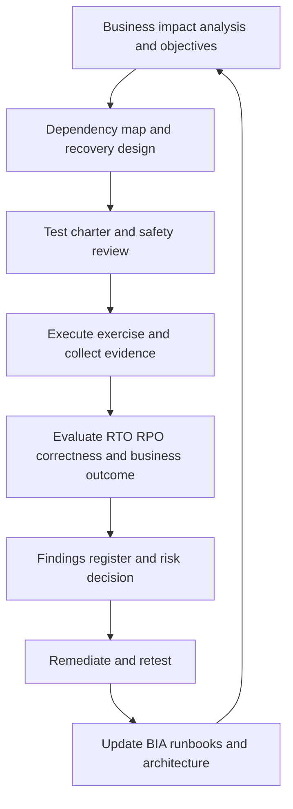

# Business Continuity and Resilience Testing

> **Document status:** Learning material and architecture-design aid  
> **Roadmap position:** Stage 2D — Data Architecture, Module 12, Topic 08  
> **Target filename:** `08-business-continuity-and-resilience-testing.md`  
> **Scope discipline:** The module roadmap recommends this topic after Topics 01–07 and expects a BIA, test plan, programme charter and findings register. The roadmap is the learning specification used here. The overall project tree establishes the file's location. Specific scenarios, thresholds, organisations, dates, costs and numerical targets below are illustrative assumptions, not formal source requirements. The roadmap states that this module is a design-and-documentation exercise; no live production outage is required.

## Contents

1. Position in the roadmap and learning outcomes
2. Reliability, resilience, HA, DR and BC
3. Business impact analysis and recovery priorities
4. Business-function-to-data-service dependency mapping
5. Degraded operating modes and minimum viable business operations
6. Designing a measurable resilience test
7. Resilience testing methods and trade-offs
8. Safety, approvals, blast-radius controls and abort conditions
9. Evidence and validation: proving recovery, not merely reading a plan
10. Test plan: availability-zone outage
11. Advanced scenario: regional outage plus data corruption
12. Worked BIA and recovery-objective consistency calculations
13. Test charter template
14. Findings register, remediation and retesting
15. Test cadence and annual risk-based programme
16. Continuous validation and automation
17. Metrics and management reporting
18. Governance, risk acceptance and feedback loops
19. Exercises and expected deliverables
20. Common mistakes and how to avoid them
21. Mastery criteria and completion checklist
22. Glossary
23. Relationship to adjacent roadmap topics

---

## 1. Position in the roadmap and learning outcomes

### 1.1 Why this topic comes last

The reliability and recovery module follows a deliberate progression:

1. **Reliability objectives, SLI, SLO and SLA** define what good service means.
2. **Failure domains and blast radius** identify what can fail together and how impact spreads.
3. **High availability and redundancy** reduce interruption from component failures.
4. **Backup, restore and recovery validation** address loss, corruption and deletion that redundancy alone cannot solve.
5. **RPO, RTO and DR strategies** turn business tolerance into recovery targets and strategy choices.
6. **Replay, reprocessing and backfill** bring recovered data current and correct.
7. **Incident response, runbooks and postmortems** coordinate people, decisions, communication and recovery.
8. **Business continuity and resilience testing** checks whether the technical design, people, decisions and business workarounds function together.

Topic 08 is not a replacement for the earlier topics. It is the evidence loop that tests them. If an exercise shows that a service cannot meet its RTO, revise the recovery strategy. If a failure affects supposedly isolated workloads, revise the failure-domain map. If a restore completes but data are inconsistent, revisit backup validation and replay/backfill. If nobody knows whether to switch to a manual process, revise the BIA and continuity plan.

### 1.2 Roadmap-derived scope versus recommendations

The module roadmap explicitly identifies these learning outcomes and deliverables for Topic 08:

- Relate technical recovery to continued business operations.
- Identify critical business functions and data dependencies.
- Design scenario-based tests with objectives and success criteria.
- Execute and record tests safely, including tabletop and live exercises where appropriate.
- Record findings, corrective actions and retesting.
- Build a test programme and cadence.
- Produce a BIA, test plan, programme charter and findings register.

This lesson provides recommended templates and examples to make those outcomes practical. It does **not** claim that a blank lesson file, the overall project tree, or the roadmap specifies the fictional company's target values, exact test frequencies, or any requirement to run a live failure experiment.

### 1.3 Learning outcomes

After completing this lesson, you should be able to:

1. Distinguish reliability, resilience, HA, DR and BC and explain how they complement each other.
2. Conduct a business impact analysis that links interruption to time-dependent business harm.
3. Map business functions to data products, pipelines, infrastructure, identity, keys, people and external dependencies.
4. Define a minimum viable business mode and safe workarounds for a disrupted data service.
5. Write a test charter with a falsifiable hypothesis, scope, preconditions, measurable pass/fail criteria and a stop plan.
6. Select a test method proportionate to service criticality, uncertainty and risk.
7. Test recovery time, recovery point, correctness, consumer resumption and communication—not only infrastructure availability.
8. Collect evidence, record limitations, assign corrective actions and retest to closure.
9. Build a risk-based programme and communicate residual risk to management.
10. Feed findings back into SLOs, failure-domain maps, HA, backup/restore, DR, replay and incident procedures.

### 1.4 Prerequisites

Recommended prerequisites are Topics 01–07, plus a basic understanding of data pipeline states, dependencies, access control, observability, backup retention, recovery points, replay idempotency and data quality. If these concepts are unfamiliar, use the adjacent topics as reference rather than treating this lesson as a substitute.

---

## 2. Reliability, resilience, HA, DR and BC

These terms overlap but answer different questions.

| Concept | Definition | Primary question | Typical evidence |
|---|---|---|---|
| Reliability | A service performs its required function within agreed conditions over time | Does it meet its service objectives? | SLI/SLO measurements, error-budget history |
| Resilience | A system and organisation withstand, contain, adapt to and recover from disruption | How does it behave when something fails? | Controlled test results, recovery evidence, corrective actions |
| High availability (HA) | Architecture that reduces interruption from component or infrastructure failure | Can service continue through a local failure? | Failover tests, redundancy validation, dependency checks |
| Disaster recovery (DR) | Capabilities and procedures for restoring technology and data after a major disruption | How do we restore service and state, within what RTO/RPO? | Restore, failover, replay, reconciliation and recovery timing evidence |
| Business continuity (BC) | Arrangements that keep critical business functions operating during disruption, possibly in degraded form | Can the business continue safely while normal services are unavailable? | BIA, workarounds, decision records, business sign-off |
| Operational continuity | The people, process, supplier and technology arrangements needed to sustain operations | Can people perform the required work, not just access systems? | Staff coverage, contact trees, runbook walkthroughs, supplier plans |

**DR is a means; BC is the business outcome.** Restoring a warehouse in four hours does not prove that a regulatory report can be produced by its deadline. The report may also depend on source data, identity services, encryption keys, an orchestration service, a data-quality gate, a business approver and a publishing channel. Conversely, BC may keep the business operating temporarily through an approved manual process while DR continues.

### 2.1 The plan-versus-proof distinction

A plan documents an intended response. A test creates evidence about whether that response works under stated conditions.

| Having a plan | Demonstrating the plan works |
|---|---|
| A document says a secondary region is available | A controlled test proves the region can be activated with required identity, keys, network routes, data and operators |
| A backup job reports success | An isolated restore produces a readable, consistent dataset with known recovery point and measured duration |
| A runbook lists steps | A competent operator unfamiliar with the procedure follows it, records outcomes and reaches the expected safe state |
| A business workaround is documented | Business owners demonstrate they can invoke it, obtain trusted inputs, reconcile work and exit the workaround safely |
| A target says RTO = 4 hours | Timed evidence shows when the business service became usable, including validation and consumer resumption |

Document review is useful, but it is weaker evidence than execution. A successful infrastructure failover is also insufficient if data are stale, corrupted, incomplete or inaccessible to consumers.

### 2.2 Resilience is more than recovery speed

A resilient service should be evaluated across several dimensions:

- **Availability:** can consumers access the service?
- **Integrity:** are the values correct and internally consistent?
- **Freshness:** are the data current enough for the intended decision?
- **Completeness:** are required entities, events and time windows present?
- **Confidentiality and control:** did recovery preserve access boundaries, encryption and audit requirements?
- **Recoverability:** can the service be restored from known-good state and brought current?
- **Operability:** can the assigned team execute procedures with available permissions and evidence?
- **Business continuity:** can critical decisions and obligations continue safely?

A service must not be declared recovered solely because a health endpoint returns success.

---

## 3. Business impact analysis and recovery priorities

A **business impact analysis (BIA)** identifies critical business activities, the consequences of disruption over time, dependencies, tolerable interruption, minimum operating requirements and recovery priorities. It provides a business rationale for service tiers and recovery objectives.

### 3.1 A practical BIA workflow

1. **Identify business functions.** Describe an outcome the organisation must produce, not merely a system. Examples: publish a regulatory report, detect fraud, settle transactions, provide customer balances.
2. **Identify time sensitivity.** Record deadlines, peak periods, legal or contractual windows, and the point at which interruption becomes materially harmful.
3. **Assess impact over time.** Consider financial loss, customer harm, regulatory exposure, operational backlog, decision quality, reputational impact and safety where relevant.
4. **Define minimum viable operation.** What must continue? What can pause? What can be performed manually, at reduced volume, or from an alternate approved source?
5. **Map dependencies.** Include upstream data, processing, storage, identity, keys, networks, DNS, orchestration, catalogues, monitoring, people, suppliers and consumers.
6. **Set business recovery priorities.** Determine the order in which functions should resume. Do not rank by technical convenience alone.
7. **Derive candidate recovery objectives.** Propose maximum tolerable disruption, RTO and RPO in business terms, then test whether architecture and operating procedures can meet them.
8. **Validate with accountable owners.** Business owners, technology owners, risk and compliance representatives should confirm assumptions and sign off relevant objectives.
9. **Review after change or incident.** A new report deadline, source dependency, data-retention rule or business process can invalidate an old BIA.

### 3.2 Terms that must not be conflated

- **Maximum tolerable period of disruption (MTPD):** the outer boundary beyond which disruption is unacceptable for a business activity. Terminology varies by organisation; define it in the local policy.
- **RTO:** the target time to restore the relevant service to an agreed usable state after disruption. Define the start event and what “usable” means.
- **RPO:** the maximum tolerable data-loss window, expressed as time or a clearly defined equivalent. It is not the time to restore.
- **Minimum business continuity objective (MBCO):** the minimum level of service or output that must be sustained during disruption, if the organisation uses this term.
- **Workaround activation time:** time needed to authorise and begin an alternate process. It can be distinct from technology RTO.

RTO should fit inside the business tolerance, leaving time for decision-making and safe resumption. For example, if a function's illustrative maximum tolerable disruption is 8 hours, an RTO of 8 hours may be too tight if the function needs an additional hour to validate and publish its output. The organisation must define whether those steps are included in RTO; ambiguity makes measurements incomparable.

### 3.3 Impact categories

Use a consistent scoring rubric, but retain narrative evidence. A numeric score alone can conceal a catastrophic impact in one dimension.

| Dimension | Questions to ask | Possible evidence |
|---|---|---|
| Financial | What revenue, loss, penalties or cost accumulates over time? | Business estimates, transaction volume, contractual terms |
| Customer | Which customers or channels are affected? Is harm reversible? | Support impact, service commitments, customer journeys |
| Regulatory/legal | Are statutory deadlines, retention, reporting or audit obligations affected? | Compliance mapping, reporting calendar, legal advice where required |
| Decision quality | Could stale or incorrect data cause an unsafe decision? | Data consumers, decision thresholds, downstream controls |
| Operational | Does a backlog grow? Can staff work safely around it? | Queue growth, manual capacity, staffing assumptions |
| Reputational | Would the event damage trust or require external notification? | Stakeholder assessment and approved policy |
| Safety/mission | Could decisions affect physical safety or essential services? | Domain-specific risk assessment |

### 3.4 Worked fictional BIA example

The following is an **illustrative** example for *Northbridge Financial*, a fictional enterprise. The values are assumptions for learning, not recommended targets or claims about a real institution.

| Business function | Business deadline / impact trigger | Minimum viable operation | Candidate RTO | Candidate RPO | Priority |
|---|---|---|---:|---:|---|
| Regulatory exposure report | Due by 07:00 on business days; late or incorrect submission creates material compliance risk | Approved fallback extract plus documented review, only if compliance authorises it | 3 h | 15 min | 1 — critical |
| Fraud monitoring | Alerts normally within 2 min; delayed signals increase exposure | Continue core rules on approved alternate feed; flag reduced coverage and queue unresolved cases | 30 min | 5 min | 1 — critical |
| Customer balance inquiry | Customer-facing freshness target 5 min; stale balance can mislead users | Show last-updated time and invoke a controlled read-only fallback if validated | 1 h | 5 min | 2 — high |
| Daily marketing segmentation | Campaign preparation due next business day | Defer campaign build; do not send based on unvalidated stale segments | 12 h | 24 h | 3 — important |
| Historical analytics sandbox | No same-day business deadline | Pause jobs and restore after critical workloads | 48 h | 24 h | 4 — standard |

**How to interpret this table:** priority is a business decision. It does not automatically dictate active-active architecture or expensive replication. The candidate objectives must be checked against dependency capabilities, cost, risk, retention and measured recovery time. A 15-minute RPO is meaningless if the source cannot reproduce changes inside that window or if restored records cannot be reconciled.

### 3.5 Prioritisation under resource contention

When multiple services fail at once, recovery capacity is finite. Establish priority before the incident, then allow the incident commander and business owner to make documented exceptions. A sensible sequence may be:

1. Protect people, security and integrity; stop propagation of corruption.
2. Preserve evidence and identify known-good recovery points.
3. Restore shared prerequisites such as identity, key access, network connectivity and control-plane services.
4. Restore highest-priority business functions and their minimum dependencies.
5. Validate correctness and freshness before enabling decisions or publication.
6. Resume lower-priority workloads only when they will not threaten critical recovery.

Do not let a technically easy service displace a critical business function without an explicit reason.

---

## 4. Mapping business functions to data services and dependencies

A dependency map should link the business outcome to the data products and technical capabilities required to produce it. The map should include logical dependencies and operational dependencies.

### 4.1 Dependency categories

- **Data inputs:** operational databases, CDC, files, event streams, reference data and external feeds.
- **Processing:** orchestration, transformation, quality gates, schedulers, streaming consumers and replay/backfill jobs.
- **State and storage:** object storage, warehouse/lakehouse, serving database, checkpoints, offsets, catalogues and configuration.
- **Control plane:** identity provider, secrets service, key management, DNS, certificates, network routing and deployment control.
- **Operations:** on-call coverage, incident commander, service desk, business approver, vendor contacts and access approval.
- **Observability:** metrics, logs, traces, freshness monitors, lineage, data-quality rules and alert delivery.
- **Consumers and channels:** dashboards, APIs, report publisher, file-transfer endpoint, regulator portal or internal decision process.
- **Governance:** data classification, retention, deletion obligations, legal holds, audit logging and approval controls.

A common failure is to map only compute and storage. A failover environment may be healthy but unusable because the identity provider is unavailable, encryption keys cannot be retrieved, private network routes are missing, or the people authorised to approve a report cannot access the alternate environment.

### 4.2 Example business-to-service map

Illustrative function: **publish the 07:00 regulatory exposure report**.

| Layer | Required capability | Dependency owner | Recovery evidence |
|---|---|---|---|
| Business | Report definition, deadline and approval authority | Regulatory reporting owner | Approved output and recorded decision |
| Source | Ledger and card transactions through defined cutoff | Source-system owners | Source control totals and cutoff timestamps |
| Ingestion | CDC and file landing, gap detection | Data ingestion owner | Offset continuity, file manifest and source-to-landed counts |
| Transform | Exposure calculations and reference-data joins | Data product owner | Versioned logic, quality checks and reconciliation |
| Storage | Known-good raw and curated data | Data platform owner | Restore point, checksums where appropriate, consistent snapshot |
| Orchestration | Dependency order and retry control | Platform operations | DAG state, successful task lineage and bounded retries |
| Identity and keys | Approved operator and workload access | Security/platform identity owner | Access tests and audit records; no shared credentials |
| Observability | Logs, freshness, quality, alert routing | SRE/data observability owner | Timestamped evidence and working alert route |
| Publication | Output location, signing/transfer, approval | Reporting operations | Consumer receipt/acknowledgement and publication timestamp |
| Continuity fallback | Approved manual or alternate-source process | Business continuity owner | Exercise record, reconciliation and fallback exit criteria |

### 4.3 Dependency health is not the same as data readiness

A dependency can be “up” while still being unsuitable. Examples include a source that responds but has not reached its cutoff, a replica that is available but lagging, a catalogue that loads but describes an old schema, or a report store containing mixed snapshots. Test assertions should therefore specify both technical state and data state.

### 4.4 Ownership and escalation

Every critical dependency should have:

- A named role or team accountable for service health.
- A primary and backup contact path.
- An operational runbook and access prerequisites.
- A business owner or consumer representative.
- A declared recovery tier and dependencies.
- A known escalation path when the dependency owner is unavailable.

Do not put personal phone numbers or secrets in broadly accessible lesson material. In real environments, link to the approved contact directory and secrets-management process.

---

## 5. Degraded operating modes and minimum viable business operations

Business continuity is often the ability to keep a safe, reduced version of a function running until full service is restored. A workaround is not automatically safe merely because it is possible.

### 5.1 Types of degraded operation

| Pattern | Example | Key risk | Required control |
|---|---|---|---|
| Reduced freshness | Display data with a prominent “last updated” time | Consumers treat stale data as current | Freshness threshold, UI/API signalling and escalation |
| Reduced coverage | Fraud checks continue on a subset of sources | False confidence in detection coverage | Explicit coverage indicator, compensating review and queue monitoring |
| Manual process | Approved operator prepares a controlled extract | Human error, uncontrolled copies, missing audit trail | Dual review, access restriction, secure storage, reconciliation and expiry |
| Alternate source | Use a validated replica or alternate provider | Different cutoff, semantics or completeness | Source authority, cutoff comparison and reconciliation |
| Read-only mode | Stop writes while preserving safe queries | Consumers may assume updates still occur | Clear service state, write rejection and resumption checks |
| Queue-and-catch-up | Accept events durably while downstream processing is paused | Retention expiry or backlog overload | Durable queue, capacity estimate, retention check and replay plan |
| Deferred processing | Pause low-priority analytics | Backlog and downstream schedule collision | Priority policy, catch-up window and consumer notice |

### 5.2 Define a minimum viable business operation

For each critical function, specify:

1. **Permitted activities:** what staff or systems may continue to do.
2. **Prohibited activities:** what decisions or publications must stop.
3. **Approved inputs:** source, authority, cutoff, freshness and known limitations.
4. **Controls:** approvals, dual control, reconciliation, audit logging and access limits.
5. **Capacity:** volume and duration the workaround can sustain.
6. **Activation authority:** who may invoke it and under what conditions.
7. **Communication:** who must be informed, by when, and what uncertainty must be disclosed.
8. **Exit criteria:** what must be true before returning to normal operation.
9. **Reconciliation:** how work performed during degraded mode is merged with recovered system state without duplicates or omissions.
10. **Expiry:** when the workaround must be re-approved or stopped.

### 5.3 Example: manual reporting fallback

Assumptions (illustrative): the normal report is due at 07:00; the primary transformation platform is unavailable; a prior approved extract exists but is 20 minutes older than the preferred cutoff.

A safe fallback plan does not say “use the last file.” It specifies:

- Which report versions are permitted as fallback and how the file's cutoff is proved.
- Who determines whether the cutoff difference is acceptable.
- Which source control totals and critical quality rules must pass.
- How the output is marked as a fallback and how its limitations are communicated.
- Who performs independent review and records approval.
- Which publication channels remain authorised.
- Whether legal, regulatory or risk owners must approve late publication instead of using the fallback.
- How the normal platform's recovered data will be reconciled with the fallback output.
- How to withdraw or supersede the fallback after full recovery.

If the fallback cannot prove data integrity or its use is not authorised, the correct action may be to withhold the output and escalate rather than publish uncertain data.

---

## 6. Designing a measurable resilience test

A useful test is a controlled experiment, not a meeting with an optimistic conclusion. It should state what is being challenged, why the challenge matters, what outcome would support or refute the hypothesis, and how the test will stop safely.

### 6.1 Test-design sequence

1. **Risk statement:** identify a plausible failure and its business consequence.
2. **Objective:** state what capability the test should prove or falsify.
3. **Hypothesis:** make a falsifiable claim, including thresholds and scope.
4. **Scope:** list systems, data, consumers, teams and failure boundaries included and excluded.
5. **Preconditions:** confirm approvals, test environment, known-good recovery points, permissions, capacity, contact paths and monitoring.
6. **Baseline:** record normal service level, freshness, volume, lag, quality, dependency state and relevant SLOs before the test.
7. **Scenario and injection:** define the exact simulated or controlled failure, start condition and permitted changes.
8. **Success criteria:** specify measurable pass/fail conditions for business function, data correctness, RPO/RTO, communication, safety and operator performance.
9. **Evidence plan:** name each signal, source, timestamp, owner and retention location.
10. **Safety plan:** set blast-radius limits, abort thresholds, stop authority, rollback/containment and recovery plan.
11. **Execution:** follow approved steps, record deviations and preserve timestamps.
12. **Evaluation:** compare observed behaviour to criteria; separate pass, fail, inconclusive and not tested.
13. **Findings:** assign risk, owner, deadline, retest and residual-risk authority.
14. **Retest and update:** prove the fix, revise runbooks/designs and feed findings into the next programme cycle.

### 6.2 Hypothesis and criteria examples

Weak hypothesis: “The platform will survive a zone outage.” It is too broad to test.

Stronger illustrative hypothesis: “If the primary availability zone becomes unavailable in the isolated test environment, the critical reporting path will resume producing validated outputs within 45 minutes, with no more than 5 minutes of accepted data loss, all required identity and key dependencies available, and the business owner notified within 10 minutes.”

The thresholds above are invented for the example. They must be derived from an approved BIA and service objectives in a real system.

A test passes only if all required criteria pass. If service returns in 20 minutes but data are missing, the test fails the data-integrity criterion. If the system recovers but no one can approve the output, business recovery has not been demonstrated. If a criterion could not be measured, mark it **inconclusive/not tested**, not passed.

### 6.3 Baseline and measurement boundaries

Before execution, define the clock:

- **T0:** the declared start event (for example, the controlled fault injection or confirmed loss of service).
- **T_detect:** time the monitoring/on-call system detects the event.
- **T_decide:** time the authorised role decides to fail over or invoke continuity mode.
- **T_service:** time a technical endpoint first responds successfully.
- **T_data:** time the recovered data pass integrity, completeness, freshness and consistency checks.
- **T_business:** time the consumer can safely perform the intended business function, including approvals and publication where in scope.

These timestamps are not interchangeable. If the RTO definition is business service restoration, measure from the declared start to T_business, not merely T_service. Record whether detection and decision time are included in the agreed RTO definition.

---

## 7. Resilience testing methods and trade-offs

Select a method based on the risk being tested, the uncertainty it resolves and the blast radius it introduces. A programme should use multiple methods; no single test proves all aspects of resilience.

| Method | What happens | Strengths | Limitations / risks | Typical evidence |
|---|---|---|---|---|
| Document review | Review BIA, DR plan, contact lists and procedures | Cheap; finds omissions and conflicting assumptions | Does not prove execution or actual recovery times | Review record, gaps and approvals |
| Walkthrough | Operator narrates each step against a scenario | Tests clarity, ownership and dependencies | May hide practical access or timing problems | Step-by-step notes, questions and decisions |
| Tabletop exercise | Participants respond to injects in a facilitated scenario | Tests authority, judgement, escalation and communication safely | Does not prove technology can recover | Decision log, timeline, communication samples |
| Runbook usability test | A person not involved in writing the runbook follows it in a safe environment | Exposes ambiguity, missing permissions and hidden knowledge | Limited to the tested scenario and environment | Deviations, time per step, operator feedback |
| Isolated backup restore | Restore backup into a segregated environment | Tests recoverability and consistency without production interruption | May not represent production scale, identity, network or consumers | Restore duration, recovery point, reconciliation evidence |
| Replay/backfill simulation | Reprocess bounded data with duplicate and gap checks | Tests data catch-up, idempotency and downstream correctness | May not reproduce production load or external side effects | Counts, checksums, gap/duplicate checks, lag and runtime |
| Failover drill | Move service to a secondary component or zone | Tests HA control paths and real dependencies | Can cause unintended traffic shift or split-brain if poorly controlled | Transition timestamps, health, routing and data checks |
| Game day | Coordinated exercise involving operators, dependencies and business stakeholders | Tests people and systems together | Scope can expand; needs strict control and stop authority | Timeline, decisions, user impact and findings |
| Controlled failure injection | Introduce a preapproved fault in a bounded environment | Tests resilience mechanisms and detection directly | Can cascade; only safe with guardrails and rollback | Injection log, observed blast radius, abort checks |
| Regional DR exercise | Activate alternate region and recover data and consumers | Strong evidence of end-to-end DR capability | High cost, coordination and risk; production use requires formal approval | Actual RTO/RPO, data validation, dependencies and business sign-off |
| Full production interruption | Deliberately interrupt a production service | Strongest realism when properly governed | Highest risk; not required for this learning module and may be unjustified | Approved change, impact monitoring, rollback and signed report |

**Safety principle:** use the least risky method that answers the question. A tabletop is appropriate for authority and communication; it cannot prove restore integrity. An isolated restore can prove a backup is usable; it cannot prove the business can operate during a region outage. Escalate to higher-risk testing only when the additional evidence justifies the risk and controls are adequate.

---

## 8. Safety, approvals, blast-radius controls and abort conditions

No live infrastructure or production outage is needed for this lesson. The following controls are a design template for any organisation that later chooses to run a real exercise.

### 8.1 Preconditions and approvals

Before a technical exercise, confirm and record:

- Named exercise lead, technical leads, safety controller and business owner.
- Written approval from the service owner and required change/risk authorities.
- Explicit environment and resource identifiers; no ambiguity about production versus test.
- Scope, exclusions, start/end window, participant list and contact tree.
- Baseline health and SLO state; no unresolved incident that makes the test unsafe.
- Tested rollback or containment method and a separate stop authority empowered to abort.
- Known-good backup or recovery point and validated recovery procedure if the exercise can affect data.
- Access to required identity services, encryption keys, network routes and monitoring.
- Data protection controls for any copied data; prefer synthetic or suitably masked data in test environments.
- Downstream consumers and third parties informed where required.
- Capacity and cost limits; quotas or resource caps where available.
- Evidence capture and secure storage location.
- Clear criteria for “no-go,” pause, abort and post-test verification.

### 8.2 Safety controller and stop authority

The safety controller should not be the only person performing the technical change. Their responsibility is to monitor blast radius and stop the exercise when pre-agreed conditions are reached. Any participant should be able to raise an immediate safety concern. The exercise lead should record who exercised authority and why.

### 8.3 Example abort conditions

These thresholds are **illustrative only** and must be adapted to the system's SLOs and approved risk limits.

- Any sign of uncontrolled impact outside the declared test boundary.
- Customer-facing error rate exceeds the agreed limit for two consecutive measurement windows.
- Critical data freshness falls below the minimum business continuity threshold.
- A data-quality or reconciliation control indicates unexpected corruption or duplicate publication.
- A failover creates split-brain, conflicting writers or uncertain ownership of authoritative state.
- Required identity, key access, audit logging or monitoring becomes unavailable.
- Rollback or containment cannot be confirmed within the approved time budget.
- A real incident starts or the incident commander/service owner orders a stop.
- Costs, capacity, queue depth or resource use exceed the approved cap.
- The test operator cannot determine the current state or safe next step.

**Abort procedure:** stop further fault injection; apply the approved containment action; prevent new writes if integrity is uncertain and if the runbook authorises it; preserve logs and timestamps; notify the incident commander/service owner; restore only through the approved path; validate data and consumer state; and do not resume the experiment without a new decision. Never improvise destructive commands during a test.

### 8.4 Go/no-go checklist

| Check | Go condition | If not met |
|---|---|---|
| Scope and approval | Signed and unambiguous | No-go |
| Baseline | Within agreed safe bounds | Postpone or explicitly reassess |
| Recovery point | Known and usable for affected state | No-go for destructive/data-impacting test |
| Rollback/containment | Rehearsed or validated for this scope | No-go for risky injection |
| Monitoring | Independent signals and alert routes work | No-go for failure injection |
| Roles | Lead, operator, safety controller and stop authority present | No-go |
| Downstream impact | Understood, bounded and communicated | Narrow scope or no-go |
| Data safety | Access, masking, retention and audit controls approved | No-go |
| End-state validation | Specific checks and owners defined | No-go |

---

## 9. Evidence and validation: proving recovery, not merely reading a plan

Evidence should make the result reproducible and reviewable by someone who did not run the test.

### 9.1 Evidence package

Capture at minimum:

- Test charter version, approvals, environment, scope and participants.
- Start/end timestamps and clock source/time zone.
- Baseline service metrics and data state.
- Fault/inject details, change references and operator actions.
- Alert delivery and acknowledgement times.
- Decision log, incident roles and escalation events.
- Logs, metrics, traces, orchestration state, lineage and dependency health.
- Backup identifier/recovery point, restore duration and replay boundaries where applicable.
- Source and destination row counts/control totals; key uniqueness; missing/duplicate windows; data-quality results; freshness and consistency checks.
- Business validation: report acceptance, consumer test, publication receipt or approved degraded-mode evidence.
- Communication timeline and representative status updates.
- Deviations, abort events, unexpected effects and limitations.
- Findings with owner, due date, severity, retest and residual-risk decision.
- Final outcome: pass, fail, partial pass, inconclusive or not tested, with rationale.

Do not include secrets, raw sensitive records or unrestricted production extracts in the evidence pack. Reference protected logs or controlled artifacts through approved access paths.

### 9.2 Data correctness checks

The exact checks depend on the data product, but a robust recovery validation commonly includes:

1. **Recovery point:** identify the latest source event, transaction or timestamp represented in the restored state.
2. **Completeness:** reconcile expected partitions, files, keys, time windows or source manifests.
3. **Uniqueness:** check business keys and replay duplication boundaries.
4. **Consistency:** ensure related tables, dimensions, balances and aggregates represent a compatible snapshot.
5. **Accuracy:** compare authoritative control totals or independently computed results where possible.
6. **Freshness:** compare event time, ingestion time and consumer-visible update time against the objective.
7. **Schema and semantics:** validate schema version, reference data and transformation version.
8. **Lineage:** identify which upstream versions and transformations produced the output.
9. **Downstream impact:** refresh and validate dependent marts, reports, features, APIs or exports in dependency order.
10. **Publication:** prove the consumer can access and correctly interpret the output; capture acknowledgement where available.

A successful process exit code is one signal, not proof of correctness.

### 9.3 RTO measurement boundary

A common operational error is to stop the timer when the compute service is reachable. For a data product, full recovery may include restore, replay, quality validation, downstream refresh, approval and consumer resumption.

Illustrative recovery timeline:

| Phase | Duration | Cumulative elapsed time |
|---|---:|---:|
| Detect and declare | 10 min | 10 min |
| Decide and activate recovery | 15 min | 25 min |
| Restore platform and metadata | 50 min | 75 min |
| Replay missing events | 35 min | 110 min |
| Reconcile and validate | 20 min | 130 min |
| Consumer refresh and business approval | 15 min | 145 min |

Total measured business recovery time is 145 minutes (2 h 25 min) under these illustrative assumptions. If the approved RTO is 2 hours measured from the initial incident start to business usability, this test fails the RTO even if the infrastructure was available after 75 minutes. The team must not redefine the clock after the test to claim success.

### 9.4 RPO measurement

Define RPO as a time window or equivalent data-loss boundary. For a timestamp-based example:

- Incident start: 10:00.
- Latest source event included in the recovered, validated dataset: 09:54.
- Measured recovery point lag: 6 minutes.
- Illustrative approved RPO: 5 minutes.

This result fails the RPO by 1 minute. The calculation is valid only if timestamps are trustworthy, the source event-time semantics are defined, and the recovered dataset is validated. “Backup completed at 09:58” does not prove a 2-minute RPO if the backup omitted transactions committed before 09:58.

### 9.5 Recovery success is multidimensional

Use separate outcome fields rather than one undifferentiated “success” label:

- Technical service restored: pass/fail.
- Data integrity and consistency: pass/fail/inconclusive.
- RTO met: pass/fail/not measured.
- RPO met: pass/fail/not measured.
- Business function resumed at required level: pass/fail.
- Communications and authority: pass/fail/partial.
- Safety controls followed: pass/fail.
- Corrective actions assigned: pass/fail.

An overall result can be “failed” when a critical criterion fails even if other components pass. Document partial successes to preserve useful evidence.

---

## 10. Test plan: availability-zone outage

This is a **paper-based and isolated-environment exercise**. No production outage is required. The service, targets and timings below are fictional assumptions.

### 10.1 Scenario and hypothesis

A fictional reporting pipeline runs across two availability zones. The primary worker zone becomes unavailable. The platform is expected to reschedule processing in the surviving zone, retain source events, and deliver a validated report without breaching its approved recovery objectives.

**Hypothesis (illustrative):** if the primary zone is unavailable, the reporting path will resume validated output within 45 minutes, the latest recoverable source position will be no more than 5 minutes behind the incident start, downstream data-quality checks will pass, and the business owner will receive a factual update within 10 minutes of incident declaration.

### 10.2 Scope

**In scope:** worker scheduling, service routing, durable input retention, checkpoint/offset recovery, identity and key access, orchestration, freshness and quality alerts, report generation, business validation, incident coordination and communications.

**Out of scope:** total regional loss, deliberate data corruption, irreversible production writes, third-party regulator portal failure and unbounded capacity stress. These require separate charters.

### 10.3 Roles

| Role | Responsibility |
|---|---|
| Exercise lead | Owns charter, timeline, coordination and final report |
| Technical operator | Executes only the approved fault simulation and recovery steps |
| Safety controller | Monitors blast radius and can stop the test |
| Incident commander (exercise role) | Makes coordination and escalation decisions |
| Data owner | Defines integrity, completeness and freshness acceptance |
| Business owner | Confirms report usability and continuity decisions |
| Observer/scribe | Records evidence, decisions, timestamps and deviations |
| Security/platform representative | Confirms identity, key, audit and network prerequisites |

One person may fill multiple roles only when separation does not undermine safety or decision independence.

### 10.4 Preconditions

- Written approval for the isolated environment and test window.
- A known-good recovery point and synthetic or approved test data.
- Baseline freshness, throughput, error rate, backlog and data-quality results recorded.
- Secondary zone identity, key access, routing and compute capacity confirmed.
- Monitoring and alert delivery independently verified.
- Approved rollback/containment steps and stop authority available.
- The report owner and downstream consumer test are available.
- No unresolved incident or material change freeze conflict.

### 10.5 Execution procedure

1. **Baseline:** capture source offset/watermark, latest event time, row/control totals, current pipeline state, lag, freshness, quality checks and service metrics.
2. **Open exercise record:** record test ID, participants, approval, environment, T0 definition and stop authority.
3. **Simulate zone loss:** use the environment's approved test control or a preconfigured fault simulator. Do not run generic destructive shell commands.
4. **Observe detection:** record alert generation, routing, acknowledgement and declaration times. If detection does not occur within the pre-agreed threshold, do not silently continue; record the finding and decide whether further steps are safe.
5. **Confirm containment:** ensure only the declared zone is affected and no unintended cross-environment or customer impact occurs.
6. **Execute failover:** follow the approved runbook. Record each decision and dependency check.
7. **Validate platform readiness:** check identity, key retrieval, network path, scheduler, storage, input retention and output destination.
8. **Validate data recovery:** compare offsets/watermarks, completeness, uniqueness, control totals, schema and quality rules. Replay only the approved bounded gap using idempotent procedures.
9. **Validate consumer readiness:** refresh downstream output, have the business owner perform the acceptance check, and record publication/receipt evidence.
10. **Measure results:** calculate elapsed business recovery time and recovery-point lag using the charter's definitions.
11. **Restore test baseline:** remove the simulated fault through the approved procedure, return routing/configuration to the intended state, and verify no stale test settings remain.
12. **Close the exercise:** confirm data and consumer state, capture evidence, record deviations and create findings.

### 10.6 Pass/fail criteria

All thresholds are illustrative and must be approved for a real service.

| Criterion | Pass condition | Evidence |
|---|---|---|
| Containment | Impact remains within the declared test scope | Monitoring and operator log |
| Detection | Alert delivered and acknowledged within 5 minutes | Alert timestamps |
| Business recovery time | Validated report is usable within 45 minutes of T0 | Timeline, quality results, business sign-off |
| Recovery point | Validated output is no more than 5 minutes behind T0 | Source position and output reconciliation |
| Data integrity | No unexplained missing keys, duplicates or control-total differences | Reconciliation report |
| Dependency readiness | Identity, keys, network, scheduler and storage work in surviving zone | Recorded checks and logs |
| Communication | Business owner receives first update within 10 minutes of declaration and updates follow cadence | Message timeline |
| Safety | No abort condition breached; rollback and post-test checks pass | Safety-controller record |
| Runbook usability | Operator can execute without undocumented intervention | Step log and observer notes |

Any critical criterion that fails means the test does not pass overall. A result may be **inconclusive** if the environment could not represent the relevant condition or required evidence was missing.

### 10.7 Abort and rollback

Abort immediately if impact escapes the test boundary, data integrity becomes uncertain, monitoring or identity/key access fails unexpectedly, the safety controller or service owner orders a stop, or rollback cannot be confirmed. Stop injection, contain the fault, preserve evidence, restore the approved baseline and validate the output before declaring the environment normal. Do not continue simply to obtain a passing result.

### 10.8 Expected report

The report should state the hypothesis, exact scope, baseline, timeline, criteria results, measured recovery point and time, business acceptance, deviations, safety outcome, findings, owners, deadlines, retest method and residual risk. Include what the test did **not** prove—for example, regional recovery or corruption recovery.

---

## 11. Advanced scenario: regional outage plus data corruption

This scenario combines a broad infrastructure failure with a data-integrity problem. It is intentionally complex because a replica or failover target may have copied corrupted state. This is a **tabletop plus isolated restore/replay design exercise**, not an instruction to corrupt production data.

### 11.1 Scenario assumptions

Fictional enterprise *Northbridge Financial* publishes a critical exposure report at 07:00. A regional outage occurs at 04:10. The alternate region is reachable, but its latest replicated curated tables contain incorrect exposure values caused by a transformation defect introduced at 02:00. Raw input events remain available in a separate protected store. The normal report deadline is approaching. The following numbers are illustrative:

- Candidate business RTO: 3 hours from declared incident to a validated, usable report.
- Candidate RPO: 15 minutes for source transactions, subject to validated recovery point.
- Detection/declaration: 10 minutes.
- Alternate-region activation and dependency readiness: 35 minutes.
- Restore a known-good curated snapshot: 50 minutes.
- Replay/reprocess from known-good raw inputs: 45 minutes.
- Reconciliation and quality validation: 25 minutes.
- Downstream report refresh, approval and publication: 20 minutes.

If all phases are sequential, elapsed time is 10 + 35 + 50 + 45 + 25 + 20 = **185 minutes (3 h 5 min)**. This exceeds the illustrative 3-hour RTO by 5 minutes. The calculation is a planning estimate, not evidence of measured runtime. Parallelisable work may reduce duration only if dependencies and validation permit it; do not simply subtract overlapping tasks without proving that they can run concurrently.

### 11.2 Decisions the exercise must force

1. Who declares the incident and authorises regional activation?
2. Is the alternate region's curated data trusted, or might replication have propagated corruption?
3. Which backup or snapshot is known to predate the defect? Is it consistent with raw event retention and reference data?
4. Can the team establish the RPO from authoritative source records rather than a backup timestamp alone?
5. Which data are restored, which are replayed, and in what dependency order?
6. Are transformation code, configuration, reference data and schema versions reproducible?
7. Are external side effects suppressed during reprocessing, such as sending notifications or republishing reports prematurely?
8. Can the business use an approved degraded mode while full validation continues?
9. Who decides whether to publish a late but correct report versus a timely but untrusted report?
10. What exact evidence permits the team to declare business recovery?

### 11.3 Safe recovery strategy

- **Contain:** isolate the suspect curated output and prevent automated publication. Avoid deleting evidence or overwriting the only copy of affected state.
- **Preserve:** capture incident timeline, replication positions, job/version metadata, relevant logs and quality failures under approved retention and access controls.
- **Select a known-good point:** identify a recovery point before the defect, verify backup integrity, schema and reference-data compatibility, and confirm it meets the required RPO or document the gap.
- **Restore into a controlled target:** use an isolated or versioned destination where possible. Do not make unvalidated data authoritative.
- **Reprocess bounded inputs:** use retained raw data, fixed code/configuration versions, explicit time/offset boundaries and idempotent writes. Suppress non-idempotent side effects.
- **Reconcile:** compare source control totals, record counts, business keys, exposure aggregates, missing/duplicate events, late data and cross-table consistency.
- **Validate lineage and consumers:** identify every downstream report, dashboard, API or export that consumed suspect data; refresh in dependency order and mark superseded outputs clearly.
- **Choose continuity mode:** if an approved alternate report is used, disclose cutoff and limitations, require the defined business approval and retain evidence. If correctness cannot be established, escalate rather than imply certainty.
- **Resume and monitor:** publish only after quality and business acceptance gates pass. Observe the service for a defined stability period and confirm backlog/catch-up behaviour.
- **Learn:** revise failure-domain assumptions, replication trust model, backup retention, corruption detection, replay controls, report gating and incident procedures.

### 11.4 Test criteria and failure modes

| Criterion | Evidence required | Failure example |
|---|---|---|
| Corruption is contained | Suspect outputs quarantined; publication gate blocks them | Automated report publishes corrupted data |
| Known-good recovery point established | Snapshot/version, source positions and validation | Team selects latest replica without checking corruption window |
| RPO measured | Recovered source position reconciled to incident time | Backup timestamp is used as a proxy for data completeness |
| Recovery timeline measured | Phase start/end timestamps and total business recovery time | Infrastructure-ready time is reported as total recovery |
| Replay is safe | Bounded range, deterministic version, idempotency and side-effect controls | Duplicate transactions or external notifications |
| Correctness demonstrated | Reconciliation and critical business-rule checks pass | Only row counts are checked despite value corruption |
| Consumers informed | Time-stamped status and affected-output list | Downstream users continue using superseded report |
| Decision authority clear | Named role and recorded publication decision | Technical team makes an unapproved business risk decision |
| Recovery remains within safety limits | Test is bounded, evidence retained, stop conditions honoured | Exercise expands into uncontrolled production changes |

### 11.6 Additional scenario coverage: common-cause and dependency loss

The combined scenario above should be complemented by targeted variants. These are planning options, not additional mandatory exercises; select them according to BIA, uncertainty and approved risk.

| Variant | Fault assumption | What the test should prove | Critical safety / validation concern |
|---|---|---|---|
| Single component failure | One worker or storage endpoint fails while dependencies remain healthy | Local recovery, retry boundaries, alerting and no duplicate writes | Verify the fault is limited to the named component |
| Common-cause failure | Two nominally redundant services depend on the same identity provider, network route, DNS control plane or key service | Dependency map exposes shared failure domains and the continuity path is understood | Do not assume “multi-zone” means independent; avoid injecting a shared control-plane failure outside an isolated scope |
| Identity or credential dependency loss | Workload identity or credential rotation fails during recovery | Least-privilege access, emergency access policy and audit controls remain usable | Never paste or distribute secrets; do not disable authentication as a workaround |
| Encryption-key dependency loss | Data storage is healthy but approved key access is unavailable | Key recovery/availability and authorised access are included in recovery time | Do not weaken encryption or copy keys to an unapproved location |
| Observability dependency loss | Central metrics or alert routing is unavailable | Independent signals, alternate contact paths and manual evidence collection exist | Stop risky injection if the team cannot observe the blast radius safely |
| External supplier/source loss | A critical feed or publication endpoint is unavailable | Alternate source, buffering, business fallback and reconciliation are defined | Validate source authority and cutoff; do not silently substitute semantically different data |
| Corruption without infrastructure loss | Pipeline remains available but a transformation produces wrong values | Quality gates detect semantic errors and block publication | A healthy endpoint must not override failed integrity checks |

A scenario catalogue should record which variants were actually tested, which were only discussed, and which remain untested. Do not infer that passing a zone failover test proves resilience to identity loss, key unavailability, a regional outage or logical corruption.

### 11.5 Debrief prompts

- Did replication increase availability while also propagating corruption?
- Was there a known-good recovery point independent of the failed region?
- Were raw data, transformation code and reference data all retained long enough?
- Did the business understand the difference between restored service and trusted data?
- Which phase dominated the RTO estimate, and which can be improved safely?
- Were there hidden dependencies on identity, keys, DNS, catalogue, alert routing or people?
- Which findings should revise Topic 01 objectives, Topic 02 failure domains, Topic 03 HA, Topic 04 backup/restore, Topic 05 DR strategy, Topic 06 replay/backfill and Topic 07 runbooks?

---

## 12. Worked BIA and recovery-objective consistency calculations

### 12.1 RTO budget must include the actual business endpoint

Suppose a critical function has an illustrative RTO of 180 minutes. The estimated phases are:

| Phase | Estimate |
|---|---:|
| Detect and decide | 15 min |
| Activate recovery environment | 25 min |
| Restore required data and metadata | 55 min |
| Replay or backfill | 35 min |
| Validate and reconcile | 25 min |
| Refresh consumers and obtain approval | 15 min |
| **Total** | **170 min** |

Nominal headroom is 180 − 170 = **10 minutes**. This is fragile if estimates exclude access delays, queue contention, slow dependencies or rework. A plan should include uncertainty and a contingency margin justified by evidence. If a 20-minute contingency is needed, this plan does not meet the 180-minute objective without parallelisation or a design change. Do not hide the shortfall by excluding validation or business approval from the timer if those are part of the objective.

### 12.2 RPO must be measured from recovered data

Illustrative incident begins at 12:00. The recovered, validated output contains source records only through 11:47. Measured gap = 13 minutes. If approved RPO is 10 minutes, the test fails by 3 minutes. It is not enough to show that a backup job completed at 11:55; backup completion time and the latest durable transaction represented in the restored data can differ.

### 12.3 Business workaround capacity

Illustrative assumption: a manual process can validate 1,200 records per hour, while the critical function receives 900 records per hour. Net processing capacity is 300 records/hour above arrival rate. For a backlog of 6,000 records, the backlog-only drain time at that net rate is 6,000 / 300 = **20 hours**, assuming stable rates and no additional work. If the manual process can handle only 700/hour, the backlog grows by 200/hour; the workaround is not sustainable without reducing arrivals, increasing capacity or changing the business mode. This calculation should drive an explicit maximum duration and escalation threshold for the workaround.

### 12.4 Recovery objectives are constraints, not promises by declaration

A BIA can propose a 30-minute RTO, but if restore, replay, validation and consumer resumption take 90 minutes in measured exercises, the design does not satisfy the objective. Options include changing architecture, simplifying dependencies, improving automation, reducing validation time without weakening correctness, using a safe degraded mode, increasing recovery capacity, or revisiting the business objective with accountable approval. Merely changing the runbook wording is not a solution.

---

## 13. Test charter template

Copy and complete this template for each meaningful exercise. The values must be approved for the target service; blanks are not permission to proceed.

### 13.1 Charter

| Field | Required entry |
|---|---|
| Test ID / version | Unique identifier and revision |
| Business function | Outcome being protected |
| Service / data product | Service, pipeline, datasets and consumers in scope |
| Risk statement | Failure condition and business consequence |
| Objective | Capability the exercise must demonstrate |
| Hypothesis | Falsifiable statement with thresholds |
| Test method | Tabletop, walkthrough, isolated restore, failover, game day, etc. |
| Environment | Exact named environment and boundary; state whether production is excluded |
| Scope | Included systems, data, teams and dependencies |
| Exclusions | Explicitly excluded failure modes and dependencies |
| Assumptions | Data volumes, traffic, timing, staff availability, external service state |
| Preconditions | Approvals, baseline, access, backup, monitoring, rollback and participants |
| Roles | Exercise lead, operators, safety controller, stop authority, business owner, observer |
| T0 definition | Exact start event and clock source |
| RTO definition | Endpoint considered “recovered” and start clock |
| RPO definition | Data-loss boundary and method for measuring it |
| Success criteria | Numeric or binary criteria with evidence source and owner |
| Safety limits | Blast radius, thresholds, resource/cost caps and prohibited actions |
| Abort conditions | Observable conditions and who may stop the test |
| Rollback/containment | Approved steps and expected safe end state |
| Evidence plan | Logs, metrics, offsets, quality checks, communications, storage location |
| Communication plan | Audience, channel, cadence, templates and escalation |
| Findings process | Severity, owner, deadline, retest and risk acceptance path |
| Approval | Required approvers and approval timestamps |
| Final outcome | Pass, fail, partial, inconclusive or not tested, with reasons |

### 13.2 Success criteria quality test

Before approving the charter, ask:

- Is each criterion observable and measurable?
- Is the threshold linked to an approved SLO, BIA, RTO/RPO or explicit test objective?
- Does it test business usability and data correctness as well as technical availability?
- Is the evidence source named and accessible?
- Can an independent reviewer determine pass/fail from the evidence alone?
- Are any assumptions so unrealistic that a passing result would provide false confidence?
- Does the test remain safe if the hypothesis is false?

If a criterion has no measurement method, it is not yet testable.

---

## 14. Findings register, remediation and retesting

A resilience programme is only as useful as the changes it drives. Findings should be specific, risk-ranked, owned, time-bound and closed only after verification.

### 14.1 Finding lifecycle

1. Record the observed gap and evidence while the test context is fresh.
2. State the business or technical risk, affected functions and potential blast radius.
3. Identify a systemic contributing condition rather than stopping at the visible symptom.
4. Assign one accountable owner and a due date; supporting teams may be listed separately.
5. Define a corrective action that changes a system, process, control or tested capability.
6. Define acceptance criteria and retest method before marking the action complete.
7. Escalate overdue or high-risk findings; document temporary mitigations and risk acceptance.
8. Retest in a safe, representative environment and retain evidence.
9. Close only when the evidence meets the acceptance criteria and an authorised reviewer accepts the result.
10. Update architecture records, runbooks, BIA, objectives and training as required.

### 14.2 Illustrative findings register

All owners are roles in a fictional organisation; dates and priorities are illustrative.

| ID | Finding / risk | Severity | Accountable owner | Due date | Corrective action | Retest requirement | Closure evidence |
|---|---|---|---|---|---|---|---|
| F-01 | Zone failover did not restore key access; recovery blocked | Critical | Identity platform owner | 2026-11-05 | Provision and validate least-privilege workload identity and key access in secondary zone | Repeat isolated zone-failover exercise | Timestamped successful key retrieval, audit log and end-to-end report validation |
| F-02 | Report endpoint was healthy while data were 18 minutes stale | High | Data product owner | 2026-11-12 | Add freshness gate and consumer-visible stale status | Replay/late-data test with known offsets | Gate blocks stale publication; alert and data-age evidence |
| F-03 | Manual fallback has no documented expiry or reconciliation owner | High | Business continuity owner | 2026-11-19 | Define activation approval, capacity limit, expiry, reconciliation and exit criteria | Tabletop with handoff from fallback to normal service | Approved process and signed exercise checklist |
| F-04 | Runbook assumes operator has an unlisted permission | Medium | Platform operations lead | 2026-11-26 | Add preflight permission check and escalation branch | Unfamiliar operator walkthrough using least-privilege account | Step log shows success or safe escalation without ad hoc privilege grant |
| F-05 | Status update omitted affected downstream reports | Medium | Incident communications lead | 2026-12-03 | Add lineage-derived consumer impact list to template | Tabletop inject with multiple downstream consumers | Sample update identifies scope, impact, unknowns and next update time |

### 14.3 Severity and deadline rules

The organisation should define severity labels and escalation rules. An illustrative scheme is:

- **Critical:** immediate risk to safety, data integrity, regulatory obligations or multiple critical functions; containment and executive/risk escalation required immediately.
- **High:** material risk to a critical service or recovery objective; prompt remediation and explicit interim control required.
- **Medium:** meaningful operational weakness with a bounded workaround; scheduled remediation and retest.
- **Low:** documentation or efficiency improvement with low immediate risk; tracked to an agreed maintenance cycle.

Do not let the severity label replace narrative risk analysis. A medium technical defect can become critical if it affects a regulated report or creates an unsafe recovery path.

### 14.4 Closure evidence and retest independence

“Code merged,” “runbook updated,” or “owner says fixed” is not sufficient closure evidence for a resilience finding. Retest the original failure mode and the intended control. Where practical, use an operator who did not implement the fix. If a retest cannot reproduce the original condition, explain the limitation and use an alternative validation method; do not silently mark it passed.

### 14.5 Risk acceptance

If a finding cannot be fixed by its due date, record:

- The residual risk and affected business functions.
- The reason remediation is deferred.
- Temporary mitigations and their limitations.
- Named risk owner and authorised acceptance authority.
- Expiry/review date and triggering conditions for reconsideration.
- Monitoring and contingency steps.

Risk acceptance is not remediation. High or critical risks may require a business decision to reduce scope, suspend a function, invoke a fallback, or fund a design change. Follow the organisation's formal risk process.

---

## 15. Test cadence and annual risk-based programme

Test cadence should reflect criticality, rate of change, incident history, dependency complexity, recovery uncertainty and potential impact. The schedule below is illustrative, not a mandatory standard.

### 15.1 Example risk-based cadence

| Service tier | Example function | Recommended exercise mix (illustrative) | Event-triggered tests |
|---|---|---|---|
| Tier 1 / critical | Regulatory reporting, fraud detection | Quarterly tabletop or runbook exercise; at least annual end-to-end recovery evidence; periodic isolated restore and replay validation | Major architecture change, serious incident, new region/provider, changed RPO/RTO, failed backup/restore |
| Tier 2 / high | Customer-facing balance or operational risk dashboard | Semiannual failover/walkthrough; annual restore and consumer validation | Material dependency change, repeated freshness SLO breach, new data source |
| Tier 3 / important | Daily operational analytics | Annual tabletop or restore test proportionate to impact | New critical consumer, retention change, significant platform migration |
| Tier 4 / standard | Sandbox or low-criticality historical analytics | Periodic documented review and sampled recovery test | Major platform change, data loss, ownership change |

A cadence is a risk decision. Some services require more frequent tests because changes are frequent; other low-risk services may use lighter methods. Any regulatory, contractual or internal policy requirement takes precedence over this illustrative programme.

### 15.2 Illustrative annual programme

| Quarter | Exercise | Primary objective | Target evidence |
|---|---|---|---|
| Q1 | Critical-service BIA and dependency-map review | Confirm priorities, owners, fallback limits and changed dependencies | Approved BIA and dependency map |
| Q1 | Isolated backup restore for Tier 1 data product | Verify backup usability, consistency and measured restore duration | Restore log, RPO evidence, reconciliation |
| Q2 | Availability-zone failover game day | Verify HA, identity, keys, monitoring, runbook and consumer recovery | Test report, timeline, RTO/RPO and findings |
| Q2 | Manual fallback tabletop | Test decision authority, safe degraded mode and communication | Decision log, fallback activation and exit criteria |
| Q3 | Replay/backfill recovery exercise | Verify bounded replay, idempotency, backlog catch-up and downstream consistency | Offset boundaries, counts, duplicate/gap checks |
| Q3 | Regional outage plus corruption tabletop and isolated restore | Verify known-good point selection, corruption containment and business publication decision | Recovery decision record and validation plan |
| Q4 | Cross-team integrated DR exercise for a critical function | Test full dependency chain and consumer resumption | End-to-end report, measured objectives and management sign-off |
| Q4 | Findings closure review and programme refresh | Ensure actions are retested and risk accepted or closed | Current register, overdue-risk report, next-year plan |

### 15.3 Trigger-based testing

Do not wait for the annual calendar when risk changes materially. Reassess test need after:

- A production incident, near miss or postmortem finding.
- A failed restore, expired retention window or unexplained data inconsistency.
- A major schema, pipeline, identity, encryption-key, network or region change.
- A new critical consumer, regulatory deadline or business process.
- A change in source event retention, replay capability or backup policy.
- A merger, supplier transition, staffing change or loss of specialist knowledge.
- Repeated SLO breaches or a trend in recovery-time growth.

---

## 16. Continuous validation and automation

Automation can improve repeatability and detect drift, but it does not eliminate the need for end-to-end business exercises.

### 16.1 Useful automated checks

- **Backup verification:** confirm expected backup artifacts exist, are readable, encrypted and within retention policy; periodically restore a sample into an isolated environment.
- **Restore smoke tests:** verify schemas, critical tables, permissions, metadata and basic consistency after restore.
- **Configuration drift:** compare intended and actual secondary-region configuration, identity roles, key permissions, network rules, alert routes and resource quotas.
- **Dependency probes:** verify the alternate environment can reach required sources, storage and publication destinations using approved identities.
- **Freshness and completeness gates:** block or label outputs that fail critical thresholds.
- **Replay safety checks:** require explicit range, version, idempotency mode, side-effect controls and bounded workload settings.
- **Runbook link checks:** periodically verify that dashboards, contact directories, procedures and recovery artifacts still exist and are accessible to the intended role.
- **Evidence generation:** capture timestamps, versions, offsets, quality results and test outcomes in a structured record.
- **Alert-route tests:** confirm critical alerts reach the intended on-call channel and escalation path.

### 16.2 Example: automated restore verification workflow

This is vendor-neutral pseudocode, not an executable command sequence.

```text
schedule isolated_restore_check for critical_dataset
  assert approved_test_window
  assert isolated_target_is_empty_or_versioned
  assert test_identity_has_least_privilege_access
  backup = select_latest_eligible_backup_before_test_cutoff()
  assert backup.exists and backup.integrity_status == "verified"

  restore_result = restore_to_isolated_target(backup)
  record(restore_started_at, restore_completed_at, backup.recovery_point)

  assert restore_result.status == "success"
  assert schema_check(target) == "pass"
  assert critical_table_presence(target) == "pass"
  assert key_uniqueness_check(target) == "pass"
  assert control_total_reconciliation(target) == "pass"
  assert freshness_and_consistency_checks(target) == "pass"

  publish_test_evidence_without_sensitive_rows()
  create_finding_if_any_assertion_failed()
  destroy_or_expire_test_copy_using_approved_data_lifecycle()
```

**Expected outcome:** a timestamped record with backup identity, measured restore duration, recovery point and validation results. Any failed assertion creates a finding and prevents a green result. The pseudocode does not define a real vendor API, and it has not been run against a production system.

### 16.3 Automation limitations

- A synthetic probe may pass while a real business workflow fails.
- A restore smoke test may not represent production scale or concurrent load.
- A green configuration diff can still miss an undocumented external dependency.
- Automated row counts may miss incorrect values, wrong joins or semantically invalid aggregates.
- A test that automatically cleans up may destroy evidence if retention controls are poorly designed.
- Automation may share a failure domain with the system under test, so the test itself becomes unavailable during a disaster.
- A successful pipeline test does not prove a human approver, supplier or consumer can act.

Use independent monitoring where possible and combine automation with human walkthroughs and business acceptance tests.

### 16.4 Configuration drift controls

Treat recovery configuration as a first-class artifact. Track intended and observed state for:

- Region/zone resource inventory and capacity.
- Identity policies, workload identities and privileged access.
- Key availability, key policies and certificate validity.
- Network routes, DNS, firewall rules and endpoint configuration.
- Data replication, retention, snapshots, checkpoints and replay windows.
- Orchestration schedules, dependencies, retries and concurrency limits.
- Monitoring, alert thresholds, contact routing and status communications.
- Data quality rules, schema versions, reference data and publication gates.

A drift finding should state whether it is expected, approved, harmless or recovery-critical. Do not automatically “correct” drift during an incident without understanding the intended state and potential side effects.

---

## 17. Metrics and management reporting

Metrics are useful only when definitions and clocks are explicit. Use both technical measures and business outcome measures.

### 17.1 Core metrics

| Metric | Definition / calculation | What it tells you | Limitation |
|---|---|---|---|
| Achieved recovery time | `T_business_usable − T0`, using the charter's start and endpoint | Actual elapsed time to safe business resumption | Comparisons are invalid if clocks or endpoints differ |
| Achieved recovery point lag | Difference between incident cutoff and latest validated recoverable source position | Data loss exposure relative to RPO | Timestamp-only proxies can misstate committed/validated data |
| RTO attainment | Number of valid tests/incidents meeting RTO ÷ number with measurable RTO outcome | Whether recovery time target is met | Small sample size and scenario mix matter |
| RPO attainment | Number meeting RPO ÷ number with measurable RPO outcome | Whether data-loss target is met | Must measure data correctness, not just backup time |
| Recovery success rate | Tests meeting all required critical criteria ÷ tests with a valid result | Overall success across defined scope | Averages can hide one catastrophic failure; report by scenario and tier |
| Restore validation pass rate | Restores passing all defined integrity and consistency checks ÷ completed restores | Backup recoverability and correctness | Tests may be unrepresentative or only sample data |
| Runbook execution success | Exercises completed by intended operators without undocumented intervention ÷ exercises attempted | Operational usability | A small number of operators may not represent all shifts |
| Detection time | `T_detect − T0` | Monitoring/alerting responsiveness | T0 can be uncertain in real incidents; report uncertainty |
| Decision time | `T_decide − T_detect` or other explicitly defined interval | Decision authority and escalation efficiency | Faster is not always better if decision quality suffers |
| Business resumption time | `T_business − T0` | When the business outcome can safely resume | Requires a clear acceptance definition |
| Communication timeliness | Time from declaration to first update / next update | Stakeholder coordination | Timely communication can still be inaccurate or incomplete |
| Corrective-action closure rate | Actions verified closed by due date ÷ actions due | Follow-through on findings | Closing easy tasks can mask unresolved high-risk items |
| Retest pass rate | Corrective actions passing retest ÷ corrective actions retested | Whether fixes work in tested conditions | A retest can be too narrow or non-representative |
| Recurrence rate | Incidents or failed tests with a previously identified failure mode over a defined window | Whether systemic causes are being addressed | Classification quality and exposure change affect interpretation |
| Workaround sustainability | Actual safe workload/duration compared with approved continuity capacity | Whether degraded mode can be sustained | Rates may vary by volume, staff and incident duration |

### 17.2 MTTD and MTTR require careful definition

- **MTTD** often means mean time to detect, but organisations differ on the start event and whether the average is calculated over incidents, alerts or service-level windows. State the definition.
- **MTTR** is ambiguous: it may mean mean time to repair, recover, respond or resolve. Define the acronym in each report. For resilience testing, prefer explicit “mean time to restore business service” or “median time to validated recovery” rather than relying on an unqualified MTTR.
- Means can be distorted by a few very long incidents. Report median, percentile distribution, sample count and worst case where useful.
- Do not combine tabletop exercises with actual restore tests into one “recovery time” metric; they measure different capabilities.
- Report failed and inconclusive tests, not only successful runs.

### 17.3 Example management dashboard

A management summary for a fictional quarter might report:

- 4 critical-service exercises planned; 3 completed; 1 postponed due to an unresolved production risk.
- 2 of 3 completed exercises met every critical criterion; the third failed RPO by 3 minutes.
- Median measured business recovery time: 142 minutes across two comparable recovery tests; sample size is small.
- One critical finding remains open: alternate-region key access has not been demonstrated end to end.
- Five high findings were due; three verified closed, one overdue, one risk-accepted until a stated review date.
- No full production outage was performed; results apply only to the stated isolated and tabletop scenarios.

The summary should separate **observed facts**, **assumptions**, **inference** and **residual risk**. Do not present an illustrative metric or paper exercise as operational evidence.

### 17.4 Management-facing result template

```text
Service / business function:
Test ID and date:
Business risk addressed:
Method and environment:
Hypothesis:
Outcome: PASS / FAIL / PARTIAL / INCONCLUSIVE / NOT TESTED
RTO target / observed business recovery time:
RPO target / observed validated recovery point:
Data correctness and consumer acceptance:
Continuity mode tested and duration:
Communication / decision-authority result:
Critical findings and accountable owners:
Overdue actions and interim mitigations:
Residual risk and authorised risk owner:
What this test does not prove:
Next test / trigger / date:
Decision or funding requested from management:
```

---

## 18. Governance, risk acceptance and feedback loops

### 18.1 Governance responsibilities

| Role | Accountability |
|---|---|
| Business function owner | Confirms business impact, priorities, MBCO, fallback acceptability and return-to-normal decision |
| Data product/service owner | Owns service objectives, dependencies, data correctness and recovery design |
| Platform/operations owner | Maintains infrastructure, runbooks, access, restore and failover capability |
| Security/privacy representative | Confirms access, encryption, data handling, audit and security boundaries |
| Risk/compliance owner | Advises on regulatory/contractual consequences and risk acceptance authority |
| Exercise lead | Designs and coordinates the test and produces the report |
| Safety controller | Monitors scope and can abort when safety limits are breached |
| Incident commander | Coordinates live incident response if an actual incident arises during an exercise |
| Independent reviewer | Challenges evidence, criteria and closure decisions |
| Executive sponsor | Resolves cross-team prioritisation and funds material resilience gaps |

The same individual may hold multiple roles in small organisations, but the test charter should identify any loss of independence and compensate for it.

### 18.2 Risk acceptance and governance boundaries

A test can reveal that a target is unattainable under the current design. The response is a decision, not a spreadsheet adjustment. Options include:

- Invest in architecture or automation to meet the existing objective.
- Change the business continuity process or reduce the minimum service safely.
- Add a tested workaround or alternate dependency.
- Reduce blast radius or isolate a shared dependency.
- Revise the target only with business, risk and compliance approval and a documented impact analysis.
- Accept residual risk temporarily through the authorised process, with expiry and monitoring.

Do not lower an SLO, widen an RPO or redefine RTO after a failed test solely to convert failure into a pass.

### 18.3 Feedback into earlier architecture decisions

| Test finding | Earlier topic to revisit | Possible design or operating change |
|---|---|---|
| Recovery cannot meet the business deadline | Topic 01 — SLI/SLO/SLA; Topic 05 — RPO/RTO | Revalidate objectives, remove recovery bottlenecks, add capacity or improve sequencing |
| Components fail together despite expected isolation | Topic 02 — Failure domains | Update dependency map, isolate shared control-plane or network dependencies |
| Failover is slow or split-brain risk appears | Topic 03 — HA/redundancy | Rework routing, fencing, leader election, failover conditions or operator controls |
| Backup exists but restore is inconsistent | Topic 04 — Backup/restore | Improve snapshot consistency, retention, verification and restore testing |
| DR target conflicts with cost or architecture | Topic 05 — DR strategies | Reassess strategy tier, business impact, risk and cost transparently |
| Replay creates duplicates or misses late data | Topic 06 — Replay/backfill | Improve idempotency, range boundaries, retention, reconciliation and side-effect controls |
| People cannot execute the process under pressure | Topic 07 — Incident response | Simplify runbooks, clarify roles, improve access preflight and rehearse communications |
| Workaround is unsafe or cannot sustain backlog | Topic 08 and BIA | Define a better degraded mode, limit duration, improve manual controls or change business process |

### 18.4 Continuous improvement loop



This loop prevents the test programme from becoming a compliance ritual. A mature programme changes the system, the operating model or the explicitly accepted risk based on evidence.

---

## 19. Exercises and expected deliverables

Complete the exercises in sequence. All scenarios and values are illustrative. Use paper plans, diagrams or isolated simulations; do not create a live production outage.

### Exercise 1 — BIA for a data platform (beginner)

**Scenario:** a fictional retailer uses a data platform for checkout fraud signals, inventory availability, daily finance close and campaign analytics.

**Tasks:**
1. Identify at least five business functions and their time-dependent impact.
2. Define a minimum viable operating mode for each.
3. Propose candidate RTO/RPO and justify each from business impact.
4. Map at least three critical dependencies per function.
5. Identify the accountable business owner and continuity approval authority.

**Deliverable:** BIA table, assumptions, impact rationale and review questions.

**Validation:** no function is ranked only by technical complexity; targets have definitions and fit the stated business tolerance; fallbacks include safety controls and exit criteria.

### Exercise 2 — Zone outage test charter (intermediate)

Use Section 10. Produce a charter with hypothesis, scope, preconditions, roles, thresholds, abort conditions, evidence plan and end-state validation.

**Deliverable:** approved-for-review test charter and pass/fail matrix.

**Validation:** each criterion is measurable; business recovery includes data validation and consumer acceptance; safety controller and stop authority are explicit.

### Exercise 3 — Regional outage plus corruption (advanced)

Use Section 11. Build a dependency graph and timeline. Choose a known-good recovery point, state how you will prove the RPO, bound replay, suppress external side effects and reconcile downstream consumers.

**Deliverable:** recovery decision record, estimated phase budget, validation checklist and business communication.

**Validation:** no reliance on a potentially corrupted replica without verification; restore and replay are separated; report publication has an explicit correctness gate; estimate includes validation and consumer resumption.

### Exercise 4 — Workaround capacity and exit criteria

Assume arrivals are 900 records/hour, manual processing is 1,200/hour and backlog is 6,000 records. Calculate net drain rate and backlog drain time. Then explain what happens if manual capacity falls below arrivals. Define maximum workaround duration, audit controls, re-approval and reconciliation before returning to normal.

**Expected arithmetic:** net drain = 1,200 − 900 = 300 records/hour; backlog drain = 6,000 / 300 = 20 hours, under the stated constant-rate assumptions.

### Exercise 5 — Evidence quality review

Review a hypothetical report that says: “Failover successful; system healthy; RTO achieved.” List the missing evidence.

**Expected gaps include:** T0 definition, measured T_business, RPO measurement, data completeness and accuracy checks, dependency readiness, consumer acceptance, communication timeline, safety outcome, test scope/limitations and corrective actions.

### Exercise 6 — Findings and retest

Create five findings from an exercise. Give each an owner, severity, due date, interim mitigation, acceptance criteria, retest method and closure evidence. Include at least one overdue item and one item requiring formal risk acceptance.

**Deliverable:** findings register and management escalation note.

### Exercise 7 — Programme design

Design a 12-month risk-based programme for four service tiers. Include routine exercises, event-triggered tests, owners, budget assumptions and reporting cadence. Mark any formal policy or regulatory obligations that must override the proposed schedule.

**Deliverable:** annual programme and rationale.

---

## 20. Common mistakes and how to avoid them

| Mistake | Why it fails | Better practice |
|---|---|---|
| Treating a DR plan as proof of BC | Business process, people and fallback may still fail | Test minimum viable operation, authority, communications and exit from fallback |
| Testing only whether a service endpoint responds | Data may be stale, incomplete, inconsistent or inaccessible to consumers | Include data validation and business acceptance gates |
| Using backup completion time as RPO | Backup timestamp does not prove latest recoverable transaction | Measure the latest validated source position represented in restored data |
| Stopping the RTO clock when compute starts | Replay, validation and consumer resumption may remain | Define T0 and T_business before testing |
| Selecting tests only by convenience | High-risk dependencies remain untested | Prioritise by BIA, uncertainty, changes and incident history |
| Testing production without explicit approval | Can cause outage, corruption or customer harm | Use isolated environments by default; formal approvals and safety controls for any live test |
| No abort condition or independent stop authority | Test may continue after risk becomes unacceptable | Define observable abort thresholds and empower safety controller |
| Using only tabletop exercises | Good discussion does not prove technology or data recovery | Combine methods matched to the hypothesis |
| Using only technical tests | Misses business decisions, staff availability and supplier coordination | Include business owners, operators and communications roles |
| Ignoring identity, keys, DNS and monitoring | Secondary region may be technically provisioned but unusable | Include control-plane and operational dependencies in scope |
| Failing to test corruption | Replication may spread bad data to the recovery site | Test known-good point selection, integrity validation and replay separately |
| Overlooking side effects during replay | Duplicated notifications, reports or transactions | Define replay mode and suppress non-idempotent effects |
| Pass/fail criteria are subjective | Results cannot be independently reproduced | Use explicit metrics, thresholds, evidence sources and owners |
| Reporting only averages | Rare catastrophic failures disappear in aggregate | Report scenario-specific results, worst cases and sample size |
| Closing findings when code is merged | Fix may not work in recovery conditions | Retest original failure mode and record closure evidence |
| Risk acceptance has no expiry | Temporary exception becomes permanent by neglect | Name authorised owner, rationale, mitigations and review date |
| No post-test cleanup | Test settings or data may leak into normal operation | Validate rollback, remove temporary access, expire test data and check drift |
| Overstating test coverage | A zone test does not prove regional DR or corruption recovery | Document tested scope, exclusions and unproven assumptions |
| Lowering targets after a failed test | Hides a capability gap instead of resolving it | Require a transparent business/risk decision to revise objectives |

---

## 21. Mastery criteria and completion checklist

### 21.1 Mastery criteria

You are ready to apply this topic in an architecture review when you can:

- Explain how reliability, HA, DR, resilience and BC differ and connect.
- Produce a BIA with time-dependent impact, minimum viable operations, owners and defensible candidate RTO/RPO.
- Map a critical business function to its full data and operational dependency chain.
- Define a safe degraded mode with approved inputs, controls, capacity, expiry and exit criteria.
- Write a test charter with a falsifiable hypothesis and measurable criteria.
- Choose a test method proportionate to uncertainty and risk.
- Define T0, T_detect, T_service, T_data and T_business and calculate achieved recovery time consistently.
- Measure RPO from validated recovered data, not a proxy timestamp.
- Demonstrate data correctness and downstream consumer readiness.
- State preconditions, abort conditions, stop authority, rollback and end-state checks.
- Produce an evidence package and honest pass/fail/inconclusive conclusion.
- Maintain a findings register with owners, deadlines, retests and risk acceptance.
- Design a risk-based test programme and explain its assumptions.
- Feed test outcomes into earlier objectives, dependency maps, HA, backup/restore, DR, replay and runbooks.

### 21.2 Completion checklist

- [ ] BIA identifies critical business functions and impact over time.
- [ ] Recovery priorities and candidate RTO/RPO have accountable business owners.
- [ ] Dependency map includes data, platform, control-plane, people, consumers and suppliers.
- [ ] Minimum viable business mode and workarounds are defined and bounded.
- [ ] Test charter includes hypothesis, scope, assumptions, preconditions and measurable criteria.
- [ ] Test method is appropriate to the capability being proven.
- [ ] Environment, approvals, blast radius, stop authority and abort conditions are explicit.
- [ ] Evidence plan covers timeline, service health, data correctness, communications and business acceptance.
- [ ] Recovery-time clock includes the agreed business endpoint.
- [ ] Recovery point is measured from validated data.
- [ ] Backup/restore validation includes consistency and correctness, not only job status.
- [ ] Replay/backfill controls include explicit boundaries, idempotency and side-effect handling.
- [ ] Incident roles, escalation and stakeholder updates are exercised.
- [ ] Findings have owners, due dates, acceptance criteria and retest requirements.
- [ ] Residual risk is accepted only by the authorised role and has a review/expiry date.
- [ ] Test cadence reflects criticality, change and incident history.
- [ ] Test report documents limitations and what remains unproven.
- [ ] Earlier architecture decisions and runbooks are updated from findings.
- [ ] Relevant practice questions are attempted and remaining gaps logged.

### 21.3 Completion gate

Do not mark the topic complete merely because the lesson was read. Completion evidence should include at least a BIA, dependency map, test charter, findings register and a management-facing summary. Review the artifacts with another person. For any technical runbook or test plan, ask an operator unfamiliar with its authoring to walk through it in a safe environment. Record unresolved gaps rather than assuming they are closed.

---

## 22. Glossary

| Term | Meaning |
|---|---|
| BIA | Business impact analysis: evaluates consequences of disruption and recovery priorities |
| BC | Business continuity: maintaining critical business functions through disruption |
| DR | Disaster recovery: restoring technology and data after major disruption |
| HA | High availability: reducing service interruption from component failures |
| MBCO | Minimum business continuity objective, if used by the organisation |
| MTPD | Maximum tolerable period of disruption; local policy should define exact usage |
| RPO | Recovery point objective: tolerated data-loss boundary |
| RTO | Recovery time objective: target time to restore a defined usable service |
| SLI | Service-level indicator: measured signal of service behaviour |
| SLO | Service-level objective: target for an SLI over a defined window |
| SLA | Service-level agreement: formal commitment, often with consequences or remedies |
| Tabletop | Facilitated discussion exercise in which participants make decisions through a scenario |
| Game day | Coordinated exercise that tests people, systems and operating procedures under a scenario |
| Failure injection | Deliberately introducing a controlled fault to observe system behaviour |
| Blast radius | Scope of systems, data or users affected by a failure or test |
| Degraded mode | Reduced but controlled operating state used while normal service is unavailable |
| Recovery point | The source state or time represented by recovered and validated data |
| Replay | Re-consuming retained events or records from a defined position/range |
| Backfill | Processing historical data to fill gaps or correct outputs |
| Corrective action | A tracked change intended to remove a finding or reduce recurrence risk |
| Retest | A follow-up test that verifies whether the corrective action works |
| Residual risk | Risk remaining after controls and mitigations |
| Safety controller | Person monitoring exercise boundaries and empowered to stop the test |

---

## 23. Relationship to adjacent roadmap topics

### Topic 01 — Reliability objectives, SLI, SLO and SLA

Tests must evaluate actual outcomes against approved objectives. Repeated failures can indicate that objectives are unrealistic, poorly measured or unsupported by architecture. Update objectives only through the appropriate business and governance process.

### Topic 02 — Failure domains and blast radius

Use dependency maps to choose realistic scenarios and safe test boundaries. If a zone exercise affects a supposedly independent zone, investigate shared network, identity, key, storage, control-plane or human dependencies.

### Topic 03 — High availability and redundancy

Failover exercises prove whether redundancy is usable and whether traffic routing, leader control, fencing and state consistency behave as expected. Redundancy does not, by itself, protect against logical corruption propagated to replicas.

### Topic 04 — Backup, restore and recovery validation

Isolated restores test whether backups are readable, consistent and usable. Validate data and metadata, access, key recovery, retention and restore duration. A backup-success alert alone is insufficient evidence.

### Topic 05 — RPO, RTO and disaster recovery strategies

The BIA informs candidate recovery objectives and strategy. Tests provide observed recovery time, validated recovery point and evidence about whether the selected strategy can meet the target. Report the measurement boundary and limitations.

### Topic 06 — Replay, reprocessing and backfill architecture

Recovery may require more than restoring a snapshot. Test explicit replay ranges, event retention, idempotency, ordering, late data, bounded catch-up, capacity protection and downstream reconciliation. A successful replay process does not prove the output is correct until it is validated.

### Topic 07 — Incident response, runbooks and postmortems

Exercises should test declaration, incident command, decision authority, escalation, communications, evidence preservation and runbook usability. Findings should become owned actions, not merely meeting notes.

### Future work — integrated disaster recovery and resilience plan

The module roadmap identifies an integrated disaster recovery and resilience plan as the capstone. Topic 08 contributes the BIA, test plan, programme charter and findings register. The capstone should reconcile these artifacts with the earlier objectives, failure-domain map, HA design, backup/restore plan, RPO/RTO strategy, replay/backfill plan and incident runbooks. The project file's own contents, when populated, govern any additional project-specific requirements.

---

## Final operating principle

**Resilience is demonstrated by evidence, not asserted by architecture diagrams.** A credible programme links business impact to service dependencies, defines safe operating modes, tests measurable hypotheses, validates recovered data and business outcomes, records limitations, assigns corrective actions and retests. A plan is a starting point. The combination of tested procedures, trustworthy data, informed business decisions and verified improvement is what makes it operationally credible.
