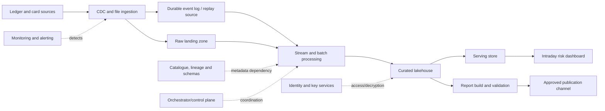

# Project 12 — Disaster Recovery and Resilience Plan

> **Stage:** 2D — Data Architecture  
> **Module:** 12 — Reliability, Resilience and Disaster Recovery  
> **Target:** `Projects/12-disaster-recovery-and-resilience-plan.md`  
> **Version:** 1.0 · **Status:** Reference design for review, not approved for production execution  
> **Last updated:** 2026-10-22 · **Owner:** To be assigned

> **Safety and assumptions.** Northbridge Bank, the architecture, volumes, targets, timelines and scenarios below are fictional teaching assumptions, not production measurements, legal advice, vendor guarantees or contractual commitments. This is a vendor-neutral design/documentation project. Do not execute a recovery, failover, deletion, replay or infrastructure operation in production solely because it appears here. Before production use, replace assumptions with approved requirements, environment-specific procedures, named owners, change authority and test evidence.

---

## 0. Executive summary

This project designs an integrated, testable approach to keeping a critical enterprise data platform reliable, limiting the blast radius of failures, restoring data and services after disruption, and continuing essential business functions while recovery is underway.

The fictional Northbridge Bank operates an exposure-reporting platform. Ledger and card changes arrive through change data capture (CDC) and file ingestion, are processed into a lakehouse, and feed an intraday risk dashboard and a regulatory exposure report due by 07:00 each business day. A successful restart is not recovery until the data is consistent, sufficiently current, validated, secure, and usable by authorised consumers.

The project integrates all eight module topics:

1. Reliability objectives: SLIs, SLOs, SLAs, error budgets and measurable service outcomes.
2. Failure domains and blast radius: dependencies, correlated failures and containment.
3. High availability and redundancy: failover, capacity during failure, fencing and failback.
4. Backup, restore and recovery validation: recovery set, ordered restore and evidence.
5. RPO/RTO and DR strategies: BIA, recovery tiers, feasibility and time budgets.
6. Replay, reprocessing and backfill: safe catch-up, idempotency, reconciliation and publication gates.
7. Incident response: authority, runbooks, communications, evidence and postmortems.
8. Business continuity and resilience testing: workarounds, safe tests, findings and retesting.

The deliverable is a design package—not evidence that a live restore, failover or disaster recovery exercise has occurred.

### 0.1 Intended audience

Data architects, data/platform engineers, SRE, storage/database and streaming owners, security/key-management specialists, business continuity leads, data product owners, incident commanders, risk/compliance reviewers and architecture boards.

### 0.2 Scope

**In scope:** service boundaries; reliability and recovery objectives; dependency/failure-domain mapping; HA options; backup/restore; BIA and DR strategy; replay/backfill; incident procedures; continuity mode; tests; ADRs; risks; validation and completion gates.

**Out of scope unless separately approved:** production deployment or configuration changes; live outages/destructive tests; vendor or SKU selection; legal determinations; real credentials, private endpoints or customer data; claims that illustrative targets are guaranteed.

### 0.3 Success definition

The design is ready for architecture review when all eight topics are covered, assumptions are labelled, recovery objectives are coherent, calculations are reproducible, critical claims have validation methods, runbooks include decision and abort gates, and residual risks have owners. Operational readiness requires environment-specific approval and successful evidence-producing tests.

---

## 1. Project charter, stakeholders and governance

### 1.1 Illustrative scenario and service inventory

Northbridge Bank (fictional) ingests ledger and card changes from source systems, lands raw data, transforms curated lakehouse tables, and publishes data to a serving store and report channel.

| Component | Purpose | Illustrative criticality |
|---|---|---|
| Ledger/card source systems | Authoritative business records | Critical upstream dependencies |
| CDC and file ingestion | Capture changes and extracts | Tier 1/2, by source path |
| Durable event log / CDC journal | Retain replayable changes | Critical for catch-up |
| Raw landing zone | Preserve source-aligned input | Tier 2 |
| Curated lakehouse | Historical and reconciled exposure data | Tier 2 |
| Orchestrator/control plane | Schedule and coordinate jobs | Shared dependency |
| Catalogue, schema registry, lineage | Resolve schemas and dependencies | Recovery prerequisite |
| Identity, secrets and key services | Authorise access and decrypt data | Recovery prerequisite |
| Serving store | Intraday risk dashboard | Tier 1 |
| Report build/publisher | Produce and publish daily report | Tier 1 business outcome |
| Observability and alerting | Detect delay, failure and bad data | Operational dependency |
| Consumers | Risk analysts and report recipients | Business-facing endpoints |

This logical inventory must be replaced with actual services, regions, accounts/subscriptions, datasets, owners and dependency links. Do not store secret values in the plan.

### 1.2 Roles and responsibilities

| Role | Responsibility | Decision/evidence |
|---|---|---|
| Business service owner | Defines criticality, deadline, tolerable impact and funding | Approves BIA, tiers and residual business risk |
| Data product owner | Defines correctness, freshness and consumer acceptance | Signs off reconciliation and publication |
| Data architect | Owns design coherence, dependency model and ADRs | Reviews options, constraints and trade-offs |
| Platform/SRE lead | Owns availability, observability, capacity and operations | Supplies failover and service evidence |
| Storage/database owner | Owns backup, restore, replication and consistency | Supplies restore and recovery-point evidence |
| Data engineering lead | Owns replay, reprocessing, backfill and data checks | Supplies idempotency/catch-up evidence |
| Incident commander (IC) | Coordinates response, priorities and decision log | Declares severity within approved policy |
| Security/identity/key owner | Validates privileged access and key recovery | Approves secure recovery path |
| Privacy/compliance/legal specialists | Determine applicable obligations | Provide specialist determination; not inferred here |
| Business continuity lead | Defines minimum viable business operations | Approves workaround and handback |
| Test lead/independent reviewer | Designs safe tests and verifies evidence | Signs test result and retest outcome |

Where feasible, separate execution, approval and independent validation for high-risk actions.

### 1.3 Governance rules

1. Assign an accountable owner to each service, objective, runbook, risk and corrective action.
2. Business owners approve business-impact tolerances; technical teams must not invent them unilaterally.
3. Security, privacy, legal and compliance specialists determine applicable obligations.
4. Each operational runbook states prerequisites, permissions, expected results, validation, rollback/abort criteria and escalation.
5. No one identity should be able to destroy all production and recovery copies where separation of duties is required.
6. Maintain a timestamped decision log with decision-maker, options, rationale and affected services.
7. Review the plan after material changes to architecture, identity, keys, retention, regions, suppliers or business deadlines.
8. Store production runbooks in an approved access-controlled location and test them against the current environment.

### 1.4 Evidence labels

- **BR — Business requirement:** approved by accountable business owner.
- **TE — Technical evidence:** measured or test-produced evidence, with date, scope and method.
- **IA — Illustrative assumption:** invented to demonstrate the method.
- **TBD — To be determined:** unresolved, with owner and due date.
- **ADR — Architecture decision record:** choice, alternatives, rationale and consequences.
- **RA — Risk acceptance:** explicit acceptance by an authorised risk owner.

No IA or TBD may be represented as a production fact.

---

## 2. Requirements, constraints and assumptions

### 2.1 Business outcomes

1. Publish a validated exposure report by 07:00 each business day.
2. Keep the intraday dashboard within an approved freshness objective or clearly mark it stale/degraded.
3. Prevent unvalidated, duplicated or inconsistent data from being presented as authoritative.
4. Recover services and data within approved RPO/RTO tolerances.
5. Continue essential business functions through an approved degraded mode when necessary.
6. Preserve an auditable timeline and evidence package for decisions and recovery tests.

### 2.2 Assumption and constraint register

| ID | Statement | Status | Owner to confirm | Closure evidence |
|---|---|---|---|---|
| A-01 | Ledger/card changes arrive via CDC and files | IA | Data owner | Source/integration inventory |
| A-02 | Lakehouse footprint is approximately 250 TB | IA | Storage owner | Measured logical/physical size and growth |
| A-03 | Two regions are available within the required jurisdiction | IA/TBD | Cloud owner + compliance | Region/service availability and residency review |
| A-04 | Hybrid connectivity links on-premises sources | IA | Network owner | Network paths, bandwidth and failure modes |
| A-05 | Tier 1 has 24×7 on-call coverage | IA | Operations manager | Rota and escalation test |
| A-06 | Tier 3 support may be business-hours | IA | Sandbox owner | Approved tier/service expectations |
| A-07 | Existing identity provider is required for normal access | IA | Identity owner | Identity failure/recovery test |
| A-08 | Long-lived plaintext keys are not embedded in application configuration | IA | Security owner | Configuration and secret-management review |
| A-09 | Recovery copies remain in approved jurisdiction(s) | TBD | Compliance/legal | Written specialist determination |
| A-10 | A budget ceiling exists but is not quantified | TBD | Business owner/FinOps | Approved cost envelope |
| A-11 | Report deadline is 07:00 local business time | IA pending approval | Business owner | Time zone, holiday calendar and receipt semantics |
| A-12 | Event/raw-data retention supports replay after outage | TBD | Data engineering/storage | Retention horizon calculation |
| A-13 | Clean recovery can proceed if primary identity/control plane is compromised | TBD | Security/platform | Isolated recovery-path test |
| A-14 | This project is initially design/documentation only | Project constraint | Sponsor | No live production outage required |

### 2.3 Production approval questions

- What are the actual service owners, source systems, datasets, regions and consumer endpoints?
- Which timestamp defines the recovery point: source commit, event time, ingestion time or business time?
- What business harm occurs after 15 minutes, one hour, two hours or eight hours?
- Does “report published” mean generated, validated, delivered, acknowledged—or all four?
- Which jurisdiction, regulator, contract and retention rules apply? Obtain specialist confirmation.
- Which primary/secondary components share identity, keys, network, account, deployment pipeline or operator?
- What are measured restore throughput, replication lag, replay throughput and validation duration?
- Can the recovery environment be provisioned if the primary control plane or identity service is unavailable?
- Which manual procedures are approved, time-bounded and reconciled after recovery?
- Who may declare a disaster, approve failover, accept data loss, resume publication and declare recovery complete?

---

## 3. Step 1 — Discover the service and define the recovery boundary

**Purpose:** Establish what is recovered, for whom, and what “recovered” means.

### 3.1 Work sequence

1. Interview business, data product, source, platform, security and consumer owners.
2. Inventory services, datasets, pipelines, schedulers, storage, identity/key dependencies, network paths and endpoints.
3. Assign each component an owner, criticality, service objective, source of truth and recovery procedure.
4. Define each service boundary: request accepted, data committed, data validated, output published, consumer receipt.
5. Identify hard dependencies and dependencies that may be optional in degraded mode.
6. Document safe behaviour when a dependency is unavailable.
7. Record unknowns as TBD rather than filling them with guesses.

### 3.2 Logical dependency flow

This is a conceptual model, not a verified deployment diagram. Add actual network, DNS, control-plane, deployment, supplier and human dependencies before approval.

### 3.3 Definition of recovered

| Output | Minimum recovery condition | Not sufficient |
|---|---|---|
| Dashboard | Endpoint usable; freshness within target or visibly degraded; data-quality and access checks pass | HTTP 200 with stale/incorrect figures |
| Regulatory report | Correct period; reconciliation and business validation pass; authorised sign-off and delivery receipt recorded | File exists without validation/receipt |
| Curated lakehouse | Data and metadata consistent; required quality/lineage/access controls work | Storage mounted but table metadata is inconsistent |
| Ingestion/replay | Source position known; required events retained; processing idempotent; lag measured | Consumer process runs while skipping or duplicating events |
| Orchestration | Safe job execution, dependencies/credentials verified, duplicate runs prevented or harmless | Scheduler UI is reachable but workers/state are unavailable |

**Outputs:** service inventory, dependency graph, owners, boundary definitions and open questions.

**Gate G1:** every critical output has an accountable owner, measurable recovery definition and dependency list.

---

## 4. Step 2 — Define SLIs, SLOs, SLAs and recovery objectives

**Purpose:** Convert business needs into measurable, non-contradictory targets.

- **SLI:** measured service behaviour.
- **SLO:** internal target for an SLI over a defined window.
- **SLA:** agreement with defined terms and potential consequences.
- **RPO:** maximum tolerable data loss measured as time from disruption to last acceptable recoverable state.
- **RTO:** maximum tolerable time to restore the defined service to acceptable operation.
- **Error budget:** allowed unreliability implied by an SLO.

An SLO is not an SLA, and neither automatically defines RPO/RTO. A reachable service may still serve stale data. Recovery requires correctness, freshness, security and business usability.

### 4.1 Illustrative objectives matrix

All values are **IA** until approved and measured.

| ID | Service/output | SLI | Illustrative target | Window/population | Recovery relation |
|---|---|---|---|---|---|
| OBJ-01 | Daily exposure report | Business days with validated report and publication receipt by 07:00 / scheduled business days | ≥99.5% | Rolling 100 business days | Tier 1 report path |
| OBJ-02 | Intraday dashboard | Eligible observations with source-to-dashboard age ≤5 min / eligible observations | ≥99.9% | Monthly; sampling interval TBD | Tier 1 serving path |
| OBJ-03 | Curated lakehouse | Eligible validated requests/jobs completed within defined latency/correctness boundary | TBD | Window and thresholds TBD | Tier 2 |
| OBJ-04 | Ingestion completeness | Source control records reconciled to landed records within agreed lag | TBD | By source and time/partition | Tier 1/2 by source |
| OBJ-05 | Recovery test | Mandatory gates passed / scheduled exercises | All mandatory gates pass; cadence TBD | Per exercise | All tiers |
| OBJ-06 | Tier 1 RPO | Gap to last consistent usable recovered state | ≤15 minutes | Per disaster scenario/data domain | Tier 1 |
| OBJ-07 | Tier 1 RTO | Time from defined incident/disaster start to accepted restoration | ≤2 hours | Per Tier 1 service/scenario | Tier 1 |
| OBJ-08 | Tier 2 RPO/RTO | Same definitions for core lakehouse | ≤1 hour / ≤8 hours | Per scenario | Tier 2 |
| OBJ-09 | Tier 3 RPO/RTO | Same definitions for sandbox | ≤24 hours / ≤72 hours | Per scenario | Tier 3 |

### 4.2 SLI specification checklist

For every SLI record: outcome; event population; numerator/denominator or time measurement; exclusions; data source; timestamp semantics; sampling; window; missing telemetry treatment; correctness/security boundary; known blind spots; owner; alert/reporting location.

Do not report “99.9%” without stating what was measured, for whom, over what window, and how missing measurements are handled.

### 4.3 Illustrative error-budget arithmetic

For a 30-day window and a time-based availability SLO of 99.9%:

- Total = 30 × 24 × 60 = 43,200 minutes.
- Allowed unavailability = 43,200 × (1 − 0.999) = **43.2 minutes**.

This applies to the stated time-based example. An event-based report-on-time SLI cannot be converted into downtime minutes without a justified model.

### 4.4 Feasibility checks

- Confirm each target matters to its consumer and business process.
- Evaluate end-to-end dependencies; serial dependencies can reduce service availability.
- Include detection, declaration, decision, restore/failover, replay, validation and consumer resumption in RTO.
- Check RPO against backup interval, replication lag, source retention and consistency.
- Confirm freshness objectives remain feasible during degraded capacity and replay.
- Define actions when objectives cannot be met: escalate, label stale data, hold publication, use approved workaround or seek risk acceptance.

**Outputs:** objective matrix, SLI definitions and feasibility notes.  
**Gate G2:** every critical objective has definition, window, evidence source, owner, approval status and relationship to RPO/RTO.

---

## 5. Step 3 — Map failure domains and quantify blast radius

**Purpose:** Identify what can fail together and contain impact.

### 5.1 Failure-domain dimensions

Map physical (host/zone/region/power); logical/cloud (account, cluster, quota, control plane); data (source, partition, table, catalogue, event log, checkpoint); network (hybrid link, DNS, routing, private endpoint); security (identity, key service, secrets, policy); delivery/change (shared CI/CD, configuration, schema migration); human/process (operator error, ownership, supplier, staffing); and common causes (shared credentials, account, key, backup permissions or deployment pipeline).

### 5.2 Failure scenario register

Likelihood/impact require local evidence; these are design scenarios, not claims of actual incidents.

| ID | Trigger | Propagation / impact | Containment and recovery direction | Evidence |
|---|---|---|---|---|
| F-01 | Availability-zone failure | Serving/workers lose capacity; lag rises | Fail over, shed noncritical work, validate N−1 | Zone test and service SLI |
| F-02 | Primary region unavailable | Ingestion, storage and control plane may fail together | Declare DR and activate approved secondary plan | Regional dependency test |
| F-03 | Corruption replicated | Primary and replica contain bad data | Hold publication; restore clean point; reconcile/replay | Corruption/point-in-time restore test |
| F-04 | Privileged identity compromised | Data/backups/configuration may be altered | Contain identity, preserve evidence, use clean recovery identity | Access review and clean-room test |
| F-05 | Key service unavailable | Data exists but cannot be decrypted | Use approved key recovery path; never bypass controls | Key-recovery drill |
| F-06 | Hybrid link fails | Ingestion stalls; freshness and report deadlines at risk | Preserve source position; resume/reconcile after recovery | Lag alert and replay test |
| F-07 | Orchestrator/control plane fails | Jobs cannot coordinate; duplicate runs possible | Recover state; prevent duplicate execution | Scheduler-state restore test |
| F-08 | Catalogue/metastore inconsistent | Data cannot be safely resolved | Restore compatible metadata; hold publication | Metadata/table-integrity test |
| F-09 | Event retention expires | Required events cannot be replayed | Use valid alternate source/archive or quantify gap | Retention calculation |
| F-10 | Bad schema/config rollout | Many jobs fail or misinterpret records | Roll back compatible version; isolate/reprocess bounded range | Rollback/schema tests |
| F-11 | Backup deleted or keys lost | Recovery copies unusable | Use isolated/immutable copy and recoverable key path | Restore and access-control test |
| F-12 | Backfill overloads platform | Live workload misses SLO | Throttle; reserve live capacity; pause on guardrail breach | Load/pause-resume test |
| F-13 | Split-brain/stale writer | Divergent state and conflicting updates | Fence old writer; reconcile before writes resume | Fencing/single-writer proof |
| F-14 | Publication channel unavailable | Validated report cannot be delivered | Approved alternate channel; record receipt | Alternate-channel exercise |
| F-15 | Key staff/supplier unavailable | Recovery stalls despite technical capability | Cross-training, contact tree and supplier escalation | Tabletop/contact-tree review |

### 5.3 Blast-radius method

For each scenario, record directly affected services/datasets/consumers; secondary dependencies; availability, freshness, integrity and confidentiality impact; detection delay; containment boundary; shared failure causes; and recovery-path dependencies.

Every percentage needs numerator, denominator and boundary. “3 of 12 critical products affected = 25% of listed critical products” is an impact fraction, not a failure probability.

### 5.4 Containment principles

1. Use isolation boundaries to limit affected tenants, pipelines and datasets.
2. Avoid retry storms with bounded retries/backoff and appropriate queue/circuit controls.
3. Preserve offsets, logs, checkpoints and forensic evidence before resetting state.
4. Hold unsafe publication when correctness is uncertain.
5. Challenge “independent” standby systems for shared account, identity, key, network and deployment dependencies.
6. Define degraded modes explicitly: read-only, stale-but-labelled, partial service, manual process or shutdown.

**Outputs:** failure-domain map, scenario register, blast-radius estimates and controls.  
**Gate G3:** at least eight scenarios have trigger, impact, containment, recovery path, owner and evidence. This project includes 15 starter scenarios.

---

## 6. Step 4 — Design high availability and redundancy

**Purpose:** Reduce interruption for justified failure modes without confusing redundancy with recoverability.

### 6.1 Pattern comparison

| Pattern | Benefit | Cost/complexity | Residual risk | Evaluate for |
|---|---|---|---|---|
| Single instance + backup | Low cost and complexity | Longer restore outage | Backup may be unusable | Low-criticality sandbox |
| Active/passive within region | Controlled standby and write ownership | Standby and failover orchestration | Regional failure remains | Selected components |
| Multi-zone stateless active/active | Can survive zone loss | Routing and capacity complexity | Shared control-plane failure | Stateless API/worker tier |
| Multi-region warm standby | Faster regional recovery than rebuild-only | Duplicate capacity and replication operations | Lag, stale standby, shared identity/keys | Tier 1/2 where justified |
| Multi-region active/active | Potentially low interruption | High consistency and operations complexity | Conflicts, split-brain, divergence | Only with proven need/capability |
| N+1 capacity | One component can fail while workload continues | Headroom and cost | Common cause or multiple failures | Worker/serving capacity |

### 6.2 Availability formulas and limitations

For simplified independent serial dependencies with availability \(A_i\):

\[
A_{\text{serial}}=\prod_i A_i
\]

For two independent parallel components that can each provide the function:

\[
A_{\text{parallel}}=1-(1-A_1)(1-A_2)
\]

These are approximations, not guarantees. Challenge independence, shared dependencies, failover correctness, data consistency, maintenance windows and control-plane availability.

### 6.3 N−1 capacity

The design must show:

\[
C_{\text{remaining}} \ge C_{\text{critical workload}} + C_{\text{recovery overhead}}
\]

State the units (events/s, queries/s, TB/hour, worker slots), measured demand, reserve and test method. A system that fails over but cannot process critical workload is not resilient.

### 6.4 Failover control requirements

- End-to-end health checks measure usable service, not process liveness alone.
- Define timeouts, false-positive handling, hysteresis and flapping controls.
- Use technology-appropriate fencing/lease/epoch controls against stale writers.
- Verify standby schema, metadata, policy, keys, configuration and capacity.
- Define automatic/manual failover conditions and override authority.
- Treat failback as a controlled migration after resynchronisation.
- Test degraded modes and their freshness/completeness implications.

### 6.5 ADR-01 — Availability and failure-domain approach

**Status:** Proposed, pending review.  
**Decision direction:** Evaluate multi-zone resilience for suitable stateless/worker components, a controlled stateful write model, N−1 capacity and warm standby for critical services; retain an independently protected backup/recovery path. Do not assume active/active until consistency, cost and operations evidence justify it.

**Alternatives:** restore-only; multi-region active/active; warm standby with manual declaration.  
**Rationale/trade-off:** balance interruption reduction against consistency, cost and operational burden.  
**Evidence required:** independent failure domains, fencing/failover test, measured capacity and cost model.  
**Revisit:** target, topology, test findings or budget changes.

**Outputs:** pattern comparison, capacity worksheet, failover/failback design, ADR-01.  
**Gate G4:** patterns address named scenarios, calculations state assumptions, and backup remains a separate control.

---

## 7. Step 5 — Design backup, restore and recovery validation

**Purpose:** Preserve data, metadata, configuration and security prerequisites needed to reconstruct a usable platform.

### 7.1 Recovery set inventory

Explicitly assess:

- Raw/landing data and source-aligned extracts.
- Database/table snapshots, transaction logs and point-in-time recovery artifacts.
- Lakehouse data files **and compatible table/catalogue/transaction metadata**.
- Event logs, CDC positions, offsets, checkpoints, watermarks and replay state.
- Orchestration definitions, scheduler metadata and dependency configuration.
- Schema registry, catalogue, lineage, quality rules and publication definitions.
- Infrastructure-as-code, deployment artifacts, configuration and transformation versions.
- Identity/policy configuration, secrets metadata and encryption-key recovery arrangements.
- DNS/network configuration and approved endpoint references.
- Runbooks, contact lists, supplier support paths and evidence retention.

Do not store secret values here. A backup is usable only if dependencies can be recovered securely and within the required time.

### 7.2 Backup protection controls

1. Set frequency against RPO and data-change rate.
2. Separate production administration from backup deletion/retention permissions.
3. Use immutable/versioned/tamper-resistant copies where supported and justified.
4. Keep a copy in an independent failure domain; verify residency before selecting a location.
5. Encrypt backups and document authorised key recovery.
6. Monitor completion, age, integrity, capacity and retention expiry.
7. Apply deletion/legal-hold requirements with specialist guidance; do not assume one universal rule.
8. Ensure a compromised production identity cannot silently remove all recovery copies.
9. Record recovery point, consistency boundary, key version and test evidence.
10. Restore periodically to an isolated environment and validate data, metadata, policy and service behaviour.

### 7.3 Candidate recovery order

1. Incident command, approved scope and clean administrative access.
2. Network, DNS, minimum identity and key capability.
3. Backup catalogue/index and recovery artifacts; verify integrity.
4. Core storage and compatible metadata/catalogue/transaction state.
5. Source/CDC logs, offsets, checkpoints and orchestration state with duplicate-run protection.
6. Processing services and critical curated datasets.
7. Serving store and report publisher.
8. Replay/backfill and reconciliation.
9. Technical, data-quality, security and business validation.
10. Consumer notification and controlled resumption.

This is a dependency hypothesis, not a universal order. If primary identity/control plane is the failure, recovery cannot depend solely on that same failed component.

### 7.4 Restore-time estimate

\[
T_{\text{transfer}}=\frac{\text{bytes to restore}}{\text{measured effective throughput}}
\]

End-to-end restore time also includes provisioning, metadata reconstruction, log application, indexing/compaction, dependency readiness, validation and business approval. Use measured throughput, not theoretical network bandwidth.

| Recovery item | Scope | Method | Duration | Evidence |
|---|---|---|---|---|
| Infrastructure/access | Minimal recovery environment | Provisioning estimate | TBD | IA until rehearsed |
| Metadata/catalogue | Required schemas and table state | Restore + integrity checks | TBD | TBD |
| Tier 1 serving data | Critical serving tables | Restore/rebuild | TBD | TBD |
| Tier 2 lakehouse | Illustrative 250 TB | Measured rate + rebuild work | TBD | TBD |
| Key/access validation | Required keys and roles | Approved recovery path | TBD | TBD |
| Reconciliation/quality | Critical tables/report period | Defined checks | TBD | TBD |
| Consumer validation | Dashboard/report endpoints | Smoke test + business sign-off | TBD | TBD |

No conclusion that 250 TB can be restored in eight hours is valid until rate, contention, metadata work and validation are measured.

### 7.5 Restore runbook

**Preconditions:** IC/service owner approve scope; target and recovery point are named; integrity, retention and key access are verified; least-privilege access is available; publication is held or isolated; evidence and current offsets are preserved.

**Procedure**

1. Open recovery record; record incident ID, start time, scope and decision owner.
2. Determine whether the source environment may still accept writes.
3. Fence/isolate unsafe writers before promotion or stateful restore.
4. Select a consistent recovery point across required datasets and metadata.
5. Verify manifest, integrity, retention and key availability.
6. Restore infrastructure and prerequisites in dependency order.
7. Restore data with compatible metadata; do not mix incompatible table logs/checkpoints.
8. Restore processing state only after duplicate execution is controlled.
9. Run technical checks: health, schema/table readability, metadata integrity and access enforcement.
10. Run data checks: control totals, counts where meaningful, partition coverage, uniqueness, source reconciliation and quality rules.
11. Calculate recovered point/RPO exposure and compare with approved target.
12. Record elapsed time and compare against RTO budget.
13. Keep publication blocked if correctness, access, RPO or provenance is uncertain.
14. Obtain data-owner/business sign-off.
15. Resume traffic/publication in controlled order and monitor.
16. Record evidence, deviations, open issues and review date.

**Stop/abort if:** recovery point/metadata consistency is unknown; keys/access are unavailable; dual-writer risk remains; restore may destroy clean copies or forensic evidence; validation finds unexplained gaps/duplicates/corruption; target cannot be met without an authorised degraded-mode decision; or an unapproved jurisdiction/environment would be used.

### 7.6 Recovery validation matrix

| Layer | Check | Pass condition |
|---|---|---|
| Artifact | Manifest, integrity and readability | Matches approved recovery set |
| Infrastructure | Network, identity, keys and compute | Required dependencies work and are authorised |
| Metadata | Schema, catalogue, table logs, checkpoint compatibility | No unresolved critical mismatch |
| Data integrity | Counts/control totals, uniqueness and constraints | Mandatory checks pass or approved exceptions recorded |
| Reconciliation | Source-to-target by period/partition | Differences are within approved tolerance and explained |
| Freshness/RPO | Last consistent source/event time | Gap within approved RPO or escalated |
| Security | Role/policy tests and audit trail | No unapproved access/control bypass |
| Service | End-to-end dashboard/report smoke test | Meets defined recovery condition |
| Business | Report review and delivery receipt | Authorised owner accepts output |
| Timing | Actual milestones and elapsed time | Compared with RTO budget |

**Outputs:** recovery-set inventory, restore runbook, validation matrix and restore-time worksheet.  
**Gate G5:** data and required metadata/security dependencies are covered; stop conditions are explicit; validation covers business correctness, not just infrastructure health.

---

## 8. Step 6 — Conduct BIA and select RPO/RTO and DR strategy

**Purpose:** Translate business impact into recovery requirements and choose a strategy that can plausibly meet them.

### 8.1 BIA method

1. List business functions/outputs, including report publication, intraday decisions and historical analysis.
2. Assess impact over time: operational, financial, customer, integrity, reputational and legal/regulatory effects.
3. Identify deadlines, time zones, calendar exceptions and minimum viable operation.
4. Map functions to datasets, pipelines, infrastructure, identity, keys, people, suppliers and publication channels.
5. Determine tolerable downtime/data loss with accountable owners.
6. Assign a tier; do not use tier labels instead of impact evidence.
7. Approve RPO/RTO and degraded-mode requirements.
8. Test technical feasibility and cost; revisit targets if not feasible.
9. Record residual risk and risk-acceptance authority.

### 8.2 Illustrative recovery tiers

All values are IA until approved.

| Tier | Scope | RPO | RTO | Candidate strategy | Business validation |
|---|---|---:|---:|---|---|
| Tier 1 | Serving store/report publisher | ≤15 min | ≤2 h | Warm standby for selected components plus independent backup/replay | Dashboard/report, freshness, reconciliation and receipt |
| Tier 2 | Core lakehouse/curated data | ≤1 h | ≤8 h | Backup/restore plus protected replication/standby where justified | Metadata consistency, quality, lineage and reconciliation |
| Tier 3 | Sandbox | ≤24 h | ≤72 h | Backup/restore and rebuild from retained sources | Owner verifies required data/access |

**Dependency caveat:** Tier 1 may depend on Tier 2 data. Restoring the serving store alone does not meet the report objective if authoritative data is unavailable. Define which last validated data can support degraded operation and whether publication is permitted.

### 8.3 Strategy comparison

| Strategy | Benefit | Limitation/cost | Decision test |
|---|---|---|---|
| Backup and restore | Lowest standby footprint; supports clean recovery points | Restore may exceed RTO | Measured restore + validation fits target |
| Pilot light | Minimal core services/data ready | Provisioning and scaling add time | Scale-up is rehearsed |
| Warm standby | Faster activation | Continuous cost and replication-lag risk | Standby freshness/capacity/failover measured |
| Hot standby/active-passive | Fast transition for selected services | Cost, state sync and split-brain risk | Fencing and end-to-end checks pass |
| Active-active | Can reduce interruption for compatible workloads | Highest consistency/operational complexity | Conflict semantics and independence proven |
| Rebuild from source/archive | Can recover from some corruption cases | Depends on source retention and replay capacity | Rebuild/replay duration and correctness proven |

### 8.4 Illustrative Tier 1 RTO budget

This is a planning allocation, **not test evidence**. It totals 105 minutes plus 15 minutes of contingency = 120 minutes.

| Phase | Budget | Cumulative | Exit evidence |
|---|---:|---:|---|
| Detect/confirm impact | 5 min | 5 | Signal and scope recorded |
| Declare/assign command | 10 min | 15 | Severity and owner recorded |
| Select path/approvals | 5 min | 20 | Scenario and recovery point approved |
| Fence/failover/provision | 15 min | 35 | Safe writer ownership and health |
| Restore critical state/metadata | 25 min | 60 | State technically readable |
| Replay bounded gap | 20 min | 80 | Required range processed |
| Validate correctness/access/freshness | 15 min | 95 | Mandatory checks pass |
| Business approval/resume | 10 min | 105 | Owner approval and consumer notice |
| Contingency headroom | 15 min | 120 | Reserved capacity |

This budget is credible only if restore/replay are bounded and measured rates support estimates. Do not double-count parallel work as sequential time or assume parallelism without evidence. Evaluate full lakehouse restore against Tier 2’s separate eight-hour target.

### 8.5 RPO feasibility worksheet

For every critical dataset record: approved RPO; backup interval and latest backup age; replication lag/consistency model; source/event retention; outage duration before retention expiry; recovery-point consistency; recovery duration; corruption/deletion coverage; timestamp semantics.

Backup cadence alone does not prove RPO. The recovered state must be consistent, accessible and validated. Replication may reduce data-loss exposure but can propagate corruption/deletion.

### 8.6 Failback procedure

1. Confirm primary integrity and identify authoritative state.
2. Keep the recovered environment as sole writer until transfer is planned.
3. Reconcile outage-period writes and resolve conflicts with approved rules.
4. Verify lag, schema compatibility, access policies and capacity.
5. Schedule controlled cutover with rollback point and decision owner.
6. Fence old writer, transfer ownership, validate outputs and reopen writes.
7. Monitor SLOs, data quality and lag; retain ability to pause/rollback.
8. Record actual cutover time and deviations.

**Outputs:** BIA, tier matrix, strategy comparison, RTO budget, RPO worksheet, failback plan and ADR-02.  
**Gate G6:** targets are approved or visibly provisional; time budget fits RTO; dependencies and feasibility evidence/gaps are explicit.

---

## 9. Step 7 — Plan replay, reprocessing and backfill

**Purpose:** Restore missing processing progress or correct outputs without duplicates, omissions or inconsistent publication.

### 9.1 Select the operation

| Operation | When used | Key control |
|---|---|---|
| Retry | Transient operation failure | Determine whether first attempt committed |
| Replay | Retained events/log records need re-consumption | Explicit offsets/range, ordering and deduplication |
| Reprocessing | Re-run transformations over captured inputs | Pin code/config/reference-data versions |
| Backfill | Fill/correct bounded historical range | Scope, capacity, validation and versioned output |
| Catch-up | Drain backlog after interruption | Measured input/processing rates and lag |
| Restore | Reconstruct state from recovery artifacts | Consistent point and compatible metadata |

### 9.2 Safe replay workflow

1. Identify incident, datasets, partitions, offsets and exact time range.
2. Freeze/preserve current state and checkpoints for investigation.
3. Confirm source-of-truth, event retention and earliest replayable point.
4. Pin code, schema, configuration and reference-data versions.
5. Estimate backlog and sustainable catch-up rate.
6. Calculate duration:

\[
T_{\text{catch-up}}=\frac{B}{R_p-R_i}, \quad R_p>R_i
\]

where \(B\) is backlog, \(R_p\) sustainable processing rate and \(R_i\) incoming rate in matching units. If \(R_p \le R_i\), backlog does not drain under those assumptions.

7. Confirm idempotency key, deduplication policy, transaction boundary and side effects.
8. Select destination strategy; use isolated staging/versioned output for high-risk corrections where feasible.
9. Reserve capacity for live critical workloads and set rate limits.
10. Run a small bounded canary and compare control totals.
11. Process the approved range while monitoring lag, errors, capacity and duplicates.
12. Pause on guardrail breach; preserve checkpoints and record why.
13. Reconcile source-to-target; validate uniqueness, ordering, schema, quality and lineage.
14. Publish only after data-owner approval and consumer-impact review.
15. Record range, code/config version, output version, metrics, evidence and sign-off.

### 9.3 Illustrative catch-up calculation

Assume backlog = 18 million events, sustainable processing rate = 60,000 events/minute, incoming rate = 30,000 events/minute.

Net rate = 60,000 − 30,000 = 30,000 events/minute.  
Estimated catch-up = 18,000,000 / 30,000 = **600 minutes (10 hours)**, before validation, retries, skew or overhead. This does not fit the illustrative two-hour Tier 1 budget. The design needs a smaller replay scope, higher proven capacity, alternate source, different recovery point or approved degraded mode.

### 9.4 Idempotency and correctness controls

- Define stable business keys and deduplication scope.
- Specify update/delete, late-event and out-of-order semantics.
- Make side effects replay-safe or suppress them during recovery.
- Pin transformation, schema, configuration and reference-data versions.
- Define the relationship between sink commit and checkpoint/offset commit.
- Do not claim end-to-end “exactly once” unless all relevant boundaries support it.
- Reconcile by partition and business period, not only aggregate row count.
- Ensure retention/deletion policy is not bypassed by replay or stale backup restoration.
- Preserve lineage from source range to output version and consumer publication.

### 9.5 Backfill guardrails

| Guardrail | Control | Stop/pause condition |
|---|---|---|
| Live workload | Reserved compute/IO and concurrency cap | Critical SLO/freshness breach |
| Capacity | Worker, storage, network thresholds | Saturation or queue instability |
| Correctness | Canary, totals, uniqueness, reconciliation | Unexplained differences/duplicates |
| Scope | Approved source range and datasets | Range expands or unapproved data touched |
| Publication | Versioned output and hold | Validation/sign-off incomplete |
| Security/privacy | Approved path and audit logging | Unauthorised access or prohibited movement |
| Recoverability | Checkpoints and rollback pointer | Cannot resume/revert safely |

**Outputs:** replay/backfill plan, catch-up calculation, idempotency design and publication gates.  
**Gate G7:** range, code/config version, rates, live-capacity controls, duplicate handling, reconciliation and rollback criteria are explicit.

---

## 10. Step 8 — Incident response, runbooks and postmortem

**Purpose:** Coordinate recovery safely under pressure.

### 10.1 Incident lifecycle

1. Detect and validate signal.
2. Classify severity using business impact and data correctness.
3. Assign IC and technical/data/security leads.
4. Establish shared timeline, decision log and communication channel.
5. Contain unsafe activity and preserve evidence.
6. Select failover, restore, regional DR, replay or continuity mode.
7. Execute approved runbook steps with prerequisites and stop gates.
8. Validate service, data, freshness, security and business output.
9. Resume consumers in controlled order and monitor.
10. Close only after impact, ownership and follow-up actions are recorded.
11. Conduct blameless postmortem and verify corrective actions through retest.

### 10.2 Illustrative severity model

Organisations must approve their own policy.

| Severity | Illustrative condition | Coordination |
|---|---|---|
| SEV-1 | Critical report deadline at risk/failed, broad authoritative-data corruption, recovery-control compromise or Tier 1 recovery failure | Immediate command and relevant business/security/executive escalation |
| SEV-2 | Material degradation or multiple critical consumers affected; workaround exists | Incident lead, service owners and frequent updates |
| SEV-3 | Limited product/workload impact without immediate critical deadline risk | Owning team and tracked incident |
| SEV-4 | Minor issue or nonurgent resilience defect | Problem/backlog process |

A pipeline can report success while producing incomplete or incorrect data. Security incidents follow the security response process too.

### 10.3 Incident roles

- **IC:** coordinates, prioritises, maintains timeline and makes decisions explicit.
- **Technical lead:** diagnoses and proposes safe technical recovery.
- **Data recovery lead:** controls restore/replay/backfill and recovery-point decisions.
- **Security lead:** handles compromised identity, keys and evidence.
- **Communications lead:** sends approved internal/business/consumer updates.
- **Business approver:** decides degraded operation and validates outputs.
- **Scribe/evidence owner:** captures timestamps, metrics, approvals and changes without secrets.

### 10.4 Runbook A — Regional service loss

**Trigger:** multiple critical dependencies are unavailable in a region or approved regional-failure criterion is met.

**Preconditions:** incident declared under policy; IC and service owner identified; secondary readiness/recovery point assessed; publication can be held.

1. Record detection time, scope, affected outputs, last known good data time and alert evidence.
2. Distinguish local component failure from regional/common-cause failure.
3. Determine whether primary writes continue; fence/isolate to prevent dual writers.
4. Review secondary dependencies: identity, keys, network, catalogue, logs and control plane.
5. Obtain required declaration/failover approvals.
6. Select consistent recovery point and record RPO exposure.
7. Activate approved secondary environment; verify config, keys, roles and capacity.
8. Restore/promote in dependency order and validate single-writer ownership.
9. Resume bounded processing; hold publication until reconciliation/quality pass.
10. Record actual RTO milestones and deviations.
11. Business owner validates outputs or approves documented degraded mode.
12. Notify consumers and monitor.
13. Record residual gaps and schedule review.

**Abort/escalate if:** writer cannot be fenced; secondary identity/key path is untrusted; recovery point is inconsistent; access policy cannot be enforced; or target cannot be met without an authorised decision.

### 10.5 Runbook B — Suspected corruption or malicious deletion

1. Hold/quarantine affected outputs; show stale/unavailable status.
2. Preserve logs, audit records, offsets, snapshots and metadata.
3. Notify IC, data owner and security lead if malicious activity is plausible.
4. Identify earliest known bad time and affected tables/consumers using lineage/quality signals.
5. Determine whether corruption propagated to replicas or archives.
6. Select known-good point and verify backup isolation, integrity and key access.
7. Restore to isolated target; validate schema and metadata.
8. Reprocess only bounded range with pinned code/config and idempotency controls.
9. Reconcile source/target and inspect gaps, duplicates, partitions and business invariants.
10. Obtain data-owner/security approval before publication.
11. Publish corrected version, communicate impact and retain evidence under approved policy.
12. Complete postmortem and control remediation.

Never assume a replica is clean just because it is available.

### 10.6 Runbook C — Backlog exceeds recovery budget

1. Capture backlog, oldest event age, incoming rate, processing rate and retention expiry.
2. Estimate net catch-up rate and duration, with units/assumptions.
3. Protect live critical processing using reserved capacity and rate limits.
4. Decide whether RTO/freshness remains feasible.
5. If not, notify IC/business owner and choose approved degraded mode or alternate source.
6. Run a bounded canary and verify idempotency/reconciliation.
7. Process with pause conditions and checkpoints.
8. Validate and publish only after gates pass.
9. Record measured rate and update capacity estimates.

### 10.7 Communications template

Include incident ID/start/severity; confirmed impact; knowns and unknowns; recovery action and next decision point; whether data may be stale/incomplete/incorrect; approved workaround/restrictions; next update time and owner. Do not present an estimate as fact or expose sensitive security details broadly.

### 10.8 Postmortem template

| Field | Content |
|---|---|
| Summary | Impact, start/end and current recovery state |
| Detection | Signal, detection time and alert gaps |
| Timeline | Timestamped events, decisions, actions and approvals |
| Impact | Services, data periods, consumers and objective breaches |
| Root/contributing factors | Evidence-based technical and organisational conditions |
| What went well/poorly | Procedures, tooling, dependencies and coordination |
| Recovery correctness | RPO/RTO, data quality, security and consumer evidence |
| Corrective actions | ID, owner, due date, priority and verification method |
| Residual risk | What remains and who accepts it |
| Retest | Scenario, result, evidence and closure decision |

**Outputs:** severity/escalation model, three runbooks, communication and postmortem templates.  
**Gate G8:** authority, stop conditions, evidence preservation and business acceptance are explicit; another operator can walk through the runbook.

---

## 11. Step 9 — Business continuity and resilience testing

**Purpose:** Test technology, data, people, decisions and workarounds safely.

### 11.1 Minimum viable business operations

Business owners must define:
- Whether last-known-good data can be used and for how long.
- How stale data is labelled and which decisions are prohibited.
- Whether a report may be delayed, generated from an approved alternate source or delivered through an alternate channel.
- Who approves manual workarounds and their expiry.
- How manual actions are recorded and reconciled after recovery.
- What must never be done manually due to integrity, privacy or safety risk.
- How consumers return from degraded to normal operation.

Technical possibility alone does not approve a workaround.

### 11.2 Test principles

1. Start with document review and tabletop exercises.
2. Use synthetic or approved masked data in isolated environments.
3. Define a falsifiable hypothesis and criteria before the test.
4. Obtain test/change approval, scope, owners, communications and abort plan.
5. Do not run a production-impacting test without a separately authorised programme.
6. Test data correctness and consumer outcomes, not only infrastructure availability.
7. Capture evidence/deviations and assign corrective actions.
8. Retest material findings; close only with evidence.
9. Set cadence based on criticality, change rate, risk and specialist-confirmed requirements.

### 11.3 Test matrix

| ID | Scenario/method | Main steps | Pass criteria | Evidence |
|---|---|---|---|---|
| T-01 | Tabletop: report deadline missed | Walk through alert, severity, decisions and comms | Roles assigned; actions clear; no hidden dependency | Attendance, timeline, findings |
| T-02 | Isolated serving-data restore | Restore safe backup in test environment | Artifacts readable; metadata, data and access checks pass; time measured | Logs, checks, duration |
| T-03 | Zone/worker loss simulation | Remove test capacity or model under load | Critical workload meets approved degraded objective; no writer conflict | Metrics and failover evidence |
| T-04 | Secondary-region tabletop/isolated failover | Exercise prerequisites and approved path | Recovery order/approvals work; RPO/RTO milestones recorded | Run log and budget |
| T-05 | Corruption recovery | Use synthetic corrupted dataset and clean point | Bad data quarantined; clean point restored; reconciliation passes before publication | Data comparison and sign-off |
| T-06 | Replay/backfill under live-load simulation | Inject bounded backlog | Measured drain rate; guardrails/pause work; no duplicate keys | Throughput, lag and reconciliation |
| T-07 | Identity/key loss tabletop | Simulate normal identity/key path unavailable | Approved recovery path works without control bypass | Access logs and specialist sign-off |
| T-08 | Backup deletion-control review | Review roles; test isolated deletion protection | Production identity cannot silently remove all recovery copies | IAM policy/test log |
| T-09 | Manual continuity mode | Exercise approved stale-data/manual process | Restrictions, approval, expiry and reconciliation understood | Business sign-off |
| T-10 | End-to-end recovery rehearsal | Restore, replay, validate and resume in isolation | Mandatory checks pass; RPO/RTO fit targets or gaps accepted | Full timeline and signed result |

### 11.4 Test charter template

- Test ID/title; owner, approver and participants.
- Hypothesis and objective IDs.
- Scope: services, datasets, partitions, environment and exclusions.
- Preconditions: recovery point, backup, credentials, capacity, monitoring and approval.
- Risk/blast-radius assessment.
- Method: tabletop, simulation, isolated restore, load test or authorised live exercise.
- Measurable pass/fail criteria.
- Stop/abort conditions and who can stop the test.
- Rollback/cleanup and synthetic-data removal.
- Evidence plan: metrics, logs, timestamps, quality checks and approvals.
- Communications and incident escalation.
- Result, limitations, deviations and actual duration.
- Corrective actions, owners, due dates and retest.

### 11.5 Starter findings register

These are proposed work items, not claims that tests failed.

| ID | Finding/action | Priority before production | Owner | Verification | Status |
|---|---|---|---|---|---|
| CA-01 | Replace illustrative targets with approved BIA | High | Business owner | Signed BIA/objectives | Open |
| CA-02 | Measure critical and lakehouse restore throughput | High | Storage/platform | Representative restore evidence | Open |
| CA-03 | Verify independent recovery identity/key path | High | Security/key owner | Isolated recovery test | Open |
| CA-04 | Prove idempotent replay and backfill isolation | High | Data engineering/SRE | Replay/load test | Open |
| CA-05 | Confirm report receipt semantics and degraded mode | High | Report owner/BC lead | Tabletop and business sign-off | Open |
| CA-06 | Validate fencing and single-writer failback | High | Platform/database | Fencing/failback test | Open |

**Outputs:** continuity procedure, test charters, evidence checklist, findings and retest plan.  
**Gate G9:** tests have measurable criteria, safe scope, approvals, abort conditions, evidence and action owners.

---

## 12. Step 10 — Integrate the plan and verify consistency

**Purpose:** Ensure all deliverables agree and no section makes unsupported promises.

### 12.1 Cross-topic consistency table

| ID | Rule | Evidence | Design-time status |
|---|---|---|---|
| INT-01 | Critical outputs have owner and recovery definition | Inventory | Must confirm real owners |
| INT-02 | Each SLI has population, window, source and owner | Objectives | Production values partly TBD |
| INT-03 | Scenarios cover common-cause and security/control-plane failure | Failure register | 15 starter scenarios |
| INT-04 | HA addresses failure domains and N−1 capacity | ADR-01/capacity worksheet | Proposed; measurements pending |
| INT-05 | Recovery set includes data, metadata, offsets, config and key recovery | Backup inventory | Checklist included; implementation TBD |
| INT-06 | Backup/replication/replay can support approved RPO | RPO worksheet | Not proven until tested |
| INT-07 | Restore + replay + validation + resumption fit RTO | RTO budget and test evidence | 105-minute plan + 15-minute headroom; unverified |
| INT-08 | Restore order respects dependencies and fencing | Map/runbooks | Environment validation pending |
| INT-09 | Replay bounded, idempotent, reconciled and capacity-limited | Replay plan | Method defined; test pending |
| INT-10 | Publication requires correctness and business acceptance | Validation/runbook | Gate defined; approval pending |
| INT-11 | Continuity mode has approval, expiry and reconciliation | BIA/BC plan | TBD |
| INT-12 | Tests map to objectives and include abort conditions | Test plan | 10 starter tests |
| INT-13 | Residual risks have owners or explicit acceptance | Risk register | Starter register |
| INT-14 | Illustrative values are not represented as measured facts | Labels/caveats | Maintain during review |
| INT-15 | Residency, retention and notification get specialist review | Open questions | Pending |

### 12.2 Recovered-service readiness checklist

- [ ] Correct recovery point chosen and timestamp semantics recorded.
- [ ] Primary/stale writer fenced or isolated.
- [ ] Data and metadata/table transaction state compatible.
- [ ] Identity, authorisation and keys available through approved controls.
- [ ] Source/event retention still supports required replay.
- [ ] Replay range and code/config/schema versions fixed.
- [ ] Live workloads retain protected capacity.
- [ ] Technical integrity and source reconciliation pass.
- [ ] Freshness and RPO exposure calculated.
- [ ] Business invariants and quality gates pass.
- [ ] Outputs are correct or clearly marked degraded under an approved rule.
- [ ] Business owner accepts output; receipt/consumer resumption recorded.
- [ ] Actual RTO milestones and deviations recorded.
- [ ] Residual risks and next actions assigned.

### 12.3 ADR-02 — Recovery tiering and DR strategy

**Status:** Proposed.  
**Context:** Services differ in business impact and recovery cost.  
**Decision:** Use service-specific tiers; evaluate warm standby for Tier 1 and backup/restore or warm standby for Tier 2 based on measured feasibility.  
**Alternatives:** same strategy for all services; active-active for all critical components; restore-only for all tiers.  
**Trade-off:** tiering aligns cost with impact but adds governance and testing complexity.  
**Evidence:** signed BIA, approved targets, RTO budget, restore/replay throughput and jurisdiction review.  
**Revisit:** business deadlines, retention, volume, topology or specialist determinations change.

### 12.4 ADR-03 — Recovery publication gate

**Status:** Proposed.  
**Decision:** Hold critical publication until technical integrity, reconciliation, quality, access and business approval pass. Degraded publication requires a documented business-approved rule.  
**Alternatives:** publish immediately after infrastructure recovery; serve unlabelled stale data; rely on unrecorded manual approval.  
**Trade-off:** may delay publication but lowers the risk of distributing invalid data.  
**Evidence:** validation results, owner sign-off, receipt and consumer notice.

### 12.5 ADR-04 — Replay/backfill safety

**Status:** Proposed.  
**Decision:** Use bounded ranges, pinned code/config, idempotency, canary processing, capacity guardrails, reconciliation and versioned publication for high-risk corrections.  
**Alternatives:** unrestricted in-place replay; restart from latest checkpoint without reconciliation.  
**Trade-off:** slower controlled processing versus lower risk of corruption or starving live workloads.  
**Evidence:** idempotency test, catch-up measurement, pause/resume and reconciliation.  
**Revisit:** event semantics, transformations or retention change.

### 12.6 Architecture review questions

1. What precisely constitutes “recovered” for report and dashboard?
2. What is the last consistent recovery point and how is its time determined?
3. Which critical dependencies share a failure domain with the primary region?
4. What if identity, keys or control plane are unavailable?
5. Does the RTO budget include restore, replay, validation, business approval and consumer resumption?
6. How is a stale primary prevented from writing after failover?
7. How are duplicated, late, deleted or out-of-order events handled?
8. What can the business do if the report cannot be safely published by 07:00?
9. Which tests have actually run, and which claims remain assumptions?
10. Who accepts residual risk if targets are infeasible?

**Outputs:** integrated consistency table, readiness checklist, four ADRs and review questions.  
**Gate G10:** contradictions are resolved or logged with owners; unproven claims have evidence tasks.

---

## 13. Step 11 — Risk register, audit and remediation

**Purpose:** Identify residual risk and audit completeness, correctness and operational usefulness.

### 13.1 Starter risk register

Likelihood/impact require the organisation's risk method.

| ID | Risk | Initial concern | Mitigation | Owner | Closure/trigger |
|---|---|---|---|---|---|
| R-01 | RPO/RTO are not business-approved | High | Complete BIA and sign off | Business owner | Signed BIA |
| R-02 | Restore exceeds RTO | High | Representative restore tests and measured rates | Storage/platform | Restore evidence |
| R-03 | Primary/secondary share common cause | High | Map account, identity, keys, network, control plane and deployment | Architect/SRE | Dependency review |
| R-04 | Corruption/deletion affects backups | High | Isolated/immutable copies and clean restore | Storage/security | Corruption test |
| R-05 | Key/identity recovery blocks access | High | Approved independent recovery path | Security/key owner | Recovery test |
| R-06 | Replay duplicates/omits data | High | Idempotency and source reconciliation | Data engineering | Replay test |
| R-07 | Backfill overloads critical workload | Med/High | Capacity reservation, throttle and pause controls | SRE/data engineering | Load test |
| R-08 | Manual continuity is unsafe/unapproved | High | Business-approved workaround, expiry and reconciliation | BC/business owner | Tabletop |
| R-09 | Plan becomes stale | Med/High | Change-triggered and scheduled review | Plan owner | Review record |
| R-10 | Staff/supplier unavailable | Med/High | Cross-training, backup contacts and support path | Operations | Contact-tree exercise |
| R-11 | Residency/retention/notification assumption is wrong | High | Written specialist determination | Compliance/legal | Review evidence |
| R-12 | Test results are overgeneralised | Med/High | Label scope, environment and limitations | Test lead | Evidence review |

### 13.2 Audit checklist

Review:
- scope and traceability across all eight topics and D1–D12;
- requirements, constraints, assumptions and open questions;
- service boundaries, control-plane dependencies and common-cause failures;
- SLI/SLO definitions and qualified availability arithmetic;
- RPO/RTO and time budgets, including restore, replay, validation and resumption;
- backup completeness, metadata compatibility and key recovery;
- data correctness/reconciliation before publication;
- incident authority, stop conditions, communications and postmortem;
- approved continuity workarounds and expiry;
- safe tests with measurable criteria, abort plans, evidence and retest;
- ADRs, risk ownership, review triggers and residual-risk acceptance;
- explicit units, formulas, assumptions and limitations;
- file hygiene: this is one target Markdown deliverable; sibling lesson files need not be modified.

### 13.3 Remediation protocol

1. Assign finding ID and severity.
2. State defect, impact and affected requirement/section.
3. Assign owner and required correction.
4. Update this project file only where correction belongs.
5. Re-run structural checks and review affected technical logic.
6. Check for contradictions introduced elsewhere.
7. Record evidence and disposition in the separate audit report.
8. Leave items requiring measurement/specialist approval open; never fabricate closure.

**Outputs:** risk register, audit checklist, remediation log and review summary.  
**Gate G11:** defects are corrected or visibly logged as open dependencies with owners; no untested capability is claimed as proven.

---

## 14. Step 12 — Present, defend and complete

### 14.1 D1–D12 deliverable map

| ID | Deliverable | Location | Evidence |
|---|---|---|---|
| D1 | Requirements and assumptions | Sections 1–2 | Labels, constraints and open questions |
| D2 | Reliability/recovery objectives | Sections 4 and 8 | Definitions and approval status |
| D3 | Failure-domain map and scenarios | Section 5 | Dependency flow and 15 scenarios |
| D4 | HA/redundancy decision | Section 6, ADR-01 | Alternatives and trade-offs |
| D5 | Backup/restore/validation | Section 7 | Recovery set, procedure and checks |
| D6 | DR strategy/RPO/RTO | Section 8, ADR-02 | Tier matrix, RTO budget, RPO worksheet |
| D7 | Replay/backfill plan | Section 9, ADR-04 | Workflow, calculation and controls |
| D8 | Incident runbook/postmortem | Section 10 | Three runbooks and templates |
| D9 | Resilience/continuity tests | Section 11 | 10 tests, charter, findings |
| D10 | Integrated plan/consistency table | Section 12 | 15 consistency checks |
| D11 | Risks and ADRs | Sections 12–13 | Four ADRs and 12 starter risks |
| D12 | Validation/review summary | Section 13 and separate audit report | Checklist and gates |

### 14.2 Completion checklist

- [ ] Actual service boundaries, owners and dependencies replace placeholders.
- [ ] Business owners approve critical outputs, calendar and publication semantics.
- [ ] SLI/SLO and recovery objectives are approved.
- [ ] BIA, RPO/RTO, continuity mode and risk acceptance are signed off.
- [ ] Failure-domain map includes identity, keys, network, control plane, deployment and supplier dependencies.
- [ ] HA and N−1 capacity are justified with evidence.
- [ ] Recovery set includes data, metadata, state, configuration and security dependencies.
- [ ] Recovery copies are protected from the same identity/failure that can destroy production.
- [ ] Restore and key-recovery procedures are exercised safely.
- [ ] RPO and recovery-point semantics are demonstrable.
- [ ] RTO includes declaration, restore, replay, validation, approval and resumption.
- [ ] Replay/backfill is bounded, idempotent, capacity-protected and reconciled.
- [ ] Critical publication has technical and business gates.
- [ ] Incident roles, communications, runbooks, stop conditions and postmortem are reviewed.
- [ ] Continuity workarounds are approved, time-bounded and reconciled.
- [ ] Tests have scope, approval, criteria, abort conditions and evidence.
- [ ] Findings are retested and closed with evidence or accepted by authorised risk owner.
- [ ] At least five reviewer challenges are answered with evidence.
- [ ] Audit report reviewed; unresolved items remain visible.
- [ ] Plan is versioned in approved repository location.

### 14.3 Reviewer defence

Prepare evidence-based answers:
1. Why this architecture rather than the alternatives?
2. What is the weakest dependency or largest common-cause risk?
3. Can the target actually be met based on measured restore, replay, validation and resumption?
4. What prevents incorrect data publication?
5. What if identity or key recovery is unavailable?
6. How does failover avoid split-brain?
7. How is backlog caught up without hurting live workloads?
8. What can the business do while the platform is down?
9. Which assumptions remain open, who owns them and by when?
10. Which tests have actually run, in what scope, with what limitations?

### 14.4 Final status

At authoring time, this is a **complete reference design package**, not a production-approved recovery capability. The targets and RTO budget are illustrative. Readiness remains **not demonstrated** until requirements are confirmed, rates measured, security/recovery dependencies tested, data correctness validated, continuity procedures approved, and risks closed or formally accepted.

---

## Appendix A — Evidence record schema

Store evidence in an approved repository and link it here; do not include secrets or sensitive raw data.

| Field | Description |
|---|---|
| Evidence ID | Unique identifier |
| Requirement/test/risk | Objective, T-ID, R-ID, CA-ID or gate |
| Environment/scope | Isolated test/staging/production; datasets and regions |
| Timestamp/time zone | Start, end and relevant event times |
| Operator/approver | Role or controlled identity reference |
| Procedure/version | Runbook or test charter version |
| Inputs | Recovery point, backup ID, replay range, code/config version |
| Results | Durations, checks, reconciliation and pass/fail |
| Limitations | Nonrepresentative scale, missing telemetry, exclusions |
| Approval | Reviewer and decision |
| Retention/access | Approved classification, retention and access policy |

## Appendix B — Recovery milestone record

| Milestone | Planned | Actual | Elapsed | Evidence/deviation |
|---|---:|---|---:|---|
| Detection | 0 min | TBD | TBD | TBD |
| Incident declaration | 5 min | TBD | TBD | TBD |
| Recovery decision | 20 min | TBD | TBD | TBD |
| Failover/provisioning complete | 35 min | TBD | TBD | TBD |
| Critical restore complete | 60 min | TBD | TBD | TBD |
| Replay/catch-up complete | 80 min | TBD | TBD | TBD |
| Technical/data validation complete | 95 min | TBD | TBD | TBD |
| Business acceptance/resumption | 105 min | TBD | TBD | TBD |
| RTO deadline | 120 min | TBD | TBD | Pass/fail and approved exceptions |

These are illustrative allocations. Actual times must come from an approved exercise.

## Appendix C — Glossary

- **Availability:** proportion of an interval or request population meeting usable-service criteria.
- **Backfill:** process a bounded historical range to fill gaps or correct output.
- **BIA:** business impact analysis of disruption consequences over time.
- **Blast radius:** extent of impact from a failure/common cause.
- **Business continuity:** arrangements that sustain essential business functions during disruption.
- **CDC:** change data capture.
- **DR:** disaster recovery; restoring technology, data and services after major disruption.
- **Failback:** controlled return to a preferred environment.
- **Failover:** transfer of responsibility to a healthy alternative.
- **Failure domain:** components/workloads that may be affected by one failure/common cause.
- **Fencing:** preventing a stale/former writer from making unsafe writes.
- **HA:** high availability; reducing interruption under specified failures.
- **Idempotency:** repeating an operation does not cause unintended additional effects.
- **RPO:** maximum tolerable data-loss interval to last acceptable recoverable state.
- **RTO:** maximum tolerable time to restore defined service to acceptable state.
- **SLA:** service level agreement, often contractual.
- **SLI:** measured indicator of service behaviour.
- **SLO:** target for an SLI over a defined window.
- **Replay:** consume retained events/log records again from a defined position/range.
- **Reprocessing:** rerun transformations over captured inputs.
- **Resilience:** ability to withstand, contain, degrade gracefully under and recover from disruption.

## Appendix D — Source alignment and scope note

This project is based on the supplied Module 12 lessons and roadmap:

- `01-reliability-objectives-sli-slo-and-sla.md`
- `02-failure-domains-and-blast-radius.md`
- `03-high-availability-and-redundancy-patterns.md`
- `04-backup-restore-and-recovery-validation.md`
- `05-rpo-rto-and-disaster-recovery-strategies.md`
- `06-replay-reprocessing-and-backfill-architecture.md`
- `07-incident-response-runbooks-and-postmortems.md`
- `08-business-continuity-and-resilience-testing.md`
- `roadmap-Reliability-Resilience-and-Disaster-Recovery.md`

The roadmap says the project file was empty and proposes a 12-step workflow and D1–D12 deliverables. This document operationalises those recommendations. The scenario, values and procedures are labelled teaching assumptions. Before production use, update from approved requirements and test evidence; do not infer illustrative values are existing business requirements.
