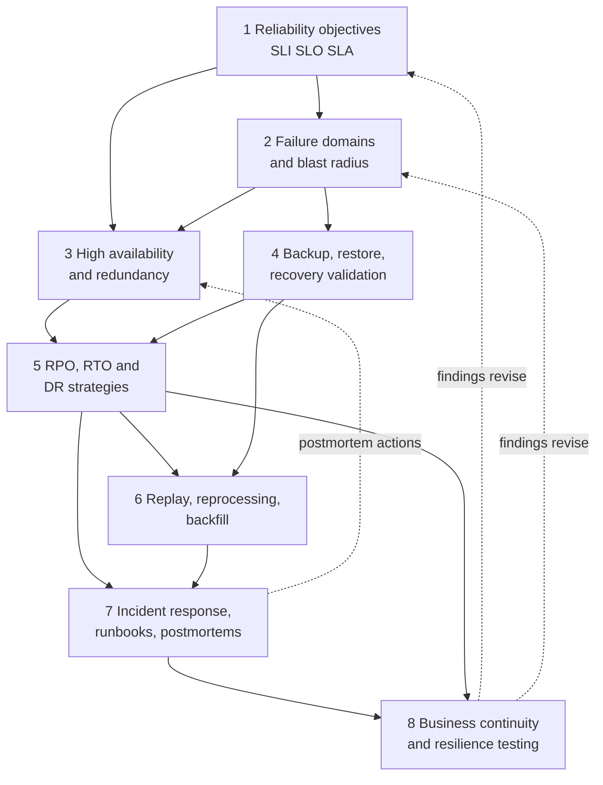

# Roadmap — Module 2D.12: Reliability, Resilience and Disaster Recovery

This is the learning roadmap for the twelfth module of Stage 2D, **Data
Architecture**. It tells you **what** to learn, **in what order**, **how** to
study and practise each topic from beginner to advanced level, **how to prove**
you have learned it, and **how to complete** the module's final disaster
recovery and resilience plan.

Earlier modules designed the platform, its integration, its cloud realisation,
its real-time paths, its governance and its metadata. This module asks: **what
happens when something goes wrong, and how do we design so that the business
keeps going and recovers in a way we can prove?**

> **Repository note (source-of-truth limits).** The eight topic files,
> `practice-questions.md`, `README.md`, `Projects/README.md` and
> `Projects/12-disaster-recovery-and-resilience-plan.md` currently exist but are
> **empty**, as are the Stage 2D overview files; the target roadmap file existed
> but was empty. This roadmap therefore cannot be grounded in their contents. It
> is the first written statement of the module's scope, derived from the file
> names, the Stage 2D structure and the earlier module roadmaps. It does **not**
> claim that any topic file already contains the material below. Every exercise,
> template, scenario and target is a **recommendation**, not a documented
> requirement. When the topic files and the project file are written, their scope
> governs and this roadmap should be updated to match.
>
> **Directory name.** The prompt that requested this roadmap referred to
> `STAGE 2D - DATA ARCHITECURE/`. The actual directory is
> `Stage 2D — Data Architecture/`, and the actual name is preserved.
>
> **Illustrative content.** Every number, system, price and organisation here is an
> **illustrative assumption** used to teach a method. None is a real requirement,
> benchmark or recommended target. The module is vendor-neutral. It is also a
> *design and documentation* module: no exercise requires production
> infrastructure or real outages; recovery is demonstrated on paper, in
> calculations and in small simulations unless the project file later states
> otherwise.

## Table of contents

- [A. Module overview](#a-module-overview)
- [B. Module learning outcomes](#b-module-learning-outcomes)
- [C. Prerequisites and knowledge dependencies](#c-prerequisites-and-knowledge-dependencies)
- [D. Recommended learning sequence](#d-recommended-learning-sequence)
- [E. Detailed learning roadmap for every topic](#e-detailed-learning-roadmap-for-every-topic)
  - [E.1 Reliability objectives, SLI, SLO and SLA](#e1-topic-01--reliability-objectives-sli-slo-and-sla)
  - [E.2 Failure domains and blast radius](#e2-topic-02--failure-domains-and-blast-radius)
  - [E.3 High availability and redundancy patterns](#e3-topic-03--high-availability-and-redundancy-patterns)
  - [E.4 Backup, restore and recovery validation](#e4-topic-04--backup-restore-and-recovery-validation)
  - [E.5 RPO, RTO and disaster recovery strategies](#e5-topic-05--rpo-rto-and-disaster-recovery-strategies)
  - [E.6 Replay, reprocessing and backfill architecture](#e6-topic-06--replay-reprocessing-and-backfill-architecture)
  - [E.7 Incident response, runbooks and postmortems](#e7-topic-07--incident-response-runbooks-and-postmortems)
  - [E.8 Business continuity and resilience testing](#e8-topic-08--business-continuity-and-resilience-testing)
- [F. Cross-topic integration](#f-cross-topic-integration)
- [G. Practice-question integration](#g-practice-question-integration)
- [H. Module completion checklist](#h-module-completion-checklist)
- [I. Final project guide — Disaster recovery and resilience plan](#i-final-project-guide--disaster-recovery-and-resilience-plan)

---

## A. Module overview

### A.1 What the terms mean in data architecture

| Term | Plain meaning | Question it answers |
| --- | --- | --- |
| **Reliability** | The system does what it should, when it should, consistently | How often does it work as promised? |
| **Resilience** | The system keeps working or recovers gracefully when parts fail | How well does it cope with failure? |
| **High availability (HA)** | Designing so that single failures do not interrupt service | Can it keep running through a component failure? |
| **Disaster recovery (DR)** | Restoring service and data after a major loss (site, region, corruption) | How do we get back, how fast, and with how much data lost? |
| **Business continuity (BC)** | Keeping critical business functions going during and after disruption | Can the business operate, even in degraded mode? |

### A.2 Four different jobs

| Job | Aim | Typical mechanisms | Where in this module |
| --- | --- | --- | --- |
| **Preventing failures** | Make failure less likely | Good design, testing, change control, capacity headroom | Topics 1, 2, 8 |
| **Limiting impact** | Contain the damage when failure occurs | Failure domains, isolation, redundancy | Topics 2, 3 |
| **Restoring service** | Get back to working state | Failover, backup/restore, replay, incident response | Topics 3–7 |
| **Continuing critical business operations** | Keep the business running, possibly degraded | Continuity plans, manual workarounds, communication, testing | Topic 8 |

A design that only prevents failures is fragile when one finally happens; a design
that only restores is slow and costly. Mature architecture does all four, in
proportion to business impact.

### A.3 Why these capabilities matter in enterprise data platforms

- Data platforms feed regulatory reporting, risk, fraud and customer-facing
  services; downtime or wrong data have direct cost.
- Data platforms have **state** (stored data, offsets, checkpoints, metadata), so
  recovery is not "restart a server": data must be restored **correctly and
  consistently** (2D.5, 2D.9).
- Pipelines have long dependency chains, so one failure spreads (2D.11 lineage).
- Regulators and customers expect demonstrated resilience, not only plans.

### A.4 What the learner should be able to do by the end

Design, evaluate, document and validate: reliability objectives; failure domains
and blast radius; availability and redundancy; backup, restore and recovery
validation; recovery objectives and DR strategy; replay and backfill; incident
response and learning; business continuity and resilience tests; and an
integrated, defensible disaster recovery and resilience plan.

### A.5 How this module connects to broader work

| Connection | How |
| --- | --- |
| `../05-Database-and-Storage-Architecture/` | Replication, consistency, retention, backup vs archive |
| `../06-Data-Integration-and-Interoperability/` | Idempotency, reconciliation, failure handling |
| `../07-Enterprise-Data-Platform-and-Lakehouse-Architecture/` | Planes, tenancy, service levels |
| `../08-Cloud-Hybrid-and-Multi-Cloud-Data-Architecture/` | Regions, zones, hybrid links, IaC |
| `../09-Streaming-and-Real-Time-Data-Architecture/` | Replay, lag, failure modes |
| `../10-Data-Governance-Security-Privacy-and-Compliance/` | Residency, retention, evidence, key recovery |
| `../11-Metadata-Lineage-Quality-and-Master-Data/` | Lineage for recovery order; observability |
| `../13-Performance-Scalability-and-Cost-Architecture/` | Cost of redundancy; headroom |
| `../15-Architecture-Documentation-Reviews-and-Operating-Model/` | Documentation and review of plans |
| `../16-Enterprise-Data-Architecture-Case-Studies-and-Capstone/` | Case-study use of resilience designs |

### A.6 Terminology (expanded at first use)

| Term | Meaning |
| --- | --- |
| SLI (Service Level Indicator) | A measured quantity describing service behaviour |
| SLO (Service Level Objective) | A target for an SLI over a window |
| SLA (Service Level Agreement) | An agreement with consequences if not met |
| Error budget | Allowed unreliability implied by an SLO |
| Failure domain | A set of components that can fail together |
| Blast radius | The extent of impact of a failure |
| RPO (Recovery Point Objective) | Maximum tolerable data loss, expressed as time |
| RTO (Recovery Time Objective) | Maximum tolerable time to restore service |
| Failover / failback | Switching to a standby / returning to the primary |
| Runbook | Step-by-step operational procedure |
| Postmortem | Structured review after an incident |
| MTTD / MTTR | Mean time to detect / to restore or resolve |

---

## B. Module learning outcomes

After completing the module you will be able to:

1. **Define** reliability objectives and **distinguish** SLI, SLO and SLA.
2. **Identify** failure domains and **evaluate** blast radius.
3. **Evaluate** high-availability and redundancy patterns against requirements.
4. **Design** backup, restoration and recovery-validation procedures, and
   **distinguish** having a backup from being able to recover.
5. **Select and justify** RPO, RTO and disaster recovery strategies.
6. **Plan** replay, reprocessing and backfill with correctness controls.
7. **Develop** incident response runbooks and **conduct** post-incident reviews.
8. **Plan** business continuity and resilience testing.
9. **Integrate** these into a coherent disaster recovery and resilience plan and
   **defend** it.

Each outcome is demonstrated through the exercises, deliverables and gates in
Sections E, H and I.

---

## C. Prerequisites and knowledge dependencies

### C.1 Prerequisite table

| # | Prerequisite (plain terms) | Why needed | Needed by topics | Essential? | Provided by |
| --- | --- | --- | --- | --- | --- |
| P1 | Measurable targets: percentiles, availability arithmetic, freshness | SLOs, RPO/RTO, test criteria are numbers | 1, 3, 5, 8 | Essential | `../02-Requirements-Constraints-and-Architecture-Decisions/04-latency-throughput-freshness-and-availability-targets.md` |
| P2 | Constraints, risks, trade-offs, ADRs | Resilience is trade-off and risk decision-making | All | Essential | `../02-Requirements-Constraints-and-Architecture-Decisions/05-constraints-assumptions-dependencies-and-risks.md`, `06-architecture-trade-offs-and-decision-criteria.md`, `07-architecture-decision-records-adrs.md` |
| P3 | Replication, consistency, transaction boundaries; retention and lifecycle | Backups, replicas, RPO and restore consistency | 3, 4, 5, 6 | Essential | `../05-Database-and-Storage-Architecture/06-replication-consistency-and-transaction-boundaries.md`, `07-retention-archival-and-data-lifecycle-storage-tiers.md` |
| P4 | Idempotency, deduplication, reconciliation, integration failure handling | Replay/backfill correctness; recovery verification | 4, 6, 7 | Essential | `../06-Data-Integration-and-Interoperability/07-idempotency-deduplication-and-reconciliation.md`, `08-integration-pattern-selection-and-failure-handling.md` |
| P5 | Platform planes, tenancy, service levels | Failure domains and shared dependencies | 1, 2, 3 | Essential | `../07-Enterprise-Data-Platform-and-Lakehouse-Architecture/04-compute-storage-and-control-plane-separation.md`, `07-multi-team-isolation-and-tenant-boundaries.md`, `08-platform-service-levels-and-product-thinking.md` |
| P6 | Cloud regions/zones, hybrid links, IaC | Where redundancy and DR are built | 2, 3, 5, 8 | Essential | `../08-Cloud-Hybrid-and-Multi-Cloud-Data-Architecture/01-cloud-data-architecture-principles.md`, `06-hybrid-connectivity-and-on-premises-integration.md`, `08-infrastructure-as-code-and-environment-strategy.md` |
| P7 | Streaming lag, backlog, replay, failure modes | Replay, backlog catch-up, stream recovery | 3, 5, 6, 7 | Essential | `../09-Streaming-and-Real-Time-Data-Architecture/05-cdc-event-backbones-and-replay.md`, `07-late-events-backpressure-and-stream-failure-modes.md` |
| P8 | Retention, deletion, legal holds; key recovery; evidence | Backups interact with deletion and keys; DR must meet residency | 4, 5, 8 | Useful (essential for regulated data) | `../10-Data-Governance-Security-Privacy-and-Compliance/07-retention-deletion-legal-holds-and-auditability.md`, `04-encryption-key-management-and-secrets.md`, `08-regulatory-controls-and-evidence-design.md` |
| P9 | Lineage, observability, ownership | Recovery order, detection, incident context | 2, 6, 7 | Useful | `../11-Metadata-Lineage-Quality-and-Master-Data/03-end-to-end-lineage-and-impact-analysis.md`, `05-data-observability-and-quality-service-levels.md` |

### C.2 Dependency map across the eight topics



The numeric order is a sound default. The dotted arrows show the **feedback**
loops: test and incident findings change objectives and designs, so earlier
topics are revisited.

---

## D. Recommended learning sequence

Effort estimates are **recommendations** (about 6–8 hours per week assumed), not
repository requirements. The recommended order **matches the numeric order**,
following *define the goal → find what can fail → build to survive → recover
data → set recovery targets and strategy → fix data flows → respond →
rehearse*.

| Seq | File | Title | Why here | Prerequisite topics | Primary concepts | Practical activity before proceeding | Expected evidence | Effort (rec.) |
| --- | --- | --- | --- | --- | --- | --- | --- | --- |
| 1 | `01-reliability-objectives-sli-slo-and-sla.md` | Reliability objectives, SLI, SLO and SLA | Everything else is judged against a target | P1, P2 | SLI vs SLO vs SLA; error budget | SLO proposal for one pipeline | Objectives table with measurement method | 5–7 h |
| 2 | `02-failure-domains-and-blast-radius.md` | Failure domains and blast radius | Need to know what can fail together before designing for it | Seq 1, P5, P9 | Failure domain, dependency, blast radius | Failure-domain map | Map with scenarios and containment ideas | 6–8 h |
| 3 | `03-high-availability-and-redundancy-patterns.md` | High availability and redundancy | Uses objectives and domains to choose patterns | Seq 1–2, P6 | Active/standby, active/active, failover | Pattern comparison and decision | Decision record with availability arithmetic | 6–8 h |
| 4 | `04-backup-restore-and-recovery-validation.md` | Backup, restore and recovery validation | Redundancy does not protect against corruption or deletion; backups do | Seq 2–3, P3, P8 | Backup vs recoverability; restore testing | Backup/restore procedure with validation | Procedure and validation checklist | 6–8 h |
| 5 | `05-rpo-rto-and-disaster-recovery-strategies.md` | RPO, RTO and DR strategies | Turns requirements and mechanisms into a strategy | Seq 1, 3, 4 | RPO, RTO, DR strategy tiers | Recovery requirements matrix and strategy comparison | Justified recommendation | 6–8 h |
| 6 | `06-replay-reprocessing-and-backfill-architecture.md` | Replay, reprocessing and backfill | After restoring to a point in time, data must be brought current correctly | Seq 4–5, P4, P7 | Replay, backfill, idempotency | Backfill plan for a pipeline interruption | Plan with validation steps | 6–8 h |
| 7 | `07-incident-response-runbooks-and-postmortems.md` | Incident response, runbooks and postmortems | People and procedures execute the recovery designed above | Seq 5–6 | Roles, escalation, runbook, blameless review | Runbook and postmortem outline | Runbook and template | 6–8 h |
| 8 | `08-business-continuity-and-resilience-testing.md` | Business continuity and resilience testing | Proves everything works and links technical recovery to the business | Seq 1–7 | Scenario testing, game days, findings loop | Resilience test plan | Test plan with success criteria | 6–8 h |
| — | `practice-questions.md` | Validation | After each topic and fully before the project | Seq 1–8 | — | Gap log | Gap log | 3–4 h |
| — | `Projects/12-disaster-recovery-and-resilience-plan.md` | Final project | Integrates all eight | All | — | Integrated plan | Plan package | 14–18 h |

**Opportunities to revisit earlier topics.**

| When | Revisit |
| --- | --- |
| A recovery objective cannot be met by the chosen pattern | Topics 1, 3 |
| A restore test shows data inconsistency | Topics 4, 6, and 2D.5 Topic 6 |
| A game day exposes an unmapped dependency | Topic 2 |
| A postmortem identifies a missing objective | Topic 1 |
| Cost of a DR tier is unacceptable | Topics 5, 1 |

---

## E. Detailed learning roadmap for every topic

Each topic uses the same twelve parts. Levels are cumulative. Examples use the
**illustrative** scenario of *Northbridge Bank* (Section I.2), a fictional
mid-sized bank. Because the source topic files are empty, specific subtopics named
below are **recommended** learning focuses, not source-derived claims.

---

### E.1 Topic 01 — Reliability objectives, SLI, SLO and SLA

Source: [`01-reliability-objectives-sli-slo-and-sla.md`](01-reliability-objectives-sli-slo-and-sla.md)

#### 1. Topic overview

Before you can say a data service is reliable you must say **what reliable
means** and **how you will measure it**. This topic teaches the vocabulary and
the practice: choosing **indicators** users feel, setting **objectives**,
understanding **agreements**, and using the **error budget** to make trade-offs
between reliability and change.

#### 2. Learning objectives

1. Define SLI, SLO and SLA and explain how they differ.
2. Identify meaningful indicators for a data service or pipeline.
3. Relate objectives to user or business expectations.
4. Calculate allowed downtime and error budgets.
5. Document objectives with window, scope and measurement method.
6. Evaluate whether an objective is achievable given dependencies.

#### 3. Prerequisites

P1, P2. Review `../02-Requirements-Constraints-and-Architecture-Decisions/04-latency-throughput-freshness-and-availability-targets.md` if percentiles or availability arithmetic feel weak.

#### 4. Beginner level — understand the fundamentals

- **Concepts and definitions:**

  | Term | Meaning | Example |
  | --- | --- | --- |
  | SLI | A measurement of behaviour | Share of daily loads finished by 07:00 |
  | SLO | A target for an SLI over a window | 99% of days over a rolling 100 days |
  | SLA | An agreement with consequences if missed | Credits or penalties; contractual |
  | Error budget | 100% − SLO; the unreliability you may "spend" | 1% of days |

- **Learn in this order:** reliability as user experience → indicators →
  objectives → agreements → error budgets.
- **Analogy:** a train timetable: punctuality measurement (SLI), a target (SLO),
  a refund policy (SLA).
- **Plain-English point:** SLOs are targets you design to; SLAs are promises you
  can be held to, so SLAs are usually looser than internal SLOs.
- **Questions to answer:** Who is the "user" of a data pipeline? Why is "as
  reliable as possible" not an objective?
- **Small exercise:** for a daily customer mart, list three candidate SLIs
  (freshness, completeness, job success) and say which user need each reflects.

#### 5. Intermediate level — apply the concepts

- **Analyse a scenario:** a risk report must be ready by 07:00. Identify user
  expectations, define the SLI ("report available by 07:00 on a business day"),
  the window (rolling 90 days) and the SLO (99%).
- **Availability and downtime arithmetic:**

  ```text
  allowed_downtime = (1 − SLO) × period
  99.9% over 30 days: 0.001 × 43,200 min = 43.2 min
  99.5% over 30 days: 0.005 × 43,200 min = 216 min (3.6 h)
  ```

- **Granularity and window:** a daily indicator over 30 days with a 99% SLO allows
  0.3 missed days, which rounds to zero allowed misses; use a longer window (for
  example 100 days → 1 miss) or a finer-grained indicator.
- **Choosing indicators:** user-visible (freshness, correctness, availability,
  latency) rather than internal (CPU); one to three per service.
- **Measurement method:** where measured (consumer side is best), how
  (timestamps, probes), what is excluded (agreed maintenance).
- **Dependencies:** a service's SLO cannot exceed its serial dependencies:

  ```text
  A_service ≤ A_1 × A_2 × … × A_n    (serial chain)
  e.g. 0.999 × 0.9995 × 0.999 ≈ 0.9975
  ```

- **Practical exercise:** produce a reliability-objectives table for one pipeline
  and check feasibility against its dependency chain.
- **Check:** each SLO has SLI, window, scope, measurement method and a feasibility
  statement.

#### 6. Advanced level — design and evaluate production-ready solutions

- **Tiered objectives:** differentiate by business criticality (regulatory
  reporting vs exploration) and price or prioritise accordingly.
- **Error-budget policy:** what happens when the budget is exhausted (freeze risky
  changes, prioritise reliability work); who decides; how exceptions are recorded.
- **Multi-indicator SLOs:** availability, freshness and correctness together;
  composite objectives and their ambiguities.
- **Interacting objectives:** tighter freshness raises cost and failure exposure;
  higher availability needs redundancy (Topic 3) and tested recovery (Topic 4).
- **Burn-rate alerting (concept):** alert when the budget is being consumed fast
  rather than on every blip.
- **SLA design:** set SLAs below SLOs, define exclusions, remedies and
  measurement authority; avoid committing to what the dependency chain cannot
  deliver.
- **Evidence and validation:** historical data to ground targets; measurement
  integrity; reviewing objectives after incidents (Topic 7).
- **Data-specific nuance:** correctness as reliability (wrong data delivered on
  time is a failure); late-arriving data (2D.9 Topic 3) and its effect on
  indicators.
- **Document** the objective set, rationale and error-budget policy in an ADR.
- **Advanced exercise:** for a three-stage pipeline (ingest → transform →
  publish), set stage objectives that compose into an end-to-end objective, show
  the arithmetic and propose a change if the composition fails the requirement.

#### 7. Industry-style practical exercises

| Level | Scenario | Task | Constraints / assumptions | Expected output | Validation | Demonstrates |
| --- | --- | --- | --- | --- | --- | --- |
| Beginner | Daily customer mart | Classify five statements as SLI, SLO or SLA | Given statements | Classification table | 100% correct with reasons | You know the vocabulary |
| Intermediate | Risk report by 07:00 | Write SLI, SLO, window, measurement method; compute downtime and error budget | 99.5% over 30 days | Objectives table | Arithmetic reproducible; method stated | You can define measurable objectives |
| Advanced | Three-stage regulatory pipeline | Compose stage objectives; check feasibility; define error-budget policy and SLA | Dependencies at 99.9%, 99.95%, 99.9% (assumed) | Objective set, composition calc, policy, ADR | Composition shown; SLA looser than SLO | You can design realistic objectives |

#### 8. Real-world scenarios and architectural trade-offs

| Scenario | Situation / impact | Options | Benefits / limits | Deciding factors | Evidence to validate |
| --- | --- | --- | --- | --- | --- |
| Executive requests "100% uptime" | Costs and complexity infinite | (a) Agree; (b) negotiate tiered objectives; (c) offer error budget policy | (a) unachievable; (b) realistic; (c) transparent | Business impact per hour | Cost estimate per extra "nine" |
| SLO met but users unhappy | Indicator wrong | (a) Keep; (b) change indicator to user-visible measure | (a) false comfort; (b) honest | User complaints, support data | Correlation of indicator with complaints |

*(Assumptions are illustrative; none is from the source files.)*

#### 9. Expected deliverables

- Glossary of SLI/SLO/SLA/error budget with examples.
- Reliability-objectives table with measurement methods.
- Feasibility calculation against the dependency chain.
- Error-budget policy and ADR.

#### 10. Common mistakes and misconceptions

| Mistake | Why problematic | Correct / recognise |
| --- | --- | --- |
| Treating SLO and SLA as the same | Internal targets become contracts | SLA looser than SLO |
| Measuring internal metrics only | Misses user pain | Use user-visible indicators |
| Targets copied from other teams | Not grounded | Use history and business need |
| Ignoring dependency chain | Unachievable SLO | Compute the chain |
| No window or granularity | Ambiguous | State both |
| Counting delivery but not correctness | Wrong data pass | Include correctness |

#### 11. Mastery criteria

- Explain SLI/SLO/SLA/error budget without reciting definitions.
- Compute allowed downtime and detect an infeasible SLO.
- Defend an indicator choice for a data pipeline.

#### 12. Completion gate

- [ ] You can explain SLI vs SLO vs SLA with a data example.
- [ ] The intermediate exercise is complete with reproducible arithmetic.
- [ ] Objectives table and ADR reviewed by one other person.
- [ ] You have attempted the relevant questions in `practice-questions.md`
      (Section G) and logged gaps.
- [ ] Readiness: you can now use objectives to decide which failures matter
      (Topic 2).

---

### E.2 Topic 02 — Failure domains and blast radius

Source: [`02-failure-domains-and-blast-radius.md`](02-failure-domains-and-blast-radius.md)

#### 1. Topic overview

Failures are not random: components share power, networks, software versions,
accounts, credentials, control planes and people. A **failure domain** is a set
of things that tend to fail together. **Blast radius** is how much is affected
when one fails. Good architecture draws boundaries so that one failure does not
become many.

#### 2. Learning objectives

1. Define failure domain and blast radius.
2. Identify dependencies and single points of failure.
3. Map how a failure propagates across a data platform.
4. Assess business impact of failure scenarios.
5. Compare containment options (isolation, cells, bulkheads).
6. Document failure scenarios and containment boundaries.

#### 3. Prerequisites

Seq 1; P5 (planes, tenancy), P9 (lineage).

#### 4. Beginner level — understand the fundamentals

- **Terms:** failure domain, dependency, single point of failure (SPOF), cascading
  failure, blast radius, isolation, bulkhead, cell.
- **Typical failure domains in a data platform:** a node; a rack/zone; a region; a
  cloud account or project; a shared control plane (catalogue, identity,
  orchestrator); a shared software release; a shared credential; a shared
  network; a team's mistake.
- **Analogy:** watertight compartments on a ship: a hole floods one compartment,
  not the ship.
- **Learn in this order:** components → dependencies → shared things → what fails
  together → who is affected.
- **Questions to answer:** If the catalogue goes down, which pipelines stop? If
  one tenant's job floods storage, who else is hurt?
- **Small exercise:** list ten components of a simple pipeline and mark which
  share a failure domain.

#### 5. Intermediate level — apply the concepts

- **Dependency mapping:** use lineage (2D.11) and platform diagrams to list
  upstream and shared dependencies for each critical service; mark hard (must
  have) vs soft (degrades) dependencies.
- **Failure propagation analysis:** for each failure, trace consequences: direct
  loss, delayed data, wrong data, retry storms, backlog (2D.9 Topic 7).
- **Blast radius measure.** *Illustrative:* a platform of 25 teams; if all share one
  account and credential, one credential leak affects 25/25 = 100%. With 5
  isolated cells of 5 teams each, the blast radius of one cell failure is
  5/25 = 20%.
- **Business impact:** link each affected service to business processes and
  objectives (Topic 1): which SLOs would be violated, for how long.
- **Containment options:** per-tenant resources and quotas (2D.7 Topic 7),
  separate accounts, separate regions, circuit breakers, rate limits, queues
  between stages, feature flags, canary releases.
- **Practical exercise:** build a failure-domain map for a pipeline from source to
  report with at least 8 failure scenarios.
- **Check:** each scenario has trigger, affected components, impact on objectives
  and a containment idea.

#### 6. Advanced level — design and evaluate production-ready solutions

- **Common-cause failures:** shared software versions (a bad release hits all
  regions), shared control planes, shared dependencies (DNS, identity,
  certificate expiry), shared credentials. Redundancy across a common cause is
  not redundancy.
- **Cell-based and shard-based architectures:** partitioning customers/tenants
  into cells limits blast radius; costs: duplication, routing complexity,
  uneven load; criteria for cell size.
- **Interacting failure modes:** a partial failure causes retries that overload
  a dependency, which fails and propagates; recovery causes a thundering herd
  (2D.6 Topic 8; 2D.9 Topic 7).
- **Graceful degradation:** define what the platform does when a dependency is
  unavailable (serve stale, reduce features, queue work) and who accepts it.
- **Detecting domain boundaries that are not real:** two "independent" services
  that use the same configuration repository, same operator or same on-call.
- **Human and process failure domains:** one team with all administrative
  rights; unreviewed changes; knowledge concentrated in one person.
- **Evidence and validation:** failure injection and dependency tests (Topic 8);
  architecture review of shared dependencies; incident history.
- **Document** domains, containment boundaries and accepted residual blast radius
  in an ADR.
- **Advanced exercise:** analyse a platform with a shared catalogue and shared
  deployment pipeline; show two common-cause scenarios, quantify blast radius,
  and propose containment with its cost.

#### 7. Industry-style practical exercises

| Level | Scenario | Task | Constraints | Expected output | Validation | Demonstrates |
| --- | --- | --- | --- | --- | --- | --- |
| Beginner | Simple ingest→store→report flow | Mark shared failure domains | Given diagram | Annotated diagram | Each component assigned domains | You can see shared fate |
| Intermediate | Northbridge exposure pipeline | Failure-domain map with 8 scenarios and impact on SLOs | Lineage provided | Map and scenario table | Each scenario ties to an objective | You can analyse propagation |
| Advanced | 25-team shared platform | Quantify blast radius for 3 common-cause failures; design cells or isolation | Budget limits (assumed) | Blast-radius table, containment design, ADR | Percentages computed; costs stated | You can design containment |

#### 8. Real-world scenarios and architectural trade-offs

| Scenario | Situation / impact | Options | Benefits / limits | Deciding factors | Evidence |
| --- | --- | --- | --- | --- | --- |
| Bad release to shared pipeline tooling | All pipelines fail at deploy | (a) Deploy to all; (b) canary then staged rollout; (c) separate tooling per domain | (a) fast, big radius; (b) safer; (c) isolated, duplicated | Release frequency, risk | Canary results, rollback time |
| Shared catalogue outage | Jobs cannot start | (a) Accept; (b) cached metadata fallback; (c) replicated catalogue | (a) simple; (b) partial; (c) resilient, costly | SLO of dependent services | Failover test |

#### 9. Expected deliverables

- Failure-domain map and dependency inventory.
- Scenario table (trigger, impact, containment).
- Blast-radius calculation.
- Containment ADR.

#### 10. Common mistakes and misconceptions

| Mistake | Why problematic | Correct / recognise |
| --- | --- | --- |
| Assuming redundancy removes common-cause risk | Shared dependency fails both | Map shared dependencies |
| Mapping only technology, not people/process | Misses human failure | Include operators, releases |
| Treating all dependencies as equal | Misprioritise | Hard vs soft |
| No impact link to objectives | Unprioritised | Tie to SLOs |
| Isolation without cost view | Unaffordable | Cost the options |

#### 11. Mastery criteria

- Identify at least three shared domains in a diagram unprompted.
- Quantify blast radius and compare containment options.
- Explain why two redundant components may still share fate.

#### 12. Completion gate

- [ ] Failure-domain map, scenario table and blast-radius calculation reviewed.
- [ ] You can explain a cascading failure from retries.
- [ ] Practice questions attempted and gaps logged.
- [ ] Readiness: you can now choose redundancy patterns aimed at specific domains
      (Topic 3).

---

### E.3 Topic 03 — High availability and redundancy patterns

Source: [`03-high-availability-and-redundancy-patterns.md`](03-high-availability-and-redundancy-patterns.md)

#### 1. Topic overview

**High availability** means designing so a single failure does not interrupt
service. **Redundancy** (extra copies of components or data) is the main tool,
supported by **detection** and **failover**. Redundancy has costs, limits and
failure modes of its own. It protects against component failure, **not** against
corruption, deletion or common-cause failure (Topics 2, 4).

#### 2. Learning objectives

1. Explain HA, redundancy, failover, failback.
2. Compare active/passive, active/active and N+1 patterns, and data replication
   modes.
3. Compute availability for redundant configurations and state assumptions.
4. Identify dependencies that limit availability.
5. Select a pattern from requirements and failure scenarios.
6. Validate that a design meets its objective.

#### 3. Prerequisites

Seq 1–2; P3 (replication), P6 (zones/regions).

#### 4. Beginner level — understand the fundamentals

- **Terms:** availability, redundancy, replica, failover, failback, health check,
  quorum, split-brain, single point of failure.
- **Analogy:** a spare tyre (passive standby) versus two engines running (active/
  active).
- **Patterns in plain English:**

  | Pattern | How it works | Strength | Limit |
  | --- | --- | --- | --- |
  | Active/passive (standby) | One serves; standby takes over on failure | Simpler, cheaper | Failover time; standby may be untested or stale |
  | Active/active | Several serve concurrently | Fast, uses capacity | Complexity; data conflicts; capacity planning for loss |
  | N+1 | N needed plus one spare | Cost-efficient | Only one failure tolerated |
  | Multi-zone / multi-region | Spread across zones/regions | Survives larger events | Latency, replication lag, cost |

- **Learn in this order:** SPOF → redundancy → detection → failover → data
  consistency.
- **Questions to answer:** What detects that the primary failed? What if it is
  wrong?
- **Small exercise:** for a database, name the SPOFs and propose a standby.

#### 5. Intermediate level — apply the concepts

- **Availability arithmetic.**

  ```text
  parallel (independent): A = 1 − (1 − A1)(1 − A2)
  two zones at 99.9% each: A = 1 − 0.001 × 0.001 = 99.9999%
  serial chain: A = A1 × A2 × …
  ```

  State that independence is an assumption; shared dependencies (Topic 2) make
  real availability lower. Add the **failover time** and **detection time**:

  ```text
  downtime per failure ≈ detection_time + failover_time (+ recovery of in-flight work)
  ```

- **Data layer:** synchronous replication (no committed loss, higher latency and
  availability coupling) vs asynchronous (possible loss, lower latency) (2D.5
  Topic 6).
- **Data platform patterns:** multi-zone object storage (provider-managed
  durability — verify what is guaranteed), replicated catalogues, replicated
  message brokers (2D.9 Topic 2), redundant orchestrators, stateless compute with
  state in durable stores, idempotent jobs so retries are safe.
- **Health checking and failover:** what is checked; thresholds; avoiding flapping;
  automatic vs manual failover and the risk of false failover.
- **Capacity under failure:** if one of three nodes fails, the remaining two must
  carry 100% of load, so each runs ≤ 66% in normal operation (N+1 headroom).
- **Practical exercise:** compare three HA designs for an analytics serving store.
- **Check:** each design has availability calculation, failover time, data loss
  exposure (RPO proxy), cost and dependencies.

#### 6. Advanced level — design and evaluate production-ready solutions

- **Split-brain and consistency:** two sides both believe they are primary; use
  quorum, fencing and a single source of leadership; understand what the chosen
  technology guarantees (verify).
- **Active/active trade-offs:** conflict resolution, global ordering limits,
  idempotency, data locality; pay for capacity you may not use.
- **Dependency limits:** HA of an application is bounded by identity, DNS, network
  and control planes; a highly available cluster that depends on a single-zone
  service is not highly available.
- **Redundancy is not backup.** A replica faithfully copies a corruption or
  deletion; protect against logical errors with backups, versioning and delayed
  replicas (Topic 4).
- **Graceful degradation vs hard failover:** read-only mode, stale reads, queue
  and retry; decisions tied to objectives (Topic 1).
- **Testing HA:** failover drills, chaos experiments, load tests at N−1; evidence
  that failover works and meets time targets (Topic 8).
- **Cost and operations:** cost multiplier of redundancy (for example two active
  regions ≈ 2× infrastructure plus replication/egress); operational complexity,
  runbooks and on-call (Topic 7).
- **Streaming and stateful HA:** checkpoints, state replication, consumer group
  rebalancing (2D.9 Topic 4).
- **Document** the selected pattern with rejected alternatives and assumptions in
  an ADR.
- **Advanced exercise:** design HA for a regulatory reporting platform with stated
  objective; show availability arithmetic with shared dependencies, failover time,
  data loss exposure and a degradation mode; justify the cost.

#### 7. Industry-style practical exercises

| Level | Scenario | Task | Constraints | Expected output | Validation | Demonstrates |
| --- | --- | --- | --- | --- | --- | --- |
| Beginner | Single database serving dashboards | Identify SPOFs and propose a standby | Given diagram | SPOF list, proposal | Each SPOF addressed | You understand redundancy |
| Intermediate | Analytics serving store with 99.95% objective | Compare active/passive, multi-zone, active/active | Budget (assumed) | Comparison table with arithmetic | Calculation reproducible; dependencies listed | You can compare patterns |
| Advanced | Regulatory reporting platform | Full HA design with shared dependencies, split-brain handling, degradation mode, test plan | Residency forces in-country regions | Design, ADR, N−1 capacity calc | Failover time within objective; common-cause risks noted | You can justify an HA architecture |

#### 8. Real-world scenarios and architectural trade-offs

| Scenario | Situation / impact | Options | Benefits / limits | Deciding factors | Evidence |
| --- | --- | --- | --- | --- | --- |
| Zone outage | One zone of three lost | (a) Multi-zone cluster; (b) single zone + restore | (a) continues; (b) outage | Objective and cost | Zone-loss test |
| Corrupted write replicated | Bad job overwrote data | (a) Rely on replicas; (b) versioning/backups/point-in-time | (a) fails; (b) recovers | Data criticality | Restore test (Topic 4) |

#### 9. Expected deliverables

- Pattern comparison with availability calculations.
- Failover design (detection, decision, steps, time).
- Dependency list limiting availability.
- N−1 capacity calculation.
- HA ADR.

#### 10. Common mistakes and misconceptions

| Mistake | Why problematic | Correct / recognise |
| --- | --- | --- |
| "Replication = backup" | Corruption replicates | Add backups/versioning |
| Assuming independent failures | Overstates availability | Map shared dependencies |
| Untested standby | Fails when needed | Drill regularly |
| Ignoring failover time | Misses RTO | Include detection and switch time |
| No spare capacity | Overload after failure | N+1 headroom |
| Automatic failover without safeguards | Flapping/split-brain | Fencing, thresholds |

#### 11. Mastery criteria

- Calculate availability for serial and parallel configurations and caveat them.
- Explain why a replica does not protect against deletion.
- Choose a pattern with explicit requirements and trade-offs.

#### 12. Completion gate

- [ ] Comparison, failover design and ADR reviewed.
- [ ] Arithmetic reproduced by a reviewer.
- [ ] Practice questions attempted and gaps logged.
- [ ] Readiness: you can now ask what redundancy does *not* cover and design
      backups (Topic 4).

---

### E.4 Topic 04 — Backup, restore and recovery validation

Source: [`04-backup-restore-and-recovery-validation.md`](04-backup-restore-and-recovery-validation.md)

#### 1. Topic overview

A **backup** is a copy of data kept to restore from. **Recoverability** is the
proven ability to restore service and data to a usable, consistent state within
required time. **A backup is not evidence of recoverability** until restoration
and validation have been tested.

#### 2. Learning objectives

1. Define backup objectives (what, how often, how long, where).
2. Distinguish backup, replica, snapshot, archive and versioning.
3. Design restoration procedures with dependencies and order.
4. Design recovery validation (technical and business checks).
5. Estimate restore time and relate it to RTO.
6. Document evidence of recoverability.

#### 3. Prerequisites

Seq 2–3; P3 (retention, replication), P8 (keys, retention, deletion).

#### 4. Beginner level — understand the fundamentals

- **Terms:** backup, snapshot, full/incremental/differential, point-in-time
  recovery, retention, offsite/immutable copy, restore, recovery validation.
- **Distinctions:**

  | Item | Purpose | Protects against | Does not protect against |
  | --- | --- | --- | --- |
  | Replica | Availability | Node/zone loss | Corruption, deletion (replicated) |
  | Snapshot | Point-in-time state | Some logical errors | Loss of the same storage system |
  | Backup | Restore after loss | Corruption, deletion, disasters (if separate) | Nothing if untested or co-located |
  | Archive | Long-term retention | Compliance retention needs | Fast recovery |
  | Versioning | Undo object changes | Accidental overwrite/delete | Account compromise (if same account) |

- **Analogy:** a fire-escape plan that has never been rehearsed.
- **Learn in this order:** what to protect → backup types → where stored →
  restore → validation.
- **Questions to answer:** Is a backup stored in the same account as production
  safe from account compromise? What is the difference between a backup and an
  archive?
- **Small exercise:** list the data and metadata a pipeline needs to be rebuilt
  (data, schemas, catalogue entries, configuration, secrets/keys, code).

#### 5. Intermediate level — apply the concepts

- **Backup scope for a data platform:** data (tables, files, topics where
  relevant), metadata (catalogue, table-format metadata), configuration and
  infrastructure code (IaC), pipeline definitions, secrets/keys (with controlled
  recovery), access policies, orchestrator state.
- **Frequency and RPO:**

  ```text
  worst-case data loss ≈ time since last good backup (or last replicated change)
  backups every 6 h → worst-case loss ≈ 6 h
  ```

- **Restore-time estimate (illustrative):**

  ```text
  restore_time ≈ data_volume / sustained_restore_throughput + rebuild + validation
  20 TB at 400 MB/s = 20,000,000 MB / 400 = 50,000 s ≈ 13.9 h (before rebuild and validation)
  ```

  Compare with RTO (Topic 5).
- **Restore procedure:** order of restoration (identity/keys → network/IaC →
  storage → metadata/catalogue → pipelines → consumers), prerequisites, who runs
  it, where it restores to (original vs clean environment), how to avoid
  re-introducing the original fault.
- **Consistency across systems:** restoring one store to 02:00 and another to 04:00
  creates inconsistency; define coordinated recovery points or reconciliation
  (2D.6 Topic 7).
- **Recovery validation:** technical checks (counts, checksums, schema, referential
  integrity), business checks (control totals, sample reports), consumer smoke
  tests, lineage-based downstream checks.
- **Retention and deletion interplay:** backups may contain data that should have
  been deleted; document handling (2D.10 Topic 7).
- **Practical exercise:** write a backup-and-restore procedure with validation
  checklist for a lakehouse table set.
- **Check:** the procedure states assumptions, steps, owners, validation checks and
  success criteria.

#### 6. Advanced level — design and evaluate production-ready solutions

- **Threat-aware backups:** protect against ransomware and malicious deletion with
  immutable/offline copies, separate accounts and credentials, restricted delete
  rights, delayed deletion, backup integrity monitoring.
- **Backup of immutable and table-format data:** snapshots, time travel and
  metadata logs are not backups unless stored independently; coordinate data
  files with their metadata (2D.5 Topic 4).
- **Stateful streaming:** backing up offsets/checkpoints and the changelog; replay
  as alternative recovery (Topic 6).
- **Key recovery:** if encryption keys are lost, backups are useless; include key
  backup, escrow and recovery tests under dual control (2D.10 Topic 4).
- **Cross-region and residency:** backup location rules (2D.10 Topic 6); egress
  cost and time.
- **Backup of SaaS and managed services:** what the provider does and does not
  back up (shared responsibility, verify).
- **Recovery validation at scale:** automated restore tests on a schedule, sampled
  validation, measuring achieved restore time vs RTO, evidence retention.
- **Cost and operations:** storage cost of retention and copies; restore drill
  cost; operational burden.
- **Evidence of recoverability:** dated restore test records with measured time,
  data volume, issues found and fixes (feeds Topic 8).
- **Document** backup policy, restore order and validation in an ADR.
- **Advanced exercise:** design recovery for a lakehouse after logical corruption
  discovered 36 hours later: choose a recovery point, restore data and metadata
  consistently, validate, and decide how to handle changes made since.

#### 7. Industry-style practical exercises

| Level | Scenario | Task | Constraints | Expected output | Validation | Demonstrates |
| --- | --- | --- | --- | --- | --- | --- |
| Beginner | Lakehouse table set | Classify replica/snapshot/backup/archive for ten items | Given list | Classification table | Reasons correct | You know the distinctions |
| Intermediate | Customer mart | Backup/restore procedure with order, estimate, validation checks | 20 TB, 400 MB/s (assumed) | Procedure, restore-time calc, checklist | Calc reproducible; checks testable | You can design recoverability |
| Advanced | Corruption found after 36 h | Recovery plan with consistent point, metadata, downstream handling | Several stores involved | Recovery plan and evidence template | Consistency addressed; evidence defined | You can validate recovery |

#### 8. Real-world scenarios and architectural trade-offs

| Scenario | Situation / impact | Options | Benefits / limits | Deciding factors | Evidence |
| --- | --- | --- | --- | --- | --- |
| Ransomware encrypts storage and backups | Backups in same account encrypted | (a) Same-account backups; (b) immutable cross-account copy | (a) fast, vulnerable; (b) resilient, cost | Threat model | Restore from isolated copy test |
| Backup exists but restore fails | Missing keys/metadata | (a) Assume fine; (b) scheduled restore tests | (a) false assurance; (b) proven | Criticality | Dated test records |

#### 9. Expected deliverables

- Backup policy (scope, frequency, retention, location, protection).
- Restore procedure with order and prerequisites.
- Restore-time estimate.
- Recovery validation checklist and evidence template.
- ADR.

#### 10. Common mistakes and misconceptions

| Mistake | Why problematic | Correct / recognise |
| --- | --- | --- |
| "We have backups, so we can recover" | Untested | Test restores |
| Backups in the same failure domain | Lost together | Separate account/region/credentials |
| Backing up data but not metadata/keys | Cannot read data | Include dependencies |
| No restore-time estimate | RTO unknown | Measure |
| Inconsistent recovery points across systems | Data mismatch | Coordinate/reconcile |
| Backups hold data that must be deleted | Compliance risk | Document handling |

#### 11. Mastery criteria

- Explain why a backup is not evidence of recoverability.
- Produce a restore procedure with order, estimate and validation.
- Identify dependencies without which restore fails.

#### 12. Completion gate

- [ ] Procedure, estimate and validation checklist reviewed.
- [ ] You can state the evidence that proves recoverability.
- [ ] Practice questions attempted and gaps logged.
- [ ] Readiness: you can now set recovery targets and choose strategies (Topic 5).

---

### E.5 Topic 05 — RPO, RTO and disaster recovery strategies

Source: [`05-rpo-rto-and-disaster-recovery-strategies.md`](05-rpo-rto-and-disaster-recovery-strategies.md)

#### 1. Topic overview

**RPO** (Recovery Point Objective) is the maximum tolerable data loss, expressed as
time. **RTO** (Recovery Time Objective) is the maximum tolerable time to restore
service. **DR strategies** (from backup-and-restore to active-active) trade
recovery speed and data loss against cost and complexity. The skill is choosing,
per service, the cheapest strategy that meets business-justified targets.

#### 2. Learning objectives

1. Define RPO and RTO and distinguish them from SLOs and from each other.
2. Elicit recovery requirements from business impact.
3. Compare DR strategies and relate them to achievable RPO/RTO.
4. Relate recovery targets to cost and operational complexity.
5. Justify a strategy per service tier.
6. Identify what limits achieved recovery times in practice.

#### 3. Prerequisites

Seq 1, 3, 4; P2, P6.

#### 4. Beginner level — understand the fundamentals

- **Terms:** disaster, RPO, RTO, recovery tier, failover, failback, DR site/region,
  maximum tolerable downtime, work recovery.
- **Plain English:** RPO = "how much recent data can we afford to lose?"; RTO =
  "how long can we be down?".

  ```text
  Time ──────────────▶
        last good copy        disaster          service restored
              │◀──── RPO ────▶│◀──────── RTO ───────▶│
  ```

- **Strategy tiers (conventional; verify with the topic file):**

  | Strategy | Idea | Typical RPO / RTO (illustrative) | Relative cost |
  | --- | --- | --- | --- |
  | Backup and restore | Restore from backups into a rebuilt environment | Hours–days / hours–days | Lowest |
  | Pilot light | Minimal core running in DR; scale up on disaster | Minutes–hours / tens of minutes–hours | Low–medium |
  | Warm standby | Reduced-capacity full stack running in DR | Seconds–minutes / minutes | Medium–high |
  | Active-active | Full capacity in multiple regions | Near zero / near zero | Highest |

  Ranges are illustrative assumptions, not guarantees.
- **Questions to answer:** Is a tighter RPO always better? Who decides RPO/RTO?
- **Small exercise:** for five services (payment ledger, regulatory report, fraud
  features, analyst sandbox, telemetry) guess an order of criticality.

#### 5. Intermediate level — apply the concepts

- **Business-driven requirements:** use business impact analysis: cost per hour of
  downtime, cost per hour of lost data, regulatory deadlines, dependencies (a
  service cannot recover before the services it depends on).
- **Recovery requirements matrix (illustrative):**

  | Service | Impact of 1 h outage | Impact of 1 h data loss | RPO | RTO | Tier |
  | --- | --- | --- | --- | --- | --- |
  | Payment ledger | Very high | Very high | ~0 | Minutes | 1 |
  | Regulatory reporting | Medium (deadline-driven) | High | 1 h | 8 h | 2 |
  | Analyst sandbox | Low | Low | 24 h | 72 h | 4 |

- **Mapping to mechanisms:** RPO is bounded by backup frequency or replication lag;
  RTO is bounded by detection + decision + failover/restore + validation.

  ```text
  achieved_RTO ≈ detection + decision + provisioning/failover + data restore
                 + replay/backfill + validation + cut-over
  ```

- **Cost tradeoff (illustrative):** if warm standby costs 40% of production per
  month and the outage cost is X per hour, compare expected annual loss with
  standby cost (state probability and impact assumptions).
- **Dependencies:** recovery order (identity, network, storage, catalogue, then
  pipelines); shared services' RTO must be at least as good as dependents'.
- **Practical exercise:** create a recovery-requirements matrix for six services and
  compare two strategies for the top-tier one.
- **Check:** each target has a business justification, each strategy has an
  achievable-RPO/RTO argument and a cost estimate range.

#### 6. Advanced level — design and evaluate production-ready solutions

- **Strategy selection per tier:** one organisation uses several strategies;
  criteria include criticality, data volume, change rate, dependency chain,
  skills, regulatory constraints (residency, regulator notification).
- **Achievable vs promised:** measure real RTO components in drills (Topic 8);
  if achieved RTO > target, change the strategy or the target; do not leave
  unproven numbers.
- **Data consistency in DR:** asynchronous replication gives RPO > 0; recover to a
  consistent point across systems; handle in-flight transactions and events
  (Topic 6).
- **Failback:** returning to the primary is a second risky operation; plan data
  re-synchronisation, cut-over and rollback; sometimes the DR site becomes the new
  primary.
- **Regional and provider-level disasters:** cross-region/cloud DR with residency
  limits (2D.8 Topic 7, 2D.10 Topic 6); control-plane dependencies (the DR plan
  must not depend on the failed region's identity or DNS).
- **Cyber-recovery:** DR from malicious compromise differs from natural disaster:
  clean-room recovery, validated backups, credential rotation, forensics
  retention.
- **Cost optimisation:** scale-on-demand, reserved vs on-demand DR capacity,
  periodic testing cost; tiering workloads.
- **Governance:** regulator expectations for tested DR (specialists interpret);
  evidence of tests.
- **Document** the recovery requirements, tiering and strategy justification in an
  ADR with revisit triggers.
- **Advanced exercise:** for a platform with three tiers, select strategies, compute
  an achieved-RTO budget by stage, compare cost options and document risk that
  remains.

#### 7. Industry-style practical exercises

| Level | Scenario | Task | Constraints | Expected output | Validation | Demonstrates |
| --- | --- | --- | --- | --- | --- | --- |
| Beginner | Five services | Define RPO/RTO in own words; rank by criticality | Given list | Short note | Distinguishes RPO from RTO | You know the definitions |
| Intermediate | Six Northbridge services | Recovery-requirements matrix; compare two strategies for tier 1 | Cost ranges (assumed) | Matrix and comparison | Targets justified; arithmetic shown | You can derive and compare |
| Advanced | Three-tier platform | Strategy per tier, RTO budget by stage, failback plan, ADR | Residency, shared services | Strategy document | Budget sums ≤ RTO; failback defined | You can justify DR architecture |

#### 8. Real-world scenarios and architectural trade-offs

| Scenario | Situation / impact | Options | Benefits / limits | Deciding factors | Evidence |
| --- | --- | --- | --- | --- | --- |
| Region outage | Primary region unavailable for hours | (a) Restore from backup; (b) warm standby; (c) active-active | (a) cheap, slow; (b) balanced; (c) fast, costly | RTO/RPO, cost, residency | Drill results |
| Data corruption | Silent bad data for 2 days | (a) Failover (copies corruption); (b) point-in-time restore + replay | (a) fails; (b) correct | Detection delay | Restore + replay test |

#### 9. Expected deliverables

- Recovery-requirements matrix.
- Strategy comparison per tier with cost and RTO/RPO arguments.
- RTO budget by stage.
- Failback outline.
- ADR.

#### 10. Common mistakes and misconceptions

| Mistake | Why problematic | Correct / recognise |
| --- | --- | --- |
| Same RPO/RTO for everything | Over-spend or under-protect | Tier by impact |
| Targets not tested | Fiction | Measure in drills |
| Confusing RTO with SLO | Different concepts | RTO is recovery after disaster |
| Ignoring dependencies | Dependent service cannot recover | Recovery order |
| Assuming failover handles corruption | Replicates it | Point-in-time restore |
| Forgetting failback | Stuck on DR site | Plan return |

#### 11. Mastery criteria

- Derive RPO/RTO from business impact and defend them.
- Map targets to strategies with cost reasoning.
- Compute an RTO budget and identify the dominant component.

#### 12. Completion gate

- [ ] Matrix, strategy comparison and ADR reviewed.
- [ ] RTO budget reproduced by a reviewer.
- [ ] Practice questions attempted and gaps logged.
- [ ] Readiness: you can now plan how data are brought current after recovery
      (Topic 6).

---

### E.6 Topic 06 — Replay, reprocessing and backfill architecture

Source: [`06-replay-reprocessing-and-backfill-architecture.md`](06-replay-reprocessing-and-backfill-architecture.md)

#### 1. Topic overview

After restoring to a point in time, or after a pipeline outage or bug, data
processing must **catch up** or **correct** history. **Replay** re-reads retained
events; **reprocessing** re-runs transformation on existing inputs; **backfill**
loads missing or corrected historical data. Each risks duplicates, wrong order,
overload and inconsistency unless designed carefully.

#### 2. Learning objectives

1. Distinguish replay, reprocessing and backfill and when each applies.
2. Identify prerequisites: retention, idempotency, determinism, versioned logic.
3. Plan ordering, dependencies and consistency.
4. Control duplicate processing and correctness risks.
5. Plan downstream effects and consumer communication.
6. Validate reprocessed or backfilled outputs.

#### 3. Prerequisites

Seq 4–5; P4, P7.

#### 4. Beginner level — understand the fundamentals

- **Terms:** replay, reprocessing, backfill, idempotent, deterministic,
  watermark, offset, checkpoint, late data, reconciliation.
- **Distinctions:**

  | Action | Source of input | Typical trigger |
  | --- | --- | --- |
  | Replay | Retained events/logs | Consumer outage; bug fix; new consumer |
  | Reprocessing | Stored raw/landed data | Logic bug; changed rules |
  | Backfill | Historical or source data | Missed ingestion; new feed; recovery gap |

- **Analogy:** re-reading yesterday's mail after fixing your spectacles: you must
  not pay the same bill twice.
- **Learn in this order:** why gaps happen → where the raw material is → how to
  re-run safely → how to check.
- **Questions to answer:** What must be true for a re-run to be safe? What if the
  retention window has expired?
- **Small exercise:** for three failures (consumer down 6 h; transformation bug for
  3 days; new source added), choose replay, reprocessing or backfill.

#### 5. Intermediate level — apply the concepts

- **Prerequisites for safe re-run:**
  1. Raw data or events retained long enough (2D.9 Topic 2, 2D.5 Topic 7).
  2. Idempotent writes (upsert by key/version; partition overwrite) (2D.6 Topic 7).
  3. Deterministic, versioned logic (same input + same version = same output).
  4. Known start and end boundaries (offsets/time windows).
  5. Side effects controlled (notifications, external calls).
- **Backfill workload arithmetic (illustrative).**

  ```text
  backfill_volume = days × daily_volume = 30 × 2 TB = 60 TB
  duration at 500 MB/s = 60,000,000 MB / 500 = 120,000 s ≈ 33.3 h
  if live traffic needs 20% of capacity: effective 400 MB/s → 41.7 h
  ```

  Compare with RTO/consumer impact; consider throttling to protect live
  processing.
- **Ordering and dependencies:** process upstream before downstream; per-key order
  for stateful logic; use lineage (2D.11) to schedule dependent reruns.
- **Consistency of outputs:** write to a new version/staging area then swap
  atomically (partition swap/table version); avoid exposing partial results.
- **Duplicate and correctness risks:** replayed events processed twice; late events
  changing results; counters double-counted; derived tables inconsistent.
- **Downstream effects:** consumers may have acted on wrong data; communicate
  corrections; data products are versioned (2D.7 Topic 3).
- **Validation:** counts and control totals vs source, comparison of old vs new for
  unaffected ranges (should match), spot checks, downstream smoke tests.
- **Practical exercise:** write a recovery plan for a pipeline that stopped for
  8 hours: replay window, throttling, ordering, validation, communication.
- **Check:** plan states boundaries, prerequisites, duration estimate, idempotency
  mechanism and validation.

#### 6. Advanced level — design and evaluate production-ready solutions

- **Replay architecture:** separate replay path from live path with quotas;
  "replay mode" that suppresses external side effects; independent consumer groups;
  rate limiting; priority for live traffic (2D.9 Topics 5, 7).
- **Backfill architecture:** parameterised, restartable, partitioned jobs;
  progress tracking; idempotent per partition; failure and resume; protection of
  source systems (2D.6 Topic 1).
- **Stateful processing:** rebuild state from a checkpoint plus replay; verify
  against known totals; event-time vs processing-time effects (2D.9 Topic 3).
- **Correcting history vs preserving what was reported:** when regulatory reports
  were already submitted, define restatement rules, versioned datasets, audit
  trail (2D.10 Topic 7).
- **Interacting failures:** replay load causing a second outage; recovery
  triggering a thundering herd; backfill racing against a schema change.
- **Limits:** retention expired; raw data lost; non-deterministic logic; external
  side effects irreversible; document where recovery to exact prior state is
  impossible and what the fallback is (reload from source, accept gap, manual
  correction).
- **Cost:** compute for re-runs, duplicate storage of versions, source load.
- **Validation at scale:** reconciliation (2D.6 Topic 7), statistical comparison,
  sampling, sign-off by data owners.
- **Document** replay/backfill design, conditions, limits and validation in an ADR.
- **Advanced exercise:** design a restartable backfill for 90 days of corrected
  card data across three dependent layers; include ordering, throttling,
  idempotency, consumer communication and validation; compute duration.

#### 7. Industry-style practical exercises

| Level | Scenario | Task | Constraints | Expected output | Validation | Demonstrates |
| --- | --- | --- | --- | --- | --- | --- |
| Beginner | Three failure cases | Choose replay/reprocessing/backfill with reasons | Given descriptions | Decision table | Reasons cite input source | You know the distinctions |
| Intermediate | Pipeline down 8 h | Recovery workflow with window, throttling, validation | Retention 3 days (assumed) | Workflow and duration calc | Calc reproducible; idempotency stated | You can plan catch-up |
| Advanced | Corrected card data, 90 days | Restartable backfill design with ordering, side effects, restatement | Regulatory submission already made | Design, ADR, validation plan | Handles late data, versions, restatement | You can design backfill architecture |

#### 8. Real-world scenarios and architectural trade-offs

| Scenario | Situation / impact | Options | Benefits / limits | Deciding factors | Evidence |
| --- | --- | --- | --- | --- | --- |
| Bug in transformation for 3 days | Wrong exposure values | (a) Patch forward only; (b) reprocess 3 days; (c) reprocess and restate reports | (a) cheap, leaves error; (b) corrects data; (c) corrects reports | Regulatory impact | Before/after comparison |
| Replay triggers customer emails | Side effects | (a) Replay as is; (b) replay mode suppresses sends | (a) duplicates; (b) safe | Side-effect inventory | Test in staging |

#### 9. Expected deliverables

- Replay/reprocessing/backfill decision table.
- Recovery workflow with boundaries and prerequisites.
- Duration and capacity estimate.
- Validation plan and reconciliation checks.
- Consumer communication template.
- ADR.

#### 10. Common mistakes and misconceptions

| Mistake | Why problematic | Correct / recognise |
| --- | --- | --- |
| Assuming a re-run is harmless | Duplicates, side effects | Idempotency and replay mode |
| Replaying at full speed during live traffic | Second outage | Throttle, priorities |
| Non-versioned logic | Cannot reproduce | Version code and rules |
| No validation of output | Unknown correctness | Reconcile and compare |
| Ignoring dependent layers | Inconsistent downstream | Use lineage order |
| Retention shorter than the gap | Cannot replay | Plan fallback |

#### 11. Mastery criteria

- Select replay/reprocessing/backfill correctly with prerequisites.
- Estimate duration and plan throttling.
- Design validation that detects duplicates and gaps.

#### 12. Completion gate

- [ ] Workflow, estimate and validation plan reviewed.
- [ ] Idempotency and side-effect handling explicit.
- [ ] Practice questions attempted and gaps logged.
- [ ] Readiness: you can now write operational procedures for people to execute
      recovery (Topic 7).

---

### E.7 Topic 07 — Incident response, runbooks and postmortems

Source: [`07-incident-response-runbooks-and-postmortems.md`](07-incident-response-runbooks-and-postmortems.md)

#### 1. Topic overview

Technology recovers only as fast as the people and procedures that operate it. This
topic covers how an organisation detects, declares, coordinates, communicates
and resolves incidents; how **runbooks** make response repeatable; and how
**postmortems** turn incidents into improvements.

#### 2. Learning objectives

1. Describe an incident lifecycle and roles.
2. Define severity levels and escalation paths.
3. Write usable runbooks.
4. Plan incident communication and coordination.
5. Conduct a blameless postmortem and track follow-up actions.
6. Measure incident response effectiveness.

#### 3. Prerequisites

Seq 5–6; P9 (observability and ownership).

#### 4. Beginner level — understand the fundamentals

- **Terms:** incident, severity, incident commander, on-call, escalation, mitigation
  vs resolution, runbook, status update, postmortem, blameless, action item,
  MTTD, MTTR.
- **Lifecycle:** detect → triage and declare → mitigate → communicate → resolve →
  review → improve.
- **Analogy:** a ward emergency: triage, roles, a checklist, a handover, and a case
  review afterwards.
- **Roles (typical):** incident commander (coordinates), operations lead
  (hands-on), communications lead (updates), subject-matter experts, scribe.
- **Questions to answer:** Who is in charge during an incident? Why separate
  "make it stop" from "find the root cause"?
- **Small exercise:** define four severity levels (illustrative) with examples.

#### 5. Intermediate level — apply the concepts

- **Severity and escalation (illustrative):**

  | Sev | Example | Response |
  | --- | --- | --- |
  | 1 | Regulatory report will miss deadline; data wrong in production | Immediate, incident commander, executive notification |
  | 2 | Critical pipeline down, workaround exists | Rapid, on-call lead |
  | 3 | Degraded non-critical service | Business hours |
  | 4 | Minor | Ticket |

- **Runbook structure:** purpose and scope; trigger/symptoms; impact; prerequisites
  and access; diagnosis steps; mitigation steps; verification; rollback; escalation
  contacts; communication template; links to dashboards and lineage; last tested
  date and owner. Usable under stress: short steps, copyable commands (pseudocode
  here), decision points.
- **Communication:** internal updates at fixed cadence, consumer notifications
  (data product owners, regulators where required), status page; single source of
  truth; no speculation.
- **Investigation:** use observability and lineage (2D.11) to find the first failing
  node; capture timeline as you go.
- **Recovery integration:** link to backup/restore (Topic 4), failover (Topic 3),
  replay (Topic 6) procedures.
- **Postmortem outline:** summary; impact; timeline; detection; contributing
  factors; what went well; what went poorly; recovery; action items with owners and
  dates; lessons.
- **Practical exercise:** write a runbook for "daily exposure pipeline missed its
  07:00 deadline" and a postmortem outline.
- **Check:** runbook is executable by a person unfamiliar with the system; postmortem
  captures all required sections.

#### 6. Advanced level — design and evaluate production-ready solutions

- **Operating model:** on-call rotation design, follow-the-sun, escalation tiers,
  handover; sustainable load (alert fatigue, 2D.11 Topic 5); authority to act
  (who may fail over, pause consumers, delete data).
- **Decision making under uncertainty:** mitigate first (roll back, failover,
  disable), investigate later; criteria for declaring a disaster and invoking DR
  (Topic 5) and the time-box for that decision.
- **Interacting incidents:** multiple simultaneous failures; communication overload;
  protecting the incident channel; handoff of command.
- **Security incidents:** coordination with security response, evidence preservation
  (2D.10), restricted communication, legal and regulatory notification handled by
  specialists.
- **Postmortem quality:** blameless focus on systems and decisions; causal analysis
  beyond "human error"; contributing-factor taxonomy; action items that change
  architecture, alerts or runbooks; follow-through tracking.
- **Metrics:**

  ```text
  MTTD = mean(detection_time − start_time)
  MTTR = mean(restore_time − detection_time)   (define exactly what "restore" means)
  ```

  Also incidents found by users vs by monitoring, repeat incidents, action-item
  completion rate. Targets are assumptions.
- **Runbook lifecycle:** testing in game days (Topic 8), review after each use,
  automation of safe steps (with guardrails), ownership.
- **Learning from near misses:** lightweight reviews.
- **Architecture feedback:** postmortem findings update objectives (Topic 1),
  failure-domain maps (Topic 2), HA designs (Topic 3).
- **Document** the incident process, severity model and postmortem standard in an
  ADR or operating policy.
- **Advanced exercise:** run a tabletop of a regional outage during month-end:
  assign roles, make the DR declaration decision with stated criteria, write the
  communications, and produce a postmortem with architecture actions.

#### 7. Industry-style practical exercises

| Level | Scenario | Task | Constraints | Expected output | Validation | Demonstrates |
| --- | --- | --- | --- | --- | --- | --- |
| Beginner | Pipeline outage | Define severity levels and roles | Given context | Severity table and roles | Distinct, unambiguous | You know the structure |
| Intermediate | Missed 07:00 deadline | Runbook and postmortem outline | Lineage and dashboards exist (assumed) | Runbook, postmortem template | A colleague can follow the runbook | You can write operational procedures |
| Advanced | Regional outage at month-end | Tabletop with decisions, communications, postmortem | Residency and regulator deadlines (assumed) | Timeline, comms, postmortem with actions | Decisions justified; actions assigned | You can lead and learn from incidents |

#### 8. Real-world scenarios and architectural trade-offs

| Scenario | Situation / impact | Options | Benefits / limits | Deciding factors | Evidence |
| --- | --- | --- | --- | --- | --- |
| Unclear authority to fail over | Delay of 40 min | (a) Ad hoc; (b) predefined decision rights and criteria | (a) slow; (b) fast | Impact per hour | Tabletop timing |
| Postmortem actions not done | Repeat incident | (a) List only; (b) tracked with owners and dates, reviewed | (a) repeat; (b) improvement | Governance | Completion rate |

#### 9. Expected deliverables

- Incident process (lifecycle, roles, severity, escalation).
- Runbook(s) following a standard template.
- Communication templates.
- Postmortem template and one completed exercise postmortem.
- Incident metrics definition.

#### 10. Common mistakes and misconceptions

| Mistake | Why problematic | Correct / recognise |
| --- | --- | --- |
| Runbooks nobody tested | Fail under stress | Exercise in game days |
| Everyone investigating, nobody coordinating | Chaos | Incident commander |
| Blaming individuals | Hides systemic causes | Blameless, systems focus |
| Postmortem without actions | No improvement | Owners, dates, tracking |
| Over-long runbooks | Unusable | Short steps, decision points |
| Communicating late or inconsistently | Loss of trust | Cadence and templates |

#### 11. Mastery criteria

- Run a tabletop with correct roles, decisions and communications.
- Write a runbook another person can execute.
- Produce a postmortem with systemic causes and tracked actions.

#### 12. Completion gate

- [ ] Process, runbook, postmortem reviewed by one other person.
- [ ] Runbook walked through by a colleague unfamiliar with it.
- [ ] Practice questions attempted and gaps logged.
- [ ] Readiness: you can now test whether the whole plan works (Topic 8).

---

### E.8 Topic 08 — Business continuity and resilience testing

Source: [`08-business-continuity-and-resilience-testing.md`](08-business-continuity-and-resilience-testing.md)

#### 1. Topic overview

**Business continuity (BC)** is keeping critical business functions running through
disruption, possibly in degraded form. **Resilience testing** deliberately
exercises failures and recoveries to find weaknesses before real incidents do.
Technical recovery is necessary but not sufficient: the business must be able to
operate, people must know what to do, and plans must be proven.

#### 2. Learning objectives

1. Relate technical recovery to continued business operations.
2. Identify critical business functions and their data dependencies.
3. Design scenario-based resilience tests with objectives and success criteria.
4. Execute and record tests safely, including tabletop and live exercises.
5. Document findings, corrective actions and retesting.
6. Build a test programme and cadence.

#### 3. Prerequisites

Seq 1–7.

#### 4. Beginner level — understand the fundamentals

- **Terms:** business continuity, business impact analysis (BIA), critical function,
  workaround, degraded mode, tabletop exercise, game day, failure injection,
  chaos experiment, test objective, success criteria, corrective action,
  retest.
- **BC vs DR:** DR restores systems; BC keeps the business operating while systems
  recover (manual workarounds, alternative channels, communications).
- **Analogy:** a fire drill tests exits, people and procedures, not just that the
  doors exist.
- **Test types:**

  | Type | What happens | Risk | Evidence value |
  | --- | --- | --- | --- |
  | Document review / walkthrough | Read the plan | None | Low |
  | Tabletop | Talk through a scenario | None | Medium (decisions, gaps) |
  | Simulation / restore test in isolation | Actually restore elsewhere | Low | High for recoverability |
  | Failover / game day | Controlled real failure | Medium | High |
  | Full interruption | Switch production | High | Highest, rare |

- **Questions to answer:** What would the business do manually if the pipeline were
  down for a day? How do you know the plan works?
- **Small exercise:** list five critical business functions and the data each needs.

#### 5. Intermediate level — apply the concepts

- **Business impact analysis:** critical functions, maximum tolerable downtime,
  dependencies on data services (links back to RPO/RTO, Topic 5), workarounds, key
  people and suppliers.
- **Scenario planning:** choose scenarios from the failure-domain map (Topic 2):
  zone loss, region loss, corruption, credential compromise, key loss, vendor
  outage, major pipeline defect, loss of a key person.
- **Test plan structure:** objective; scope; scenario; prerequisites (approvals,
  backups taken, communication to stakeholders); steps; roles; safety limits and
  abort criteria; evidence to collect; success criteria (measured RPO/RTO,
  validation checks); rollback; schedule.
- **Evidence and success criteria (illustrative):** achieved failover time ≤ target
  RTO; no committed data lost beyond RPO; validation checks pass; communications
  sent within stated time.
- **Findings and corrective action:** record deviations (what happened vs expected),
  severity, owner, due date, retest requirement.
- **Test cadence:** by tier (for example tier 1 more frequently), after major
  changes and after incidents.
- **Practical exercise:** write a resilience test plan for a zone-loss failover of the
  serving store.
- **Check:** every step has an expected outcome and evidence; abort criteria exist.

#### 6. Advanced level — design and evaluate production-ready solutions

- **Failure injection and chaos engineering (concept):** hypothesis-driven
  experiments with controlled blast radius, steady-state measurement and
  automatic abort; start in non-production, progress with confidence.
- **Testing combined failures:** concurrent failures and degraded dependencies;
  recovery under load; test the DR plan's dependencies (identity, DNS, keys,
  secrets, runbook access during an outage).
- **Testing people and process:** unannounced on-call drills (with safeguards),
  communications, decision-making under time pressure, third-party suppliers.
- **Measuring resilience:** achieved vs target RTO/RPO, detection time, recovery
  success rate, number of manual steps, runbook accuracy, findings closure time,
  test coverage of critical scenarios.
- **Test safety and governance:** approvals, change windows, regulator or customer
  notification where needed, data protection during tests (restored data are
  production data: apply security controls, then purge), cost control.
- **Continuous verification:** automated restore tests, continuous failover checks,
  configuration drift detection (2D.8 Topic 8) to keep DR environments equivalent.
- **Using results:** findings update objectives (Topic 1), domain maps (Topic 2),
  patterns (Topic 3), backup procedures (Topic 4), strategies (Topic 5),
  replay design (Topic 6) and runbooks (Topic 7). Track closure.
- **Limits of testing:** tests cannot cover everything; prioritise by risk;
  document untested scenarios and accepted risk.
- **Reporting:** summary to management with evidence, gaps and accepted residual risk.
- **Document** the test programme and results in an ADR/test charter.
- **Advanced exercise:** design a year-long resilience test programme for a three-tier
  platform: scenarios per tier, cadence, safety controls, success metrics, how
  findings flow back and how readiness is reported.

#### 7. Industry-style practical exercises

| Level | Scenario | Task | Constraints | Expected output | Validation | Demonstrates |
| --- | --- | --- | --- | --- | --- | --- |
| Beginner | Bank operations | List critical functions and data dependencies; distinguish BC from DR | Given context | Table and short note | Functions tied to data | You understand BC |
| Intermediate | Serving-store zone loss | Resilience test plan with steps, evidence, abort criteria | Staging environment | Test plan | Success criteria measurable; evidence defined | You can plan tests |
| Advanced | Three-tier platform | Annual programme with combined failures, people drills, metrics, findings loop | Budget, change windows (assumed) | Programme charter and schedule | Coverage by tier; findings tracked | You can run a programme |

#### 8. Real-world scenarios and architectural trade-offs

| Scenario | Situation / impact | Options | Benefits / limits | Deciding factors | Evidence |
| --- | --- | --- | --- | --- | --- |
| DR never tested | Plan assumed to work | (a) Annual tabletop only; (b) tabletop + isolated restore; (c) tabletop + live failover | (a) cheap, low assurance; (b) strong for data; (c) strongest, risk | Tier and risk appetite | Test results |
| Manual workaround needed | Pipeline down a day | (a) Wait; (b) documented manual process; (c) alternate data feed | (a) business stalls; (b) feasible; (c) costly | BIA | Workaround rehearsal |

#### 9. Expected deliverables

- Business impact analysis summary.
- Scenario catalogue.
- Resilience test plan(s) and evidence templates.
- Test programme charter with cadence.
- Findings register with corrective actions and retests.

#### 10. Common mistakes and misconceptions

| Mistake | Why problematic | Correct / recognise |
| --- | --- | --- |
| Equating a plan with capability | Untested | Evidence from tests |
| Testing only technology | People/process fail | Include drills and comms |
| Tests without success criteria | No pass/fail | Measurable criteria |
| Not fixing findings | Same weakness persists | Track closure and retest |
| Only easy scenarios | False confidence | Include hard, combined cases |
| Unsafe tests | Create incidents | Abort criteria, approvals |

#### 11. Mastery criteria

- Distinguish BC from DR and map functions to data services.
- Write a test plan with measurable criteria and abort conditions.
- Close the loop from findings to design changes.

#### 12. Completion gate

- [ ] BIA summary, test plan and programme charter reviewed.
- [ ] Findings register shows owners, dates and retest.
- [ ] Practice questions attempted and gaps logged.
- [ ] Readiness: you can now integrate everything into one plan and complete the
      project (Section I).

---

## F. Cross-topic integration

### F.1 End-to-end conceptual sequence

A conceptual (not mandatory) sequence in which the eight topics build one plan:

1. **Define reliability objectives** (Topic 1): what must be true, how measured.
2. **Identify failure domains and blast radius** (Topic 2): what can fail together
   and who is hurt.
3. **Select availability and redundancy patterns** (Topic 3): survive component
   and zone failures.
4. **Define backups, restores and validation** (Topic 4): survive corruption and
   deletion, and prove it.
5. **Set recovery requirements and DR strategy** (Topic 5): RPO, RTO, tiers.
6. **Plan replay, reprocessing and backfill** (Topic 6): bring data current
   correctly.
7. **Document incident response and learning** (Topic 7): people and procedures.
8. **Test business continuity and resilience** (Topic 8): prove and improve.

Real incidents do not follow this order; the sequence is a design logic.

### F.2 How decisions constrain one another

| Decision in… | Constrains / influences… | Example |
| --- | --- | --- |
| Topic 1 objectives | Topics 3, 5, 8 | A 99.95% objective rules out single-zone designs |
| Topic 2 domains | Topics 3, 4, 5 | Common-cause region risk requires cross-region backups |
| Topic 3 pattern | Topics 5, 6 | Async replication → RPO > 0 → replay needed |
| Topic 4 backups | Topics 5, 6 | Backup interval bounds RPO; restore speed bounds RTO |
| Topic 5 strategy | Topics 7, 8 | Warm standby requires failover runbooks and drills |
| Topic 6 replay | Topics 5, 7 | Backfill duration adds to RTO; needs communication |
| Topic 7 incident process | Topics 5, 8 | Decision authority affects achieved RTO |
| Topic 8 findings | Topics 1–7 | Failed drill changes targets or designs |

### F.3 End-to-end integration exercise (recommended; not a repository requirement)

**Scenario (illustrative).** Northbridge's *exposure reporting service* ingests
ledger changes, enriches with customer and rate data and publishes a daily
regulatory report by 07:00 and an intraday risk view.

**Tasks.** Produce **one coherent plan**, not eight documents:

1. Objectives table (Topic 1) for the daily report and intraday view.
2. Failure-domain map with 8 scenarios and blast-radius estimates (Topic 2).
3. HA design for the serving tier with availability arithmetic (Topic 3).
4. Backup/restore procedure with restore-time estimate and validation (Topic 4).
5. Recovery-requirements matrix and strategy per tier with an RTO budget by stage
   (Topic 5).
6. Backfill plan for an 8-hour pipeline stop and a 3-day bug, with duration (Topic 6).
7. Runbook and postmortem outline for "report missed 07:00" (Topic 7).
8. Resilience test plan for a regional outage plus corruption (Topic 8).
9. A **consistency table** showing that objectives, RPO/RTO, backup frequency,
   replay duration, runbook steps and test criteria agree.

**Deliverables.** A 5–6 page plan, the consistency table and one ADR.

**Validation criteria.** The RTO budget sums to ≤ target; restore time and backfill
duration are included in it; the backup interval satisfies the RPO; every test
success criterion traces to an objective; a reviewer can follow a regional-outage
scenario through all documents without contradiction.

**Completion gate.** A reviewer who did not write the plan can execute the tabletop
using only your documents.

### F.4 Integration questions (original, supplementary)

1. Which objective drives the most expensive design decision, and is it justified?
2. Which failure domains are shared by your primary and your recovery environment?
3. Does the backup interval, replication lag and replay window satisfy the RPO?
4. What is the dominant component of your RTO, and how would you reduce it?
5. What breaks if the failed region also hosted your identity service or runbooks?
6. How do you prove the recovered data are correct, not merely present?
7. Who decides to invoke DR, on what criteria and by when?
8. Which scenarios remain untested and what risk do you accept?

---

## G. Practice-question integration

### G.1 Source status

[`practice-questions.md`](practice-questions.md) is currently **empty**. This
roadmap does not assume any question numbers, headings, groups or categories exist
and does not modify the file. The method below is a **proposed study method** for
use once the file is populated. If the file is not organised by topic, use the
questions by matching their subject to the topic list in Section D; do not rely on
any mapping this roadmap has not verified.

### G.2 When to attempt questions

| When | What | Purpose |
| --- | --- | --- |
| After each topic's beginner level | Definition-type questions on that topic, closed-book | Check vocabulary |
| After each topic's intermediate exercise | Calculation and scenario questions on that topic | Check application |
| After each topic's gate | The topic's full set | Gate evidence |
| After Topics 1–4 | Mixed questions on objectives, domains, HA, backup | Test the protective core |
| After Topics 5–8 | Mixed questions on recovery, replay, incident, testing | Test the operating core |
| Before the project | The complete set | Readiness check |
| After the project | Re-attempt missed questions | Close gaps |

### G.3 Using incorrect answers

1. Mark each answer correct / partly correct / wrong, with a one-sentence reason.
2. Classify each error: *vocabulary*, *calculation*, *scenario analysis*, *missing
   dependency*, *missing validation*.
3. Revisit the corresponding topic file and the roadmap's beginner/intermediate
   section; repeat the practical exercise.
4. Keep a **gap log**: question, topic, misconception, remedial exercise,
   re-attempt date.
5. Re-attempt after several days; two consecutive failures mean redoing the topic
   exercise.

### G.4 Memorisation vs application

An answer shows application, not memorisation, when it: states assumptions;
shows arithmetic with units; names the dependency or failure domain that limits
the answer; says what evidence would validate it; and states what the answer does
not cover. Practise by rewriting any definition answer as a scenario answer.

### G.5 Readiness check before the project

- [ ] All eight topic gates signed off.
- [ ] Average at least 85% correct on the full set (*recommended threshold*), with
      no topic below 70%.
- [ ] Integration exercise (Section F.3) completed.
- [ ] Gap log has no unresolved items older than one week.

### G.6 Gaps in testing practical judgement, and supplementary exercises

Recall questions seldom test design or validation. Add these **supplementary
exercises** (recommendations):

1. Given a backup policy, estimate worst-case data loss and restore time.
2. Given a dependency diagram, identify common-cause failures and compute blast
   radius.
3. Given RPO/RTO and a strategy, decide whether it can meet them and show the RTO
   budget.
4. Given a pipeline stop, choose replay/reprocessing/backfill and estimate duration.
5. Given a half-written runbook, identify what is missing for a stressed operator.
6. Given a test plan, critique success criteria and abort conditions.
7. Defend your plan to a sceptical operations lead and a sceptical finance lead.

---

## H. Module completion checklist

### H.1 Status definitions

| Status | Meaning |
| --- | --- |
| **Not started** | No work done on the item |
| **In progress** | Topic read and exercises started; gate not yet met |
| **Completed** | Gate met, deliverables reviewed by another person, practice questions answered with gaps closed |
| **Needs revision** | A reviewer found a weakness, or later work (for example a test finding) exposed a contradiction; redo the specific exercise |

Reading a topic file alone is **not** mastery.

### H.2 Per-topic checklist

| Topic | Status | Beginner done | Intermediate exercise | Advanced exercise | Deliverables | Questions attempted | Evidence required |
| --- | --- | --- | --- | --- | --- | --- | --- |
| 1 Reliability objectives | ☐ | ☐ | ☐ | ☐ | ☐ | ☐ | Objectives table, feasibility calc, ADR |
| 2 Failure domains | ☐ | ☐ | ☐ | ☐ | ☐ | ☐ | Domain map, blast-radius calc, containment ADR |
| 3 HA and redundancy | ☐ | ☐ | ☐ | ☐ | ☐ | ☐ | Pattern comparison, failover design, ADR |
| 4 Backup and restore | ☐ | ☐ | ☐ | ☐ | ☐ | ☐ | Procedure, restore estimate, validation checklist |
| 5 RPO/RTO and DR | ☐ | ☐ | ☐ | ☐ | ☐ | ☐ | Requirements matrix, strategy comparison, RTO budget |
| 6 Replay/backfill | ☐ | ☐ | ☐ | ☐ | ☐ | ☐ | Workflow, duration estimate, validation plan |
| 7 Incident response | ☐ | ☐ | ☐ | ☐ | ☐ | ☐ | Process, runbook, postmortem |
| 8 BC and testing | ☐ | ☐ | ☐ | ☐ | ☐ | ☐ | BIA, test plan, programme charter, findings register |

### H.3 Module-level checklist

- [ ] The eight topic roadmaps are all **Completed**.
- [ ] Beginner, intermediate and advanced exercises done for each topic.
- [ ] Expected topic deliverables produced and reviewed.
- [ ] Relevant practice questions attempted; gap log current.
- [ ] End-to-end integration exercise (Section F.3) completed with a consistency
      table.
- [ ] Final project (Section I) completed and defended.
- [ ] Project validated against its documented requirements.
- [ ] Remaining knowledge gaps listed with a practice plan.
- [ ] No topic is in **Needs revision**.

---

## I. Final project guide — Disaster recovery and resilience plan

Project file:
[`Projects/12-disaster-recovery-and-resilience-plan.md`](Projects/12-disaster-recovery-and-resilience-plan.md)
and its index [`Projects/README.md`](Projects/README.md).

> **Source status.** Both project files are currently **empty**. There is no
> existing specification to preserve. This guide therefore proposes a project shape
> consistent with the file name. Everything in it (scenario, steps, deliverables,
> templates, criteria) is a **recommendation**. If the project file is later
> written with different requirements, **its content governs** and this guide
> should be adjusted to it. Nothing here makes any deliverable, technology,
> numerical target or live test mandatory.

### I.1 Project overview

- **Purpose (proposed):** produce an integrated, defensible plan that keeps a
  critical data service reliable, limits the impact of failures, restores it after
  a disaster within stated objectives, and proves it through testing.
- **Problem addressed:** recovery depends on undocumented knowledge, untested
  backups and unstated targets; nobody can say how long recovery takes or how much
  data would be lost.
- **Learning outcomes:** objective setting, failure analysis, HA and backup
  design, DR strategy, replay planning, incident documentation, resilience
  testing, integration and defence.
- **Use of the eight topics:** 1 → objectives; 2 → domains; 3 → HA; 4 → backup and
  restore; 5 → RPO/RTO/strategy; 6 → replay/backfill; 7 → runbooks and
  postmortem; 8 → testing and continuity.
- **Evidence of completion:** an integrated plan whose parts agree, with
  measurable targets, validated procedures (on paper and in calculation) and a
  review record.

### I.2 Scenario and requirements

**Scenario (proposed assumption; not from the project file).** *Northbridge Bank*
(fictional) runs an **exposure reporting platform**: ledger and cards changes flow
(batch and streaming) into a lakehouse; a serving store feeds an intraday risk
dashboard; a regulatory exposure report must be published by 07:00 each business
day.

| Assumption (all illustrative) | Value |
| --- | --- |
| Services | Ingestion (CDC + files), lakehouse (≈ 250 TB), serving store, orchestrator, catalogue, report publisher |
| Business-critical outputs | Regulatory exposure report by 07:00; intraday risk dashboard (≤ 5 min stale) |
| Proposed objectives | Report on time 99.5% of business days (rolling 100 days); dashboard freshness SLO 99.9% monthly |
| Proposed recovery targets | Tier 1 (serving store, report publisher): RPO ≤ 15 min, RTO ≤ 2 h; Tier 2 (lakehouse core): RPO ≤ 1 h, RTO ≤ 8 h; Tier 3 (sandbox): RPO 24 h, RTO 72 h |
| Constraints | In-country data residency; existing identity provider; no stored long-lived keys; budget ceiling (assumed) |
| Environment | Two in-country regions available; a hybrid link to on-premises sources |
| Operations | 24×7 on-call for tier 1; business-hours for tier 3 |
| Deployment | Design and documentation only; no live outage; drills as tabletop and isolated restore estimates |

**Unspecified details to clarify (as assumptions):** actual impact cost per hour,
regulator notification obligations, vendor SLAs, exact data volumes, and who has
authority to declare a disaster. If you use your own scenario, label observed facts
vs assumptions.

### I.3 Prerequisites

| Prerequisite | Why it matters | Reusable earlier artefact |
| --- | --- | --- |
| Reliability objectives (Topic 1) | The plan is judged against them | Objectives table |
| Failure-domain map (Topic 2) | Scenarios and common-cause risks | Domain map, blast-radius table |
| HA design (Topic 3) | Basis of availability section | Pattern comparison, ADR |
| Backup/restore procedure (Topic 4) | Basis of recoverability section | Procedure, estimate, checklist |
| RPO/RTO and strategy (Topic 5) | Core of the DR section | Requirements matrix, RTO budget |
| Replay/backfill plan (Topic 6) | Data catch-up section | Workflow, duration calc |
| Runbook and postmortem (Topic 7) | Operational section | Runbook, templates |
| Test plan (Topic 8) | Validation section | Test plan, programme charter |
| Integration exercise (Section F.3) | Reuse as the project backbone | Consistency table |

### I.4 Step-by-step project execution plan

A proposed workflow; adapt to the real project file when populated. For each
step: **purpose, tasks, output, check**.

| Step | Purpose | Tasks | Output | Check |
| --- | --- | --- | --- | --- |
| 1 — Understand the requirements | Know scope | Review scenario; identify business-critical services, pipelines and dependencies; constraints, assumptions, unresolved questions | Requirements summary | Critical services listed; assumptions labelled |
| 2 — Define reliability and recovery objectives | Make targets measurable | Reliability indicators and objectives; recovery requirements where specified or justified; basis for each | Reliability and recovery objectives table | Each target has measure, window and rationale; feasibility checked |
| 3 — Map architecture and failure domains | See what fails together | Components, dependencies, boundaries; plausible failure scenarios; impact and containment | Architecture / failure-domain diagram and analysis | ≥ 8 scenarios; shared dependencies and common causes identified |
| 4 — Design availability and redundancy | Survive component loss | Evaluate patterns; compare against requirements and scenarios; trade-offs | HA design decision record | Availability arithmetic with caveats; N−1 capacity |
| 5 — Design backup, restore and validation | Survive corruption and deletion | Backup scope and protection; restore order and prerequisites; validation and testing | Recovery procedure and validation checklist | Restore-time estimate; keys/metadata included |
| 6 — Select DR strategies | Meet RPO/RTO | Compare strategies against requirements per tier; limitations and dependencies | DR strategy and justification | RTO budget sums to ≤ target; failback outlined |
| 7 — Plan replay, reprocessing and backfill | Bring data current correctly | Decide which applies; workflow; correctness and consistency risks; completion criteria | Data-processing recovery plan | Duration estimated; idempotency and side effects handled |
| 8 — Create incident response documentation | Make recovery executable | Steps, responsibilities, escalation, communication; runbook/checklist; how findings are recorded | Runbook and incident process | A colleague can follow it; decision authority defined |
| 9 — Plan business continuity and resilience testing | Prove it | Scenarios; objectives, prerequisites, steps, evidence; measurable success criteria; corrective action and retest | Resilience test plan | Success criteria trace to objectives |
| 10 — Integrate the complete plan | One coherent plan | Combine decisions and procedures; consistency among objectives, scenarios, strategies, tests; gaps, contradictions, unverified assumptions | Integrated plan and consistency table | No contradictions; assumptions listed |
| 11 — Validate the project | Check quality | Compare against project requirements; review as architect and operations; actionability and testability; limitations and risks | Validation checklist and review summary | Gaps logged with owners |
| 12 — Present and defend | Communicate and test reasoning | Summarise architecture and recovery; key decisions and trade-offs; how it would be validated; limitations and revision triggers | Presentation and defence notes | Five reviewer challenges answered with evidence |

### I.5 Project deliverables

**Required by the project file:** to be taken from the file when populated (it is
empty at present, so none can be asserted).

**Recommended deliverables (not required unless the project file says so):**

| # | Deliverable | Contents | Supporting topics | How to validate |
| --- | --- | --- | --- | --- |
| D1 | Requirements and assumptions summary | Critical services, constraints, assumptions, open questions | 1, 2 | Items labelled; specialists flagged |
| D2 | Reliability and recovery objectives table | SLIs/SLOs, RPO, RTO, tiers, basis | 1, 5 | Measurable; feasible |
| D3 | Failure-domain map and scenario analysis | Dependencies, scenarios, impact, containment, blast radius | 2 | Common causes identified |
| D4 | HA and redundancy design decision record | Options, arithmetic, selection, trade-offs | 3 | Calculations reproducible |
| D5 | Backup, restore and validation procedure | Scope, order, estimate, checks, evidence | 4 | Restore time within RTO budget |
| D6 | DR strategy and justification | Strategy per tier, RTO budget, failback, cost | 5 | Budget sums to ≤ RTO |
| D7 | Replay/reprocessing/backfill plan | Workflow, constraints, duration, validation | 6 | Idempotency and side effects handled |
| D8 | Incident response runbook and postmortem template | Roles, severity, steps, comms, review | 7 | Walk-through by a colleague |
| D9 | Resilience and continuity test plan | Scenarios, steps, evidence, criteria, retest | 8 | Criteria measurable |
| D10 | Integrated plan with consistency table | One coherent document | All | Agreement across artefacts |
| D11 | Risk register and ADRs | Residual risk, decisions, alternatives | All | Owners, triggers |
| D12 | Final validation checklist and review summary | Evidence per requirement | All | Reviewer sign-off |

### I.6 Project validation checklist

Map each applicable requirement to evidence:

- [ ] **Coverage of project requirements:** each requirement in the project file has
      a corresponding section and evidence.
- [ ] **Alignment of reliability and recovery objectives:** SLOs, RPO and RTO agree;
      none is infeasible given dependencies.
- [ ] **Explicit architectural assumptions:** listed with confidence and owner.
- [ ] **Clear failure and recovery scenarios:** ≥ 8 scenarios with impact and
      recovery path.
- [ ] **Justified design decisions:** options, criteria, rejected alternatives
      recorded.
- [ ] **Actionable recovery procedures:** a colleague can execute the runbook and
      restore procedure on paper.
- [ ] **Appropriate validation and testing:** test plan with measurable success
      criteria and abort conditions.
- [ ] **Consistency across deliverables:** backup interval ≤ RPO; restore + backfill
      + validation within RTO budget; test criteria trace to objectives.
- [ ] **Quantification:** arithmetic has units and assumptions; illustrative values
      labelled.
- [ ] **Limitations and unresolved risks:** listed with owners and revisit triggers.
- [ ] **Compliance-sensitive items:** residency, retention of backups, key recovery
      and regulator notification flagged for specialists.

### I.7 Project completion gate

The project is complete only when **all** hold:

- [ ] The requirements in the project file (or D1–D12 if none are specified) are
      addressed, version-dated and use consistent identifiers.
- [ ] Concepts from all eight topics appear in the plan with traceable decisions.
- [ ] Key trade-offs (cost vs RTO, redundancy vs complexity, speed vs safety of
      replay) are explained.
- [ ] Validation evidence is defined for each critical claim (restore time,
      failover time, backfill duration, data correctness).
- [ ] The RTO budget and RPO argument are reproduced by a reviewer.
- [ ] The plan is reviewed for gaps and contradictions; open issues are logged.
- [ ] You have defended the plan against at least five reviewer questions (for
      example from Section F.4) using recorded evidence.
- [ ] Any additional acceptance criteria stated in the project file are met.

*(The criteria above are suggested; no official acceptance criteria could be read
from the empty project file.)*

### I.8 Connection to later learning

Suggested connections (not formal repository dependencies):

| Later area | How this project helps |
| --- | --- |
| `../13-Performance-Scalability-and-Cost-Architecture/` | Cost of redundancy tiers, capacity headroom, restore/backfill throughput |
| `../14-Data-Access-Serving-Semantic-and-AI-Data-Architecture/` | Serving-tier availability and degradation modes |
| `../15-Architecture-Documentation-Reviews-and-Operating-Model/` | Reviewable plan structure, ADRs, operating model for on-call and testing |
| `../16-Enterprise-Data-Architecture-Case-Studies-and-Capstone/` | A reusable resilience design for case studies and the capstone |
| Data engineering and platform operations practice | Runbooks, drills, recovery validation habits |

Do not add requirements to those modules beyond what their own files specify.

---

## Where this module leads

Module 2D.13, **Performance, Scalability and Cost Architecture**, uses the
capacity, headroom, redundancy and recovery costs identified here to ask how
platforms are sized, scaled and paid for: capacity planning, throughput and
latency, query performance, scaling and hotspots, caching and materialisation,
cost modelling and FinOps, performance testing and evidence-based optimisation.
