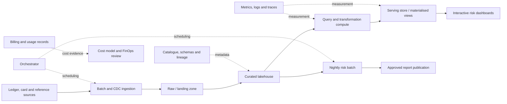

# Project 13 — Capacity, Cost and Performance Review

> **Stage:** 2D — Data Architecture  
> **Module:** 13 — Performance, Scalability and Cost Architecture  
> **Target repository path:** `Stage 2D — Data Architecture/13-Performance-Scalability-and-Cost-Architecture/Projects/13-capacity-cost-and-performance-review.md`  
> **Document version:** 1.0  
> **Status:** Reference design for review; not a production approval  
> **Owner:** To be assigned  
> **Review date:** 2026-10-22  
> **Classification:** Training/reference design; classify actual operational evidence before storage

> **Critical assumption notice:** Northbridge Bank, the workload, data volumes, performance targets, prices, capacity numbers, query patterns, test results and cost figures in this project are fictional teaching inputs. They are not production measurements, vendor prices, benchmarks, savings claims, contractual commitments or universal thresholds. Any value not supported by an identified source must be labelled as an assumption or estimate. Do not use this document to approve a production change or procurement without replacing illustrative inputs with measured telemetry, dated price sources, approved requirements and a reviewed test plan.

---

## 0. Executive summary

This project produces a defensible, evidence-backed review of a data platform's workload, capacity, performance, scalability and cost. It is intended to turn an ambiguous problem—slow dashboards, batch overruns, rising spend or uncertain growth headroom—into a structured decision supported by reproducible calculations and a validation plan.

The fictional Northbridge Bank operates a lakehouse-based risk analytics service. It serves interactive risk dashboards and a nightly batch. Dashboard latency degrades around the morning peak, the batch sometimes overruns its delivery window, and monthly platform spend is growing faster than the data volume. The review must determine what is known, locate the likely bottlenecks, forecast demand, compare architectural options, estimate cost consistently, and define tests that could confirm or refute each recommendation.

The project integrates all eight topics in Module 13:

1. Capacity planning and growth forecasting.
2. Throughput, latency, concurrency and queueing.
3. Query performance and data locality.
4. Scaling, partitioning, sharding and hotspots.
5. Caching, materialisation and serving trade-offs.
6. Cost modelling, unit economics and FinOps.
7. Performance testing and capacity validation.
8. Architecture optimisation with measured evidence.

The final review is not a list of tuning tips. It is a decision package that connects business requirements to workload inputs, resource estimates, performance measurements, cost drivers, option comparisons, experiment design, risks and decision gates. It must distinguish facts from assumptions, estimates, hypotheses, recommendations and verified outcomes.

### 0.1 Intended audience

- Data architects and senior data engineers
- Platform engineers, SREs and performance engineers
- Query, storage, lakehouse, streaming and serving owners
- FinOps, finance, procurement and business owners
- Security, governance and architecture reviewers
- Engineering managers and technical decision-makers

### 0.2 Problem statement

Without an integrated review, teams may add compute to a query problem, cache data without a freshness contract, increase shard count without addressing skew, compare cloud costs using inconsistent workload assumptions, or declare a performance win from one nonrepresentative benchmark. This project establishes a repeatable method to diagnose the actual constraint and recommend the least complex option that meets business requirements at an acceptable total cost.

### 0.3 Scope

**In scope**

- Business requirements, workload profile and baseline provenance
- Low/expected/high demand and growth scenarios
- Capacity estimates, utilisation, headroom and uncertainty
- Throughput, latency percentiles, concurrency, queues and bottleneck analysis
- Query plans, scan volume, locality, joins, shuffles and expensive workload patterns
- Scaling alternatives, partitioning/sharding, skew, hotspots and migration risks
- Cache/materialisation/serving alternatives, freshness and break-even analysis
- Transparent cost model, unit economics, allocation, sensitivity and FinOps governance
- Safe performance test plan and capacity-validation criteria
- Evidence-labelled optimisation hypotheses, prioritisation, rollback and retesting
- Risk register, architecture decision records (ADRs), reviewer checklist and completion gates

**Out of scope unless separately approved**

- Executing changes against a live production platform
- Accessing or inventing actual telemetry, bills, contracts, vendor rates or account details
- Guaranteeing savings or performance improvements without representative measurement
- Selecting a cloud vendor or service SKU without requirements and dated source evidence
- Bypassing reliability, privacy, security, residency, governance or disaster-recovery controls to reduce cost
- Treating synthetic measurements as production evidence

### 0.4 Success criteria

The design is complete when all eight topics are integrated, all numeric values have units and evidence labels, capacity and cost use consistent assumptions, every recommendation is falsifiable and ranked, performance tests have predeclared acceptance criteria, risks and trade-offs are explicit, and the reviewer can trace any material claim to its source and validation plan.

Production decision readiness additionally requires actual workload measurements, dated price sources, approved business objectives, safe test evidence and sign-off from accountable owners.

---

## 1. Project charter and governance

### 1.1 Proposed scenario

Northbridge Bank is a fictional organisation using a lakehouse to support risk analytics. Its logical data flow is:



This is a logical model, not a claim about an existing deployment. Before using the project operationally, replace it with the actual platform and dependencies.

### 1.2 Illustrative problem signals

The following are proposed teaching inputs, not observed facts:

- Dashboard latency is worse during the morning peak.
- The nightly risk batch sometimes exceeds its intended delivery window.
- Monthly platform spend is increasing faster than data volume.
- The platform owner does not yet know whether the dominant cause is query inefficiency, queueing, skew, refresh work, over-provisioning, data movement, or pricing/allocation.

The project must not assume all four signals share one cause. Each requires evidence.

### 1.3 Stakeholders and responsibilities

| Role | Responsibility | Decision / evidence |
|---|---|---|
| Business service owner | Defines business outcomes, criticality and delivery deadlines | Approves SLOs, priorities and acceptable degradation |
| Data product owner | Defines data correctness, freshness and consumer expectations | Approves freshness contracts and output validation |
| Data architect | Integrates workload, design, constraints and alternatives | Owns review coherence and ADRs |
| Performance/SRE lead | Defines instrumentation, workload tests and saturation limits | Provides baseline, test results and capacity evidence |
| Query/data engineering lead | Analyses plans, transformations, locality and skew | Provides query-level evidence and correctness safeguards |
| Platform/storage owner | Provides resource, storage, network and scaling data | Provides capacity estimates and topology constraints |
| FinOps/finance owner | Supplies billing data, price sources, allocation rules and budget context | Reviews cost model, unit economics and savings verification |
| Security/governance owner | Confirms required controls and data-handling constraints | Reviews that optimisation does not weaken required controls |
| Test lead / independent reviewer | Reviews methodology, test validity and conclusions | Signs off on evidence quality and acceptance criteria |
| Change authority | Approves any real configuration or production intervention | Authorises implementation and rollback plan |

One person may hold multiple roles in a small team, but high-risk production changes should retain appropriate independent review and separation of duties.

### 1.4 Evidence labels

Every important statement in the review must use one of these labels:

- **Fact (measured):** directly observed with source, unit, scope, time window and method.
- **Assumption:** provisionally accepted but not verified.
- **Estimate:** calculated from facts and/or assumptions.
- **Hypothesis:** a testable explanation or prediction.
- **Recommendation:** a proposed action based on current evidence and trade-offs.
- **Verified outcome:** a result measured after a defined intervention and compared with a valid baseline.

A recommendation is not a verified outcome. A benchmark result is not automatically a production result. Never upgrade the evidence label because a conclusion sounds plausible.

### 1.5 Governance rules

1. Keep business requirements, measured observations and architecture decisions separate.
2. Record source, timestamp, units, environment, configuration and workload for every material measurement.
3. Freeze acceptance criteria before running a test.
4. Compare options at the same workload and required service level.
5. Include performance, freshness, correctness, reliability, security, operational complexity and cost in every material trade-off.
6. Do not use an optimisation to bypass an approved control or service objective.
7. Maintain a decision log and record rejected alternatives.
8. Any production intervention requires the organisation's normal change process, a rollback plan and accountable approval.
9. Actual price inputs must have source, region, currency, effective date, billing unit and contract/discount treatment.
10. Revalidate the review after a material workload, data model, topology, price, contract or service-objective change.

---

## 2. Requirements, assumptions and initial questions

### 2.1 Business outcomes

1. Keep interactive dashboard latency within an approved objective for the representative peak workload.
2. Complete the nightly risk batch before the approved business deadline.
3. Maintain data correctness and freshness while optimising.
4. Support expected growth and a defined headroom policy.
5. Explain total cost and cost per useful business unit, with shared costs allocated transparently.
6. Prioritise changes by measured impact, confidence, implementation effort, risk and payback.
7. Produce a test plan that can fail and can distinguish among competing hypotheses.

### 2.2 Illustrative assumptions register

All rows are **assumptions** until confirmed.

| ID | Assumption | Illustrative value | Owner to confirm | Validation / closure condition |
|---|---|---|---|---|
| A-01 | Current logical lakehouse data volume | 250 TB | Storage owner | Inventory actual logical and physical bytes |
| A-02 | Annual data growth | Low 20%, expected 30%, high 40% | Data product owner | Analyse historical growth and business forecast |
| A-03 | Dashboard peak | Up to 200 concurrent users | Product owner | Obtain time-series and concurrency telemetry |
| A-04 | Peak query rate | 1,000 queries/minute | Performance lead | Confirm offered/completed request definitions |
| A-05 | Nightly batch input | 2 TB per run | Data engineering lead | Measure input bytes by run and period |
| A-06 | Batch deadline | 06:00 local business time | Business owner | Confirm timezone, calendar and delivery definition |
| A-07 | Dashboard target | p95 ≤ 3 seconds | Product owner | Approve SLI definition and workload population |
| A-08 | Batch success target | Complete by 06:00 on 99% of scheduled days | Business owner | Approve measurement window and exclusions |
| A-09 | Current monthly spend | $60,000 | FinOps | Reconcile invoice, credits, tax and shared allocation |
| A-10 | Spend growth ceiling | No more than +15% under expected scenario | Finance/business owner | Approve budget basis and scope |
| A-11 | Price inputs | Not yet sourced | FinOps/procurement | Obtain dated price sheet and contract terms |
| A-12 | Query patterns | Ten representative patterns available for analysis | Query owner | Validate query mix and workload representativeness |
| A-13 | Performance evidence | Synthetic load, query and billing examples may be used | Test lead | Clearly label synthetic data; do not claim production validity |
| A-14 | Data residency and security controls remain mandatory | Must not be weakened for savings | Governance/security | Confirm applicable controls and approved architecture |

### 2.3 Questions to answer before any final recommendation

- What exact business event defines a successful dashboard request or completed batch?
- Which users, queries, tenants and time periods define the representative workload?
- Are the latency values client-observed end-to-end or server-side timings?
- What are p50, p95, p99, timeout, error, queue-depth and saturation values at the same load?
- Which query patterns account for the most cumulative runtime, bytes scanned, shuffle, spill or cost?
- Is the slowest task caused by skew, I/O, data volume, join cardinality, resource contention or an external dependency?
- What fraction of storage is active, retained, duplicated, replicated, temporary or subject to a retention requirement?
- What is the true marginal cost of each candidate resource under current contracts?
- Which costs are direct and which are shared? How are idle capacity and platform overhead allocated?
- What freshness, consistency and failure-recovery guarantees must caching/materialisation preserve?
- What is the safe test environment and what would invalidate a benchmark run?
- What operational skills, maintenance, migration, rollback and vendor dependencies does each option introduce?

---

## 3. Step 1 — Establish scope, service objectives and decision criteria

**Purpose:** Define the decision before analysing metrics, so the review does not optimise a metric that is irrelevant to the business.

### 3.1 Tasks

1. Confirm the business owner, data product, consumers and critical workflows.
2. Define the dashboard and batch service boundaries.
3. Define success for dashboard requests, including timeout/error policy and measurement population.
4. Define batch success: completed, validated and published by the deadline—not merely a job marked “finished.”
5. Record latency, freshness, correctness, availability, reliability and security constraints.
6. Identify peak periods, scheduled batch windows, data-refresh periods and recovery/backfill overlap.
7. Agree on budget scope, currency, time horizon and what costs are included.
8. Define the decision to be made: e.g. retain, resize, optimise query, repartition, add cache/materialisation, alter serving architecture or change commitment.
9. Set acceptance criteria and evidence requirements before testing.

### 3.2 Initial objective matrix

The following are **illustrative targets**, not commitments.

| Objective ID | Service | SLI | Proposed target | Measurement window | Owner approval |
|---|---|---|---|---|---|
| SLO-01 | Dashboard | Client-observed end-to-end request latency | p95 ≤ 3 s at agreed representative peak; p99 threshold TBD | Per representative run and rolling production window | TBD |
| SLO-02 | Dashboard | Successful eligible requests / all eligible requests | ≥99.9% success, with explicit timeout/error semantics | Monthly | TBD |
| SLO-03 | Nightly batch | Scheduled runs completed, validated and published by deadline | ≥99% by 06:00 | Rolling 100 scheduled runs or approved window | TBD |
| SLO-04 | Data freshness | Source-to-serving age for eligible records | TBD by data product | Per data domain and sampling interval | TBD |
| SLO-05 | Capacity | Critical peak workload served without sustained unbounded queue growth | Defined workload and queue threshold TBD | Peak load test | TBD |
| FIN-01 | Cost | Total in-scope monthly cost and cost per unit | Within approved budget; illustrative +15% growth ceiling | Monthly | TBD |
| FIN-02 | Efficiency | Cost per useful request / TB processed / completed batch | Baseline and target TBD | Monthly and per test | TBD |

Do not compare latency from a cold cache with a warm-cache baseline unless that is the actual production condition. Record both if cold-start behaviour matters.

### 3.3 Step 1 outputs and gate

**Outputs:** signed problem statement, service-boundary definitions, objective matrix, decision scope, constraint list and open-question register.

**Gate G1:** the team can state what success means, for which workload, over which window, and who approves the objective.

---

## 4. Step 2 — Build the workload baseline and capacity forecast

**Purpose:** Quantify demand, variability, growth and required headroom using consistent units.

### 4.1 Workload profile

For each workload class, capture:

- Requests/events/rows/bytes per second or per time window.
- Average, peak, burst magnitude and burst duration.
- Concurrency and arrival pattern (open-loop arrival rate versus closed-loop users).
- Query/job mix, read/write ratio, key/tenant distribution and data shape.
- Input/output bytes, retained data, temporary/shuffle data and replication.
- Schedule, freshness deadline, batch window and overlap with other jobs.
- Growth drivers: customers, transactions, new products, retention, query adoption or model complexity.
- Current resource footprint and the source/quality of each measurement.

### 4.2 Workload inventory template

| Workload ID | Business purpose | Arrival / schedule | Average | Peak / burst | Data/query shape | Objective | Evidence label |
|---|---|---|---:|---:|---|---|---|
| W-01 | Interactive dashboard | Morning peak | TBD | Illustrative 1,000 queries/min | Read-heavy, mixed filters and joins | p95 latency | Assumption until telemetry |
| W-02 | Nightly risk batch | Scheduled daily | Illustrative 2 TB/run | Deadline-bound | Batch joins and aggregations | Finish by 06:00 | Assumption until run logs |
| W-03 | Data refresh/materialisation | Scheduled or incremental | TBD | Can overlap dashboard peak | Refresh and compaction work | Freshness + workload isolation | TBD |
| W-04 | Ad hoc analysis | Business hours | TBD | Bursty | Variable scans | Fairness and resource limits | TBD |
| W-05 | Recovery/backfill | Incident-driven | TBD | Potentially large backlog | Reprocessing and replay | Must not starve critical work | TBD |

### 4.3 Capacity planning method

1. Convert all demand to consistent units.
2. Separate steady-state, peak, burst and batch demand.
3. Estimate resource demand per unit from measured representative runs.
4. Model low, expected and high growth.
5. Include scheduled overlaps, background maintenance, compaction, refresh and recovery/backfill.
6. Define target utilisation or saturation guardrails based on measured latency and queueing behaviour.
7. Include N+1/failure headroom if required by the reliability architecture.
8. Validate that capacity and cost models use the same workload and growth assumptions.
9. Record uncertainty ranges and which measurement would narrow them.

### 4.4 Growth forecast example

Let current volume be \(V_0\), annual growth rate be \(g\), and horizon be \(n\) years:

\[
V_n = V_0(1+g)^n
\]

For the illustrative current volume of 250 TB after three years:

| Scenario | Annual growth | Calculation | Approximate year-3 volume |
|---|---:|---|---:|
| Low | 20% | 250 × 1.20³ | 432 TB |
| Expected | 30% | 250 × 1.30³ | 549 TB |
| High | 40% | 250 × 1.40³ | 686 TB |

These are scenario calculations, not a forecast validated by historical data. The model must separately account for compression, retention, replicas, temporary storage and physical overhead; logical data volume is not the same as billable storage.

### 4.5 Capacity/headroom worksheet

| Resource | Current measured demand | Peak demand | Planned capacity | Guardrail / headroom | Evidence needed |
|---|---:|---:|---:|---|---|
| Query CPU/compute | TBD | TBD | TBD | Based on measured saturation knee | Load tests + telemetry |
| Memory | TBD | TBD | TBD | Avoid sustained spill/GC/eviction threshold | Resource profiles |
| Storage read throughput | TBD | TBD | TBD | Peak scans + background work | I/O telemetry |
| Network / data transfer | TBD | TBD | TBD | Include shuffle and remote reads | Network counters |
| Queue/worker slots | TBD | TBD | TBD | Queue must drain under peak assumptions | Queue time series |
| Serving store | TBD | TBD | TBD | N+1 / failover capacity as required | Load/failure tests |
| Storage capacity | TBD | TBD | TBD | Retention, growth, replicas and recovery copies | Storage inventory |
| Refresh/compaction | TBD | TBD | TBD | Avoid overlap with critical peak if possible | Job history |

Do not set a universal “safe utilisation” number without evidence. Find the workload-specific point where tail latency, queue depth or errors begin to deteriorate.

### 4.6 Step 2 outputs and gate

**Outputs:** workload inventory, baseline data dictionary, growth scenarios, capacity worksheet, uncertainty register.

**Gate G2:** every estimate has units, time horizon, source/label and a clear relationship to the later performance and cost models.

---

## 5. Step 3 — Analyse throughput, latency, concurrency and queueing

**Purpose:** Identify the limiting resource and understand how performance changes as demand approaches capacity.

### 5.1 Metric definitions

- **Offered load:** work the generator or users attempt to submit.
- **Throughput:** completed operations per unit time, separated into successful and failed completions.
- **Latency:** elapsed time for a defined operation, measured at a stated boundary.
- **Percentiles:** p50, p95 and p99 show different parts of the latency distribution; averages can hide tail behaviour.
- **Concurrency:** work in flight at a point in time.
- **Queue depth / wait time:** work waiting for service or resources.
- **Saturation:** a resource is near its effective limit, often accompanied by increasing queueing, latency or errors.
- **Backlog:** accumulated unprocessed work.

### 5.2 Little’s Law

For a stable system, with consistent boundaries and time averages:

\[
L = \lambda W
\]

where \(L\) is average work in the system, \(\lambda\) is average throughput/arrival rate, and \(W\) is average time in the system. Use matching units and a stable observation window. Little’s Law does not by itself predict tail latency or prove the system is stable under overload.

### 5.3 Queue growth and drain

If arrival rate \(\lambda\) exceeds sustainable service rate \(\mu\), backlog grows. If \(\mu > \lambda\), an existing backlog \(B\) can drain at net rate \(\mu-\lambda\), under simplifying assumptions:

\[
T_{\text{drain}} = \frac{B}{\mu-\lambda}, \quad \mu > \lambda
\]

If \(\mu \leq \lambda\), the backlog does not drain in this model. State units, workload mix, variability and overhead.

### 5.4 Measurement worksheet

| Test/run | Offered rate | Completed rate | p50 | p95 | p99 | Error rate | Queue trend | Saturated resource | Valid run? |
|---|---:|---:|---:|---:|---:|---:|---|---|---|
| Baseline | TBD | TBD | TBD | TBD | TBD | TBD | TBD | TBD | TBD |
| Peak | TBD | TBD | TBD | TBD | TBD | TBD | TBD | TBD | TBD |
| Stress | TBD | TBD | TBD | TBD | TBD | TBD | TBD | TBD | TBD |
| Failure/degraded | TBD | TBD | TBD | TBD | TBD | TBD | TBD | TBD | TBD |

### 5.5 Diagnostic procedure

1. Confirm the load generator can produce the intended offered load without becoming the bottleneck.
2. Compare offered and completed rates.
3. Inspect p50/p95/p99, errors, timeouts and retries together.
4. Inspect queues, wait time, resource saturation and downstream dependencies.
5. Identify the “knee” where incremental load causes disproportionate latency/queue growth.
6. Determine whether the constraint is CPU, memory, I/O, network, lock/contention, queue slots, external dependency, skew or serial work.
7. Repeat with a controlled change or discriminating workload to test the hypothesis.
8. State alternative explanations and the evidence that would distinguish them.

### 5.6 Measurement validity risks

- Coordinated omission or closed-loop load that reduces offered load as latency rises.
- Comparing warm-cache and cold-cache runs.
- Different query mix, data size, concurrency, configuration or software versions.
- Background refresh/compaction differences.
- Sampling gaps or inconsistent client/server timing boundaries.
- A test client or network path that saturates before the system under test.
- Reporting only the best run or a single average.
- Inferring production behaviour from an isolated synthetic environment without caveats.

**Outputs:** latency/throughput analysis, queueing interpretation, bottleneck hypotheses and a metric-quality note.

**Gate G3:** the review distinguishes offered from completed work, explains tail latency and queues, and does not treat a symptom as a proven cause.

---

## 6. Step 4 — Review query performance and data locality

**Purpose:** Find expensive query patterns and data-movement costs before increasing capacity.

### 6.1 Query inventory

Rank representative queries by cumulative business impact, not only single-run duration. Useful measures include total runtime, execution frequency, bytes scanned, bytes shuffled, spill, CPU, queue time, cache behaviour, failure rate and freshness impact.

| Query ID | Business use | Frequency | Runtime p95 | Bytes scanned | Shuffle/spill | Cost proxy | Evidence label |
|---|---|---:|---:|---:|---:|---:|---|
| Q-01 | Dashboard aggregate | TBD | TBD | TBD | TBD | TBD | TBD |
| Q-02 | Customer exposure join | TBD | TBD | TBD | TBD | TBD | TBD |
| Q-03 | Nightly risk aggregation | TBD | TBD | TBD | TBD | TBD | TBD |
| Q-04 | Ad hoc historical scan | TBD | TBD | TBD | TBD | TBD | TBD |

### 6.2 Query review steps

1. Capture representative query text or a safe equivalent, parameters, plan, schema and table statistics.
2. Rank by cumulative cost/latency and business criticality.
3. Inspect scan volume, partition pruning, filter selectivity, projection, join cardinality, join strategy, shuffle, sort, aggregation, spill and repeated subexpressions.
4. Check whether statistics are fresh and whether the plan matches actual runtime behaviour.
5. Evaluate locality: where data resides, whether joins co-locate, and whether remote reads or network movement dominate.
6. Check small-file/metadata overhead and compaction costs for file-based analytical storage.
7. Form a hypothesis before changing the query or layout.
8. Measure before/after under equivalent workload and configuration.
9. Validate result correctness, including nulls, duplicates, join semantics, late data and security filters.
10. Reassess whether the bottleneck moved to another stage.

### 6.3 Selectivity and scan-reduction calculations

Selectivity can be expressed as:

\[
\text{selectivity} = \frac{\text{rows matching predicate}}{\text{rows examined}}
\]

Scan reduction is:

\[
\text{scan reduction} = 1 - \frac{\text{bytes read after}}{\text{bytes read before}}
\]

These measures are useful only when the denominator and workload are comparable. Reduced scan bytes do not guarantee proportional end-to-end speedup if joins, shuffle, queueing or serial stages dominate.

### 6.4 Query decision matrix

| Candidate change | Potential benefit | Cost / risk | Required evidence |
|---|---|---|---|
| Filter/projection pushdown | Less data read | Engine may already apply it; semantics risk | Physical plan and scan metrics |
| Partition pruning / layout change | Fewer bytes read | More partitions/files/metadata | Representative filter patterns and file statistics |
| Join strategy / pre-aggregation | Lower shuffle or repeated work | Memory, correctness, freshness | Cardinality, shuffle, output-equivalence tests |
| Statistics update | Better plan choice | Maintenance overhead | Stale-statistics evidence and plan comparison |
| Compaction | Lower file/metadata overhead | Extra compute and write amplification | File-size distribution and query metrics |
| Materialise common result | Less repeated query work | Refresh cost, storage and staleness | Query frequency, refresh cost and freshness contract |

**Outputs:** ranked query inventory, plan findings, hypotheses and candidate changes.

**Gate G4:** each query recommendation is tied to a measured workload pattern and has a correctness-aware validation plan.

---

## 7. Step 5 — Evaluate scaling, partitioning, sharding and hotspots

**Purpose:** Determine whether additional capacity or a different distribution strategy addresses the actual bottleneck.

### 7.1 Scaling options

| Option | Benefits | Limitations / risks | Evaluate when |
|---|---|---|---|
| Scale up | Simpler topology; can help memory/CPU-bound work | Hardware ceiling, larger failure domain, cost step | Resource is constrained and workload scales vertically |
| Scale out | More aggregate resources and parallelism | Coordination, network, skew, overhead | Work can be distributed effectively |
| Add read replicas | More read capacity / isolation | May not fix write bottlenecks; lag/consistency | Read-heavy workload and replica semantics are acceptable |
| Partition data | Pruning, parallelism, lifecycle management | Too many small partitions, metadata overhead | Queries align with partition dimensions |
| Shard by stable key | Distributes data/requests | Cross-shard operations, hot keys, resharding | Workload can be partitioned with clear ownership |
| Isolate hot tenants/keys | Reduces noisy-neighbour impact | Routing and operational complexity | Distribution is demonstrably skewed |
| Queue/buffer writes | Smooths bursts | Does not solve sustained overload if arrival exceeds service rate | Bursts are transient and delay is acceptable |

### 7.2 Skew analysis

For partition loads \(x_i\), compute mean \(\bar{x}\), maximum \(x_{\max}\), and a simple skew ratio \(x_{\max}/\bar{x}\). This is a diagnostic summary, not a universal capacity formula. Also inspect per-partition bytes, CPU, I/O, request cost and task duration; row counts alone may hide expensive records.

### 7.3 Partition/shard decision procedure

1. Identify the dominant access patterns and transaction/consistency boundaries.
2. Measure key frequencies, partition sizes, per-partition requests and resource usage.
3. Compare candidate keys for pruning/locality versus write distribution.
4. Model skew and hot-key behaviour under expected and peak load.
5. Estimate query fan-out, cross-shard work, data movement and resharding impact.
6. Check how replication, failover and recovery interact with the distribution.
7. Test representative skewed data, not only uniform keys.
8. Plan migration with snapshot boundary, change capture, validation, routing cutover and rollback.
9. Check whether adding capacity simply moves the bottleneck to network, metadata, a hot key or a serial stage.

### 7.4 Distribution decision matrix

| Dimension | Range by time | Hash by tenant/key | Tenant-aware directory |
|---|---|---|---|
| Time-range query locality | Often strong | May fan out | Depends on placement |
| Point lookup | Depends on key | Often direct | Directory lookup + placement |
| Hot current write range | Risk of concentration | Depends on key skew | Can isolate selected tenants |
| Hot tenant/key | May be mixed with others | Can dominate one shard | Can move/isolate tenant |
| Cross-tenant aggregation | Range fan-out | Shard fan-out | Usually fan-out or pre-aggregate |
| Resharding | Split/move ranges | Modulo remapping can be expensive | Can move selected tenants gradually |
| Operational complexity | Low–medium | Medium | Higher: directory and migration control |

**Outputs:** scale-up/scale-out comparison, skew analysis, distribution recommendation and migration risk notes.

**Gate G5:** the chosen scaling or partitioning change addresses measured evidence, preserves data semantics and includes a plan for representative skew and rollback.

---

## 8. Step 6 — Evaluate caching, materialisation and serving trade-offs

**Purpose:** Reduce repeated work only when the total cost and freshness/correctness implications justify it.

### 8.1 Options

- **In-memory/distributed cache:** trades memory, invalidation and operational complexity for fewer backend reads.
- **Result cache:** reuses query results under defined query/data/security semantics.
- **Materialised view/table:** precomputes a result; trades refresh compute and storage for faster reads.
- **Serving store:** maintains a query-optimised representation; trades write/refresh pipelines and duplicated state for predictable serving.
- **No cache/precompute:** simplest freshness/correctness model, but may repeat expensive work.

### 8.2 Cache decision method

1. Measure request frequency and repeated-key/query distribution.
2. Estimate hit ratio from representative access traces; do not assume every request is equally cacheable.
3. Measure cache hit and miss latency, backend request rate and miss-path concurrency.
4. Define invalidation, TTL, versioning, consistency and security-scope behaviour.
5. Specify maximum acceptable staleness and what consumers see when refresh fails.
6. Include cache memory/compute, network, refresh, invalidation, operations and failure costs.
7. Test cold start, cache loss, invalidation storm and skewed access patterns.
8. Compare end-to-end latency, backend load, correctness and cost under the same workload.

### 8.3 Simplified effective latency model

For a simple two-path model:

\[
E[T] = hT_{\text{hit}} + (1-h)T_{\text{miss}}
\]

where \(h\) is hit ratio. This omits queueing interaction, concurrent misses, refresh work and tail-latency effects. Use it for first-order reasoning, then validate with a representative test.

### 8.4 Serving/materialisation decision matrix

| Option | Latency | Freshness | Cost drivers | Key risks |
|---|---|---|---|---|
| Direct query | Depends on query and concurrency | Potentially freshest | Compute, scans, queueing | Tail latency and repeated work |
| Cache | Fast on hit | TTL/invalidation-dependent | Memory, refresh, backend misses | Stale data, stampede, access-scope leak |
| Materialised view/table | Predictable reads | Refresh lag | Storage + refresh compute + serving reads | Refresh failure, stale output, duplicate state |
| Dedicated serving store | Can isolate dashboard traffic | Replication/update lag | Serving compute/storage + sync pipeline | Divergence and extra operational burden |

**Outputs:** cache/materialisation/serving decision matrix, freshness contract, hit-ratio sensitivity and validation plan.

**Gate G6:** the proposal includes both avoided work and the cost of maintaining the alternative, plus explicit freshness, invalidation, correctness and failure behaviour.

---

## 9. Step 7 — Build the cost model and unit economics

**Purpose:** Translate the same workload and architecture assumptions used in capacity planning into a transparent and reconcilable cost estimate.

### 9.1 Cost model principles

- Use dated, sourced prices for real decisions; label unsourced values as placeholders.
- Keep units consistent across quantities, rates, time periods and currency.
- Include compute, storage, requests, transfer/egress, orchestration, logs/metrics, backup/replication, licences/support and material operational effort where relevant.
- Do not double-count costs bundled into managed-service pricing.
- Separate fixed, variable, direct, indirect, recurring, usage-based and committed costs.
- Model low/expected/high demand and sensitivity to the largest drivers.
- Reconcile the estimate with actual billing and usage data before claiming savings.
- Compare options at equivalent performance, reliability, freshness and security requirements.

### 9.2 Cost-driver inventory

| Driver | Quantity / billing unit | Example formula | Required source |
|---|---|---|---|
| Compute | node-hours, vCPU-hours, processing units | Quantity × unit price | Usage records and dated price |
| Persistent storage | GB-month/TB-month | Average billable capacity × price | Storage inventory and pricing |
| Requests / scans | requests, reads, bytes scanned | Billable count × rate | Service usage records |
| Network transfer | GB transferred by path | Transfer volume × applicable rate | Flow/usage records and price source |
| Logs/metrics/traces | GB ingested/retained or service units | Ingest + retention + query cost | Observability usage |
| Backup/replication | retained bytes, snapshots, replicas | Billable copy volume × price | Recovery/retention design |
| Orchestration | job runs, scheduler units, worker-hours | Quantity × rate | Scheduler and billing records |
| Licence/support | seat, node, usage or contract | Contract charge allocation | Contract/procurement |
| Operations | engineering/on-call effort | Hours × approved loaded rate, if in scope | Time/cost policy |
| Materialisation/refresh | refresh compute + storage + transfer | Sum of applicable drivers | Job and storage usage |

### 9.3 Basic formulas

For a line item:

\[
C_i = Q_i \times P_i
\]

where \(Q_i\) is billable quantity and \(P_i\) is price per billing unit.

For a total:

\[
C_{\text{total}} = \sum_i C_i + C_{\text{shared allocation}} - C_{\text{eligible credits}}
\]

Include taxes, support, commitments, discounts, currency conversion and one-time costs only according to the defined model scope. Document exclusions.

### 9.4 Unit economics

Choose a denominator that reflects delivered business value and is comparable between options. Examples:

- cost per 1,000 successful dashboard queries;
- cost per validated TB processed;
- cost per completed nightly batch;
- cost per active data product or tenant, if allocation rules are justified.

\[
\text{Unit cost} = \frac{\text{cost over period}}{\text{successful useful units over same period}}
\]

Do not use failed requests or duplicated processing as successful output. If two options have different correctness or freshness, their unit costs are not comparable until those differences are made explicit.

### 9.5 Illustrative two-option cost model

The figures below are arbitrary teaching placeholders, not vendor prices.

| Cost line | Option A: existing design | Option B: query optimisation + selective materialisation | Notes |
|---|---:|---:|---|
| Compute/month | $32,000 | $28,000 | Placeholder |
| Storage/month | $8,000 | $10,000 | Materialised storage raises storage |
| Network/requests/month | $5,000 | $4,000 | Placeholder |
| Observability/orchestration/month | $4,000 | $4,000 | Assumed unchanged |
| Backup/replication/support/month | $6,000 | $6,000 | Assumed unchanged |
| Shared allocation/month | $5,000 | $5,000 | Allocation method must be approved |
| **Total/month** | **$60,000** | **$57,000** | Illustrative only |
| Successful dashboard queries/month | 30 million | 30 million | Must meet same service objective |
| **Cost per 1,000 successful queries** | **$2.00** | **$1.90** | Total cost ÷ 30,000 units |

This table demonstrates arithmetic only. Option B is not a savings claim; it becomes a candidate only if equivalent correctness, latency, freshness, reliability and operational constraints are demonstrated.

### 9.6 Break-even and sensitivity

If a change has one-time implementation cost \(I\) and expected monthly net saving \(S\), simple payback is:

\[
\text{Payback months} = \frac{I}{S}, \quad S>0
\]

This simple metric ignores discount rate, risk, ongoing maintenance, migration cost, failure cost and changing workload. Include those when material.

Sensitivity analysis should vary at least:

- demand/growth (low, expected, high);
- peak duration and concurrency;
- storage retention and replication;
- cache hit ratio and refresh frequency;
- query scan/shuffle volume;
- compute unit price and discounts;
- data-transfer volume and path;
- commitment utilisation and break-even;
- engineering/operational effort;
- test and migration costs.

### 9.7 FinOps and allocation controls

1. Assign each resource/service a business owner and cost owner.
2. Define shared-cost allocation rules (e.g. usage, reserved capacity, headcount or fixed service charge) and explain why the chosen denominator is fair.
3. Separate showback (visibility) from chargeback (financial transfer).
4. Set budget, forecast and anomaly thresholds appropriate to the organisation.
5. Investigate variance by price, quantity, workload mix, configuration and allocation.
6. Model commitments using expected utilisation, flexibility, cancellation/exit constraints and opportunity cost.
7. Review cost per useful unit, not just the monthly bill.
8. Track optimisation actions through baseline, expected effect, measured result and follow-up.
9. Never report a saving until the actual billing window is comparable and confounders are documented.

**Outputs:** cost-driver inventory, cost model, unit economics, scenario/sensitivity table, allocation proposal and FinOps action register.

**Gate G7:** the cost model reconciles to the workload/capacity assumptions, all prices have provenance or placeholder labels, and comparisons include the cost of refresh, redundancy and operations.

---

## 10. Step 8 — Design performance tests and capacity validation

**Purpose:** Test whether the planned architecture meets the stated objectives under a defined workload and produce reproducible evidence.

### 10.1 Test types

| Test type | Question |
|---|---|
| Baseline | What does the system do under a known reference workload? |
| Load | Does it meet objectives at expected/peak load? |
| Stress | Where and how does it fail beyond expected demand? |
| Spike | How does it react to abrupt demand changes? |
| Endurance/soak | Does behaviour degrade over time due to leaks, compaction, queue growth or resource exhaustion? |
| Scalability | How does performance change as resources and workload scale? |
| Capacity-limit | What workload can be supported while meeting acceptance criteria? |
| Failure/degraded mode | Can the service meet its defined degraded objective when a component or capacity slice is lost? |
| Recovery/backfill overlap | Can critical work continue while backlog or refresh is processed? |

### 10.2 Test plan template

- Test ID/title and decision it supports
- Hypothesis and competing explanations
- Environment, topology, versions and configuration
- Dataset shape, size, key distribution and data freshness
- Request/job mix, arrival pattern, concurrency, burst, duration and ramp
- Warm-up, cache state and background work
- Metrics and exact measurement boundaries
- Predeclared pass/fail criteria, including latency percentiles, errors, throughput, queue stability and resource headroom
- Invalid-run rules and test-harness limits
- Safety controls, data handling, approval, abort thresholds and cleanup
- Evidence capture, repeat count, variance and reviewer
- Result, limitations, corrective actions and retest plan

### 10.3 Example acceptance criteria (illustrative)

For three valid steady-state runs after warm-up:

- offered load reaches the specified target and the load generator is not saturated;
- p95 and p99 stay within approved limits;
- error/timeout rate stays below the approved threshold;
- completed throughput is consistent with the offered load;
- queues do not grow without bound and drain after a bounded burst;
- resource use remains within measured saturation/headroom guardrails;
- data correctness, freshness and access controls pass;
- cost per successful useful unit is recorded;
- any failure-mode capacity requirement is tested separately.

The numerical thresholds must come from the approved objectives, not from whichever values happen to pass.

### 10.4 Safe execution sequence

1. Review the test charter, risk assessment, environment and approvals.
2. Confirm synthetic or approved test data and no unintended production impact.
3. Validate telemetry, clocks, load generator capacity and test harness.
4. Run a smoke test, then a low-load baseline.
5. Execute controlled ramp and steady-state runs; avoid changing multiple variables at once.
6. Record all metrics, versions, configuration, workload and invalid-run conditions.
7. Repeat valid runs and report variation, not just the best result.
8. Run stress/spike/soak/failure tests only when safe and approved.
9. Compare results with predeclared acceptance criteria.
10. Clean up test resources and data; preserve evidence and findings.
11. Re-run after material remediation and record whether the original hypothesis was supported.

### 10.5 Capacity validation output

For each workload class, state the supported capacity envelope:

- validated workload shape and rate;
- resource configuration and topology;
- latency/throughput/error results;
- queueing and saturation signals;
- headroom and growth assumptions;
- degraded/failure conditions tested;
- known limits and extrapolation boundaries;
- cost at validated workload;
- date, owner, environment and test evidence.

**Outputs:** test plan, acceptance criteria, run template and capacity-validation report structure.

**Gate G8:** the plan is reproducible, can fail, protects the environment, and links results to the workload and objectives.

---

## 11. Step 9 — Develop measured-evidence optimisation recommendations

**Purpose:** Prioritise interventions based on expected impact and validate their real effect without overclaiming.

### 11.1 Optimisation workflow

**baseline → diagnose → prioritise → hypothesise → change → measure → decide → document**

1. Establish a reproducible baseline.
2. Separate facts, assumptions, estimates and hypotheses.
3. Rank bottlenecks by business impact and cumulative cost.
4. Form a falsifiable hypothesis with predicted effect and possible side effects.
5. Define a controlled experiment and rollback plan.
6. Change one primary variable where feasible.
7. Compare paired/repeated runs at equivalent workload and configuration.
8. Assess latency, throughput, cost, freshness, correctness, reliability and operations together.
9. Decide to keep, revert, iterate or collect more evidence.
10. Update the capacity/cost model only to the extent supported by the measured outcome.

### 11.2 Amdahl-style reasoning

For a simplified sequential workload, if fraction \(p\) of runtime is improved by speedup factor \(s\), the idealised total speedup is:

\[
S = \frac{1}{(1-p) + p/s}
\]

This assumes the unaffected fraction stays unchanged and ignores bottleneck migration, overlap, queueing, contention and measurement effects. Use it as an upper-bound reasoning aid, not a prediction.

### 11.3 Recommendation register

| ID | Recommendation / hypothesis | Evidence label | Expected impact | Confidence | Effort/risk | Cost effect | Validation / rollback |
|---|---|---|---|---|---|---|---|
| OPT-01 | Optimise the highest cumulative-cost query pattern | Hypothesis until tested | Lower scan/shuffle and query latency | TBD | TBD | Estimate only | Paired benchmark; revert query/layout |
| OPT-02 | Materialise repeated dashboard aggregate | Recommendation pending freshness review | Lower repeated query work | TBD | Refresh/storage cost | A/B or replay test; disable materialisation |
| OPT-03 | Isolate a proven hot tenant/partition | Hypothesis until skew confirmed | Lower straggler/queue impact | TBD | Migration and routing complexity | Skewed workload test; route rollback |
| OPT-04 | Right-size idle capacity after peak analysis | Recommendation pending failure/headroom test | Lower idle spend | TBD | Risk of saturation | Load test at forecast peak and failure headroom |
| OPT-05 | Adjust retention/replication only after governance review | Not approved by default | Potential storage cost reduction | TBD | Data-loss/compliance risk | Formal owner approval and restore/recovery validation |

Do not rank recommendations by gross savings alone. Include expected business benefit, confidence, implementation effort, risk, reversibility, operational burden and measurement cost.

### 11.4 Before/after comparison requirements

- Same representative workload and data shape, or a clearly justified normalisation.
- Same measurement boundary and metric definitions.
- Equivalent environment and resource configuration unless configuration is the variable under test.
- Sufficient repetitions and variation reporting.
- Correctness and freshness checks.
- Cost comparison over equivalent billable periods, with credits/discounts and other confounders documented.
- Clear statement of what the experiment does not establish.

### 11.5 Outcome language

Use wording that matches evidence:

- **Estimate:** “The model estimates a 10–15% reduction under the stated assumptions.”
- **Measured test result:** “Across three valid runs in the test environment, p95 decreased from X to Y at the stated load.”
- **Verified production outcome:** only when relevant production evidence and comparable conditions support it.
- **Unresolved:** “The test was inconclusive because the workload was not representative.”

**Outputs:** ranked recommendation register, evidence register, experiment plans, rollback steps and follow-up measurement plan.

**Gate G9:** every material recommendation has evidence label, predicted benefit, trade-offs, validation criteria and a safe rollback/stop condition.

---

## 12. Step 10 — Integrate the architecture review and reconcile the models

**Purpose:** Ensure capacity, performance, serving and cost conclusions form one coherent decision.

### 12.1 Cross-topic consistency checks

| ID | Consistency check | Evidence required |
|---|---|---|
| INT-01 | Capacity forecast and cost model use the same demand and growth scenarios | Shared input table and units |
| INT-02 | Peak workload includes dashboard, batch, refresh, compaction and ad hoc overlap | Workload timeline |
| INT-03 | Performance metrics use defined boundaries and comparable workloads | Measurement definitions |
| INT-04 | Query recommendations address measured query patterns and bottlenecks | Query plans and runtime metrics |
| INT-05 | Scaling recommendation addresses actual resource/skew constraints | Per-resource/per-partition evidence |
| INT-06 | Cache/materialisation includes refresh, storage, staleness and failure cost | Freshness contract and cost model |
| INT-07 | Cost options meet the same required service objectives | Test or explicit feasibility evidence |
| INT-08 | Prices are dated/sourced or clearly labelled placeholders | Price source register |
| INT-09 | Unit economics use successful useful units over the same period as cost | Denominator definition and reconciliation |
| INT-10 | Test criteria were set before execution | Test charter version and approval |
| INT-11 | Optimisation claims do not exceed evidence | Evidence labels and reviewer check |
| INT-12 | Security, reliability, recovery and governance constraints are unchanged or formally reviewed | Specialist sign-off |
| INT-13 | Risks and operational complexity are included in option comparison | Risk/effort register |
| INT-14 | After-change capacity and cost models are updated only where supported | Before/after evidence |
| INT-15 | Remaining uncertainty has an owner and measurement plan | Open-question register |

### 12.2 Option comparison matrix

| Criterion | Option A: retain and tune existing | Option B: query optimisation + selective materialisation | Option C: redesign distribution/serving |
|---|---|---|---|
| Expected latency | To measure | To measure | To measure |
| Peak throughput | To validate | To validate | To validate |
| Batch completion | To validate | To validate | To validate |
| Correctness/freshness | Existing contract | Must preserve via refresh gates | Must preserve through new pipeline |
| Capacity/headroom | To estimate | Includes refresh load | Includes migration and fan-out |
| Monthly cost | Reconcile current bill | Include storage/refresh | Include transition and steady state |
| Operational complexity | Lower initial change | Moderate | Higher |
| Reversibility | Usually higher | Depends on data model | Depends on migration |
| Main risk | Existing bottleneck remains | Refresh/staleness and extra state | Migration, routing, consistency |
| Evidence needed | Baseline | Controlled experiment | Prototype and migration/capacity test |

No option should be selected solely from this template. Populate it with measured values and approved requirements.

### 12.3 Architecture Decision Records (ADRs)

#### ADR-01 — Optimise query/data layout before adding capacity

- **Status:** Proposed; evidence-dependent.
- **Context:** More compute may mask a scan, join, locality or skew problem without solving its cause.
- **Decision direction:** Rank query/data-layout changes using measured scan, shuffle, queue and runtime evidence before approving a capacity increase.
- **Alternatives:** add compute first; redesign data distribution; leave the workload unchanged.
- **Trade-offs:** query/layout work may take engineering time and introduce correctness risk; capacity increase may be faster but more expensive.
- **Required evidence:** query plans, per-stage metrics, representative before/after tests and correctness checks.
- **Revisit when:** bottleneck evidence shows a genuine compute capacity limit or the workload changes.

#### ADR-02 — Materialise only with an explicit freshness and cost contract

- **Status:** Proposed.
- **Context:** Repeated query work may be expensive, but precomputation adds refresh, storage and operational cost.
- **Decision direction:** Materialise only when observed reuse, hit ratio or query frequency justifies the total cost and the refresh contract meets business freshness requirements.
- **Alternatives:** direct query; cache; dedicated serving store.
- **Required evidence:** request distribution, refresh duration/cost, stale-data behaviour, correctness and failure tests.
- **Revisit when:** access patterns, freshness objectives or refresh cost changes.

#### ADR-03 — Cost comparisons use equivalent workload and service levels

- **Status:** Proposed.
- **Context:** A smaller bill under lower capacity or worse latency is not an equivalent architecture win.
- **Decision direction:** Compare options against the same workload envelope, required correctness/freshness, reliability and accepted latency.
- **Alternatives:** compare raw monthly totals; compare theoretical unit prices only.
- **Required evidence:** common workload assumptions, dated price sources, cost reconciliation and test results.
- **Revisit when:** service objectives, pricing/contract or workload changes.

#### ADR-04 — Optimisation outcomes require controlled evidence

- **Status:** Proposed.
- **Context:** Single runs, changed workload, warm cache or noisy environments can produce misleading improvements.
- **Decision direction:** Use predeclared criteria, controlled changes, repeat runs, correctness checks, variance reporting and rollback.
- **Alternatives:** deploy based on intuition; accept one benchmark run.
- **Required evidence:** test charter, baseline, run metadata, result comparison and independent review.
- **Revisit when:** test methodology or risk class changes.

**Outputs:** integrated review, cross-topic consistency matrix, option comparison and ADRs.

**Gate G10:** capacity, performance and cost models reconcile; no option is described as better without comparable evidence or clearly labelled uncertainty.

---

## 13. Step 11 — Risk register and review audit

**Purpose:** Identify technical, financial and methodological risks before a recommendation is approved.

### 13.1 Starter risk register

Ratings are provisional and must be aligned to the organisation's risk framework.

| Risk ID | Risk | Initial concern | Mitigation / control | Owner | Closure evidence |
|---|---|---|---|---|---|
| R-01 | Workload baseline is not representative | High | Use multiple periods, peak traces and realistic data/key distributions | Performance lead | Reviewed workload profile |
| R-02 | Capacity forecast underestimates growth/overlap | High | Low/expected/high scenarios and peak overlap model | Data product owner | Forecast review |
| R-03 | Tail latency is hidden by averages | High | Report p50/p95/p99, errors, queueing and offered load | SRE | Metric-quality review |
| R-04 | Query tuning changes result semantics | High | Result equivalence and business-rule tests | Data engineering | Correctness evidence |
| R-05 | Partitioning moves rather than removes bottleneck | Medium/High | Per-partition and end-to-end metrics; test skewed workloads | Architect | Distribution test |
| R-06 | Cache/materialisation serves stale or wrong data | High | Freshness contract, invalidation, versioning and failure test | Product owner | Sign-off and test evidence |
| R-07 | Cost model omits bundled or shared charges | High | Reconcile with invoices; document allocation and exclusions | FinOps | Billing reconciliation |
| R-08 | Unsourced price assumptions mislead decision | High | Dated, region-specific source and contract treatment | Procurement/FinOps | Price source register |
| R-09 | Commitment is underutilised | Medium/High | Break-even/utilisation sensitivity and flexibility review | FinOps | Commitment model |
| R-10 | Test harness saturates before system | High | Validate generator and measure achieved offered load | Test lead | Harness validation |
| R-11 | Benchmark comparison is confounded | High | Controlled variables, repeats, run metadata and validity rules | Independent reviewer | Valid run set |
| R-12 | Cost optimisation weakens resilience/security/governance | High | Mandatory architecture/security/recovery review | Architecture/security | Approved control review |
| R-13 | Estimated savings are reported as realised savings | High | Separate estimate, measured result and finance-verified saving | FinOps | Comparable billing windows |
| R-14 | Optimisation introduces unowned operational burden | Medium | Include support, alerting, refresh, migration and on-call effort | Platform owner | Runbook/owner acceptance |

### 13.2 Audit checklist

Review the project against:

- Scope and traceability to all eight module topics and D1–D12.
- Requirement and assumption discipline.
- Units, formula correctness and consistent time windows.
- Workload realism and growth scenarios.
- Queueing/latency interpretation and measurement boundaries.
- Query diagnosis, data locality and correctness.
- Scaling/skew/hotspot analysis and migration safety.
- Cache/materialisation freshness and total-cost comparison.
- Cost drivers, unit economics, shared allocation, price provenance and sensitivity.
- Test validity, safety, repeatability and predeclared criteria.
- Evidence labels, recommendation ranking and rollback.
- Risks, ADRs, owners, open questions and completion gates.
- No unsupported claim of production measurements, savings or test success.

### 13.3 Audit remediation protocol

1. Assign each finding an ID and severity.
2. State the defect, why it matters and which requirement is affected.
3. Identify the owner and required evidence.
4. Correct the project document if the defect is in its design.
5. Re-run structural and arithmetic checks.
6. Review the changed section for cross-topic contradictions.
7. Leave real-world evidence gaps open until measured or formally accepted.
8. Record final disposition in the separate audit report.

**Outputs:** risk register, audit checklist, remediation log and unresolved dependency list.

**Gate G11:** no known document defect is hidden; unresolved environment-dependent items are labelled and owned rather than falsely closed.

---

## 14. Step 12 — Validate, present and complete the project

### 14.1 Recommended deliverables D1–D12

These deliverables operationalise the roadmap's final project guide. They are recommended outputs for this reference design.

| ID | Deliverable | Required content | Validation |
|---|---|---|---|
| D1 | Requirements and assumptions summary | Business outcomes, constraints, questions, evidence labels | Facts/assumptions/questions separated |
| D2 | Workload profile and baseline | Arrival pattern, peak, mix, data shape and provenance | Units, source and window recorded |
| D3 | Capacity and growth forecast | Low/expected/high scenarios, headroom and sensitivity | Arithmetic reproducible |
| D4 | Performance and queueing analysis | Throughput, percentiles, errors, queues, saturation | Offered vs completed load separated |
| D5 | Query performance review | Ranked queries, plan/scan/shuffle findings | Evidence-linked hypotheses |
| D6 | Scaling/distribution decision | Alternatives, skew, hotspots and migration risks | Representative workload test planned |
| D7 | Cache/materialisation/serving decision | Freshness contract, hit-ratio and refresh economics | Total cost and failure modes included |
| D8 | Cost model and unit economics | Drivers, prices, allocation, scenarios, break-even | Reconciles to same workload |
| D9 | Performance test/capacity validation plan | Workload, metrics, criteria, safety and evidence | Falsifiable criteria set in advance |
| D10 | Optimisation register | Ranked hypotheses, evidence labels, expected effect and rollback | No overclaiming |
| D11 | Integrated review and evidence register | Consistent capacity, performance and cost story | Independent review |
| D12 | Validation checklist and limitations | Findings, open items, sign-off and next measurements | Reviewer can trace claims |

### 14.2 Completion checklist

- [ ] Business service and data-product owners have approved the requirements.
- [ ] Baseline workload and telemetry are representative and documented.
- [ ] Growth forecast has low/expected/high scenarios and explicit uncertainty.
- [ ] Capacity assumptions include peak overlap, background work and required headroom.
- [ ] Latency boundaries, percentiles, error rates and queue metrics are defined.
- [ ] Query recommendations are supported by plans and runtime evidence.
- [ ] Scaling/distribution choices are tested against skew and hot-key scenarios.
- [ ] Cache/materialisation decisions include refresh cost and freshness/correctness rules.
- [ ] Cost inputs have dated sources or placeholder labels.
- [ ] Unit economics use successful useful units and an approved denominator.
- [ ] Shared-cost allocation and exclusions are documented.
- [ ] Performance test criteria were set before the test.
- [ ] Test harness, environment and data are safe and representative.
- [ ] Results include repeated runs, variance and limitations.
- [ ] Optimisation claims match their evidence labels.
- [ ] Risks, ADRs, owners, rollback and retest plans are recorded.
- [ ] Security, governance, reliability and recovery requirements remain intact.
- [ ] Independent reviewer has checked the integrated models.
- [ ] Outstanding gaps have owners and due dates or formal risk acceptance.
- [ ] The separate audit report has been reviewed.

### 14.3 Reviewer defence questions

1. Which workload fact drives the capacity estimate most strongly, and how confident are you in it?
2. At what load does tail latency or queue growth begin to deteriorate?
3. What evidence distinguishes the top bottleneck hypothesis from alternative causes?
4. Which query pattern contributes the most cumulative cost or latency, and how was it ranked?
5. Does the distribution design address skew, or only move the bottleneck?
6. What cache hit ratio and refresh cost make the serving option worthwhile?
7. Which cost assumption most affects the recommended option?
8. Can the proposed architecture meet the same service objective under the high-growth scenario?
9. What test could falsify the main recommendation?
10. What was measured before and after, and what remains only estimated?
11. How will you know if a change regresses correctness, freshness, reliability or cost?
12. What must be re-measured and replanned after implementation?

### 14.4 Final status

At authoring time, this document is a **complete reference design package**, not a production performance result or a savings commitment. The scenario and prices are illustrative. Production readiness remains **not demonstrated** until the organisation supplies actual workload and billing evidence, approves service objectives, validates the test environment, executes representative tests, reviews risks and records accountable sign-off.

---

## Appendix A — Evidence register template

| Evidence ID | Claim / metric | Label | Source / owner | Environment / scope | Unit and window | Method / version | Limitation | Decision supported |
|---|---|---|---|---|---|---|---|---|
| EV-001 | TBD | Fact / assumption / estimate / hypothesis / recommendation / verified outcome | TBD | TBD | TBD | TBD | TBD | TBD |

For each number, record whether it is measured, assumed or calculated. For calculated values, retain the formula and input sources.

## Appendix B — Cost input register template

| Cost ID | Driver | Quantity | Unit | Price | Currency | Price source/date | Region / contract | Included/excluded | Confidence |
|---|---|---:|---|---:|---|---|---|---|---|
| COST-001 | Compute | TBD | node-hour or equivalent | TBD | TBD | TBD | TBD | TBD | TBD |

Avoid double-counting embedded service costs. Record one-time migration/implementation costs separately from recurring run-rate costs.

## Appendix C — Performance test run record

| Field | Required value |
|---|---|
| Test ID / version | Unique ID and charter version |
| Date/time/timezone | Start/end timestamps |
| Environment | Topology, version, region and configuration |
| Workload | Request mix, data shape, arrival rate, concurrency and duration |
| Cache/background state | Warm/cold, refresh/compaction, other load |
| Generator validity | Achieved offered rate, client CPU/network and limitations |
| Metrics | p50/p95/p99, throughput, errors, queue, resource and cost |
| Acceptance criteria | Frozen before run |
| Validity | Valid/invalid and reason |
| Result | Pass/fail/partial/inconclusive |
| Evidence | Logs, metrics, result comparison and reviewer |
| Follow-up | Findings, owner, due date and retest |

## Appendix D — Example calculation logic (Python standard library)

The following is a small calculation helper for the review, not a system benchmark or capacity simulator. It validates inputs and makes units explicit. The examples are synthetic.

```python
from dataclasses import dataclass
import math


def _finite_nonnegative(name: str, value: float) -> None:
    if isinstance(value, bool) or not isinstance(value, (int, float)):
        raise TypeError(f"{name} must be numeric")
    if not math.isfinite(value) or value < 0:
        raise ValueError(f"{name} must be finite and non-negative")


def growth_forecast(current: float, annual_growth: float, years: int) -> float:
    _finite_nonnegative("current", current)
    _finite_nonnegative("annual_growth", annual_growth)
    if isinstance(years, bool) or not isinstance(years, int) or years < 0:
        raise ValueError("years must be a non-negative integer")
    return current * (1 + annual_growth) ** years


def unit_cost(total_cost: float, successful_units: float) -> float:
    _finite_nonnegative("total_cost", total_cost)
    _finite_nonnegative("successful_units", successful_units)
    if successful_units == 0:
        raise ValueError("successful_units must be greater than zero")
    return total_cost / successful_units


def queue_drain_seconds(backlog: float, service_rate: float, arrival_rate: float) -> float:
    _finite_nonnegative("backlog", backlog)
    _finite_nonnegative("service_rate", service_rate)
    _finite_nonnegative("arrival_rate", arrival_rate)
    net_rate = service_rate - arrival_rate
    if net_rate <= 0:
        raise ValueError("service_rate must exceed arrival_rate to drain backlog")
    return backlog / net_rate


def expected_latency(hit_ratio: float, hit_seconds: float, miss_seconds: float) -> float:
    for name, value in (
        ("hit_ratio", hit_ratio),
        ("hit_seconds", hit_seconds),
        ("miss_seconds", miss_seconds),
    ):
        _finite_nonnegative(name, value)
    if hit_ratio > 1:
        raise ValueError("hit_ratio must be between 0 and 1")
    return hit_ratio * hit_seconds + (1 - hit_ratio) * miss_seconds


def test_examples() -> None:
    assert abs(growth_forecast(250, 0.30, 3) - 549.25) < 1e-9
    assert unit_cost(57_000, 30_000) == 1.9
    assert queue_drain_seconds(50_000, 200, 100) == 500
    assert abs(expected_latency(0.8, 0.02, 0.5) - 0.116) < 1e-12

    for fn in (
        lambda: growth_forecast(-1, 0.2, 3),
        lambda: growth_forecast(100, -0.1, 3),
        lambda: growth_forecast(100, 0.1, -1),
        lambda: unit_cost(10, 0),
        lambda: queue_drain_seconds(10, 100, 100),
        lambda: expected_latency(1.1, 0.1, 1),
    ):
        try:
            fn()
        except (TypeError, ValueError):
            pass
        else:
            raise AssertionError("invalid input should fail")


if __name__ == "__main__":
    test_examples()
    print("Growth forecast (250 TB, 30%, 3 years):", growth_forecast(250, 0.30, 3))
    print("Unit cost ($57,000 / 30,000 units):", unit_cost(57_000, 30_000))
    print("Queue drain (50,000 units, net 100/s):", queue_drain_seconds(50_000, 200, 100))
    print("Expected latency (80% hit, 20ms hit, 500ms miss):", expected_latency(0.8, 0.02, 0.5))
    print("All calculation assertions passed.")
```

Expected output:

```text
Growth forecast (250 TB, 30%, 3 years): 549.25
Unit cost ($57,000 / 30,000 units): 1.9
Queue drain (50,000 units, net 100/s): 500.0
Expected latency (80% hit, 20ms hit, 500ms miss): 0.116
All calculation assertions passed.
```

The helper verifies arithmetic and input guards for the synthetic examples. It does not validate physical performance, billable units, a cloud provider's price model, queueing distributions or production behaviour.

## Appendix E — Source alignment

This project is aligned to the supplied Module 2D.13 roadmap and lesson files:

- `roadmap-Performance-Scalability-and-Cost-Architecture.md`
- `01-capacity-planning-and-growth-forecasting.md`
- `02-throughput-latency-concurrency-and-queueing.md`
- `03-query-performance-and-data-locality.md`
- `04-scaling-partitioning-sharding-and-hotspots.md`
- `05-caching-materialization-and-serving-trade-offs.md`
- `06-cost-modeling-unit-economics-and-finops.md`
- `07-performance-testing-and-capacity-validation.md`
- `08-architecture-optimization-with-measured-evidence.md`

The roadmap's proposed final project workflow has twelve steps and recommends D1–D12 outputs. This document operationalises that workflow. Where the roadmap and lessons mark example quantities/prices as illustrative, this project preserves that distinction. The source files do not provide the actual platform's telemetry, price sheet, contractual terms or production test results; those must be supplied before a real architecture or procurement decision.
