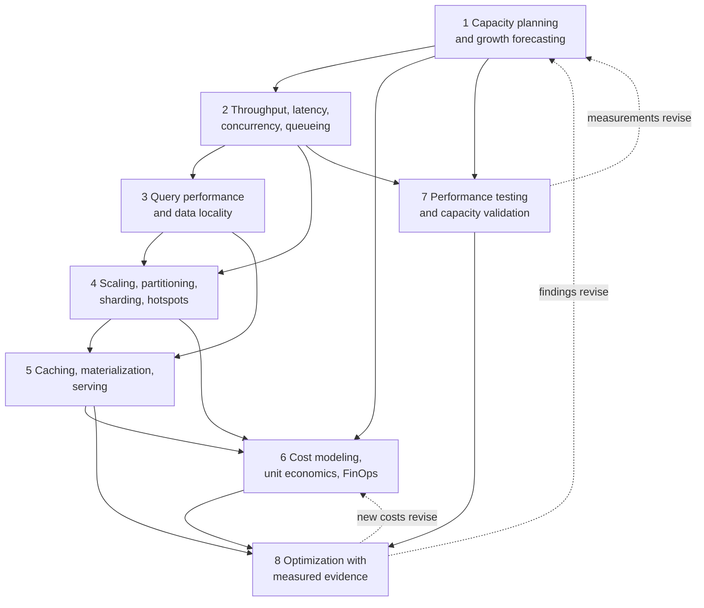

# Roadmap — Module 2D.13: Performance, Scalability and Cost Architecture

This is the learning roadmap for the thirteenth module of Stage 2D, **Data
Architecture**. It tells you **what** to learn, **in what order**, **how** to
study and practise each topic from beginner to advanced level, **how to prove**
you have learned it, and **how to complete** the module's final capacity, cost
and performance review.

Earlier modules designed the platform and made it reliable. This module asks the
question every platform eventually faces: **will it be fast enough, will it keep
up as demand grows, and what will it cost, and how do we know, from evidence
rather than hunches?**

> **Repository note (source-of-truth limits).** The eight topic files,
> `practice-questions.md`, `README.md`, `Projects/README.md` and
> `Projects/13-capacity-cost-and-performance-review.md` currently exist but are
> **empty**, as are the Stage 2D overview files; the target roadmap file existed
> but was empty. This roadmap therefore cannot be grounded in their contents. It
> is the first written statement of the module's scope, derived from the file
> names, the Stage 2D structure and the earlier module roadmaps. It does **not**
> claim that any topic file already contains the material below. Every formula,
> exercise, template, scenario and target is a **recommendation** or standard
> general method, not a documented requirement. When the topic files and the
> project file are written, their scope governs and this roadmap should be
> updated to match.
>
> **Directory name.** The prompt that requested this roadmap referred to
> `STAGE 2D - DATA ARCHITECURE/`. The actual directory is
> `Stage 2D — Data Architecture/`, and the actual name is preserved.
>
> **Illustrative content.** Every number, price, system and organisation here is
> an **illustrative assumption** used to teach a method. No value is a real price,
> benchmark, quota or recommended target. Prices in particular are placeholders;
> never treat them as market rates. The module is vendor-neutral and requires no
> cloud account or production access: exercises use calculations, small
> synthetic datasets and documented analysis.

## Table of contents

- [A. Module overview](#a-module-overview)
- [B. Module learning outcomes](#b-module-learning-outcomes)
- [C. Prerequisites and knowledge dependencies](#c-prerequisites-and-knowledge-dependencies)
- [D. Recommended learning sequence](#d-recommended-learning-sequence)
- [E. Detailed learning roadmap for every topic](#e-detailed-learning-roadmap-for-every-topic)
  - [E.1 Capacity planning and growth forecasting](#e1-topic-01--capacity-planning-and-growth-forecasting)
  - [E.2 Throughput, latency, concurrency and queueing](#e2-topic-02--throughput-latency-concurrency-and-queueing)
  - [E.3 Query performance and data locality](#e3-topic-03--query-performance-and-data-locality)
  - [E.4 Scaling, partitioning, sharding and hotspots](#e4-topic-04--scaling-partitioning-sharding-and-hotspots)
  - [E.5 Caching, materialization and serving trade-offs](#e5-topic-05--caching-materialization-and-serving-trade-offs)
  - [E.6 Cost modeling, unit economics and FinOps](#e6-topic-06--cost-modeling-unit-economics-and-finops)
  - [E.7 Performance testing and capacity validation](#e7-topic-07--performance-testing-and-capacity-validation)
  - [E.8 Architecture optimization with measured evidence](#e8-topic-08--architecture-optimization-with-measured-evidence)
- [F. Cross-topic integration](#f-cross-topic-integration)
- [G. Practice-question integration](#g-practice-question-integration)
- [H. Module completion checklist](#h-module-completion-checklist)
- [I. Final project guide — Capacity, cost and performance review](#i-final-project-guide--capacity-cost-and-performance-review)

---

## A. Module overview

### A.1 What the terms mean

| Term | Plain meaning | Question it answers |
| --- | --- | --- |
| **Performance** | How fast and how smoothly work gets done | How quickly does it respond, and how much can it process? |
| **Scalability** | How well the system handles growing demand by adding resources | What happens when demand doubles? |
| **Capacity** | The amount of work the system can handle with acceptable service | How much can it take before service degrades? |
| **Cost architecture** | Designing so that resource spend matches value and is understood | What does this cost, why, and per unit of what? |
| **FinOps** | Practices for financial accountability of cloud spend | Who pays, who decides, who optimises? |

### A.2 How workload, design, utilisation, performance and cost relate

```text
Workload (demand) ──▶ Architecture (design) ──▶ Resource use ──▶ Performance
         │                                           │                │
         └──────────────────── Cost ◀────────────────┘                │
                              ▲                                      │
                              └──────── Measurements ◀───────────────┘
```

Demand and design together determine resource use; resource use determines both
performance and cost. Measurement closes the loop.

### A.3 Why optimising one metric can hurt another

| Optimisation | Benefit | Possible side effect |
| --- | --- | --- |
| Add cache | Lower latency, less backend load | Staleness, memory cost, invalidation complexity |
| Add partitions | Parallelism, pruning | Small-file overhead, skew, more metadata |
| Over-provision | Headroom, low latency | Cost, idle capacity |
| Pre-compute (materialise) | Fast reads | Storage, refresh cost, freshness lag |
| Aggressive cost cuts | Lower bill | Queueing, missed objectives, reliability risk |

Performance, scalability and cost are **trade-offs**, not independent goals.

### A.4 Bottleneck vs symptom

A **symptom** is what you see (slow dashboard). A **bottleneck** is the constraint
that limits throughput (a single hot partition, a saturated disk, a lock). Treating
the symptom (adding compute) when the bottleneck is elsewhere (data skew, a
network link) wastes money and does not fix the problem. The discipline is:
**baseline → measure → locate the bottleneck → change one thing → re-measure**.

### A.5 What you should be able to do by the end

Analyse workloads, estimate and forecast capacity, reason about throughput,
latency and queueing, diagnose query performance, evaluate scaling and
distribution, compare caching and materialisation, build transparent cost models
and unit economics, design performance tests, and justify optimisations with
measured evidence in an integrated capacity, cost and performance review.

### A.6 How the module connects to broader work

| Connection | How |
| --- | --- |
| `../02-Requirements-Constraints-and-Architecture-Decisions/` | Volume, rate, latency targets; trade-off method |
| `../05-Database-and-Storage-Architecture/` | Partitioning, indexing, layout, lifecycle |
| `../06-Data-Integration-and-Interoperability/` | Ingestion throughput, backfill load |
| `../07-Enterprise-Data-Platform-and-Lakehouse-Architecture/` | Compute/storage separation, tenancy, quotas, service levels |
| `../08-Cloud-Hybrid-and-Multi-Cloud-Data-Architecture/` | Pricing models, egress, regions |
| `../09-Streaming-and-Real-Time-Data-Architecture/` | Latency budgets, partitions, lag |
| `../10-Data-Governance-Security-Privacy-and-Compliance/` | Cost of controls (encryption, audit volume) |
| `../11-Metadata-Lineage-Quality-and-Master-Data/` | Metadata volume, rule execution cost |
| `../12-Reliability-Resilience-and-Disaster-Recovery/` | Redundancy cost, headroom, restore throughput |
| `../14-Data-Access-Serving-Semantic-and-AI-Data-Architecture/` | Serving performance for analytics and AI |
| `../15-Architecture-Documentation-Reviews-and-Operating-Model/` | Documenting evidence and decisions |

### A.7 Terminology (expanded at first use)

| Term | Meaning |
| --- | --- |
| Throughput | Amount of work completed per unit time |
| Latency | Time taken for one unit of work |
| Concurrency | Number of units of work in progress at once |
| Utilisation | Fraction of capacity in use |
| Queueing | Waiting for a busy resource |
| Percentile (p50/p95/p99) | The value below which that share of observations fall |
| Data locality | Keeping computation close to the data it needs |
| Partitioning / sharding | Splitting data across pieces/nodes |
| Hotspot | A piece that receives disproportionate load |
| Materialisation | Storing a precomputed result |
| Unit economics | Cost (or revenue) per unit of a meaningful quantity |
| FinOps | Financial operations for cloud: accountability and optimisation |
| Baseline | A measured reference state before a change |

---

## B. Module learning outcomes

After completing the module you will be able to:

1. **Estimate** capacity requirements and **forecast** workload growth with stated
   assumptions and uncertainty.
2. **Explain** throughput, latency, concurrency and queueing and **interpret**
   measurements.
3. **Analyse** query performance and data locality.
4. **Evaluate** scaling, partitioning, sharding and hotspots.
5. **Compare** caching, materialisation and serving approaches.
6. **Build and evaluate** cost models, unit economics and FinOps considerations.
7. **Plan** performance tests and **validate** capacity assumptions.
8. **Recommend** architecture optimisations supported by measured evidence.
9. **Explain** performance, scalability, cost and operational trade-offs.
10. **Present** an evidence-backed capacity, cost and performance review.

Each outcome is demonstrated through the exercises, deliverables and gates in
Sections E, H and I.

---

## C. Prerequisites and knowledge dependencies

### C.1 Prerequisite table

| # | Prerequisite (plain terms) | Why needed | Needed by topics | Essential? | Provided by |
| --- | --- | --- | --- | --- | --- |
| P1 | Estimating volume, rate, growth, retention; units and ranges | Capacity and cost start from these | 1, 6, 7 | Essential | `../02-Requirements-Constraints-and-Architecture-Decisions/03-data-volume-velocity-variety-and-growth-estimation.md` |
| P2 | Measurable latency, throughput, freshness and availability targets; percentiles | Performance goals and test criteria | 2, 3, 5, 7, 8 | Essential | `../02-Requirements-Constraints-and-Architecture-Decisions/04-latency-throughput-freshness-and-availability-targets.md` |
| P3 | Trade-offs, criteria, sensitivity analysis, ADRs | Optimisation is trade-off decision-making | 4, 5, 6, 8 | Essential | `../02-Requirements-Constraints-and-Architecture-Decisions/06-architecture-trade-offs-and-decision-criteria.md`, `07-architecture-decision-records-adrs.md` |
| P4 | Partitioning, indexing, clustering, skew; file layout and formats | Query performance, distribution, locality | 3, 4 | Essential | `../05-Database-and-Storage-Architecture/05-partitioning-indexing-clustering-and-data-layout.md`, `03-object-storage-and-file-format-selection.md` |
| P5 | Table formats, compute/storage separation, planes, quotas | Where performance and cost are determined on a platform | 3, 4, 6 | Essential | `../05-Database-and-Storage-Architecture/04-warehouse-lakehouse-and-table-format-design.md`, `../07-Enterprise-Data-Platform-and-Lakehouse-Architecture/04-compute-storage-and-control-plane-separation.md`, `07-multi-team-isolation-and-tenant-boundaries.md` |
| P6 | Cloud cost drivers (compute, storage, requests, transfer), regions, egress | Cost modelling | 6 | Essential | `../08-Cloud-Hybrid-and-Multi-Cloud-Data-Architecture/01-cloud-data-architecture-principles.md`, `07-portability-lock-in-and-multi-cloud-trade-offs.md` |
| P7 | Streaming partitions, lag, backlog arithmetic | Queueing and catch-up intuition | 2, 4, 7 | Useful | `../09-Streaming-and-Real-Time-Data-Architecture/02-event-brokers-topics-partitions-and-retention.md`, `07-late-events-backpressure-and-stream-failure-modes.md` |
| P8 | Redundancy, headroom, recovery throughput | Cost of resilience; capacity under failure | 1, 6 | Useful | `../12-Reliability-Resilience-and-Disaster-Recovery/03-high-availability-and-redundancy-patterns.md`, `06-replay-reprocessing-and-backfill-architecture.md` |
| P9 | Serving stores and materialised views | Caching and serving trade-offs | 5 | Useful | `../09-Streaming-and-Real-Time-Data-Architecture/06-real-time-serving-stores-and-materialized-views.md` |
| P10 | Basic arithmetic: ratios, percentages, compound growth, simple probability of waiting | Every topic uses calculation | All | Essential (no advanced mathematics required) | Reviewed in Topic 1 Beginner level |

### C.2 Dependency map across the eight topics



The numeric order is a sound default. Dotted arrows show the **feedback loops**:
measurements and optimisation outcomes change capacity assumptions and cost models.

---

## D. Recommended learning sequence

Effort estimates are **recommendations** (about 6–8 hours per week assumed).
The recommended order **matches the numeric order**, following *how much do we
need → how does load behave → why is a query slow → how do we spread data → how do
we avoid repeated work → what does it cost → does it really work → what should we
change and was it worth it*.

| Seq | File | Title | Why here | Prerequisite topics | Main concepts | Practical activity | Expected output | Readiness criteria | Effort (rec.) |
| --- | --- | --- | --- | --- | --- | --- | --- | --- | --- |
| 1 | `01-capacity-planning-and-growth-forecasting.md` | Capacity planning and growth forecasting | Establishes demand and resource need | P1, P2, P10 | Workload, peak, headroom, growth scenarios | Capacity estimate with scenarios | Estimate with assumptions and limits | Reproducible arithmetic; assumptions labelled | 6–8 h |
| 2 | `02-throughput-latency-concurrency-and-queueing.md` | Throughput, latency, concurrency and queueing | Explains how load turns into response time | Seq 1 | Little's law, utilisation, queues, percentiles | Workload diagnosis | Diagnosis note | Can state what data do and do not show | 6–8 h |
| 3 | `03-query-performance-and-data-locality.md` | Query performance and data locality | A main driver of cost and latency in data platforms | Seq 2, P4, P5 | Scan volume, pruning, joins, movement | Query review | Bottleneck hypotheses and proposals | Hypotheses tied to evidence | 6–8 h |
| 4 | `04-scaling-partitioning-sharding-and-hotspots.md` | Scaling, partitioning, sharding and hotspots | Distributes load once single-node limits matter | Seq 2–3, P4 | Scale up/out, partitions, skew | Distribution comparison | Design comparison and validation plan | Skew computed; validation defined | 6–8 h |
| 5 | `05-caching-materialization-and-serving-trade-offs.md` | Caching, materialization and serving trade-offs | Avoids repeated work at a freshness/cost price | Seq 3–4, P9 | Hit ratio, staleness, refresh cost | Decision matrix | Matrix and recommendation | Trade-offs quantified | 6–8 h |
| 6 | `06-cost-modeling-unit-economics-and-finops.md` | Cost modeling, unit economics and FinOps | Prices capacity and design choices | Seq 1, 4, 5, P6 | Cost drivers, unit cost, accountability | Cost comparison | Model with units and limits | Consistent assumptions; no invented prices | 6–8 h |
| 7 | `07-performance-testing-and-capacity-validation.md` | Performance testing and capacity validation | Turns estimates into evidence | Seq 1–2, 6 | Workload model, baselines, success criteria | Test and validation plan | Plan with criteria | Plan is repeatable and falsifiable | 6–8 h |
| 8 | `08-architecture-optimization-with-measured-evidence.md` | Architecture optimization with measured evidence | Decides what to change and proves it | Seq 5–7 | Baseline, Amdahl-style reasoning, before/after | Optimisation review | Review separating facts from hypotheses | Claims match evidence | 7–9 h |
| — | `practice-questions.md` | Validation | After each topic and fully before the project | Seq 1–8 | — | Gap log | Gap log | — | 3–4 h |
| — | `Projects/13-capacity-cost-and-performance-review.md` | Final project | Integrates all eight | All | — | Integrated review | Review package | — | 14–18 h |

**Revisiting earlier topics.**

| When | Revisit |
| --- | --- |
| A load test shows saturation earlier than the capacity estimate | Topics 1, 2 |
| Skew appears after partitioning | Topics 4, 3 |
| Cache hit ratio is lower than assumed | Topics 5, 2 |
| Actual cost differs from the model | Topics 6, 1 |
| An optimisation changes the bottleneck | Topics 2, 3, 8 |

---

## E. Detailed learning roadmap for every topic

Each topic uses the same twelve parts. Levels are cumulative. Examples use the
**illustrative** scenario of *Northbridge Bank* (Section I.2), a fictional
mid-sized bank. Because the source topic files are empty, specific methods and
subtopics named below are **recommended** learning content (standard general
methods), not source-derived claims.

---

### E.1 Topic 01 — Capacity planning and growth forecasting

Source: [`01-capacity-planning-and-growth-forecasting.md`](01-capacity-planning-and-growth-forecasting.md)

#### 1. Topic overview

Capacity planning answers "how much of what do we need, and when?" It starts from
the **workload** (what work, how much, how bursty), translates it into **resource
requirements** (storage, compute, memory, network, concurrency), adds **headroom**,
and projects **growth**. Forecasts are always uncertain, so the discipline is to be
explicit about assumptions and ranges. It connects to performance (under-provision
and latency rises), scalability (growth) and cost (over-provision).

#### 2. Learning objectives

1. Describe a workload in measurable terms (volume, rate, peaks, mix).
2. Translate workload into resource requirements with formulas and units.
3. Apply growth models (linear, compound, scenario-based).
4. Include peak factors and headroom.
5. Express uncertainty as ranges and identify sensitive inputs.
6. Relate capacity decisions to cost and architecture.

#### 3. Prerequisites

P1, P2, P10. Review `../02-Requirements-Constraints-and-Architecture-Decisions/03-data-volume-velocity-variety-and-growth-estimation.md` if units or ranges are unfamiliar.

#### 4. Beginner level — understand the fundamentals

- **Concepts:** workload, demand, resource, utilisation, peak, average, headroom,
  growth, forecast, scenario.
- **Analogy:** planning a restaurant: how many covers on a normal night vs
  Friday, how many tables, how many chefs, and what if the neighbourhood grows.
- **Units discipline:** write units on every number; keep decimal units
  (1 GB = 10⁹ bytes) unless stated; keep time bases consistent (per second vs per
  day).
- **Basic formulas:**

  ```text
  daily_volume       = records_per_day × average_record_size
  average_rate       = events_per_day / 86,400 s
  peak_rate          = average_rate × peak_factor
  storage_needed     = daily_volume × retention_days × copies × (1 + overhead)
  ```

- **Questions to answer:** Why plan for peak instead of average? What is
  headroom for?
- **Small exercise:** 2,000,000 transactions/day × 500 B = 1.0 GB/day; compute
  average events/s (≈ 23.1/s) and peak at factor 8 (≈ 185/s).

#### 5. Intermediate level — apply the concepts

- **Workload profile:** record, for each workload, volume, arrival pattern
  (steady, daily peak, month-end), read/write mix, concurrency, latency target,
  growth driver (customers, products, regulation).
- **Compound growth.**

  ```text
  V_n = V_0 × (1 + g)^n
  250 TB at 30%/year: V_3 = 250 × 1.3³ = 250 × 2.197 ≈ 549 TB
  ```

  Compare with linear growth (+75 TB/yr → 475 TB) and note the difference grows
  with time.
- **Required capacity with headroom.**

  ```text
  required_capacity = peak_demand / target_utilisation
  e.g. peak 12,000 events/s, target utilisation 70% → 17,143 events/s of capacity
  ```

  Choose the target utilisation from latency behaviour (Topic 2), not habit.
- **Capacity under failure (N+1):** with 3 nodes, losing one leaves 2 carrying the
  load; each can run at most 66% normally (links to 2D.12).
- **Scenarios:** low / expected / high growth and peak factors; **sensitivity**:
  vary one input at a time and see which dominates the result.
- **Uncertainty:** state ranges and confidence; avoid single-point precision.
- **Capacity vs cost:** convert capacity to a rough cost range (Topic 6).
- **Practical exercise:** produce a three-year capacity estimate (storage, ingest
  rate, query concurrency) with three scenarios.
- **Check:** every number has a unit, source and confidence; sensitivity ranking
  present; limitations stated.

#### 6. Advanced level — design, optimise and evaluate

- **Composite and interacting demands:** batch windows overlapping with peak
  interactive demand; month-end plus backfill (2D.12 Topic 6); seasonal peaks;
  correlated growth of different workloads.
- **Forecasting methods and limits:** trend extrapolation, driver-based forecasts
  (customers × usage per customer), step changes from launches or mergers;
  forecast error measurement (compare past forecasts with actuals); avoid
  extrapolating beyond the evidence.
- **Lead time and elasticity:** capacity that takes weeks to provision needs
  earlier decisions than elastic capacity; reserved vs on-demand trade-offs
  (Topic 6).
- **Non-linear scaling:** doubling data does not always double query time or
  cost; some resources (metadata, coordination) scale super-linearly.
- **Bottleneck-resource thinking:** capacity is set by the scarcest resource
  (storage, CPU, memory, network, IOPS, connections, quotas); identify it.
- **Capacity vs service objectives:** link to reliability (2D.12 Topic 1) and
  latency (Topic 2); define what degraded service is acceptable.
- **Evidence and validation:** compare estimates with measurements (Topic 7);
  trigger-based re-planning (when utilisation > X for Y days).
- **Documentation:** capacity plan with assumptions register and review cadence;
  ADR for major provisioning decisions.
- **Advanced exercise:** build a capacity model for a platform with batch,
  streaming and interactive workloads, include N+1, backfill overlap and growth
  scenarios, and state re-planning triggers.

#### 7. Industry-style practical exercises

| Level | Scenario | Objective | Inputs / assumptions | Task | Constraints | Expected output | Validation | Demonstrates |
| --- | --- | --- | --- | --- | --- | --- | --- | --- |
| Beginner | Transaction feed | Convert volume to rate and storage | 2 M/day, 500 B (assumed) | Compute daily, per-second, peak, 90-day storage with 3 copies | Units on all numbers | Worksheet | Reviewer recomputes | You can do the basics |
| Intermediate | Risk analytics store | Three-year forecast with scenarios | 250 TB, growth 20/30/40% (assumed) | Forecast; sensitivity; required capacity at 70% utilisation | Ranges, not points | Estimate and sensitivity table | Arithmetic reproducible | You can plan under uncertainty |
| Advanced | Mixed platform | Integrated capacity model with failure and backfill overlap | Rates and windows (assumed) | Model peak overlap, N+1, scenarios, triggers | Lead times | Capacity plan and ADR | Triggers measurable; assumptions listed | You can plan realistically |

#### 8. Real-world scenarios and architectural trade-offs

| Scenario | Workload / problem | Symptoms / constraints | Alternatives | Evidence needed | Benefits / limits | Why one may suit better |
| --- | --- | --- | --- | --- | --- | --- |
| Month-end spike | 4× normal load for 3 days | Latency breaches | (a) Size for peak always; (b) elastic scale for peak; (c) smooth demand via scheduling | Historical peaks, startup time | (a) safe, costly; (b) cheaper, startup lag; (c) cheap, business change | (b) if scale-up time is below the tolerance |
| Rapid growth after acquisition | Customers +40% | Forecast uncertain | (a) Provision to high case; (b) provision to expected case with triggers | Integration plan, early actuals | (a) wasteful; (b) risk of shortfall | (b) with short lead time |

*(Illustrative; none is a source requirement.)*

#### 9. Expected deliverables

- Workload profile and assumptions register.
- Capacity and growth estimate with scenarios and sensitivity.
- Headroom and N+1 calculation.
- Re-planning triggers and ADR.

#### 10. Common mistakes and misconceptions

| Mistake | Why problematic | Recognise / correct |
| --- | --- | --- |
| Planning for averages | Peaks cause breaches | Add peak factors from data |
| Single-point forecasts | False precision | Ranges and scenarios |
| No units | Errors multiply | Write and convert units |
| Unstated assumptions | Not auditable | Assumptions register |
| Linear extrapolation of compound growth | Underestimates | Use growth models |
| Ignoring headroom and failure | Overload after a fault | Target utilisation and N+1 |

#### 11. Mastery criteria

- Convert a workload description into rates, storage and peak capacity with
  correct units.
- Produce scenario ranges and identify the dominant sensitivity.
- Explain what the estimate cannot tell you.

#### 12. Completion gate

- [ ] Worksheet, scenario table and sensitivity ranking reviewed; arithmetic
      reproduced.
- [ ] Assumptions register and re-planning triggers present.
- [ ] Relevant practice questions attempted and gaps logged (Section G).
- [ ] Readiness: you can now ask how demand turns into response time (Topic 2).

---

### E.2 Topic 02 — Throughput, latency, concurrency and queueing

Source: [`02-throughput-latency-concurrency-and-queueing.md`](02-throughput-latency-concurrency-and-queueing.md)

#### 1. Topic overview

**Throughput** is how much work completes per unit time. **Latency** is how long
one piece of work takes. **Concurrency** is how many pieces are in progress at
once. When demand approaches capacity, work **queues**, and latency rises sharply.
Understanding these relationships explains most performance behaviour and guides
capacity targets.

#### 2. Learning objectives

1. Define and distinguish throughput, latency and concurrency.
2. Apply Little's law to relate them.
3. Explain utilisation and why queues grow non-linearly near capacity.
4. Interpret percentiles, averages and distributions.
5. Reason about contention and shared resources.
6. Evaluate how workload changes affect behaviour and what to measure.

#### 3. Prerequisites

Seq 1; P2 (percentiles), P7 (backlog).

#### 4. Beginner level — understand the fundamentals

- **Concepts:** throughput (requests/s, MB/s, rows/s), latency (ms per request),
  concurrency (in-flight requests), service time, waiting time, utilisation,
  queue, saturation.
- **Analogy:** a supermarket checkout: customers per hour (throughput), time per
  customer (latency), how many in the shop (concurrency), the queue.
- **Little's law (a general relationship for stable systems):**

  ```text
  L = λ × W
  L = average number in the system (concurrency)
  λ = average arrival (and completion) rate (throughput)
  W = average time in the system (latency)
  e.g. 200 requests/s × 0.05 s = 10 requests in flight on average
  ```

- **Averages and percentiles:** the mean hides tails; p95/p99 describe the slow
  experiences.
- **Questions to answer:** If latency doubles at constant throughput, what
  happens to concurrency? Why is average latency incomplete?
- **Small exercise:** with throughput 500/s and mean latency 40 ms, compute
  average concurrency (20).

#### 5. Intermediate level — apply the concepts

- **Utilisation and waiting (simple single-server model, M/M/1, as intuition
  only).** With service rate μ and arrival rate λ, utilisation ρ = λ/μ; mean time
  in system W = 1 / (μ − λ):

  ```text
  μ = 100 requests/s
  λ = 50  → ρ = 0.50 → W = 1/50 = 20 ms
  λ = 90  → ρ = 0.90 → W = 1/10 = 100 ms
  λ = 95  → ρ = 0.95 → W = 1/5  = 200 ms
  ```

  Latency grows rapidly as utilisation approaches 100%. Real systems are not
  M/M/1 (multiple servers, non-random arrivals, varied service times), so use
  the model for **intuition**, then measure.
- **Concurrency limits:** thread pools, connection limits, slot limits; when
  concurrency is capped, extra demand queues or is rejected.
- **Contention:** shared resources (disk, network, locks, caches) cause
  slowdown that is not proportional to demand.
- **Throughput–latency curve:** as load increases, throughput rises then
  plateaus while latency climbs; find the knee.
- **Interpreting measurements:** a table of load levels vs throughput and p50/p95/
  p99 latency; identify the saturation point and which resource saturates first.
- **Batch vs interactive:** batch jobs maximise throughput and tolerate latency;
  interactive workloads need bounded latency; mixing them causes interference
  (2D.5 Topic 1).
- **Practical exercise:** given a measurement table, identify the knee, compute
  concurrency via Little's law, and recommend a target utilisation.
- **Check:** conclusions are labelled as evidence-based or hypotheses; units
  consistent.

#### 6. Advanced level — design, optimise and evaluate

- **Tail latency:** causes (queueing, garbage collection, retries, cold caches,
  noisy neighbours, rebalances); effect of fan-out (a request calling 100
  backends is as slow as the slowest, so the chance of hitting a slow one rises).
  *Illustrative:* if each backend call exceeds 100 ms with probability 1%, a
  request that fans out to 100 calls has probability 1 − 0.99¹⁰⁰ ≈ 63.4% of at
  least one slow call.
- **Multi-stage pipelines:** the slowest stage limits throughput; queues between
  stages absorb bursts but add latency; backpressure (2D.9 Topic 7).
- **Coordinated omission and measurement artefacts:** load generators that wait
  for slow responses under-report latency; use open-loop load where appropriate
  (links to Topic 7).
- **Headroom policy:** choose target utilisation from the latency requirement:
  e.g. if p99 must stay below X, find the maximum utilisation at which the
  measured p99 is below X, then add margin.
- **Admission control and load shedding:** protect the system by rejecting or
  delaying work beyond capacity; compare with unbounded queues that hide overload
  until failure.
- **Priority and isolation:** separate queues/pools for critical workloads
  (2D.7 Topic 7).
- **Cost link:** the capacity needed to keep latency in bounds is a cost driver
  (Topic 6).
- **What data cannot show:** averages from sampled data; correlation vs causation;
  one workload mix.
- **Document** the performance model, headroom rule and evidence in an ADR.
- **Advanced exercise:** diagnose a three-stage pipeline with a measurement table;
  identify the bottleneck stage, compute queue growth, and propose changes with
  predicted effect and validation measurements.

#### 7. Industry-style practical exercises

| Level | Scenario | Objective | Inputs / assumptions | Task | Constraints | Expected output | Validation | Demonstrates |
| --- | --- | --- | --- | --- | --- | --- | --- | --- |
| Beginner | API serving risk data | Apply Little's law | 500/s, 40 ms (assumed) | Compute concurrency; predict effect of latency doubling | Show units | Worksheet | Reviewer agrees | You understand the relationship |
| Intermediate | Query service | Find the knee in a load table | Load/latency table (synthetic) | Identify saturation, set target utilisation | No new data | Diagnosis note | Reasoning matches table | You can interpret measurements |
| Advanced | Three-stage pipeline | Locate bottleneck and predict change | Stage rates and queue depths (synthetic) | Compute queue growth, propose and justify changes, define validation | Mixed workloads | Analysis and test proposal | Predictions are falsifiable | You can diagnose with evidence |

#### 8. Real-world scenarios and architectural trade-offs

| Scenario | Workload / problem | Symptoms / constraints | Alternatives | Evidence needed | Benefits / limits | Why one may suit better |
| --- | --- | --- | --- | --- | --- | --- |
| Dashboard slows at 10:00 | Concurrent users rise | p95 spikes; CPU 85% | (a) Add compute; (b) cap concurrency; (c) cache | Latency vs load curve; CPU vs wait time | (a) cost; (b) rejections; (c) staleness | Depends on whether CPU or lock waits dominate |
| Large batch during business hours | Interference | Interactive p99 doubles | (a) Reschedule; (b) separate pool; (c) throttle | Time-aligned latency and batch logs | (a) free; (b) cost; (c) slower batch | (a) if window exists |

#### 9. Expected deliverables

- Throughput/latency/concurrency worksheet.
- Interpretation of a load-vs-latency table (knee, saturation resource).
- Headroom rule and ADR.
- Measurement list to validate hypotheses.

#### 10. Common mistakes and misconceptions

| Mistake | Why problematic | Recognise / correct |
| --- | --- | --- |
| Reporting only average latency | Hides tail | Use percentiles |
| Running near 100% utilisation | Queueing explosion | Set headroom from measured curve |
| Confusing throughput and concurrency | Wrong sizing | Use Little's law |
| Treating the M/M/1 numbers as predictions | Models are simplified | Use for intuition, then measure |
| Unbounded queues | Hide overload, add latency | Bound and monitor |
| Ignoring fan-out | Tail probability grows | Compute fan-out effect |

#### 11. Mastery criteria

- Apply Little's law correctly in both directions.
- Explain why latency rises sharply near saturation.
- State what a given measurement table does and does not prove.

#### 12. Completion gate

- [ ] Worksheet, table interpretation and ADR reviewed; arithmetic reproduced.
- [ ] Hypotheses clearly separated from findings.
- [ ] Practice questions attempted and gaps logged.
- [ ] Readiness: you can now investigate why individual queries are slow
      (Topic 3).

---

### E.3 Topic 03 — Query performance and data locality

Source: [`03-query-performance-and-data-locality.md`](03-query-performance-and-data-locality.md)

#### 1. Topic overview

In data platforms, much latency and cost comes from **queries**: how much data
they read, how it is laid out, how much is moved between nodes, and how joins and
aggregations execute. **Data locality** means doing work near the data, avoiding
unnecessary movement. This topic teaches how to read evidence about a query and
find the real constraint.

#### 2. Learning objectives

1. Describe query execution stages and where time and cost arise.
2. Explain scan volume, pruning, predicate pushdown and column selection.
3. Explain the cost of data movement (shuffles, joins, network).
4. Interpret query plans and runtime statistics at a conceptual level.
5. Diagnose inefficient access patterns from evidence.
6. Propose optimisations and state trade-offs.

#### 3. Prerequisites

Seq 2; P4 (layout, formats, pruning), P5.

#### 4. Beginner level — understand the fundamentals

- **Concepts:** query plan, scan, filter, join, aggregation, sort, shuffle (data
  redistribution), pruning, selectivity, cardinality, data skew, locality.
- **Analogy:** finding a book: read every shelf (full scan) vs use the index and go
  to one shelf (pruning); carrying books across the building (movement).
- **Where time goes (typical order of magnitude, to be measured):** reading data
  from storage, moving data across the network, CPU for processing, waiting for
  resources.
- **Rule of thumb:** *read less, move less, compute less.*
- **Learn in this order:** what a query asks → how much data it must touch → how
  that data is organised → how it is joined/aggregated.
- **Questions to answer:** Why does selecting three columns from a columnar table
  read less? Why can a join be expensive?
- **Small exercise:** given a table size and a filter selectivity, estimate bytes
  scanned with and without partition pruning.

#### 5. Intermediate level — apply the concepts

- **Scan-time estimate (illustrative):**

  ```text
  scan_time ≈ bytes_scanned / aggregate_scan_throughput
  10 TB scanned at 2 GB/s = 10,000 GB / 2 = 5,000 s ≈ 83 min
  after pruning to 5% (500 GB): 500 / 2 = 250 s ≈ 4.2 min
  ```

- **Reading a plan:** identify the largest scans, the join types and order, the
  shuffles, the stages with the highest time or rows; compare estimated vs actual
  rows (large mismatches suggest stale statistics).
- **Data layout effects:** partition columns matching filters, clustering/sorting
  for min/max skipping, file sizes (many small files add overhead), columnar
  formats (2D.5 Topics 3, 5).
- **Joins and movement:** broadcast small tables rather than shuffling large
  ones; join on co-located/co-partitioned keys; pre-aggregate before joining;
  avoid joining at mismatched grain (2D.4 Topic 4).
- **Statistics and maintenance:** up-to-date statistics help planners; compaction
  and clustering maintenance; table-format metadata growth.
- **Diagnose from evidence:** collect query time, bytes scanned, bytes shuffled,
  rows in/out per stage, spills to disk, skewed task durations, queue/wait time;
  separate time waiting for resources from time executing.
- **Locality across systems:** querying remote data moves it; compute near storage;
  cross-region reads incur latency and cost (2D.8).
- **Practical exercise:** review a described query and its plan summary; identify the
  dominant cost and list two evidence-supported optimisations and one
  hypothesis requiring more data.
- **Check:** each proposal links to evidence; expected effect estimated with
  arithmetic; side effects stated.

#### 6. Advanced level — design, optimise and evaluate

- **Data skew in execution:** one task processes far more data than others, so the
  job takes as long as the slowest task. *Illustrative:* mean task time 20 s, max
  task time 240 s: runtime is dominated by the straggler (skew ratio 12).
  Mitigations: salting hot keys, adaptive execution, pre-aggregation, different
  join strategy (each with costs).
- **Workload-level optimisation:** a single slow query vs thousands of similar
  queries; optimise the pattern (layout, materialisation) rather than each query
  (Topic 5).
- **Trade-offs:** faster query vs more storage/maintenance (indexes, clustering);
  denormalisation vs update cost (2D.4 Topic 3); freshness vs precomputation.
- **Concurrency interactions:** many heavy scans saturate shared I/O; resource
  classes, queues and quotas (2D.7 Topic 7).
- **Cost link:** engines billed per byte scanned or per compute time make scan
  volume a direct cost driver (Topic 6).
- **Plan stability and regression:** plans change with data growth and statistics;
  guard critical queries with performance tests (Topic 7).
- **Limits of micro-optimisation:** Amdahl-style reasoning: if a stage is 20% of
  runtime, even a 10× speedup of it yields at most
  1 / (0.8 + 0.02) ≈ 1.22× overall; focus on the dominant stage (Topic 8).
- **Evidence and validation:** before/after plans, runtime and bytes scanned on the
  same data; repeat runs to account for caching and variance.
- **Document** query pattern analysis and layout decisions in an ADR.
- **Advanced exercise:** analyse a workload of 10 query patterns, rank by total
  cost (frequency × cost), choose layout changes that help the top three, and
  predict and plan the validation of effects and side effects.

#### 7. Industry-style practical exercises

| Level | Scenario | Objective | Inputs / assumptions | Task | Constraints | Expected output | Validation | Demonstrates |
| --- | --- | --- | --- | --- | --- | --- | --- | --- |
| Beginner | Transaction table | Estimate scan with/without pruning | 10 TB, 5% selectivity (assumed) | Compute bytes and time | Show units | Worksheet | Reviewer recomputes | You grasp scan cost |
| Intermediate | Join of fact and customer | Interpret a plan summary | Synthetic plan with rows and shuffle sizes | Identify dominant cost; propose two optimisations | Evidence only | Query review | Proposals tied to plan data | You can diagnose |
| Advanced | 10 query patterns | Rank and optimise by workload cost | Frequencies and costs (synthetic) | Choose layout/materialisation; predict effect; validation plan | Storage and maintenance cost | Workload analysis and ADR | Predictions testable | You can optimise at workload level |

#### 8. Real-world scenarios and architectural trade-offs

| Scenario | Workload / problem | Symptoms / constraints | Alternatives | Evidence needed | Benefits / limits | Why one may suit better |
| --- | --- | --- | --- | --- | --- | --- |
| Report scans full history | Filter on last 7 days | 40 min runtime | (a) Partition by date; (b) cluster; (c) summary table | Bytes scanned vs rows used | (a) simple pruning; (b) helps secondary filters; (c) fastest, maintenance | (a) first; (c) if the report is frequent |
| Skewed join | One customer has 30% of rows | One task runs 12× longer | (a) Salting; (b) broadcast; (c) handle hot key separately | Task duration distribution | Each adds complexity | Depends on table sizes |

#### 9. Expected deliverables

- Scan and runtime estimate worksheets.
- Query review (plan interpretation, bottleneck, proposals, hypotheses).
- Workload-level ranking and layout proposal.
- Before/after validation plan and ADR.

#### 10. Common mistakes and misconceptions

| Mistake | Why problematic | Recognise / correct |
| --- | --- | --- |
| Optimising a query without checking frequency | Low impact | Rank by total cost |
| Assuming more compute fixes everything | Skew/scan remain | Locate bottleneck first |
| Reading plans without actual-vs-estimated rows | Misses stale statistics | Compare |
| Indexing everything | Write and storage cost | Index for dominant patterns |
| Testing once on warm cache | Misleading | Repeat; control caching |
| Ignoring data movement | Hidden cost | Look at shuffles and cross-region reads |

#### 11. Mastery criteria

- Estimate scan cost with and without pruning.
- Read a plan summary and identify the dominant cost.
- Propose optimisations with evidence and trade-offs.

#### 12. Completion gate

- [ ] Worksheet, query review and workload analysis reviewed.
- [ ] Hypotheses labelled and measurements to confirm them listed.
- [ ] Practice questions attempted and gaps logged.
- [ ] Readiness: you can now decide how to distribute data and load (Topic 4).

---

### E.4 Topic 04 — Scaling, partitioning, sharding and hotspots

Source: [`04-scaling-partitioning-sharding-and-hotspots.md`](04-scaling-partitioning-sharding-and-hotspots.md)

#### 1. Topic overview

When one machine or one partition is not enough, you **scale**: up (bigger) or out
(more). Scaling out requires splitting data and work: **partitioning** within a
system and **sharding** across nodes. The risk is **hotspots**: pieces that get
disproportionate load, wasting the added capacity.

#### 2. Learning objectives

1. Compare scale-up and scale-out.
2. Explain partitioning and sharding strategies (range, hash, composite,
   directory/lookup).
3. Identify and quantify skew and hotspots.
4. Evaluate rebalancing, resharding and their costs.
5. Reason about distribution of reads vs writes and of queries vs ingestion.
6. Evaluate performance, scalability, operational and cost trade-offs.

#### 3. Prerequisites

Seq 2–3; P4, P7.

#### 4. Beginner level — understand the fundamentals

- **Concepts:** vertical (scale up) and horizontal (scale out) scaling, stateless vs
  stateful scaling, partition, shard, partition key, hash, range, hotspot, skew,
  rebalancing.
- **Analogy:** more checkout lanes (scale out) vs a faster cashier (scale up); a
  lane everyone prefers becomes a hotspot.
- **Strategies:**

  | Strategy | How | Good for | Risk |
  | --- | --- | --- | --- |
  | Range | Key ranges per piece | Range scans, time series | Hotspots on current range |
  | Hash | `hash(key) mod N` | Even spread of point access | Range scans scatter; resharding cost |
  | Composite | Prefix + hash | Balance ordering and spread | Complexity |
  | Lookup/directory | Table maps key→shard | Flexibility | Lookup is a dependency |

- **Questions to answer:** Why does scaling out not help a single hot key? What
  limits scale-up?
- **Small exercise:** assign twelve keys to three shards by hash mod 3 and by
  range; list the load on each.

#### 5. Intermediate level — apply the concepts

- **Skew measurement:**

  ```text
  skew_ratio = max_partition_load / mean_partition_load
  e.g. loads 10, 10, 10, 70 → mean 25, max 70 → skew 2.8
  ```

  The busiest partition bounds throughput: effective capacity ≈
  total_capacity / skew_ratio.
- **Partition sizing:** too few partitions limit parallelism; too many add overhead
  (small files, metadata); target a size range from measurement (2D.5 Topic 5).
- **Resharding cost.** With `hash mod N`, growing from N to N+1 shards moves about
  N/(N+1) of keys (for 10→11: ≈ 90.9%); consistent hashing moves about
  1/(N+1) (≈ 9.1%). Compare the movement cost and the disruption during rebalance.
- **Read vs write distribution:** read replicas scale reads, not writes; writes
  need partitioning; ingestion and query may want different keys (maintain a
  second copy or index with its cost).
- **Hot-key mitigation:** salting (spread one key over several sub-keys, at the
  cost of scatter-gather reads), caching hot reads (Topic 5), splitting hot
  partitions, rate limiting.
- **Stateful scaling:** state redistribution during rescale (2D.9 Topic 4).
- **Practical exercise:** compare range, hash and composite partitioning for a
  transaction table given a key distribution sample.
- **Check:** skew computed; resharding cost estimated; validation measurements
  defined.

#### 6. Advanced level — design, optimise and evaluate

- **Choosing a scaling model:** workload shape (read-heavy, write-heavy, scan-heavy,
  mixed), consistency needs (cross-shard transactions are costly), operational
  maturity; criteria weighted before choosing (2D.2 Topic 6).
- **Scatter-gather and cross-shard operations:** queries not including the shard key
  hit all shards; latency is the slowest shard; fan-out probability applies
  (Topic 2); cross-shard joins and transactions are expensive.
- **Dynamic hotspots:** time-based keys, trending entities, month-end, a single
  large customer; detect via per-partition metrics; adaptive splitting;
  admission control.
- **Elasticity and autoscaling:** scale triggers, lag in scaling, cooldowns,
  over/under-shooting; scale-out limits from partition count, quotas and
  coordination overhead; non-linear returns.
- **Multi-tenancy:** noisy neighbours, per-tenant quotas, tenant-aware sharding
  (2D.7 Topic 7).
- **Cost implications:** more nodes = more fixed overhead and cross-node traffic;
  skew wastes the capacity you pay for. *Illustrative:* with skew 2.8 you pay for
  4 partitions but get ≈ 1.43 partitions of effective throughput
  (4 / 2.8).
- **Operational complexity:** rebalancing windows, monitoring per-partition load,
  backup/restore per shard (2D.12), schema changes across shards.
- **Evidence and validation:** load tests with realistic key distributions
  (uniform tests hide hotspots), measure per-partition utilisation (Topic 7).
- **Document** the distribution design, skew mitigation and rebalancing plan in an
  ADR.
- **Advanced exercise:** design the sharding for a customer-keyed ledger with a few
  very large customers and month-end spikes; quantify skew before/after salting
  and the added read cost; define validation.

#### 7. Industry-style practical exercises

| Level | Scenario | Objective | Inputs / assumptions | Task | Constraints | Expected output | Validation | Demonstrates |
| --- | --- | --- | --- | --- | --- | --- | --- | --- |
| Beginner | Twelve keys, three shards | Compare hash and range | Given keys and loads | Assign and total loads | By hand | Table | Totals correct | You see distribution effects |
| Intermediate | Transaction table | Compare range/hash/composite | Key sample (synthetic) | Compute skew, resharding movement, query pattern fit | Evidence-based | Comparison and recommendation | Arithmetic reproducible | You can compare designs |
| Advanced | Ledger with large customers | Design with hot-key mitigation | Distribution and spikes (assumed) | Salting design, skew before/after, read cost, validation | Operational limits | Design, ADR, test plan | Predictions falsifiable | You can design for hotspots |

#### 8. Real-world scenarios and architectural trade-offs

| Scenario | Workload / problem | Symptoms / constraints | Alternatives | Evidence needed | Benefits / limits | Why one may suit better |
| --- | --- | --- | --- | --- | --- | --- |
| Today's partition is always hot | Time-ordered writes | One node at 95% | (a) Hash partition; (b) composite (hash prefix + time); (c) buffer writes | Per-partition write rates | (a) spread, hurts range scans; (b) balanced; (c) smooths | (b) if range queries matter |
| Resharding at peak | Need more nodes soon | Mod-hash resharding moves 90% | (a) Reshard now; (b) consistent hashing next cycle; (c) add read replicas | Data size, movement bandwidth | (a) disruptive; (b) future benefit; (c) only reads | (c) now, (b) planned |

#### 9. Expected deliverables

- Scale-up vs scale-out analysis.
- Partitioning/sharding design with skew calculation.
- Resharding cost estimate.
- Hotspot mitigation plan and validation plan.
- ADR.

#### 10. Common mistakes and misconceptions

| Mistake | Why problematic | Recognise / correct |
| --- | --- | --- |
| Assuming scale-out is linear | Skew, coordination, fan-out limit it | Measure effective capacity |
| Choosing partition key without access patterns | Hotspots, scatter | Derive from queries |
| Testing with uniform keys | Hides skew | Use realistic distributions |
| Ignoring resharding cost | Disruption | Estimate movement |
| Fixing hotspots only by adding nodes | Hot key remains | Mitigate the key |
| Underestimating cross-shard operations | Latency, correctness cost | Design around shard key |

#### 11. Mastery criteria

- Compute skew and effective capacity.
- Compare strategies with data movement and query-pattern effects.
- Propose and validate hotspot mitigation.

#### 12. Completion gate

- [ ] Comparison, skew and resharding calculations reviewed; reproduced.
- [ ] Validation plan uses realistic distributions.
- [ ] Practice questions attempted and gaps logged.
- [ ] Readiness: you can now decide when avoiding repeated work (caching,
      materialisation) is better than spreading it (Topic 5).

---

### E.5 Topic 05 — Caching, materialization and serving trade-offs

Source: [`05-caching-materialization-and-serving-trade-offs.md`](05-caching-materialization-and-serving-trade-offs.md)

#### 1. Topic overview

The cheapest query is one you do not run again. **Caching** reuses recent results
or data; **materialisation** stores precomputed results; **serving** layers
present them to consumers. Each trades **freshness**, **consistency**, **storage**,
**computation** and **maintenance** for speed and lower backend load.

#### 2. Learning objectives

1. Explain caching and materialisation and when each applies.
2. Calculate effective latency and backend load with hit ratio.
3. Evaluate freshness and consistency implications.
4. Estimate refresh cost and storage cost of materialisation.
5. Compare serving options for access patterns.
6. Document assumptions and a decision.

#### 3. Prerequisites

Seq 3–4; P9.

#### 4. Beginner level — understand the fundamentals

- **Concepts:** cache, hit/miss, hit ratio, TTL (time to live), invalidation,
  materialised view, precomputed aggregate, refresh (full, incremental), serving
  store, staleness.
- **Analogy:** keeping frequently used documents on your desk (cache) vs filing
  a prepared summary (materialisation).
- **Where caching occurs:** client, application, serving layer, query engine,
  storage layer.
- **Trade-off summary:**

  | Approach | Gains | Costs / risks |
  | --- | --- | --- |
  | Cache | Low latency, less backend load | Stale data, invalidation, memory |
  | Materialised view | Fast reads, stable cost | Refresh compute, storage, lag |
  | Compute on demand | Always fresh, flexible | Slow, costly at scale |

- **Questions to answer:** What can go wrong if a cached balance is stale? When
  is on-demand computation better?
- **Small exercise:** list five queries and decide which suit caching,
  materialisation or on-demand.

#### 5. Intermediate level — apply the concepts

- **Effective latency and load.**

  ```text
  effective_latency = h × t_cache + (1 − h) × t_backend
  h = 0.90, t_cache = 2 ms, t_backend = 100 ms → 1.8 + 10.0 = 11.8 ms
  backend_load = total_requests × (1 − h)
  1,000 req/s × 0.10 = 100 req/s reaching the backend
  ```

  Note the sensitivity: if h drops to 0.5 the backend load is 500 req/s and the
  effective latency is 51 ms. Hit ratio must be **measured**, not assumed.
- **Freshness requirement:** derive allowed staleness from the business decision
  (Topic 1 of 2D.9); set TTL or refresh interval accordingly.
- **Materialisation economics.**

  ```text
  materialise if:  queries_per_period × cost_per_live_query
                   > refresh_cost_per_period + storage_cost_per_period
  ```

  *Illustrative:* 5,000 queries/day × $0.04 live = $200/day vs refresh $30/day +
  storage $2/day = $32/day → materialising saves ≈ $168/day (prices are
  placeholders; replace with your own measured costs).
- **Refresh strategies:** full rebuild vs incremental (upserts with version),
  event-driven vs scheduled; handling late data (2D.9 Topic 3).
- **Consistency:** read-your-writes expectations, cross-view consistency,
  eventual consistency windows.
- **Serving options:** key-value store for point lookups, analytical engine for
  ad hoc aggregation, search index for text, semantic layer (2D.14).
- **Invalidation:** TTL, event-based invalidation, versioned keys; the cost of
  getting it wrong.
- **Practical exercise:** build a decision matrix of cache / materialised view /
  on-demand for a dashboard with five query types.
- **Check:** each choice cites hit ratio or reuse, freshness need, cost estimate
  and failure behaviour.

#### 6. Advanced level — design, optimise and evaluate

- **Cache failure modes:** cache stampede (many misses at once after expiry),
  cold start, hot keys, inconsistent invalidation, cache outage causing backend
  overload. Mitigations: request coalescing, jittered TTL, warm-up, capacity
  headroom for the miss path, circuit breakers.
- **Capacity of the miss path.** If the cache fails, backend load rises from
  (1 − h) × R to R; the backend must either handle it or degrade gracefully
  (2D.12 Topic 3).
- **Materialisation at scale:** refresh windows, dependency ordering (lineage),
  partial refresh, versioning for safe swap, cost of rebuild after schema change.
- **Freshness vs cost frontier:** more frequent refresh = fresher + costlier; plot
  cost vs staleness and choose the knee.
- **Security and governance:** caches and materialisations copy sensitive data;
  apply the same access controls, retention and deletion (2D.10); masking in
  precomputed results.
- **Multi-tier design:** edge/client cache, serving cache, materialised tables,
  base data; avoid inconsistent layers; document ownership of each.
- **Operational complexity:** monitoring hit ratio, evictions, refresh lag,
  correctness checks (compare materialised vs live samples).
- **AI and analytics relevance:** feature and embedding caches, precomputed
  context for retrieval; staleness affects model outputs.
- **Evidence and validation:** hit ratio under realistic traffic; load test with
  cache disabled; correctness comparison; cost before/after (Topic 8).
- **Document** the serving architecture, freshness contract and failure behaviour
  in an ADR.
- **Advanced exercise:** design a serving architecture for a risk dashboard with
  per-customer lookups and aggregate views; compute hit-ratio sensitivity, miss-path
  capacity, refresh cost and freshness SLO; include a cache-outage plan.

#### 7. Industry-style practical exercises

| Level | Scenario | Objective | Inputs / assumptions | Task | Constraints | Expected output | Validation | Demonstrates |
| --- | --- | --- | --- | --- | --- | --- | --- | --- |
| Beginner | Five dashboard queries | Choose cache/materialise/on-demand | Descriptions | Decision list with reasons | None | Table | Reasons cite reuse and freshness | You know the options |
| Intermediate | Customer exposure lookups | Quantify cache benefit | 1,000 req/s, h 0.9/0.5 (assumed) | Compute latency and backend load; recommend TTL | Freshness 60 s | Worksheet and recommendation | Arithmetic reproducible | You can quantify caching |
| Advanced | Risk dashboard | Full serving design with failure handling | Costs and rates (placeholders) | Matrix, miss-path capacity, refresh economics, stampede plan | Governance | Design and ADR | Failure behaviour defined | You can design serving trade-offs |

#### 8. Real-world scenarios and architectural trade-offs

| Scenario | Workload / problem | Symptoms / constraints | Alternatives | Evidence needed | Benefits / limits | Why one may suit better |
| --- | --- | --- | --- | --- | --- | --- |
| Same aggregate queried 5,000×/day | Repeated scan | Cost and latency high | (a) Cache result; (b) materialised view; (c) leave | Query frequency, variability of filters | (a) cheap, staleness; (b) stable, refresh cost; (c) simple | (b) if filters are few and fixed |
| Cache outage | Cache cluster fails | Backend overload | (a) Overprovision backend; (b) degrade (serve stale/limit); (c) multi-zone cache | Miss-path load test | (a) costly; (b) cheap, UX trade; (c) resilient | (b)+(c) for critical views |

#### 9. Expected deliverables

- Cache/materialisation/on-demand decision matrix.
- Hit-ratio sensitivity and miss-path calculations.
- Materialisation break-even calculation.
- Freshness contract and invalidation design.
- Failure-behaviour description and ADR.

#### 10. Common mistakes and misconceptions

| Mistake | Why problematic | Recognise / correct |
| --- | --- | --- |
| Assuming a hit ratio | Overstated benefit | Measure with real traffic |
| Caching without a freshness requirement | Wrong decisions on stale data | Derive allowed staleness |
| Forgetting the miss path | Outage on cache failure | Size and test it |
| Materialising everything | Storage and refresh cost | Break-even test |
| Sensitive data in caches unprotected | Exposure | Apply governance |
| No invalidation plan | Persistent staleness | TTL/events/versioning |

#### 11. Mastery criteria

- Compute effective latency and backend load for given hit ratios.
- Justify materialisation with a break-even calculation.
- Explain failure behaviour and freshness consequences.

#### 12. Completion gate

- [ ] Matrix, calculations and ADR reviewed; arithmetic reproduced.
- [ ] Miss-path and stampede behaviour documented.
- [ ] Practice questions attempted and gaps logged.
- [ ] Readiness: you can now put prices on these choices (Topic 6).

---

### E.6 Topic 06 — Cost modeling, unit economics and FinOps

Source: [`06-cost-modeling-unit-economics-and-finops.md`](06-cost-modeling-unit-economics-and-finops.md)

> **Pricing caution.** This topic uses **placeholder prices only**. Real prices vary
> by provider, region, service, contract and time. Never present a placeholder as a
> market rate; always replace with your own current, sourced figures and date them.

#### 1. Topic overview

A **cost model** estimates what an architecture will cost from its resource use and
prices. **Unit economics** expresses cost per meaningful unit (per million events,
per query, per active customer). **FinOps** is the practice of making cost
visible, accountable and optimised through collaboration between engineering,
finance and the business.

#### 2. Learning objectives

1. Identify cost drivers (compute, storage, requests, transfer, licences, people).
2. Build a transparent cost model with consistent units and assumptions.
3. Compute and interpret unit costs.
4. Compare architecture options on cost with sensitivity analysis.
5. Explain FinOps practices: tagging, allocation, showback/chargeback, budgets,
   commitments.
6. Identify optimisation opportunities without breaking performance requirements.

#### 3. Prerequisites

Seq 1, 4, 5; P6.

#### 4. Beginner level — understand the fundamentals

- **Concepts:** fixed vs variable cost, on-demand vs committed capacity, cost
  driver, unit cost, allocation, tagging, showback (report) vs chargeback (bill),
  budget, forecast, total cost of ownership (TCO).
- **Typical data-platform cost drivers (to be priced from your own sources):**

  | Driver | Usually scales with |
  | --- | --- |
  | Storage | Volume × time × tier × copies |
  | Compute | Time × size × concurrency (or bytes scanned) |
  | Requests/operations | Count of API/list/read calls |
  | Data transfer / egress | Bytes leaving a zone/region/provider |
  | Managed-service premiums | Throughput/capacity units |
  | People and operations | Complexity and team size |

- **Analogy:** a household budget with fixed rent, variable utilities and
  occasional big purchases.
- **Questions to answer:** Why is total bill an incomplete view? What is a unit
  cost useful for?
- **Small exercise:** with placeholder numbers, compute unit cost:

  ```text
  unit_cost = total_cost / units
  $12,000 / 600,000,000 events = $0.00002/event = $20 per million events
  ```

#### 5. Intermediate level — apply the concepts

- **Model structure:** inputs (workload from Topic 1), resource formulas, prices
  (dated, sourced placeholders), outputs (monthly cost, unit cost), assumptions
  and ranges.
- **Compare options on consistent assumptions.** Example structure (placeholders):

  | Option | Compute | Storage | Transfer | Ops (people) | Total / month | Unit cost |
  | --- | --- | --- | --- | --- | --- | --- |
  | A: always-on cluster | $9,000 | $2,000 | $500 | $4,000 | $15,500 | $25.8 per M events |
  | B: elastic/serverless | $5,500 | $2,000 | $500 | $2,500 | $10,500 | $17.5 per M events |

  with 600 million events/month (assumption). Show formulas and sensitivity
  (what if volume doubles; what if utilisation of A is 30% vs 70%).
- **Committed vs on-demand break-even.** If a commitment gives a 40% discount on
  capacity paid whether used or not, then commitment is cheaper when utilisation
  of that capacity exceeds 60% (0.6 / 1.0):

  ```text
  commit cost = 0.6 × P per hour (always)
  on-demand cost = 1.0 × P × utilisation
  break-even utilisation = 0.6
  ```

- **Tiering and lifecycle:** storage tier costs vs retrieval costs (2D.5 Topic 7).
- **Egress and architecture:** cross-region/multi-cloud designs incur transfer
  costs that scale with data movement (2D.8 Topic 7).
- **FinOps basics:** mandatory tags (owner, domain, environment, product), cost
  allocation to teams/products, budgets and alerts, regular reviews.
- **Cost of resilience and controls:** redundancy multiplies infrastructure; audit
  log volume, encryption and monitoring have costs (2D.10, 2D.12).
- **Practical exercise:** build a cost comparison for two architecture options
  with stated assumptions, consistent units and a sensitivity table.
- **Check:** all prices flagged as placeholders; arithmetic reproducible;
  limitations stated.

#### 6. Advanced level — design, optimise and evaluate

- **Unit economics for decision-making:** cost per business unit (per active
  customer, per report, per decision) tied to value; marginal vs average cost;
  scale effects (fixed costs diluted; step costs when capacity increments).
- **Cost–performance frontier:** plot cost against latency/throughput for options;
  identify dominated options and the knee; do not cut cost below the performance
  requirement (Topic 2).
- **Forecasting cost:** driver-based (workload growth × unit cost), commitments,
  price changes, discount tiers; error tracking (forecast vs actual).
- **Allocation fairness:** shared platform costs split by usage meters vs
  headcount vs flat fee; incentives created by each; showback to build awareness
  before chargeback.
- **Optimisation levers:** right-sizing, autoscaling, scheduling non-urgent jobs
  off-peak, storage tiering/lifecycle, file compaction (fewer requests), pruning
  scans (bytes scanned), caching/materialisation (Topic 5), removing idle
  resources, commitment coverage, data transfer reduction.
- **Hidden and indirect costs:** engineering effort, incident cost, vendor
  lock-in exit costs (2D.8), opportunity cost; include as ranges.
- **Governance:** budgets, anomaly detection on spend, approval for large
  provisioning, tagging enforcement (policy-as-code, 2D.10 Topic 9).
- **Risk:** optimisations that reduce resilience or violate residency; savings that
  require performance trade-offs.
- **Evidence and validation:** compare model vs actual bills; reconcile cost
  allocation to total; unit cost trends; record what changed.
- **Document** the cost model, assumptions, sensitivity and optimisation decisions
  in an ADR.
- **Advanced exercise:** model three architectures (always-on cluster, elastic,
  hybrid with commitment) at three demand levels; identify cost crossover points,
  unit costs, and a recommendation with sensitivity to the dominant assumption.

#### 7. Industry-style practical exercises

| Level | Scenario | Objective | Inputs / assumptions | Task | Constraints | Expected output | Validation | Demonstrates |
| --- | --- | --- | --- | --- | --- | --- | --- | --- |
| Beginner | Event pipeline | Compute unit cost | $12,000 / 600 M events (placeholders) | Compute per-event and per-million cost; list drivers | Units shown | Worksheet | Reviewer recomputes | You understand unit cost |
| Intermediate | Two architecture options | Build comparison with sensitivity | Placeholder prices and workloads | Cost table; vary volume and utilisation; break-even for commitment | Consistent assumptions | Model and recommendation | Formulas visible; prices flagged | You can compare costs |
| Advanced | Three options × three demand levels | Crossover and unit economics | Placeholder prices; performance floor | Cost–performance frontier; allocation scheme; FinOps controls | Must meet latency target | Model, allocation policy, ADR | Dominated options identified; sensitivity shown | You can design cost-aware architecture |

#### 8. Real-world scenarios and architectural trade-offs

| Scenario | Workload / problem | Symptoms / constraints | Alternatives | Evidence needed | Benefits / limits | Why one may suit better |
| --- | --- | --- | --- | --- | --- | --- |
| Cloud bill up 40% with flat traffic | Unexplained growth | No tagging | (a) Cut compute; (b) tag, allocate, investigate; (c) buy commitment | Cost by service/tag/time | (a) risky; (b) informs; (c) locks in | (b) first |
| Shared platform cost dispute | Teams contest allocation | Usage varies | (a) Flat split; (b) usage-based showback; (c) chargeback | Usage meters | (a) simple, unfair; (b) fair, effort; (c) strongest incentive | (b) then (c) |

#### 9. Expected deliverables

- Cost-driver inventory and cost model.
- Option comparison with sensitivity and break-even analysis.
- Unit-economics table.
- Tagging and allocation proposal.
- Optimisation opportunity list with risks.
- ADR.

#### 10. Common mistakes and misconceptions

| Mistake | Why problematic | Recognise / correct |
| --- | --- | --- |
| Using real-looking prices without a source | Misleading | Placeholders or dated, cited prices |
| Comparing options with different assumptions | Unfair | Same workload and units |
| Ignoring people and transfer costs | Understated TCO | Include ranges |
| Cutting cost below performance needs | Breaches objectives | Cost–performance frontier |
| No sensitivity analysis | False certainty | Vary key inputs |
| Chargeback before visibility | Resentment, gaming | Showback first |

#### 11. Mastery criteria

- Build a model with explicit formulas, units, assumptions and ranges.
- Compute break-evens and unit costs correctly.
- Compare options fairly and state what the model does not capture.

#### 12. Completion gate

- [ ] Model, sensitivity and ADR reviewed; arithmetic reproduced.
- [ ] All prices flagged as placeholders or dated sources.
- [ ] Practice questions attempted and gaps logged.
- [ ] Readiness: you can now plan how to verify that capacity and performance
      assumptions are true (Topic 7).

---

### E.7 Topic 07 — Performance testing and capacity validation

Source: [`07-performance-testing-and-capacity-validation.md`](07-performance-testing-and-capacity-validation.md)

#### 1. Topic overview

Estimates and models are hypotheses. **Performance testing** produces evidence:
you run a defined **workload** against a system, **measure** it, and judge it
against **success criteria**. **Capacity validation** checks that the system
actually handles the planned load with the planned resources. Well-designed tests
are repeatable and can fail.

#### 2. Learning objectives

1. Define test objectives and types (baseline, load, stress, soak, spike).
2. Model a representative workload (data, mix, arrival pattern, concurrency).
3. Choose metrics and success criteria.
4. Execute and record tests with controlled conditions.
5. Interpret results, including variance and artefacts.
6. Decide whether capacity assumptions hold.

#### 3. Prerequisites

Seq 1–2, 6.

#### 4. Beginner level — understand the fundamentals

- **Concepts:** test objective, workload model, baseline, load, stress, soak
  (endurance), spike, ramp-up, warm-up, steady state, throughput, latency
  percentiles, error rate, saturation, success criterion.
- **Test types:**

  | Type | Question | Typical shape |
  | --- | --- | --- |
  | Baseline | What is current performance? | Moderate known load |
  | Load | Does it meet targets at expected load? | Expected peak |
  | Stress | Where does it break, and how? | Increase until failure |
  | Soak | Does it degrade over time? | Steady load for hours/days |
  | Spike | Can it handle sudden bursts? | Sharp increase |

- **Analogy:** testing a bridge with trucks of known weight before opening.
- **Questions to answer:** Why must a test be able to fail? What is a baseline?
- **Small exercise:** write test objectives and one success criterion for a
  dashboard service (for example "p95 ≤ 2 s at 50 concurrent users with error rate
  < 0.1%").

#### 5. Intermediate level — apply the concepts

- **Workload model:** realistic data volume and distribution (including skew),
  query/operation mix, arrival pattern (open vs closed loop), think time,
  concurrency, duration, ramp-up. Use production-derived statistics where
  available; synthetic data must preserve distributions that matter (key skew,
  cardinality, size).
- **Environment:** representative scale (or scaled with justified extrapolation),
  isolation from other load, stable configuration; record versions, settings,
  data size and cache state.
- **Metrics:** throughput, latency percentiles (p50/p95/p99), error rate,
  resource utilisation (CPU, memory, I/O, network), queue depth, bytes scanned,
  cost per test.
- **Statistical care.** A percentile estimate needs enough samples. *Rule of
  thumb (not a law):* to estimate p99 reasonably you want on the order of
  100 observations above it, i.e. about 100 / (1 − 0.99) = 10,000 requests;
  repeat runs and report variation.
- **Warm-up and steady state:** discard warm-up; measure steady state; control
  cold vs warm cache deliberately.
- **Success criteria:** derived from requirements (2D.2 Topic 4) and the
  capacity plan (Topic 1); pass/fail thresholds set **before** running.
- **Recording and interpreting:** run log, parameters, raw results, charts,
  anomalies, conclusion; compare with the baseline and with the model's
  prediction.
- **Practical exercise:** write a performance-test and capacity-validation plan for
  a query service with workload definition, objectives, metrics, success criteria
  and a results template.
- **Check:** plan is repeatable by another person and can fail.

#### 6. Advanced level — design, optimise and evaluate

- **Open vs closed load generators:** closed-loop testers slow down when the
  system slows (coordinated omission) and under-report latency; open-loop arrivals
  better represent independent users (Topic 2).
- **Capacity validation method:** run at planned peak with planned headroom;
  verify latency within objective and utilisation below the target; then stress
  to find the true limit and compare with the estimate:

  ```text
  estimate_error = (measured_capacity − estimated_capacity) / estimated_capacity
  ```

  Investigate large errors; update the model.
- **Bottleneck identification during tests:** correlate latency knee with the
  resource that saturates first (CPU, disk, network, locks, connections, quotas);
  per-partition metrics for skew.
- **Failure and resilience tests:** N−1 capacity, failover under load, backfill
  concurrent with live (2D.12 Topics 3, 6, 8).
- **Regression testing:** automated benchmark suite for critical queries and
  pipelines; thresholds with tolerance; run on changes (CI), detect regressions
  early.
- **Production testing:** canary releases, shadow traffic, controlled experiments;
  safety limits and approvals.
- **Limits of tests:** synthetic data and workloads differ from production;
  environment differences; test duration; one-off measurements. State what the
  results do not show and the confidence.
- **Cost of testing:** large tests are expensive; sample, scale down with
  documented extrapolation, schedule.
- **Evidence handling:** retain run records, configurations and datasets for audit
  and reproducibility.
- **Document** the performance test strategy and capacity validation results in an
  ADR and evidence repository.
- **Advanced exercise:** design a validation programme for a platform with batch,
  streaming and interactive workloads: test matrix, workload models with skew,
  criteria, N−1 and backfill-overlap tests, regression suite, reporting and
  re-planning triggers.

#### 7. Industry-style practical exercises

| Level | Scenario | Objective | Inputs / assumptions | Task | Constraints | Expected output | Validation | Demonstrates |
| --- | --- | --- | --- | --- | --- | --- | --- | --- |
| Beginner | Dashboard service | Write objectives and criteria | Requirements (assumed) | Define test types and pass/fail | Criteria before running | Objectives table | Criteria measurable | You understand test design |
| Intermediate | Query service at expected peak | Full test and validation plan | Workload stats (synthetic) | Workload model, metrics, environment, sample sizes, results template | Repeatable | Test plan | Another person can run it | You can plan tests |
| Advanced | Mixed platform | Validation programme with failure and overlap tests | Rates, windows (assumed) | Test matrix, regression suite, reporting, triggers | Budget limits | Programme document | Covers estimates, N−1, skew | You can plan capacity validation |

#### 8. Real-world scenarios and architectural trade-offs

| Scenario | Workload / problem | Symptoms / constraints | Alternatives | Evidence needed | Benefits / limits | Why one may suit better |
| --- | --- | --- | --- | --- | --- | --- |
| Estimate says 12 nodes, test says 18 | Capacity gap | Stress limit lower than planned | (a) Trust test; (b) investigate skew/workload mix; (c) provision to test | Per-node metrics, key distribution | (a) quick; (b) root cause; (c) safe, costly | (b) before (c) |
| Test environment is 10% of production | Cost limits | Extrapolation needed | (a) Linear extrapolate; (b) scaled tests + model; (c) production canary | Scaling behaviour evidence | (a) risky; (b) reasoned; (c) real, risk | (b) with (c) as confirmation |

#### 9. Expected deliverables

- Test objectives, workload model and success criteria.
- Test plan with environment, metrics, sample-size reasoning and results template.
- Baseline record.
- Capacity validation report template (estimate vs measured, error, conclusions).
- Regression suite outline.

#### 10. Common mistakes and misconceptions

| Mistake | Why problematic | Recognise / correct |
| --- | --- | --- |
| No pass/fail criteria set beforehand | Results rationalised | Define first |
| Uniform synthetic data | Hides skew | Preserve distributions |
| Closed-loop load only | Under-reports latency | Use open-loop where relevant |
| Single run | Variance unknown | Repeat; report spread |
| Mixing warm-up with measurement | Distorted | Discard warm-up |
| Testing a different configuration than production | Invalid | Record and match |
| Claiming capacity from a test that never stressed the limit | Unknown headroom | Include stress tests |

#### 11. Mastery criteria

- Design a repeatable test with a representative workload and pre-set criteria.
- Interpret results including variance and artefacts.
- Compare measured with estimated capacity and update the model.

#### 12. Completion gate

- [ ] Test plan, baseline and validation template reviewed by another person.
- [ ] The plan could fail and states how failure is judged.
- [ ] Practice questions attempted and gaps logged.
- [ ] Readiness: you can now decide, from evidence, which architecture changes are
      worth making (Topic 8).

---

### E.8 Topic 08 — Architecture optimization with measured evidence

Source: [`08-architecture-optimization-with-measured-evidence.md`](08-architecture-optimization-with-measured-evidence.md)

#### 1. Topic overview

Optimisation without evidence is guessing. This topic is the discipline of
**baseline → diagnose → prioritise → change → measure → decide → document**. It
applies everything earlier: capacity targets, queueing, query analysis, scaling,
caching, cost, and tests. Its central rule is to distinguish **measured facts**,
**assumptions**, **hypotheses**, **recommendations** and **verified outcomes**.

#### 2. Learning objectives

1. Establish and record baselines.
2. Diagnose and prioritise bottlenecks by impact.
3. Compare candidate improvements on expected benefit, cost and risk.
4. Evaluate performance and cost before and after a change.
5. Recognise measurement limitations and confounders.
6. Document decisions and outcomes with the right evidence labels.

#### 3. Prerequisites

Seq 5–7 (and the earlier topics).

#### 4. Beginner level — understand the fundamentals

- **Concepts:** baseline, hypothesis, experiment, confounder, regression, impact,
  effort, risk, before/after, verified outcome.
- **The loop:**

  ```text
  Define goal → Measure baseline → Find bottleneck → Hypothesise a fix →
  Change ONE thing → Re-measure → Compare → Keep, revert or iterate → Record
  ```

- **Evidence labels (use throughout):**

  | Label | Meaning | Example |
  | --- | --- | --- |
  | **Fact (measured)** | Observed and recorded | p95 = 3.2 s in run 7 |
  | **Assumption** | Taken as true without proof | Traffic grows 30% |
  | **Estimate** | Calculated from assumptions | Needs 18 nodes |
  | **Hypothesis** | Proposed explanation, untested | Skew is the bottleneck |
  | **Recommendation** | Proposed action | Add salting |
  | **Verified outcome** | Measured after the change | p95 fell to 1.9 s |

- **Analogy:** a doctor measures vitals, forms a diagnosis, treats, and re-measures.
- **Questions to answer:** Why change one thing at a time? What is a confounder?
- **Small exercise:** label ten statements about a pipeline's performance with the
  six evidence labels.

#### 5. Intermediate level — apply the concepts

- **Baseline discipline:** same workload, data, environment and metrics before and
  after; multiple runs; record conditions.
- **Prioritisation by potential impact (Amdahl-style reasoning).** If a component
  takes a fraction p of the total time and you speed that component up by a
  factor s:

  ```text
  overall_speedup = 1 / ((1 − p) + p / s)
  p = 0.40, s = 10 → 1 / (0.60 + 0.04) = 1.5625×
  p = 0.10, s = 100 → 1 / (0.90 + 0.001) ≈ 1.11×
  ```

  Optimise the dominant component first.
- **Option comparison matrix:** expected benefit (range), cost to implement, run
  cost change (Topic 6), risk, reversibility, evidence level.
- **Before/after evaluation:** same tests (Topic 7); compare latency percentiles,
  throughput, error rate, resource use and cost; check for regressions elsewhere
  (a fix that moves the bottleneck).
- **Confounders:** concurrent load, cache state, data growth between runs, config
  drift, time-of-day effects; control or record them.
- **Practical exercise:** produce an optimisation review for a described pipeline
  using supplied baseline and after measurements; label every statement.
- **Check:** no claim exceeds its evidence; effect sizes are compared with
  run-to-run variation.

#### 6. Advanced level — design, optimise and evaluate

- **Optimising a system with shifting bottlenecks:** after fixing one, the next
  appears; plan iterations; define stopping criteria (meets objective, next gain
  too costly).
- **Multi-objective trade-offs:** latency, throughput, cost, reliability,
  complexity; Pareto thinking; record what was traded away; ADRs.
- **Statistical significance and practical significance:** is the change larger than
  noise (run-to-run variation)? Is it large enough to matter to users or cost?
- **Risk management:** staged rollout (canary), feature flags, rollback criteria,
  monitoring after release; verifying in production when test environments
  differ.
- **Cost-aware optimisation:** savings net of engineering and operating cost;
  payback period.

  ```text
  payback_period = one-off_cost / monthly_saving
  e.g. $24,000 one-off / $3,000 per month = 8 months
  ```

- **Architectural vs tactical optimisation:** tactical (tuning, indexes, config)
  vs structural (re-partitioning, materialisation, re-platforming); structural
  changes need stronger evidence and rollback plans.
- **Avoiding premature and perpetual optimisation:** optimise against stated
  objectives; stop when met; keep a regression suite (Topic 7) to hold gains.
- **Communicating results:** distinguish facts from hypotheses to stakeholders;
  state confidence and limits; avoid presenting expected benefits as achieved.
- **Documenting outcomes:** decision record with baseline, change, measurements,
  conclusion, residual issues and next steps; keep raw evidence.
- **Do not claim an optimisation improved performance or reduced cost unless the
  evidence supports it.**
- **Advanced exercise:** run (on paper, with supplied data) a three-iteration
  optimisation of a pipeline whose bottleneck shifts; at each iteration label
  evidence, choose the next change by Amdahl impact and cost, and decide when to
  stop.

#### 7. Industry-style practical exercises

| Level | Scenario | Objective | Inputs / assumptions | Task | Constraints | Expected output | Validation | Demonstrates |
| --- | --- | --- | --- | --- | --- | --- | --- | --- |
| Beginner | Pipeline notes | Label evidence types | Ten statements | Classify each | None | Labelled list | Labels correct | You can separate fact from guess |
| Intermediate | Pipeline with before/after data | Evaluate an optimisation | Baseline and after runs (synthetic) | Compare, check variance, conclude, list side effects | Evidence only | Optimisation review | Claims match evidence | You can evaluate honestly |
| Advanced | Pipeline with shifting bottleneck | Three-iteration plan | Stage timings, costs (synthetic/placeholder) | Prioritise by Amdahl and cost, define stopping rule, payback | Mixed objectives | Plan and ADRs | Each step justified; payback computed | You can run an evidence-led programme |

#### 8. Real-world scenarios and architectural trade-offs

| Scenario | Workload / problem | Symptoms / constraints | Alternatives | Evidence needed | Benefits / limits | Why one may suit better |
| --- | --- | --- | --- | --- | --- | --- |
| Team wants to re-platform for speed | Slow pipeline | No profiling done | (a) Re-platform; (b) profile and fix dominant stage; (c) do nothing | Stage timing breakdown | (a) costly, uncertain; (b) targeted; (c) risk | (b) first |
| Optimisation "worked" in test only | Test shows 2× | Production unchanged | (a) Accept; (b) investigate environment differences; (c) canary | Prod metrics before/after | (a) false win; (b) learning; (c) real evidence | (b)+(c) |

#### 9. Expected deliverables

- Baseline record.
- Bottleneck ranking with impact calculation.
- Option comparison with evidence levels and risks.
- Before/after evaluation report.
- Decision record with labelled evidence.

#### 10. Common mistakes and misconceptions

| Mistake | Why problematic | Recognise / correct |
| --- | --- | --- |
| Optimising before a baseline | No proof of effect | Measure first |
| Changing several things at once | Cannot attribute | One change per experiment |
| Treating a symptom | Bottleneck persists | Locate it |
| Reporting expected savings as achieved | Misleads | Use evidence labels |
| Ignoring variance | Noise taken as signal | Compare with run-to-run spread |
| Optimising what is small in the total | Little impact | Amdahl prioritisation |
| No regression guard | Gains lost | Add tests |

#### 11. Mastery criteria

- Label statements correctly by evidence type.
- Prioritise optimisations by quantified impact and cost.
- Conclude only what the evidence supports and state limitations.

#### 12. Completion gate

- [ ] Optimisation review and decision record reviewed by another person.
- [ ] Every claim has an evidence label; none overstates.
- [ ] Practice questions attempted and gaps logged.
- [ ] Readiness: you can now integrate all eight topics into one review
      (Section F) and complete the project (Section I).

---

## F. Cross-topic integration

### F.1 The engineering workflow

A learning workflow (not a mandatory sequence for every real problem):

1. **Establish workload and capacity requirements** (Topic 1).
2. **Forecast growth** with scenarios (Topic 1).
3. **Analyse throughput, latency, concurrency, queueing** (Topic 2).
4. **Investigate query performance and data locality** (Topic 3).
5. **Evaluate scaling, partitioning, sharding, hotspots** (Topic 4).
6. **Compare caching, materialisation and serving** (Topic 5).
7. **Model cost and unit economics** (Topic 6).
8. **Design performance tests and validate capacity** (Topic 7).
9. **Use measured evidence to prioritise and evaluate optimisations** (Topic 8).

### F.2 What flows between topics

| From → To | Information that flows | Decisions that depend on it | Trade-offs to revisit | Evidence needed before a final recommendation |
| --- | --- | --- | --- | --- |
| 1 → 2 | Peak rate, concurrency, growth | Target utilisation, headroom | Headroom vs cost | Measured latency vs load |
| 2 → 3 | Where latency arises, saturation resource | Which queries to investigate | Averages vs tails | Percentiles at load |
| 3 → 4 | Scan volume, skew, shuffles | Partition keys, data layout | Pruning vs file count | Per-partition metrics |
| 4 → 5 | Hot keys, access patterns | What to cache or precompute | Staleness vs load | Hit-ratio estimate from real access logs |
| 1, 4, 5 → 6 | Resource needs, node counts, storage | Cost model inputs | Performance vs spend | Dated, sourced prices |
| 6 → 7 | Cost per test and per unit | Test scope | Test cost vs assurance | Success criteria |
| 2, 7 → 8 | Baselines and measured limits | Which optimisation first | Impact vs effort | Before/after comparisons |
| 8 → 1, 6 | Measured behaviour, new costs | Revised capacity and cost models | Forecast changes | Re-validation |

### F.3 Integrated exercise (recommended; not a repository requirement)

**Scenario (illustrative).** Northbridge's *risk analytics service* serves
interactive dashboards and a nightly batch from a lakehouse. The business reports
slow dashboards at 10:00 and a rising monthly bill.

**Tasks.** Produce **one coherent architecture review**:

1. Workload profile and capacity/growth estimate with three scenarios (Topic 1).
2. Throughput/latency analysis from a supplied load table; target utilisation
   (Topic 2).
3. Query review of the three highest-cost query patterns (Topic 3).
4. Distribution/skew analysis and a partitioning recommendation (Topic 4).
5. Cache/materialisation decision matrix with hit-ratio sensitivity (Topic 5).
6. Cost model for two options with unit economics and break-even (Topic 6).
7. Performance-test and validation plan (Topic 7).
8. Optimisation recommendations ranked by Amdahl impact and payback, each with an
   evidence label and a verification plan (Topic 8).
9. An **evidence register** separating **workload facts, assumptions, estimated
   values, measured values, hypotheses, recommendations and validated outcomes**.

**Deliverables.** A 5–6 page review, the evidence register and one ADR.

**Validation criteria.** Every number has a unit and label; the capacity estimate
reconciles with the cost model's inputs; recommendations are consistent with the
skew and query findings; no recommendation is described as validated unless
measurement data (supplied or simulated and labelled) support it.

**Completion gate.** A reviewer can pick any claim and find its evidence label,
source and the test that would confirm or refute it.

### F.4 Integration questions (original, supplementary)

1. Which workload fact most strongly drives your capacity estimate, and how
   confident are you in it?
2. At what utilisation does latency breach the objective, and what is the cost of
   staying below it?
3. Which single query pattern accounts for the largest share of cost?
4. Does your partitioning remove the bottleneck, or only move it?
5. What hit ratio makes caching worthwhile, and what happens if it is lower?
6. Which cost assumption has the largest effect on the recommended option?
7. What test would falsify your main hypothesis?
8. After the change, what must be re-measured, and what must be re-planned?

---

## G. Practice-question integration

### G.1 Source status

[`practice-questions.md`](practice-questions.md) is currently **empty**. This
roadmap does not assume any question numbers, headings, groups, categories or
difficulty labels exist, and it does not modify the file. The method below is a
**proposed study method**. If the file is not organised by topic, match questions
to topics by subject using the Section D list; do not rely on a mapping this
roadmap has not verified.

### G.2 When to attempt questions

| When | What | Purpose |
| --- | --- | --- |
| After each topic's beginner level | Vocabulary and simple-calculation questions | Check fundamentals |
| After each topic's intermediate exercise | Calculation and scenario questions on that topic | Check application |
| After each topic's gate | The topic's full set | Gate evidence |
| After Topics 1–4 | Mixed capacity, queueing, query, scaling questions | Test the performance core |
| After Topics 5–8 | Mixed serving, cost, testing, optimisation questions | Test the decision core |
| Before the project | The complete set | Readiness check |
| After the project | Re-attempt missed questions | Close gaps |

### G.3 Using incorrect answers

1. Mark each answer correct / partly correct / wrong, with a one-sentence reason.
2. Classify the error: *units*, *formula*, *assumption missing*, *wrong bottleneck*,
   *overclaimed evidence*, *trade-off ignored*.
3. Return to the topic and repeat its exercise with different numbers.
4. Keep a **gap log**: question, topic, error type, remedial exercise, re-attempt
   date.
5. Re-attempt after several days; two consecutive failures mean redoing the topic
   exercise.

### G.4 Memorisation vs application

An answer shows application when it states assumptions and units, shows the
calculation, identifies the limiting resource or bottleneck, says what evidence
would confirm it, notes the trade-off, and does not claim more than the data show.
Practise by converting any definition answer into a numerical scenario answer.

### G.5 Readiness check before the project

- [ ] All eight topic gates signed off.
- [ ] Average at least 85% correct on the full set (*recommended threshold*), with
      no topic below 70%.
- [ ] Integrated exercise (Section F.3) completed.
- [ ] Gap log has no unresolved items older than one week.

### G.6 Gaps in testing practical judgement, and supplementary exercises

Recall questions seldom test analysis. Add these **supplementary exercises**
(recommendations):

1. Given a workload description, compute rates, peak, storage and required
   capacity with headroom.
2. Given a load/latency table, find the knee and apply Little's law.
3. Given a plan summary, name the dominant cost and propose evidence-based fixes.
4. Given key counts per partition, compute skew and effective capacity.
5. Given hit ratios, compute effective latency and backend load.
6. Given placeholder prices, build a two-option cost comparison with sensitivity.
7. Given baseline and after data, state exactly what can be concluded.
8. Defend your review to a sceptical finance lead and a sceptical performance
   engineer.

---

## H. Module completion checklist

### H.1 Status definitions

| Status | Meaning |
| --- | --- |
| **Not started** | No work done on the item |
| **In progress** | Topic read and exercises started; gate not yet met |
| **Completed** | Gate met, deliverables reviewed by another person, practice questions answered with gaps closed |
| **Needs revision** | A reviewer found a weakness, or later evidence contradicted an earlier result; redo the specific exercise |

Reading a topic file alone is **not** mastery.

### H.2 Per-topic checklist

| Topic | Status | Beginner done | Intermediate exercise | Advanced exercise | Deliverables | Trade-offs reviewed | Questions attempted | Evidence required |
| --- | --- | --- | --- | --- | --- | --- | --- | --- |
| 1 Capacity planning | ☐ | ☐ | ☐ | ☐ | ☐ | ☐ | ☐ | Estimate, scenarios, sensitivity |
| 2 Throughput/latency/queueing | ☐ | ☐ | ☐ | ☐ | ☐ | ☐ | ☐ | Worksheet, table interpretation |
| 3 Query performance/locality | ☐ | ☐ | ☐ | ☐ | ☐ | ☐ | ☐ | Query review, workload ranking |
| 4 Scaling/partitioning/hotspots | ☐ | ☐ | ☐ | ☐ | ☐ | ☐ | ☐ | Skew and resharding calculations |
| 5 Caching/materialisation | ☐ | ☐ | ☐ | ☐ | ☐ | ☐ | ☐ | Decision matrix, break-even |
| 6 Cost modelling/FinOps | ☐ | ☐ | ☐ | ☐ | ☐ | ☐ | ☐ | Cost model, sensitivity, unit economics |
| 7 Performance testing | ☐ | ☐ | ☐ | ☐ | ☐ | ☐ | ☐ | Test plan, validation template |
| 8 Optimisation with evidence | ☐ | ☐ | ☐ | ☐ | ☐ | ☐ | ☐ | Review with evidence labels |

### H.3 Module-level checklist

- [ ] The eight topic roadmaps are all **Completed**.
- [ ] Beginner, intermediate and advanced exercises done for each topic.
- [ ] Expected topic deliverables produced and reviewed.
- [ ] Trade-offs in each topic can be explained without notes.
- [ ] Relevant practice questions attempted; gap log current.
- [ ] Integrated capacity, cost and performance exercise (Section F.3) completed
      with an evidence register.
- [ ] Final project (Section I) completed.
- [ ] Project validated against its actual requirements.
- [ ] Unresolved knowledge gaps and further learning needs recorded.
- [ ] No topic is in **Needs revision**.

---

## I. Final project guide — Capacity, cost and performance review

Project file:
[`Projects/13-capacity-cost-and-performance-review.md`](Projects/13-capacity-cost-and-performance-review.md)
and its index [`Projects/README.md`](Projects/README.md).

> **Source status.** Both project files are currently **empty**. There is no
> existing specification to preserve. This guide therefore proposes a project shape
> consistent with the file name. Everything in it (scenario, steps, deliverables,
> templates, criteria) is a **recommendation**. If the project file is later
> written with different requirements, **its content governs** and this guide
> should be adjusted to it. Nothing here makes any deliverable, tool, price or
> numeric target mandatory. All prices are placeholders.

### I.1 Project overview

- **Purpose (proposed):** produce an evidence-backed review of a data platform's
  capacity, cost and performance, ending in prioritised, justified architecture
  recommendations and a plan to verify them.
- **Problem addressed:** performance complaints, a rising bill and uncertain
  headroom, with decisions being made by intuition.
- **Expected learning outcomes:** workload and capacity analysis, performance
  diagnosis, scaling and serving design, cost modelling, test design, and honest
  evidence-led recommendations.
- **Use of the eight topics:** 1 → capacity and growth; 2 → performance behaviour;
  3 → query analysis; 4 → distribution; 5 → caching/serving; 6 → cost; 7 →
  validation; 8 → prioritised optimisation.
- **What the review should demonstrate:** every conclusion is traceable to
  labelled evidence, trade-offs are explicit, limitations are stated, and
  recommendations are testable.

### I.2 Scenario and requirements

**Scenario (proposed assumption; not from the project file).** *Northbridge Bank*
(fictional) operates a lakehouse-based **risk analytics service**. Interactive
dashboards are slow around 10:00; a nightly batch occasionally overruns; monthly
cloud spend has risen faster than data volume.

| Assumption (all illustrative) | Value |
| --- | --- |
| Data volume today / growth | ~250 TB / 20–40% per year (scenarios) |
| Interactive load | Up to 200 concurrent dashboard users at 10:00; 1,000 queries/min at peak |
| Batch | Nightly 2 TB; must finish by 06:00 |
| Objectives | Dashboard p95 ≤ 3 s; batch complete by 06:00 on 99% of days |
| Spend | Placeholder: $60,000/month today; budget growth ceiling +15% |
| Available evidence (synthetic) | Load/latency table; plan summaries for ten query patterns; per-partition row counts; monthly cost breakdown by service; two benchmark runs before/after one change |
| Constraints | In-country data; no stored long-lived keys; no paid infrastructure for this exercise; resilience requirements unchanged |

**Unspecified details to clarify (as assumptions):** actual price sheets, contract
discounts, real traffic traces, and quotas. If you use your own scenario, label
observed facts vs assumptions and use synthetic data.

### I.3 Prerequisites

| Prerequisite | Why it matters | Reusable earlier artefact |
| --- | --- | --- |
| Capacity estimate (Topic 1) | Baseline demand and growth | Worksheet, scenarios |
| Performance analysis (Topic 2) | Headroom rule and bottleneck reasoning | Load-table interpretation |
| Query review (Topic 3) | Dominant cost patterns | Workload ranking |
| Distribution analysis (Topic 4) | Skew and partitioning | Skew calculation |
| Serving decision matrix (Topic 5) | Caching/materialisation options | Matrix, break-even |
| Cost model (Topic 6) | Option comparison | Model, sensitivity |
| Test plan (Topic 7) | Validation | Plan, template |
| Optimisation review (Topic 8) | Evidence labelling | Review template |
| Integrated exercise (F.3) | Project backbone | Evidence register |

### I.4 Step-by-step project execution plan

A proposed workflow; adapt to the real project file when populated. For each
step: **purpose, tasks, output, check**.

| Step | Purpose | Tasks | Output | Check |
| --- | --- | --- | --- | --- |
| 1 — Understand the project requirements | Know scope | Read brief; workload, goals, constraints, expected outputs; separate facts, assumptions, questions | Requirements summary | Facts/assumptions/questions separated |
| 2 — Establish the workload baseline | Know the starting point | Document workload characteristics and current operation; available measurements and their limits; baseline evidence | Workload profile and baseline summary | Each number has unit, source, label |
| 3 — Estimate capacity and forecast growth | Plan demand | Capacity requirements; growth assumptions and scenarios; calculations; uncertainty | Capacity estimate and forecast | Scenarios and sensitivity present |
| 4 — Analyse performance behaviour | Understand response | Throughput, latency, concurrency, queueing; symptoms and possible bottlenecks; observations vs hypotheses | Performance analysis summary | Knee identified; hypotheses labelled |
| 5 — Evaluate query performance and data locality | Find waste | Query and access behaviour; inefficiencies supported by evidence; options and expected impact | Query analysis and options | Ranked by workload cost; evidence cited |
| 6 — Evaluate scaling and data distribution | Spread load | Scaling options; partitioning/sharding comparison; hotspots and distribution risks | Scaling and distribution recommendation | Skew computed; validation defined |
| 7 — Evaluate caching, materialisation and serving | Avoid repeated work | Serving requirements and access patterns; compare alternatives; trade-offs | Serving recommendation | Hit-ratio sensitivity; freshness contract |
| 8 — Build the cost model | Price the options | Cost drivers; consistent units/assumptions; alternatives; unit economics | Cost model | Prices flagged; sensitivity; limitations |
| 9 — Design performance tests and capacity validation | Plan evidence | Representative workloads; objectives; measurements; success criteria; validation of assumptions | Test and validation plan | Criteria set beforehand; can fail |
| 10 — Develop evidence-backed optimisation recommendations | Decide | Prioritise; link each to evidence; estimate impact only where justified; costs, risks, validation; expected vs verified | Recommendation register | Evidence labels present; Amdahl/payback shown |
| 11 — Integrate the review | One coherent document | Consolidate; check consistency among capacity, performance, scaling, cost; trade-offs and risks | Integrated review and evidence register | No contradictions among numbers |
| 12 — Validate and present | Verify and communicate | Compare with requirements; check calculations, units, assumptions, evidence; rationale for each recommendation; limitations; further measurements | Validation checklist and presentation | Reviewer can trace any claim to evidence |

### I.5 Project deliverables

**Required by the project file:** to be taken from the file when populated (it is
empty at present, so none can be asserted).

**Recommended deliverables (not required unless the project file says so):**

| # | Deliverable | Contents | Supporting topics | How to validate |
| --- | --- | --- | --- | --- |
| D1 | Requirements and assumptions summary | Facts, assumptions, questions | All | Items labelled |
| D2 | Workload profile and baseline | Characteristics, measurements, limits | 1, 2 | Units and sources |
| D3 | Capacity and growth forecast | Scenarios, sensitivity, headroom | 1 | Arithmetic reproducible |
| D4 | Performance analysis and bottleneck notes | Load interpretation, hypotheses | 2 | Evidence vs hypothesis labels |
| D5 | Query performance review | Patterns ranked, plan interpretation, options | 3 | Evidence cited |
| D6 | Scaling and data-distribution decision matrix | Strategies, skew, resharding | 4 | Skew computed |
| D7 | Caching/materialisation/serving comparison | Matrix, break-even, miss path | 5 | Sensitivity shown |
| D8 | Cost model and unit-economics table | Drivers, formulas, options, sensitivity | 6 | Prices flagged |
| D9 | Performance test and capacity-validation plan | Workload, metrics, criteria, template | 7 | Repeatable; falsifiable |
| D10 | Optimisation recommendation register | Ranked, evidence labels, payback, risks | 8 | Claims match evidence |
| D11 | Consolidated architecture review and evidence register | One document | All | Consistent |
| D12 | Validation checklist and limitations list | Results of Step 12 | All | Reviewer sign-off |

### I.6 Project validation checklist

Connect each applicable requirement to evidence:

- [ ] **Requirements and assumptions documented** (D1).
- [ ] **Workload characteristics clearly stated** with units and sources.
- [ ] **Capacity estimates explainable** with scenarios and sensitivity.
- [ ] **Performance findings supported by measurements** or labelled hypotheses.
- [ ] **Scaling and data-distribution decisions justified** by skew and access
      patterns.
- [ ] **Serving and materialisation choices** reflect freshness, cost and failure
      trade-offs.
- [ ] **Cost comparisons use consistent assumptions and units;** all prices are
      placeholders or dated sources.
- [ ] **Performance tests have clear objectives and pre-set success criteria.**
- [ ] **Recommendations have supporting evidence and validation plans;** none
      claim verified benefit without measurement.
- [ ] **Internal consistency:** capacity inputs match cost inputs; skew findings
      match partition recommendations; numbers agree across documents.
- [ ] **Limitations and unresolved questions documented.**
- [ ] **Evidence register** separates facts, assumptions, estimates, hypotheses,
      recommendations and verified outcomes.

### I.7 Project completion gate

The project is complete only when **all** hold:

- [ ] The actual project requirements are addressed (or D1–D12 if none are
      specified).
- [ ] All required deliverables exist, are version-dated and use consistent
      identifiers.
- [ ] Concepts from all eight topics are connected in the review.
- [ ] Important trade-offs (performance vs cost vs freshness vs complexity) are
      explained.
- [ ] Facts, estimates, assumptions and hypotheses are distinguished everywhere.
- [ ] Each recommendation has evidence, an expected effect with a range, a
      validation method and a rollback or stop criterion.
- [ ] A reviewer reproduces three calculations from your documents.
- [ ] You have defended the review against at least five reviewer questions (for
      example from Section F.4) using recorded evidence.
- [ ] Any acceptance criteria stated in the project file are met.

*(The criteria above are suggested; no official acceptance criteria could be read
from the empty project file.)*

### I.8 Connection to later learning

Suggested connections (not formal repository dependencies):

| Later area | How this project helps |
| --- | --- |
| `../14-Data-Access-Serving-Semantic-and-AI-Data-Architecture/` | Serving performance, caching and cost for analytics and AI consumers |
| `../15-Architecture-Documentation-Reviews-and-Operating-Model/` | A reviewable evidence-based review format; cost/performance as review inputs |
| `../16-Enterprise-Data-Architecture-Case-Studies-and-Capstone/` | A reusable capacity, cost and performance method for case studies |
| Platform engineering and FinOps practice | Cost allocation, unit economics, regression testing habits |

Do not add requirements to those modules beyond what their own files specify.

---

## Where this module leads

Module 2D.14, **Data Access, Serving, Semantic and AI Data Architecture**, builds
on the performance, caching and cost foundations here to design how data are
exposed to people, applications and AI systems: analytical serving patterns,
semantic layers, low-latency access, feature platforms, vector and retrieval
pipelines, permission-aware retrieval, data products and APIs, and cache and
freshness strategy.
