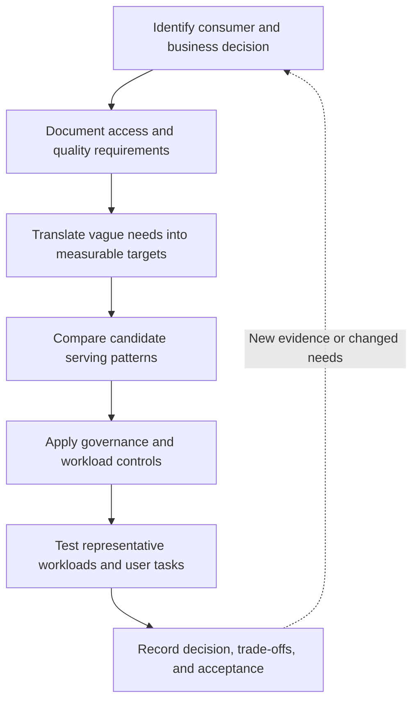

# Analytical Serving Patterns and Consumer Needs

> **Module:** Stage 2D — Data Architecture / Module 14: Data Access, Serving, Semantic and AI Data Architecture  
> **Lesson:** 01 of 08  
> **Scenario:** Northbridge Bank (fictional)  
> **Status of examples:** All organizations, data, targets, volumes, costs, and numerical thresholds in this lesson are illustrative. They are not industry benchmarks or compliance advice.  
> **Technology stance:** Vendor-neutral. Select product categories and architecture patterns from measured requirements, not brand preference.

## 1. Topic overview and learning objectives

Data architecture is not complete when data has been stored, cleaned, or modelled. It is complete enough for a use case only when the intended consumer can obtain the right data, in a useful shape, at an acceptable speed and freshness, with correct meaning, permissions, reliability, and cost.

**Analytical serving** is the set of models, interfaces, controls, and runtime resources that make data usable for analysis and decision support. It is distinct from simply storing data. A table may be technically available yet still be unsuitable because its fields are confusing, definitions disagree across reports, queries are too slow, access is too broad, or a heavy exploration job disrupts an executive dashboard.

By the end of this lesson, you should be able to:

1. Identify analytical consumers and the business questions they need to answer.
2. Distinguish ad hoc and scheduled access, concurrency, latency, and freshness.
3. Convert vague requirements such as “fast” and “real-time” into testable acceptance criteria.
4. Compare dashboards, marts, semantic layers, SQL access, extracts, files, application programming interfaces (APIs), embedded analytics, and controlled raw-data exploration.
5. Build a consumer-requirement matrix for at least six consumer types.
6. Explain the trade-offs among flexibility, consistency, freshness, usability, security, performance, and cost.
7. Design basic workload isolation, quotas, priority classes, and cost allocation.
8. Resolve conflicting consumer requirements using serving tiers, separate products, and explicit trade-offs.
9. Validate a design with representative workload tests, user acceptance, metric reconciliation, and adoption measures.
10. Document the recommendation in an architecture decision record (ADR).

### The central principle

**Start with the consumer and decision, then select the serving pattern.** Do not start with a favourite tool and force every user into it.

A useful chain is:

`consumer → decision/question → access pattern → measurable requirements → serving pattern → controls → evidence`

## 2. Prerequisites and dependency mapping

This lesson assumes you have a working introductory understanding of:

| Prerequisite | What you need to know | Why it matters here |
|---|---|---|
| Analytical vs. operational workloads | Analytical workloads aggregate or scan data to answer questions; operational workloads commonly read or update individual entities as part of a business transaction | A dashboard workload should not automatically be served by an application transaction database |
| Data warehouse, lakehouse, and curated/gold data | These are possible foundations for analytical data | Serving patterns need a trustworthy source and appropriate data shape |
| Basic data modelling | Tables, keys, grain, facts, dimensions, and historical records | Consumer questions determine which data and level of detail are needed |
| Access control and data classification | Identity, least privilege, sensitive fields, masking, and auditability | Usability does not justify exposing data to an unauthorized user |
| Performance and cost basics | Latency, throughput, concurrency, capacity, and query cost | “Fast” must be tested under realistic demand |

This topic deliberately introduces consumer analysis and high-level pattern selection. Detailed warehouse/mart and semantic-layer design belongs to **Topic 02**; operational serving to Topic 03; feature platforms to Topic 04; document/vector pipelines to Topic 05; RAG permissions to Topic 06; data products and API contracts to Topic 07; and caching/freshness strategy across access paths to Topic 08. We will refer to those ideas without replacing those lessons. For AI-related consumers, this lesson covers analytical access to historical datasets for data science and model development; online feature serving and permission-aware RAG retrieval are deliberately left to Topics 04 and 06 rather than conflated with analytical BI serving.

### Dependency map



## 3. Beginner foundations

### 3.1 Who is a data consumer?

A **data consumer** is a person, team, application, or downstream system that uses data to answer a question, make a decision, perform a task, or produce another data asset. A **persona** is a useful description of a consumer group with similar goals, skills, risks, and usage patterns. It is not a substitute for interviewing actual users.

For Northbridge Bank, the same customer-exposure data might be used to:

- show executives a portfolio summary;
- let business analysts compare exposure by region and product;
- reconcile finance totals for a reporting period;
- investigate a risk concentration;
- train a model on historical patterns;
- show operations managers an updated operational view.

The underlying subject may be similar, but the requirements are not.

### 3.2 Consumer personas

| Persona | Main decisions/questions | Typical skill | Common access pattern | Main risks or constraints |
|---|---|---|---|---|
| Executive | “How is total exposure trending against plan?” | Low technical | Governed dashboard, occasional drill-down | Must be easy to interpret; metric consistency matters more than arbitrary query flexibility |
| Business analyst | “Which regions and products explain the change?” | Medium to high | Dashboard plus ad hoc SQL or governed exploration | Needs flexible slicing, discoverable definitions, and bounded query cost |
| Finance / regulatory reporting | “Can we reproduce the approved figure for the reporting date?” | Medium; process-oriented | Scheduled report, controlled query, signed-off extract | Reconciliation, audit trail, stable definitions, period close, and access restrictions |
| Risk analyst | “Which segments exceed the exposure threshold?” | Medium to high | Governed dashboard plus ad hoc analysis | Sensitive data, historical detail, explainable filters, reliable refresh |
| Data scientist | “Which historical signals predict a later outcome?” | High | Curated historical data and controlled analytical sandbox | Point-in-time correctness, reproducibility, detailed fields, and compute limits |
| Operations manager | “Which queues or exceptions need attention now?” | Low to medium | Operational dashboard or embedded view fed by a suitable serving path | Freshness and response time; may need a separate operational serving design if requirements are truly low-latency |
| Internal auditor / compliance reviewer | “Who accessed the report and how was this number produced?” | Medium | Governed reports, controlled extracts, audit evidence | Traceability, least privilege, reproducibility, retention obligations |

A persona is a starting hypothesis. Validate the assumptions about usage frequency, actual decision timing, skill, and sensitivity with stakeholders.

### 3.3 Core vocabulary

- **Access pattern:** the way a consumer requests data—for example, repeatedly opening a dashboard, running exploratory SQL, downloading a file, or calling an API.
- **Ad hoc query:** a query initiated as a question arises, often with changing filters or joins. It offers flexibility but can be unpredictable in resource use.
- **Scheduled query:** a query executed on a defined schedule or trigger. It is useful for repeatable reports and extracts, but a schedule does not itself guarantee that source data are current or correct.
- **Concurrency:** the number of requests or queries active at the same time. A system that performs well for one query may degrade when many users run queries together.
- **Latency:** elapsed time between a request and the result being available. State the measured boundary: for example, from dashboard request to rendered result, not just database execution time.
- **Latency percentile (p50, p95, p99):** p50 is the median; p95 is the time at or below which 95% of measured requests complete; p99 focuses on the slowest 1%. Percentiles should be reported with the workload and measurement boundary.
- **Freshness:** how current the served data are relative to the relevant source events or business cutoff. Freshness is not the same as query latency.
- **Availability:** the proportion of time the service is usable according to a defined measurement.
- **Self-service:** consumers can find and use approved data without a bespoke engineering request for every question. Good self-service requires discoverability, understandable definitions, permissions, documentation, and guardrails—not unrestricted access to every raw table.
- **Governed access:** access that is authorized, purpose-appropriate, auditable, and constrained by policy.
- **Workload:** a set of queries or requests with a common purpose and operating profile, such as executive dashboards or analyst exploration.
- **Acceptance criterion:** a condition that can be checked to determine whether the design meets a requirement.

### 3.4 Why one pattern cannot serve every consumer

A dashboard is efficient for a known set of questions but may not support a scientist's exploratory joins. Raw data may be flexible but difficult to interpret and risky to expose. A scheduled extract can be easy to consume in a legacy tool but introduces a copy that can become stale. A semantic layer can align definitions across tools but requires active ownership of metrics and relationships.

Think of a serving platform as a library: a curated dashboard is a well-organized reference shelf; ad hoc SQL is a research desk; a controlled extract is a checked-out copy; and raw-data exploration is a supervised archive room. The archive room should not be the default interface for every visitor.

### 3.5 Ask these questions in order

1. **Who** is the consumer, and what decision will they make?
2. **What** exact question or task must be supported?
3. **How often** will it be used, and is it ad hoc or scheduled?
4. **How fresh** must the data be for the decision to remain useful?
5. **How quickly** must the complete user task finish?
6. **How many** users or requests may arrive together?
7. **What detail** is needed, and what fields are prohibited?
8. **What skill** can reasonably be assumed?
9. **What is the cost or risk of failure?**
10. **How will success be measured?**

Do not skip directly from “the user wants a dashboard” to selecting a platform. A dashboard is an interface; it does not specify the data model, refresh process, permissions, workload capacity, or service target behind it.

## 4. Intermediate application

### 4.1 Requirements analysis: turn needs into testable statements

Requirements should distinguish **business intent**, **service objective**, **constraints**, and **assumptions**.

| Requirement dimension | Questions to ask | Example measurable statement (illustrative) |
|---|---|---|
| Business question | What decision does the result support? | “Compare month-to-date exposure by region and product” |
| Usage frequency | How often is it used? | Opened throughout business hours; reviewed daily |
| Access pattern | Fixed, exploratory, batch, API, or file? | Dashboard with filter changes; analysts may submit ad hoc SQL |
| Query complexity | Point lookup, aggregation, multi-table join, broad scan? | Aggregate over 24 months, grouped by region and product |
| Concurrency | How many simultaneous users/queries? | 80 active dashboard sessions during the peak window |
| Latency | What user-visible response time is acceptable? | p95 dashboard interaction ≤ 4 seconds under the agreed test workload |
| Freshness | How old may the served information be? | Data available within 20 minutes of source-event arrival for this view |
| Availability | During what hours and at what level? | 99.5% monthly availability during the defined business window |
| Sensitivity | Which fields and records are restricted? | No direct identifiers in the general dashboard |
| Permissions | Who can see which rows/columns? | A regional manager can see only authorized regions |
| Skill | Can users write SQL or configure joins? | Executive users need no SQL; analysts can use approved SQL |
| Correctness | How is the result reconciled? | Portfolio total agrees with the approved control total within an agreed tolerance; exact reporting figures require exact reconciliation |
| Cost | What is the budget guardrail? | Monthly serving cost stays within the approved illustrative budget; expensive exploratory jobs have quotas |
| Operability | Who owns incidents and changes? | Named product owner, data owner, and service owner; documented support window |

Numbers in examples are design hypotheses, not universal thresholds. Choose targets with users and service owners, then validate them against measured workloads and the business impact of delay.

### 4.2 Translating “fast” and “real-time”

“Fast” is incomplete until the measurement boundary, percentile, workload, and conditions are defined. “Real-time” is often used imprecisely; it may mean seconds, minutes, or simply “updated during the day.”

A stronger requirement includes:

- **Measurement boundary:** for example, from selecting a filter to the chart being usable.
- **Percentile:** p50 describes the median; p95 means 95% of measured requests complete at or below the stated time; p99 focuses on the slow tail.
- **Workload profile:** representative query mix, data size, filters, user count, and peak concurrency.
- **Freshness measure:** source event time to availability in the serving interface, including ingestion, transformation, and publication delay.
- **Failure behavior:** timeout, partial result, stale-but-labelled result, or explicit error.
- **Acceptance window:** duration and number of samples required to judge the test.

Example acceptance statement:

> Under the agreed representative dataset and a peak of 80 concurrent dashboard sessions, at least 95% of filter interactions render within 4 seconds over a 30-minute test; published data are no more than 20 minutes behind the defined source watermark for at least 99% of the measured business-hour intervals. The test records errors, timeouts, and cost. All values are illustrative and must be agreed before implementation.

This statement separates request latency from data freshness. A result can return in 200 milliseconds and still be several hours old.

### 4.3 Analytical serving-pattern comparison

| Pattern | Best fit | Strengths | Limitations / risks | Controls and validation |
|---|---|---|---|---|
| Governed dashboard | Stable, repeated questions for many users | Accessible, consistent presentation, reusable filters | Fixed views can hide nuance; refresh delay may be misunderstood | Approved metrics, labelled “as of” time, role-aware access, interaction latency tests |
| Data mart or curated analytical model | A subject area with reusable analytical queries | Better-shaped data, clearer ownership, can reduce repeated transformation | Another model or copy to maintain; may not fit every domain | Grain and definitions documented; reconciliation and data-quality checks |
| Semantic layer / governed metrics interface | Shared metrics across dashboards and analytical tools | Reusable business definitions and relationships | Governance and change management required; not magic performance acceleration | Metric owner, definition tests, access policy tests, cross-tool reconciliation |
| Ad hoc SQL on curated tables | Analysts and scientists with SQL skills | Flexible, supports novel questions | Unbounded scans, complex joins, inconsistent local calculations | Read-only role, query limits, curated schemas, cost attribution, workload isolation |
| Scheduled report or query | Repeatable daily/monthly outputs | Predictable execution, repeatability, easy distribution | Schedule can run before upstream data is complete; output may be stale | Dependency checks, watermark, retries, versioned logic, run history |
| Curated extract or file (CSV/Parquet or equivalent) | Legacy tools, offline analysis, approved transfer | Portable, easy to consume in existing workflows | Copy proliferation, uncontrolled onward sharing, schema drift, stale copies | Encryption, access expiry, classification, checksum/count reconciliation, retention and deletion |
| Embedded analytics | Analytics inside an existing business application | Contextual user experience; can reuse application identity | Application latency and availability depend on analytics path; authorization can be mishandled | Explicit identity propagation, tenant/row filtering, end-to-end tests |
| Analytics API | Programmatic access to stable aggregates or analytical results | Contracted interface, can centralize authorization and throttling | API versioning, request limits, and operational support needed; unsuitable for arbitrary broad scans by default | Schema/contract tests, quotas, latency service-level objective (SLO), authentication and authorization tests |
| Controlled raw-data exploration | Research, debugging, novel feature discovery | Maximum flexibility and detail | Harder semantics, high cost, sensitive data exposure, reproducibility issues | Isolated sandbox, masked views, expiring grants, quotas, catalogue and lineage |
| Governed export to a partner or regulator | Defined downstream transfer | Stable hand-off and explicit delivery schedule | Copies leave the primary control plane; delivery errors can have material impact | Approved schema, recipient validation, encryption, audit log, reconciliation, delivery acknowledgement |

No pattern is universally best. A robust architecture often combines several patterns over shared, governed source data. The important point is to define the authoritative path for each metric and the controls at every serving boundary.

### 4.4 Complete consumer-requirement matrix

The following is a **worked example** for Northbridge Bank. The numbers and targets are illustrative planning assumptions, not promised platform capabilities. “Freshness” refers to source-to-publication delay; latency refers to the consumer-facing request.

| Consumer | Questions / task | Frequency and access | Illustrative concurrency | Freshness target | Latency / completion target | Availability / deadline target | Sensitivity / permissions | Skill | Candidate pattern and reason | Cost guardrail / measurement | Acceptance evidence |
|---|---|---|---:|---|---|---|---|---|---|---|---|
| Executive | Portfolio exposure trend vs. plan | Repeated dashboard, business hours | 80 sessions | ≤ 20 min | p95 interaction ≤ 4 s | 99.5% availability during agreed business hours (illustrative) | Aggregated data; no direct identifiers; approved executive scope | Low | Governed dashboard over curated model; fixed KPIs and low-friction UX | Product-level monthly budget; alert at 80% of the approved cap and review usage | Peak-load test, approved KPI reconciliation, “as of” label, user task test |
| Business analyst | Explain movement by region, product, and period | Daily dashboard plus ad hoc exploration | 35 active queries | ≤ 1 hour | p95 common query ≤ 8 s | 99.0% availability during agreed business hours (illustrative); exploratory jobs may queue | Regional row filters; sensitive columns masked | Medium/high | Dashboard plus curated SQL access; flexibility without unrestricted raw access | Per-team query/scan budget; report cost by workload and throttle runaway queries | Representative query suite, regional-access tests, cost/query review |
| Finance / regulatory reporting | Produce period-end exposure and reproducible evidence | Scheduled period-close process; controlled reruns | 10 scheduled/interactive jobs | Period cutoff and completion deadline defined per reporting calendar | Complete by agreed deadline; individual query latency secondary | At least 99% of scheduled close runs delivered by the approved reporting-calendar deadline (illustrative); track every miss | Restricted; approved fields and roles; auditable access | Medium | Controlled report and versioned extract from reconciled data; repeatability is essential | Reserved period-close capacity within an owner-approved reporting budget; record cost per run | Exact control-total reconciliation, rerun reproducibility, lineage and run log |
| Risk analyst | Identify concentrations and threshold breaches | Dashboard plus ad hoc investigation | 20 active queries | ≤ 15 min for designated risk view | p95 common query ≤ 5 s | 99.5% availability during the agreed risk-review window (illustrative) | Restricted records; least privilege; row/column controls | Medium/high | Governed risk mart/semantic definitions plus isolated SQL workload | Dedicated workload budget; alert on forecast breach and attribute scans to the risk workload | Threshold test cases, access-policy tests, freshness monitoring, workload test |
| Data scientist | Build historical analysis and model datasets | Weekly/daily experiments, batch reads | 12 expensive jobs | Daily for most research; point-in-time cutoff required for historical training | Job completion target based on dataset size, e.g. ≤ 45 min for reference job | Reference dataset job succeeds by its agreed deadline in at least 99% of scheduled runs (illustrative) | Approved de-identified or masked dataset; exceptional access reviewed | High | Curated historical tables and governed sandbox with quotas; enables reproducibility | Monthly sandbox quota and per-job cost reporting; throttle or review jobs that exceed agreed scan/runtime limits | Dataset version, reproducible query, point-in-time checks, cost attribution |
| Operations manager | Review exceptions and service queues | Repeated operational view during shift | 50 sessions | ≤ 2 min if this delay supports the operational decision | p95 interaction ≤ 3 s | 99.5% availability during the agreed shift window (illustrative); verify whether operational serving is required | Only team-authorized operational scope; no unnecessary customer detail | Low/medium | Dashboard backed by an appropriately refreshed serving path; if true sub-second transactional reads are needed, assess Topic 03 patterns | Shift-critical capacity included in the approved service budget; measure cost per active session or workload | Freshness watermark, peak test, task-based acceptance, access tests |
| Internal audit / compliance | Reproduce figure and inspect access/lineage | Scheduled review and controlled investigations | 5 users/jobs | Must match the reviewed reporting snapshot | Report available within 1 business day for the illustrative review process | 99% of approved review requests completed within the agreed one-business-day target (illustrative) | Highly restricted; access logged and reviewed | Medium | Controlled report, audit logs, lineage evidence, read-only extracts | Track cost per review/report; keep access and retention controls within the approved audit budget | Reproduction exercise, complete access evidence, approval trail |

**How to use this matrix:**

1. Confirm the consumer and decision with a stakeholder.
2. Mark every number as measured, agreed target, or assumption.
3. Name the business owner for the metric and the technical owner for the serving path.
4. Identify the authoritative source and definition for each important measure.
5. Specify permissions and prohibited fields before granting access.
6. Choose the smallest pattern set that meets the requirements.
7. State which requirements remain unmet and whether that is acceptable.
8. Define a test for every important acceptance criterion.

A candidate pattern is not accepted merely because it looks reasonable on paper. It must be tested with representative data, query shapes, permissions, and concurrent demand.

### 4.5 A small structured decision procedure

This pseudocode illustrates a decision sequence. It is deliberately a transparent checklist, not an automatic architecture selector: final choices depend on validated constraints and evidence.

```text
for each consumer:
    capture business_question, decision_deadline, skill, and usage_frequency
    quantify concurrency, request_latency, freshness, availability, and cost limits
    classify required fields and rows; define allowed purpose and permissions

    if output is fixed, repeated, and primarily read by non-SQL users:
        consider governed_dashboard or scheduled_report
    if repeatable business metrics must agree across multiple tools:
        require governed_metric_definitions (often a semantic layer)
    if users need flexible historical exploration and have SQL skills:
        consider curated_SQL_access in an isolated, quota-controlled workload
    if data must cross a system boundary:
        consider a controlled_extract or contract-bound_API
    if users need raw detail:
        use a governed sandbox with masking, scoped grants, audit, and cost limits

    reject any candidate that cannot enforce the required permissions
    test remaining candidates against the workload and acceptance criteria
    document trade-offs, owner, unmet requirements, and review triggers
```

Expected result for the executive persona: a governed dashboard is a strong candidate because the questions are repeated, the user does not need SQL, and the metric needs to be consistent. The decision still depends on proving latency, freshness, access control, and metric correctness.

## 5. Advanced production architecture

### 5.1 Serving tiers and workload isolation

When different consumers share analytical infrastructure, a heavy ad hoc scan can compete with latency-sensitive dashboards or deadline-sensitive reporting. **Workload isolation** limits that interference. Isolation can be logical (queues, workload groups, concurrency limits) or physical (separate compute or serving resources). Physical isolation can improve predictability but increases operational complexity and cost.

A possible illustrative tiering model:

| Tier | Typical consumers | Priority | Controls | Example service promise |
|---|---|---|---|---|
| Tier A — decision-critical | Approved executive and risk dashboards | High during agreed business windows | Reserved capacity or isolated queue; strict query budget; alerting | Defined p95 interaction and freshness targets |
| Tier B — governed analytical | Business analysts and scheduled business reports | Normal | Concurrency limits; queueing; workload monitoring | Target completion time for common queries |
| Tier C — exploration | Data scientists and exploratory analysts | Best effort within budget | Separate sandbox/queue; scan and runtime quotas; interruptible or cancellable jobs where supported | No guarantee of dashboard-like latency; bounded spend |
| Tier D — controlled delivery | Period-close and approved external extracts | Deadline-based, tightly controlled | Scheduled windows; dependency checks; retries; reconciliation; audit | Complete and reconciled by the agreed deadline |

The exact tiers should reflect actual business criticality, not organizational seniority alone. A regulatory close may deserve a deadline reservation even if it is not interactive. Avoid a single global priority queue where one category can starve another indefinitely.

**Controls to consider:**

- separate compute pools, workload groups, or queues for distinct workload classes;
- per-user, per-team, or per-product concurrency limits;
- maximum execution time, scanned data, or estimated cost where the platform supports them;
- query cancellation and escalation for runaway work;
- reserved capacity for critical work and fair-share rules for shared resources;
- rate limits for APIs and embedded analytics;
- scheduled windows for large exports;
- alerts for queue time, error rate, latency percentiles, resource saturation, and budget burn;
- safe defaults and clear explanations when a query is throttled.

Isolation does not fix inefficient queries, poor data layout, or unclear metrics. It protects workloads from each other while performance engineering addresses the causes of expensive work.

### 5.2 Security, masking, and governed self-service

Self-service should be easy for authorized work and difficult to misuse. Design controls around **identity, purpose, data classification, and the minimum data needed**.

- **Authentication** establishes who the consumer is.
- **Authorization** determines what that identity may do.
- **Row-level access** restricts which records can be seen, such as limiting a regional manager to approved regions.
- **Column-level access** restricts sensitive attributes.
- **Masking or tokenization** reduces exposure of sensitive values when the use case does not require the original value.
- **Purpose limitation** restricts use to approved purposes.
- **Audit logging** records access and important administrative changes.
- **Data discovery** helps users find approved, documented datasets and understand owners, definitions, classifications, lineage, and freshness.
- **Time-bounded grants** reduce the risk of stale permissions for temporary projects.
- **Sandbox boundaries** limit the scope and blast radius of exploratory activity.

Enforce authorization at a trusted serving boundary, not only in the visual interface. Hiding a column in a dashboard is not sufficient if the same user can query the underlying table directly. If exports are permitted, define how the controls and audit obligations apply after export.

A practical self-service design includes:
1. a catalogue with searchable, owned datasets;
2. plain-language descriptions, definitions, sensitivity labels, lineage, and freshness;
3. approved curated schemas and starter queries;
4. access request and approval workflow where needed;
5. role- and purpose-aware views;
6. quotas and cost visibility;
7. training and examples;
8. usage, satisfaction, and incident review.

### 5.3 Resolve conflicting consumer requirements explicitly

Consider this Northbridge Bank conflict:

- Risk analysts want detailed records refreshed every 5 minutes.
- Finance wants month-end figures reconciled and reproducible.
- Business analysts want flexible self-service.
- Compliance requires masking and strict access control.
- Executives want a low-latency dashboard.
- The platform owner must keep costs within a fixed budget.

Trying to satisfy everyone with one universally detailed, continuously refreshed, unrestricted dataset is likely to create unnecessary cost and risk.

A better resolution may be **multiple serving products over governed foundations**:

1. **Executive tier:** aggregated, curated dashboard; refresh target chosen based on whether more frequent data changes decisions.
2. **Risk tier:** restricted, more frequently refreshed risk view with row/column controls and an isolated workload.
3. **Finance tier:** controlled period-close snapshot with explicit cutoff, reconciliation, versioned logic, and audit evidence.
4. **Analyst tier:** curated self-service tables and approved metrics; flexible queries subject to quotas.
5. **Research tier:** masked or de-identified historical data in a sandbox with explicit grants and budget controls.

This design accepts that freshness and reproducibility can be different product promises. Finance's “correct as of the approved cutoff” is not the same requirement as risk's “updated within five minutes.” A single metric may need separate views with different timestamps and use constraints, but its business definition must remain clear. Never silently label different cutoff rules as if they were the same figure.

Document the residual trade-off. For example, a five-minute risk refresh may be funded only for the critical risk view, while the broad executive portfolio view refreshes less frequently. This is acceptable only if stakeholders agree that the executive decision does not require the faster refresh.

### 5.4 Cost allocation and usage governance

Cost should be visible enough that teams can understand the consequences of their usage. Depending on the platform and billing model, cost attribution may use compute time, query count, scanned bytes, allocated capacity, extract volume, or an agreed internal chargeback/showback model.

Useful practices include:

- tag or attribute queries to a consumer, team, product, or workload class where feasible;
- report usage and estimated cost alongside latency and success rate;
- set budgets and alerts before introducing hard limits;
- offer query history and explain plans or equivalent diagnostics to analysts;
- distinguish platform baseline cost from incremental consumer-driven cost;
- protect critical workloads without giving unlimited priority to every request;
- review expensive recurring queries for materialization, pruning, aggregation, or scheduling opportunities;
- avoid optimizing only for lowest cost if it violates a meaningful business deadline or correctness requirement.

Cost allocation is not necessarily a literal bill to every user. Its purpose is to make trade-offs visible, discourage waste, and support informed capacity decisions.

### 5.5 Evidence-based validation and adoption

A production design needs more than a diagram. Validate it in layers:

1. **Requirement review:** business owners agree on the question, deadline, freshness, sensitivity, and acceptance criteria.
2. **Data correctness:** reconcile key metrics against an approved reference; test boundary cases and filters.
3. **Permission testing:** verify authorized and unauthorized rows, columns, exports, and direct access paths.
4. **Representative workload test:** use realistic data volume, query shapes, concurrency, and peak periods.
5. **Failure tests:** examine upstream delay, query timeout, failed scheduled jobs, and stale data; ensure the interface communicates the state clearly.
6. **User acceptance testing (UAT):** ask representative users to complete real tasks, not merely click through the screen.
7. **Cost review:** measure or estimate resource use under the same workload.
8. **Operational readiness:** identify owners, support window, alert thresholds, runbooks, and change process.
9. **Adoption review:** track whether the product is discovered, used, trusted, and useful.

Possible adoption measures include monthly active intended users, repeat usage, completion rate for important tasks, time to answer a common question, reduction in duplicate extracts, user satisfaction, access-request lead time, and number of unresolved metric disputes. Interpret adoption in context: a low-use report may be obsolete, or it may be a low-frequency but mandatory control.

### 5.6 Architecture decision record (ADR): example

#### ADR-014-01 — Separate governed reporting from exploratory workloads

| Field | Entry |
|---|---|
| Status | Proposed — pending workload test and stakeholder approval |
| Context | Northbridge Bank's dashboards, finance reports, and exploratory SQL share analytical resources. Early workload observations suggest that broad exploratory scans may delay interactive queries. All statements and targets are illustrative. |
| Decision | Use governed curated models for shared business metrics; place interactive dashboards and exploratory SQL in distinct workload groups or resource pools where supported; provide a masked, quota-controlled sandbox for approved detailed exploration. Finance period-close reporting uses a controlled, reconciled snapshot. |
| Drivers | Consistent metrics, predictable interactive performance, least privilege, reproducible reporting, flexible exploration, cost visibility |
| Alternatives considered | (A) One shared unrestricted workload; (B) separate physical infrastructure for every consumer; (C) shared governed data with logical isolation and a small number of differentiated serving products |
| Rationale | In this scenario, A would leave contention and governance risks insufficiently controlled unless workload and permission tests demonstrate otherwise. B may over-fragment capacity and raise operational cost. C is the preferred initial hypothesis because it separates incompatible service needs without duplicating every dataset; workload tests and stakeholder review must confirm that choice. |
| Consequences | Additional workload policies and monitoring are required. Some exploratory jobs may queue or be throttled. Separate products require explicit freshness and metric definitions. |
| Security controls | Role-based grants, row/column policies, masking, audited access, time-bounded sandbox grants, no reliance on UI-only hiding |
| Validation plan | Run representative query mix at agreed peak concurrency; test permission boundaries; reconcile priority metrics; test period-close rerun; record latency, freshness, errors, and cost |
| Acceptance criteria | Illustrative: dashboard p95 ≤ 4 s at the agreed peak; risk view meets its agreed freshness target; finance control totals reconcile exactly to the approved reference; no unauthorized row/column access in the test suite; workload cost remains within the agreed budget |
| Owners | Business metric owner, data product owner, platform/service owner, security reviewer |
| Review triggers | Material increase in concurrency or data volume; new sensitive fields; repeated SLO misses; changed reporting cutoff; sustained budget breach; new consumer class |

An ADR records the reasoning and consequences, not just the selected technology. Mark unverified decisions as proposed, and update the record when test evidence changes the conclusion.

## 6. Step-by-step worked examples

### Example A — “We need a fast executive dashboard”

**Step 1: Clarify the decision.** Executives need portfolio exposure trend and variance to plan; they do not need transaction-level customer identifiers.

**Step 2: Ask what “fast” means.** Stakeholders agree, illustratively, that 95% of common filter interactions should complete in 4 seconds or less during the peak business window.

**Step 3: Ask what “current” means.** The decision is reviewed at scheduled intervals; stakeholders accept a data freshness target of 20 minutes for the dashboard, subject to validation. The dashboard must display its last successful data timestamp.

**Step 4: Select a candidate.** A governed dashboard over a curated analytical model is more suitable than unrestricted raw SQL for this persona. Shared metric definitions should be governed so that “total exposure” means the same thing across executive and risk views.

**Step 5: Define controls.** Use aggregated output, approved executive permissions, a protected workload class, and a query budget.

**Step 6: Prove it.** Test the representative data volume and peak sessions, reconcile the headline metric, test access boundaries, and conduct UAT using the executive's actual decision task.

**Decision:** Proceed only if the measurable requirements pass. If the test fails, investigate the query, model, workload isolation, and capacity before merely increasing infrastructure.

### Example B — Finance requires reproducible month-end figures

**Step 1:** Identify the cutoff date/time, timezone, late-arriving-data policy, and sign-off process. “Latest available” is not an adequate reporting rule.

**Step 2:** Define the authoritative metric and reconciliation reference. If the requirement is exact equality to an approved control total, do not replace it with an arbitrary tolerance.

**Step 3:** Select a scheduled, controlled report or extract using versioned logic and a stable reporting snapshot.

**Step 4:** Record source watermark, run ID, code/definition version, row counts, control totals, access logs, and delivery acknowledgement where relevant.

**Step 5:** Test rerun reproducibility and deliberate failure cases, including upstream data arriving late.

**Trade-off:** This path may not reflect every event arriving after the approved cutoff. That is a documented reporting rule, not necessarily a defect. A separate operational view may be fresher but must not be confused with the signed-off period-close number.

### Example C — Analysts want raw data, but governance prohibits broad exposure

**Step 1:** Determine which detailed fields are genuinely required for approved analysis.

**Step 2:** Provide curated and masked views by default. Where raw detail is justified, require a documented purpose, scoped access, approval if needed, and an expiry date.

**Step 3:** Place exploration in a sandbox with concurrency/runtime/scan limits and usage attribution.

**Step 4:** Publish catalogue entries, definitions, lineage, example queries, and known limitations.

**Step 5:** Test that users cannot bypass row/column controls by querying underlying objects or exporting from an alternate interface.

**Trade-off:** The sandbox adds governance and operating work, but it reduces the incentive to create uncontrolled copies and makes cost and access review possible.

## 7. Practical exercises and expected outputs

All exercises use fictional, synthetic data. Do not use real customer records.

### Exercise 1 — Beginner: identify consumers and questions

**Objective:** Identify distinct consumers, the questions they need answered, and the minimum data each needs.

**Inputs:** Northbridge Bank’s synthetic customer-exposure dataset has account category, region, product, exposure amount, reporting date, and a restricted customer identifier. No real customer records are used.

**Task:**
1. Identify five distinct consumer personas.
2. Write one concrete business question for each.
3. State the skill level and one risk or constraint for each.
4. Identify which fields each persona needs and which fields should not be exposed by default.

**Expected output:** A table with columns `Persona`, `Business question`, `Skill`, `Required detail`, `Sensitivity/constraint`.

**Validation criteria:**
- Questions are decision-oriented, not vague (“analyze data” is insufficient).
- At least five personas are genuinely different.
- Sensitive identifiers are not included without a justified purpose.
- Each persona has at least one explicit constraint.

### Exercise 2 — Intermediate: complete the requirements matrix

**Objective:** Turn consumer hypotheses into measurable, reviewable serving requirements.

**Inputs:** The seven-persona worked matrix in Section 4.4, plus any stakeholder assumptions the learner records explicitly.

**Task:** Choose six personas and refine the matrix with:
- business question;
- frequency and access pattern;
- query complexity;
- expected concurrency;
- freshness and user-visible latency;
- availability or completion deadline;
- sensitivity and authorization;
- skill;
- candidate serving pattern;
- owner and validation evidence.

Mark each target as **agreed**, **measured**, or **assumed**.

**Expected output:** A six-row-or-larger matrix plus a short rationale for each pattern. Every pattern must cite at least two requirements and state at least one limitation.

**Validation criteria:**
- Latency and freshness are separate.
- Numbers have a measurement boundary and are explicitly illustrative until agreed.
- Permission requirements are not deferred until after design.
- At least one unmet requirement or uncertainty is documented rather than hidden.

### Exercise 3 — Intermediate: pattern comparison and measurable acceptance

**Objective:** Replace ambiguous speed/freshness language with a testable acceptance statement.

**Inputs:** A stakeholder request: “We need real-time numbers that are fast.” Assume a representative dataset and peak workload must be agreed before testing.

**Task:** Write five clarification questions, then propose a measurable acceptance statement that covers the user-facing latency, source-to-serving freshness, concurrency, correctness, and failure behavior.

**Expected output:** One acceptance statement and a table mapping each vague phrase to a measure.

**Validation criteria:**
- “Real-time” is replaced by a specific freshness target and source watermark.
- Latency includes p95 or another justified percentile and identifies the request boundary.
- Test load and test duration are defined.
- Correctness and error behavior are testable.
- The proposed targets are labelled as hypotheses pending stakeholder agreement.

### Exercise 4 — Advanced: resolve conflicting requirements

**Objective:** Design a governed multi-tier architecture and make conflicting requirements explicit.

**Inputs:** Risk needs five-minute freshness; finance needs reproducible month-end totals; analysts want flexible detail; compliance requires masking; executives need a responsive dashboard; the serving budget is constrained. Treat these as synthetic requirements, not measured facts.

**Task:** Design serving tiers and show:
1. which patterns each consumer receives;
2. how shared metrics are governed;
3. where workload isolation, quotas, and cost attribution apply;
4. how row/column controls and exports are governed;
5. which requirements conflict and how they are resolved;
6. what is deliberately not promised;
7. how each tier is tested.

**Expected output:** A target-state diagram or table, an explicit conflict-resolution log, and an ADR.

**Validation criteria:**
- No tier bypasses authorization.
- Finance's reporting cutoff is distinguished from the risk freshness target.
- Critical workloads have a justified protection mechanism.
- Cost guardrails do not silently starve a critical workload.
- Each acceptance criterion has an evidence source and owner.

### Exercise 5 — Advanced: workload and adoption validation plan

**Objective:** Produce evidence that a proposed serving design meets correctness, access, performance, freshness, cost, and usability requirements.

**Inputs:** The Section 4.4 requirements matrix and three synthetic workload classes: one dashboard, one ad hoc workload, and one scheduled report. Where no measured baseline exists, state the assumption and how it will be measured.

**Task:** Create a test plan for those workloads. Include representative data volume, concurrency, latency/freshness measures, permissions, correctness, failure cases, cost, UAT, and adoption metrics.

**Expected output:** Test matrix with columns `Test`, `Workload`, `Setup`, `Measure`, `Pass criterion`, `Evidence`, `Owner`.

**Validation criteria:**
- Includes peak or burst conditions, not only a single-user happy path.
- Tests unauthorized access as well as authorized access.
- Reconciles important metrics against an approved reference.
- Includes upstream delay or scheduled-job failure.
- Adoption measures relate to intended user tasks, not just raw login count.

## 8. Real-world-style scenarios and trade-offs

### 8.1 Executives request live metrics

**Options:** a frequently refreshed analytical model, a less-frequent curated dashboard, or a separate operational serving path.

**Decision logic:** Establish whether a newer number changes the decision. If a 15-minute refresh is adequate, a more complex continuously updated path may not justify its cost. If action depends on seconds-old data, an analytical dashboard may not be the right interface and the design should be evaluated with the operational-serving lesson.

**Evidence:** Compare decision latency and error consequences, measure freshness end-to-end, test response time under concurrency, and report resource cost.

### 8.2 Analysts bypass the curated model

Blocking every raw-data path may push analysts toward uncontrolled exports. Unrestricted access, however, can expose sensitive fields and produce expensive or inconsistent queries.

**Candidate resolution:** a documented curated layer for most work plus a governed sandbox for justified exploration. Measure how often the sandbox is used, how many duplicate extracts disappear, query cost, policy violations, and analyst satisfaction.

### 8.3 A dashboard and a finance extract disagree

Do not immediately assume the semantic layer is broken. Compare metric definitions, filters, currency/timezone handling, reporting cutoffs, late-arriving data, and source watermarks. Determine whether both consumers are meant to use the same definition and snapshot. If yes, reconcile them; if not, name and document the distinction clearly.

### 8.4 Heavy queries disrupt business reporting

Options include query optimization, scheduled execution, concurrency limits, separate queues, isolated compute, or precomputed results. Choose based on measured contention and cost. Do not create a new physical serving system before establishing that simpler controls are insufficient.

### 8.5 Adoption is low despite good performance

Investigate discoverability, confusing definitions, missing fields, access-request delays, poor workflow fit, and trust in metric correctness. Faster queries do not compensate for a dataset no one can find or understand. Use task-based UAT and interviews alongside usage metrics.

## 9. Common mistakes and troubleshooting

| Symptom or mistake | Likely cause | Investigation | Corrective action |
|---|---|---|---|
| “Fast” target cannot be tested | No measurement boundary, percentile, or workload | Ask what user action is timed, under what load, and over what window | Write a measurable acceptance criterion before capacity planning |
| Fresh results arrive too slowly | Upstream ingestion or transformation delay | Trace source event time, ingestion, transformation, publication, and display timestamps | Locate the delay; do not confuse faster queries with fresher data |
| Fast query returns the wrong number | Metric definition, filter, join, cutoff, or stale snapshot mismatch | Compare definitions and reconcile against a trusted reference | Assign a metric owner and test definitions/filters |
| Dashboards slow down during analyst exploration | Shared resources and unbounded query demand | Compare queue time, execution time, concurrency, and expensive query patterns | Optimize queries; introduce fair quotas, queueing, or workload isolation |
| Users export data to personal files | Data difficult to discover/use, or official path lacks required fields | Interview users; review access friction and approved use cases | Improve curated products and controlled exports; do not assume unrestricted raw access is the answer |
| Unauthorized rows appear in a report | Authorization applied only in the UI, or identity context is lost | Test direct queries, alternate tools, export paths, and delegated identities | Enforce policy at trusted serving boundaries; add negative authorization tests |
| Finance and dashboard totals disagree | Different cutoff, definition, refresh time, currency, or filters | Compare metric contract and data watermark | Align definitions or explicitly label separate measures and snapshots |
| Costs rise without clear ownership | Queries lack consumer attribution or limits | Break down usage by workload/team/product and identify top consumers | Add attribution, budget alerts, query guardrails, and regular review |
| Users do not adopt the dashboard | Poor discoverability, usability, or trust | Observe task completion and collect feedback | Improve catalogue, labels, documentation, access workflow, and metric reconciliation |
| Scheduled report is late | Upstream dependency incomplete, contention, or retry behavior | Inspect run history, dependencies, queue delay, and failure logs | Add dependency/watermark checks, appropriate schedule capacity, alerting, and recovery procedures |

### Troubleshooting order

1. Reproduce the actual user task.
2. Verify data freshness and correctness.
3. Check permissions and the exact identity used.
4. Separate queue wait from query execution and rendering time.
5. Inspect concurrency and the representative workload.
6. Compare measured resource use to the cost guardrail.
7. Change one major factor at a time and repeat the same test.

## 10. Review questions

Answer without looking back, then compare your reasoning to the lesson.

1. What is analytical serving, and why is storage alone insufficient?
2. How does a consumer persona differ from an actual validated requirement?
3. Explain the difference between latency and freshness using one example.
4. Why might a scheduled query still produce stale data?
5. What is concurrency, and why can a single-user benchmark be misleading?
6. When is a governed dashboard preferable to ad hoc SQL? What flexibility does it sacrifice?
7. What problem does a semantic layer address, and what does it not automatically solve?
8. Why should an extract be treated as a governed copy rather than a harmless file?
9. How can a platform provide self-service without granting unrestricted raw access?
10. Explain row-level access, column-level access, and masking.
11. What is workload isolation? Compare logical and physical isolation.
12. How should the platform resolve a conflict between risk freshness and finance reproducibility?
13. Name at least four pieces of evidence needed before declaring a serving pattern production-ready.
14. Which adoption metrics would tell you whether a data product is genuinely useful?
15. What information belongs in an ADR, and what conditions should trigger its review?

### Answer-quality rubric

For each response, score yourself from 0 to 2:
- **0:** missing or materially incorrect;
- **1:** broadly correct but lacks a concrete example, trade-off, or validation method;
- **2:** correct, contextualized, and includes a measurable example or test where appropriate.

Review every zero and one before moving on.

## 11. Mastery criteria

You have mastered this topic when you can independently:

- describe at least six distinct consumer personas and their business decisions;
- complete a requirements matrix with frequency, query complexity, concurrency, latency, freshness, availability/deadline, sensitivity, permissions, skill, and cost;
- explain why each proposed pattern fits at least two requirements and identify its limitations;
- distinguish assumptions, stakeholder-agreed targets, and measured results;
- specify a workload test with realistic concurrency and clear pass/fail criteria;
- design governed self-service and test row/column restrictions;
- resolve conflicting consumer needs using explicit serving tiers or separate products;
- explain the effects of workload isolation and quotas on performance, fairness, and cost;
- reconcile a metric disagreement by checking definitions, filters, cutoffs, and freshness;
- produce an ADR that names alternatives, consequences, validation, owners, and review triggers.

## 12. Completion gate and readiness for Topic 02

Use this checklist before continuing.

- [ ] I can explain analytical serving in my own words.
- [ ] I identified consumer personas and concrete business questions.
- [ ] I completed a requirements matrix for at least six consumers.
- [ ] I separated latency, freshness, availability, and scheduled completion deadlines.
- [ ] I replaced vague requirements with measurable acceptance criteria.
- [ ] I compared the serving patterns and named each pattern's limitations.
- [ ] I specified sensitivity, row/column permissions, masking, and audit needs.
- [ ] I addressed concurrency, workload isolation, priority, quotas, and cost attribution.
- [ ] I resolved at least one conflicting-requirements scenario.
- [ ] I defined workload testing, UAT, metric reconciliation, and adoption measures.
- [ ] I completed an ADR with alternatives and review triggers.
- [ ] I attempted the review questions and recorded remaining gaps.
- [ ] Another reviewer has challenged my assumptions and pattern choices, where available.

**Readiness for `02-warehouse-marts-and-semantic-layers.md` — Warehouses, Marts and Semantic Layers:** You are ready when you can explain *who needs what and why*, and justify the high-level serving pattern for each consumer. The next lesson will deepen the design of warehouses, marts, metric definitions, and semantic models that make those serving patterns consistent and understandable.

---

## Quick reference: the design sequence

1. Start from the business decision, not the tool.
2. Identify consumer personas and access patterns.
3. Quantify frequency, complexity, concurrency, latency, freshness, availability, and cost.
4. Classify data and define authorization before opening access.
5. Compare serving patterns and state their limitations.
6. Use separate tiers or products where requirements genuinely conflict.
7. Protect workloads with proportionate isolation, quotas, and priorities.
8. Validate correctness, permissions, performance, freshness, cost, and user task completion.
9. Track adoption and trust, not just infrastructure metrics.
10. Record the decision, trade-offs, owners, and review triggers.
