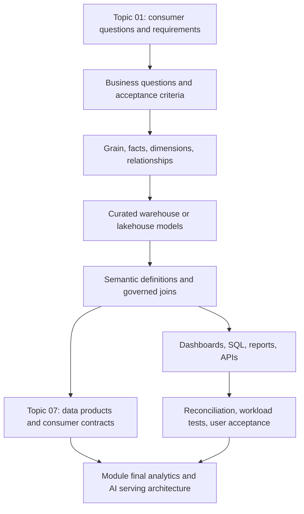
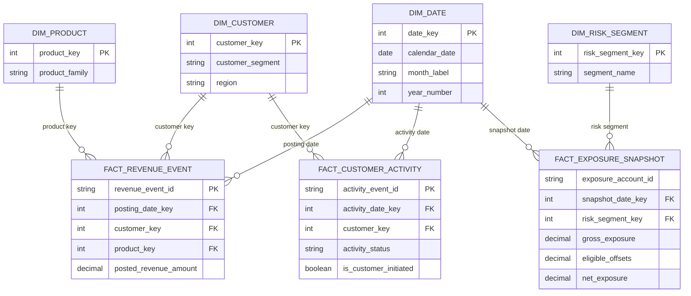

# Warehouses, Marts and Semantic Layers

> **Stage:** 2D — Data Architecture  
> **Module:** 14 — Data Access, Serving, Semantic and AI Data Architecture  
> **Lesson:** Topic 02 of 08  
> **Scenario:** Northbridge Bank, a fictional organization  
> **Data policy:** All rows, organizations, dates, targets, amounts, and thresholds in examples are synthetic and illustrative.  
> **Technology policy:** Vendor-neutral. The patterns described can be implemented with different database, lakehouse, transformation, catalogue, and BI technologies.

## 1. Overview and learning objectives

Topic 01 began with the consumer: who needs data, what decision they need to make, and which serving pattern may fit. This lesson moves one level deeper: **how to shape analytical data and define business meaning so that consumers receive consistent, trustworthy results**.

A warehouse or lakehouse provides analytical storage and processing foundations. A data mart organizes a subject area for a defined set of questions. A semantic layer describes the business meaning of data—metrics, dimensions, relationships, hierarchies, filters, and rules—so different consumers can interpret it consistently. These components work together, but they are not interchangeable.

By the end, you should be able to:

1. Distinguish a warehouse, lakehouse gold layer, data mart, semantic layer, and data product.
2. Translate business questions into a model with a documented grain, facts, dimensions, measures, and relationships.
3. Explain conformed dimensions, hierarchies, join cardinality, and double-counting risks.
4. Define metrics with explicit formulas, filters, units, time semantics, null handling, aggregation behavior, ownership, and validation.
5. Build illustrative definitions for active customers, revenue, and net exposure.
6. Compare centralized and domain-oriented marts, and physical versus virtual serving.
7. Govern metric definitions, business glossaries, access policies, lineage, data quality, and ownership.
8. Assess schema and metric changes, downstream impact, compatibility, and reconciliation.
9. Evaluate performance, materialization, freshness, maintainability, and cost trade-offs.
10. Produce a defensible design with SQL tests, review criteria, and an architecture decision record (ADR).

### Learning progression

- **Beginner:** learn the components, terms, and why they differ.
- **Intermediate:** build a small analytical model from business questions and define its metrics.
- **Advanced:** evaluate semantic consistency, security boundaries, query behavior, change management, and enterprise governance.

## 2. Prerequisites and dependency map

### Prerequisites

| Prerequisite | Required understanding | How it is used here |
|---|---|---|
| Topic 01 — analytical serving patterns and consumer needs | Consumers, questions, access patterns, freshness, latency, governance, and requirement matrices | Supplies the questions and acceptance criteria that the model must support |
| Dimensional modeling basics | Tables, keys, grain, facts, dimensions, and historical records | Provides the structure for analytical models |
| Warehouse/lakehouse and curated data foundations | Integrated analytical storage and consumption-shaped data | Explains where modeled data can live |
| Metadata, glossary, lineage, and data quality | Ownership, definitions, dependency tracking, quality checks | Keeps metric meaning and downstream effects understandable |
| Basic SQL | `SELECT`, `JOIN`, `GROUP BY`, aggregate functions, and common table expressions | Supports the worked example and validation tests |

The Module 2D.14 roadmap identifies Topic 01, dimensional modeling, warehouse/lakehouse and gold-layer foundations, and metadata/glossary knowledge as key dependencies. If a term is unfamiliar, treat this lesson's examples as an introduction and revisit the relevant earlier module.

### Dependency map



**Scope boundary:** This lesson teaches modeling and semantic definition. Topic 01 owns the complete consumer-pattern analysis; Topic 07 owns the complete data-product/API contract and versioning design; Topic 08 examines cross-cutting access, caching, and freshness strategy. The module's final project integrates all eight topics into a coherent architecture.

## 3. Beginner foundations and terminology

### 3.1 Start with business questions

A data model is not just a collection of tables. It is a deliberate representation of business events, entities, and rules that makes important questions answerable.

For Northbridge Bank, possible questions include:

- What was the total booked revenue by product and month?
- How many customers met the agreed definition of active during a month?
- What was net exposure by risk segment as of a specified reporting date?
- How did this month's result compare with the same month last year?
- Which regions contributed to a change in the portfolio total?

These questions imply different time rules, aggregation behavior, and levels of detail. “Revenue by month” needs a clear revenue event and reporting date. “Active customers” needs a customer-level status rule and a time window. “Net exposure as of date” is a snapshot question; summing daily snapshots across a month would normally be wrong.

### 3.2 Core concepts

- **Analytical storage:** storage and compute organized to support analysis, often scans, joins, grouping, and historical comparison.
- **Data warehouse:** an integrated analytical environment with modeled, governed data from multiple sources.
- **Lakehouse:** an architectural approach combining data-lake storage characteristics with table management and analytical processing capabilities. Exact capabilities depend on implementation.
- **Gold layer:** a platform convention for curated, consumption-oriented data. A gold layer may contain data products or marts, but the label alone does not guarantee ownership, contracts, quality, or service promises.
- **Data mart:** a subject-focused analytical model or dataset designed for a business area or use case, such as finance, risk, or customer analytics.
- **Semantic layer:** business-facing definitions for metrics, dimensions, relationships, hierarchies, filters, and sometimes access rules, mapped onto underlying data.
- **Data product:** a governed, owned, discoverable data asset or interface with defined consumers, quality expectations, and operating responsibilities. A mart can be one component of a data product; they are not synonyms.
- **Fact:** a recorded business event, observation, or snapshot at a declared grain, usually with measurable values and foreign keys to descriptive entities.
- **Dimension:** descriptive context used to filter, group, or label facts, such as date, product, region, or customer segment.
- **Grain:** the exact meaning of one row in a fact table. It must be stated before choosing measures.
- **Measure:** a numeric or countable value available for aggregation, such as transaction amount or exposure balance.
- **Metric:** a governed business definition for a reported value, including formula, population, filters, time semantics, unit, and aggregation rules. A metric is more than a column or a chart label.
- **Conformed dimension:** a shared dimension whose meaning and key semantics are aligned across multiple fact tables or marts, allowing valid cross-subject analysis.
- **Hierarchy:** a governed path through levels, such as day → month → quarter → year or branch → region → country.
- **Join cardinality:** the expected relationship between rows on each side of a join, such as one-to-one, many-to-one, or one-to-many. Incorrect assumptions can multiply rows and measures.

### 3.3 An analogy

Imagine a large library:

- The **warehouse/lakehouse** is the organized storage and processing foundation.
- A **mart** is a curated collection organized for a subject or audience.
- The **semantic layer** is the catalogue and shared vocabulary that explains what each item means and how items relate.
- A **data product** is a managed service around an asset: it has an owner, description, access process, quality expectations, and a way to report problems.

A well-organized storage room does not guarantee that every visitor uses the same definition of “current edition.” Likewise, well-modeled tables do not automatically guarantee consistent business metrics.

### 3.4 Why the distinctions matter

Without these boundaries:
- every dashboard may implement “revenue” differently;
- one-to-many joins may inflate totals;
- users may combine incompatible dates or grains;
- sensitive columns may leak through a less-protected interface;
- a schema change may silently break a report;
- query logic may be duplicated across tools and become difficult to maintain.

The goal is not to add layers for their own sake. Each layer should solve a clear problem, and its ownership and operating cost should be justified.

## 4. Warehouse, mart, gold-layer, and semantic-layer distinctions

### 4.1 Comparison table

| Component | Primary role | Typical contents | What it is not | Main design questions |
|---|---|---|---|---|
| Data warehouse | Integrated analytical storage and modeled data foundation | Conformed entities, historical facts, curated analytical models | A universal guarantee of correct metric definitions | Which sources and history are integrated? What quality and governance apply? |
| Lakehouse gold layer | Consumption-shaped data in a lakehouse-style platform | Curated tables, aggregates, subject models, possibly product outputs | Automatically a data product or semantic layer | What does “gold” mean locally? Who owns each table and its contract? |
| Data mart | Subject-focused analytical model for a domain or use case | Facts, dimensions, aggregates, subject-specific views | Merely a folder or uncontrolled copy of tables | Which questions and consumers does it serve? What grain and definitions are stable? |
| Semantic layer | Business definitions and governed relationships mapped to data | Metrics, dimensions, hierarchies, joins, filters, descriptions, policies | The underlying physical storage | How are definitions tested, versioned, and reused across tools? |
| Data product | Owned, discoverable, supported data asset or interface | Data, documentation, access process, lineage, quality measures, support commitments | A particular storage engine or a synonym for a mart | Who owns it? Who consumes it? What are its quality and change expectations? |

These are conceptual roles, not necessarily five separate technologies. A warehouse may contain marts; a gold layer may host mart-shaped tables; a semantic layer may query physical tables or views; a data product may expose a mart through multiple approved interfaces.

### 4.2 Physical storage, modeled data, business meaning, and interface

Keep four questions separate:

1. **Where and how is data stored?** Physical storage, table format, partitioning, and compute belong here.
2. **How is data organized for analysis?** Modeled facts, dimensions, keys, history, and curated aggregates belong here.
3. **What does the data mean?** Metric formulas, business terms, filters, hierarchies, and join relationships belong here.
4. **How does a consumer access it?** Dashboard, SQL, file, or API belongs here, with its own authorization and service characteristics.

A semantic layer may improve consistency and simplify queries, but it does not automatically make a slow underlying query fast. A materialized mart may improve query performance, but it does not automatically settle the business definition of a metric. A data product may document quality promises, but those promises need monitoring and evidence.

### 4.3 When to use each

- Use a **warehouse or lakehouse foundation** when multiple analytical use cases need governed integration and historical analysis.
- Use a **mart** when a coherent subject area needs a stable model shaped for its questions.
- Use a **semantic layer** when multiple consumers need shared metric meaning, governed relationships, or business-friendly names.
- Use a **data product** when the asset needs clear ownership, discovery, access procedures, quality expectations, and change communication.
- Avoid creating all four as separate physical copies by default. Prefer clear responsibilities and measured benefits over layer-count.

## 5. Intermediate modeling and metric-definition workflow

### 5.1 A reliable modeling sequence

1. **List business questions.** Use the requirements and personas from Topic 01.
2. **Define the decision and time reference.** Is the question about events during a period or a state as of a point in time?
3. **Declare grain.** Write one sentence: “One row represents …”
4. **Identify facts and dimensions.** Facts represent events or observations; dimensions describe their context.
5. **Define keys and relationships.** State uniqueness and expected join cardinality.
6. **Choose measures.** Determine which values can be summed, averaged, counted, or must be selected as a snapshot.
7. **Define metrics.** Specify formula, filters, units, time semantics, null behavior, aggregation, owner, and tests.
8. **Conform shared dimensions.** Ensure common entities mean the same thing across marts.
9. **Apply governance.** Set ownership, classification, row/column controls, masking, and audit needs.
10. **Validate representative queries.** Reconcile outputs to trusted references and test joins, filters, and edge cases.
11. **Publish and monitor.** Document the model, lineage, freshness, and quality signals. Package it as a data product when the ownership and consumer contract justify it.

### 5.2 Grain comes first

A grain statement is a precise declaration of what one row means. It prevents incompatible measures from being mixed.

Examples:

- `fact_revenue_event`: one row per posted revenue event line.
- `fact_monthly_customer_status`: one row per customer per reporting month.
- `fact_daily_exposure_snapshot`: one row per exposure account per snapshot date.

These grains are different. Revenue events are additive across events when business rules permit. A monthly customer status is a periodic snapshot and is not automatically additive across months. Daily exposure snapshots should not be summed across dates to produce a period-end balance.

**Rule:** Declare grain before adding numeric columns. If a table mixes multiple grains, split it or explicitly model the relationships; do not expect a semantic layer to repair ambiguous row meaning.

### 5.3 Facts and dimensions

A simple analytical model might contain:

- **Revenue fact:** event date key, customer key, product key, branch key, posted amount, currency code, and source event identifier.
- **Customer dimension:** customer key, approved segment, region assignment, valid-from/to dates if historical changes matter, and classification attributes.
- **Product dimension:** product key, product name, product family, and hierarchy.
- **Date dimension:** date key, calendar date, month, quarter, year, and relevant business-calendar attributes.
- **Exposure snapshot fact:** snapshot date key, exposure account key, risk segment key, gross exposure, eligible offsets, and approved net exposure calculation inputs.

A fact usually stores foreign keys and measures. A dimension provides descriptive attributes. The exact model depends on the questions, history requirements, and source semantics.

### 5.4 Conformed dimensions and hierarchies

A dimension is **conformed** when multiple models use compatible definitions and keys for the same business concept. For example, a shared date dimension can support revenue and exposure analysis, but the date roles must remain explicit: `posting_date` is not the same as `snapshot_date`.

A product hierarchy might be:

`product → product family → portfolio`

A geography hierarchy might be:

`branch → region → country`

Hierarchy roll-ups are valid only when the mapping is well-defined for the relevant time. If a branch moves regions, historical reporting must specify whether it uses the region at transaction time or the current region. Otherwise, the same historical metric can change unexpectedly after a dimension update.

### 5.5 Relationships and join cardinality

Common cardinalities:

- **One-to-one:** each row on one side matches at most one row on the other.
- **Many-to-one:** many fact rows match one dimension row; common for facts joining to a dimension key.
- **One-to-many:** one parent matches multiple child rows.
- **Many-to-many:** multiple rows on both sides can relate, often requiring a bridge or an explicitly defined allocation rule.

A join from a revenue fact to a unique product dimension should be many-to-one from fact to dimension. If the product key is duplicated in the dimension, a join can multiply revenue rows. A join from a fact to a multi-row customer-tag table can also multiply measures if the tag relationship is not reduced or allocated intentionally.

Before aggregating a measure, ask:
1. Is the join key unique on the dimension side?
2. Can the join create more than one output row per fact row?
3. If many-to-many is intended, what is the allocation or counting rule?
4. Does the result reconcile to the fact table's control total?

### 5.6 Measures and aggregation behavior

| Behavior | Meaning | Example | Common mistake |
|---|---|---|---|
| Additive | Can be summed across the relevant dimensions | Posted revenue amount across event rows | Summing duplicated rows after a fanout join |
| Semi-additive | Can be summed across some dimensions but not all, commonly not across time | Account balance at a point in time | Summing daily balance snapshots to obtain month-end balance |
| Non-additive | Cannot be meaningfully summed; often requires recalculation | Ratio, percentage, average rate | Summing percentages across segments |
| Distinct-count metric | Counts unique entities under a defined population and period | Active customers in a month | Summing monthly distinct counts to infer annual distinct customers |
| Snapshot measure | Represents a state at a specific point or interval | Net exposure as of a reporting date | Mixing different snapshot dates without an explicit rule |

Averages need special care. An average of subgroup averages is not generally equal to the overall average unless the appropriate weights are applied. Ratios should generally be recalculated from their numerator and denominator at the requested grain.

### 5.7 Metric definitions must be complete

A metric definition should specify at least:

- business name and purpose;
- owner and approving authority;
- formula and contributing fields;
- fact grain and output grain;
- population and filters;
- unit and currency treatment;
- event date, effective date, or snapshot date;
- null and missing-value behavior;
- aggregation and roll-up behavior;
- time zone and reporting calendar where relevant;
- source lineage and refresh/freshness expectations;
- quality/reconciliation tests;
- access classification and applicable restrictions;
- version and change policy.

### 5.8 Illustrative metric-definition table

The definitions below are deliberately explicit examples, not universal banking definitions. Northbridge Bank must approve the business rules before production use.

| Metric | Illustrative definition and formula | Grain / time semantics | Filters and null handling | Aggregation behavior | Owner | Validation rule |
|---|---|---|---|---|---|---|
| Posted revenue | `SUM(posted_revenue_amount)` for revenue events accepted by the approved accounting rule | Event grain, reported by posting date; currency normalized to an explicitly selected reporting currency before summing | Include only posted, non-reversed eligible entries; missing currency conversion rate is a quality failure, not silently zero | Additive across eligible event rows and dimensions when each event appears once; not safe across mixed currencies without conversion | Finance metric owner | Reconcile to approved ledger control total for the same cutoff, filters, and currency |
| Active customers in month | Distinct count of customers meeting the approved activity rule during the reporting month; illustrative rule: at least one eligible customer-initiated transaction in the month | One customer counted at most once per calendar month; uses event date and approved customer identity mapping | Exclude test/internal accounts and reversed-only activity; missing customer key is quarantined or reported as unknown, not counted as a named customer | Distinct count is non-additive across months and often across overlapping segments | Customer analytics owner | Compare with a reviewed sample and assert one count per customer per month; verify exclusions |
| Net exposure as of date | `SUM(gross_exposure - eligible_offsets)` over eligible exposure accounts at one approved snapshot date, after applying the approved offset and currency rules | One row per exposure account per snapshot date; use the selected reporting snapshot, not a sum over dates | Only eligible accounts and offsets; missing required inputs are flagged, not automatically replaced with zero unless the business rule explicitly says so | Additive across accounts and compatible segments at the same snapshot/currency basis; semi-additive across time | Risk metric owner | Reconcile to the approved exposure control total for the same snapshot date and scope |
| Exposure-to-limit ratio | `SUM(net_exposure) / SUM(approved_limit)` for the same population and snapshot | Calculated at requested reporting group and snapshot date | Exclude or separately flag zero/missing denominators; never silently divide by zero | Non-additive; recompute numerator and denominator at each output grain | Risk metric owner | Check denominator rules and reconcile numerator/denominator independently |
| Average posted revenue per active customer | Eligible posted revenue in the period divided by distinct active customers in that same period | Period metric; numerator and denominator must share period, population, and identity rules | Explicit revenue eligibility and active-customer definition; zero active customers yields null/not-defined, not infinity | Non-additive; recalculate numerator and denominator at each grouping level | Finance and customer analytics jointly | Test zero-denominator case and verify numerator/denominator periods match |

**Important:** The phrase “active customer” is not self-defining. It could mean a customer with a login, a transaction, an open account, or an active contractual relationship. The selected definition must be named, owned, and applied consistently.

The `exposure-to-limit ratio` row is a conceptual metric specification only; `approved_limit` is not part of the worked-example DDL. Before implementing it, model the approved limit at a grain compatible with the exposure population and snapshot, then test the join so the numerator and denominator are neither duplicated nor drawn from mismatched dates.

### 5.9 Semantic layer components

A semantic model commonly describes:

- **Entities:** customer, account, product, branch, date, exposure.
- **Dimensions:** attributes that users filter or group by.
- **Measures:** aggregatable values and the rules under which they can be aggregated.
- **Metrics:** governed business calculations built from measures and filters.
- **Relationships:** approved joins with cardinality and key semantics.
- **Hierarchies:** valid roll-up paths.
- **Filters:** standard population rules, including exclusions and status logic.
- **Descriptions and glossary links:** business language and definitions.
- **Security policies:** approved row/column access or references to policies enforced by the serving platform.
- **Ownership and versioning:** who approves a definition and how changes are communicated.

The semantic layer maps business meaning onto modeled data. It can make consumer queries simpler and promote reuse, but only if definitions and relationships are governed and tested.

**How consumers use it:** dashboards can bind charts and filters to governed metrics and dimensions; self-service analysts can discover approved business terms and explore compatible dimensions without rebuilding each formula; scheduled reports can reuse the same filters, time rules, and calculations; and embedded analytics or a metrics endpoint can expose selected definitions to applications. The semantic model supplies shared meaning, not a universal interface or automatic performance guarantee. Each consumer path still needs its own authorization, workload, freshness, and change controls. Topic 07 covers the full data-product/API contract.

### 5.10 Example semantic relationship diagram

The diagram shows three facts with explicit date roles. `fact_revenue_event` has revenue-event grain; `fact_customer_activity` has activity-event grain; `fact_exposure_snapshot` has account-by-snapshot-date grain. Revenue and customer activity remain separate because their qualifying populations can differ. The facts should not be joined directly at row level just because they share a date or customer concept.



The `PK` marker on `revenue_event_id` and `activity_event_id` denotes illustrative unique event identifiers. `net_exposure` is derived from `gross_exposure - eligible_offsets` in the metric/query, not stored as a separate base column in this example. In the exposure fact, the intended uniqueness constraint is the **combination** `(exposure_account_id, snapshot_date_key)`; Mermaid ER syntax does not consistently express composite keys across all renderers, so the grain statement and tests remain authoritative. The DDL and relationship diagram now use the same date, customer, product, and risk-segment keys.

## 6. Advanced semantic architecture and governance

### 6.1 Centralized versus domain-oriented marts

| Design | Description | Benefits | Risks / costs | Suitable when |
|---|---|---|---|---|
| Centralized enterprise mart/model | A central team owns common models and definitions across domains | Strong consistency, shared standards, fewer duplicate definitions | Central bottleneck, slower domain-specific changes, ownership may be distant from domain expertise | Enterprise-wide metrics are highly coupled or need strong centralized control |
| Domain-oriented marts with conformed contracts | Domain teams own subject models; shared definitions and dimensions follow agreed enterprise standards | Domain knowledge close to the data, clearer accountability, independent evolution | Duplicate concepts, inconsistent keys, and conflicting metrics if governance is weak | Domains have distinct needs and can operate under shared standards and review |
| Hybrid/federated | Central platform governs shared semantics and controls; domains own detailed models and domain-specific metrics | Balances consistency with autonomy | Requires explicit ownership, escalation, and change coordination | Multiple domains need both common enterprise measures and domain-specific analysis |

A practical bank architecture may centrally govern core date, customer identity, currency, and enterprise-level definitions, while risk and finance own their specialized models under documented rules. “Domain-owned” must not mean “definition-free”; “centralized” must not mean every minor change waits indefinitely for one team.

### 6.2 Physical versus virtual serving

- **Physical model/materialization:** data are stored in a precomputed table, aggregate, or materialized view. Queries may be faster and more predictable, but the copy must be refreshed, reconciled, secured, and paid for.
- **Virtual model:** the semantic definition or view is evaluated over underlying data at query time. It can reduce duplication and improve freshness in some designs, but performance depends on source layout, query complexity, and concurrency.
- **Hybrid:** stable, high-use metrics may be materialized while less frequent exploratory questions remain virtual.

| Consideration | Physical/materialized | Virtual/on-demand |
|---|---|---|
| Query latency | Often more predictable for repeated queries | Can vary with source size and query plan |
| Freshness | Depends on refresh/update process | May reflect newer source state, but only if source data are current and query can access them |
| Storage and maintenance | Additional storage and refresh logic | Less duplicated storage, but complex query logic remains |
| Workload isolation | Can isolate common queries on precomputed structures | May push load to shared source resources |
| Correctness risk | Stale or partially refreshed copies | Changing underlying data may alter repeated results unless snapshot semantics are defined |
| Best fit | High-use, stable queries with clear refresh requirements | Flexible or lower-volume queries where on-demand cost and latency are acceptable |

Do not assume physical always means fast or virtual always means fresh. Measure the full path and define the staleness boundary.

### 6.3 Metric ownership and conflicting definitions

Suppose Finance defines “revenue” as posted eligible revenue net of reversals at posting date, while a commercial dashboard defines it as contract value at signing date. Both may be useful business measures, but they are not the same metric.

Resolution process:

1. Collect each definition, including formula, population, event date, cutoff, currency, and exclusions.
2. Identify the business decision each definition supports.
3. Determine whether the definitions are genuinely contradictory or are different metrics with similar labels.
4. Assign accountable owners and agree on a canonical name for each.
5. Publish the definitions in a glossary and semantic model.
6. Update dashboards and API consumers to use the correct metric.
7. Reconcile historic values and document any intentional differences.
8. Version the change and communicate effective dates.

Do not force unlike measures into a single “revenue” metric just to make a dashboard match. Prefer clear names such as `posted_revenue` and `contracted_value` with separate definitions and owners.

### 6.4 Security boundaries

Semantic-layer policies can improve consistent access, but they are not a substitute for enforcement at trusted storage or serving boundaries.

- **Row-level security:** limits records visible to a principal, such as region-scoped risk analysts.
- **Column-level security:** restricts sensitive attributes such as direct identifiers.
- **Masking:** transforms or suppresses sensitive values when full values are unnecessary.
- **Least privilege:** grant only the actions and data required for an approved purpose.
- **Identity propagation:** ensure the user's identity or an equivalent verified authorization context is preserved across tools and services.
- **Auditability:** record access and administrative changes according to policy.
- **Export controls:** treat extracts as new copies with access, retention, and onward-sharing implications.

Example policy intent (not vendor-specific syntax):

```text
role: regional_risk_analyst
allowed_dataset: risk_mart
row_filter: region_id IN regions_assigned_to_verified_identity
restricted_columns: customer_name, government_identifier
masked_columns: customer_reference
purpose: approved risk analysis
audit: log access, export, and policy changes
```

Tests must include both allowed and denied cases. A dashboard hiding a restricted column is not sufficient if the user can query the underlying table directly through another interface.

### 6.5 Lineage, data quality, and ownership

Lineage should make it possible to trace a metric from its consumer-facing definition back through semantic expressions, modeled tables, transformations, and source data. For each important metric, record:

- business owner and technical steward;
- upstream source and transformation lineage;
- model and semantic-definition version;
- freshness/watermark and last successful publication;
- quality checks and last outcomes;
- downstream dashboards, reports, extracts, or APIs;
- sensitivity and authorization policy;
- known limitations and contact/escalation path.

Useful quality checks include:
- uniqueness of declared business keys;
- non-null required keys and measures;
- referential integrity for dimension keys;
- accepted status/domain values;
- freshness and late-arrival checks;
- reconciliations against approved control totals;
- duplicate-event detection;
- snapshot uniqueness by account and snapshot date;
- valid currency conversion coverage;
- tests for unexpected changes in metric distributions.

A quality check must encode the business rule. For example, “no null net exposure” may be wrong if missing inputs should be represented as unknown and quarantined. Never silently replace unknown with zero unless the metric contract explicitly requires it.

### 6.6 Schema evolution and downstream impact

Schema changes can affect semantic definitions and consumers in different ways.

- **Additive nullable column:** may be compatible for many consumers, but can still affect wildcard queries, data classification, or semantic exposure.
- **Rename/drop column:** likely breaks dependencies that refer to the old name.
- **Type or unit change:** can change metric meaning even if queries still execute.
- **Grain change:** is a major semantic change; a query may return plausible but wrong totals.
- **Dimension hierarchy or key change:** can alter historical rollups and joins.
- **Metric filter/formula change:** can change dashboard values without changing the physical schema.

Before change:
1. inspect lineage and downstream dependencies;
2. identify owners and consumers;
3. define compatibility expectations;
4. create test cases for old and new behavior;
5. reconcile historical and current outputs;
6. version or stage the change where necessary;
7. communicate effective date and migration guidance;
8. monitor after release and retain a rollback path.

Compatibility is not just schema compatibility. A change can be syntactically compatible but semantically breaking.

### 6.7 Performance, materialization, freshness, and cost

Semantic consistency and performance are separate concerns, but they interact.

- Repeated joins and calculations can be expensive; a well-designed mart or materialization may reduce repeated work.
- Materialization creates refresh lag, storage, invalidation/refresh logic, and a second place where quality must be verified.
- Virtual queries may avoid a duplicate dataset but can create unpredictable source load.
- Broad high-cardinality dimensions and many-to-many relationships can create costly or misleading queries.
- Workload isolation may protect priority dashboards from ad hoc queries, but does not repair incorrect modeling.
- Caching is a cross-cutting access/freshness concern covered in Topic 08; a semantic layer should state the freshness expectations rather than assume a cache is safe.

Evaluate with representative queries and concurrency, including:
- p50/p95 latency and error rate;
- scanned or processed data and resource consumption;
- freshness at the serving boundary;
- query queue time versus execution time;
- reconciliation and correctness;
- operating and storage cost;
- maintenance effort and failure modes.

Optimize the full consumer task, not only an isolated SQL execution time.

### 6.8 Metric reconciliation across dashboards and APIs

When two consumers disagree:
1. Confirm both use the same metric name and version.
2. Compare filters, population, time zone, date role, cutoff, and currency.
3. Compare grain and join path; look for fanout.
4. Compare source watermark and materialization timestamp.
5. Compare null handling and exclusions.
6. Run the same canonical test query against the same snapshot.
7. Document whether the difference is a defect or an intentional semantic distinction.

A metric should have one authoritative definition for a stated purpose. Different products can expose different views, but differences must be named, explained, and approved—not left as accidental drift.

## 7. Worked example and SQL

### 7.1 Scenario and synthetic data

Northbridge Bank wants to report:
- posted revenue by month and product;
- active customers by month;
- net exposure as of a reporting date.

Illustrative assumptions:
- Reporting currency is a single normalized currency for the example; production currency conversion rules would be separately governed.
- Only eligible posted revenue events count; reversed or test events are excluded by a defined status field.
- An active customer has at least one eligible customer-initiated transaction in the month.
- Net exposure is reported for one selected snapshot date and equals gross exposure minus eligible offsets.
- The sample data below contain no real people or real financial records.

The correct approach is to keep revenue events and exposure snapshots at separate grains, then aggregate each fact independently. Do not join both fact tables together at row level and then sum both measures.

### 7.2 Example model and SQL

The following DDL and queries use a PostgreSQL-like SQL dialect (including `DATE_TRUNC` and typed date literals). They are a teaching example, not a promise of syntax portability or a complete production schema; adapt date functions, constraints, and types to the chosen engine. The conceptual model is vendor-neutral. The worked schema is intentionally explicit about dimensions and fact grains so its joins match the relationship diagram below.

```sql
CREATE TABLE dim_date (
    date_key INTEGER PRIMARY KEY,
    calendar_date DATE NOT NULL UNIQUE,
    month_label VARCHAR(7) NOT NULL,
    year_number INTEGER NOT NULL
);

CREATE TABLE dim_product (
    product_key INTEGER PRIMARY KEY,
    product_name VARCHAR(100) NOT NULL,
    product_family VARCHAR(100) NOT NULL
);

CREATE TABLE dim_customer (
    customer_key INTEGER PRIMARY KEY,
    customer_segment VARCHAR(50) NOT NULL,
    region VARCHAR(50) NOT NULL,
    is_test_customer BOOLEAN NOT NULL
);

CREATE TABLE dim_risk_segment (
    risk_segment_key INTEGER PRIMARY KEY,
    segment_name VARCHAR(50) NOT NULL UNIQUE
);

CREATE TABLE fact_revenue_event (
    revenue_event_id VARCHAR(40) PRIMARY KEY,
    posting_date_key INTEGER NOT NULL,
    customer_key INTEGER NOT NULL,
    product_key INTEGER NOT NULL,
    posted_revenue_amount DECIMAL(14, 2) NOT NULL,
    event_status VARCHAR(20) NOT NULL,
    FOREIGN KEY (posting_date_key) REFERENCES dim_date(date_key),
    FOREIGN KEY (customer_key) REFERENCES dim_customer(customer_key),
    FOREIGN KEY (product_key) REFERENCES dim_product(product_key)
);

CREATE TABLE fact_customer_activity (
    activity_event_id VARCHAR(40) PRIMARY KEY,
    activity_date_key INTEGER NOT NULL,
    customer_key INTEGER NOT NULL,
    activity_status VARCHAR(20) NOT NULL,
    is_customer_initiated BOOLEAN NOT NULL,
    FOREIGN KEY (activity_date_key) REFERENCES dim_date(date_key),
    FOREIGN KEY (customer_key) REFERENCES dim_customer(customer_key)
);

CREATE TABLE fact_exposure_snapshot (
    exposure_account_id VARCHAR(40) NOT NULL,
    snapshot_date_key INTEGER NOT NULL,
    risk_segment_key INTEGER NOT NULL,
    gross_exposure DECIMAL(14, 2) NOT NULL,
    eligible_offsets DECIMAL(14, 2) NOT NULL,
    PRIMARY KEY (exposure_account_id, snapshot_date_key),
    FOREIGN KEY (snapshot_date_key) REFERENCES dim_date(date_key),
    FOREIGN KEY (risk_segment_key) REFERENCES dim_risk_segment(risk_segment_key)
);
```

The declared primary key on `(exposure_account_id, snapshot_date_key)` is the intended grain of the exposure fact: one account per snapshot date. The `fact_customer_activity` table is separate from the revenue fact because qualifying customer activity is not necessarily equivalent to a posted revenue event. The synthetic `posted_revenue_amount` values are assumed to have already been normalized to one reporting currency; a production multi-currency model must specify currency, conversion source, rate date, and rounding policy.

Synthetic inserts:

```sql
INSERT INTO dim_date VALUES
    (20260105, DATE '2026-01-05', '2026-01', 2026),
    (20260118, DATE '2026-01-18', '2026-01', 2026),
    (20260120, DATE '2026-01-20', '2026-01', 2026),
    (20260122, DATE '2026-01-22', '2026-01', 2026),
    (20260125, DATE '2026-01-25', '2026-01', 2026),
    (20260131, DATE '2026-01-31', '2026-01', 2026),
    (20260201, DATE '2026-02-01', '2026-02', 2026);

INSERT INTO dim_product VALUES
    (1, 'Home Lending', 'Lending'),
    (2, 'Card Services', 'Payments');

INSERT INTO dim_customer VALUES
    (101, 'Retail', 'North', FALSE),
    (102, 'Small Business', 'South', FALSE),
    (103, 'Retail', 'North', TRUE);

INSERT INTO dim_risk_segment VALUES
    (1, 'Standard'),
    (2, 'Elevated');

INSERT INTO fact_revenue_event VALUES
    ('R-001', 20260105, 101, 1, 100.00, 'POSTED'),
    ('R-002', 20260118, 101, 2,  40.00, 'POSTED'),
    ('R-003', 20260120, 102, 2,  60.00, 'POSTED'),
    ('R-004', 20260122, 103, 1, 900.00, 'POSTED'),
    ('R-005', 20260125, 102, 1,  50.00, 'REVERSED');

INSERT INTO fact_customer_activity VALUES
    ('C-001', 20260105, 101, 'ELIGIBLE', TRUE),
    ('C-002', 20260118, 101, 'ELIGIBLE', TRUE),
    ('C-003', 20260120, 102, 'ELIGIBLE', TRUE),
    ('C-004', 20260122, 103, 'ELIGIBLE', TRUE);

INSERT INTO fact_exposure_snapshot VALUES
    ('A-01', 20260131, 1, 1000.00, 100.00),
    ('A-02', 20260131, 2,  500.00,  50.00),
    ('A-01', 20260201, 1, 1100.00, 100.00);
```

### 7.3 Revenue by month and product

```sql
SELECT
    DATE_TRUNC('month', d.calendar_date) AS revenue_month,
    p.product_family,
    p.product_name,
    SUM(f.posted_revenue_amount) AS posted_revenue
FROM fact_revenue_event AS f
JOIN dim_date AS d
  ON d.date_key = f.posting_date_key
JOIN dim_product AS p
  ON p.product_key = f.product_key
JOIN dim_customer AS c
  ON c.customer_key = f.customer_key
WHERE f.event_status = 'POSTED'
  AND c.is_test_customer = FALSE
GROUP BY
    DATE_TRUNC('month', d.calendar_date),
    p.product_family,
    p.product_name
ORDER BY revenue_month, p.product_family, p.product_name;
```

**Expected output:**

| revenue_month | product_family | product_name | posted_revenue |
|---|---|---|---:|
| 2026-01-01 | Lending | Home Lending | 100.00 |
| 2026-01-01 | Payments | Card Services | 100.00 |

The reversed event is excluded; the test customer's 900.00 event is excluded. Total included posted revenue is 200.00. This result assumes all sample amounts are already in the same reporting currency.

**Test:** compare the sum of the grouped output with the included event-level total. The included fact rows are R-001, R-002, and R-003, totaling 200.00.

### 7.4 Active customers by month

```sql
SELECT
    DATE_TRUNC('month', d.calendar_date) AS activity_month,
    COUNT(DISTINCT a.customer_key) AS active_customers
FROM fact_customer_activity AS a
JOIN dim_date AS d
  ON d.date_key = a.activity_date_key
JOIN dim_customer AS c
  ON c.customer_key = a.customer_key
WHERE a.activity_status = 'ELIGIBLE'
  AND a.is_customer_initiated = TRUE
  AND c.is_test_customer = FALSE
GROUP BY DATE_TRUNC('month', d.calendar_date)
ORDER BY activity_month;
```

**Expected output:**

| activity_month | active_customers |
|---|---:|
| 2026-01-01 | 2 |

Customer 101 has two qualifying activity events but counts once. Customer 102 counts once. Customer 103 is excluded because it is a test customer. The activity fact is separate from revenue so that qualifying activity without a posted revenue event can still count when business rules allow it. This metric is a distinct count for the month; adding monthly counts across months does not produce the distinct number of customers across the entire year.

### 7.5 Net exposure as of one date

```sql
SELECT
    d.calendar_date AS snapshot_date,
    r.segment_name AS risk_segment,
    SUM(f.gross_exposure - f.eligible_offsets) AS net_exposure
FROM fact_exposure_snapshot AS f
JOIN dim_date AS d
  ON d.date_key = f.snapshot_date_key
JOIN dim_risk_segment AS r
  ON r.risk_segment_key = f.risk_segment_key
WHERE d.calendar_date = DATE '2026-01-31'
GROUP BY d.calendar_date, r.segment_name
ORDER BY r.segment_name;
```

**Expected output:**

| snapshot_date | risk_segment | net_exposure |
|---|---|---:|
| 2026-01-31 | Elevated | 450.00 |
| 2026-01-31 | Standard | 900.00 |

Total net exposure for the selected snapshot is 1,350.00. The row for 2026-02-01 is excluded. Do not sum all snapshots to compute a point-in-time balance.

### 7.6 Avoiding double counting: a deliberate bad pattern

Suppose one revenue event is joined to multiple customer tags, then revenue is summed by product. If customer 101 has two tags, a revenue event for that customer can appear twice. The query may run successfully and return plausible but inflated totals.

**Safer options:**
- aggregate revenue to the intended grain before joining to a multi-valued attribute;
- use `EXISTS` when the question is whether a related record exists;
- deduplicate the relationship only when a defensible business rule identifies the correct row;
- use a bridge table with explicit allocation weights if revenue must be apportioned across multiple categories;
- test that each source event contributes exactly once to additive totals.

Do not use `SUM(DISTINCT amount)` as a generic fix: two legitimate events can have the same amount, and the function would incorrectly collapse them.

### 7.7 Validation queries and tests

**1. Revenue event uniqueness** (primary key should enforce this, but test source-to-model loads too):

```sql
SELECT revenue_event_id, COUNT(*) AS row_count
FROM fact_revenue_event
GROUP BY revenue_event_id
HAVING COUNT(*) > 1;
```

Expected: zero rows.

**2. Exposure grain uniqueness:**

```sql
SELECT exposure_account_id, snapshot_date_key, COUNT(*) AS row_count
FROM fact_exposure_snapshot
GROUP BY exposure_account_id, snapshot_date_key
HAVING COUNT(*) > 1;
```

Expected: zero rows.

**3. Missing dimension references:**

```sql
SELECT f.revenue_event_id
FROM fact_revenue_event AS f
LEFT JOIN dim_product AS p
  ON p.product_key = f.product_key
WHERE p.product_key IS NULL;
```

Expected: zero rows for a fully conformed model, or rows quarantined under an explicit unknown-member policy. Do not silently drop unmatched events without a documented rule.

Check the other relationships as well; these examples return rows only when a reference is missing:

```sql
SELECT f.revenue_event_id
FROM fact_revenue_event AS f
LEFT JOIN dim_customer AS c ON c.customer_key = f.customer_key
WHERE c.customer_key IS NULL;

SELECT f.revenue_event_id
FROM fact_revenue_event AS f
LEFT JOIN dim_date AS d ON d.date_key = f.posting_date_key
WHERE d.date_key IS NULL;

SELECT a.activity_event_id
FROM fact_customer_activity AS a
LEFT JOIN dim_customer AS c ON c.customer_key = a.customer_key
LEFT JOIN dim_date AS d ON d.date_key = a.activity_date_key
WHERE c.customer_key IS NULL OR d.date_key IS NULL;

SELECT f.exposure_account_id, f.snapshot_date_key
FROM fact_exposure_snapshot AS f
LEFT JOIN dim_date AS d ON d.date_key = f.snapshot_date_key
LEFT JOIN dim_risk_segment AS r ON r.risk_segment_key = f.risk_segment_key
WHERE d.date_key IS NULL OR r.risk_segment_key IS NULL;
```

Expected: zero rows for all four checks, or explicit quarantine/unknown-member handling under a documented policy. Foreign keys can enforce these constraints in some engines, but ingestion tests remain useful when loading stages, constraints are disabled, or upstream extracts bypass enforcement.

**4. Reconcile included revenue:**

```sql
SELECT SUM(f.posted_revenue_amount) AS included_revenue
FROM fact_revenue_event AS f
JOIN dim_customer AS c
  ON c.customer_key = f.customer_key
WHERE f.event_status = 'POSTED'
  AND c.is_test_customer = FALSE;
```

Expected: 200.00 for the synthetic sample.

**5. Check snapshot inputs:**

```sql
SELECT *
FROM fact_exposure_snapshot
WHERE gross_exposure < 0
   OR eligible_offsets < 0
   OR eligible_offsets > gross_exposure;
```

Expected for this illustrative business rule: zero rows. If legitimate business cases permit negative balances or offsets greater than gross exposure, replace this rule with the approved domain rule rather than blindly applying the example.

### 7.8 What the semantic layer would expose

A semantic layer could expose:

- `posted_revenue`: sum of eligible posted revenue under the approved filters;
- `active_customers_monthly`: distinct count of eligible customers with qualifying activity in the month;
- `net_exposure_as_of_date`: sum of account-level net exposure for exactly one selected snapshot date;
- dimensions `posting month`, `product family`, `product`, `customer segment`, `region`, and `risk segment`;
- explicit relationships from revenue events to product/customer/date and from exposure snapshots to snapshot date/risk segment;
- documented metric descriptions, owners, classifications, and tests.

It should not expose a generic join between revenue events and exposure snapshots that multiplies rows. Cross-fact analysis should aggregate each fact to a compatible common grain first, then join the aggregates using conformed dimensions and an explicitly defined date relationship.

## 8. Design alternatives and production trade-offs

### 8.1 A compact decision guide

| Decision | Prefer option A when | Prefer option B when | Validate |
|---|---|---|---|
| Centralized vs domain marts | Enterprise consistency and shared control dominate | Domains need autonomy and can honor common standards | Definition drift, delivery lead time, ownership clarity |
| Physical vs virtual | Query patterns repeat and need predictable performance | On-demand flexibility and lower duplication are more valuable | End-to-end latency, source load, freshness, cost |
| One metric vs separate metrics | Business meaning and population are genuinely identical | Similar labels conceal different decisions or time rules | Formula, cutoff, filters, unit, owner, reconciliation |
| Shared dimension vs local dimension | Entity semantics and keys can be conformed | Concepts genuinely differ or cannot be safely aligned | Key mapping, history, hierarchy, duplicate definitions |
| Materialize vs calculate at query time | Repeated work and latency justify refresh/storage cost | Workload is infrequent or source query performance is adequate | Usage frequency, refresh lag, maintenance and storage cost |
| Strict schema contract vs flexible exploration | Consumers depend on stable production interfaces | Approved users need experimentation in a bounded sandbox | Breaking-change risk, access controls, cost, reproducibility |

### 8.2 Architecture review checklist

A design review should ask:

**Business semantics**
- Does every metric have one explicit definition and owner?
- Are time, unit, filters, null behavior, and aggregation rules specified?
- Are similarly named but different metrics clearly distinguished?

**Model correctness**
- Is the grain documented for every fact?
- Are dimension keys unique at the join point?
- Are many-to-many relationships handled explicitly?
- Do sums and distinct counts reconcile to known controls?

**Governance**
- Are classifications, row/column policies, masking, and purpose restrictions defined?
- Are policies enforced across all access paths, including exports?
- Are lineage, ownership, and audit requirements recorded?

**Operations**
- Are freshness and publication status visible?
- Are representative queries and concurrency tested?
- Is the refresh/materialization failure mode understood?
- Are cost, support, and change responsibilities assigned?

**Change management**
- Are downstream dependencies known?
- Are schema and metric changes tested for semantic compatibility?
- Is there a versioning and communication plan?

### 8.3 ADR example

#### ADR-014-02 — Govern common metrics over domain-owned marts

| Field | Decision record |
|---|---|
| Status | Proposed, pending owner approval and representative workload validation |
| Context | Northbridge Bank's Finance and Risk teams need domain-specific analytical models, while dashboards require consistent date, customer, and enterprise metric semantics. |
| Decision | Let Finance and Risk own their subject-specific marts. Govern shared dimensions and enterprise-level metrics through named owners and a shared semantic-definition process. Materialize only workloads whose measured latency, repeat use, or cost justifies it. |
| Alternatives | (A) One central mart for all teams; (B) fully independent marts with no shared semantic governance; (C) domain-owned marts with conformed dimensions and governed shared definitions |
| Rationale | A can slow domain change; B risks inconsistent metrics and keys; C balances domain expertise with cross-domain consistency. |
| Consequences | Requires a metric registry/glossary, clear approval roles, cross-domain tests, and a process to resolve definition disputes. Some metrics will remain domain-specific. |
| Controls | Fact grain declarations, uniqueness/referential tests, row/column access, lineage, metric owners, change review, reconciliation |
| Validation | Reconcile posted revenue and net exposure to approved references; test shared date/customer semantics; review join cardinality; benchmark representative queries; verify access restrictions |
| Review triggers | New domain or consumer; changed metric formula or grain; repeated reconciliation failure; schema-breaking change; sustained latency or cost regression |
| Owners | Finance model owner, Risk model owner, enterprise metric steward, platform owner, security reviewer |

An ADR should explain why an option was selected, what alternatives were rejected, and what evidence will cause the decision to be revisited. It is not a substitute for a detailed metric specification or consumer contract.

## 9. Practical exercises and validation

All exercises use synthetic data. They are recommended practice activities, not additional source-mandated requirements; adapt or skip an activity if it does not fit your learning path. For any activity you choose, use the stated acceptance criteria to review the result.

### Exercise 1 — Beginner: classify the layers

**Task:** For each of these items, identify whether it primarily represents a warehouse/lakehouse foundation, gold-layer dataset, mart, semantic definition, interface, or data product:
1. integrated transaction history;
2. curated risk exposure tables;
3. a reusable definition of `net_exposure_as_of_date`;
4. a dashboard used by risk managers;
5. an owned dataset with a catalogue entry, owner, quality expectations, access process, and support contact.

**Expected deliverable:** A table with `Item`, `Primary role`, `Why`, and `What it is not`.

**Acceptance criteria:**
- Distinguishes storage from business meaning and interface.
- Recognizes that a gold table is not automatically a data product.
- Explains that one implementation may combine roles without making the concepts identical.

### Exercise 2 — Intermediate: model a subject area

**Task:** Design a small revenue mart from these questions:
- What is posted revenue by month and product family?
- How many active customers were there in each month?
- Which regions contributed to revenue?

State the grain of the revenue and customer-activity facts separately, list fact fields and dimensions, specify keys and cardinality, and write definitions for `posted_revenue` and `active_customers_monthly`. Do not assume every qualifying activity event creates a posted revenue event.

**Expected deliverable:** Grain statement, ER diagram or relationship table, metric-definition table, and at least three validation queries.

**Acceptance criteria:**
- Grain is written before measures are selected.
- The active-customer definition includes population, qualifying event, period, and distinct-count rule.
- Product and customer dimensions have unique keys at the join point.
- Metric definitions state owner, filters, time semantics, aggregation behavior, and reconciliation rule.
- Tests cover duplicates, missing keys, and total reconciliation.

### Exercise 3 — Intermediate: diagnose a metric conflict

**Task:** Finance says revenue means posted eligible amounts by posting date. Commercial reporting says revenue means contract value by signing date. Determine whether they should share one metric name.

**Expected deliverable:** A comparison table, proposed canonical names, owners, and a change/reconciliation plan.

**Acceptance criteria:**
- Does not silently combine the definitions.
- States why event date and population change the result.
- Names the owner for each metric and explains how dashboards should be updated.
- Includes an effective date and downstream impact review.

### Exercise 4 — Advanced: design a governed semantic architecture

**Task:** Propose centralized, domain-oriented, or hybrid marts for Finance and Risk. Include shared dimensions, metric ownership, physical/virtual decisions, security controls, lineage, quality tests, and change management.

**Expected deliverable:** Architecture diagram, trade-off table, one ADR, and a representative query validation plan.

**Acceptance criteria:**
- Every fact has an explicit grain and join-cardinality assumptions.
- Cross-domain metrics have approved definitions and owners.
- Row/column controls are tested beyond the dashboard UI.
- Materialization choices cite measured workload or freshness needs.
- Breaking semantic changes include downstream impact analysis and reconciliation.

### Exercise 5 — Advanced: audit an analytical query

**Task:** Create a query that aggregates revenue by product and region. Introduce a deliberately duplicated dimension key or multi-valued relationship, observe how the result changes, and correct the model or query.

**Expected deliverable:** Bad query, diagnosis, corrected query, and regression test.

**Acceptance criteria:**
- Explains the fanout mechanism in terms of join cardinality.
- Does not use `SUM(DISTINCT amount)` as a generic patch.
- Demonstrates reconciliation to the original event-level control total.
- Adds a uniqueness or relationship test to prevent recurrence.

## 10. Common mistakes and troubleshooting

| Mistake or symptom | Why it happens | Diagnosis | Correction |
|---|---|---|---|
| “The gold layer is our semantic layer” | Storage convention confused with business definitions | Look for metric formulas, relationships, owners, and tests | Document the semantic role explicitly; a table name alone is insufficient |
| Metric differs between dashboards | Definitions, filters, time roles, or versions differ | Compare metric specifications and source watermarks | Establish canonical definitions or clearly name distinct metrics |
| Revenue doubles after a join | Dimension key is duplicated or relationship is one-to-many | Compare row counts and sum before/after join; inspect cardinality | Fix uniqueness or use explicit bridge/allocation logic |
| Monthly active customers summed into annual active customers | Distinct count treated as additive | Compare monthly counts with distinct customers across the full year | Recompute distinct count at annual grain |
| Snapshot balance grows when more dates are included | Semi-additive snapshot summed across time | Inspect snapshot grain and reporting date filter | Select the approved snapshot or use a defined period-end rule |
| Average of averages is incorrect | Unweighted subgroup averages are combined | Compare weighted numerator/denominator | Recalculate from numerator and denominator at requested grain |
| Unknown amount treated as zero | Null handling is unspecified | Trace missing source fields and business meaning | Define null policy; quarantine or label unknown when appropriate |
| Metric change breaks an API or report | Downstream dependencies were not reviewed | Use lineage and consumer inventory | Version the change, test compatibility, communicate and migrate |
| Virtual semantic query is too slow | Complex joins or large scans execute at request time | Inspect query plan, queue time, scanned data, and concurrency | Improve model/query; materialize justified hot paths |
| Materialized data are stale | Refresh lag or partial refresh is hidden | Compare source watermark, refresh run, and served timestamp | Publish freshness metadata, test refresh completeness, alert on lag |
| Access policy works in one tool but not another | Authorization exists only in the UI or identity is lost | Test direct SQL, API, exports, and alternate clients | Enforce at trusted boundaries and test negative cases |
| Centralized governance becomes a bottleneck | Ownership and approval responsibilities are unclear | Measure change lead time and repeated approval loops | Delegate domain ownership under shared standards and escalation paths |

### Troubleshooting sequence

1. Confirm the exact metric name, version, grain, and time cutoff.
2. Verify source data and refresh/watermark state.
3. Test dimension key uniqueness and join cardinality.
4. Compare row counts and control totals before and after joins.
5. Inspect filters, null rules, currency/unit, and time-zone handling.
6. Verify access policies at every path.
7. Separate query execution cost from queueing and refresh cost.
8. Fix the root cause and add a regression test before release.

## 11. Review questions, mastery criteria, and completion gate

### Review questions

1. How do a warehouse, mart, gold layer, semantic layer, and data product differ?
2. Why must grain be declared before selecting measures?
3. What makes a dimension conformed?
4. Explain one-to-many join fanout and how it can inflate an additive measure.
5. Why is a distinct customer count usually non-additive across months?
6. Why is exposure as of a date semi-additive across time?
7. What fields belong in a complete metric definition?
8. How should a semantic layer handle two different business meanings that share a label?
9. Compare physical materialization with virtual querying.
10. Why is hiding a sensitive column in a dashboard not a complete security control?
11. What should lineage and downstream impact analysis reveal before a metric changes?
12. How would you reconcile a dashboard and an API that return different totals?
13. What should trigger a review of an ADR?
14. How can a model be syntactically compatible but semantically breaking?

### Mastery criteria

You are ready to apply this topic when you can:
- explain the distinct responsibilities of storage, modeling, semantics, and access interfaces;
- build a model from business questions and declare each fact's grain;
- choose facts, dimensions, measures, keys, and relationships with explicit cardinality;
- define active customers, revenue, and a point-in-time balance without ambiguous time or aggregation rules;
- demonstrate that SQL examples reconcile and avoid fanout;
- assign metric owners and document glossary terms, lineage, quality checks, and security;
- compare centralized, domain-oriented, and hybrid models with explicit trade-offs;
- select physical or virtual serving based on evidence;
- design a schema/metric change process with impact analysis, compatibility checks, and reconciliation;
- create an ADR and validation plan that a reviewer can challenge.

### Completion checklist

- [ ] I can distinguish the warehouse, lakehouse gold layer, mart, semantic layer, and data product.
- [ ] I used Topic 01 consumer questions to shape the model.
- [ ] Every fact has a documented grain.
- [ ] Facts, dimensions, keys, hierarchies, and join cardinalities are defined.
- [ ] Metric definitions include formulas, filters, units, time semantics, null rules, aggregation behavior, owners, and validation.
- [ ] Active-customer, revenue, and net-exposure examples state their assumptions.
- [ ] SQL expected outputs match the synthetic data.
- [ ] Tests cover uniqueness, referential integrity, and reconciliation.
- [ ] I can explain and prevent double counting.
- [ ] Row/column security, masking, lineage, quality, and ownership are addressed.
- [ ] Centralized/domain and physical/virtual alternatives are compared.
- [ ] Schema and metric changes include downstream impact and compatibility checks.
- [ ] Recommended practice: I attempted at least one exercise and recorded gaps, or noted why I deferred it.
- [ ] I can defend the design and its trade-offs in a review.

**Readiness for Topic 03 — Operational Data Serving and Low-Latency Access:** You are ready when you can model and define trusted analytical metrics and explain where they belong. Topic 03 then examines why interactive operational applications often need a different serving shape, consistency model, and latency budget.

### Connection to Topic 07 and the final project

Topic 07 will package governed data as products and APIs with explicit contracts, versioning, and consumer expectations. This lesson contributes the modeled data, semantic definitions, ownership, lineage, quality tests, and security expectations those contracts need. The final `Projects/14-analytics-and-ai-data-serving-architecture.md` integrates these models with consumer patterns, operational and ML/AI serving, permission-aware retrieval, and freshness/cache decisions. This lesson does not attempt to design those entire systems in isolation.

---

## Quick reference: model and govern in this order

1. Start with business questions and consumer requirements.
2. Declare fact grain and time semantics.
3. Select facts, dimensions, keys, measures, and relationships.
4. Verify join cardinality and conformed dimensions.
5. Define each metric's formula, population, unit, null handling, and aggregation behavior.
6. Assign owners and publish business glossary definitions.
7. Apply access policies, masking, lineage, and quality checks.
8. Compare centralized/domain and physical/virtual options.
9. Test representative queries, reconcile totals, and assess cost/freshness.
10. Review downstream impact before changing schema or metric meaning.
11. Record the decision and its review triggers.
