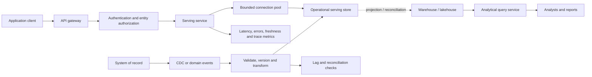

# Operational Data Serving and Low-Latency Access

> **Module:** Stage 2D — Data Architecture / Module 2D.14 — Data Access, Serving, Semantic and AI Data Architecture  
> **Topic:** 03 — Operational data serving and low-latency access  
> **Audience:** Beginner through advanced data architects and data engineers  
> **Status:** Learning material; all organizations, systems, workloads, measurements, and numerical values are synthetic and illustrative.  
> **Scope:** Vendor-neutral. No deployment or real personal data is required.

## 1. Overview and learning objectives

Operational serving is the architecture that makes the right current state available to an application or service within a defined response-time budget, at the required concurrency, with explicit correctness, freshness, availability, and security guarantees.

A customer-facing request such as “retrieve this customer’s current limit” is not the same workload as “calculate monthly limit utilization across three years of transactions.” The first normally needs a small, predictable lookup. The second scans and aggregates a large data set. A system optimized for one is not automatically suitable for the other.

By the end of this lesson, you should be able to:

1. Distinguish operational serving from analytical serving and explain OLTP versus OLAP.
2. Translate consumer expectations into a testable workload specification.
3. Interpret request rate, concurrency, throughput, payload size, latency percentiles, freshness, consistency, availability, and error budgets.
4. Compare relational, key-value, document, cache, search, and materialized-view patterns based on measured access needs.
5. Design bounded API request paths with connection management, timeouts, safe retries, batching, and backpressure.
6. Explain replication lag, stale reads, upserts, change-data capture (CDC), and read-your-writes requirements.
7. Isolate latency-sensitive application paths from analytical workloads.
8. Design for hot keys, skew, overload, partial failure, stale data, and graceful degradation.
9. Define security boundaries and least-privilege access for operational serving.
10. Produce an architecture decision record (ADR) and a validation plan with measurable acceptance criteria.

### The central design principle

**Choose the serving pattern from the access pattern and correctness contract—not from a favorite technology.** A low median latency is not sufficient if p99 misses the business deadline, stale values violate a risk rule, retries amplify an outage, or authorization is bypassed.

## 2. Prerequisites and dependency map

The Module 2D.14 roadmap names these prerequisites for Topic 03:

| Dependency | What to know | Why it matters here |
|---|---|---|
| Topic 01 — analytical serving patterns and consumer needs | Identify consumers, access patterns, and service expectations | Establishes the workload before selecting a store |
| P1 — OLTP/OLAP and operational/analytical separation | Transactional point operations versus large analytical scans | Prevents using the wrong workload engine |
| P4 — operational stores and consistency | Relational, key-value, specialized stores, replication, transaction boundaries | Supports store and correctness decisions |
| P5 — serving stores, materialized views, upserts, freshness | Stream- or batch-maintained operational projections | Explains how serving state is populated and kept current |
| P6 — caching, materialization, cost, performance testing | Hit ratio, bottlenecks, realistic load tests | Helps quantify performance and operating trade-offs |
| Reliability objectives (useful dependency) | SLI, SLO, error budget, degraded modes | Connects application behavior to reliability goals |
| Topic 08 — access patterns, cache strategy and freshness | Cache TTL, invalidation, hit ratio, freshness SLO | Follow-on deep dive; this lesson introduces the relevant decisions |

The project tree also contains Topics 04–08. Topic 04 builds on this lesson for online machine-learning features and training-serving consistency. Topic 08 returns to cache strategy and freshness in greater depth. This lesson introduces the operational contract but does not attempt to replace either topic.

**Source-scope note:** The module roadmap identifies the topic file as a target deliverable and states that the topic files were empty when the roadmap was written. Therefore, this lesson follows the roadmap's stated scope and prerequisite map; it does not claim to reproduce pre-existing content from the target lesson.

## 3. Beginner fundamentals

### 3.1 Operational versus analytical access

| Dimension | Operational serving | Analytical serving |
|---|---|---|
| Typical question | “What is this account's current status?” | “How did account status change across all regions over three years?” |
| Common operation | Point lookup, small update, short bounded query | Scan, join, aggregate, historical comparison |
| Data scope per request | One entity or a small known set | Many rows, partitions, or entities |
| Latency objective | Often milliseconds to low hundreds of milliseconds, depending on business path | Often seconds or longer, depending on query and platform |
| Concurrency pattern | Many simultaneous short requests; bursts matter | Fewer, heavier queries may consume substantial resources |
| Correctness concern | Current-enough state, transaction semantics, read-your-writes | Reproducible aggregates, completeness, metric definitions |
| Failure impact | User action may block or produce an incorrect decision | Report or analysis may be delayed |
| Common architecture | API + operational store, possibly cache or read model | Warehouse/lakehouse + mart/semantic layer |
| Primary optimization | Predictable tail latency and safe concurrency | Scan efficiency, aggregation, throughput, analytical cost |

These are tendencies, not universal laws. An operational database can run analytical queries, and a warehouse can support fast queries. The key question is whether the workload, concurrency, and service-level objective are supported together.

### 3.2 OLTP and OLAP

- **OLTP (online transaction processing):** handles short, concurrent transactions such as reading an account, updating a status, or recording a payment. It emphasizes transaction correctness, concurrency control, and predictable access to a small amount of data.
- **OLAP (online analytical processing):** handles analytical questions that scan, join, and aggregate many records. It emphasizes efficient data access over large volumes and complex calculations.

An application should not normally use a warehouse query as its primary request-time path merely because the warehouse already contains the data. Analytical query planning, queueing, scans, shared-resource contention, and variable result sizes can make response times less predictable than a bounded lookup. A warehouse may be appropriate for a particular low-volume or explicitly latency-tolerant API, but that suitability must be demonstrated with representative tests and an explicit service contract.

### 3.3 A concrete contrast

**Analytical request:** “Calculate total transaction value by month for all customers from 2022 through 2025.”

- Likely work: scan many partitions, filter, aggregate, perhaps join dimensions.
- Main concern: scan volume, query plan, concurrency with other analyses, correctness of aggregate definitions.
- Suitable path: analytical platform, governed mart, and/or semantic layer.

**Operational request:** “Return customer `C-1042`’s current account status and approved limit.”

- Likely work: authenticate caller, authorize access to the entity, perform a bounded key lookup, serialize a small response.
- Main concern: end-to-end latency, predictable behavior under concurrent traffic, current-enough data, and correct authorization.
- Suitable path: an operational store or a purpose-built serving projection; a cache may be added only if its consistency and failure behavior are acceptable.

The distinction is not simply “small data versus big data.” It is also the shape of work, concurrency, transaction semantics, and the cost of being slow or stale.

### 3.4 Core terms

- **Point lookup:** retrieve one record by a known key, such as `customer_id`.
- **Access pattern:** the repeatable way a consumer reads or writes data: keys, predicates, sort order, result size, and frequency.
- **Serving store:** a data system shaped and operated to answer a consumer's requests.
- **Latency:** elapsed time for an operation or request. State whether the measurement is client-observed, service-only, or store-only.
- **Throughput:** completed work per unit time, such as requests per second (req/s).
- **Concurrency:** work in flight at the same time.
- **Freshness:** how old the served data is relative to the authoritative change or event time.
- **Consistency:** what relationships between reads and writes a consumer is allowed to observe.
- **Upsert:** insert a record if absent or update it if present, subject to the store's semantics.
- **Read replica:** a copy used to serve reads; it may lag the write authority.
- **Hot key:** a key that receives a disproportionate share of requests or updates.
- **Tail latency:** the slower end of a latency distribution, often described with p95 or p99.
- **Backpressure:** deliberate slowing or rejection of incoming work when downstream capacity is constrained.

### 3.5 Why a serving store is often a projection

The authoritative system may be optimized for transaction recording, while a consumer needs a denormalized current-state view. A pipeline can consume database changes or domain events and maintain a read-optimized projection. The projection can answer the consumer's known query efficiently, but it introduces propagation delay, replay, ordering, and reconciliation concerns.

A projection is not automatically the system of record. Its contract should say which fields it contains, who owns them, how updates arrive, how stale it may be, how deletes are represented, and what happens when the projection falls behind.

## 4. Operational access patterns and workload requirements

### 4.1 Describe the request before choosing a database

For each operation, document:

1. **Consumer and purpose:** which application or service calls it, and what decision depends on the result?
2. **Read/write shape:** point read, bounded range, conditional update, append, upsert, or aggregate.
3. **Key and predicates:** primary key, tenant, entity type, time range, filters, sort order.
4. **Request mix:** read/write ratio, peak-to-average ratio, burst duration, and key-frequency distribution.
5. **Payload and result size:** typical and maximum request/response bytes, including serialization overhead.
6. **Latency:** end-to-end p50, p95, and p99 target, plus timeout/deadline.
7. **Freshness:** maximum acceptable age and how it is measured.
8. **Consistency:** whether eventual consistency is acceptable, or whether the request requires a transaction, monotonic reads, or read-your-writes.
9. **Availability and failure behavior:** what response is safe if the store is unavailable or the data is stale?
10. **Security:** identity, tenant isolation, row/entity authorization, masking, audit, and deletion behavior.
11. **Operations:** expected growth, recovery objectives, backup/restore, schema evolution, and ownership.

### 4.2 Illustrative workload-requirement matrix

All values below are synthetic design assumptions for teaching, not benchmarks or promises.

| Workload | Access pattern | Typical / peak rate | Assumed mean latency for concurrency estimate | Approx. average in-flight at peak | Payload | Latency target | Freshness | Consistency / availability |
|---|---|---:|---:|---:|---|---|---|---|
| Customer profile read | Point lookup by tenant + customer key | 800 / 2,000 req/s | 30 ms | 60 requests | 2–8 KiB response | p95 ≤ 40 ms; p99 ≤ 100 ms end-to-end | ≤ 5 s | Eventual may be acceptable for non-critical profile fields; 99.95% monthly availability target |
| Current risk/limit check | Point read of a small risk/limit projection | 1,200 / 3,000 req/s | 25 ms | 75 requests | 1–4 KiB | p95 ≤ 35 ms; p99 ≤ 75 ms | ≤ 1 s, or stronger for selected fields | Explicitly define whether stale reads are safe; high availability target, fail closed for uncertain authorization or safety-critical decisions |
| Update notification preference | Conditional update by customer key | 100 / 400 req/s | 40 ms | 16 requests | 1 KiB request, 1 KiB response | p95 ≤ 60 ms; p99 ≤ 150 ms | Write visible to caller immediately or by documented read-your-writes path | Transactional update; idempotency key or conditional semantics for safe client retries |
| Product availability search | Filtered lookup with bounded result set | 250 / 700 req/s | 50 ms | 35 requests | 5–30 KiB | p95 ≤ 80 ms; p99 ≤ 180 ms | ≤ 10 s | Search/index may be eventually consistent; authoritative checkout must revalidate |
| Analytical monthly report | Aggregation across historical partitions | 2 / 10 queries/s | 2 s | 20 queries | 100 KiB–several MiB | p95 ≤ 8 s, with queueing policy | ≤ 15 min | Reproducible and complete result; separate resource pool/quotas from interactive serving |

All concurrency values are approximate average in-flight work calculated with Little's Law at the stated peak rate and the illustrative mean latency: requests/s × seconds. They are planning estimates, not connection-pool sizes, worker counts, or load-test results. Real bursts, queueing, fan-out, and skew can produce higher concurrency. A p95/p99 target should be measured at the consumer boundary, not inferred from a store benchmark.

### 4.3 Latency percentiles are not averages

For a set of completed requests, p95 is the latency at or below which approximately 95% of observations fall; p99 is the corresponding 99th percentile. They are not averages and do not mean every request completes within that time. The exact percentile calculation can vary by measurement system, so use a consistent histogram/quantile method and enough observations.

Example: if p50 = 18 ms, p95 = 55 ms, and p99 = 210 ms, the typical request is quick but a meaningful tail is much slower. An average of 30 ms could hide that tail. Investigate the slow cohort: cold starts, queueing, lock contention, retries, network variance, garbage collection, cache misses, hot partitions, and downstream fan-out.

Always record:
- sample window and request count;
- endpoint and request class;
- client-observed versus server-observed timing;
- successful, failed, and timed-out requests;
- load level and key distribution;
- whether warm-up and cache state are included.

Do not report only successful requests: excluding timeouts and errors can make a failing service look fast.

### 4.4 Request rate, concurrency, and capacity arithmetic

Little's Law gives a useful steady-state relationship:

\[
L = \lambda W
\]

where \(L\) is average work in flight, \(\lambda\) is average arrival/completion rate per second, and \(W\) is average time in seconds. It is not a direct p99 calculator and does not prove capacity.

Illustrative example: at 2,000 requests/s and a mean end-to-end time of 0.040 s, average in-flight requests are approximately:

\[
L = 2{,}000 \times 0.040 = 80
\]

This does **not** imply that 80 worker threads are enough. CPU time, I/O waits, queueing, fan-out, connection limits, and burstiness determine resource needs. If the service slows down, \(W\) rises and concurrency rises even at the same arrival rate, potentially creating a feedback loop.

For payload planning, 2,000 req/s × 4 KiB/request is about 8,000 KiB/s (roughly 7.8 MiB/s) of one-way application request payload before protocol overhead, responses, replication, and retries. Always calculate both request and response directions.

A separate capacity-headroom example follows the module roadmap's recommended method. If expected peak traffic is 3,000 req/s and an illustrative safety factor is 1.5, the design target is 3,000 × 1.5 = **4,500 req/s**. At an average request payload of 2 kB (decimal, 2,000 bytes), one-way request payload bandwidth is 4,500 × 2 kB = **9 MB/s** (decimal), before headers, response traffic, replication, retries, and protocol overhead. Using 2 KiB instead would be 9,000 KiB/s ≈ 8.79 MiB/s. The safety factor is an assumption to test—not a substitute for representative load, burst, and failure testing.

### 4.5 Translating business expectations into an end-to-end latency budget

Suppose a synthetic risk-check endpoint has a 75 ms p99 end-to-end target. An illustrative allocation might be:

| Stage | Budget (ms) | Measurement |
|---|---:|---|
| Network and gateway overhead | 8 | Client/gateway timing |
| Authentication and authorization | 7 | Identity middleware spans |
| Application validation and mapping | 8 | Application span |
| Queueing and connection acquisition | 7 | Pool wait / event-loop queue |
| Serving-store operation | 25 | Store client span, including network |
| Serialization and response handling | 5 | Application span |
| Variability reserve | 15 | Remaining headroom for variance |
| **Total** | **75** | End-to-end p99 objective |

This table is a planning hypothesis, not a mathematical guarantee that component p99 values sum to the end-to-end p99. Component percentiles are correlated and generally cannot simply be added to derive the end-to-end percentile. Instrument the full path and each stage, then validate the actual end-to-end distribution under representative load. If a request fans out to several dependencies in parallel, the slowest dependency can dominate tail latency; serial stages add delay, and retries can add entire attempts.

A useful process is:
1. Set the endpoint-level SLO based on business need.
2. Allocate provisional stage budgets with explicit reserve.
3. Trace each request and record stage durations, queue time, attempts, and result.
4. Load-test the complete path.
5. Compare measured end-to-end p95/p99 with the target.
6. Reallocate budget only when evidence identifies the bottleneck.

### 4.6 Availability, SLOs, and error budgets

A **service-level indicator (SLI)** is a measured property, such as the fraction of valid requests that complete successfully within 75 ms. A **service-level objective (SLO)** is the target for that indicator over a defined window. An **SLA** is a formal commitment that may have contractual consequences. Do not use these terms interchangeably.

For illustration, an availability SLO of 99.95% over a 30-day month corresponds to about 21.6 minutes of unavailability if the window has 43,200 minutes: \(43{,}200 \times (1 - 0.9995) = 21.6\). This is a planning conversion, not a promise or a statement about maintenance exclusions.

Define whether the SLI includes:
- timeout responses;
- overload rejections;
- dependency failures;
- stale responses;
- semantically incorrect responses;
- requests rejected due to caller errors.

A service can return HTTP success while serving a dangerously stale value. For critical use cases, correctness and freshness indicators may need separate SLOs.

## 5. Intermediate store selection and serving design

### 5.1 Candidate serving-store categories

| Category | Strong fit | Limitations and risks | Selection questions |
|---|---|---|---|
| Relational operational database | Transactions, constraints, joins over bounded data, conditional updates, familiar SQL | Hot rows/locks, connection pressure, expensive unbounded queries, scale-out complexity varies | Are transaction boundaries and relational queries central? Can indexed queries meet p99 under peak concurrency? |
| Key-value store | High-rate point reads/writes by known key; predictable access shape | Limited ad hoc query flexibility; hot-key and partition-skew risks; multi-key transactions vary | Is the key known for nearly every request? What are partitioning and consistency semantics? |
| Document store | Entity documents, nested structures, flexible schema, bounded retrieval by key or indexed fields | Large documents increase I/O; cross-document transactions/joins vary; schema drift | Is the aggregate naturally retrieved/updated as a document? What is the maximum document size? |
| Cache / in-memory store | Repeated hot reads, low-latency ephemeral data, reducing backend load | Eviction, invalidation, stampedes, stale data, memory cost, cold-miss overload | Is stale data acceptable? What is the miss path? Can cache loss be tolerated? |
| Search/index store | Text search, relevance ranking, indexed filters, faceting | Usually not the transactional source of truth; index propagation lag; index rebuild cost | Does the query require search semantics? Will authoritative actions revalidate results? |
| Time-series store | Time-bounded measurements, telemetry, recent samples and rollups | High-cardinality tags, retention, late points, and aggregation behavior can dominate; not automatically suited to entity transactions | Is time the primary query dimension, and are retention/rollup semantics explicit? |
| Graph-oriented store | Multi-hop traversal across relationships | Traversal depth, graph size, update rate, and operational complexity; simpler indexed relational queries may suffice | Does the consumer genuinely need relationship traversal rather than bounded joins? |
| Vector-capable search/serving store | Similarity lookup over embeddings, often with metadata filters | Recall/latency trade-offs, filtering behavior, index freshness, and vector lifecycle require validation | Is approximate similarity retrieval the actual access pattern, and how are permissions and freshness enforced? |
| Stream-maintained materialized view | Precomputed lookup or aggregate from event/CDC flow | Propagation lag, replay/reordering, schema changes, reconciliation and backfill complexity | Can the consumer accept measured lag? How are deletes, duplicates, late events and rebuilds handled? |
| Warehouse/lakehouse direct query | Flexible analytical query, low-frequency internal use, large historical scans | Queueing, variable plans, shared resource contention, scan cost, less predictable request latency | Is request latency tolerant? Are concurrency and cost limits tested? Is there an operational fallback? |

No category is universally fastest or best. Benchmark the actual query shape, key distribution, payload, durability settings, replication mode, and failure conditions. A store's advertised peak throughput is not a substitute for a test against your SLO.

### 5.2 A practical selection sequence

1. **Start with correctness.** Determine transaction boundaries, source of truth, acceptable staleness, read-your-writes needs, and whether stale data could cause harm.
2. **Classify access shape.** Known-key lookup, conditional update, bounded range, document retrieval, text search, or aggregate.
3. **Estimate load.** Average and peak arrival rates, bursts, concurrency, read/write ratio, hot-key share, payload, and growth.
4. **Set the latency target.** Specify end-to-end p95/p99 and timeout, not only store latency.
5. **Identify failure behavior.** Decide when to reject, return stale data, use a fallback, or fail closed.
6. **Compare operating costs.** Replicas, memory, index maintenance, data synchronization, backups, on-call burden, and recovery.
7. **Prototype the top candidates.** Use representative key distributions and realistic payloads; test normal and degraded paths.
8. **Record the decision.** Document assumptions, rejected alternatives, risks, owner, and revisit triggers.

### 5.3 Indexes, query shape, and access locality

An index can turn a scan into a bounded lookup, but it consumes storage and adds work to writes. Indexes should align with real predicates and sort order. An index that does not match the filter, leading columns, collation, or query shape may not be used. Too many indexes can slow inserts and updates.

Prefer bounded queries with:
- selective predicates and appropriate composite indexes;
- explicit limits and pagination/cursors for result sets;
- projections that return only needed fields;
- stable ordering where pagination requires it;
- query plans inspected under representative data volume;
- protection against unbounded scans from malformed or adversarial requests.

**Access locality** describes how requests map to data placement and memory/storage access. Locality improves when the requested entity and related data can be read together. But denormalizing too far creates duplicated fields and synchronization work. Partitioning by tenant or entity can improve locality, but a single oversized tenant or popular key can create skew.

### 5.4 Hot keys and skew

Average traffic can hide a severe imbalance. Assume an illustrative service receives 3,000 req/s, but 20% of requests target one key. That key receives 600 req/s while the remaining traffic is spread over all other keys. If the key maps to one partition or one cache entry, that partition may saturate while overall fleet utilization appears moderate.

Potential mitigations, each with trade-offs:
- cache the hot value if its freshness and authorization semantics allow it;
- replicate hot read-only values or route reads across replicas where supported;
- coalesce identical in-flight reads (request collapsing);
- partition or shard a logical aggregate only when semantics permit recombination;
- rate-limit callers or tenants that create disproportionate load;
- use a queue for asynchronous writes if the business operation can be asynchronous;
- remove unnecessary fan-out and repeated reads.

Do not split a hot key mechanically if it represents a strongly consistent balance or counter. Sharding a value can change the correctness model and requires an explicit aggregation or coordination strategy.

### 5.5 API-mediated access and connection management

A typical serving path is:

1. Authenticate the caller.
2. Authorize the requested entity and fields.
3. Validate the request and bound its size.
4. Acquire a connection or client slot within a short deadline.
5. Execute a bounded query/lookup.
6. Validate result shape and freshness/version where required.
7. Map only permitted fields into the response.
8. Emit timing, status, attempts, freshness, and trace metadata.
9. Return a stable error contract without leaking internal details.

**Connection pooling** avoids repeated setup cost and caps the number of concurrent database connections. A pool that is too small creates queueing; one that is too large can overwhelm the store. Measure pool wait time, active/idle connections, saturation, and server-side connection limits. The correct pool size is workload- and client-model-specific.

**Batching** reduces per-operation overhead when the consumer naturally requests several keys. It may increase latency while waiting to fill a batch, enlarge responses, and make one slow item affect the batch. Use bounded batch size and a deadline; do not batch unrelated calls merely to maximize throughput.

**Timeouts** must be bounded and propagated. Set a total request deadline and shorter per-dependency timeouts that fit within it. A timeout is not proof that the operation did not happen: the server may have committed a write before the response was lost.

**Retries** should be bounded, jittered, deadline-aware, and restricted to failures that may be transient. Retrying non-idempotent writes can duplicate effects. Use idempotency keys, conditional updates, transaction IDs, or deduplication where appropriate. Avoid retrying at every layer: three attempts at three stacked layers can create up to \(3^3 = 27\) downstream attempts for one logical request. Retries can worsen overload; use circuit breakers, retry budgets, and backpressure.

**Backpressure** means limiting work before the dependency is overwhelmed: cap queues, reject excess work quickly, shed low-priority traffic, limit per-tenant rates, and avoid accumulating unlimited pending requests. A long queue often turns a visible overload into widespread timeout amplification.

### 5.6 Illustrative pseudocode: bounded read with deadline

This language-neutral pseudocode teaches control flow; it is not production-ready code and does not establish performance, security, or library-specific correctness. The retry path below releases the connection before sleeping or starting another attempt, so a retry does not hold an old pool slot while waiting.

```text
function getCustomerProfile(customerId, caller, deadline):
    validateIdentifier(customerId)
    authorize(caller, "customer:read", customerId)

    remaining = deadline - monotonicNow()
    if remaining <= 0:
        return timeoutResponse()

    # Pool acquisition must itself have a bounded timeout.
    connection = pool.acquire(timeout=min(remaining, 5 ms))
    if connection unavailable:
        record("pool_exhausted")
        return overloadResponse(retryAfter=boundedHint)

    transientFailure = false
    result = missing
    try:
        remaining = deadline - monotonicNow()
        if remaining <= 0:
            return timeoutResponse()

        result = connection.readByKey(
            key=customerId,
            timeout=min(remaining, 25 ms)
        )
    catch transientReadError:
        transientFailure = true
    finally:
        # Release this attempt's pool slot before any retry delay or next attempt.
        pool.release(connection)

    if transientFailure:
        remaining = deadline - monotonicNow()
        if not retryBudgetAvailable() or remaining <= minimumAttemptBudget:
            return controlledDependencyError()
        delay = randomJitterWithinBound()
        if delay + minimumAttemptBudget >= remaining:
            return timeoutResponse()
        sleep(delay)
        # Retry only once here, after releasing the first connection; the
        # retry function must have its own deadline and attempt bound.
        return oneBoundedRetryAfterRelease(customerId, caller, deadline)

    if result is missing:
        return notFoundResponse()

    validateResultSchema(result)
    if result.version is missing or result.updatedAt is missing:
        record("invalid_serving_record")
        return controlledDependencyError()

    if isTooStale(result.updatedAt):
        record("stale_serving_record")
        # Caller policy decides whether stale is safe for this field.
        return freshnessPolicy(result)

    return mapAllowedFields(result, caller)
```

Important review points:
- The deadline uses a monotonic clock for elapsed-time decisions.
- Pool acquisition and store operations both have timeouts.
- The caller is authorized for the specific entity, not just authenticated.
- Result fields and freshness metadata are validated.
- Retries are bounded and should not be layered invisibly across gateway, SDK, and service.
- The pseudocode omits language-specific cancellation, tracing, transaction cleanup, and exception mapping; these must be implemented and tested in a real system.
- Do not return stale data by default. Define a per-field and per-use-case policy.

## 6. Advanced latency, consistency, concurrency, and reliability

### 6.1 Consistency contract

Consistency is not a single yes/no property. Describe what the caller may observe.

| Requirement | Meaning | Example |
|---|---|---|
| Strong/linearizable read (where supported) | Read observes a value consistent with a single global order of completed operations | A critical balance check requiring the latest committed update |
| Read-your-writes | A caller that completed a write can observe that write on a subsequent read | User changes a preference and immediately reloads it |
| Monotonic reads | A caller does not see values move backward in version/order | A status must not revert from a newer version to an older one |
| Eventual consistency | Replicas/projections converge if updates stop and delivery succeeds | Search index catches up after a product update |
| Bounded staleness | The contract places a measurable upper bound on age/lag under defined conditions | A profile projection may lag by at most five seconds in normal operation |
| Transactional atomicity | Related writes commit together or not at all within a transaction boundary | A state transition updates record and audit row atomically |

The actual guarantees depend on the store, configuration, transaction boundary, and failure mode. “We use replication” does not tell a consumer what it can read. Specify whether reads go to the leader, a replica, a cache, or an asynchronously maintained projection.

### 6.2 Replication, CDC, upserts, and materialized views

A common pattern is:

1. A source-of-record transaction commits.
2. A change log or CDC mechanism emits a change.
3. A consumer validates and transforms the event.
4. A serving store is updated with an upsert or tombstone.
5. Metrics record source position, processing lag, and failures.
6. Reconciliation compares the projection with the authoritative source.

The serving projection is behind the source by **propagation lag**. Measure lag using source commit/event timestamps and processing position, accounting for clock skew where timestamps cross systems. Event delivery time alone is not always equivalent to data age.

Key correctness hazards:
- **Duplicates:** delivery may repeat an event. Make processing idempotent.
- **Out-of-order changes:** an older event may arrive after a newer one. Use monotonic source versions, sequence numbers, or compare-and-set conditions; do not blindly let the last-arriving event win.
- **Deletes:** represent deletion explicitly with tombstones or durable deletion events, and propagate it to caches and derived views.
- **Schema changes:** validate compatibility and support controlled rollouts.
- **Replays/backfills:** ensure replay does not overwrite newer values or duplicate side effects.
- **Partial failure:** a pipeline may update some partitions or entities and fail others; expose lag and reconciliation status.
- **Clock skew:** timestamps alone may not be a reliable total order.

A robust upsert often applies an incoming record only if its source version is newer than the stored version. The exact comparison and conflict behavior must match the source's versioning contract.

**Materialized views** precompute a read model or aggregate. They can reduce request-time work but move complexity into maintenance, backfills, correctness checks, and lag management. A materialized view is suitable only if the consumer accepts its freshness and correction behavior.

### 6.3 Separating operational and analytical workloads

An analytical query can consume CPU, memory, I/O, connections, and cache capacity that an application request needs. Isolation strategies include:
- a dedicated serving store or projection;
- separate compute/resource pools and workload quotas;
- read replicas with known lag semantics;
- query limits and statement timeouts;
- admission control and queue limits;
- separate scaling and deployment windows;
- monitoring that correlates analytical jobs with application latency.

A replica is not free isolation if it shares constrained storage, network, or replication resources. Verify the actual isolation boundary. A separate serving store provides stronger workload separation but introduces synchronization and reconciliation work.

### 6.4 Cache and duplication trade-offs

A cache can reduce read latency and backend load for repeated values. It also creates a second copy of data with its own freshness, invalidation, eviction, authorization, and outage behavior.

Use a cache when:
- the access pattern has measured reuse;
- cache misses can be handled safely;
- the data's staleness policy is explicit;
- cache keys include the tenant/authorization scope when relevant;
- cache loss does not make the backend collapse;
- invalidation and synchronization are testable.

Avoid assuming a high hit ratio. Measure hit ratio by key class and endpoint, as well as miss latency and backend request rate. A 95% hit ratio can still leave a miss path receiving a large burst during cache failure.

A cache stampede occurs when many requests miss or expire the same hot item together. Mitigations include request coalescing, randomized TTL jitter, controlled refresh-ahead, and bounded stale-while-revalidate **only when stale responses are permitted**. These mechanisms do not replace correctness checks for critical data.

Topic 08 covers cache strategy and freshness in more depth. For this lesson, the key requirement is to treat cache freshness and cache failure as part of the serving contract—not as implementation details.

### 6.5 Capacity and queueing under load

A system can have enough average CPU and still violate p99 because requests queue behind a saturated resource or a hot partition. Measure:
- arrival rate and completed throughput;
- in-flight work and queue depth;
- request and dependency latency distributions;
- pool wait and active connection count;
- CPU, memory, garbage collection, disk/network I/O;
- lock waits, throttling, partition-level skew;
- cache hit/miss and refresh activity;
- timeouts, retries, rejections, and cancellation;
- replication/CDC lag and stale-record rate.

Test at expected peak, above peak, and through recovery. Do not infer sustainable throughput from a short burst if the system accumulates queue depth or delayed replication.

### 6.6 Graceful degradation and failure policy

Every endpoint should define what happens if:
- the serving store is unavailable;
- the dependency is slow but not yet failed;
- the source projection is stale;
- the cache is empty or down;
- authorization service is unavailable;
- a required field is missing or malformed;
- one replica or region is unhealthy.

Possible behaviors:
- fail fast with a controlled retryable error;
- return a documented stale value for low-risk fields;
- serve a precomputed fallback if it is safe and labeled;
- queue an asynchronous operation when synchronous completion is not required;
- reject low-priority requests to protect critical traffic;
- fail closed for authorization, financial/risk decisions, or other safety-critical checks where uncertainty is unacceptable.

A fallback must not silently change the meaning of the response. For example, returning an old limit without an age/version indicator may be more dangerous than returning an error. Avoid using a default such as zero for missing financial or risk data unless zero is a legitimate value under the contract.

### 6.7 Security and access-boundary design

Operational serving often exposes data through a high-traffic API. Controls should include:
- service-to-service authentication and strong caller identity;
- authorization at the entity and field level where required;
- tenant-aware keys and query predicates;
- least-privilege database roles, separated read/write identities, and scoped credentials;
- encryption in transit and at rest as required by the threat model;
- validation and parameterized queries;
- response allow-lists and data minimization;
- rate limits and payload limits;
- audit events for sensitive access and administrative changes;
- secret rotation and no credentials in logs;
- masking/redaction of personal or sensitive fields;
- retention and deletion propagation across replicas, projections, and caches.

Authentication answers “who are you?” Authorization answers “may you access this entity and these fields for this purpose?” Do not rely on a client-supplied tenant ID alone. Enforce the authorized scope server-side. Cache keys and cache contents must not allow one tenant's response to be returned to another.

If authorization is uncertain, fail closed. A stale data response may be acceptable for some profile fields; a stale permission decision should not be used to grant access.

## 7. Worked examples, diagrams, and code where relevant

### 7.1 Serving architecture diagram

The diagram shows one illustrative pattern. It is not mandatory for every system.



The operational path is separated from the analytical query path. The serving store may be populated asynchronously from the system of record, so the architecture must define propagation lag and correctness semantics. The dotted reconciliation relationship does not mean that the request path synchronously queries the warehouse.

### 7.2 Worked example: why direct analytical-store access may be unsuitable

**Scenario:** A synthetic customer-risk API receives 3,000 requests/s at peak and has an end-to-end p99 target of 75 ms. Each request needs one current risk flag and one approved limit.

Candidate A queries the warehouse directly:
- the query engine may plan or queue requests;
- concurrency can overlap with dashboards and batch jobs;
- response time can vary with partition pruning, metadata work, and shared resources;
- request-time queries can increase analytical cost;
- retries from the API can amplify a warehouse overload.

Candidate B maintains a compact operational projection:
- a CDC/event pipeline updates a key-addressable serving record;
- the API performs a bounded lookup;
- freshness is monitored against a one-second illustrative target;
- the service uses a documented stale-data policy and fail-closed behavior for critical uncertainty;
- reconciliation detects drift against the authoritative source.

**Why B is a stronger starting hypothesis:** the request is a known-key lookup with a strict tail-latency objective, so a purpose-built serving projection aligns with the access pattern. This is not proof that every warehouse is too slow. Candidate A could remain valid for a low-rate, latency-tolerant internal endpoint if representative load tests demonstrate the target, concurrency isolation, and acceptable cost.

#### Candidate comparison

| Criterion | A: direct analytical query | B: operational projection |
|---|---|---|
| Query shape fit | Flexible but heavier than needed | Optimized for known key |
| p99 predictability | Must be demonstrated; queueing/shared work risk | More controllable, still requires measurement |
| Freshness | Depends on ingestion and table availability | Depends on CDC/event lag and projection update |
| Correctness | Can query canonical analytical snapshot, but not necessarily current operational state | Can lag or reorder; needs versioning and reconciliation |
| Isolation | Risk of contention with analytics | Better if resources are actually separate |
| Complexity | Fewer copied data paths | More pipeline, schema, replay, and reconciliation work |
| Best case | Low volume, flexible query, relaxed latency | High-rate point lookup with explicit freshness contract |

### 7.3 Worked latency analysis

Synthetic example values (illustrative only; **not produced by a benchmark or load-test run**):

| Metric | Example value |
|---|---:|
| p50 | 16 ms |
| p95 | 42 ms |
| p99 | 96 ms |
| Timeout rate | 0.25% |
| Peak arrival rate | 3,000 req/s |
| Maximum observed queue depth | 1,800 |

If these synthetic values were observed in a real test against a 75 ms p99 target, the test would **fail**: p99 is 21 ms over target, and the timeout rate is a separate failure signal. The queue-depth peak would suggest overload or burst mismatch but would not prove the root cause. No benchmark is claimed here; these values are a worked example for interpreting evidence.

Follow-up investigation:
1. Split latency by endpoint, key class, status, and attempt number.
2. Inspect pool wait and store duration separately.
3. Compare hot-key and uniform-key runs.
4. Inspect CPU, lock waits, throttling, cache misses, and queue depth during the same window.
5. Remove or bound retries if attempts correlate with tail spikes.
6. Re-run at the same offered load after changing one variable at a time.
7. Confirm the fix under a longer soak and during a dependency slowdown.

Do not declare success based on a lower p50 alone.

### 7.4 Failure scenario: hot key plus downstream slowdown

**Initial conditions (illustrative):** 3,000 req/s; one popular key receives 20% of traffic; the serving store slows from 20 ms to 120 ms; clients permit up to three total attempts per logical request; the queue is unbounded.

Possible sequence:
1. The hot partition slows first.
2. Requests wait longer, so in-flight concurrency increases.
3. Client timeouts trigger retries while original requests may still be executing.
4. Effective downstream attempt rate increases.
5. Queue depth and p99 grow; more requests time out.
6. Retries amplify load, making recovery slower.

**Controls:**
- bounded request deadlines and store timeouts;
- one explicit retry owner, bounded attempts, jitter, and a retry budget;
- per-key/tenant rate controls where appropriate;
- request coalescing for duplicate reads;
- bounded queues and fast overload responses;
- capacity and skew tests using realistic key distributions;
- circuit breaking or adaptive load shedding where justified;
- alerting on queue depth, retry rate, p99, timeouts, hot-partition skew, and freshness lag.

For writes, do not retry blindly. Confirm idempotency or use a unique operation identifier/conditional transition. A timed-out write may already have committed.

### 7.5 Freshness calculation

Assume the source commits an update at 12:00:00.000 and the serving projection applies it at 12:00:00.650. If timestamps are comparable and clock error is controlled, the observed propagation lag is 650 ms. If the freshness SLO is one second, this individual event is within the target. This does not prove the SLO is met overall: measure the distribution over many updates and report lag percentiles, maximum age, missing events, and the observation window.

Do not confuse:
- **query latency:** how long a read takes;
- **propagation lag:** how long an update takes to reach the serving view;
- **data age:** how old the served value is at read time;
- **completeness:** whether all expected source changes are represented.

## 8. Performance testing and failure analysis

### 8.1 Test plan

A credible test uses a workload model, not just a large number of synthetic requests.

| Test | Purpose | Required dimensions | Example acceptance criteria (illustrative) |
|---|---|---|---|
| Functional/contract | Validate response and error semantics | Existing/missing keys, invalid input, auth failures, schema versions | Correct status, allowed fields only, no unauthorized entity exposure |
| Baseline | Establish latency without peak stress | Warm and cold states, typical payload, typical key distribution | p95 and p99 recorded; no unexplained error rate |
| Peak load | Verify stated peak capacity | Expected peak req/s, read/write mix, concurrency, payload | p95 ≤ 40 ms and p99 ≤ 100 ms for profile-read workload; error rate ≤ 0.1% |
| Overload | Observe saturation and load shedding | Increasing arrival rate beyond target, bounded queue | Queue remains bounded; overload is explicit; service recovers |
| Skew/hot key | Test partition and cache concentration | Uniform distribution and intentionally skewed distribution | No single hot key causes unbounded queue growth; critical p99 remains within agreed threshold or controlled degradation activates |
| Soak | Detect leaks and slow accumulation | Sustained peak/near-peak over an agreed period | Stable memory, pool, latency, and replication lag; no progressive degradation |
| Dependency slowdown | Validate timeout and retry behavior | Injected delay, errors, connection exhaustion | Deadlines respected; retry attempts bounded; no retry storm |
| Cache outage / cold start | Verify miss path | Cache unavailable, cold cache, simultaneous expiry | Backend remains within safe capacity or requests are shed safely |
| Replication/CDC lag | Verify freshness contract | Delayed events, duplicate/out-of-order events, replay | Stale values detected; version ordering prevents stale overwrite; lag alert fires |
| Recovery/reconciliation | Validate restoration | Restart, replay, backfill, partial failure | Projection converges; duplicate effects absent; discrepancy is measured and cleared |
| Security | Verify boundaries | Cross-tenant keys, overbroad roles, sensitive fields | Unauthorized access denied; no cross-tenant cache leakage; audit emitted |

Acceptance thresholds must be agreed with the product owner and derived from the actual business contract. The example numbers are not universal targets.

### 8.2 Workload realism checklist

- Use the expected read/write ratio and endpoint mix.
- Include typical and maximum payloads.
- Model bursts and sustained load separately.
- Test both uniform and skewed key distributions.
- Include cold-cache and cache-loss behavior.
- Use realistic authentication and authorization work.
- Include failed, timed-out, cancelled, and retried requests in reporting.
- Record offered load as well as completed throughput.
- Observe server and client metrics together.
- Run long enough to reveal queue growth, GC effects, replication lag, and resource leaks.
- Keep synthetic data and test identities; do not load-test production personal data without a formal approved plan.
- Change one major variable at a time where possible and preserve test configurations/results.

### 8.3 Bottleneck diagnosis

| Symptom | Candidate causes | Evidence to inspect | Possible response |
|---|---|---|---|
| p50 good, p99 bad | Queueing, skew, lock contention, cold misses, fan-out | Traces, histograms, queue depth, per-partition metrics | Find slow cohort; bound queues; reduce contention or fan-out |
| Pool wait high, store time low | Pool too small, leaks, long-held connections | Pool acquisition wait, active/idle counts, connection lifecycle | Fix leaks; tune pool within server limits; shorten connection hold time |
| Store time high, CPU low | Network, locks, disk I/O, throttling, slow replicas | Store waits, I/O, network, lock metrics | Inspect query plan and storage path; remove contention |
| Latency rises with retries | Retry amplification or slow dependency | Attempts per logical request, retry reason, deadline | Reduce retry layers; cap attempts; add jitter/budget/backpressure |
| Overall CPU moderate, one partition saturated | Hot key or poor partition key | Per-partition request rate, key histogram | Cache/coalesce safe reads, rebalance, rate-limit or redesign key |
| Values are stale but reads are fast | CDC lag, dropped events, refresh interval, stale cache | Source position, lag distribution, updated-at/version | Repair pipeline, alert on freshness, apply safe stale policy |
| Data regresses to older value | Out-of-order update or replay | Stored/source versions, event order, replay logs | Conditional upsert by version; fix ordering and replay logic |
| Error rate spikes after cache outage | Miss storm or undersized backend | Cache misses, backend req/s, queue depth | Coalesce, rate-limit, warm carefully, shed load |
| Unauthorized fields appear | Overbroad query/role or response mapping | Authz decision, query scope, response schema, audit | Enforce entity-level authorization and allow-listed mapping |

### 8.4 Observability contract

At minimum, collect:
- request count by endpoint/status;
- latency histograms for client-observed end-to-end and dependency spans;
- timeout, cancellation, rejection, and retry counts;
- offered versus completed request rate;
- in-flight requests and queue depth;
- pool wait and connection saturation;
- serving-store latency and throttling;
- cache hit/miss and miss latency, if applicable;
- source-to-serving lag and stale-record rate;
- hot-key or partition-skew indicators;
- reconciliation discrepancy count and age;
- authorization denials and security-relevant audit events.

Use high-cardinality identifiers carefully. Do not place raw customer identifiers, secrets, or sensitive payloads into metric labels or ordinary logs. Traces should carry safe correlation IDs and redacted attributes.

## 9. Architecture trade-offs and decision record

### 9.1 Decision record — customer limit lookup

**Status:** Illustrative proposal, pending measurement and owner approval.

**Context:** A synthetic customer-limit API requires a point lookup at up to 3,000 req/s peak, p99 ≤ 75 ms, and a one-second freshness target for the projection. The source of record remains authoritative. Some risk decisions may require stronger consistency than the general read path.

**Decision hypothesis:** Maintain a compact operational projection from a versioned CDC/event stream and serve it through an authenticated API. Use a key-addressable store selected by benchmark. Do not query the analytical warehouse synchronously on the critical request path. A cache is optional and must be justified by measured reuse and a documented stale-data policy.

**Alternatives considered:**

| Alternative | Benefits | Costs/risks | Decision |
|---|---|---|---|
| Query warehouse directly | Fewer copied paths; flexible query | Tail latency and concurrency uncertainty; analytical contention; cost per request | Reject for the strict critical path unless measured evidence proves it meets the contract |
| Read source relational DB directly | Authoritative state and transaction semantics | Can couple app traffic to transaction workload; connection and query contention | Consider only with isolation, bounded query, and demonstrated headroom |
| Operational projection | Bounded lookup; independent scaling; explicit read model | CDC lag, replay, reconciliation, duplicated state, schema management | Preferred hypothesis for high-rate point reads |
| Cache-only response | Very low latency on hits | Staleness, invalidation, cold-miss and outage behavior | Not authoritative; optional layer only under explicit correctness policy |
| Search index | Flexible filters/text search | Index lag; not transactional authority | Use only for search-specific needs; revalidate critical actions |

**Correctness controls:**
- each projection record carries source version and update timestamp;
- upsert rejects older versions;
- duplicates are idempotent;
- deletion/tombstone behavior is documented;
- freshness lag is measured and alerted;
- periodic reconciliation compares sampled or complete keys with the source;
- critical decisions fail closed or synchronously validate with the authoritative source if the consistency contract requires it;
- authorization is performed per request and per entity;
- no sensitive fallback values are silently substituted.

**Failure policy:** bounded deadlines; bounded retries only for safe transient operations; backpressure and overload rejection; no automatic stale response for critical risk fields; controlled dependency error if freshness/correctness cannot be established.

**Validation before approval:**
- test 3,000 req/s with representative payload and read/write mix;
- include hot-key skew, cold start, cache failure if cache is enabled, and a slowed serving dependency;
- measure p50/p95/p99, error and timeout rates, queue depth, attempts, and freshness lag;
- demonstrate recovery and reconciliation after duplicate/out-of-order event replay;
- validate cross-tenant authorization and cache-key isolation;
- confirm backup/restore and operational ownership.

**Revisit triggers:** sustained SLO breach, source schema change, materially different traffic distribution, freshness requirement tightening, cost growth, repeated reconciliation drift, new regional/residency constraints, or a new critical consumer.

### 9.2 Cost and operational complexity

Total cost is more than the database bill. Include:
- serving-store compute, memory, storage, replicas, and network;
- CDC/stream processing and replay/backfill;
- cache capacity and invalidation logic;
- indexes and write amplification;
- observability retention and incident response;
- backup/restore, disaster recovery, and multi-region replication;
- engineering time for schemas, contracts, reconciliation, and on-call operations.

A duplicated serving model may improve latency but creates a second data lifecycle to secure, monitor, correct, and delete. Use it when the consumer need justifies those costs.

## 10. Practical exercises and expected outputs

All exercises are designed for synthetic data and can be completed with a written design; deployment is not required.

### Exercise 1 — Beginner: specify three calls

**Scenario:** An illustrative application needs (a) customer profile, (b) current risk flag, and (c) monthly spend history.

**Task:** For each call, define key/predicate, read shape, latency target, freshness target, consistency expectation, and safe failure behavior.

**Expected output:**

| Call | Access shape | Example target | Freshness | Failure policy |
|---|---|---|---|---|
| Profile | Point lookup by customer key | p95 ≤ 40 ms, p99 ≤ 100 ms | ≤ 5 s for non-critical fields | Return controlled error; stale policy only if explicitly safe |
| Risk flag | Point lookup by customer key | p99 ≤ 75 ms | ≤ 1 s or stronger field-specific rule | Fail closed if stale/unknown could create unsafe decision |
| Monthly spend | Historical aggregate by customer/month | p95 ≤ 2 s, illustrative | Defined by report refresh contract | Report delay/error; do not silently substitute incomplete totals |

**Acceptance criteria:**
- all three patterns are distinct;
- each has measurable latency and freshness;
- consistency and failure policies are explicit;
- the monthly aggregate is not automatically routed to the same store as the point lookup.

### Exercise 2 — Intermediate: compare three serving patterns

**Scenario:** A customer-limit lookup peaks at 3,000 req/s, has a p99 target of 75 ms, and requires projection freshness within one second. Assume 20% of requests hit one hot key.

**Task:** Compare (1) direct analytical query, (2) source relational DB, and (3) CDC-maintained operational projection. Score each against latency, correctness, freshness, capacity, cost, and operations. State what evidence would change your recommendation.

**Expected output:** A comparison table with:
- at least two benefits and two risks per candidate;
- an explicit consistency/freshness contract;
- a justified preferred hypothesis;
- a test plan including hot-key skew, p99, overload, CDC lag, and reconciliation;
- no claim that a store is suitable solely because its category is “fast.”

**Acceptance criteria:** The recommendation follows from access pattern and requirements, and the assumptions that remain unproven are named.

### Exercise 3 — Advanced: design a critical limit-check path

**Scenario:** A risk decision reads a current limit and a recent aggregate. The source is authoritative; a projection can lag. The path has a synthetic p99 target of 75 ms and receives 3,000 req/s at peak.

**Task:** Draw a serving diagram, allocate a latency budget, define consistency semantics, specify hot-key mitigation, choose degraded modes, design versioned upserts, and create a test plan.

**Expected output includes:**
- valid Mermaid request-path diagram;
- end-to-end p99 target and per-stage provisional budgets;
- explicit note that component percentiles do not simply add to end-to-end p99;
- a rule for when stale data is rejected;
- safe retry/idempotency design;
- CDC duplicate, reordering, delete, replay, and reconciliation controls;
- overload and dependency-timeout behavior;
- measurable acceptance criteria and a short ADR.

**Acceptance criteria:** The design has no unbounded retry or queue; no stale-value default that silently changes meaning; no unsupported consistency guarantee; and test cases cover both normal and failure paths.

### Exercise 4 — Advanced: diagnose a tail-latency regression

**Scenario:** After a release, p50 remains 18 ms, p95 rises from 45 ms to 58 ms, p99 rises from 80 ms to 240 ms, timeout rate rises to 0.4%, and the serving projection lag reaches 2.5 seconds against a one-second target.

**Task:** Propose a prioritized investigation that distinguishes queueing, hot-key skew, dependency slowdown, retry amplification, and CDC backlog.

**Expected output:**
1. confirm sample window, offered load, request count, and client-observed metrics;
2. segment latency by endpoint, key class, status, attempt number, and dependency span;
3. inspect queue depth, pool wait, partition load, store duration, and retry rate;
4. inspect source position, CDC processing lag, failed records, and version conflicts;
5. apply a safe mitigation and preserve evidence;
6. define a re-test and recovery criterion.

**Acceptance criteria:** The response distinguishes symptoms from causes and does not treat p50 improvement as proof of recovery.

### Exercise 5 — Intermediate/advanced: safe retry review

**Scenario:** A client calls `setLimit(customer, newLimit)` and times out. The application, gateway, and SDK each permit up to three total attempts per logical request, independently.

**Task:** Explain the risk and redesign retry ownership.

**Expected output:**
- worst-case attempts can reach \(3 \times 3 \times 3 = 27\) per logical operation if all three layers independently permit three total attempts each;
- timeout does not prove that the write failed;
- use one retry owner, an overall deadline and retry budget;
- use an idempotency key or conditional/versioned update and define duplicate handling;
- retry only appropriate transient errors with bounded jitter;
- reject/slow new work when the dependency is overloaded.

**Acceptance criteria:** The redesigned plan bounds attempts, avoids duplicate unsafe effects, and does not amplify load without limit.

## 11. Common mistakes, review questions, mastery criteria, and completion gate

### 11.1 Common mistakes

| Mistake | Why it fails | Correction |
|---|---|---|
| Choosing a database before describing access patterns | Optimizes the wrong workload | Write workload matrix and correctness contract first |
| Treating p95/p99 as averages | Hides slow tails | Use distributions and state the observation window |
| Measuring only store latency | Omits gateway, auth, queue, serialization, and network | Measure client-observed end-to-end latency and trace stages |
| Assuming component p99 values add to end-to-end p99 | Percentiles are not generally additive; stages may correlate | Measure full path; use component spans diagnostically |
| Using the warehouse as a default application backend | Query and resource contention may violate the SLO | Separate analytical and latency-sensitive paths when evidence supports it |
| Treating a replica as strongly consistent | Replication lag can expose old values | State read target and consistency guarantee |
| Blind retries | Duplicates writes and amplifies overload | Bounded retries, idempotency, one retry owner, deadline and budget |
| Unbounded queueing | Converts overload into timeouts and memory pressure | Cap queues and shed load explicitly |
| Ignoring hot keys | Average capacity hides partition saturation | Test skew and monitor per-key/partition behavior |
| Blindly trusting cache freshness | Stale values may violate business rules | Define freshness SLO, invalidation, miss path, and safe stale policy |
| Upserting by arrival time only | Old events may overwrite newer state | Use source versions/sequence and conditional writes |
| Failing open on authorization uncertainty | Exposes data | Fail closed and keep authorization at the entity boundary |
| Returning zero/default on missing data | Can change the business meaning silently | Use explicit unknown/error state unless default is contractually valid |
| No reconciliation plan | Projection drift persists undetected | Compare source and projection, alert, repair and verify |
| Benchmarking uniform keys only | Misses real skew and hot partitions | Include realistic and adversarial distributions |
| Calling a design “production ready” after a toy example | Omits failure, security, operations and recovery | Complete validation and operational readiness review |

### 11.2 Review questions

1. What makes a point lookup different from a historical analytical query?
2. Why are p95 and p99 more informative than a single average for latency-sensitive systems?
3. What is the difference between request rate and concurrency?
4. Why does a high average throughput not prove a system meets its p99 target?
5. When is a relational database a better choice than a key-value store?
6. Why is a search index usually not the authoritative source for a critical write?
7. How can a timed-out write have succeeded?
8. What can happen if the gateway, SDK, and application all retry independently?
9. Why must CDC updates be versioned or otherwise protected against reordering?
10. What is the difference between query latency and propagation lag?
11. How can cache invalidation cause an outage even when the cache normally improves latency?
12. What is a hot key, and why can it break a design with apparently sufficient average capacity?
13. Why should authorization be checked per entity and not inferred from a caller-supplied tenant field?
14. What evidence is needed before concluding that a direct warehouse query is unsuitable?
15. What belongs in the ADR and what conditions should trigger revisiting it?

### 11.3 Mastery criteria

You have mastered this topic when you can:
- explain operational versus analytical access without reducing the distinction to “fast versus slow”;
- produce a workload specification with access shape, rate, concurrency, payload, p95/p99, freshness, consistency, availability, and failure behavior;
- calculate a basic concurrency estimate using Little's Law while explaining its limitations;
- compare at least three store patterns against requirements and identify unproven assumptions;
- explain replication lag, stale reads, versioned upserts, CDC, and reconciliation;
- design bounded timeouts, retries, connection pools, batching, and backpressure;
- analyze a p99 regression with measurements rather than guesswork;
- specify safe degraded modes for stale data and dependency failures;
- include least privilege, entity authorization, tenant-safe cache behavior, and data minimization;
- document a decision and a test plan with measurable acceptance criteria.

### 11.4 Completion checklist

- [ ] I have completed the workload-requirement matrix for at least three operations.
- [ ] I can distinguish OLTP point operations from OLAP analytical queries.
- [ ] I have stated p95 and p99 targets and know how they will be measured.
- [ ] I have documented freshness and consistency requirements separately.
- [ ] I have compared candidate stores using access patterns and constraints.
- [ ] I have defined query bounds, connection limits, deadlines, retry safety, and backpressure.
- [ ] I have addressed replicas, CDC lag, duplicate/out-of-order events, upserts, deletes, and reconciliation.
- [ ] I have separated the critical operational request path from analytical workload contention where needed.
- [ ] I have defined safe behavior for hot keys, store outages, stale data, and authorization failures.
- [ ] I have a representative load/failure test plan with measurable pass/fail criteria.
- [ ] I have completed an ADR with assumptions, alternatives, trade-offs, owner, and revisit triggers.
- [ ] I have attempted the exercises and recorded gaps.

**Completion gate:** The topic is complete when the serving comparison is justified by explicit requirements, latency and capacity arithmetic can be reproduced, freshness/consistency and degraded modes are documented, and the test plan validates both normal and failure behavior. This prepares you for **Topic 04 — Feature platforms and training-serving consistency**, which applies operational serving concepts to online model features, and **Topic 08 — Access patterns, cache strategy and freshness**, which deepens cache, hit-ratio, invalidation, and freshness-SLO design.
