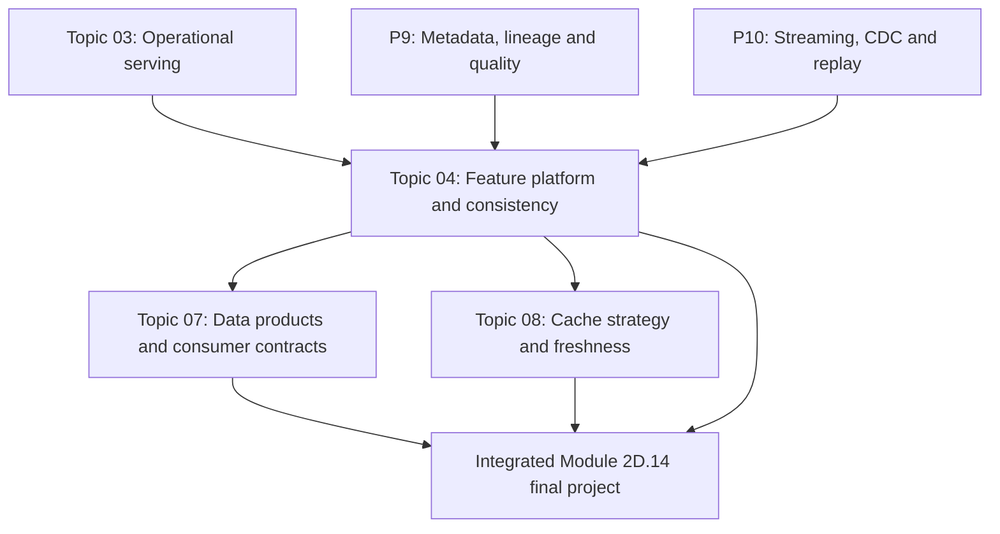
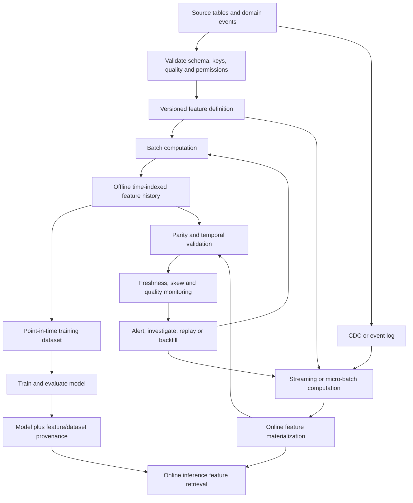

# Feature Platforms and Training–Serving Consistency

> **Module:** Stage 2D — Data Architecture / Module 2D.14 — Data Access, Serving, Semantic and AI Data Architecture  
> **Topic:** 04 — Feature platforms and training-serving consistency  
> **Audience:** Beginner to advanced data architects, data engineers, and ML platform engineers  
> **Data policy:** All people, entities, events, timestamps, thresholds, and numerical values in examples are synthetic and illustrative. No deployment or real personal data is required.  
> **Architecture stance:** Vendor-neutral; no particular feature-store product, cloud, model framework, or stream processor is assumed.

## 1. Overview and learning objectives

A machine-learning (ML) model learns from historical examples and later uses input values to make predictions for new cases. Those input values are **features**. A model may be mathematically sound and still perform poorly in production if the values used during training differ from the values available at prediction time, or if training accidentally includes information that would not yet have been known.

A **feature platform** is the set of definitions, computation pipelines, storage, retrieval interfaces, metadata, governance, and operational controls used to create, serve, validate, and retire features. It may use an explicit feature-store product, or it may be built from governed tables, streaming pipelines, operational stores, and reusable libraries. A feature store is one component or pattern; it is not the whole lifecycle by itself.

The central challenge is to make a feature mean the same thing across historical training and online inference, while respecting their different access patterns and time semantics.

### Learning objectives

By completing this lesson, you should be able to:

1. Explain features, labels, entities, training examples, prediction time, training, and inference.
2. Distinguish offline feature storage from online feature serving.
3. Write a feature-definition contract with owner, type, unit, null behavior, transformation, time semantics, freshness, and version.
4. Design a lifecycle from source data to transformations, offline history, online materialization, and inference.
5. Explain batch, streaming, and hybrid feature-computation strategies.
6. Build a point-in-time-correct historical training example using both event time and data-availability time.
7. Identify training-serving skew, data leakage, stale features, late events, null/default differences, and schema changes.
8. Design feature parity tests, monitoring, lineage, backfills, versioning, and deletion propagation.
9. Evaluate consistency, latency, throughput, reliability, storage duplication, cost, and operational complexity.
10. Define security and access controls for sensitive feature data and document an architecture decision.

### Core rule

**A feature is not fully defined by its formula alone.** It also needs an entity key, input sources, time semantics, type and unit, null/default behavior, version, freshness expectation, and an owner. A feature called `txn_count_7d` is ambiguous until its window boundary, event-time basis, late-event policy, and availability rule are specified.

## 2. Prerequisites and dependency mapping

The Module 2D.14 roadmap defines Topic 04 as building on Topic 03, with metadata/lineage (P9) and streaming/CDC (P10) as dependencies. Basic ML concepts (P12) are to be taught at beginner level in this lesson.

| Dependency | What it contributes | How this lesson uses it |
|---|---|---|
| Topic 03 — Operational data serving and low-latency access | Point lookups, latency budgets, consistency, serving-store behavior, freshness, failure handling | Online feature retrieval must fit inside the inference request budget |
| P9 — Metadata, catalogue, lineage, quality, entity consistency | Discoverability, ownership, provenance, quality controls, impact analysis | Trace a feature to source columns, transformation version, dataset, and model |
| P10 — Event/streaming basics, replay, CDC | Event-time processing, late events, replay, idempotent upserts, lag measurement | Maintain online features and correct historical values |
| P8 — Access control and sensitive-data handling (broader module dependency) | Least privilege, purpose limitation, masking, retention/deletion | Govern access to features derived from sensitive records |
| Topic 07 — Data products, APIs and consumer contracts | Published contracts, versioning, consumer compatibility | Publish feature interfaces and change guarantees without duplicating Topic 07 |
| Topic 08 — Access patterns, cache strategy and freshness | Cache behavior, freshness SLOs, hit ratio, invalidation | Provides the deeper cross-cutting freshness/cache lesson |

### Scope note from the roadmap

The Module 2D.14 roadmap records that the topic files were empty when that roadmap was written, and that its exercises, scenarios, and targets were recommendations rather than existing file requirements. This document follows the roadmap's stated Topic 04 scope and dependency map; it does not claim to reproduce pre-existing content from the target lesson.

### Dependency map



## 3. Beginner foundations

### 3.1 Training, inference, features, and labels

- **Training:** fitting a model from historical examples.
- **Training example:** one row or record representing a prediction opportunity at a defined time, with feature values that would have been available then and a label describing the later outcome.
- **Feature:** an input used by the model, such as transaction count over the previous seven days.
- **Label:** the outcome the model is trained to predict, such as whether a synthetic transaction was later confirmed fraudulent.
- **Entity:** the object for which a feature is defined: customer, account, device, merchant, or transaction.
- **Prediction time (`t_pred`):** the time at which the model would have made the prediction in the historical example or current inference request.
- **Inference:** applying a trained model to features for a new case.
- **Feature computation:** transforming source records into a model input.
- **Feature materialization:** persisting computed feature values in a store or table so that consumers can retrieve them efficiently.
- **Training-serving skew:** a mismatch between feature values, definitions, or behavior in training and online inference.
- **Data leakage:** information from outside the permitted information set—often information from after prediction time—enters training and makes evaluation unrealistically optimistic.

Example: a model predicts whether a transaction is suspicious at 10:00. A feature may be “number of transactions for this account in the prior 24 hours.” It must use qualifying transactions from the correct lookback window that were actually available to the prediction path by 10:00. A transaction that occurred at 09:58 but did not arrive until 10:04 cannot be used by a model that made its decision at 10:00, even though a later warehouse query can see it.

### 3.2 Why offline and online features differ

| Dimension | Offline feature data | Online feature serving |
|---|---|---|
| Primary purpose | Build historical training sets, evaluation sets, and batch scoring inputs | Supply features to a live prediction request |
| Typical access | Scan/join large history; retrieve values as of many timestamps | Retrieve a small feature vector for one or a few entity keys |
| Data shape | Time-indexed history, snapshots, event tables, large partitions | Latest value or bounded state per entity/key, sometimes time-window aggregates |
| Latency | Seconds to minutes may be acceptable for dataset construction | Usually part of a low-latency inference budget |
| Compute pattern | Batch jobs, historical reconstruction, large joins | Precomputed values, streaming updates, bounded on-demand computation |
| Correctness focus | Point-in-time correctness and reproducibility | Current-enough values, bounded latency, defined missing/stale behavior |
| Common storage category | Warehouse/lakehouse or analytical tables | Low-latency key-addressable store; sometimes in-process or distributed cache |
| Main risks | Future leakage, non-reproducible backfills, inconsistent definitions | Stale/missing values, write propagation lag, latency spikes, partial updates |

Offline and online systems have different workload requirements; they do not have permission to define different meanings for the same feature. A feature platform aims to share the **definition and contract**, even if storage and execution differ.

### 3.3 A simple analogy

A feature definition is like a recipe. Offline training may prepare thousands of meals in a large kitchen; online inference must prepare one meal quickly at order time. The equipment and serving speed differ, but ingredients, measurements, and cooking rules must remain equivalent. If the training recipe treats missing values as zero but online code treats them as `null`, the model sees a different input distribution.

### 3.4 Feature definition as a contract

A useful feature definition includes:

| Field | Purpose | Example (synthetic) |
|---|---|---|
| Stable feature name | Unique, searchable identifier | `account.txn_count_7d.v1` |
| Business meaning | What the feature represents | Count of qualifying posted transactions in the preceding seven-day interval |
| Entity and key | What the value belongs to | `account_id` |
| Source and fields | Traceable inputs | `transaction_events.account_id`, `event_time`, `available_at`, `status` |
| Transformation | Reproducible logic | Count qualifying events in \((t-7d, t]\) |
| Event-time rule | Defines which business events qualify | `event_time <= prediction_time` and `event_time > prediction_time - 7 days` |
| Availability rule | Prevents information unavailable at prediction time | `available_at <= prediction_time` for historically faithful online reconstruction |
| Type and unit | Prevents coercion and unit drift | Integer count, unit `transactions` |
| Null/default behavior | Defines absent and unknown cases | Missing aggregate is `0` only if no observed qualifying events is semantically zero; unknown/incomplete state remains distinguishable |
| Late-event policy | Defines corrections | Recompute affected windows; record correction/version |
| Freshness objective | Operational promise, with a named start event and end state | 99% of eligible source updates applied to the online feature state within 30 seconds of becoming available to the serving pipeline (illustrative target) |
| Offline/online parity | States comparison tolerance | Exact integer equality for the same source snapshot and as-of time |
| Owner and steward | Assigns accountability | Risk Data Platform team (illustrative) |
| Version and lifecycle | Controls change | `v1`, active; incompatible changes create `v2` |
| Quality tests | Makes the contract testable | Non-negative count; key/time completeness; offline/online parity |
| Security classification | Controls use | Internal; entity-level access; no raw sensitive attributes in logs |

A feature name is not a complete definition. A change to the window boundary, source filter, null behavior, currency unit, timezone, or late-event policy can change model behavior and should be versioned or otherwise handled through an explicit compatibility process.

## 4. Feature lifecycle and offline/online architecture

### 4.1 Lifecycle stages

1. **Identify a prediction decision and entity.** Define what the model predicts and at what time.
2. **Specify the feature.** Document source, entity key, transformation, time semantics, type/unit, null behavior, freshness, owner, and version.
3. **Validate source data.** Check schema, completeness, duplicates, event-time quality, and access permissions.
4. **Compute features.** Use batch, streaming, or hybrid processing according to latency and correction requirements.
5. **Persist offline history.** Keep enough time-indexed data and lineage to reconstruct training values as of historical prediction times.
6. **Materialize online state.** Write current or windowed feature state to a low-latency serving store with version/updated-at metadata.
7. **Build a point-in-time training set.** Reconstruct only the feature values permitted at each example's prediction time.
8. **Train and record provenance.** Record feature-definition versions, source snapshot, code revision, label definition, and dataset identity.
9. **Serve inference.** Retrieve a coherent feature vector within the request deadline; apply documented missing/stale policy.
10. **Monitor and compare.** Track freshness, missingness, distributions, feature retrieval failures, and offline/online parity.
11. **Backfill or correct.** Recompute affected historical intervals when late events or definitions change.
12. **Deprecate safely.** Notify consumers, maintain compatibility during migration, and remove data according to retention and deletion rules.

### 4.2 Feature lifecycle diagram



This is a conceptual architecture, not a requirement to use separate products for every box. A platform may share compute or storage while maintaining clear contracts and workload isolation.

### 4.3 Feature-platform responsibilities

A feature platform can provide:
- a catalogue and searchable definitions;
- entity/key conventions and schema validation;
- shared transformation code or an equivalent reproducible specification;
- offline historical storage and point-in-time retrieval;
- online materialization and low-latency lookup;
- versioning, lineage, dataset/model provenance, and deprecation;
- freshness, quality, missingness, distribution, and parity monitoring;
- access control, audit, retention, and deletion propagation;
- backfill, replay, reconciliation, and incident runbooks;
- ownership and service-level expectations.

It does not automatically solve data quality, label correctness, causal validity, model drift, model evaluation, deployment safety, or feature meaning. Those need explicit owners and controls.

## 5. Intermediate feature engineering and temporal correctness

### 5.1 Event time, processing time, availability time, and prediction time

These timestamps answer different questions:

- **Event time:** when the business event occurred according to the event/source.
- **Processing time:** when a pipeline processor handled the event.
- **Availability time:** when the value became available to the serving path or system that made the prediction. This is the most useful historical boundary for faithfully reconstructing what the model could have known.
- **Prediction time:** when the prediction was made or would have been made.
- **Label time / outcome horizon:** when the outcome became known, often after prediction time.

Do not assume that event time equals processing time or availability time. An event may occur at 09:03, arrive at 09:12, and be processed at 09:13. A prediction made at 09:10 cannot use that event if the live serving system had not received it yet.

### 5.2 Synthetic event dataset

The following records are entirely illustrative. Times are UTC on the same synthetic date. `available_at` represents when the event became usable by the prediction path; in a real platform, this should be measured or reconstructed from ingestion/serving logs rather than guessed from event timestamps.

| event_id | account_id | event_time (UTC) | available_at (UTC) | amount | qualifying |
|---|---|---|---|---:|---|
| E101 | A-17 | 2026-05-01 09:00:00 | 2026-05-01 09:01:00 | 20.00 | true |
| E102 | A-17 | 2026-05-01 09:05:00 | 2026-05-01 09:06:00 | 30.00 | true |
| E103 | A-17 | 2026-05-01 09:03:00 | 2026-05-01 09:12:00 | 40.00 | true |
| E104 | A-17 | 2026-05-01 09:08:00 | 2026-05-01 09:08:30 | 10.00 | false |
| E105 | B-22 | 2026-05-01 09:07:00 | 2026-05-01 09:07:20 | 15.00 | true |

Prediction example:

| example_id | account_id | prediction_time | label_available_time | label (synthetic) |
|---|---|---|---|---:|
| P1 | A-17 | 2026-05-01 09:10:00 | 2026-05-02 12:00:00 | 1 |
| P2 | B-22 | 2026-05-01 09:10:00 | 2026-05-02 12:00:00 | 0 |

For P1, E101 and E102 qualify. E103 occurred before prediction time but arrived after prediction time, so it must be excluded when reconstructing what was available to the live system at 09:10. E104 is not qualifying. The correct count for P1 is **2** and the amount sum is **50.00**. An event-time-only join would incorrectly include E103, producing count 3 and sum 90.00. This is an availability-time leakage problem even though E103's business event time is earlier.

P2 has one qualifying event (E105), so its count is **1** and sum is **15.00**.

### 5.3 Point-in-time correctness

For an example with entity \(e\) and prediction time \(t_p\), a historically faithful feature should use only records that:
1. belong to the correct entity;
2. satisfy the feature's event-time window and filters;
3. were available to the relevant serving path by \(t_p\);
4. obey the documented late-event and correction policy.

For a seven-day event-time window:

\[
t_p - 7\text{ days} < t_{\text{event}} \le t_p
\]

and, for an availability-faithful reconstruction:

\[
t_{\text{available}} \le t_p
\]

The boundary is part of the feature contract. If the business requires an inclusive start boundary, write that explicitly. For event streams, event-time watermarks can allow bounded lateness in aggregate computation, but a watermark does not mean a live prediction can use an event that had not arrived yet.

### 5.4 SQL example: point-in-time feature reconstruction

The following is standard-style SQL intended to be portable with minor dialect adjustments. Assumptions:
- `synthetic_events` contains the table shown above;
- `prediction_examples` contains the examples shown above;
- timestamps are normalized to UTC;
- `available_at` is the actual availability time relevant to serving;
- `qualifying = TRUE` is the feature's source filter;
- the example uses a seven-day lookback, although all sample events fall within a few minutes.

```sql
SELECT
    p.example_id,
    p.account_id,
    p.prediction_time,
    COUNT(e.event_id) AS txn_count_7d,
    COALESCE(SUM(e.amount), 0.00) AS txn_amount_7d
FROM prediction_examples AS p
LEFT JOIN synthetic_events AS e
    ON e.account_id = p.account_id
   AND e.qualifying = TRUE
   AND e.event_time > p.prediction_time - INTERVAL '7' DAY
   AND e.event_time <= p.prediction_time
   AND e.available_at <= p.prediction_time
GROUP BY
    p.example_id,
    p.account_id,
    p.prediction_time
ORDER BY p.example_id;
```

Expected output:

| example_id | account_id | txn_count_7d | txn_amount_7d |
|---|---|---:|---:|
| P1 | A-17 | 2 | 50.00 |
| P2 | B-22 | 1 | 15.00 |

**Important null distinction:** `COALESCE(SUM(...), 0)` is valid only if the contract says that no qualifying observed events means a true zero. If source completeness is unknown, the feature should represent “unknown/incomplete” separately; silently converting an ingestion failure into zero can teach the model a false relationship. For production SQL, confirm timestamp arithmetic syntax and decimal types in the target engine.

### 5.5 Runnable Python example with assertions

This example uses only the Python standard library (Python 3.10+ recommended). It is intentionally small and is not a production feature engine. It demonstrates the two time filters and a deterministic result.

```python
from datetime import datetime, timedelta, timezone
from decimal import Decimal

UTC = timezone.utc

def ts(value: str) -> datetime:
    # Input format: YYYY-MM-DD HH:MM:SS, interpreted as UTC for this example.
    return datetime.strptime(value, "%Y-%m-%d %H:%M:%S").replace(tzinfo=UTC)

events = [
    {"id": "E101", "account": "A-17", "event": ts("2026-05-01 09:00:00"),
     "available": ts("2026-05-01 09:01:00"), "amount": Decimal("20.00"), "qualifies": True},
    {"id": "E102", "account": "A-17", "event": ts("2026-05-01 09:05:00"),
     "available": ts("2026-05-01 09:06:00"), "amount": Decimal("30.00"), "qualifies": True},
    {"id": "E103", "account": "A-17", "event": ts("2026-05-01 09:03:00"),
     "available": ts("2026-05-01 09:12:00"), "amount": Decimal("40.00"), "qualifies": True},
    {"id": "E104", "account": "A-17", "event": ts("2026-05-01 09:08:00"),
     "available": ts("2026-05-01 09:08:30"), "amount": Decimal("10.00"), "qualifies": False},
    {"id": "E105", "account": "B-22", "event": ts("2026-05-01 09:07:00"),
     "available": ts("2026-05-01 09:07:20"), "amount": Decimal("15.00"), "qualifies": True},
]

examples = [
    {"id": "P1", "account": "A-17", "prediction": ts("2026-05-01 09:10:00")},
    {"id": "P2", "account": "B-22", "prediction": ts("2026-05-01 09:10:00")},
]

def compute_as_of(account: str, prediction_time: datetime, lookback: timedelta):
    start = prediction_time - lookback
    selected = [
        e for e in events
        if e["account"] == account
        and e["qualifies"]
        and start < e["event"] <= prediction_time
        and e["available"] <= prediction_time
    ]
    return {
        "count": len(selected),
        "amount": sum((e["amount"] for e in selected), Decimal("0.00")),
        "event_ids": sorted(e["id"] for e in selected),
    }

results = {
    p["id"]: compute_as_of(p["account"], p["prediction"], timedelta(days=7))
    for p in examples
}

assert results["P1"]["count"] == 2
assert results["P1"]["amount"] == Decimal("50.00")
assert results["P1"]["event_ids"] == ["E101", "E102"]
assert results["P2"]["count"] == 1
assert results["P2"]["amount"] == Decimal("15.00")
assert "E103" not in results["P1"]["event_ids"]  # late-arriving event excluded at 09:10

for example_id, value in results.items():
    print(example_id, value)
```

Expected output:

```text
P1 {'count': 2, 'amount': Decimal('50.00'), 'event_ids': ['E101', 'E102']}
P2 {'count': 1, 'amount': Decimal('15.00'), 'event_ids': ['E105']}
```

The example assumes event records have already been validated and deduplicated, that availability timestamps are trustworthy, and that the feature definition has no additional filters. A production implementation also needs source schema validation, duplicate/event identity handling, time-zone policy, late-event correction, versioning, lineage, and performance tests.

### 5.6 Labels and outcome horizons

A label often becomes known after the prediction time. For example, “confirmed fraudulent within 30 days” cannot be labeled reliably until that outcome window matures, and it may be corrected later. Do not use label information as a feature. Keep separate:
- prediction time;
- feature observation window;
- label outcome window;
- label availability/maturity time.

Training data should exclude or explicitly censor examples whose labels have not matured, according to the model's evaluation design. The exact label rule is domain-specific and must be owned and documented.

### 5.7 Temporal joins and historical reconstruction

A point-in-time join is more than a join on entity ID. Joining a training example to the latest feature row for that entity can attach a value computed days after the example's prediction time. This is a common leakage source.

For a precomputed feature-history table, the intended logic is typically:
- match on entity;
- select a feature version compatible with the training dataset;
- select the latest feature state whose effective/as-of time is not after prediction time;
- ensure the data was available by prediction time if reconstructing live knowledge;
- enforce the feature's time window and filters;
- avoid duplicate matches caused by overlapping history intervals.

If the history table records only event time and not when a record became available, it may be impossible to reconstruct what production actually knew. In that case, document the limitation and do not claim availability-time correctness. Consider capturing ingestion/availability metadata for future records and run sensitivity analysis on historical examples.

## 6. Advanced consistency, skew, monitoring, and governance

### 6.1 Training-serving skew: causes and controls

| Cause | How skew appears | Detection/control |
|---|---|---|
| Separate transformation implementations | Offline rounds or filters differently from online code | Shared transformation specification/code where feasible; golden test vectors |
| Different source tables | Training includes corrected warehouse data; online store has a delayed operational projection | Compare source provenance and data age; shadow recomputation |
| Time-window mismatch | One side uses `>= start`, the other uses `> start` | Boundary tests at exact window edges |
| Event time confused with processing/availability time | Training includes late records unavailable to live inference | Store time metadata; point-in-time tests with seeded late events |
| Null/default mismatch | Offline uses zero; online omits feature or uses a sentinel | Explicit missingness contract and parity tests |
| Type/unit mismatch | One side uses cents, another dollars; seconds versus milliseconds | Typed schemas, unit metadata, range tests |
| Stale online feature | Online materialization lags; offline history is fully corrected | Freshness SLOs, lag alerts, stale policy |
| Out-of-order/duplicate events | Online value regresses or counts an event twice | Event IDs, source versions, idempotent updates, ordering rules |
| Schema/source change | Field meaning/type changes without compatible rollout | Contract checks, versioned definitions, impact analysis |
| Model/feature version mismatch | Model expects `v2`, serving still exposes `v1` | Bind model artifacts to feature schema/version; rollout compatibility checks |
| Leakage from labels or future aggregates | Offline metrics look unrealistically strong | Feature availability audit, time-split evaluation, seeded leakage tests |

### 6.2 Worked skew incident

**Synthetic incident:** A fraud model's offline evaluation appears strong, but the production false-negative rate rises after deployment. Investigation finds that offline `txn_amount_24h` includes all events with event time inside the prior 24 hours. The online stream computes the same nominal window, but a separate code path rounds amounts before aggregation and uses processing time for the window. The offline history also includes late events that were not available when the original prediction would have occurred.

**Diagnosis sequence:**
1. Freeze the feature definition, model version, dataset snapshot, and serving schema used by the affected model.
2. Compare the same synthetic entity and prediction timestamp in offline recomputation and online logs.
3. Compare source events and feature intermediate values, not only the final prediction.
4. Check time window boundaries, event/availability timestamps, null handling, amount precision, and code/configuration versions.
5. Segment differences by late events, missing values, entity type, and serving lag.
6. Reproduce the mismatch with a minimal fixture containing one boundary event, one late event, one null, and one decimal amount.

**Illustrative root cause:**
- offline and online transformations were independently implemented;
- offline used event-time data corrected after the fact without an availability-time filter;
- online used processing-time windows and rounded each amount before summing;
- no parity test covered late data or decimal boundaries.

**Correction:**
- define `txn_amount_24h.v2` with an explicit interval, UTC timestamp semantics, amount precision, qualifying statuses, null policy, and availability-time rule;
- use a shared, versioned transformation specification and common test fixtures;
- reconstruct historical training values as of prediction time;
- materialize online values with source-version and update-time metadata;
- bind the model artifact to the required feature schema/version;
- replay/backfill affected histories and online state with version-safe updates;
- evaluate the corrected model/dataset before rollout; do not assume the feature fix alone guarantees model quality.

**Regression tests:**
- exact start/end window boundaries;
- event time before prediction but availability after prediction;
- duplicate and out-of-order event delivery;
- null, empty, zero, negative/invalid, and decimal values according to the feature contract;
- timezone and daylight-saving boundary if non-UTC business time is supported;
- parity of offline and online outputs for the same input snapshot/as-of time;
- schema compatibility and model-to-feature version compatibility;
- freshness lag and stale-value behavior;
- deletion propagation and replay idempotency.

A post-incident fix is not complete until the original mismatch is reproduced by a test and the test fails on the old implementation but passes on the corrected one.

### 6.3 Consistency strategies

| Strategy | Benefits | Trade-offs and limitations | Appropriate use |
|---|---|---|---|
| Shared transformation code/library | Reduces logic divergence | Runtime/language differences, dependency deployment, and data-engine semantics can still diverge | Deterministic transformations that can be shared across environments |
| Shared feature specification with separate engines | Portable contract; allows batch and streaming execution | Specification must be precise; engine differences still require tests | Organizations with different offline and online compute engines |
| Offline historical store plus online materialization | Supports large training scans and low-latency lookup | Duplicated state, propagation lag, replay/backfill and reconciliation cost | High-volume models with online latency constraints |
| Compute feature on request | Can use current request context; fewer precomputed values | Adds latency/CPU and may create inconsistent behavior if logic is duplicated | Lightweight features or values requiring request-specific inputs |
| Stream-maintained aggregates | Low-latency updates and windowed state | Late events, state retention, replay, watermarks, corrections and operational burden | Features requiring recent events with bounded freshness |
| Periodic batch materialization | Simple and cost-efficient for slower-changing features | Freshness limited by batch cadence; peak refresh load | Stable features with relaxed freshness requirements |
| Shadow recomputation | Measures parity against an independent reference | Extra compute; comparison can be misleading if snapshots/time semantics differ | Pre-launch validation and ongoing skew investigation |

No strategy guarantees consistency by itself. The system needs a feature contract, version compatibility, temporal semantics, and tests.

### 6.4 Batch, streaming, and hybrid computation

**Batch**
- Compute features over a defined snapshot or time interval.
- Strengths: efficient scans, reproducible runs, easy backfills, simple operational model.
- Limits: freshness is bounded by schedule and job completion; batch and online logic can diverge.
- Use for historical training sets and slower-changing features.

**Streaming**
- Process events continuously or in small increments.
- Strengths: lower update lag, event-driven online materialization.
- Limits: state management, late events, duplicate delivery, replay, event-time windows, and monitoring complexity.
- Use when freshness needs justify the operational cost.

**Hybrid**
- Use batch to build history/backfills and streaming to maintain current state.
- Strengths: combines historical completeness with online freshness.
- Limits: the batch and streaming paths can disagree; bootstrap/replay boundaries and cutover semantics must be tested.
- Use when offline training and online inference both matter.

A hybrid platform needs an explicit reconciliation boundary. For example, batch may rebuild history through a source offset while streaming applies events after that offset. If both paths write the same feature, define which version wins and how duplicates are handled. Do not rely on wall-clock arrival order.

### 6.5 Late events, watermarks, backfills, and corrections

A **late event** arrives after its event-time window has advanced. Stream processors often use watermarks to estimate event-time completeness and decide when to emit results, but a watermark is an operational policy, not proof that no earlier event will arrive.

Choose a policy:
- ignore events later than a declared threshold;
- update/retract previously emitted aggregates;
- emit provisional values and later corrections;
- route very late events to a correction/backfill workflow.

The policy affects both training history and online state. If a late event corrects an aggregate, record the correction/version and decide whether the online model should immediately use it, wait for a consistency barrier, or accept temporary divergence.

A **backfill** recomputes historical feature values after a source correction or feature-definition change. It must be reproducible and version-aware:
- identify the affected time range and feature/model versions;
- preserve source snapshot or offset boundaries;
- recompute using the intended feature definition;
- prevent older backfill output from overwriting newer online state;
- compare counts/distributions and reconcile;
- record provenance and completion status.

### 6.6 Freshness and consistency validation plan

| Control | Measurement | Example acceptance criterion (illustrative) | Response when failing |
|---|---|---|---|
| Online update lag | Time from the event becoming available to the serving pipeline to its successful application to the authoritative online feature state; exclude or separately report source-to-pipeline arrival delay | p99 ≤ 30 s for a selected feature tier | Alert; inspect source arrival delay, consumer lag, failures, and hot partitions |
| Missing feature rate | Fraction of eligible inference requests missing a required feature | < 0.1% for a required feature | Fail/route according to policy; inspect key coverage and materialization |
| Stale feature rate | Fraction older than the feature's freshness limit | < 0.5% beyond 60 s | Mark stale; alert and apply feature-specific safe behavior |
| Offline/online parity | Compare both implementations for same entity and as-of time | Exact match for integer count; decimal tolerance explicitly defined for amount | Block release or investigate drift |
| Point-in-time correctness | Seed future and late events into historical fixtures | No event unavailable at prediction time affects the result | Fail the training-data build |
| Duplicate/replay safety | Replay the same event more than once | Feature state is unchanged after duplicate replay | Quarantine and fix idempotency |
| Ordering safety | Deliver an older version after a newer version | Stored state does not regress | Reject stale update; alert on version conflict |
| Schema compatibility | Validate event/feature schema before rollout | No breaking type/name/unit change without a versioned migration | Stop rollout or use compatibility adapter |
| Reconciliation | Compare sampled/full online values with recomputation | Discrepancy rate within documented tolerance | Investigate and repair; retain audit trail |
| Deletion propagation | Track deletion through offline history, online store, caches and downstream artifacts as required | Completion within policy deadline; no serving after completion | Escalate, retry idempotently, verify all replicas/derived stores |

These are example targets, not universal defaults. A risk decision may need stronger freshness or missingness limits than a recommendation feature. Define the consequence of each breach before production.

### 6.7 Monitoring skew and drift

Monitor separate dimensions:
- **Data quality:** nulls, invalid ranges, schema violations, duplicate IDs, key coverage.
- **Freshness:** event-to-availability lag, materialization lag, feature age at inference.
- **Parity:** offline recomputation versus logged online feature vector for comparable entity/time/snapshot.
- **Distribution:** mean/quantiles, categorical frequencies, missingness, and population stability indicators.
- **Operational performance:** lookup latency, request rate, errors, timeouts, queue depth, store saturation.
- **Model behavior:** prediction distribution and downstream outcome metrics, interpreted with label delay and population changes in mind.

Distribution drift is not automatically a bug; the population may genuinely change. Conversely, matching distributions do not prove point-in-time correctness. Use multiple signals and controlled comparisons.

For parity checks, store safe metadata such as feature-definition version, model version, source snapshot/offset, feature timestamp, and correlation ID. Avoid logging sensitive raw feature vectors by default. Use approved sampling, redaction, access controls, and retention limits.

### 6.8 Feature versioning, lineage, and reproducibility

For each training run, preserve enough provenance to reproduce the input dataset:
- feature names and versions;
- transformation/code revision and configuration;
- source dataset snapshot, event offsets, or equivalent immutable boundaries;
- entity-key mapping version;
- prediction-time and label-definition logic;
- late-event/correction policy;
- null/default and unit conventions;
- output dataset identifier and build timestamp;
- model artifact identifier and expected feature schema.

Do not overwrite the meaning of a feature silently. If an incompatible transformation changes meaning, create a new version or execute an explicitly documented migration. Rebuild training history and evaluate model compatibility. Keep old versions available for reproducibility as required by retention and governance policies.

Lineage should support questions such as:
- Which source field and transformation produced this feature?
- Which feature version did this model train on?
- Which models and datasets are affected by a source schema change?
- Which feature values need recomputation after a correction?
- Has a deletion propagated to derived feature tables and online stores?

### 6.9 Security, privacy, and operational ownership

Features may contain or reveal sensitive information even if direct identifiers are removed. Controls include:
- least-privilege access by role, feature group, entity, and purpose;
- separate permissions for offline training data and online serving;
- data minimization and approved feature allow-lists;
- classification and masking for sensitive attributes;
- encryption and secure service-to-service identity as required by policy;
- audit logs for feature access and administrative changes;
- no raw sensitive feature values or credentials in ordinary logs;
- retention limits and deletion propagation to offline history, online materializations, caches, derived datasets, and model-related artifacts where required;
- purpose/consent/residency checks before data is reused for training;
- ownership for data quality, transformation logic, online operations, and model consumption.

Deleting an entity from the source is not sufficient if its derived feature values remain in historical tables, online stores, caches, snapshots, or downstream datasets. Define and test the applicable deletion workflow. The precise treatment of trained model artifacts depends on policy and applicable requirements; do not assume deleting a source row automatically removes its influence from a trained model.

### 6.10 Latency, throughput, reliability, and cost

Online feature retrieval is part of the inference latency budget. If an inference endpoint has a 100 ms p99 budget and feature lookup consumes 35 ms at p99, the model computation, authentication, network, serialization, and any other dependency must fit in the remaining budget with measured headroom. Component p99 values do not generally add to end-to-end p99; measure the full request path.

Reduce overhead by:
- fetching related features in a bounded batch;
- limiting network hops and unnecessary serialization;
- keeping online feature records small and purpose-built;
- co-locating components when it measurably helps and meets residency requirements;
- avoiding unbounded fan-out;
- using bounded timeouts and safe degraded behavior;
- monitoring queueing, pool wait, hot entities, and tail latency.

Cost considerations:
- offline historical storage and retention;
- online store replicas, memory, and backup;
- stream processing and state retention;
- batch backfills and replay;
- duplicate storage and data transfer;
- observability, lineage/catalogue, and audit retention;
- engineering/on-call cost for two computation paths;
- validation compute for shadow recomputation and parity tests.

A second copy of data is a trade-off, not a free optimization. Use offline/online duplication when the access pattern and latency requirements justify the synchronization and governance burden.

## 7. Worked examples and validation code

### 7.1 Training-versus-serving comparison

| Question | Offline training path | Online inference path | Required alignment |
|---|---|---|---|
| What entity is being scored? | Entity key in historical example | Entity key in request | Same entity definition and key mapping |
| What time does the feature represent? | Prediction time for each historical row | Current prediction/request time | Same time-window semantics |
| Which events are included? | Only qualifying events allowed by the as-of contract | Events available to live serving under the same contract | Same filters and availability rules |
| How are missing values treated? | Contract-defined null/default/missing indicator | Same meaning and compatible representation | Golden tests for all missing cases |
| How are amounts represented? | Decimal/typed unit from source | Same unit and precision | Explicit unit/type; no silent scaling |
| How are corrections handled? | Versioned historical rebuild | Versioned online update | Reproducible correction policy |
| What is the freshness promise? | Reconstruct what was known at the example time | Bound age/lag for live features | Separate historical correctness from live freshness SLO |
| How is the value retrieved? | Large temporal joins/scans | Bounded entity-key lookup | Same semantics; different storage/query plan allowed |
| What is versioned? | Feature definition, dataset snapshot, transformation | Feature schema/definition served to model | Model and feature compatibility validated |

### 7.2 Example feature definition

```yaml
feature_name: account.txn_count_7d.v1
entity:
  type: account
  key: account_id
source:
  dataset: synthetic_events
  required_fields:
    - account_id
    - event_id
    - event_time
    - available_at
    - qualifying
transformation:
  operation: count
  filter: "qualifying = true"
  event_time_window: "(prediction_time - 7 days, prediction_time]"
  availability_constraint: "available_at <= prediction_time"
  deduplication_key: event_id
type: integer
unit: transactions
null_policy:
  no_qualifying_events: 0
  incomplete_source_or_unknown_state: explicit_missing_state
freshness:
  target: "99% of online updates reflected within 30 seconds"
version: 1
owner: "Illustrative Risk Data Platform team"
validation:
  - non_negative
  - account_key_present
  - event_time_and_available_at_valid
  - duplicate_event_id_rejected_or_deduplicated
  - point_in_time_no_future_availability
  - offline_online_parity_for_same_as_of_snapshot
security:
  classification: internal
  access: least_privilege_entity_scoped
```

This is an illustrative contract. Actual tooling may use a registry, schema file, table metadata, code definitions, or a combination. The key is that every consumer can find and validate the same semantics.

### 7.3 Parity comparison example

For a parity test, compare the same entity, prediction time, feature version, source snapshot/offset, and availability rules. Comparing today's online value with a historical training value is usually invalid because the entity's data changed over time.

A minimal parity table might contain:

| case_id | entity | prediction_time | feature_version | source_snapshot_or_fixture | offline_value | online_recomputed_value | difference | result |
|---|---|---|---|---|---:|---:|---:|---|
| C1 | A-17 | 09:10 UTC | v1 | fixture-1 | 2 | 2 | 0 | PASS |
| C2 | B-22 | 09:10 UTC | v1 | fixture-1 | 1 | 1 | 0 | PASS |
| C3 | A-17 | 09:10 UTC | v1 | fixture-with-late-event | 3 | 2 | 1 | FAIL — late event included offline |

The third row is a separate deliberately faulty fixture, not the same source snapshot as C1. A failed parity row should be explainable through input event IDs, timestamps, transformation version, and source snapshot. Do not “fix” the mismatch by blindly choosing whichever value is more recent.

## 8. Production scenarios and architecture trade-offs

### 8.1 Scenario A: low-latency fraud features

**Need:** score a transaction in tens of milliseconds using recent account activity and slower-changing account attributes.

**Illustrative design:**
- streaming updates maintain a short-window aggregate and materialize it by account key;
- batch jobs build historical feature data and training examples;
- shared feature definitions specify window and null semantics;
- online requests fetch a bounded feature vector;
- point-in-time joins construct training data;
- freshness, missingness, parity, and latency are monitored;
- a stale/unknown risk feature follows an explicit safe policy.

**Trade-offs:** low latency requires online state and stream operations. That creates lag, late-event, replay, and dual-store costs. Strong consistency with the source may require an additional authoritative read or a different design, which increases latency and load.

### 8.2 Scenario B: slower-changing customer profile features

**Need:** provide a customer segment and account tenure feature refreshed every few hours.

**Illustrative design:** batch materialization may be sufficient. Online lookup remains low-latency, but freshness target is measured in hours rather than seconds.

**Trade-offs:** lower operational complexity and cost, but stale data persists until the next successful batch. The model owner must verify that this freshness tier is appropriate for the prediction.

### 8.3 Scenario C: a feature definition changes

**Need:** change `txn_amount_24h` from a simple sum to a currency-normalized sum excluding reversed transactions.

**Safer approach:**
1. define a new version with currency and reversal semantics;
2. assess source lineage and affected models;
3. backfill historical values with a recorded source snapshot;
4. run point-in-time and parity tests;
5. evaluate the model using the new feature definition;
6. deploy a compatible model/serving schema;
7. monitor during a controlled rollout;
8. deprecate the old version after consumer migration.

Overwriting the old definition without versioning can make historical training datasets irreproducible and cause a live model to receive values with a different meaning than it was trained on.

### 8.4 Architecture decision record (ADR)

**Title:** Batch plus streaming feature architecture for synthetic fraud scoring  
**Status:** Illustrative proposal pending benchmark, security review, and owner approval.

**Context:** The model uses a seven-day event count and a recent amount aggregate. The offline path must reconstruct historical examples; the online path has a low-latency budget and bounded freshness objective. Source events may arrive late or more than once.

**Decision hypothesis:** Maintain time-indexed offline feature history for training and a compact online materialization for inference. Use a versioned feature contract and shared test vectors. Batch processing handles historical rebuilds; streaming or micro-batch processing maintains current online values. Use availability-aware point-in-time reconstruction and version-safe, idempotent updates.

**Alternatives considered:**
- Batch-only: simpler and reproducible, but potentially too stale for live fraud features.
- Streaming-only: fresh online state, but historical reconstruction and backfills are more difficult.
- Compute all features on request: can reduce stored state, but may violate latency and create repeated work.
- Offline/online hybrid: meets both workload shapes but requires synchronization and reconciliation.

**Controls:**
- explicit event-time and availability-time definitions;
- source event IDs and version/ordering rules;
- offline/online parity and seeded leakage tests;
- freshness and missing-feature SLOs;
- feature/model schema compatibility;
- least-privilege access and deletion propagation;
- bounded online lookups and safe missing/stale behavior;
- lineage from source to feature definition, dataset, and model.

**Validation before approval:**
- reproduce the synthetic point-in-time output in Section 5;
- run parity tests across batch and online implementations;
- inject late, duplicate, and out-of-order events;
- verify replay/backfill cannot overwrite newer versions;
- test online latency, freshness lag, and missing-feature behavior;
- verify sensitive fields are not exposed in logs and access is authorized;
- document cost, operational owner, recovery process, and revisit triggers.

**Revisit triggers:** sustained freshness or latency SLO breach; feature meaning/source changes; repeated parity drift; new consumer/volume profile; privacy or residency requirements change; or operating cost becomes disproportionate to model benefit.

## 9. Practical exercises and expected deliverables

All exercises use synthetic data and can be completed on paper or with a local notebook. Deployment is not required.

### Exercise 1 — Beginner: define one feature

**Scenario:** A model predicts whether an account's next transaction will need manual review. Define `account.txn_count_7d`.

**Task:** Complete a feature-definition card with entity/key, source, filter, window boundaries, timestamp semantics, type/unit, null/default behavior, freshness, owner, version, and tests.

**Expected output:**
- Entity: `account`, key `account_id`.
- Type/unit: integer count, transactions.
- Window: `(prediction_time - 7 days, prediction_time]`.
- Time: event time must be within the window; availability time must not be after prediction time for historical reconstruction.
- Null: zero only when no qualifying events is known; incomplete/unknown source state is distinct.
- Owner/version: named owner and explicit `v1`.
- Tests: boundary, late event, duplicate event, null/missing source state, and parity.

**Acceptance criteria:** No ambiguity about entity, interval boundaries, time semantics, null behavior, or owner.

### Exercise 2 — Intermediate: reconstruct a point-in-time feature

**Scenario:** Use the five synthetic events and prediction examples in Section 5.

**Task:** Compute `txn_count_7d` and `txn_amount_7d` at each prediction time. Explain why E103 is excluded from P1.

**Expected output:**
- P1: count `2`, amount `50.00`, event IDs E101 and E102.
- P2: count `1`, amount `15.00`, event ID E105.
- E103 is excluded because `available_at` is 09:12, later than P1's 09:10 prediction time.

**Acceptance criteria:** The query filters both event time and availability time, does not include non-qualifying E104, and distinguishes “no events” from “unknown/incomplete data.”

### Exercise 3 — Intermediate: design offline/online feature flow

**Scenario:** A synthetic fraud model uses a seven-day transaction count and a profile segment refreshed every six hours.

**Task:** Draw a feature flow, choose batch/stream/hybrid computation per feature, specify freshness tiers, and list at least five skew risks with tests.

**Expected deliverables:**
- valid Mermaid diagram;
- one feature-definition card per feature;
- offline/online comparison table;
- five or more skew risks and a test for each;
- source-to-feature lineage and ownership.

**Acceptance criteria:** Every feature has a single semantic definition and time rule; the high-freshness feature has a justified online update strategy; the slower feature's batch freshness is explicit.

### Exercise 4 — Advanced: investigate a skew incident

**Scenario:** Offline evaluation is strong, but online outcomes degrade. The offline amount feature includes late events, while online code uses processing time and rounds values before summing.

**Task:** Write a diagnosis plan, identify the root cause, propose a versioned correction, and specify regression tests.

**Expected output:**
- compare the same entity/time/source snapshot;
- inspect event/availability time, window boundaries, decimal precision, null policy, and code version;
- introduce a corrected version and point-in-time rebuild;
- define parity, late-event, duplicate, ordering, schema, freshness, and deletion tests;
- rollout only after model and feature compatibility validation.

**Acceptance criteria:** The diagnosis separates symptoms from causes and includes a test that reproduces the original bug.

### Exercise 5 — Advanced: feature platform decision

**Scenario:** A model requires one recent streaming aggregate and two slower-changing profile features. The online endpoint has a strict latency target, source events can arrive late, and some features are sensitive.

**Task:** Create an ADR comparing batch-only, streaming-only, request-time computation, and hybrid designs. Include consistency guarantees, latency/freshness targets, security, cost, backfill/replay, and operational ownership.

**Expected deliverables:**
- candidate comparison and justified selection;
- data-flow diagram;
- feature contracts and versioning strategy;
- point-in-time and parity validation plan;
- monitoring and failure/degraded behavior;
- deletion propagation path;
- revisit triggers.

**Acceptance criteria:** No unsupported claim of “exactly once” or perfect consistency; duplicate and late-event behavior is explicit; model-to-feature compatibility and least privilege are addressed.

## 10. Common mistakes and troubleshooting

### 10.1 Common mistakes

| Mistake | Why it is dangerous | Correction |
|---|---|---|
| Defining a feature only by its name | Consumers may implement different meanings | Publish the full feature contract |
| Joining training rows to the latest feature value | Future information leaks into historical examples | Point-in-time join on entity and time semantics |
| Using event time as proof of availability | Late data can enter training that was not available online | Capture and apply availability/ingestion metadata |
| Separate offline and online formulas with no parity tests | Silent training-serving skew | Shared definition/test vectors and comparison |
| Treating null as zero universally | Unknown/incomplete data becomes a false observation | Distinguish true zero, missing, invalid, and stale |
| Ignoring units and precision | Values differ by factors or rounding | Type/unit metadata and boundary tests |
| Ignoring late events | Historical and online aggregates diverge | Define correction policy, watermark, replay, and backfill |
| Upserting by arrival order only | Older events can overwrite newer feature state | Version/sequence-aware conditional updates |
| Assuming duplicate delivery never happens | Aggregates can double-count | Deduplicate by stable event ID and make effects idempotent |
| Changing feature meaning without versioning | Models and datasets become irreproducible | Version definition and migrate consumers |
| Comparing offline historical value with today's online value | Values may legitimately differ over time | Compare same entity, as-of time, source snapshot, and version |
| Assuming a feature store guarantees correctness | Storage does not fix temporal semantics or bad transforms | Define governance, tests, monitoring, and ownership |
| Monitoring only distributions | Similar distributions can still contain leakage | Add point-in-time and row-level parity tests |
| Forgetting deletion propagation | Derived values may remain after source deletion | Track and verify the full derived-data deletion path |
| Logging raw feature vectors by default | Sensitive data may leak into telemetry | Minimize, redact, sample, and restrict logs |
| Declaring production readiness from a toy example | Omits scale, security, failures, and operations | Validate with representative workload and failure tests |

### 10.2 Troubleshooting guide

| Symptom | Likely causes | Evidence to collect | First response |
|---|---|---|---|
| Offline metrics much better than online | Leakage, skew, distribution shift, stale online features | Feature versions, point-in-time audit, logged values, source snapshot | Reconstruct identical entity/time examples and compare each feature |
| Online values consistently lower | Late events excluded online, filter mismatch, missed updates | Event IDs, availability timestamps, consumer lag, transformation versions | Verify temporal contract and pipeline completeness |
| Online values regress | Out-of-order update or replay | Source versions, event sequence, update logs | Reject stale version; make replay idempotent |
| Missing feature rate spikes | Materialization failure, key mismatch, schema change | Key coverage, pipeline errors, schema registry, store metrics | Apply documented safe behavior and repair pipeline |
| Training data cannot be reproduced | Mutable sources, missing snapshot/version/offset metadata | Dataset build manifest, feature versions, source identifiers | Preserve immutable input boundaries and transformation versions |
| Parity fails only near window boundaries | Inclusive/exclusive boundary mismatch or timezone issue | Events exactly at start/end, timezone config | Add boundary fixtures and standardize timestamp handling |
| Feature freshness deteriorates | Consumer lag, source burst, slow aggregation, hot key | Event-to-store lag, partition load, processing errors | Scale or isolate bottleneck; apply per-feature stale policy |
| Backfill overwrites current state | Backfill lacks version fencing | Stored and source versions, write timestamps | Separate historical output or use conditional versioned writes |
| Null rates differ offline/online | Schema evolution or inconsistent defaulting | Raw and transformed null counts | Fix contract and test missing/invalid states |
| Sensitive value appears in logs | Overly broad instrumentation | Log schema, trace attributes, access logs | Redact, restrict, rotate as required, and review retention |

## 11. Review questions, mastery criteria, and completion gate

### 11.1 Review questions

1. What is a feature, and how does it differ from a label?
2. Why do offline and online feature systems have different workload shapes?
3. What information belongs in a feature-definition contract beyond its formula?
4. Why is event time not enough to guarantee point-in-time correctness?
5. What is the difference between event time, processing time, availability time, and prediction time?
6. How can an event that occurred before prediction time still be unavailable to the prediction?
7. What is training-serving skew? Name at least five causes and a test for each.
8. Why can a matching feature distribution fail to prove parity?
9. What is a point-in-time join, and how can a “latest value” join leak future data?
10. How should a platform handle duplicate and out-of-order events?
11. What is the role of a watermark, and what does it not guarantee?
12. When is batch computation preferable to streaming? When is hybrid justified?
13. What must be recorded to reproduce a training dataset?
14. How should a breaking feature definition change be rolled out?
15. What must be included in feature deletion and sensitive-data controls?
16. Why does a feature store not, by itself, guarantee training-serving consistency?

### 11.2 Mastery criteria

You have mastered this topic when you can:
- explain training, inference, feature, label, entity, and prediction time;
- distinguish offline and online workload requirements without changing feature meaning;
- write an unambiguous, versioned feature contract;
- draw the lifecycle from sources through computation, offline/online stores, training, inference, and monitoring;
- construct a point-in-time-correct example using event and availability time;
- explain how late data, backfills, null handling, schema changes, and duplicated events affect correctness;
- diagnose a skew incident using comparable entity/time/source snapshots;
- design parity, freshness, missingness, leakage, replay, and schema tests;
- document feature/model lineage, access controls, deletion propagation, and ownership;
- justify batch, streaming, or hybrid architecture based on freshness, latency, consistency, cost, and operations.

### 11.3 Completion checklist

- [ ] I can explain features, labels, training, inference, and prediction time.
- [ ] Every feature I design has a contract, owner, type/unit, null policy, and version.
- [ ] I have distinguished offline historical storage from online feature serving.
- [ ] I can explain event time versus availability time with the synthetic example.
- [ ] I have run or manually validated the SQL/Python expected results.
- [ ] I can construct a point-in-time join without future-data leakage.
- [ ] I have listed skew causes and a validation test for each.
- [ ] I have defined late-event, duplicate, out-of-order, replay, and backfill behavior.
- [ ] I have defined freshness, missing-feature, parity, and operational latency measurements.
- [ ] I have documented feature/model version compatibility and lineage.
- [ ] I have addressed least privilege, sensitive feature handling, retention, and deletion propagation.
- [ ] I have completed an ADR and the exercises with expected outputs and acceptance criteria.

**Completion gate:** The topic is complete when feature definitions are precise, the lifecycle diagram is reviewed, point-in-time examples reproduce the expected results, skew risks have corresponding tests, and freshness/consistency/governance controls are documented.

### Handoff to the next module topics

- **Topic 03 — Operational data serving and low-latency access:** provides the serving-store, request-path, latency, and failure foundations used by online feature retrieval.
- **Topic 07 — Data products, APIs and consumer contracts:** formalizes how feature interfaces, versions, ownership, and consumer guarantees are published.
- **Topic 08 — Access patterns, cache strategy and freshness:** deepens the shared freshness, caching, invalidation, and hit-ratio decisions that apply to online feature serving.

This lesson does not replace the broader ML curriculum or cover unrelated model deployment and MLOps workflows. Its scope is the data and serving layer that makes model inputs reproducible, timely, consistent, governed, and operationally supportable.
