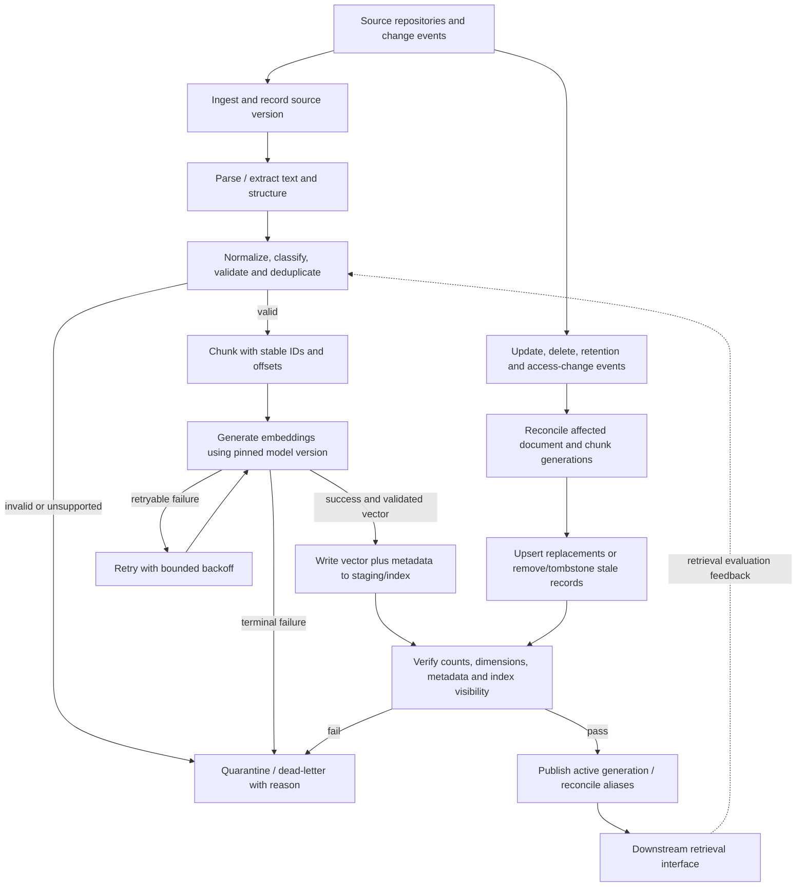

# Document Data, Embedding and Vector Pipelines

> **Module:** Stage 2D — Data Architecture / Module 2D.14 — Data Access, Serving, Semantic and AI Data Architecture  
> **Topic:** 05 of 08  
> **Audience:** Beginner through advanced data architects and AI/data engineers  
> **Scope:** Vendor-neutral design and learning. All organisations, documents, IDs, counts, timestamps, dimensions, and capacity figures are synthetic or illustrative. No production deployment or real personal data is required.

## 1. Overview and learning objectives

### 1.1 Why this topic exists

Enterprise knowledge often lives in policies, manuals, contracts, support articles, PDFs, office documents, HTML pages, email archives, and scanned files. Keeping these files in ordinary storage preserves the source, but it does not by itself provide a reliable way to find a passage because it expresses the same idea as a user's question in different words.

A **document-to-vector pipeline** converts governed source content into searchable units:

**ingest → extract → normalize and validate → deduplicate → chunk → embed → index vectors with metadata → monitor and refresh.**

This pipeline prepares knowledge for semantic and hybrid retrieval. It does **not** implement the entire retrieval-augmented generation (RAG) system, and it does not decide by itself whether a user is authorised to see a passage. Topic 06, *RAG knowledge data and permission-aware retrieval*, owns the complete retrieval-time permission enforcement and AI-consumption design. This lesson establishes the data products and metadata that Topic 06 depends on.

### 1.2 Learning objectives

By the end, you should be able to:

1. Distinguish structured, semi-structured, and unstructured data.
2. Design ingestion, extraction, cleaning, normalization, deduplication, and validation stages.
3. Define stable document and chunk identifiers, provenance, versions, timestamps, owners, and classification.
4. Compare fixed-size, structure-aware, and semantic chunking.
5. Explain embedding vectors, dimensions, similarity metrics, and model compatibility.
6. Separate embedding generation, vector storage/indexing, and retrieval.
7. Design batch and incremental refresh, retries, checkpoints, backfills, deletion, and model migrations.
8. Define lineage, quality tests, freshness measures, observability, security, and cost estimates.
9. Evaluate retrieval quality with labelled examples instead of assuming vector similarity equals relevance.

### 1.3 The key distinction

| Stage | Question answered | Output |
|---|---|---|
| Document ingestion | What source object arrived, and where did it come from? | Durable source reference and ingestion event |
| Parsing/extraction | What text and structure can be recovered? | Extracted text plus extraction diagnostics |
| Normalization/validation | Is the content usable and safe to process? | Canonical text and quality status |
| Chunking | What retrieval-sized passages preserve enough context? | Ordered chunks with source offsets/section metadata |
| Embedding generation | What vector does the selected model produce for this exact input? | Vector plus model/input provenance |
| Vector indexing | How can vectors and metadata be stored and searched efficiently? | Indexable records and index state |
| Retrieval | Which candidates best match a query under configured filters and ranking? | Ranked candidate passages |
| Refresh/deletion | Which derived records are current and permitted to remain? | Reconciled current index state |

**Embedding is not indexing. Indexing is not retrieval.** A vector is a numeric representation. An index is a data structure and storage/query capability that organises vectors and metadata. Retrieval is a query-time operation that selects and ranks candidate records. Similarity is a signal, not a guarantee of correctness or usefulness.

### 1.4 Scope boundaries and assumptions

- No specific embedding model, vector store, OCR engine, parser, cloud, or orchestration tool is required.
- Model dimensions, context limits, supported languages, input rules, and similarity conventions are model-specific and must be checked against the chosen model's contract.
- Every sample count and storage estimate below is illustrative, not a benchmark or universal recommendation.
- The code example uses Python's standard library and a **deliberately simple deterministic demonstration vectorizer**. It proves data-pipeline mechanics, idempotency keys, metadata propagation, and deletion reconciliation. It is **not a semantic embedding model** and must not be used to assess semantic retrieval quality.
- Treat source documents and extracted text as potentially confidential and potentially adversarial. A document can contain secrets, malicious instructions, or content that should never be indexed.

## 2. Prerequisites and dependencies

### 2.1 Roadmap alignment

The Module 2D.14 roadmap defines Topic 05 as the preparation of unstructured content for retrieval. Its required conceptual flow is ingest, extract/clean, chunk, embed, index with metadata, and refresh when sources change. It expects a pipeline design with validation checks, plus lifecycle, quality, cost, and governance considerations.

The relevant module sequence is:

- **Topic 01 — Analytical serving patterns and consumer needs:** establishes the consumer's search, freshness, and service requirements.
- **Prerequisite P9 — Metadata, catalogue, lineage, quality, and entity consistency:** supports discoverability, ownership, classification, provenance, and end-to-end lineage.
- **Prerequisite P10 — Event/streaming basics, replay, and CDC:** useful for change detection and incremental index refresh.
- **Topic 06 — RAG knowledge data and permission-aware retrieval:** consumes the indexed passages and must enforce permissions at retrieval time.
- **Topic 08 — Access patterns, cache strategy, and freshness:** later broadens freshness and cache decisions across serving paths.

The supplied roadmap notes that topic files were empty when the roadmap was authored; therefore, the roadmap is the source for this lesson's intended scope rather than evidence of pre-existing content in those topic files.

### 2.2 What to know first

You do not need to have trained a machine-learning model. You should understand basic data pipelines, metadata, hashes, timestamps, retries, and the difference between batch processing and event-driven processing.

| Concept | Why it matters here |
|---|---|
| Stable identifiers and source versions | Make updates, deletes, retries, and lineage unambiguous |
| Metadata and classification | Preserve ownership, discoverability, retention, and access attributes |
| CDC/events and replay | Detect source changes without rebuilding every document on every run |
| Idempotent writes | Prevent retries from creating duplicate chunks or vectors |
| Service-level objectives | Turn “fresh” and “fast” into measurable expectations |
| Data governance | Apply purpose limitation, retention, deletion, and least privilege to derived data |

### 2.3 Vocabulary

- **Document:** a source object or logical knowledge item, such as one policy or manual.
- **Extraction:** converting a source format into usable text and structure.
- **Normalization:** applying deterministic transformations such as Unicode normalization, line-ending standardisation, and whitespace cleanup.
- **Chunk:** a bounded passage derived from a document and intended to be embedded and retrieved.
- **Token:** a model-specific text unit; tokens are not the same as words or characters.
- **Embedding:** a vector generated by a model for an input text or other supported content.
- **Dimension:** the number of numeric components in a vector.
- **Vector index:** an index/storage structure designed to support vector-similarity queries, often with metadata filtering.
- **Nearest-neighbour search:** finding stored vectors closest to a query vector under a selected distance or similarity function.
- **Provenance:** evidence of where a record came from and how it was produced.
- **Idempotency:** repeating the same logical operation has the same final effect as performing it once.
- **Backfill:** reprocess an earlier or complete set of source records under specified pipeline logic.
- **Tombstone:** a durable marker that an entity was deleted, used to prevent stale data from being resurrected by late events or retries.

## 3. Beginner foundations

### 3.1 Structured, semi-structured, and unstructured content

| Type | Examples | Typical handling |
|---|---|---|
| Structured | Relational rows, typed columns, transaction tables | Schema-aware extraction, type and constraint checks |
| Semi-structured | JSON, XML, HTML, email headers, logs | Parse fields and nested structure; retain raw source and schema/version |
| Unstructured | PDF text, scanned pages, Word documents, images, manuals, free-form notes | Format-specific parsing, OCR when needed, layout/section recovery, quality review |

The categories can overlap. A PDF may contain both selectable text and scanned pages. An email has structured headers and unstructured body text. A spreadsheet has structured cells but may contain merged headings, formulas, and layout that require interpretation.

Common source formats include PDF, HTML, Markdown, plain text, DOCX or similar office formats, CSV/TSV, JSON/XML, email archives, image scans, and knowledge-base exports. Format support should be an explicit allowlist. Unsupported, encrypted, corrupt, macro-enabled, or oversized files should be quarantined or handled by a separately controlled path rather than parsed blindly.

### 3.2 Why plain text storage is not enough

Plain text storage supports exact text search when the user knows the relevant words. It can fail when the query uses synonyms, paraphrases, or a different language than the source. Embedding-based retrieval maps text and queries into a vector space in which the model has learned to place some semantically related content near one another.

For example, a source might say “staff must report a lost access badge immediately,” while a user asks “What should I do if my entry card disappears?” A lexical search may or may not connect the phrases. A suitable embedding model may retrieve the relevant passage because the meanings are related. This is not guaranteed: domain language, abbreviations, negation, rare identifiers, model mismatch, and poor extraction can all cause failures.

### 3.3 The lifecycle



**How to read the diagram:** extraction must precede chunking; the embedding model must be fixed and recorded before vector generation; index writes must be validated before publication; refresh and deletion must reconcile derived records. A production implementation may split these stages into services or jobs, but the contracts and ordering remain.

### 3.4 What happens to one document?

Assume a fictional internal policy:

> **Access Badge Policy, version 3**  
> Staff must report a lost access badge to Security immediately.  
> Security disables the old badge before issuing a replacement.  
> Contractors must return temporary badges at the end of their engagement.

The pipeline records the source, extracts text, normalizes spacing, preserves the title and section context, splits the content into chunks, embeds each chunk, and stores each vector alongside metadata. When someone asks a related question, the query is embedded with a compatible model and the vector index returns candidate chunks. A separate retrieval service applies current permissions, ranking, and policy. The index does not itself know whether the generated answer is correct.

### 3.5 Similarity: useful but limited

Common measures include:

- **Cosine similarity:** compares vector directions, typically after accounting for vector magnitudes.
- **Dot product:** sums pairwise component products; its ranking can depend on vector magnitude unless the model and pipeline normalise vectors appropriately.
- **Euclidean distance (L2):** measures straight-line distance in the vector space.

Do not mix metric assumptions. Some models expect normalised vectors; some index configurations use a particular distance function; some models are trained for asymmetric query/document encoding. Use the model's intended query and document input modes, normalisation, and metric. Do not compare raw similarity scores across unrelated models or treat a score as a calibrated probability.

Nearest-neighbour retrieval can be **exact** (compare against all eligible vectors) or **approximate** (use an index structure to reduce work at the cost of possible recall loss). The choice is a measured trade-off, not a claim that one is universally better.

## 4. Document ingestion and normalization

### 4.1 Ingestion contract

For every source object, record at least:

- `document_id`: stable logical identity, independent of a filename where possible.
- `source_system` and `source_uri`: source repository and durable locator.
- `source_version`: source-native revision or a derived immutable version.
- `source_modified_at` and `ingested_at`: source and pipeline timestamps with timezone semantics.
- `owner`: accountable business or technical owner.
- `classification`: controlled label such as public, internal, confidential, or restricted.
- `retention_policy` and `lifecycle_status`: retention rule and active/deleted state.
- `content_hash`: cryptographic hash of the source bytes or canonical extracted content; state which.
- `parser_version` and `normalization_version`: reproducibility fields.
- `language`, `mime_type`, `size_bytes`, and extraction status.
- `access_policy_reference`: reference to the authoritative permission source, not a substitute for runtime authorisation.

Do not assume the filename is unique or stable. Two files can share a name; a source can move; the same content can be stored in several locations. Keep source identity separate from content identity.

### 4.2 Parsing and extraction

Extraction should be format-aware:

1. Validate file size, format signature, extension/MIME consistency, encryption status, and source trust.
2. Use a parser suitable for the format.
3. Preserve structure where useful: title, headings, paragraph order, table rows/headers, page number, hyperlinks, and document boundaries.
4. Record warnings such as OCR use, malformed pages, extraction truncation, missing fonts, or unreadable sections.
5. Compare extracted text against a human-reviewed sample for each important source format.
6. Reject or quarantine cases that cannot meet the source's quality requirements.

**OCR is a quality boundary.** Scanned documents may produce plausible but wrong text: `0` versus `O`, decimal points, negation, dates, table columns, and footnotes are common risks. If content is critical, record OCR confidence where available and require targeted review. Do not silently treat OCR output as ground truth.

Tables need special handling. Flattening a table into a sequence of numbers without headers or row labels can destroy meaning. Preserve headers and row context, or convert rows into explicit text records while keeping source coordinates.

### 4.3 Normalization and cleaning

Normalization should be deterministic and versioned. Common operations include:

- Unicode normalization and consistent line endings.
- Whitespace cleanup while retaining paragraph and section boundaries.
- Removal of repeated headers/footers only when confidently identified.
- Consistent representation of headings and table structure.
- Canonical timestamp/timezone representation in metadata.
- Language detection when it supports routing or quality checks.
- Removal of exact duplicated boilerplate only when it is safe and traceable.
- Redaction or exclusion of fields that should not enter the embedding corpus.

Avoid aggressive “cleaning” that changes meaning. Removing punctuation can reverse or blur meaning; dropping negations, units, table labels, legal section numbers, or version qualifiers is dangerous. Keep the original source and the canonical extracted representation separately, with lineage between them.

### 4.4 Deduplication

Deduplication has multiple levels:

| Level | Technique | What it catches | Main risk |
|---|---|---|---|
| Source identity | Stable source key + source version | Reprocessing the same source revision | A source system may not provide stable IDs |
| Exact source bytes | Cryptographic hash of bytes | Byte-identical copies | Different file wrappers can contain same text |
| Canonical text | Hash normalized extracted text | Text-identical content across formats | Normalization choices may hide meaningful differences |
| Near-duplicate | Similarity/fingerprinting or reviewed rules | Slightly edited copies and repeated policies | False merges can erase meaningful scope or version differences |

Never deduplicate solely on semantic similarity if different jurisdictions, effective dates, owners, access rules, or document versions matter. A “similar” contract or policy can have a materially different obligation. Keep canonical document identity and duplicate relationships explicit.

### 4.5 Validation checklist

Use this checklist before embedding and before publishing an index generation.

- [ ] Source ID and source URI are present and stable.
- [ ] Source version or content hash is present.
- [ ] Owner, classification, retention, and permission reference are populated or explicitly governed as unknown.
- [ ] MIME type and actual format are compatible; file size and parser limits are respected.
- [ ] Parsing completed without unexplained truncation, corrupt sections, or silent parser failure.
- [ ] OCR use and extraction warnings are recorded.
- [ ] Canonical text is not empty or only boilerplate.
- [ ] Required headings, table headers, page/section locations, and language are preserved.
- [ ] Hash algorithm and hash input (source bytes vs canonical text) are documented.
- [ ] Duplicate handling is deterministic and does not collapse meaningful versions.
- [ ] Chunks are non-empty, within the model's input limit, and traceable to source offsets/sections.
- [ ] Embedding output is finite, has the expected dimension, and matches the pinned model and metric contract.
- [ ] Index metadata matches the authoritative source state.
- [ ] Deleted or superseded records are absent from the active generation.
- [ ] Known-query tests pass the defined acceptance criteria.

A failed validation should produce a structured failure record containing the document/chunk key, stage, timestamp, pipeline version, retryability, error category, and safe diagnostic detail. Do not write full confidential content into general logs.

## 5. Chunking and embedding fundamentals

### 5.1 Why chunk documents?

A whole document can exceed the embedding model's input limit, mix multiple topics, or return too much irrelevant context. Chunks create retrievable units. Each chunk should be small enough to retrieve precisely but large enough to retain the context needed to interpret the passage.

Chunking changes what the index can retrieve; it is not just a storage optimisation. A poor split can separate a rule from its exception, detach a table row from its header, or separate a procedure step from the section that gives it meaning.

### 5.2 Chunking strategy comparison

| Strategy | How it works | Strengths | Risks / costs | Good starting use |
|---|---|---|---|---|
| Fixed-size | Split by token/character budget, often with overlap | Simple, repeatable, predictable bounds | May split sentences, tables, clauses, or concepts; overlap duplicates content | Homogeneous prose or baseline experiment |
| Structure-aware | Split on headings, paragraphs, pages, list items, table boundaries, or sections, then enforce size limits | Preserves natural boundaries and source context | Uneven sizes; malformed source structure can mislead parser | Policies, manuals, HTML, Markdown, contracts |
| Semantic | Use content/embedding similarity or topic shifts to choose boundaries | Can preserve coherent ideas in varied prose | More compute and tuning; boundary decisions are less deterministic; requires evaluation | Long mixed-topic documents where structure alone is insufficient |
| Hierarchical | Keep parent sections and smaller child chunks; retrieve child but retain parent context | Supports precise retrieval with broader context | More metadata and storage; needs careful parent/child ranking | Long technical manuals, structured knowledge bases |
| Table-aware | Preserve headers and row/column meaning; chunk by row groups or logical units | Reduces ambiguity in tabular content | Requires format-specific parsing and schema handling | Product catalogues, policy tables, reference data |

No strategy has a universally correct chunk size. Evaluate on the corpus, task, model, and downstream context budget.

### 5.3 Chunk size, overlap, and context

- **Too small:** precise matches but missing definitions, qualifications, antecedents, or table headers.
- **Too large:** multiple topics in one vector, diluted similarity, more input tokens and potentially higher cost/latency.
- **Overlap:** repeats a boundary region so a concept crossing a split is less likely to be lost. Excessive overlap inflates chunk count, storage, and duplicate results.
- **Context prefixes:** adding a title, heading path, or short metadata-derived prefix can help a chunk retain context. Avoid adding sensitive fields or noisy repeated boilerplate to the embedding input.
- **Token limits:** count tokens using the selected model's tokenizer or its documented input accounting. Character counts are only rough proxies.
- **Retrieval granularity:** the chunk is often the unit returned to the next system, so chunk boundaries affect how much evidence can be cited or passed to a model.

**Illustrative tuning plan, not a recommendation:** compare several chunk budgets such as 200, 400, and 800 tokens, with overlap variants such as 0%, 10%, and 20%, if the chosen model and corpus support them. Evaluate on labelled queries, including long clauses, exceptions, abbreviations, tables, and multilingual cases. The winning settings depend on empirical recall, precision, answer quality, latency, and cost.

### 5.4 Stable chunk identifiers

A chunk ID should be deterministic for the same logical input and chunking configuration. A conceptual key is:

`chunk_id = hash(document_id, source_version, chunker_version, chunk_ordinal, canonical_chunk_hash)`

Use a canonical serialization and unambiguous separators or structured encoding when constructing a real key. Do not concatenate arbitrary fields without boundaries. Including the chunker version makes it possible to distinguish records generated by changed segmentation rules. A source update should create a new generation of chunks; an unchanged retry should upsert the same logical keys rather than duplicate them.

Keep the following on each chunk:

- `document_id`, `source_version`, `chunk_id`, `chunk_ordinal`
- section/title path and page or source offsets where available
- canonical chunk text or a controlled reference to it
- `chunk_hash`, `chunker_version`, and normalization version
- owner, classification, retention, language, and permission-policy reference
- `created_at`/`indexed_at`, lifecycle state, and processing run ID

### 5.5 What is an embedding?

An embedding model is a learned function that maps supported input content into a numeric vector. For text, the model tokenizes or otherwise encodes the input, processes it through learned parameters, and returns a fixed-length or model-defined representation.

A fictional example might look like:

`"Report a lost access badge immediately." → [0.12, -0.08, 0.41, ...]`

Those numbers are **illustrative placeholders**, not real output from a model. A 768-dimensional vector has 768 components; a 1,024-dimensional vector has 1,024 components. More dimensions do not automatically mean better retrieval.

The embedding model is trained so that some semantic relationships are reflected in vector distances or similarities. It does not encode a perfect, universal representation of truth. Rare identifiers, exact dates, negation, legal wording, and fine-grained distinctions may be poorly represented. Keep lexical retrieval available when exact words, codes, names, or quoted phrases matter.

### 5.6 Selecting an embedding model

Assess candidate models against a representative, permission-safe evaluation set.

| Factor | Questions to ask |
|---|---|
| Domain fit | Does it understand the corpus vocabulary, abbreviations, product names, and specialist language? |
| Retrieval quality | Does it retrieve known relevant passages for real query types, languages, and edge cases? |
| Query/document modes | Does it specify different prefixes, encoders, or instructions for query and document inputs? |
| Dimensions and metric | What vector dimension, normalization, and distance metric are intended? |
| Input limits | What is the actual token limit and how are over-limit inputs handled? |
| Language support | Does quality hold for all corpus and query languages, including mixed-language text? |
| Latency and throughput | What are measured latency distributions and sustainable throughput under representative concurrency? |
| Cost | What are costs per input token, request, compute unit, or hosted capacity? Include re-embedding and retries. |
| Data handling | Where is content processed, retained, logged, or used? What contractual and regulatory constraints apply? |
| Versioning | Can a model version be pinned? Are dimensions, tokenization, output normalization, and semantics stable? |
| Operational support | Are batch APIs, rate limits, retries, observability, and failure semantics documented? |

Do not choose solely on a generic benchmark or model name. Measure retrieval quality on your own corpus and use case. If a provider silently changes the model behind an alias, treat that as a potential compatibility event and verify the output contract.

### 5.7 Model compatibility

Vectors should be treated as belonging to an **embedding space and model contract**. Vectors from different models—or different versions that changed representation—must not be assumed comparable just because their dimensions match. Query embeddings must be compatible with the indexed document embeddings, including any prefixes, normalization, and metric requirements.

Record at least:

- model/provider identifier and immutable version or pinned revision where available;
- model configuration, input mode, and tokenizer/version when relevant;
- output dimension, numeric type, normalization policy, and similarity metric;
- chunker and normalization versions;
- embedding input hash and generated-at timestamp.

A model change that changes only serving infrastructure may not require re-embedding if the model output contract is demonstrably identical. If the model, input recipe, chunk text, or vector contract changes, plan an evaluation and usually a new embedding/index generation.

## 6. Intermediate pipeline design and indexing

### 6.1 Reference architecture and stage contracts

| Stage | Input | Output contract | Validation | Recovery approach |
|---|---|---|---|---|
| Discover/change capture | Source listing, CDC, event, scheduled scan | Stable source key and source version | Required identity and monotonic/version rules | Replay event or rescan source |
| Extract | Source bytes/reference | Text, structure, extraction diagnostics | Parser status, non-empty content, sample quality | Retry transient failures; quarantine corrupt files |
| Normalize/deduplicate | Extracted content | Canonical text, hashes, duplicate links | Deterministic hash and required metadata | Re-run versioned deterministic transform |
| Chunk | Canonical content + chunk config | Ordered chunks and source references | Non-empty, bounded, traceable, stable IDs | Rebuild chunks for document generation |
| Embed | Chunk text + pinned model contract | Vector, dimension, input hash, model provenance | Finite values, dimension, status, response count | Retry transient errors with bounded backoff |
| Index write | Valid vector + metadata | Upserted vector record | Key uniqueness, metadata completeness, visibility | Idempotent upsert or generation rebuild |
| Reconcile/publish | Expected vs actual generation | Active generation/alias and deletion state | Counts, checksums, no stale records | Keep old generation active; retry or roll back |
| Observe | Stage events and query feedback | Metrics, traces, alerts, audit events | Missing metrics and SLO violations | Alert and incident runbook |

### 6.2 Embedding generation versus vector indexing versus retrieval

A practical implementation should keep these interfaces distinct.

1. **Embedding generator:** accepts canonical chunk text and a pinned model contract; returns vector and provenance. It may batch requests to improve throughput, subject to input limits and rate limits.
2. **Index writer:** accepts a stable record key, vector, and metadata; performs an idempotent upsert or write into a staging generation. It does not invent embeddings.
3. **Vector index:** stores vector records and supports nearest-neighbour queries. It may use exact or approximate algorithms and may support metadata filters with varying efficiency.
4. **Retrieval service:** embeds the query with the compatible query path, applies appropriate filters, obtains candidates, optionally combines lexical/vector scores, reranks, deduplicates, and returns passage references and scores. Topic 06 adds the complete permission-aware retrieval and AI consumption controls.

### 6.3 Synthetic document schema

The following JSON-like record is illustrative and describes a source document before chunking:

```json
{
  "document_id": "POL-ACCESS-001",
  "source_system": "synthetic-policy-repository",
  "source_uri": "repo://policies/access-badge",
  "source_version": "3",
  "source_modified_at": "2026-10-01T09:00:00Z",
  "ingested_at": "2026-10-02T02:00:00Z",
  "owner": "Security Operations",
  "classification": "internal",
  "retention_policy": "policy-retention-v1",
  "language": "en",
  "mime_type": "text/markdown",
  "content_hash": "sha256:illustrative-canonical-hash",
  "parser_version": "markdown-parser-1",
  "normalization_version": "normalize-2",
  "lifecycle_status": "active",
  "access_policy_reference": "policy-ref:security-docs"
}
```

The hash value above is a label, not a computed digest. A real record should contain an actual digest and define precisely which bytes/text it covers.

### 6.4 Representative chunk metadata

```json
{
  "chunk_id": "POL-ACCESS-001:v3:chunker-2:0001",
  "document_id": "POL-ACCESS-001",
  "source_version": "3",
  "chunk_ordinal": 1,
  "title": "Access Badge Policy",
  "section_path": ["Lost or damaged badges"],
  "page_number": null,
  "source_start": 0,
  "source_end": 72,
  "chunk_hash": "sha256:illustrative-chunk-hash",
  "chunker_version": "chunker-2",
  "normalization_version": "normalize-2",
  "embedding_model_id": "example-model-pinned-revision",
  "embedding_dimension": 4,
  "embedding_input_hash": "sha256:illustrative-input-hash",
  "owner": "Security Operations",
  "classification": "internal",
  "retention_policy": "policy-retention-v1",
  "access_policy_reference": "policy-ref:security-docs",
  "indexed_generation": "generation-2026-10-02-a",
  "lifecycle_status": "active"
}
```

The four-dimensional value is only an illustrative shape for the code exercise; it is not a recommended production dimension. Do not store policy labels as if they were enforced ACLs. Topic 06 must resolve current permissions against an authoritative policy at query time or through a rigorously maintained, tested authorization projection.

### 6.5 Index design and metadata filters

A vector index record usually contains a stable ID, vector, and filterable metadata or a reference to metadata stored elsewhere. Common filters include tenant/domain, document status, language, classification, owner, source version, and access-policy reference. Filter semantics and consistency differ by index technology, so validate them rather than assuming every filter is pushed down efficiently or atomically.

Metadata filtering is useful for restricting the candidate set before or during nearest-neighbour search. However:

- A filter based on stale metadata can include a revoked document or exclude a newly authorised one.
- Filtering after top-k retrieval can return too few eligible results if many top candidates are rejected. Over-fetching can help quality but does not replace correct enforcement.
- Permission checks must be based on authoritative current policy; the index is not the sole authority for access.
- Filters do not repair poor embeddings or bad extraction.
- Exact identifiers and phrases may be better served by lexical search.

### 6.6 Lexical and hybrid retrieval

- **Lexical retrieval** matches tokens or terms, often using inverted indexes, term weighting, phrase queries, and analyzers.
- **Vector retrieval** ranks candidates by embedding similarity.
- **Hybrid retrieval** combines both candidate sets or ranking signals. Combination may use rank fusion, calibrated score combination, or a reranker; the choice needs evaluation.

Hybrid retrieval is often worth testing when users search for policy names, product codes, clause numbers, dates, acronyms, or exact phrases as well as paraphrased questions. It can also help with rare terms that an embedding model does not represent reliably. It introduces extra indexing, tuning, and latency complexity. Do not add it without a measurable retrieval problem.

### 6.7 Retrieval-quality evaluation

Build a labelled evaluation set with representative questions and the document passages considered relevant by a subject-matter reviewer. Split development and holdout questions so tuning does not overfit the final evaluation set.

A simple metric:

\[
\mathrm{Recall@k} =
\frac{\text{queries with at least one relevant passage in top }k}
{\text{queries with relevance labels}}
\]

Other useful measures include precision@k, reciprocal rank, nDCG, coverage, duplicate-result rate, and downstream answer-grounding quality. State the relevance definition, corpus snapshot, filters, query set, `k`, and evaluation date. A vector similarity score alone is not a retrieval-quality metric and does not prove that a passage answers the question.

## 7. Advanced refresh, versioning, reliability, and cost

### 7.1 Batch versus incremental processing

| Pattern | How it works | Advantages | Risks / best fit |
|---|---|---|---|
| Full batch rebuild | Reprocess the complete corpus into a new generation | Simple reconciliation and clean model/chunker migration | Expensive and slower for large corpora; needs staging capacity |
| Incremental batch | Periodically process changed source versions | Easier operational model; bounded refresh delay | Freshness limited by schedule; scan cost may grow |
| Event-driven / CDC | Process source create/update/delete events | Low change-detection delay | Duplicate, delayed, reordered, or missing events; needs replay/reconciliation |
| Hybrid | Events trigger incremental work; scheduled reconciliation catches gaps | Good balance for many estates | More moving parts and operational ownership |

A robust system combines fast incremental updates with periodic reconciliation. Events can be duplicated or arrive out of order; source scans can detect missed changes. Use source version numbers, event IDs, content hashes, and durable checkpoints where available.

### 7.2 Idempotency and retries

For every stage, define a stable operation key. Example:

`operation_key = hash(document_id, source_version, normalization_version, chunker_version, embedding_model_version, chunk_hash)`

A retry should upsert or reuse the same logical record. It should not append a second copy. The actual key design must use a canonical structured encoding and include every configuration element that changes the output.

Retry transient errors (timeouts, temporary service unavailability, rate limiting) with bounded exponential backoff and jitter. Do not retry invalid input forever. Respect provider retry-after guidance and cap concurrency. Store attempt count and next eligible retry time. Route terminal failures to a dead-letter queue or quarantine table with a reason and replay procedure.

**Checkpoint after durable work.** A checkpoint should mean that the corresponding stage output is safely persisted and can be recovered. Advancing a source cursor before its records are durably processed can lose data. Replaying a checkpoint range must be safe due to idempotent keys.

### 7.3 Partial failure and publish safety

Suppose 98 of 100 chunks embed successfully and two fail. Do not silently mark the document fully indexed if all chunks are required. Choose an explicit policy:

- **Atomic document generation:** keep the previous active document generation until every required chunk passes, then switch.
- **Partial availability with status:** publish successful chunks only if the product contract permits incomplete documents, mark the generation partial, and alert.
- **Quarantine:** do not publish any chunk from a document that fails a critical quality gate.

For whole-corpus model migrations, use a new staging index/generation. Validate document/chunk counts, vector dimensions, metadata, and evaluation quality before changing the active alias or routing configuration. Retain the previous generation for a bounded rollback window, subject to deletion and retention rules.

### 7.4 Update and deletion scenario

Assume `POL-ACCESS-001` version 3 says “report immediately.” A new source version 4 changes the rule and adds an exception.

1. Detect the new source version through an event or scan.
2. Fetch the authoritative source; validate its version and lifecycle state.
3. Extract, normalize, and compute new source/canonical hashes.
4. Generate version-4 chunks and embeddings under the pinned pipeline/model contract.
5. Write them to a staging generation or new document generation.
6. Validate expected chunk count, metadata, dimensions, and known-query tests.
7. Atomically switch the document's active generation or reconcile the active index.
8. Remove or deactivate version-3 chunks from all active search paths and invalidate dependent caches.
9. Record lineage from source version 4 to chunks, embeddings, and index generation.
10. Verify that a query cannot retrieve version-3 content from the active path.

For a deletion, do not treat “source missing in one scan” as definitive without accounting for transient source failures. Confirm deletion through an authoritative tombstone or reliable source state, then propagate it to raw/extracted copies, chunk stores, vector indexes, caches, replicas, and any downstream copies according to retention/legal-hold policy. A tombstone prevents a delayed update event from resurrecting deleted content. Keep an auditable deletion record with identifiers and completion status, but do not retain the deleted sensitive content in the audit log.

Access revocation is not always the same as document deletion. If a user or group loses access, the authoritative policy must stop allowing access promptly. The index may retain a record for other authorised users, but every retrieval path must enforce current permissions. Topic 06 owns the full enforcement architecture and tests.

### 7.5 Model or chunker migration

Treat any change to the embedding model, model revision, input prefixes, normalization recipe, or chunking algorithm as a versioned transformation.

A safe migration plan:

1. Pin and document the new model/input contract and chunker configuration.
2. Create a representative evaluation set and baseline retrieval metrics for the active generation.
3. Estimate compute, token volume, write capacity, index storage, and migration duration from measured samples.
4. Build a new generation in parallel; use stable source versions and idempotent chunk keys.
5. Validate dimensions, vector finiteness, metadata completeness, counts, freshness, deletion state, and retrieval quality.
6. Run shadow queries against old and new generations; compare relevant-passage recall, latency, and cost.
7. Switch routing/alias only after defined acceptance gates pass.
8. Monitor production metrics and keep rollback capability for a defined period.
9. Retire the old generation only after rollback, retention, and deletion obligations are satisfied.

Do not mix old and new model vectors in one nearest-neighbour space unless the model contract explicitly guarantees compatibility and tests support it. Equal vector dimensions are not proof of compatibility. During migration, query and document vectors must be produced by compatible model versions.

### 7.6 Lineage and embedding provenance

Represent the lineage graph explicitly:

`source object/version → extracted representation → normalized content hash → chunker version/chunk ID → embedding model/input hash/vector record → index generation → retrieval result reference`

At minimum, be able to answer:

- Which source and source version produced this chunk?
- Which parser, normalization, chunker, and embedding model versions were used?
- Which exact input text/hash was embedded?
- When was it processed and indexed?
- Which active generation contains it?
- Which downstream copies need update or deletion?
- Which quality checks passed or failed?

Do not log vectors or full source text indiscriminately. A vector may encode information about its source and should be governed as derived data, not assumed harmless because it is numeric.

### 7.7 Observability and service levels

Instrument each stage with counts, timings, failure reasons, retries, queue age, and freshness. Suggested signals include:

| Signal | Example definition | Why it matters |
|---|---|---|
| Source change lag | Time from authoritative source change to change detection | Finds ingestion delay |
| End-to-end index freshness | Time from source modification to verified active-index visibility | Measures user-visible update delay |
| Extraction success rate | Successful eligible parses / eligible parse attempts | Finds parser regressions |
| Empty/low-quality chunk rate | Invalid chunks / generated chunks | Finds extraction/chunking problems |
| Embedding failure rate | Failed embedding requests / attempted requests | Finds provider or input failures |
| Retry backlog and age | Pending retry count and oldest age | Finds sustained capacity or dependency issues |
| Index reconciliation drift | Expected active IDs versus actual active IDs | Finds missing, duplicate, or stale records |
| Deletion propagation time | Confirmed deletion to absence from active search paths | Measures critical lifecycle behavior |
| Retrieval recall@k | Relevant-passage coverage on a fixed labelled set | Measures retrieval quality |
| Query latency | p50/p95/p99 latency, with filter and corpus context | Supports latency SLOs |
| Cost per indexed document/chunk | Measured processing and storage cost divided by accepted output | Supports unit economics |

Set thresholds from business requirements and observed baseline data; do not borrow arbitrary universal targets. Alert on missing telemetry as well as high error rates. Keep logs, metrics, traces, and audit records separate enough to control sensitive content and retention.

### 7.8 Capacity, storage, throughput, and cost

Vector raw storage can be estimated with:

\[
\text{raw vector bytes} \approx N \times D \times B
\]

where \(N\) is the number of indexed chunks, \(D\) is dimensions per vector, and \(B\) is bytes per component (for example, 4 bytes for float32). This excludes index structures, IDs, metadata, replicas, write-ahead logs, backups, and temporary migration generations.

**Illustrative arithmetic only:** 1,000,000 chunks × 768 dimensions × 4 bytes = 3,072,000,000 bytes, or about 3.07 GB in decimal units for raw vector values alone. Actual storage will be higher and depends on the index implementation, metadata layout, quantization, replication, and operational overhead.

Embedding volume can be estimated as:

`embedding input tokens ≈ accepted chunks × average input tokens per chunk`

For example, if a synthetic planning scenario has 100,000 chunks averaging 350 input tokens, the volume is about 35 million input tokens per full pass. These figures are not a performance benchmark. Use actual tokenizer counts and measured provider billing semantics for cost estimates.

Important trade-offs:

- Larger chunks may reduce record count but can lower retrieval precision and increase tokens per request.
- More overlap improves boundary coverage but duplicates content and increases embedding/index cost.
- Higher dimensions increase raw vector storage and may change latency/cost, but quality is model- and task-dependent.
- Approximate indexes can improve query efficiency but may lose relevant candidates; tune against recall and latency.
- More replicas improve availability/read capacity but increase storage and operational cost.
- Incremental updates reduce routine work but add change capture, replay, and reconciliation complexity.
- Full re-embedding is expensive; changed-chunk processing is cheaper but requires trustworthy hashes and version rules.
- Batching can improve throughput but can increase queueing latency and enlarge the failure/retry unit.

Tune with a measured corpus, labelled retrieval set, representative filters, concurrency, update rate, and realistic failure scenarios.

### 7.9 Security, privacy, and governance

- **Least privilege:** ingestion workers should read only authorised source locations and write only the required stores.
- **Classification propagation:** preserve labels and policy references through extracted content, chunks, vectors, staging indexes, logs, and backups.
- **Data minimization:** do not embed content that is unnecessary for the retrieval purpose. Exclude secrets and irrelevant personal data before processing.
- **Access enforcement:** metadata helps filtering but is not the complete authorization mechanism. Topic 06 must enforce current permissions at retrieval and test revocation, tenant isolation, and indirect paths.
- **Encryption and secrets:** protect source content, intermediate artifacts, vectors, credentials, and transport. Never hard-code credentials in examples or logs.
- **Retention/deletion:** define retention for raw files, extracted text, chunk stores, indexes, backups, caches, and dead-letter records. Track deletion completion across all derived copies.
- **Prompt injection and untrusted content:** extracted text can contain instructions designed to manipulate downstream AI systems. Treat passages as data, not trusted control instructions; downstream RAG design must isolate instructions and validate use.
- **Data residency and third parties:** verify where content is processed and stored, whether requests are retained, and whether use is compatible with policy and contracts.
- **Auditability:** record actor, source version, pipeline run, model version, and lifecycle action without copying sensitive payloads into broadly accessible logs.

Vectors are derived data and can still be sensitive. Do not assume that embedding content anonymizes it or that deleting the source file automatically deletes its embeddings.

## 8. Worked examples, diagrams, and code

### 8.1 Worked example: source to indexed records

Synthetic source, version 3:

```text
# Access Badge Policy

## Lost or damaged badges
Staff must report a lost access badge to Security immediately.
Security disables the old badge before issuing a replacement.

## Temporary badges
Contractors must return temporary badges at the end of their engagement.
```

**Step A — ingestion record:** `document_id=POL-ACCESS-001`, `source_version=3`, owner `Security Operations`, classification `internal`, language `en`, retention policy `policy-retention-v1`.

**Step B — extraction and normalization:** the Markdown parser extracts title, headings, and paragraphs. Normalization standardizes line endings and trims surrounding whitespace while retaining section boundaries. No OCR is needed for this synthetic Markdown source.

**Step C — chunking:** a structure-aware chunker may create two chunks, one for “Lost or damaged badges” and one for “Temporary badges.” The section path is carried with each chunk. The example does not prescribe a universal size.

**Step D — embedding:** a selected model receives each chunk under a pinned input contract and returns one vector per chunk. Record the model revision, dimension, input hash, and status. The numeric vectors are model output, not hand-authored labels.

**Step E — indexing:** each vector is upserted using a deterministic chunk key together with document version, classification, owner, section, retention, and policy reference. The index is checked for visibility and correct metadata before the generation is published.

**Step F — refresh:** version 4 arrives. Build the new document generation, validate it, switch the active generation, then remove version-3 records from the active path. If the document is deleted, propagate a tombstone and verify absence from all active search paths.

### 8.2 Runnable standard-library demonstration

This example illustrates normalization, deterministic chunk IDs, a fake embedding adapter, validation, idempotent upserts, and deletion reconciliation. It deliberately does **not** implement a real semantic model or a vector database.

**Requirements:** Python 3.10+; standard library only. Save as `document_vector_demo.py` and run `python document_vector_demo.py`.

```python
from __future__ import annotations

import hashlib
import json
import math
import re
import unicodedata
from dataclasses import dataclass
from typing import Iterable


def sha256_text(value: str) -> str:
    return hashlib.sha256(value.encode("utf-8")).hexdigest()


def normalize_text(text: str) -> str:
    """Small deterministic example; production cleaning must be format-aware."""
    text = unicodedata.normalize("NFC", text)
    text = text.replace("\r\n", "\n").replace("\r", "\n")
    text = re.sub(r"[ \t]+", " ", text)
    text = re.sub(r"\n{3,}", "\n\n", text)
    return text.strip()


@dataclass(frozen=True)
class Document:
    document_id: str
    source_version: str
    title: str
    owner: str
    classification: str
    retention_policy: str
    text: str


@dataclass(frozen=True)
class ChunkRecord:
    chunk_id: str
    document_id: str
    source_version: str
    ordinal: int
    section: str
    text: str
    chunk_hash: str
    chunker_version: str
    embedding_model_id: str
    embedding_dimension: int
    embedding: tuple[float, ...]
    owner: str
    classification: str
    retention_policy: str
    lifecycle_status: str


def split_by_heading(text: str) -> list[tuple[str, str]]:
    """Split this tiny Markdown example on level-2 headings."""
    sections: list[tuple[str, str]] = []
    current_heading = "Introduction"
    current_lines: list[str] = []

    for line in text.splitlines():
        if line.startswith("## "):
            if current_lines:
                body = "\n".join(current_lines).strip()
                if body:
                    sections.append((current_heading, body))
            current_heading = line[3:].strip()
            current_lines = []
        elif line.startswith("# "):
            # Keep document title as metadata; do not repeat it in every body.
            continue
        else:
            current_lines.append(line)

    body = "\n".join(current_lines).strip()
    if body:
        sections.append((current_heading, body))
    return sections


def demo_vector(text: str, dimension: int = 4) -> tuple[float, ...]:
    """Deterministic placeholder, NOT a semantic embedding model."""
    digest = hashlib.sha256(text.encode("utf-8")).digest()
    values = [((digest[i] / 255.0) * 2.0) - 1.0 for i in range(dimension)]
    norm = math.sqrt(sum(value * value for value in values))
    if norm == 0:
        raise ValueError("Unexpected zero vector")
    return tuple(round(value / norm, 6) for value in values)


def make_chunks(document: Document) -> list[ChunkRecord]:
    normalized = normalize_text(document.text)
    if not document.document_id or not document.source_version:
        raise ValueError("document ID and source version are required")
    if not normalized:
        raise ValueError("document has no usable text")

    records: list[ChunkRecord] = []
    for ordinal, (section, body) in enumerate(split_by_heading(normalized), start=1):
        chunk_text = normalize_text(f"{document.title}\n{section}\n{body}")
        if not chunk_text:
            raise ValueError(f"empty chunk at ordinal {ordinal}")

        chunk_hash = sha256_text(chunk_text)
        # Structured JSON avoids ambiguous concatenation of key components.
        key_payload = json.dumps(
            {
                "document_id": document.document_id,
                "source_version": document.source_version,
                "chunker_version": "heading-v1",
                "ordinal": ordinal,
                "chunk_hash": chunk_hash,
            },
            sort_keys=True,
            separators=(",", ":"),
        )
        chunk_id = sha256_text(key_payload)
        vector = demo_vector(chunk_text)
        if len(vector) != 4 or not all(math.isfinite(x) for x in vector):
            raise ValueError("embedding vector failed dimension/finiteness validation")

        records.append(
            ChunkRecord(
                chunk_id=chunk_id,
                document_id=document.document_id,
                source_version=document.source_version,
                ordinal=ordinal,
                section=section,
                text=chunk_text,
                chunk_hash=chunk_hash,
                chunker_version="heading-v1",
                embedding_model_id="demo-hash-vectorizer-not-semantic",
                embedding_dimension=len(vector),
                embedding=vector,
                owner=document.owner,
                classification=document.classification,
                retention_policy=document.retention_policy,
                lifecycle_status="active",
            )
        )
    return records


class InMemoryIndex:
    """A small stand-in for a vector index, keyed for idempotent upserts."""

    def __init__(self) -> None:
        self.records: dict[str, ChunkRecord] = {}

    def upsert(self, records: Iterable[ChunkRecord]) -> None:
        for record in records:
            self.records[record.chunk_id] = record

    def replace_document_generation(
        self, document_id: str, new_records: list[ChunkRecord]
    ) -> None:
        if any(record.document_id != document_id for record in new_records):
            raise ValueError("replacement contains a different document ID")
        # A published document generation must not mix source/chunker/model contracts.
        contracts = {
            (record.source_version, record.chunker_version, record.embedding_model_id,
             record.embedding_dimension)
            for record in new_records
        }
        if len(contracts) > 1:
            raise ValueError("replacement mixes source/chunker/model contracts")
        if len({record.chunk_id for record in new_records}) != len(new_records):
            raise ValueError("replacement contains duplicate chunk IDs")
        # In production, write/validate a staging generation and switch atomically.
        # This in-memory demo is sequential, not an atomic publication mechanism.
        self.upsert(new_records)
        keep_ids = {record.chunk_id for record in new_records}
        stale_ids = [
            key for key, record in self.records.items()
            if record.document_id == document_id and key not in keep_ids
        ]
        for key in stale_ids:
            del self.records[key]

    def delete_document(self, document_id: str) -> int:
        keys = [
            key for key, record in self.records.items()
            if record.document_id == document_id
        ]
        for key in keys:
            del self.records[key]
        return len(keys)


def main() -> None:
    source_v3 = Document(
        document_id="POL-ACCESS-001",
        source_version="3",
        title="Access Badge Policy",
        owner="Security Operations",
        classification="internal",
        retention_policy="policy-retention-v1",
        text=(
            "# Access Badge Policy\r\n"
            "\r\n"
            "## Lost or damaged badges\r\n"
            "Staff must report a lost access badge to Security immediately.\r\n"
            "Security disables the old badge before issuing a replacement.\r\n"
            "\r\n"
            "## Temporary badges\r\n"
            "Contractors must return temporary badges at the end of engagement.\r\n"
        ),
    )

    index = InMemoryIndex()
    v3_chunks = make_chunks(source_v3)
    index.upsert(v3_chunks)
    index.upsert(make_chunks(source_v3))  # retry: keys remain stable
    print(f"v3_chunks={len(v3_chunks)} index_after_retry={len(index.records)}")
    print("sections=" + "|".join(record.section for record in v3_chunks))
    print(
        "dimensions="
        + ",".join(str(record.embedding_dimension) for record in v3_chunks)
    )

    source_v4 = Document(
        document_id="POL-ACCESS-001",
        source_version="4",
        title="Access Badge Policy",
        owner="Security Operations",
        classification="internal",
        retention_policy="policy-retention-v1",
        text=(
            "# Access Badge Policy\n\n"
            "## Lost or damaged badges\n"
            "Staff must report a lost access badge to Security immediately. "
            "Security disables the old badge before issuing a replacement.\n\n"
            "## Temporary badges\n"
            "Contractors must return temporary badges to Security at the end "
            "of their engagement.\n"
        ),
    )
    v4_chunks = make_chunks(source_v4)
    index.replace_document_generation("POL-ACCESS-001", v4_chunks)
    assert {r.source_version for r in index.records.values()} == {"4"}
    assert len({r.chunk_id for r in index.records.values()}) == len(index.records)
    # Negative check: publication rejects mixed source/model contracts.
    try:
        index.replace_document_generation(
            "POL-ACCESS-001", [v4_chunks[0], v3_chunks[0]]
        )
    except ValueError:
        assert {r.source_version for r in index.records.values()} == {"4"}
        print("PASS: mixed-generation publication rejected; active generation unchanged")
    else:
        raise AssertionError("mixed-generation publication was not rejected")
    print(
        f"v4_chunks={len(v4_chunks)} active_versions="
        + ",".join(sorted({r.source_version for r in index.records.values()}))
    )
    deleted = index.delete_document("POL-ACCESS-001")
    print(f"deleted_records={deleted} remaining_records={len(index.records)}")


if __name__ == "__main__":
    main()
```

Expected output:

```text
v3_chunks=2 index_after_retry=2
sections=Lost or damaged badges|Temporary badges
dimensions=4,4
PASS: mixed-generation publication rejected; active generation unchanged
v4_chunks=2 active_versions=4
deleted_records=2 remaining_records=0
```

The exact chunk IDs are hashes and are intentionally not printed. The fake vectors are deterministic for test repeatability but encode no useful semantic geometry. The added negative check rejects a document publication that mixes source/chunker/model contracts. The in-memory replacement method still performs sequential mutations and is **not atomic**; its checks are pedagogical safeguards, not a substitute for transactional publication or an alias/generation cutover in a real index. In production, replace `demo_vector` with a model adapter that validates the selected model's input/output contract, handles rate limits and retries, and records model provenance. Replace `InMemoryIndex` with a real index client that supports idempotent upserts, staging generations or equivalent safe publication, filters, and deletion verification.

### 8.3 Pseudocode for a production worker

The following is **conceptual pseudocode**, not executable code. It shows the control flow a production worker should implement:

```text
for change in durable_change_stream:
    key = (source_system, document_id, source_version)

    if change is a confirmed deletion:
        persist tombstone(key)
        remove or deactivate all active derived records for document_id
        invalidate dependent caches and downstream references
        verify absence from active search paths
        checkpoint only after durable completion
        continue

    source = fetch_authoritative_source(key)
    validate_source_identity_and_version(source)

    extracted = parse_with_versioned_parser(source)
    canonical = normalize_and_validate(extracted)
    if invalid(canonical):
        write_quarantine_record(key, stage, reason)
        checkpoint according to durable failure policy
        continue

    chunks = chunk_with_pinned_configuration(canonical)
    validate_chunk_set(chunks)

    for chunk in chunks:
        operation_key = stable_key(source_version, chunk, pipeline_contract)
        if valid_cached_embedding(operation_key):
            vector = reuse_embedding(operation_key)
        else:
            vector = embed_with_bounded_retry(chunk.text, pinned_model)
            validate_vector_contract(vector)
            persist_embedding_checkpoint(operation_key, vector)

        idempotent_upsert(staging_generation, chunk, vector, metadata)

    reconcile_expected_and_actual_records(key)
    publish_document_generation_only_after_required_checks_pass()
    checkpoint only after durable state is verified
```

Important implementation detail: a checkpoint, index write, and source event acknowledgement may not share one transaction. Design for at-least-once delivery and idempotent effects unless the actual systems provide and document stronger guarantees.

## 9. Testing and practical exercises

### 9.1 Minimum test plan

| Test category | Test case | Expected acceptance evidence |
|---|---|---|
| Parsing | Valid text, HTML, office file, PDF, scanned PDF | Extraction status and sample-reviewed text meet source-specific quality rules |
| Malformed input | Corrupt, encrypted, empty, oversized, unsupported file | Explicit quarantine/error status; no silent “success” |
| Metadata | Missing owner, classification, version, retention | Rejected, quarantined, or governed fallback applied and audited |
| Deduplication | Same bytes twice; same canonical text in two wrappers; near-identical policy versions | Deterministic duplicate decision; meaningful versions preserved |
| Chunking | Long paragraph, heading boundary, table, list, exception clause | Chunks bounded, non-empty, ordered, and context-preserving |
| Embedding | Timeout, rate limit, malformed response, wrong dimension, NaN/Infinity | Bounded retries; invalid vectors rejected; no invalid index write |
| Idempotency | Replay same event twice and rerun same batch | Stable IDs and no duplicate active records |
| Update | Version 4 supersedes version 3 | Active generation has version 4 only, unless an explicit versioning contract says otherwise |
| Delete | Confirmed deletion followed by delayed old update event | Tombstone prevents resurrection; active search returns no deleted content |
| Migration | New model and chunker generation | Dimensions/provenance pass; evaluation meets gates; cutover/rollback tested |
| Permissions | Access revoked while vector record remains for other users | Topic 06 authorization test prevents revoked access |
| Quality | Labelled query set and known relevant passages | Report recall@k/precision@k and failure examples against an explicit threshold |
| Performance | Representative corpus, filters, concurrency, update rate | Measured latency, throughput, queue age, and cost meet scenario-specific targets |

### 9.2 Beginner exercise — explain and chunk

**Task:** Use the synthetic Access Badge Policy from Section 8.1. Explain why storing only the source file is not equivalent to semantic retrieval. Create five illustrative chunks from a longer synthetic policy of your own and attach `document_id`, `section_path`, `source_version`, `classification`, and `chunk_ordinal`.

**Expected output:**
- A lifecycle sketch from source through indexed chunk.
- Five non-empty chunks with stable document/source references.
- A short explanation of why the source position and version are required.

**Validation criteria:**
- Every chunk can be traced to exactly one source version.
- Heading or section context is preserved.
- The answer distinguishes a chunk from an embedding and an index.

### 9.3 Intermediate exercise — design the pipeline

**Scenario:** A fictional enterprise has 20,000 policy and manual documents in PDF, HTML, Markdown, and DOCX. This corpus size is illustrative only.

**Task:** Design ingestion, extraction, normalization, deduplication, chunking, embedding, indexing, and refresh. Specify batch versus event-driven paths, required metadata, retry policy, quarantine criteria, and at least ten validation tests. Compare two chunking strategies and explain how you would choose between them empirically.

**Expected output:**
- Mermaid data-flow diagram.
- Stage contract table with input, output, owner, validation, and failure action.
- Synthetic document/chunk schema.
- Chunking comparison with evaluation plan.
- Refresh/deletion rules and an initial capacity estimate with stated assumptions.

**Validation criteria:**
- Every stage has a failure and recovery path.
- Model, chunker, and normalization versions are recorded.
- Cost arithmetic distinguishes raw vector storage from index/metadata overhead.
- Retrieval quality is measured on labelled questions rather than inferred from similarity scores.

### 9.4 Advanced exercise — safe model migration and deletion

**Scenario:** The current index contains synthetic policy version 3. Version 4 changes one critical rule; the embedding model also needs to change. During the backfill, duplicate events arrive, one embedding request times out, and an access revocation arrives.

**Task:** Design a migration and recovery plan that prevents mixed-model queries, duplicate records, stale version-3 retrieval, and unauthorised results. Define cutover gates, rollback criteria, tombstone handling, lineage fields, and operational alerts.

**Expected output:**
- Versioned generation and cutover diagram.
- Idempotency key and checkpoint semantics.
- Failure matrix for timeout, duplicate event, stale event, delete/revoke, and partial index write.
- Retrieval evaluation baseline and holdout plan.
- Rollback and deletion verification procedure.

**Validation criteria:**
- New query vectors are never compared against incompatible old vectors.
- Version 3 is not active after version 4 publication completes.
- A confirmed deletion cannot be undone by a delayed event.
- Access revocation is enforced by the authoritative retrieval policy, not only by stale index metadata.
- The old generation is retained or retired according to explicit rollback, retention, and deletion rules.

### 9.5 Suggested architecture decision record (ADR)

- **Context:** document types, corpus ownership, consumers, freshness requirements, classification, retention, and known query types.
- **Decision:** parser strategy, chunker, embedding model contract, vector index category, lexical/hybrid requirement, refresh mode, generation strategy.
- **Alternatives considered:** fixed vs structure-aware chunking; batch vs incremental; full rebuild vs changed-chunk update; exact vs approximate index.
- **Consequences:** quality, latency, storage, cost, operational complexity, model compatibility, and governance implications.
- **Validation:** labelled query set, extraction sample, idempotency/replay test, deletion test, migration test, and performance test.
- **Revisit triggers:** model contract change, corpus language/domain shift, source volume growth, missed freshness SLO, quality regression, or policy change.

## 10. Common mistakes and troubleshooting

| Symptom or mistake | Likely cause | Investigation | Corrective action |
|---|---|---|---|
| Relevant document never appears | Source not ingested, parser dropped text, chunk absent, wrong filter | Trace source ID through every stage and inspect extraction sample | Fix ingestion/parser/filter; backfill affected source |
| Semantically related query retrieves unrelated passage | Model/domain mismatch, poor chunk boundaries, noisy text, weak labels | Inspect top candidates and query/document input contract | Test model/chunker variants; add lexical/hybrid path where evidence supports it |
| Exact policy number is missed | Embedding similarity weak for rare exact token | Compare lexical query and vector results | Add lexical candidate retrieval or exact-field lookup |
| One document creates many near-duplicate results | Excessive overlap, duplicate source copies, repeated boilerplate | Compare hashes, chunk ordinals, and provenance | Deduplicate safely; tune overlap and result deduplication |
| New version is visible alongside old text | Stale chunk IDs remain, publication not atomic, metadata filter incomplete | Compare expected vs active generation IDs | Reconcile generation; deactivate/delete stale records and verify |
| Delete appears successful but content is still returned | Index replica/cache/downstream copy not updated; stale event resurrected data | Trace tombstone through every active path and query replica | Propagate deletion, invalidate caches, add tombstone/version guards |
| Embedding errors keep retrying | Invalid input, rate limit, auth/config issue, retry policy too broad | Inspect error category and attempt history | Separate transient from terminal errors; bound retries and quarantine terminal failures |
| New model gives poor retrieval | Wrong query/document mode, incompatible metric, changed chunk recipe, no evaluation | Verify contract and compare on labelled holdout set | Rebuild compatible generation and re-evaluate before cutover |
| Storage grows unexpectedly | Overlap, duplicate generations, metadata/index overhead, orphaned vectors | Reconcile IDs, dimensions, replicas, and generation lifecycle | Remove safe-to-delete orphans, tune chunking, expire old generations after gates |
| Freshness dashboard looks healthy but index is stale | Measuring ingest time instead of active-index visibility | Compare source modification to verified publication time | Measure end-to-end freshness and reconciliation drift |
| Unauthorized content appears in search | Authorization assumed from classification alone or stale filter metadata | Review retrieval-time policy enforcement and revocation tests | Block the path; enforce authoritative current permissions; follow Topic 06 |
| OCR text is plausible but wrong | OCR confidence or layout errors ignored | Review sampled pages, especially tables, numbers, negations | Add OCR quality gates and manual review for critical sources |

### 10.1 Operational runbook outline

1. Identify the affected source, document version, pipeline run, model version, and active index generation.
2. Determine whether the failure is parsing, normalization, chunking, embedding, index write, reconciliation, or query-time retrieval.
3. Check freshness, retry backlog, error category, and reconciliation drift.
4. Stop publication if required quality or deletion gates fail; preserve the last known-good generation when policy permits.
5. Repair or quarantine the root cause, then replay idempotently from the last durable checkpoint.
6. Verify source-to-index lineage, active record counts, and labelled retrieval tests.
7. For deletion or access incidents, prioritise containment and verify every active search path and cache.
8. Record the incident, root cause, remediation, and regression test without copying sensitive content into broad logs.

## 11. Review questions, mastery criteria, and completion gate

### 11.1 Review questions

1. How do structured, semi-structured, and unstructured data differ in their extraction needs?
2. Why must extraction quality be tested before chunking and embedding?
3. What can go wrong when a table is flattened without headers?
4. When would fixed-size chunking be preferable to semantic chunking, and what evidence would change your choice?
5. Why is chunk size a retrieval-quality decision rather than only a storage decision?
6. Why can two vectors with the same dimension still be incompatible?
7. Explain the difference between embedding generation, vector indexing, and retrieval.
8. When is lexical or hybrid retrieval useful alongside vector similarity?
9. How do idempotency, checkpoints, retries, and tombstones work together during replay?
10. What must happen before a new model generation becomes active?
11. How do you verify that a deletion removed derived content from active search paths?
12. Why are vectors not automatically anonymous or safe to retain indefinitely?
13. How would you calculate raw vector storage, and which overheads are excluded?
14. Which metrics demonstrate freshness, pipeline health, and retrieval quality separately?

### 11.2 Mastery criteria

You have mastered this topic when you can:

- Explain the document-to-vector lifecycle and the boundary between Topic 05 and Topic 06.
- Design format-aware ingestion and validation for a synthetic document corpus.
- Produce stable document/chunk metadata with source provenance and version lineage.
- Justify chunking and embedding choices with a labelled evaluation plan.
- Distinguish model compatibility from merely matching vector dimensions.
- Design idempotent incremental processing, retries, checkpoints, backfills, and dead-letter handling.
- Explain safe update, deletion, access-revocation, and model-migration procedures.
- Estimate storage and embedding volume using explicit assumptions and measured tokenizer counts.
- Define observability for freshness, failures, reconciliation drift, retrieval quality, latency, and cost.
- Explain why vector similarity alone does not guarantee relevant or authorised results.

### 11.3 Completion checklist

- [ ] I can describe all pipeline stages and their input/output contracts.
- [ ] I can distinguish structured, semi-structured, and unstructured source handling.
- [ ] I can explain extraction, normalization, deduplication, and OCR risks.
- [ ] I can compare fixed-size, structure-aware, semantic, hierarchical, and table-aware chunking.
- [ ] I can define stable document IDs, chunk IDs, hashes, model provenance, and source lineage.
- [ ] I can explain embeddings, dimensions, similarity metrics, and model compatibility.
- [ ] I can separate embedding generation from vector indexing and query-time retrieval.
- [ ] I have a validation checklist for metadata, malformed inputs, empty chunks, duplicates, and failed embeddings.
- [ ] I can describe batch and incremental refresh, replay, retries, checkpoints, and dead-letter handling.
- [ ] I can design an update/deletion process that removes stale active records and prevents resurrection.
- [ ] I can describe a versioned re-embedding migration with evaluation, cutover, and rollback gates.
- [ ] I can calculate raw vector storage and estimate embedding volume with explicit assumptions.
- [ ] I can define lineage, freshness, reconciliation, and retrieval-quality metrics.
- [ ] I can explain security, privacy, retention, and permission-boundary implications.
- [ ] I completed the beginner, intermediate, and advanced exercises and checked each acceptance criterion.
- [ ] I can hand off an indexed document/chunk contract to Topic 06 without claiming this lesson implements full permission-aware RAG.

### 11.4 Readiness for Topic 06

Topic 05 is complete when the indexed corpus has reproducible source-to-chunk lineage, validated embeddings, explicit lifecycle rules, and measurable freshness and quality. Topic 06 builds on this foundation to design RAG knowledge-data flows, retrieval-time permission enforcement, access revocation, and AI-consumption controls. Do not treat a vector index or metadata filter as the complete authorization system.
