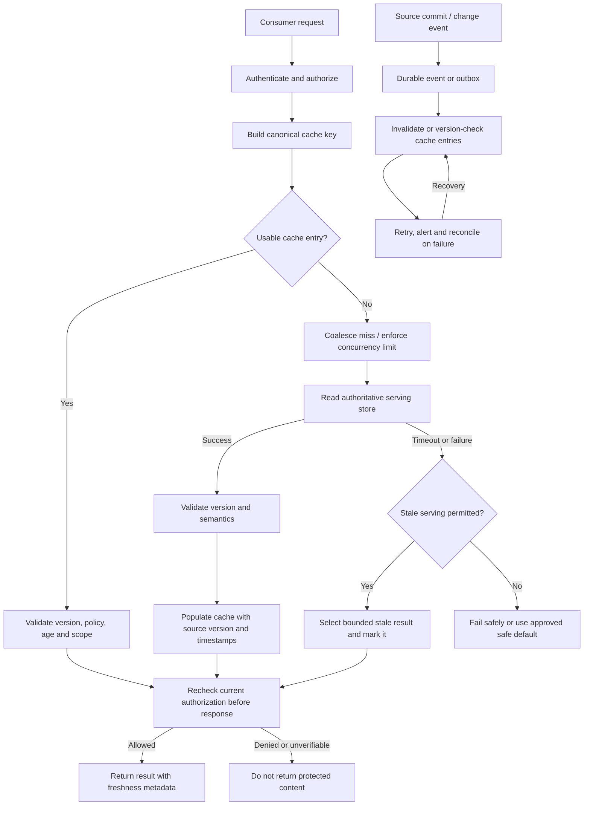

# 08 — Access Patterns, Cache Strategy and Freshness

**Module:** Stage 2D — Data Architecture  
**Roadmap:** Module 2D.14 — Data Access, Serving, Semantic and AI Data Architecture  
**Level:** Beginner → Intermediate → Advanced  
**Status:** Learning lesson; all organizations, workloads, thresholds, rates, costs, and data are synthetic and illustrative.

## 1. Overview and learning objectives

Every serving path must answer three linked questions:

1. **Access pattern:** how does a consumer read or update data?
2. **Reuse:** which results can safely be reused, and at what layer?
3. **Freshness:** how old may the returned information be, and how will that be measured?

A cache is an optimization, not the source of truth by default. It can reduce latency and backing-store load, but it can also introduce stale reads, extra failure modes, security risks, and operational cost. A high cache hit ratio is not evidence that results are correct, authorized, or fresh.

By completing this lesson, you should be able to:

- Classify point lookups, range queries, analytical aggregations, repeated reads, bulk extraction, APIs, streaming updates, and retrieval requests.
- Characterize workloads using rate, concurrency, read/write mix, payload, locality, popularity skew, and change frequency.
- Compare cache-aside, read-through, write-through, write-behind, and refresh-ahead.
- Design keys, TTLs, invalidation paths, refresh policies, and cache placement.
- Calculate hit/miss ratios, expected backend traffic, data age, and propagation lag with explicit units.
- Define freshness SLOs and validate them independently from latency SLOs.
- Handle races, stampedes, hot keys, invalidation failures, permission changes, and graceful degradation.
- Compare caching with materialized views and recomputation.
- Create a decision matrix, monitoring plan, test plan, and architecture decision record (ADR).

### A working mental model

- **Latency** is how long a request takes to return.
- **Freshness** describes how current the returned data is relative to a defined source or event.
- **Correctness** means the value and its semantics are right for the question.
- **Authorization** means the caller is permitted to receive that value.
- **Availability** means the request can be served within the agreed service definition.

These properties are related but not interchangeable. A cached answer may be fast, stale, semantically wrong, or unauthorized. Design and test each property explicitly.

## 2. Prerequisites and dependency mapping

The Module 2D.14 roadmap lists prerequisites **Seq 2, 3, 7, and P6** for Topic 08 and recommends a decision matrix that demonstrates bounded and tested staleness.

| Dependency | Reuse from the earlier lesson | How this lesson builds on it |
|---|---|---|
| Topic 02 — Warehouses, marts and semantic layers | Grain, metric definitions, governed analytical models, materialized aggregates | Decide whether to cache a governed result or maintain a materialized view; preserve semantic correctness |
| Topic 03 — Operational data serving and low-latency access | Point reads, latency budgets, concurrency, timeouts and workload isolation | Place caches around operational access paths without overwhelming the backing store |
| Topic 07 — Data products, APIs and consumer contracts | Consumer contracts, versioning, error behavior, service objectives | Make cache and freshness behavior an explicit, testable part of a data-product contract |
| P6 — Caching/materialization/performance/capacity foundations | Capacity estimates, cache trade-offs, performance testing and cost awareness | Validate measured behavior instead of assuming a cache is automatically beneficial |
| Topics 04–06, where relevant | Feature freshness; document/vector pipeline refresh; permission-aware RAG retrieval | Apply freshness and authorization policies to ML features and AI retrieval |

**Scope boundary:** this lesson chooses access, reuse, and freshness policies. It does not replace the complete implementations of semantic modeling (Topic 02), operational serving (Topic 03), data-product contracts (Topic 07), feature pipelines (Topic 04), document/vector pipelines (Topic 05), or permission-aware RAG (Topic 06).

## 3. Beginner fundamentals

### 3.1 What is a cache?

A cache stores a reusable copy of data or a computed result closer to the consumer than the authoritative or expensive source. It is useful when requests repeat and the cost of recomputing or retrieving the same result is greater than the cost of storing, maintaining, and checking the cached copy.

Examples include:
- An application cache for an account summary.
- A shared serving cache for a frequently requested product record.
- A query-result cache for a stable analytical dashboard.
- A CDN or client cache for public, versioned assets.
- A feature cache for online inference.
- A retrieval cache for a query embedding or authorized retrieval result, if the key and security rules make reuse safe.

A cache may be in-process, shared across application instances, at an API gateway, near a serving store, inside a query engine, or in a client. Each placement changes latency, sharing, invalidation, isolation, and failure behavior.

### 3.2 Access-pattern comparison matrix

| Access pattern | Typical shape | Reuse potential | Main risks | Candidate approach |
|---|---|---|---|---|
| Point lookup | One entity by stable key | High if keys repeat | Hot keys, stale entity state | Cache-aside or read-through with bounded TTL and update invalidation |
| Range query | Records over a time/key range | Depends on overlapping ranges | Partial overlap, changing result sets | Query cache for identical normalized queries; partitioned materialization for recurring ranges |
| Analytical aggregation | Grouping/sums over many rows | Often high for repeated dashboards | Expensive invalidation; semantic drift | Materialized view/preaggregation, optionally result cache |
| Repeated reads | Same key or query recurs frequently | High | Popularity shifts, eviction | Cache with admission/eviction policy; monitor reuse |
| Bulk extraction | Large export or full scan | Usually low for per-request result caching | Memory pollution, resource contention | Direct bounded export, snapshot, staged extract; avoid filling a small cache with one-off rows |
| API request | Request/response with parameters and identity | Varies by endpoint and identity | Incorrect key dimensions, auth changes | Cache only explicitly cacheable responses; include every result-affecting dimension |
| Streaming updates | Continuous change events | Cache is a derived projection | Event delay, duplicate/out-of-order updates | Event-driven invalidation/upsert plus reconciliation and TTL as a backstop |
| Retrieval request (RAG/search) | Query embedding, candidate passages, reranking | Partial; depends on query and permissions | ACL leakage, stale/deleted passages, query variation | Cache only with tenant/authorization/policy/version dimensions; short TTL or no result cache for sensitive cases |

### 3.3 Workload characteristics to measure

Do not choose a cache from request rate alone. Record at least:

- **Request rate:** requests/second (req/s), including peak and burst rate.
- **Concurrency:** in-flight requests, not just average requests per second.
- **Read/write ratio:** for example, 95:5 means 95 reads and 5 writes per 100 operations, if both are counted on the same basis.
- **Payload size:** bytes per entry and response; include metadata and index overhead.
- **Latency:** p50, p95 and p99 under realistic load, including cache misses.
- **Locality and repetition:** how often a key or normalized query is reused within the useful lifetime.
- **Popularity skew:** whether a small number of keys dominate traffic (hot keys).
- **Change frequency:** updates per key or partition per time interval.
- **Freshness tolerance:** maximum age or propagation delay accepted by each consumer.
- **Cardinality and working set:** distinct reusable keys and total memory required.
- **Failure behavior:** what the consumer can safely do when cache and backing store are degraded.

Measure a representative time window. A single average can hide daily cycles, seasonal peaks, tenant skew, or rare but severe bursts.

### 3.4 Cache hit ratio and miss ratio

Define the measurement boundary before calculating:

- **Hit:** a cache lookup returns a usable entry for the requested key and policy.
- **Miss:** no usable entry exists, so the request follows the miss path.
- **Hit ratio** = hits / (hits + misses).
- **Miss ratio** = misses / (hits + misses) = 1 − hit ratio, if hits and misses use the same denominator.

Illustrative example: during a 10-minute window, a cache records 72,000 hits and 18,000 misses. Total lookups = 90,000.

- Hit ratio = 72,000 / 90,000 = **0.80 = 80%**.
- Miss ratio = 18,000 / 90,000 = **0.20 = 20%**.

Units: counts over the same 10-minute observation window; ratios are dimensionless. This does not mean 80% of total application requests were accelerated if some requests bypass the cache or if a miss triggers multiple backing-store calls. Count bypasses, coalesced misses, retries, and errors separately.

For a simple one-lookup-per-request model, with 2,000 cache lookups/s and an 80% hit ratio:
- Misses reaching the backing store = 2,000 req/s × (1 − 0.80) = **400 miss requests/s**.
- This is not necessarily 400 backend operations/s if each miss performs multiple operations, nor is it necessarily the total backend load if other traffic bypasses the cache.

### 3.5 TTL, expiration, invalidation, and staleness

**Time to live (TTL)** is the maximum configured lifetime of an entry since its cache-specific start point, usually insertion or refresh. On expiration, the cache treats the entry as unusable or eligible for removal; exact behavior depends on implementation.

- **Expiration** is time-based. It does not necessarily notify the cache when the source changes.
- **Explicit invalidation** removes or marks an entry unusable after a known change.
- **Event-driven invalidation** uses a change event, CDC record, or message to invalidate/update a key or partition.
- **Versioned keys** include a source/model/schema/version token in the key, so a new version naturally uses a different cache namespace.
- **Refresh-ahead** refreshes a value before expiry based on demand or schedule, but refresh failures and races still need handling.

TTL is a control on cache-entry lifetime, not a universal consistency guarantee. A 60-second TTL cannot guarantee a source-to-cache delay below 60 seconds if the source-to-serving pipeline itself is delayed, refreshes fail, clocks are wrong, or the cache starts its TTL after receiving already-old data.

### 3.6 Stale data versus incorrect data

- **Stale:** the result was valid at an earlier time but does not reflect a later accepted source change.
- **Incorrect:** the result violates the required semantics, has a bad calculation, is joined at the wrong grain, or is otherwise wrong even if recently refreshed.
- **Unauthorized:** the result is not permitted for this caller, regardless of whether it is fresh and semantically correct.

Example: a dashboard shows yesterday's finalized sales total while the contract permits a one-day delay: it may be fresh enough. If the dashboard accidentally double-counts orders, the result is incorrect. If a user's cache returns another tenant's sales total, it is a security failure, not merely a freshness problem.

### 3.7 Cache warming and cache layers

**Cache warming** deliberately loads likely-to-be-requested entries before demand arrives, such as after a restart, deployment, model/index cutover, or known daily peak. Warm only a measured, bounded working set; use rate limits and low-priority background capacity so warming does not overload the source or displace live traffic. Verify values and versions during warming, expose progress, and stop or slow warming when the miss path or source is unhealthy. Warming reduces cold-start misses but does not make entries fresh forever and does not replace invalidation.

| Layer | Benefit | Limitation / control |
|---|---|---|
| Client/browser | Avoids network round trips; useful for public or versioned content | Harder centralized invalidation; client storage is not trusted for authorization |
| CDN/edge | Reduces origin load and geographic latency | Cache-control correctness, purge propagation, tenant/private content isolation |
| API gateway/reverse proxy | Central request caching and throttling | Must vary by all response-affecting headers/identity; can create a shared blast radius |
| Application/process-local | Very low lookup latency | Per-instance duplication and inconsistent copies; memory limits |
| Shared distributed cache | Reuse across instances | Network hop, availability dependency, key/tenant isolation, hot-key contention |
| Query/result cache | Reuses query outputs | Query normalization, semantic/version changes, invalidation complexity |
| Materialized view/precomputation | Avoids repeated expensive computation | Refresh cost, storage, lag, and definition/version management; not simply a transparent cache |

A common design has multiple layers. The end-to-end freshness contract must account for every layer and their combined invalidation/refresh delays.

## 4. Intermediate cache selection and freshness design

### 4.1 Cache-strategy comparison

| Strategy | Read/write flow | Appropriate when | Main trade-offs |
|---|---|---|---|
| **Cache-aside (lazy loading)** | Application reads cache; on miss reads source and populates cache. Writes usually update source then invalidate cache. | General-purpose read-heavy workloads; application can own key logic | Simple and flexible; cold misses and races; invalidation can fail |
| **Read-through** | Cache abstraction loads from source on miss | Common access pattern and centralized loading behavior | Simplifies callers; loader behavior and error semantics need operational control |
| **Write-through** | Write is applied to cache and source synchronously or as one coordinated operation | Read-after-write needs are important and write cost is acceptable | Added write latency; dual-write atomicity is difficult without transactional support |
| **Write-behind / write-back** | Cache acknowledges writes and persists asynchronously | Specialized workloads where buffering and throughput matter and bounded loss/replay is designed | Data-loss and durability risk; ordering, retry, idempotency, and recovery are critical |
| **Refresh-ahead** | Refreshes frequently used entries before they expire | Predictable, expensive refreshes with enough headroom | Wasted refreshes, refresh failures, and refresh/write races; not a substitute for invalidation |

Do not use write-behind for authoritative financial or compliance data unless the durability, recovery point, ordering, and acknowledgement contract explicitly supports it. A cache acknowledgement is not equivalent to durable source commit.

### 4.2 Cache decision matrix

| Workload signal | Candidate | Why | Guardrail / reject condition |
|---|---|---|---|
| Repeated point reads; low/moderate update rate | Cache-aside or read-through | High reuse with simple lookup | Add source version, invalidation, and miss protection |
| Read-after-write must be immediate for the writer | Bypass cache, version-aware read, or coordinated write-through | Avoids reading an older entry after a successful write | Test concurrent readers and replicas; write-through alone does not guarantee atomicity |
| Identical dashboard query repeats; result changes predictably | Query-result cache plus materialized view if computation is costly | Reuse at query/result level | Key must include semantic/model version and all parameters; freshness contract applies |
| Huge analytical aggregation repeated on a schedule | Materialized view/preaggregation | Avoids recalculating broad scans on every request | Measure refresh cost and data lag; cache can be an extra layer |
| Bulk one-time scan/export | Snapshot or bounded export path | Large scans are poor cache reuse candidates | Isolate from online traffic; avoid cache pollution |
| High popularity skew / hot keys | Replication, local near-cache, request coalescing, rate limits | Reduces contention on a single key | Invalidation across copies and stale window must be designed |
| High write rate and very tight freshness | Event-driven update/invalidation; possibly bypass cache | TTL alone may be too slow | Reconcile missed events; define fail-closed or source-read behavior |
| Sensitive/identity-dependent response | No shared cache by default; or strict identity-aware key and authorization recheck | Prevents cross-user/tenant leakage | Cache key is not an authorization decision; reauthorize before serving |
| Query has low repetition or huge result cardinality | Do not cache, or cache only a reusable sub-result | Cache memory may exceed benefit | Validate with trace-driven hit-rate and cost measurement |
| Source occasionally unavailable | Serve stale only if contract explicitly allows; otherwise fail safely | Can improve availability | Label stale age, cap stale window, never bypass security or correctness constraints |

### 4.3 Cache key design

A cache key must represent every input that can change the result. Depending on the interface, dimensions can include:

- Tenant or security boundary.
- Entity ID or normalized query and parameters.
- Locale, currency, time zone, pagination, filters, sort order, and requested projection.
- Product/API version, semantic model version, feature definition version, embedding model/index version.
- Authorization scope or policy version when the response is permission-dependent.
- Source snapshot or data version when exact reproducibility is required.

Example conceptual key:

```text
tenant:{tenant_id}:customer-summary:v{contract_version}:{customer_id}
```

For an identity-sensitive RAG result, a safer conceptual key may need tenant, principal or effective permission-scope fingerprint, normalized query, corpus/index version, and policy version. Avoid storing raw credentials or sensitive identity attributes in keys. If effective permissions cannot be represented and safely invalidated, do not share cached retrieval results across identities; re-run authorization before returning cached candidates.

Normalize keys deterministically: canonical parameter ordering, explicit null handling, stable encodings, and bounded key length. Avoid keys that silently omit filters or use ambiguous concatenation.

### 4.4 TTL and invalidation policy

Choose TTL from a consumer's accepted staleness and the measured update/propagation process, not from convention.

Common combinations:

1. **TTL only:** simplest; suitable for public or slowly changing data where bounded eventual staleness is acceptable and source-to-cache delay is known.
2. **Write invalidation + TTL backstop:** write source, then invalidate; TTL limits stale lifetime when invalidation is missed, assuming the entry's age and refresh semantics are understood.
3. **Event-driven invalidation/update + reconciliation:** appropriate for CDC/streaming paths; events must be idempotent, ordered or version-checked, retried, monitored, and periodically reconciled.
4. **Versioned keys:** useful for immutable releases, schema/model versions, and atomic cutovers; old versions still need retention and cleanup.
5. **Scheduled refresh:** useful for predictable batches; expose the refresh timestamp and lag.
6. **No cache / source read:** appropriate where correctness, security, or immediate consistency requirements cannot be met by the cache contract.

A simplified planning estimate sometimes used is:

`potential staleness ≈ source-to-serving propagation lag + cache residence time`

Illustrative calculation: source changes may take up to 25 s to reach the serving store, and a cache entry can remain for 40 s after it is populated. A rough planning bound is **25 s + 40 s = 65 s**. This is valid only under assumptions: lag is bounded by 25 s; cache TTL begins when the entry is populated from a current-enough serving value; no stale refresh or replica lag is added; expiry is enforced; and clocks/measurement are sound. It is not a universal theorem. If a cache can be populated from an already-old replica, or refresh failures leave stale entries usable, actual age may exceed this estimate. Measure source event time and served value age directly.

### 4.5 Freshness definitions, staleness budgets, and SLOs

A **staleness budget** is the maximum allowed age or propagation delay that a
consumer's contract allocates to the full path. Allocate it across upstream
processing, replication, cache residence, client/edge caching, and measurement
uncertainty. If one stage consumes more than its allocation, downstream TTL
tuning cannot recover the lost budget; change the upstream path or renegotiate
the contract.

Use an explicit timestamp lineage. Common measurements:

- **Data age at response:** response time − event/record time for the data actually returned. This can be misleading if the source event timestamp is not trustworthy or does not represent when the change became authoritative.
- **Source-to-serving delay:** serving-availability time − authoritative source commit/change time.
- **End-to-end propagation lag:** time the change becomes usable by the consumer − source commit/change time.
- **Cache residence age:** now − cache insertion/refresh time. This is not necessarily the age of the underlying data.
- **Freshness SLO:** a measurable objective over a defined population, timestamp boundary, and window. Define whether it measures (a) **change-propagation lag**—time from an authoritative commit until the new version is visible—or (b) **business-data age**—response time minus a trustworthy event time that represents the business recency requirement. These metrics answer different questions. A record that has not changed for a year can still be current if no newer authoritative version exists; therefore, “time since the last commit” is not automatically a freshness failure.

Example SLO (illustrative change-propagation contract):
- Objective: **99%** of eligible authoritative changes become visible on the serving path within **60 s**, measured from source commit timestamp to the first successful read that reflects that version, over a rolling 30-minute window. Define the eligible change population, including deletes and updates, and measure a representative set of keys/tenants.
- Validation: synthetic updates carry a source version and commit timestamp; poll each serving layer until that version is observable; record commit, serving-availability, cache insertion/refresh, and response timestamps. Track failed or never-observed changes separately so they cannot silently disappear from the denominator.
- Alert: alert on SLO burn/rolling-window failure and separately alert if the oldest known unapplied change exceeds **90 s**. The 90-second threshold is a secondary hard-lag signal, not the freshness objective itself.
- Error budget: up to 1% of eligible changes may exceed 60 s in the window, but this is not permission to violate access controls or knowingly serve semantically incorrect results.
- Report latency SLO separately (e.g. p95 response time under an illustrative target of 120 ms). Freshness and latency must both pass.

If the consumer instead requires a business-data-age SLO, define the relevant event-time field and why it represents recency, and measure its age at response. Do not substitute cache residence time or time since the last source commit for either freshness metric. Do not calculate freshness from TTL alone; correlate source versions/event IDs and track propagation-lag or data-age distributions (p50/p95/p99/max), not only averages.

### 4.6 Batch, micro-batch, and streaming refresh

| Refresh style | Typical use | Strength | Main limitation |
|---|---|---|---|
| Batch | Scheduled mart/view refresh; daily or hourly reference data | Efficient for large changes and reproducibility | Freshness bounded by schedule plus processing and queue delays |
| Micro-batch | Small groups every few seconds/minutes | Balances efficiency and delay | Bursty visibility; batch windows and retries add lag |
| Streaming/event-driven | Low-lag updates, invalidations, feature changes, document changes | Fast propagation when healthy | Event loss, duplicates, out-of-order events, consumer lag and replay complexity |

Every refresh path should specify: source of change, event/version identifier, idempotency, ordering rule, retry/backoff, dead-letter or quarantine behavior, replay procedure, lag metric, reconciliation method, and deletion propagation. Event delivery is not proof that every cache copy was invalidated.

## 5. Advanced consistency, invalidation, concurrency, and security

### 5.1 Common races and controls

**Write then invalidate:** if a reader misses the cache and reads the old source value before a concurrent write commits, it may repopulate the cache with stale data after the writer invalidates it. Mitigations include source versions, compare-and-set writes, fencing tokens, versioned keys, post-write invalidation/retry, or a write protocol that prevents older reads from replacing newer values.

**Out-of-order events:** update event v12 may arrive before v11. Store a monotonically comparable version and reject any update older than the currently cached version. If no trustworthy version exists, define an ordering/serialization strategy rather than assuming event arrival order equals source order.

**Lost invalidation:** a process can crash after committing the source write but before invalidation. Use a transactional outbox/CDC or durable event path where appropriate, retries, reconciliation scans, and a TTL as a backstop. The TTL does not prove invalidation succeeded.

**Negative caching:** caching “not found” can reduce repeated misses but can hide a newly created record. Give negative entries a deliberately short TTL or invalidate them on create; do not confuse a transient backend error with a genuine not-found result.

**Concurrent refresh:** multiple requests can refresh the same expired key. Use single-flight/request coalescing, per-key locks with bounded wait, refresh leases, or jittered refresh schedules. Lock failure must not cause unbounded waiting.

### 5.2 Cache stampede and hot-key scenario

Illustrative scenario: a popular public reference record receives 8,000 requests/s. Its cached entry expires at once. If all 8,000 requests miss and independently call the backing store, the cache turns a small serving problem into a backend overload. This is a **thundering herd**: many concurrent callers suddenly perform the same expensive work. A cold start or deployment can create a similar burst even without synchronized TTL expiry.

Mitigation plan:
1. **Request coalescing:** one in-flight refresh per key; other requests await the result or receive permitted stale data.
2. **TTL jitter:** randomize expiry around a target window (for example, a target of 60 s with ±10% jitter, illustrative) so many keys do not expire simultaneously. Jitter alone does not solve one hot key.
3. **Stale-while-revalidate:** return a previously validated value for a short, explicitly permitted stale window while one refresh runs.
4. **Refresh-ahead:** proactively refresh hot keys before expiration.
5. **Backpressure and bulkheads:** cap concurrent backend refreshes, bound queues, and isolate cache misses from unrelated workloads.
6. **Rate limiting / load shedding:** reject or degrade noncritical requests before saturating the backing store.
7. **Fallback:** use stale data only if the data contract permits it; otherwise return a clear retryable failure or use a safe default.

Track per-key or top-N key concentration, concurrent loaders, miss bursts, backend QPS, queue depth, refresh errors, stale responses, and p99 latency. A global hit ratio can hide a single damaging hot key.

### 5.3 Hot keys versus cache stampedes

A **hot key** receives disproportionate traffic even while it is cached. A **stampede** is a burst of duplicate work, often after expiration or invalidation. They overlap but are not identical.

Hot-key options: local near-cache, replica/read fan-out, request coalescing, key partitioning where semantics allow, response precomputation, and admission/rate limits. Replicating a hot key may increase invalidation complexity. Sharding a single logical key is not safe unless the result can be partitioned without changing semantics.

### 5.4 Permission-sensitive caching and tenant isolation

Security invariants:

- Authenticate and authorize the request before using a cached result as the response.
- Include tenant and every result-affecting security scope in the key, or avoid shared result caching.
- A cache key is not an authorization check. A matching key does not prove current permission.
- Permission revocation, document deletion, account closure, or tenant membership changes must invalidate or make inaccessible all derived cached data within a defined revocation SLO.
- Prefer an authoritative authorization check at response time for sensitive results. Where policy decisions are cached, use policy versioning, short bounded TTLs, and reliable invalidation.
- Never allow stale-while-revalidate to override a revocation or data-deletion requirement.
- Do not log raw sensitive values or tokens in cache keys, traces, or metrics.
- Apply tenant-aware quotas and avoid cross-tenant side channels where relevant.

**Scenario:** User A in tenant North receives a cached search result containing a restricted policy passage. User B in tenant South asks the same query. If the cache key is only a normalized query string, B may receive A's result. Correct controls: tenant/scope-aware keying, current authorization enforcement on each returned passage, ACL/policy version checks, deletion/revocation invalidation, and negative tests proving cross-tenant requests cannot reuse protected results. If effective access cannot be safely represented, do not cache the final permission-filtered result across users; cache only public, permission-independent candidate data and filter it before response, if that design is safe for the system.

### 5.5 Workload isolation, backpressure, and graceful degradation

- Separate online misses and refresh jobs from large scans, bulk exports, and batch materialization.
- Bound refresh concurrency and queue length; use exponential backoff with jitter for retryable failures.
- Do not retry every failure indefinitely. Respect deadlines, classify errors, and avoid retry storms.
- Set per-consumer quotas and priority for shared services.
- Define behavior by data class: stale-allowed, source-read-required, safe-default-allowed, or fail-closed.
- On cache outage, do not automatically send unlimited traffic to the source. Use circuit breakers, concurrency limits, load shedding, and carefully bounded bypass.
- On source outage, stale serving is allowed only if the contract and security policy permit it; expose stale status/age where possible.
- Keep observability available during degradation, and test recovery, not only steady state.

### 5.6 Version-aware cache-aside pseudocode

This is language-neutral pseudocode; it illustrates the ordering rules, not a drop-in library implementation. `source.read_with_version` must return a value and a source version from a consistency level suitable for the contract. A distributed single-flight primitive or lease is needed if multiple application instances share the same cache.

```text
function get_value(key, caller):
    request_decision = authorize_current(caller, requested_scope_for(key))
    if not request_decision.allowed:
        deny_without_returning_content()
    entry = cache.get(key)
    if entry exists and entry.age <= allowed_age
       and entry.scope_matches(request_decision.effective_scope)
       and entry.source_version_is_acceptable
       and entry.policy_version == request_decision.policy_version:
        response_decision = authorize_current(caller, resources_for(entry.value))
        if not response_decision.allowed
           or response_decision.policy_version != entry.policy_version:
            deny_or_rebuild_without_returning_cached_content()
        return entry.value

    with single_flight(full_cache_key_including_tenant_and_security_scope):
        entry = cache.get(key)                   # Another request may have refreshed it
        if entry is usable_for(entry, caller, request_decision):
            response_decision = authorize_current(caller, resources_for(entry.value))
            if not response_decision.allowed
               or response_decision.policy_version != entry.policy_version:
                deny_or_rebuild_without_returning_cached_content()
            return entry.value

        value, source_version, source_commit_time = source.read_with_version(key)
        current = cache.get(key)
        if current exists and current.source_version > source_version:
            if current is usable_for(current, caller, request_decision):
                response_decision = authorize_current(caller, resources_for(current.value))
                if not response_decision.allowed
                   or response_decision.policy_version != current.policy_version:
                    deny_or_rebuild_without_returning_cached_content()
                return current.value
            value, source_version, source_commit_time = source.read_at_least_version(
                key, current.source_version
            )
        cache.put_if_version_not_newer(
            key, value, source_version, source_commit_time, request_decision.policy_version
        )
        response_decision = authorize_current(caller, resources_for(value))
        if not response_decision.allowed
           or response_decision.policy_version != request_decision.policy_version:
            deny_or_rebuild_without_returning_cached_content()
        return value

on_source_change(key, new_version):
    current = cache.get(key)
    if current exists and current.source_version < new_version:
        cache.invalidate(key)                    # Or atomically advance version namespace
    enqueue_reconciliation_if_invalidation_fails(key, new_version)
```

Production implementation must also define timeout behavior, lock/lease expiry, cancellation, source errors, retry budgets, and whether stale data is allowed. A source read racing with a newer write must not overwrite a newer cached version. For composite results (such as RAG retrieval), `resources_for(value)` must enumerate every protected source object represented in the response; authorizing only the query or cache key is insufficient. The pseudocode rechecks authorization and policy version immediately before every protected return. A real implementation must make the check-to-response race as small as practical and use revocation/version fencing or an equivalent policy mechanism when the threat model requires stronger guarantees. If authorization cannot be verified, do not return protected content. The pseudocode is illustrative, not an executable implementation.

### 5.7 Caching vs materialized views vs recomputation

| Option | What it reuses | Best fit | Freshness / cost considerations |
|---|---|---|---|
| Cache | A previously fetched value or computed response | Repeated reads where reuse is high | Low read latency; invalidation and memory cost; may serve stale entries |
| Materialized view / precomputation | A stored result of a defined transformation or aggregation | Expensive repeated analytics, stable query shapes | Refresh compute and storage; clear lineage and refresh lag; preserves reusable model output |
| Recompute on demand | No previously stored result is required | Low repetition, rapidly changing input, simple/cheap work | Always reflects the chosen read path, but consumes compute and may have high latency |
| Hybrid | Materialized result plus cache | High read volume over expensive, refreshable results | Lowest read cost potential but more copies and more invalidation/freshness boundaries |

Choose by measured total cost and contract, not by fashion. Include compute, storage, network, engineering/on-call effort, cache misses, refresh jobs, invalidation, and incident risk. A cache over an already fast query may add more complexity than value.

## 6. Worked calculations and architecture diagram

### 6.1 Hit ratio, miss ratio, and backend load

Assumptions (illustrative): 5,000 cache lookups/s, 92% hit ratio, one backing-store read per miss, no bypasses or retries.

- Miss ratio = 1 − 0.92 = **0.08 = 8%**.
- Miss rate = 5,000 lookups/s × 0.08 = **400 misses/s**.
- Expected backing-store reads from this path = **400 reads/s** under the stated one-read-per-miss assumption.
- If each miss triggers an average of 1.5 backing-store operations, expected backend operations = 400 misses/s × 1.5 operations/miss = **600 operations/s**.

Do not infer latency improvement directly from hit ratio. Measure hit latency, miss latency, refresh overhead, queueing, network costs, and the impact on tail latency.

### 6.2 Data age and propagation lag

Synthetic record:
- Authoritative source commit time: 10:00:00.
- Serving store applies the update at 10:00:18.
- Cache refreshes at 10:00:25.
- Consumer reads at 10:00:40.

Calculations:
- Source-to-serving delay = 10:00:18 − 10:00:00 = **18 s**.
- Source-to-cache availability delay = 10:00:25 − 10:00:00 = **25 s**.
- Cache residence time at response = 10:00:40 − 10:00:25 = **15 s**.
- End-to-end source age at response = 10:00:40 − 10:00:00 = **40 s**.

These are distinct metrics. Cache residence time (15 s) is not source age (40 s). A TTL started at cache refresh cannot erase the 25 seconds already elapsed since source commit.

### 6.3 Freshness lag versus scheduled refresh

Illustrative hourly batch: source changes at 10:07:00; next batch starts at 11:00:00, finishes at 11:04:00, and the serving cache is refreshed at 11:05:00.

- Wait until batch start = 53 min.
- Batch processing = 4 min.
- Cache propagation = 1 min.
- End-to-end propagation lag = 53 + 4 + 1 = **58 min**.

If the freshness SLO is 15 minutes, this schedule cannot meet it under the stated assumptions. Reduce the refresh interval, use micro-batch/streaming, or renegotiate the SLO with consumers. A shorter cache TTL alone does not fix an upstream batch delay.

### 6.4 Multi-layer staleness calculation

Illustrative example: a source-to-serving pipeline can lag by up to 20 s; a shared cache can retain an entry for up to 30 s; and a client cache can retain its copy for up to 10 s. If each stage's bound is independently valid and each stage can expose the oldest permitted prior value, a conservative planning estimate is:

- Upstream propagation bound: 20 s
- Shared-cache residence bound: 30 s
- Client-cache residence bound: 10 s
- Conservative combined bound: **20 s + 30 s + 10 s = 60 s**

This sum is a planning bound only when the stages' definitions and behavior support it. If a later cache is refreshed from an already-old value, the upstream age carries forward; if stale-while-revalidate or failed refresh extends use beyond TTL, that extension must be added or the bound is invalid. If versions are invalidated synchronously across layers, measured age may be much lower. Validate with source versions and end-to-end timestamps rather than assuming TTLs alone enforce the bound.

### 6.5 Illustrative memory sizing

Assumptions: 200,000 entries, average serialized value 1.5 KiB, key/metadata/index overhead estimated at 35% of value bytes, and 25% headroom target. These are planning assumptions to validate with the actual cache engine and workload.

- Raw value bytes = 200,000 × 1.5 KiB = **300,000 KiB ≈ 293 MiB** (using 1 KiB = 1,024 bytes and 1 MiB = 1,024 KiB).
- Estimated total before headroom = 293 MiB × 1.35 ≈ **396 MiB**.
- Capacity with 25% headroom on the unrounded estimate = 200,000 × 1.5 KiB × 1.35 × 1.25 ≈ **494 MiB** (about 494.4 MiB).

This excludes replication, allocator fragmentation, eviction metadata, temporary refresh copies, and implementation-specific overhead. Validate with representative serialized payloads and measured memory usage; do not treat this estimate as a deployment sizing guarantee.

### 6.6 Request and refresh path



Diagram assumptions: initial authentication/authorization protects the lookup path, and a current authorization decision is rechecked immediately before returning protected content—including cached and stale-on-error results—when policy can change during a request. If current authorization cannot be established, protected content is not returned. The stale path is explicitly policy-controlled; event delivery is durable/retried; version checks prevent an older refresh from overwriting newer state. Real implementations must specify how stale values are identified, how age is computed, and how authorization-service failure is handled.

## 7. Testing, monitoring, and production failure scenarios

### 7.1 Worked stale-data incident

**Incident:** an operational API returns an old customer exposure value after an update. Latency and hit ratio look healthy.

**Synthetic timeline**
- 14:00:00 — source version 41 commits.
- 14:00:01 — application updates the source and attempts cache invalidation.
- 14:00:01 — invalidation message is lost during a consumer restart.
- 14:00:02 — cache still contains version 40; requests continue to hit it.
- 14:01:00 — TTL expires, but a delayed replica read repopulates version 40 for another interval.

**Diagnosis**
1. Confirm the exact response value, key, tenant, and source version.
2. Compare authoritative commit timestamp/version, serving-store version, cached version, and response timestamp.
3. Check invalidation producer/consumer lag, errors, restart window, retries, and dead-letter records.
4. Check replica lag and whether the loader can populate the cache from a stale replica.
5. Confirm whether TTL is measured from cache insertion or source update; do not assume TTL bounds source age if inserted data is already stale.
6. Check whether hit ratio and latency dashboards obscured freshness failures.

**Corrective actions**
- Use a durable change event/outbox and idempotent invalidation consumer.
- Include source version in cache values; reject a refresh older than the cached/source version.
- Ensure the read path selects a source with a defined consistency level.
- Add reconciliation for missed invalidations and an alert on oldest unapplied event.
- Add a regression test that simulates invalidation loss and stale-replica reads.
- Track source-to-response age and stale-response count, not only cache hit ratio.

**Acceptance criteria:** a synthetic update is either visible within the freshness SLO or the request follows the documented fail/stale policy; older versions never overwrite newer versions; security revocations remain effective within their stricter policy.

### 7.2 Test plan

| Test | Method | Pass criterion (define target per service) |
|---|---|---|
| Functional key correctness | Vary each result-affecting parameter independently | No two distinct result scopes collide into one key |
| Hit/miss accounting | Replay a deterministic request trace | Counts reconcile with requests, bypasses and errors |
| Freshness | Write versioned source updates and poll all serving layers | Measured end-to-end lag meets freshness SLO |
| Invalidation loss | Drop or delay selected events | Retry/reconciliation recovers within the defined bound |
| Race and ordering | Deliver concurrent/out-of-order updates | Cached version never regresses |
| Stampede | Expire one hot key under load | Backend concurrency and queue remain bounded |
| Hot-key behavior | Skew traffic to a small key set | p99 and backend load remain within the agreed target |
| Cache outage | Disable cache or inject network failures | No unbounded source surge; documented fallback works |
| Source outage | Fail the backing store | Stale/fail behavior follows data-class contract |
| Permission revocation | Revoke access while a result is cached | Protected content cannot be returned after the revocation SLO |
| Tenant isolation | Replay same query across tenants/principals | No unauthorized cross-scope result is returned |
| Recovery | Restore cache/source after outage | Warm-up, replay, and load remain bounded |

### 7.3 Monitoring

Measure each layer and freshness independently:

- Requests/s, concurrency, cache lookups, hits, misses, bypasses, errors, evictions, and entry count.
- Hit and miss latency distributions; p50/p95/p99; timeout and retry rates.
- Backend request rate attributable to cache misses, plus direct/bypass traffic.
- Refresh attempts, refresh success/failure, loader concurrency, coalesced requests, queue depth, and backpressure.
- Source-to-serving lag, source-to-cache lag, end-to-end propagation lag (source version commit to version visible), business-data age at response where meaningful, oldest unprocessed event, and stale-response count. Keep propagation lag separate from age of an unchanged record.
- Hot-key concentration, top-N key traffic, tenant/consumer distribution, and memory pressure.
- Invalidation delivery delay, failures, dead-letter volume, reconciliation mismatch, and version regressions.
- Cost: cache memory-hours, network, backing-store operations, refresh compute, storage/replication, and operational effort.

Use trace sampling and bounded-cardinality labels. Avoid putting raw customer IDs, query text, tokens, or sensitive values in metric labels.

## 8. Architecture decision matrix and trade-offs

Complete this matrix for each served path, rather than applying one cache policy globally.

| Decision field | Example / required answer |
|---|---|
| Consumer and purpose | API, dashboard, ML inference, RAG retrieval, bulk export |
| Access pattern | Point lookup, repeated aggregation, range scan, streaming update |
| Load profile | Average/peak req/s, concurrency, payload, read/write ratio, key skew |
| Source of truth | System and version/timestamp semantics |
| Freshness contract | Maximum source age and/or propagation lag; measurement boundary |
| Cacheability | What is reusable; what makes two results equivalent |
| Placement and strategy | Layer, cache-aside/read-through/write-through/etc. |
| Key dimensions | Tenant, entity/query, parameters, contract/model/policy version |
| Invalidation and refresh | TTL, events, versioned keys, batch/micro-batch/streaming |
| Consistency/race controls | Version checks, single-flight, fencing, reconciliation |
| Security and deletion | Auth recheck, revocation SLO, tenant isolation, purge path |
| Failure behavior | Bypass limits, stale-allowed classes, safe default, fail-closed conditions |
| SLOs and telemetry | Latency, freshness, availability, hit/miss and lag measures |
| Capacity and cost | Working set, overhead, refresh compute, miss load, operational cost |
| Evidence and owner | Test results, production measurements, accountable owner |

### ADR template

**Title:** Cache and freshness policy for `[serving path]`  
**Status / date / owner:** `[proposed | accepted | superseded] / [date] / [owner]`

1. **Context:** consumer, access pattern, measured workload, source-of-truth semantics.
2. **Requirements:** latency SLO, freshness SLO, authorization/deletion obligations, availability, cost constraints.
3. **Options considered:** no cache; cache-aside/read-through; write-through; refresh-ahead; materialized view; hybrid.
4. **Decision:** cache layer, key schema, strategy, TTL, invalidation/refresh, source version rules.
5. **Consistency and security:** stale-read policy, race handling, tenant and identity scope, revocation.
6. **Failure behavior:** cache/source outage, refresh failure, backpressure, fallback and load shedding.
7. **Validation:** load tests, freshness tests, permission tests, failure injection, acceptance thresholds.
8. **Consequences:** added complexity/cost, known limitations, rollback and migration plan.
9. **Review triggers:** workload change, SLO miss, source/model/schema change, permission incident, cost threshold breach.

## 9. Practical exercises and expected deliverables

Use synthetic values only. Each exercise should produce a short design note and evidence, not just an opinion.

### Beginner exercise — classify five consumers

**Scenario:** a fictional bank serves an executive dashboard, account-summary API, batch risk export, online fraud model, and internal policy RAG assistant.

**Tasks**
1. For each consumer, name the access pattern and data class.
2. State whether reuse is likely and what might invalidate a cached result.
3. Propose an initial freshness metric and one risk.
4. Distinguish latency target from freshness target.

**Expected output:** a five-row access-pattern matrix.

**Acceptance criteria:** all five consumers classified; every freshness metric defines the timestamp boundary; RAG and account data mention authorization; bulk export considers workload isolation. There is no single TTL applied to all consumers.

### Intermediate exercise — choose and size a cache

**Assumptions:** 3,000 requests/s, 85% measured hit ratio, one backing-store read per miss, average payload 2 KiB, 100,000 resident keys. Assume 30 s source-to-serving delay and a candidate 45 s cache residence TTL only for the first estimate.

**Tasks**
1. Calculate miss ratio and expected miss requests/s.
2. Estimate raw value storage using decimal units and then state that metadata/overhead is excluded.
3. Calculate a simplified staleness planning estimate.
4. Choose cache strategy and invalidation mechanism.
5. Specify measurements needed before production sizing.

**Expected calculations**
- Miss ratio = 1 − 0.85 = **15%**.
- Miss rate = 3,000 req/s × 0.15 = **450 misses/s**, under one lookup per request.
- Raw payload storage = 100,000 × 2 KiB = 200,000 KiB = **204.8 MB** using 1 KiB = 1,024 bytes and 1 MB = 1,000,000 bytes (metadata and overhead excluded).
- Simplified planning estimate = 30 s + 45 s = **75 s**, only if the assumptions in Section 4.4 hold.

**Acceptance criteria:** units shown; assumptions named; cache strategy tied to workload; freshness is validated using source timestamps/versions, not TTL alone; no claim that the memory estimate is production sizing.

### Advanced exercise — multi-tenant freshness under failure

**Scenario:** a shared retrieval service serves several tenants. Documents change continuously; access can be revoked; one tenant generates hot queries; invalidation events can be delayed or duplicated.

**Tasks**
- Design key dimensions and the authorization point.
- Define the source/version and ACL-policy version model.
- Specify idempotency, ordering, retry, reconciliation, deletion and revocation behavior.
- Design hot-key/stampede controls and cache/source outage behavior.
- Define measurable freshness and revocation SLOs and tests.
- Produce an ADR and a sequence diagram or Mermaid flow.

**Expected deliverables:** decision matrix, ADR, monitoring list, failure-injection plan, and a table mapping each risk to a test and pass criterion.

**Acceptance criteria:** cross-tenant leakage is impossible in the proposed key/authorization design; stale serving cannot override revocation; out-of-order events cannot regress versions; backend load is bounded during stampedes; each SLO has a measurement boundary, window, and alert; rollback is documented.

## 10. Common mistakes and troubleshooting

| Symptom / mistake | Likely cause | Investigation and correction |
|---|---|---|
| High hit ratio but users report old values | TTL too long, invalidation lost, stale replica refresh, wrong timestamp boundary | Compare source version and commit time to served version; add lag and invalidation metrics |
| High hit ratio but no latency improvement | Cache network hop or serialization dominates; hits are slow; misses are expensive | Measure hit/miss p50/p95/p99 and end-to-end traces |
| Backend overloaded during cache expiry | Stampede, synchronized TTLs, no coalescing | Single-flight, jitter, refresh-ahead, bounded refresh concurrency |
| Cache memory grows without benefit | High-cardinality one-off keys, large payloads, poor admission policy | Measure reuse distribution; exclude bulk paths; use size limits and eviction |
| New writes seem to disappear | Negative cache, stale refill race, write-through failure | Invalidate on create/update; version-check writes; test concurrent reads |
| Old event overwrites new value | Out-of-order delivery with no version check | Reject older versions; use source sequence/version |
| Permission revoked but result still appears | Identity omitted from key, stale policy cache, incomplete purge | Reauthorize at response; policy version and revocation SLO; audit all copies |
| Cache outage causes source outage | Unbounded bypass and retries | Circuit breaker, bounded concurrency, load shedding and backpressure |
| Cache and materialized view disagree | Different semantic version, refresh lag, grain mismatch | Verify model/contract version, lineage, refresh status and metric definition |
| TTL seems not to bound age | TTL starts after stale data arrives or stale values remain available after refresh failure | Measure source age, not only insertion time; cap stale-while-revalidate window and alert |
| Refresh job increases online p99 | Shared resource contention | Separate pools/quotas, schedule or throttle refresh, test mixed workload |

## 11. Review questions, mastery criteria, and completion gate

### Review questions

1. Why can a high hit ratio coexist with a freshness SLO failure?
2. When does a materialized view provide more value than a cache?
3. Which dimensions must be included in a cache key for a parameterized, tenant-scoped API?
4. Why does TTL alone not guarantee a maximum source-to-response age?
5. Describe the write-then-invalidate race and one control that prevents an old refill.
6. How do hot keys differ from cache stampedes?
7. What must happen when authorization is revoked while a result is cached?
8. Which metrics prove end-to-end freshness, and which measure only cache residence?
9. How should a service behave when both the cache and backing store are degraded?
10. What evidence would justify removing a cache?

### Mastery criteria

You can demonstrate that you can:

- Classify access patterns and workload characteristics with explicit units.
- Calculate hit/miss ratio and expected backend load using a declared measurement boundary.
- Define freshness from authoritative source timestamps/versions and set a measurable SLO.
- Choose a cache strategy based on reuse, change frequency, consistency, security, and cost.
- Explain invalidation races, event loss, ordering, stampedes, hot keys, and recovery controls.
- Design identity/tenant-aware caching without treating the key as an authorization check.
- Compare caching, materialization, and recomputation using measured evidence.
- Produce a testable decision matrix and ADR.

### Completion checklist

- [ ] Dependencies on Topics 02, 03, 07 and P6 reviewed.
- [ ] Access-pattern matrix covers all required patterns.
- [ ] Workload profile includes rate, concurrency, read/write ratio, payload, latency, locality, popularity, and change frequency.
- [ ] Cache strategy, key, TTL, invalidation, and refresh are documented per serving path.
- [ ] Freshness definition and SLO include a measurement boundary and window.
- [ ] Hit/miss, backend load, data age, propagation lag, and memory calculations are reproducible.
- [ ] Diagram matches the documented request, refresh, failure, and authorization paths.
- [ ] Stale-data incident and stampede/hot-key mitigations are tested.
- [ ] Tenant isolation, permission revocation, and deletion propagation have negative tests.
- [ ] Latency, freshness, reliability, and cost are measured independently.
- [ ] ADR records alternatives, trade-offs, evidence, owner, and review triggers.
- [ ] Practice questions attempted; unresolved assumptions and gaps logged.

**Completion gate:** the lesson is complete when another engineer can use the decision matrix and ADR to choose a cache/freshness policy, reproduce the calculations, explain failure behavior, and verify that the policy meets both freshness and authorization requirements under load. The next step is to integrate this policy into the module's final analytics and AI data-serving architecture project.
