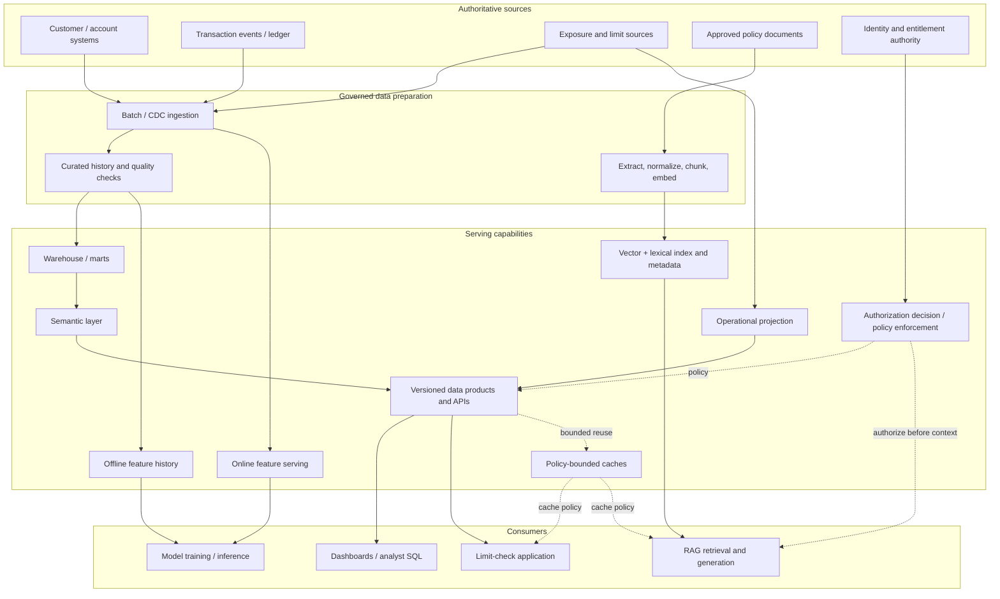

# Project 14 — Analytics and AI Data-Serving Architecture

> **Roadmap:** Stage 2D — Data Architecture / Module 2D.14 — Data Access, Serving, Semantic and AI Data Architecture  
> **Project type:** End-to-end architecture design, validation, and operational-readiness exercise  
> **Approach:** Consumer-driven, vendor-neutral, evidence-led  
> **Scenario:** Northbridge Bank (fictional); all data, identities, volumes, targets, costs, and outcomes in this document are illustrative  
> **Status:** Reference design and learning project; not an approved production deployment plan

---

## 0. How to use this project

This is the integrated capstone for the eight topics in Module 2D.14. Complete the steps in order, preserve decisions and evidence, and do not treat an architecture diagram as proof that the system meets its requirements.

The project is intentionally vendor-neutral. Choose concrete products only after validating workload, security, reliability, regional, team, and commercial constraints. Where this document supplies example thresholds, they are **scenario assumptions**, not universal benchmarks, regulatory advice, or a claim that any system has already met them.

### 0.1 What the project is about

Northbridge Bank needs a coherent way to serve governed data to several different consumers:

- risk analysts and executives who need consistent metrics and dashboards;
- finance/reporting users who need reproducible, reconciled figures;
- an application that needs bounded, low-latency account/limit lookups;
- a fraud model that needs historically correct training features and consistent online features;
- an internal policy assistant that must retrieve relevant, current evidence without exposing documents the caller is not permitted to see.

The project designs a **set of purpose-fit serving paths with shared governance**, not one universal database or one universal API. Each path has its own access pattern, freshness promise, correctness contract, and failure mode. Common definitions and product contracts reduce duplication, while authorization is enforced at every boundary where data can be exposed.

### 0.2 The problem statement

The current-state problem is a hypothetical collection of disconnected consumption patterns: teams build extracts independently, metric definitions drift, application requests risk being coupled to analytical scans, model training can use data unavailable at prediction time, AI retrieval can return stale or unauthorized content, and cache behavior can hide freshness or permission changes.

The target state must make the path from consumer request to authoritative data understandable, testable, secure, supportable, and cost-accountable.

### 0.3 Intended outcomes

At completion, a reviewer should be able to:

1. trace every in-scope consumer requirement to a serving choice and a validation test;
2. distinguish source-of-truth storage, curated models, semantic definitions, serving projections, indexes, and caches;
3. reconcile shared metrics across approved analytical surfaces;
4. explain the operational request path, latency budget, overload behavior, and consistency contract;
5. show how offline ML examples are point-in-time correct and how training/serving parity is tested;
6. trace a document from source to chunk/index and demonstrate safe update, revocation, and deletion;
7. show that authorization is evaluated independently of relevance and before restricted evidence enters model context;
8. publish consumer contracts with schema, semantic, quality, freshness, access, versioning, and support expectations;
9. calculate worst-case staleness for each serving path and state the assumptions behind it;
10. present an auditable decision log, test plan, risks, operational runbooks, and explicit unresolved dependencies.

### 0.4 Scope boundaries

**In scope**

- consumer/persona discovery and requirement quantification;
- analytical serving patterns, marts, and semantic metrics;
- operational serving and low-latency access, if justified by an application consumer;
- feature definitions, point-in-time correctness, offline/online paths, and parity tests, if ML is in scope;
- document ingestion, extraction, chunking, embedding, indexing, lifecycle and quality, if knowledge retrieval is in scope;
- retrieval-time permissions, evidence provenance, tenant isolation, revocation, deletion, and prompt-injection handling, if RAG is in scope;
- data-product/API contracts, compatibility, support, and lifecycle;
- cache strategy, freshness policy, workload isolation, monitoring, testing, and cost trade-offs;
- architecture decisions, implementation sequence, acceptance gates, and operational handover.

**Out of scope unless separately approved**

- a real banking deployment, regulatory certification, legal interpretation, or live customer-data processing;
- a production-grade fraud model or a claim about model predictive performance;
- a claim that a specific vector store, cloud, API framework, semantic tool, or feature-store product is selected;
- replacing an authoritative identity provider, entitlement system, or source-of-record application;
- bypassing enterprise security review, privacy review, threat modelling, change control, or disaster-recovery approval.

**Optional components rule:** The roadmap allows ML-feature and RAG components to be optional if the actual project does not require them. For this integrated learning scenario, both are modelled to demonstrate all eight topics. In a real engagement, remove an optional path when there is no validated consumer need; document the exclusion and its impact rather than building components merely to use a technology.

### 0.5 Source alignment

This project integrates the supplied Module 2D.14 roadmap and eight lessons:

| Topic | Source lesson | Project application |
|---|---|---|
| 01 | `01-analytical-serving-patterns-and-consumer-needs.md` | Consumer matrix, access patterns, measurable acceptance criteria, workload isolation |
| 02 | `02-warehouse-marts-and-semantic-layers.md` | Grain, marts, conformed dimensions, metric catalogue, reconciliation and semantic governance |
| 03 | `03-operational-data-serving-and-low-latency-access.md` | Bounded online request path, latency budget, consistency, overload, degraded modes |
| 04 | `04-feature-platforms-and-training-serving-consistency.md` | Feature contracts, point-in-time data, online/offline parity and leakage controls |
| 05 | `05-document-data-embedding-and-vector-pipelines.md` | Source-to-index lifecycle, stable IDs, extraction, chunking, embeddings, refresh and deletion |
| 06 | `06-rag-knowledge-data-and-permission-aware-retrieval.md` | Authorization-aware retrieval, evidence, tenant boundaries, revocation, safe failure |
| 07 | `07-data-products-apis-and-consumer-contracts.md` | Product specification, API contracts, compatibility, SLOs and support |
| 08 | `08-access-patterns-cache-strategy-and-freshness.md` | Cache decisions, invalidation, freshness calculations, staleness and validation |

The lesson material distinguishes each topic’s scope. This project integrates those responsibilities but does not silently replace a detailed topic lesson with a duplicated implementation. The roadmap notes that the project file was empty when it was authored; therefore, this document is a proposed reference project consistent with the roadmap, not a preservation of prior project-file requirements.

---

## 1. Scenario, assumptions, and requirement baseline

### 1.1 Fictional organization and data

Northbridge Bank is a fictional financial-services organization. It has governed customer/account/exposure data, transaction events, risk model inputs, and internal policies. Use only synthetic records in exercises and demonstrations.

Example identifiers:

- customer: `CUST-1042`;
- account: `ACCT-00881`;
- policy document: `POL-RISK-017`;
- synthetic tenant: `tenant-blue`;
- synthetic principal: `user-risk-17`.

Do not place real personal data, production credentials, access tokens, private keys, confidential documents, or real customer identifiers in this repository.

### 1.2 Assumption register

All values below are illustrative starting assumptions for design exercises. Replace them with evidence before production approval.

| ID | Assumption | Initial value | Validation required |
|---|---|---:|---|
| A-01 | Analytical dashboard consumer count | 50 concurrent users | Interview users and measure workload |
| A-02 | Dashboard query target | p95 ≤ 5 seconds for agreed query set | Benchmark representative filters and result sizes |
| A-03 | Analytical data freshness | Curated data available within 24 hours for daily metrics | Confirm business decision timing and source completion |
| A-04 | Finance reproducibility | A report can be reconstructed for an approved reporting cutoff | Confirm close process, snapshots, and audit needs |
| A-05 | Limit-check API peak traffic | 3,000 requests/second at peak | Load profile and burst characterization required |
| A-06 | Limit-check API target | p95 ≤ 50 ms within the named service boundary | Define end-to-end boundary, region, payload, and dependencies |
| A-07 | Operational projection freshness | ≤ 60 seconds under normal operation | Measure source-to-serving propagation and define breach handling |
| A-08 | ML path | Fraud-risk model requires historical and online features | Confirm model use case and feature inventory |
| A-09 | AI corpus | Approximately 50,000 policy/operations documents | Inventory sources, versions, languages, and access classes |
| A-10 | RAG revocation objective | Restricted content becomes unavailable within 15 minutes after authoritative revocation | Security owner must approve; design for faster where feasible |
| A-11 | Identity and entitlements | Existing enterprise identity and authoritative access-policy sources exist | Identify systems of record, owners, and outage semantics |
| A-12 | Region/residency | Data stays in approved jurisdiction(s) | Privacy, security, and legal review |
| A-13 | Cost objective | Every serving path has a measurable cost owner and usage metric | Finance/FinOps defines budget and allocation rules |
| A-14 | Service availability | No numerical SLO assumed until business criticality and dependency budgets are agreed | Product and reliability owners approve objectives |

**Do not claim that these values have been achieved.** They are candidate requirements to validate, not benchmark results.

### 1.3 Requirement classes

Tag each requirement as one of:

- **FACT:** verified by an accountable stakeholder or system of record;
- **ASSUMPTION:** provisional value or behavior used to progress design;
- **DECISION:** chosen design behavior, with rationale and alternatives;
- **DEPENDENCY:** action or input needed from another owner;
- **TEST EVIDENCE:** observed result from a repeatable test or production measurement.

Never present an assumption as an observed fact or a design intention as test evidence.

### 1.4 Stakeholders and responsibilities

| Role | Accountable for | Required involvement |
|---|---|---|
| Business/product owner | Purpose, priority, business acceptance, service tier | Requirements, trade-offs, go/no-go |
| Data architect | End-to-end patterns, boundaries, decisions, integration | Architecture, ADRs, design review |
| Analytics/data model owner | Grain, business metrics, marts, reconciliation | Semantic design and metric sign-off |
| Application/service owner | Operational request path and API behavior | Latency, consistency, overload, support |
| ML engineer/model owner | Feature semantics, training examples, inference needs | Point-in-time correctness and parity tests |
| Knowledge/RAG owner | Corpus scope, retrieval quality, citations, answer behavior | Retrieval evaluation and evidence policy |
| Security/identity owner | Identity, entitlement, tenant isolation, audit | Authorization model and adversarial tests |
| Data governance/privacy owner | Classification, purpose, retention, deletion, residency | Policy approval and lifecycle controls |
| Platform/SRE owner | Deployment, observability, capacity, incident response | SLOs, runbooks, failure tests |
| FinOps/finance owner | Budgets, unit economics, chargeback/showback | Cost model and reporting |
| Consumer representatives | Usability, acceptance, workflow fit | User acceptance and adoption feedback |

One person may hold multiple roles in a small team, but accountability must be explicit. A system cannot be approved solely by the team that built it when security, business meaning, or privacy approval is required.

---

## 2. Step 1 — Initiate the project and establish governance

### Purpose

Agree on the business problem, decision authority, scope, constraints, success criteria, and the evidence required for approval before designing components.

### Activities

1. Name the product/business sponsor and technical design authority.
2. Identify consumer groups and the decisions they need to make.
3. Confirm whether analytical, operational, ML, and AI paths are genuinely required.
4. Agree on data classification, synthetic-data-only rules for the learning environment, and prohibited content.
5. Create a project decision log, assumption register, risk register, and dependency log.
6. Set review checkpoints: requirements review, architecture review, security/privacy review, test review, operational readiness review.
7. Define the architecture boundary: systems of record, curated platform, serving interfaces, consumers, identity services, monitoring and cost reporting.
8. Define change control for this project artifact and associated evidence. In a real repository, update only the explicitly approved files.

### Outputs

- project charter;
- stakeholder and RACI table;
- scope/in-scope/out-of-scope list;
- assumption and dependency registers;
- initial risk register;
- review and sign-off plan.

### Gate 1 — Initiation acceptance

- [ ] Business problem and intended decisions are stated.
- [ ] Each consumer path is justified or marked optional.
- [ ] Assumptions are distinguishable from verified requirements.
- [ ] Security, privacy, and operational owners are named.
- [ ] Success evidence and review authority are agreed.
- [ ] No production deployment is implied by this learning document.

---

## 3. Step 2 — Discover consumers and translate needs into contracts

### Purpose

Start with consumer decisions and access patterns rather than selecting technologies first.

### 3.1 Consumer-requirement matrix

| Consumer | Decision/use | Access pattern | Candidate serving path | Latency target (assumption) | Freshness/correctness need | Main control | Acceptance evidence |
|---|---|---|---|---|---|---|---|
| Executive | Portfolio trend and plan variance | Repeated dashboard, drill-down | Governed mart + semantic layer + BI | p95 ≤ 5 s for agreed queries | Daily, with `as_of` timestamp | Role-based access; metric definitions | Query test + user acceptance + reconciliation |
| Risk analyst | Explain exposure by region/product | Dashboard + ad hoc exploration | Risk mart + semantic layer + governed SQL | p95 ≤ 5 s for agreed dashboards; ad hoc separately budgeted | Daily/historical reproducibility | Least privilege, sensitive-field controls | Metric reconciliation + representative workload test |
| Finance/reporting | Reproduce approved close figure | Scheduled query/report, controlled export | Snapshot/curated mart + governed metrics | Completion by agreed reporting deadline | Reproducible cutoff and lineage | Restricted export, approval, audit trail | Re-run cutoff and reconcile signed-off totals |
| Limit-check application | Read current account/limit state | Point lookup, high-concurrency API | API + operational serving projection; optional cache | p95 ≤ 50 ms within defined boundary | ≤ 60 s freshness only if business owner accepts it; strict transaction checks may need authoritative read | Caller/entity authorization, rate limits | Load, tail-latency, stale-read and overload tests |
| Fraud model | Predict risk for a transaction/account | Offline historical joins + online feature lookup | Offline feature history + online feature serving | Online budget must be derived from full inference path | Point-in-time correctness; parity between training and serving | Purpose-limited feature access; sensitive feature controls | Leakage and parity tests; backfill reproducibility |
| Policy assistant | Answer using internal policy evidence | Search/retrieval + model generation | Document pipeline + hybrid/vector retrieval + authorization service | Set separately for retrieval and full response | Current approved policy; revocation within approved objective | Authorization before model context; tenant isolation | Recall/grounding and leakage tests; revocation tests |
| Auditor/compliance | Explain access and reproduce a figure | Controlled report, lineage and audit queries | Governed products and audit evidence | By agreed audit SLA | Traceable source version and definition | Read-only least privilege, retention controls | Evidence walkthrough and access-log inspection |

The targets are illustrative. Replace them with stakeholder-approved targets and define the measurement boundary, payload, region, percentile, workload, and exclusion rules.

### 3.2 Requirement decomposition

For each consumer, document:

- business question or action;
- entity and grain;
- query/read/write shape;
- average, peak, burst, and concurrency;
- payload/result size;
- latency distribution, not just average latency;
- freshness, event-time semantics, and acceptable stale interval;
- correctness/consistency contract;
- availability and degraded-mode expectations;
- authorization, tenant, classification, and audit needs;
- data retention and deletion behavior;
- interface, schema, versioning, and support expectations;
- cost owner and unit-of-consumption measure.

### 3.3 Avoid conflicting requirements

If a consumer wants unrestricted SQL flexibility while another requires predictable dashboard latency, do not silently place both workloads in one unbounded resource pool. Consider separate workload groups, quotas, priority classes, governed extracts, or a separate serving product. Record the trade-off and test it.

### Outputs

- approved consumer-requirement matrix;
- measurable acceptance criteria;
- prioritized use cases;
- consumer interview notes;
- unresolved-question and assumption register.

### Gate 2 — Consumer acceptance

Every high-priority consumer has a named owner, a selected or candidate access pattern, explicit security requirements, and testable acceptance criteria. “Fast,” “real-time,” “secure,” and “accurate” alone are not acceptable requirements.

---

## 4. Step 3 — Map sources, data domains, trust boundaries, and flows

### Purpose

Establish which systems are authoritative, how data is transformed, and where controls and lineage must be preserved.

### 4.1 Logical source inventory

| Data domain | Example source | Authoritative responsibility | Derived outputs | Key controls |
|---|---|---|---|---|
| Customer/account | Customer/account source systems | Current entity state and identifiers | Curated customer/account tables, operational projection | Identity mapping, classification, correction/deletion propagation |
| Transactions | Transaction ledger/events | Recorded transaction facts | Historical analytical facts, feature inputs | Event time, ingestion time, deduplication, late-arrival policy |
| Exposure/limits | Risk/limit source | Approved limit and exposure state per source contract | Risk mart, limit API projection, feature inputs | Metric ownership, freshness, consistency and reconciliation |
| Internal policy documents | Document management/policy source | Approved document version and ACL | Extracted text, chunks, embeddings, searchable index | Version, owner, ACL, classification, retention, deletion |
| Identity/entitlements | Enterprise identity and authorization source | Current principal/group/tenant and policy decisions | Short-lived authorization context or indexed ACL metadata | Fail-closed behavior, revocation propagation, audit |
| Product metadata | Data catalogue/registry | Owner, schema, contract, lineage and lifecycle | Product catalogue entries | Stewardship and change history |

The exact systems are not chosen by this table. Identify source owners, update mechanisms, authoritative timestamps, and correction/deletion semantics during discovery.

### 4.2 Data flow and trust boundaries



**Diagram interpretation:** the diagram is logical, not a deployment topology. It intentionally separates authoritative sources from derived views, and relevance retrieval from authorization. A vector/lexical index is not an authority for access rights; it carries metadata to support filtering, while authorization must be enforced against the trusted policy source or an approved, freshness-bounded authorization mechanism.

### 4.3 Flow inventory

For each arrow in the final design, record producer, consumer, data classification, transport, cadence, schema/version, idempotency key, retry behavior, lineage, failure signal, and deletion/correction behavior. A flow without an owner or recovery behavior is an unresolved design gap.

### Outputs

- source inventory;
- logical data-flow diagram;
- trust-boundary and data-classification map;
- lineage/ownership map;
- source change, correction, and deletion propagation plan.

### Gate 3 — Source and flow integrity

Every serving path has a traceable source, accountable owner, lineage expectation, and defined behavior for source delay, correction, deletion, and schema change.

---

## 5. Step 4 — Design analytical serving, marts, and semantic definitions

### Purpose

Make analytical data fit the questions and ensure a shared business metric has one governed meaning.

### 5.1 Analytical architecture

Candidate flow:

`curated historical facts/dimensions → subject mart or governed view → semantic definitions → dashboard / SQL / scheduled report / controlled extract`

Use a warehouse/lakehouse for analytical storage and processing; a mart for a subject-oriented consumption model; a semantic layer for reusable metric/dimension/relationship definitions. These roles may be implemented in different products or combined by a platform, but the responsibilities must remain explicit.

### 5.2 Example model and grain

**Illustrative fact:** `fact_exposure_snapshot`

- **Grain:** one row per `account_id`, `snapshot_date`, and `exposure_type` after source-specific deduplication.
- **Measures:** `gross_exposure_amount`, `eligible_collateral_amount`, `net_exposure_amount`.
- **Dimensions:** date, product, region, risk segment, account/customer identifiers under appropriate access controls.
- **Keys:** stable surrogate or governed business keys with explicit unknown-member behavior.
- **History:** preserve effective date and ingestion/availability timestamps where needed for reproducibility.
- **Currency:** every amount has a currency code; conversion policy and rate timestamp are explicit if reporting currency is derived.

Do not aggregate snapshot balances across days as though each daily row were an independent transaction. Define whether the requested measure is point-in-time, average, period-end, or flow.

### 5.3 Example semantic metric catalogue

| Metric ID | Display name | Illustrative definition | Time semantics | Aggregation and caveats | Owner |
|---|---|---|---|---|---|
| M-EXPOSURE-001 | Net exposure | `SUM(net_exposure_amount)` over the approved account population at one agreed snapshot cutoff | Snapshot/as-of time | Do not sum repeated snapshots across dates; currency and exclusions must be explicit | Risk data steward |
| M-EXPOSURE-002 | Gross exposure | `SUM(gross_exposure_amount)` over the same approved population/cutoff | Snapshot/as-of time | Same grain, population, currency and cutoff as net exposure | Risk data steward |
| M-CUSTOMER-001 | Active customers | Count distinct customer keys meeting the signed-off activity/status rule during the defined period | Period-based | Define activity event, exclusions, status history and late-arrival behavior | Customer domain owner |
| M-FINANCE-001 | Booked revenue | Sum of approved booked revenue events using the accounting/reporting date and signed-off inclusion rules | Event/period | Refunds, reversals, currency, nulls and late postings need explicit rules | Finance owner |

These are sample definitions, not approved banking/accounting definitions. Finance and risk owners must approve the real formula, population, filters, time rules, unit, null handling, aggregation behavior, and reconciliation method.

### 5.4 Modeling and semantic controls

1. State the grain before choosing measures.
2. Validate join cardinality; guard against many-to-many multiplication and double counting.
3. Use conformed dimensions only when key and semantic definitions are aligned.
4. Document slowly changing dimension and effective-date behavior.
5. Specify null, unknown, excluded, and not-applicable semantics.
6. Separate additive, semi-additive, and non-additive measures.
7. Version metric definitions and record downstream impact before change.
8. Restrict sensitive dimensions/attributes at the semantic and product boundary, not only in dashboard presentation.
9. Provide lineage from displayed metric to semantic expression, model/table, transformation, and source.
10. Reconcile against a signed-off baseline for a representative cutoff.

### 5.5 Reconciliation plan

For each governed metric:

- select an agreed time cutoff and population;
- compute using the canonical model and compare with the approved reference;
- record source versions, filters, currency handling, exclusions, rounding and null rules;
- define tolerance only where the business owner approves a tolerance;
- investigate every unexplained difference;
- retain evidence and reviewer sign-off.

A matching total alone is insufficient if the underlying grain, population, or time semantics differ.

### Outputs

- analytical serving diagram;
- model/grain definitions;
- semantic metric catalogue;
- access matrix for dimensions and measures;
- SQL/data-quality tests;
- reconciliation evidence template;
- metric-change and deprecation policy.

### Gate 4 — Analytical acceptance

- [ ] Every published metric has a named owner and a complete definition.
- [ ] Grain and join cardinality are documented.
- [ ] Snapshot/flow semantics are not conflated.
- [ ] Metric access respects classification and least privilege.
- [ ] Reconciliation has a reproducible procedure and approved tolerance.
- [ ] Query performance is tested on representative query shapes and concurrency.

---

## 6. Step 5 — Design operational serving and low-latency access

### Purpose

Provide bounded, predictable access for application requests without coupling request-time behavior to unbounded analytical scans.

### 6.1 Candidate request path

`authenticated caller → API gateway/service → authorization and input validation → bounded lookup in operational projection/source → response with version/as-of metadata`

Use an operational store or purpose-built projection for short point lookups when measured requirements justify it. Do not route every application request through a warehouse merely because the warehouse contains the data. Conversely, do not create a new serving store unless latency, concurrency, isolation, or correctness needs justify its lifecycle cost.

### 6.2 Example latency budget

The following budget is a design hypothesis for a 50 ms p95 objective, not measured evidence.

| Component | Candidate p95 budget | Notes |
|---|---:|---|
| Gateway/network and request parsing | 5 ms | Must define network boundary and region |
| Authentication/authorization | 8 ms | Must include cache/identity failure behavior |
| Service logic and serialization | 5 ms | Bounded payload; avoid unbounded joins |
| Operational store lookup | 20 ms | Must be tested under peak and hot-key load |
| Queueing/retry reserve | 5 ms | Retries can consume budget; no retry storm |
| Safety margin | 7 ms | Total target budget: 50 ms |
| **Total** | **50 ms** | Budget components are additive planning values, not percentile math proof; end-to-end p95 must be measured directly |

Component p95s do not necessarily add to end-to-end p95. The budget is an allocation aid; end-to-end load tests and traces determine actual conformance.

### 6.3 Workload specification

Record average/peak/burst requests per second, in-flight concurrency, read/write ratio, payload size, key popularity/skew, hot keys, timeout budget, acceptable stale reads, consistency requirement, failure impact, and expected growth.

The assumed peak of 3,000 requests/second is not sufficient on its own to size the store. Validate burst duration, concurrency, payload, key distribution, dependency calls, and headroom.

### 6.4 Correctness and consistency contract

For each field, specify whether the endpoint returns authoritative current state, a projection that may lag, or a cacheable derived view. Include:

- `as_of` / source version or equivalent freshness metadata;
- maximum acceptable staleness and breach behavior;
- read-your-writes needs;
- behavior for missing/unknown entities;
- idempotency for write operations, if any;
- ordering, duplicate, and late-event behavior for CDC/upserts;
- whether a stale response is safe, must be rejected, or requires an authoritative fallback.

If the business action requires a strictly current approved limit, a 60-second-old projection may be unacceptable even if it meets a technical freshness objective. Business correctness overrides convenience.

### 6.5 Overload and degraded modes

Specify and test:

- per-client and global rate limits;
- bounded connection pools and queue lengths;
- request deadlines and cancellation;
- bounded retries with jitter only for retryable failures;
- backpressure and load shedding;
- circuit breakers or equivalent isolation where appropriate;
- stale-read fallback only when the contract permits it;
- clear `429`, `503`, timeout, and dependency-failure semantics;
- protection against retry amplification and thundering-herd recovery;
- hot-key mitigation and partition/key distribution checks.

### 6.6 Operational isolation

Separate latency-sensitive traffic from large analytical scans. Use resource isolation, replicas/projections, queues, priority classes, or dedicated pools only when evidence shows the need. Establish limits for ad hoc workloads and define who can raise them.

### Outputs

- operational path and latency budget;
- workload profile;
- consistency/freshness contract;
- error and degraded-mode matrix;
- API load-test plan;
- operational ownership and runbook.

### Gate 5 — Operational acceptance

The endpoint has a defined measurement boundary, tail-latency target, workload profile, authorization path, overload behavior, and correctness/freshness contract. No target is considered met until a repeatable test demonstrates it.

---

## 7. Step 6 — Design ML feature data and training-serving consistency (if in scope)

### Purpose

Ensure training examples use information available at prediction time and online inference receives the same feature semantics.

### 7.1 Feature flow

`source events/history → validated feature definitions → point-in-time offline feature history → training/evaluation examples`

and, separately:

`source events/CDC → online feature computation/materialization → online feature serving → inference`

The offline and online paths may use different storage engines, but feature definitions, keys, units, null/default behavior, time semantics, and versioning must be consistent.

### 7.2 Example feature contract

| Field | Example |
|---|---|
| Feature name/version | `account_txn_count_24h_v1` |
| Entity key | `account_id` |
| Definition | Count qualifying transactions in the explicitly defined prior 24-hour window |
| Window boundary | Define open/closed boundaries, timezone and timestamp precision |
| Event-time basis | Transaction event time |
| Availability-time rule | A record may be used only if it was available to the prediction path by prediction time |
| Late-arrival policy | Explicit correction/recompute policy; do not silently insert future-arriving data into historical examples |
| Type/unit | Integer count |
| Null/default behavior | Distinguish no qualifying events from missing/unavailable feature |
| Freshness target | Set from the model decision budget and source lag |
| Owner/version | Named feature owner and version |
| Security | Purpose-limited access; classify sensitive derivations |

### 7.3 Point-in-time correctness

For a training row with prediction time \(t_p\), include only source events satisfying both the feature's event-time window and its availability-time rule. An event that occurred before \(t_p\) but arrived after \(t_p\) must not be used if it was unavailable to the live decision at \(t_p\).

Store or derive both event time and data-availability/ingestion time where needed. Document late-event handling and backfill semantics.

### 7.4 Required tests

- training/offline versus online parity for representative entities and times;
- point-in-time leakage test;
- boundary tests for window start/end and timezone;
- null/default and missing-entity parity;
- duplicate and late-event tests;
- schema/feature-version compatibility;
- freshness lag and online read-latency tests;
- backfill reproducibility;
- access and deletion propagation for sensitive feature inputs.

A feature-store product is not mandatory. The architecture must deliver the required lifecycle and guarantees whether built from a dedicated platform or governed components.

### Outputs

- feature inventory and contracts;
- offline/online flow;
- point-in-time training example specification;
- parity/leakage test plan;
- feature versioning, backfill, and retirement policy.

### Gate 6 — ML acceptance

The model owner can reconstruct historical examples with point-in-time-correct values and demonstrate parity tests. If ML is out of scope, record a signed exclusion rationale and do not provision feature infrastructure.

---

## 8. Step 7 — Design document, embedding, and vector pipelines (if knowledge retrieval is in scope)

### Purpose

Convert governed source documents into searchable, versioned passages while preserving provenance, metadata, and lifecycle behavior.

### 8.1 Pipeline stages

1. **Discover and ingest:** enumerate approved source objects and capture stable source IDs, source version/ETag where available, owner, classification, ACL reference, and ingestion time.
2. **Extract:** parse text and structure; retain extraction status, page/section/offset metadata, and OCR diagnostics where relevant.
3. **Normalize:** apply deterministic normalization; preserve the raw source and record transformations.
4. **Validate and classify:** detect empty/corrupt content, unsupported formats, sensitive content, and policy violations before indexing.
5. **Deduplicate:** distinguish byte-identical copies from semantically similar documents; do not merge records without provenance.
6. **Chunk:** prefer structure-aware chunks where useful; document size/token boundaries, overlap, headings, and source offsets.
7. **Embed:** use a selected embedding model with a recorded model/version, dimensions, input normalization, and compatibility contract.
8. **Index:** write vectors and lexical text plus metadata, stable IDs, source version, chunk version, tenant, classification and ACL attributes.
9. **Validate:** reconcile source document counts, chunk counts, failed records, duplicate rates, and sampled content.
10. **Refresh/rebuild:** process updates incrementally where safe; version model/index migrations and support backfills.
11. **Delete/revoke:** propagate source deletion, retention expiry, classification changes, and ACL changes to derived chunks, vectors, caches and replicas.
12. **Observe:** monitor freshness lag, extraction failures, embedding failures, index lag, cost, and retrieval evaluation.

### 8.2 Stable identity and idempotency

Use a stable logical document ID plus immutable source version and deterministic chunk identity. A conceptual key may include:

`document_id + source_version + chunking_version + chunk_ordinal_or_offset`

Do not use an unstable list position as the only identifier across re-chunking. Retries should upsert the same logical records rather than create duplicates. Re-indexing a new embedding model should preserve the mapping back to source/version and allow old vectors to be retired only after migration validation.

### 8.3 Metadata contract

Each indexed chunk should carry only necessary metadata, for example:

- `document_id`, `source_version`, `chunk_id`;
- title/source URI or stable reference;
- section/page/offset provenance;
- source owner and data classification;
- tenant identifier where applicable;
- ACL/policy reference and policy version or freshness timestamp;
- ingestion, source-modified, indexed and embedding timestamps;
- parser, normalization, chunking and embedding model versions;
- deletion/revocation status or a reliably reconciled lifecycle marker.

Do not assume index metadata is the ultimate authorization authority. It is a retrieval filter and enforcement aid; authorization must use trusted identity and policy semantics.

### 8.4 Embedding and index validation

- verify the chosen model's input rules, maximum input length, output dimension and similarity convention;
- ensure query and document vectors are compatible;
- distinguish a demonstration vectorizer from a semantic embedding model;
- validate lexical and vector retrieval separately and as hybrid retrieval;
- use labelled query-document examples and report Recall@k or other suitable retrieval measures;
- track empty extraction, truncation, malformed metadata and stale index records;
- test model migration and full re-embedding cost before production rollout.

### Outputs

- source-to-index pipeline;
- document/chunk schema;
- ingestion, update, deletion and replay policy;
- embedding/index versioning plan;
- quality and retrieval evaluation dataset;
- cost/freshness estimate.

### Gate 7 — Pipeline acceptance

A sampled source document can be traced to its extracted text, chunk, embedding/index record, and current source version. Updates, retries, deletion and re-indexing have defined idempotent behavior and measurable reconciliation.

---

## 9. Step 8 — Design permission-aware RAG retrieval and AI consumption (if in scope)

### Purpose

Return relevant evidence only when the authenticated caller is currently permitted to access it, and prevent unauthorized or untrusted text from entering the model context.

### 9.1 Request path

`authenticate principal → resolve tenant/purpose → obtain authoritative authorization context → retrieve candidate passages with safe filters → authorize exact candidate set/current entitlements → recheck policy-sensitive results as required → construct bounded evidence context → generate answer → validate citations/grounding → audit outcome`

The precise order may vary by implementation, but **authorization must be enforced before restricted content is exposed to the model context or caller**. Similarity scores, model confidence, or a vector index filter alone are not authorization.

### 9.2 Permission model

Document the supported policy dimensions:

- principal and group membership;
- resource/document ACLs and inherited permissions;
- role and attribute conditions;
- tenant boundaries;
- data classification and purpose limitation;
- regional/residency constraints where applicable;
- policy version and entitlement freshness;
- source deletion, ACL change, revocation and cache invalidation behavior.

Identify the authoritative identity and policy decision sources. Define whether authorization failure, missing identity, stale entitlement state, or policy-service outage results in fail-closed denial for restricted content. A fallback to public content is allowed only if it is an explicit, separately authorized path.

### 9.3 Defense-in-depth controls

1. Authenticate the caller and propagate a trusted principal/tenant context; never trust caller-supplied group claims without validation.
2. Apply coarse filters during candidate generation to reduce unnecessary exposure.
3. Enforce authorization for exact candidate passages before prompt/context construction.
4. Prevent cross-tenant retrieval by design and verify with adversarial tests.
5. Treat document text as untrusted data. Ignore instructions embedded in retrieved documents that attempt to override system policy or request secrets.
6. Keep source citations and provenance with every returned evidence passage.
7. Limit context size and redact fields not needed for the task.
8. Do not log raw sensitive prompts, chunks, or model context by default; define redaction, retention, and access rules for security logs.
9. Ensure caches are keyed/scoped by tenant, principal or authorization-equivalence class, purpose, policy/version state, query normalization and index version as appropriate.
10. On ACL revocation or document deletion, invalidate derived indexes and caches and/or reauthorize at read time so stale cached results cannot bypass revocation.
11. If authorization cannot be established, fail closed for restricted content.
12. Make “no authorized evidence found” distinct from “no relevant evidence exists” where the interface can safely communicate that distinction.

### 9.4 Retrieval and grounding evaluation

Build a labelled synthetic query set with expected documents/passages and permission labels. Measure:

- Recall@k / relevant passage retrieval;
- ranking quality (for example, MRR or nDCG where appropriate);
- answer faithfulness/grounding against supplied evidence;
- citation correctness and coverage;
- abstention when evidence is missing or conflicting;
- unauthorized passage exposure (must be zero in the defined test suite);
- stale/deleted passage exposure;
- revocation propagation time;
- latency, token/context use and cost per request.

Retrieval relevance and authorization are separate test dimensions. A high Recall@k does not prove secure access, and a zero-leakage test suite does not prove useful retrieval.

### 9.5 Prompt injection and unsafe content

Retrieved text is evidence, not trusted instructions. Tests must include passages that ask the model to reveal secrets, ignore prior rules, change tenant, call tools, or exfiltrate data. The model must not treat retrieved instructions as higher priority than system/application policy. Tool execution, if any, needs independent authorization and input validation.

### Outputs

- retrieval sequence and trust boundaries;
- identity/authorization policy map;
- ACL propagation/revocation/deletion plan;
- retrieval evaluation set and metrics;
- prompt-injection, tenant-isolation and fail-closed tests;
- audit event specification.

### Gate 8 — RAG security and quality acceptance

- [ ] No restricted passage enters the model context without authorization.
- [ ] Cross-tenant and revoked-document tests pass.
- [ ] Missing identity and authorization-service failure fail closed for restricted content.
- [ ] Deletion and ACL changes invalidate or safely reauthorize cached/indexed results.
- [ ] Citations resolve to authorized source versions.
- [ ] Retrieval quality and answer grounding are measured separately.
- [ ] Retrieved content is treated as untrusted input.

---

## 10. Step 9 — Package interfaces as data products and consumer contracts

### Purpose

Make each consumer-facing capability owned, discoverable, testable, versioned, and supportable.

### 10.1 Product inventory

| Product ID | Product | Consumer/interface | Owner | Contract emphasis |
|---|---|---|---|---|
| DP-ANALYTICS-01 | Risk Exposure Analytics | Governed mart + semantic metrics + BI/SQL | Risk analytics owner | Grain, metric definitions, refresh, access, reconciliation |
| DP-OPS-01 | Account Limit Lookup | API over operational projection/source | Application owner | Request/response schema, authorization, latency, freshness, rate limits, errors |
| DP-ML-01 (if in scope) | Fraud Feature Product | Offline history + online feature interface | ML feature owner | Feature semantics/version, point-in-time behavior, parity, freshness |
| DP-AI-01 (if in scope) | Policy Knowledge Retrieval | Permission-aware retrieval API | Knowledge/RAG owner | Identity propagation, authorized evidence, citations, freshness, revocation, safe errors |

A product may have multiple interfaces, but each interface must have a documented contract and owner. Do not label a raw table or API a “data product” solely because it is accessible.

### 10.2 Minimum product specification

For each product record:

- product name, purpose, intended and prohibited uses;
- business owner, technical owner, steward, on-call/support route;
- consumer personas and registered clients;
- source systems, lineage and classification;
- schema, keys, grain, types, units, nullability and semantic definitions;
- quality rules and quality incident handling;
- freshness definition, SLO and `as_of`/version behavior;
- availability/latency/throughput targets and measurement boundary;
- authentication, authorization, tenant, masking and audit requirements;
- retention, deletion, correction and residency requirements;
- versioning, compatibility, deprecation and change-notice policy;
- quotas, rate limits, cost allocation and usage metrics;
- incident response, recovery, known limitations and end-of-life policy.

### 10.3 Example API contract: Account Limit Lookup

This is a contract sketch, not a running API or a commitment that the illustrative targets are achieved.

**Operation:** `GET /v1/accounts/{account_id}/limit`

**Request requirements**
- authenticated service/user identity;
- account identifier validated against allowed syntax;
- authorization decision for the requested account and purpose;
- correlation/request ID;
- deadline propagated to dependencies.

**Illustrative response shape**
```json
{
  "account_id": "ACCT-00881",
  "approved_limit": 12500.00,
  "currency": "USD",
  "exposure_as_of": "2026-10-22T08:00:00Z",
  "source_version": "synthetic-version-42",
  "freshness_status": "within_contract"
}
```

The values and timestamp are synthetic. A production contract must define numeric precision, currency semantics, timestamp format, missing-value behavior, error schema, and whether the endpoint returns authoritative or projected state.

**Error behavior**
- `400` invalid identifier or request;
- `401` unauthenticated;
- `403` authenticated but not authorized;
- `404` entity not found, if revealing existence is permitted;
- `429` rate limit exceeded;
- `503` dependency unavailable or service overloaded;
- timeout when the caller's deadline expires.

The actual status codes and body must be reviewed for information disclosure and consumer compatibility. Do not return sensitive account existence information to unauthorized callers.

**Operational contract**
- request/response schema version;
- authentication and authorization rules;
- rate limits and quota behavior;
- latency and availability objectives with a named boundary;
- freshness and consistency contract;
- retryability and idempotency semantics;
- version/deprecation notice;
- observability, support and incident process.

### 10.4 Compatibility and change management

Classify changes as compatible, conditionally compatible, or breaking. Additive optional fields are not automatically safe for every consumer; semantic changes can be breaking even when schema is unchanged. For a breaking change:

1. identify consumers from a registry;
2. assess schema and semantic impact;
3. publish migration guidance and a sunset date;
4. test old and new versions in parallel where appropriate;
5. measure consumer migration;
6. remove old versions only after owner approval and usage verification.

### Outputs

- product catalogue entries;
- product specifications and contracts;
- API schema/error contract;
- versioning/deprecation policy;
- contract test suite and ownership map.

### Gate 9 — Product acceptance

Each published product has a named owner, explicit purpose, stable contract, access rules, freshness/quality promise, compatibility policy, observability, and support path.

---

## 11. Step 10 — Define access, cache, and freshness strategy

### Purpose

Choose reuse only where it is safe and useful, and define staleness separately from latency and authorization.

### 11.1 Access-pattern matrix

| Path | Reuse candidate | Default stance | Key risks | Validation |
|---|---|---|---|---|
| Dashboard/semantic query | Materialized aggregate or query result | Prefer governed materialization for repeatable expensive aggregates; cache only if semantics and invalidation are clear | Metric drift, stale results, shared-resource contention | Reconciliation and freshness tests |
| Ad hoc analytical SQL | Limited result/query cache or isolated compute | Do not assume high reuse; isolate and quota unpredictable queries | Cache pollution, cost spikes, interference | Workload and cost test |
| Limit lookup API | Entity response cache or store-level optimization | Cache only if stale reads are contractually safe and authorization-aware | Revocation, stale limit, hot key, stampede | Invalidation, stale-read and load tests |
| Online ML features | Feature materialization or tightly controlled cache | Feature freshness and version semantics govern reuse | Training-serving skew, stale features | Parity and freshness tests |
| RAG retrieval | Query embedding/candidate cache only where safe | Do not cache authorized result across principals/tenants without a proven equivalence model | ACL leakage, stale/deleted passage, policy change | Cross-principal, revocation and index-version tests |
| Bulk export | Snapshot/staged extract | Usually avoid caching one-off large results in a small shared cache | Memory pollution, uncontrolled copies | Export controls and retention audit |

### 11.2 Freshness vocabulary

State which timestamp is used:

- source event/modified time;
- ingestion/availability time;
- transformation completion time;
- serving projection/index update time;
- response `as_of` time;
- authorization-policy evaluation time.

A cache TTL alone is not a complete freshness guarantee. The source may already be late, the materialization may lag, and invalidation may fail. Measure end-to-end age and propagation lag.

### 11.3 Staleness calculation

For a simple serial pipeline with bounded stage delays, a conservative bound can be expressed as:

\[
S_{\max} \leq L_{\text{source}} + L_{\text{ingest}} + L_{\text{transform}} + L_{\text{materialize}} + L_{\text{cache}}
\]

where each \(L\) is a documented upper bound for that stage under the conditions covered by the contract. This sum is not valid without qualification if stages overlap, queueing is unbounded, retries have no deadline, or failure modes permit indefinite lag. In those cases, define an observed SLO and breach behavior instead of claiming a hard bound.

**Illustrative example:** source delay 10 s + ingestion lag 15 s + transformation 10 s + materialization 10 s + cache TTL 15 s gives a simple worst-case planning sum of 60 s, assuming each term is a valid bound and no additional delay occurs. This is an example calculation, not proof that the 60-second freshness target is met.

For RAG revocation, do not rely only on the sum of index propagation and cache TTL. Reauthorization at read time or equivalent fail-closed controls may be necessary to prevent a stale index/cache from exposing revoked content.

### 11.4 Cache policy

For every cache specify:

- placement and owner;
- eligible data/results and prohibited data;
- cache key dimensions, including tenant/authorization equivalence where relevant;
- TTL and freshness interpretation;
- invalidation/update triggers;
- stampede and hot-key controls;
- behavior on cache miss, cache outage and backing-store outage;
- privacy and retention rules;
- metrics: hit/miss, age, invalidation lag, error rate, backend load and cost;
- correctness/security tests.

Cache-aside, read-through, write-through, write-behind, and refresh-ahead are options, not defaults. Select only after measuring the workload and defining consistency behavior.

### 11.5 Freshness decision table

| Consumer path | Freshness promise (illustrative) | How measured | Breach behavior |
|---|---|---|---|
| Daily risk dashboard | Data complete by approved daily cutoff | Source cutoff to published mart timestamp | Show last successful `as_of`; alert; do not label incomplete data as current |
| Finance report | Exact approved close snapshot | Snapshot ID and reconciliation status | Block sign-off or label as provisional |
| Limit API | ≤ 60 s only if business owner approves projection semantics | Source/update timestamp to response time | Return freshness status or fail/fallback according to correctness contract |
| ML online feature | Model-specific target derived from inference budget | Feature event/availability time to read time | Alert, reject, fallback or score with explicit policy |
| RAG policy retrieval | Current approved source version; revocation within approved objective | Source/ACL update to searchable/servable state, plus read-time authorization | Deny restricted evidence if authorization is uncertain; surface safe unavailability |
| Cache | No older than product contract permits | Entry age plus source/materialization lag | Bypass/invalidate cache, or fail closed if safe fallback is unavailable |

### Outputs

- access-pattern/cache decision matrix;
- freshness definitions and SLOs;
- staleness calculations and assumptions;
- invalidation/reconciliation design;
- cache security and failure test cases.

### Gate 10 — Cache/freshness acceptance

Each path defines latency, freshness, correctness and authorization independently. Every cache has an explicit key, TTL, invalidation, outage behavior, and test. Worst-case staleness is either bounded under stated assumptions or monitored with a documented breach policy.

---

## 12. Step 11 — Integrate governance, privacy, security, and lifecycle controls

### Purpose

Ensure every path respects identity, purpose, classification, retention, deletion, lineage, and audit requirements.

### 12.1 Cross-path control matrix

| Control | Analytical path | Operational path | ML path | Document/RAG path | Product/cache layer |
|---|---|---|---|---|---|
| Authentication | BI/SQL identity | Caller/service identity | Workload identity | Caller and service identity | Propagate verified identity |
| Authorization | Dataset, row/column/metric access as required | Entity/action/purpose access | Feature/source purpose access | Exact passage authorization before context | Never widen access through cache |
| Classification | Columns, outputs and exports | Response fields and logs | Feature derivations | Source, chunks, embeddings/metadata | Contract and cache policy |
| Lineage | Metric to source/model | Projection to source | Feature to source/version | Source to chunk/vector/citation | Product version and dependencies |
| Freshness | Cutoff and publication time | Source/projection time | Feature availability time | Source/index/policy state | TTL plus upstream lag |
| Deletion/correction | Curated model and extracts | Projection/cache | Offline/online feature history as policy requires | Source/chunks/vectors/caches | Downstream propagation evidence |
| Audit | Query/export where required | Sensitive request outcomes | Training dataset/feature access | Retrieval authorization and citation events | Product use and administrative change |
| Retention | Table/snapshot lifecycle | Logs and projections | Training/feature retention | Document-derived artifacts | Cache/log retention |
| Incident handling | Bad metric/incomplete refresh | Latency, stale state, auth failure | Skew/stale feature | Leakage, stale policy, injection | Contract/SLO breach |

### 12.2 Mandatory design principles

- least privilege and separation of duties;
- data minimization and purpose limitation;
- authoritative identity and policy ownership;
- explicit tenant isolation;
- sensitive-data redaction in logs and telemetry;
- traceable provenance and lineage;
- retention/deletion propagation across derived copies;
- secure secret management outside source code;
- fail-closed behavior where authorization is required but unavailable;
- documented recovery and rollback;
- independent security review for high-impact paths.

### 12.3 Deletion and correction propagation

Define a lifecycle event and evidence for each derived location: curated tables, marts, extracts, operational projections, offline/online features, document chunks, vector/lexical indexes, retrieval caches, API caches, logs and backups where applicable. A deletion request must not be considered complete merely because the source row was deleted. Apply the organization's approved retention, legal hold, backup and audit policies.

### 12.4 Threat scenarios

At minimum, threat-model:

- unauthorized user queries a known sensitive entity ID;
- user changes tenant or supplies forged group claims;
- RAG retrieves a passage that was revoked moments earlier;
- cache key omits tenant or policy dimensions;
- retrieved document contains indirect prompt injection;
- API retries amplify an outage;
- stale feature changes a high-impact model decision;
- analytical join multiplies amounts;
- sensitive data leaks into logs or exports;
- schema/metric change silently breaks downstream consumers.

### Outputs

- threat model and control map;
- access decision matrix;
- data lifecycle/deletion plan;
- audit-event specification;
- security test cases and approval record.

### Gate 11 — Governance and security acceptance

All data-exposure paths have an identified enforcement point, a trusted policy source, and tests for denied, revoked, stale, missing-identity and dependency-failure cases. Data retention/deletion and audit expectations are approved by the responsible owners.

---

## 13. Step 12 — Define observability, SLOs, incident response, and cost model

### Purpose

Make the serving architecture operable after design approval, with measurable service health, failure detection, and cost accountability.

### 13.1 Service indicators

Choose service-level indicators (SLIs) per path rather than one global “platform health” number.

| Path | Candidate SLIs | Example alert condition (to approve) |
|---|---|---|
| Analytics | Query latency by class, query failure rate, data freshness, reconciliation failures, queue time | Agreed dashboard p95 or freshness SLO breached |
| Operational API | End-to-end p50/p95/p99, request rate, error rate, saturation, stale response rate, authorization failures | Tail latency/error budget breached or stale response above contract |
| ML features | Online read latency, feature freshness, missing/default rate, parity drift, late-event lag | Feature SLO or parity threshold breached |
| Document pipeline | Ingestion lag, extraction failure, chunk/index counts, embedding errors, deletion lag | Failed records or source/index mismatch exceeds agreed threshold |
| RAG | Retrieval latency, Recall@k, grounding/citation checks, unauthorized exposure, revocation lag, abstention | Any confirmed unauthorized evidence exposure is a security incident |
| Products/contracts | Schema violations, consumer errors, version adoption, deprecation usage | Breaking incompatibility or contract SLO breach |
| Caches | Hit ratio, entry age, invalidation lag, backend load, stampede rate | Cache causes stale/unauthorized output or worsens backend saturation |

Metrics should avoid sensitive values and high-cardinality identifiers unless the observability platform can handle them safely and policy approves their use. Use correlation IDs for tracing without exposing raw secrets.

### 13.2 SLO and error budget design

For each service define:
- SLI numerator/denominator and exclusions;
- SLO window and target;
- alerting thresholds and burn-rate logic where appropriate;
- error budget owner and policy;
- dependency SLOs and how they affect end-to-end promises;
- maintenance and planned downtime policy;
- user-facing behavior when the SLO is breached.

Do not choose an availability percentage solely because it is common elsewhere. Derive it from business impact, recovery capabilities, cost and dependency performance.

### 13.3 Cost model

Build a model from measured units and current vendor/contract pricing when a real platform is selected. Include:

- analytical compute and storage;
- data transfer and egress;
- operational store, replicas and capacity headroom;
- feature history and online serving;
- document parsing/OCR, embedding generation and re-embedding;
- vector/lexical index storage and query compute;
- model inference/token usage;
- cache memory and operations;
- observability, security, backup, and disaster recovery;
- engineering/operational effort and support burden.

Example unit measures: cost per 1,000 successful API requests; cost per 1,000 retrieval requests; cost per 1,000 documents indexed; cost per successful dashboard query; cost per model prediction. State whether a unit includes upstream preparation, shared infrastructure, retries, idle capacity, and failed requests.

**No cost or savings figure in this learning project is a vendor quote or realized result.** A real cost case needs dated price sources, region, commitments, discount assumptions, workload shape, utilization, and sensitivity analysis.

### 13.4 Incident response playbooks

Create a short playbook for at least these incidents:

1. analytical metric mismatch or incomplete refresh;
2. operational API tail-latency or saturation breach;
3. stale/incorrect online feature;
4. document ingestion/index lag or deletion backlog;
5. unauthorized RAG passage exposure or revocation failure;
6. cache stampede or stale cache;
7. breaking product contract/schema change.

Each playbook includes detection, severity, incident commander/owner, immediate containment, safe degraded mode, communication, evidence preservation, recovery steps, validation before reopening, and post-incident review. A suspected data leak requires containment and security escalation; do not wait for a general performance incident process.

### Outputs

- path-specific SLIs/SLOs;
- dashboards/alert definitions;
- cost model and sensitivity assumptions;
- incident playbooks;
- operational ownership/on-call matrix.

### Gate 12 — Operability acceptance

The on-call owner can detect and triage each critical failure, users receive a safe defined behavior, costs have owners and units, and no SLO is claimed without a measurement method.

---

## 14. Step 13 — Validate architecture with a test strategy and evidence

### Purpose

Prove the design against consumer needs, correctness, security, freshness, performance, resilience, and cost—not merely against diagram completeness.

### 14.1 Test pyramid

| Level | Examples | Evidence |
|---|---|---|
| Unit/data contract | Metric formula, feature transformation, chunk IDs, schema validation, API validation | Repeatable automated test results |
| Integration | Source-to-mart, CDC-to-operational projection, feature materialization, document-to-index, authorization integration | Traceable integration logs and reconciliation |
| Consumer contract | API schemas/errors, metric compatibility, feature schema/version, retrieval response/citations | Contract suite and consumer sign-off |
| Security | Least privilege, tenant isolation, revoked access, cache-key isolation, prompt injection, log redaction | Security test report; zero unauthorized exposure in defined suite |
| Performance | Representative dashboard queries, API peak/burst, online feature reads, retrieval p95/p99 | Load-test scripts, environment and results |
| Freshness/lifecycle | Source lag, cache TTL, ACL revocation, deletion propagation, replay/rebuild | Timestamped end-to-end measurements |
| Resilience | Dependency outage, throttling, hot key, cache outage, queue buildup, retry storm | Fault-injection result and recovery evidence |
| Acceptance | User task success, metric reconciliation, operational runbook walk-through | Named stakeholder approval |

### 14.2 Acceptance test matrix

| Test ID | Scenario | Pass condition | Evidence |
|---|---|---|---|
| T-01 | Trace a dashboard metric to source | Definition, grain, source and transformations are discoverable | Lineage walkthrough |
| T-02 | Reconcile exposure at an agreed cutoff | Difference is zero or within owner-approved tolerance with explanation | Signed reconciliation |
| T-03 | Run representative dashboards concurrently | Agreed p95/p99 and error targets met in stated test environment | Load-test report |
| T-04 | Run limit API at peak and burst | End-to-end target met; no unbounded queue/retry amplification | Load profile, traces, saturation metrics |
| T-05 | Read stale operational projection | Contract's stale-state behavior is followed | Automated stale-data test |
| T-06 | Rebuild historical ML training row | Only information available at prediction time is used | Point-in-time leakage test |
| T-07 | Compare offline and online feature values | Differences within feature-specific approved tolerance | Parity test report |
| T-08 | Retry document ingestion | No duplicate logical chunks; source lineage retained | Idempotency/reconciliation report |
| T-09 | Change embedding/index version | New index validated before controlled cutover; rollback path exists | Migration test |
| T-10 | Query RAG with unauthorized identity | No restricted passage enters model context or response | Security trace/test |
| T-11 | Revoke a document ACL | Revoked evidence is unavailable within approved objective; fail closed if uncertain | Timestamped revocation test |
| T-12 | Attempt cross-tenant retrieval/cache reuse | No cross-tenant content is returned | Adversarial test |
| T-13 | Inject malicious instructions in retrieved text | Policy remains enforced; no unauthorized tool/action or secret disclosure | Red-team test report |
| T-14 | Change a product schema | Compatibility policy detects or safely manages impact | Contract CI result |
| T-15 | Force cache outage/stampede | Safe fallback, bounded load and correct freshness behavior | Fault-injection report |
| T-16 | Delete/correct source record | All required derived copies follow lifecycle policy | Deletion reconciliation |
| T-17 | Test cost allocation | Unit metric and cost owner can be reproduced from usage data | Cost report |
| T-18 | Exercise incident runbook | Assigned operator contains, recovers, validates and communicates | Game-day record |

### 14.3 Test environment and reproducibility

For each test capture:
- build/commit or design version;
- environment and topology;
- data volume, distributions, key skew and concurrency;
- test duration, warm-up and steady-state window;
- client/network location;
- tool/version and configuration;
- raw measurements and percentile calculation method;
- known limitations and deviations;
- reviewer and date.

Do not compare results across materially different environments without disclosing differences. Synthetic benchmark results do not guarantee production performance.

### 14.4 Acceptance scorecard

Use `Pass`, `Fail`, `Blocked`, or `Not in scope`. `Not in scope` requires a reason and owner approval.

| Dimension | Required evidence | Status |
|---|---|---|
| Consumer traceability | Every requirement maps to a design decision and test | ☐ |
| Analytical semantics | Metric catalogue, grain, reconciliation | ☐ |
| Operational behavior | Workload, tail latency, consistency and overload tests | ☐ |
| ML consistency | Point-in-time and parity tests, or signed exclusion | ☐ |
| Document lifecycle | Source-to-index trace, update/delete/rebuild tests, or signed exclusion | ☐ |
| RAG security/quality | Permission, revocation, grounding and injection tests, or signed exclusion | ☐ |
| Product contracts | Owner, schema, semantics, SLO, compatibility and support | ☐ |
| Cache/freshness | Staleness math, invalidation and outage tests | ☐ |
| Governance | Identity, classification, retention, deletion and audit | ☐ |
| Operability | SLOs, dashboards, runbooks, on-call and cost ownership | ☐ |
| Decision quality | ADRs compare alternatives and evidence | ☐ |
| Approval | Required business, technical, security and operations sign-offs | ☐ |

### Gate 13 — Validation acceptance

No requirement is marked passed without evidence. Gaps are logged with severity, owner, due date, mitigation, and whether they block launch. Security failures, unresolved semantic ambiguity in critical metrics, and unbounded critical-path behavior are release blockers.

---

## 15. Step 14 — Record architecture decisions and alternatives

Use Architecture Decision Records (ADRs) to capture context, decision, alternatives, consequences, evidence, and review triggers.

### ADR-001 — Analytical serving boundary

- **Status:** Proposed; pending workload and stakeholder validation.
- **Context:** Dashboards, ad hoc exploration and finance reporting have different predictability and reproducibility needs.
- **Decision:** Use governed analytical models/marts and semantic definitions for shared metrics; isolate or quota exploratory workloads when they threaten agreed dashboard/report objectives.
- **Alternatives:** One shared unrestricted query pool; duplicated marts per consumer; precomputed extracts for all consumers.
- **Rationale:** Preserve common semantics while controlling workload interference. The exact split depends on measured usage and platform capability.
- **Consequences:** Requires metric ownership, lineage, query monitoring and change control; may add materialization cost.
- **Evidence required:** Query-shape benchmarks, reconciliation, concurrency test, consumer acceptance.
- **Revisit when:** Workload shape, freshness, cost, or consumer needs materially change.

### ADR-002 — Operational request path

- **Status:** Proposed; pending latency and consistency tests.
- **Context:** A limit-check application needs bounded point access and cannot inherit arbitrary analytical query behavior.
- **Decision:** Use a bounded API over a fit-for-purpose operational source/projection; add caching only if the business accepts the consistency model and authorization-safe invalidation is demonstrated.
- **Alternatives:** Query the warehouse on each request; cache all responses; read directly from multiple sources in the request path.
- **Rationale:** Bound request work and make dependencies, authorization and freshness explicit.
- **Consequences:** A projection adds lag and reconciliation duties; a cache adds stale-state and invalidation risks.
- **Evidence required:** End-to-end load test, source-to-projection lag, failure-mode and stale-read tests.
- **Revisit when:** Business correctness requires authoritative reads or measured workload invalidates the assumptions.

### ADR-003 — ML feature consistency

- **Status:** Proposed if ML path is in scope.
- **Context:** Historical training must reflect what was available at prediction time; online inference needs bounded retrieval.
- **Decision:** Govern feature definitions and versions across offline history and online serving; test point-in-time correctness, parity, null/default behavior and freshness.
- **Alternatives:** Separate ad hoc training and serving transformations; online-only features; batch-only features.
- **Rationale:** Avoid leakage and training-serving skew.
- **Consequences:** Requires dual-path operations, metadata, parity tests and backfill discipline.
- **Evidence required:** Reconstructed historical examples, parity suite, latency/freshness tests.
- **Revisit when:** Model decision timing or feature lifecycle changes.

### ADR-004 — Document index and model versioning

- **Status:** Proposed if document retrieval is in scope.
- **Context:** Document content, chunking and embedding models change; stale or duplicate vectors degrade retrieval and provenance.
- **Decision:** Version source/chunk/index/model metadata, use idempotent writes, evaluate retrieval before cutover, and maintain a controlled rebuild/rollback procedure.
- **Alternatives:** In-place overwrites without lineage; full rebuild for every change; separate unmanaged index per model.
- **Rationale:** Make updates, deletion and migration auditable and recoverable.
- **Consequences:** Additional metadata and temporary migration cost; lifecycle automation required.
- **Evidence required:** Rebuild, idempotency, deletion and retrieval evaluation tests.
- **Revisit when:** Corpus size, change rate or model contract materially changes.

### ADR-005 — RAG authorization and revocation

- **Status:** Proposed; requires security approval.
- **Context:** Index metadata can be stale, and a relevant passage may be forbidden to a caller.
- **Decision:** Use trusted identity and policy semantics, apply retrieval filters as defense in depth, authorize exact candidates before context construction, fail closed for restricted content when authorization is uncertain, and invalidate/re-authorize cached results on policy changes.
- **Alternatives:** Trust vector-index filters alone; cache results globally; authorize only after generation.
- **Rationale:** Relevance does not imply permission; restricted evidence must not enter model context before authorization.
- **Consequences:** Authorization checks can add latency and dependency complexity; safe degradation must be designed.
- **Evidence required:** Cross-tenant, revocation, cache isolation, missing-identity and policy-outage tests.
- **Revisit when:** Identity model, policy engine, tenant model or revocation objective changes.

### ADR-006 — Cache policy and freshness

- **Status:** Proposed; per-product validation required.
- **Context:** Reuse may improve latency/cost but can cause stale or unauthorized responses.
- **Decision:** Define cacheability, keys, TTL, invalidation, age measurement, outage behavior and authorization dimensions per path; do not use one global TTL policy.
- **Alternatives:** No caching; uniform TTL for all products; cache every successful response.
- **Rationale:** Freshness and security needs differ by consumer and data class.
- **Consequences:** Requires invalidation observability, cache-specific tests and cost accounting.
- **Evidence required:** Hit/miss and backend load measurements, stale-state tests, authorization isolation and revocation tests.
- **Revisit when:** Workload locality, source update rate or business freshness needs change.

### ADR review rule

An ADR is not final merely because it is written. Mark it `Accepted` only after its owner reviews the alternatives and the required evidence. Record superseded decisions instead of deleting history.

---

## 16. Step 15 — Plan implementation, rollout, rollback, and handover

### Purpose

Turn the architecture into a controlled delivery sequence with safe cutover and explicit exit criteria.

### 16.1 Suggested delivery phases

| Phase | Work | Exit criteria |
|---|---|---|
| 0. Discovery | Interviews, source inventory, workload measurements, security/privacy review | Requirements, facts/assumptions, owners and dependencies approved |
| 1. Analytical vertical slice | One governed metric, mart/semantic definition, dashboard test | Reconciled metric, access rules and performance evidence |
| 2. Operational vertical slice | One bounded endpoint/projection, load and stale-state tests | Contract and failure behavior approved |
| 3. ML path (if in scope) | One versioned feature end-to-end | Point-in-time and parity tests pass |
| 4. Document/RAG path (if in scope) | Small approved corpus, index and permission-aware retrieval | Retrieval quality and security gates pass |
| 5. Productize | Contracts, versioning, catalogue, SLOs, runbooks | Product owners and support model accepted |
| 6. Hardening | Performance, lifecycle, resilience, cost and security testing | Blocking risks closed or formally accepted by authorized owner |
| 7. Controlled rollout | Canary/shadow/limited cohort where applicable, rollback ready | Observed behavior meets launch criteria |
| 8. Handover | Training, ownership, dashboards, on-call and change process | Operations accept responsibility |

### 16.2 Rollout principles

- do not switch all consumers simultaneously unless risk analysis supports it;
- use shadow comparison or parallel outputs for critical metrics where feasible;
- validate semantic parity before directing users to a new metric surface;
- use canary/limited rollout for APIs and retrieval changes when the platform supports it;
- migrate indexes/models with a tested rollback and version pin;
- monitor error, latency, freshness, authorization and cost during rollout;
- define automatic abort criteria before starting;
- preserve evidence for any incident or unexpected access result.

### 16.3 Rollback criteria

Examples of candidate rollback triggers, to be approved for the real project:

- confirmed unauthorized data exposure;
- critical metric mismatch outside approved tolerance;
- operational SLO breach beyond the release guardrail;
- feature parity/leakage test failure;
- index migration causes unacceptable retrieval quality or broken citations;
- freshness/revocation objective breach;
- cost or saturation exceeds an approved guardrail.

A security incident may require disabling a path rather than reverting to an older version that contains the same weakness.

### 16.4 Handover checklist

- [ ] Architecture and ADRs reviewed and versioned.
- [ ] Product contracts and owner registry published.
- [ ] Source, lineage, and data lifecycle responsibilities assigned.
- [ ] Dashboards and alert routes tested.
- [ ] Incident and recovery runbooks exercised.
- [ ] Access, revocation, deletion and retention procedures validated.
- [ ] Cost units, budgets and reporting owners assigned.
- [ ] Consumer migration and deprecation plan published.
- [ ] Known limitations and residual risks accepted by named owners.
- [ ] Operations team accepts on-call and maintenance responsibilities.

### Gate 15 — Operational handover

The architecture is not “production-ready” until required evidence, security approvals, business sign-offs, operational ownership, recovery procedures and rollout controls are complete. This document alone does not satisfy those approvals.

---

## 17. Integrated architecture review: traceability and component justification

### 17.1 Requirement-to-decision-to-test matrix

Use this matrix as the master traceability register. Add rows for every requirement discovered in Step 2.

| Requirement ID | Consumer | Requirement | Architecture decision | Enforcement/owner | Validation | Status |
|---|---|---|---|---|---|---|
| R-AN-01 | Risk analyst | Same exposure metric across approved views | Canonical semantic definition and governed mart | Risk steward / analytics owner | T-01, T-02 | Pending evidence |
| R-AN-02 | Executive | Dashboard p95 target for agreed query set | Governed dashboard path and workload controls | Analytics platform owner | T-03 | Pending benchmark |
| R-FIN-01 | Finance | Reproduce reporting cutoff | Versioned/snapshotted model and explicit as-of time | Finance owner | T-02 + cutoff replay | Pending sign-off |
| R-OP-01 | Application | Bounded request latency | Operational API path and bounded lookup | Application/SRE owner | T-04 | Pending load test |
| R-OP-02 | Application | Do not make unsafe stale limit decisions | Explicit freshness/consistency contract; authoritative fallback or rejection as required | Product/risk owner | T-05 | Pending business decision |
| R-ML-01 | Model | No future information in training rows | Availability-time-aware point-in-time join | ML owner | T-06 | Pending implementation |
| R-ML-02 | Model | Same feature semantics offline/online | Versioned feature contracts and parity suite | ML/data owner | T-07 | Pending implementation |
| R-AI-01 | Assistant | Relevant current approved policies | Versioned document/index lifecycle and retrieval evaluation | Knowledge owner | T-08, T-09 | Pending evaluation |
| R-AI-02 | Assistant | Never expose unauthorized evidence | Authorize exact candidate set before context construction | Security/RAG owner | T-10, T-12, T-13 | Release blocker until passed |
| R-AI-03 | Assistant | Revoked policy unavailable within approved objective | Revocation propagation plus read-time enforcement and cache controls | Security/source owner | T-11 | Pending security test |
| R-DP-01 | All products | Stable, testable interface | Product contracts, versioning and compatibility CI | Product owners | T-14 | Pending contract suite |
| R-FR-01 | All paths | Freshness behavior is explicit | Per-path freshness SLO and measured age | Each product owner | T-05, T-11, T-16 | Pending measurements |
| R-GOV-01 | All paths | Least privilege and auditable access | Identity/policy enforcement and audit events | Security/governance | Security suite | Pending review |
| R-COST-01 | Product owners | Cost can be allocated to useful work | Usage metrics and unit-cost model | FinOps | T-17 | Pending price/workload data |
| R-OPS-01 | Operations | Recover safely from failures | Runbooks, alerts, rollback and game days | SRE/product owners | T-18 | Pending exercise |

### 17.2 Component justification test

For every component in the architecture, answer:

1. Which consumer requirement does it satisfy?
2. What measurable evidence justifies it?
3. What is the source of truth?
4. What new failure modes, stale copies, permissions, and operating costs does it introduce?
5. Can a simpler pattern meet the same requirements?
6. What would happen if it were removed?
7. Who owns it and its lifecycle?

Remove or defer components with no supported requirement. A feature store, vector database, API gateway, cache, semantic layer, or separate operational projection is not mandatory by name; the required behavior and evidence determine the implementation.

### 17.3 Review questions

- Which metric appears on more than one path, and how is its definition kept consistent?
- Where could a caller receive data they are not allowed to see, and which control prevents it?
- What is the worst-case staleness on each path, and are the assumptions valid?
- Which features are available offline and online, and how is skew detected?
- What changes when the embedding model or chunking strategy changes?
- How does a breaking contract change reach every registered consumer?
- What happens if identity, entitlement, index, cache, or source systems fail?
- Which components can be removed without violating a requirement?
- What evidence would convince a skeptical security lead, business owner and SRE?

---

## 18. Risk register

Likelihood/impact ratings are initial qualitative placeholders and must be reviewed.

| ID | Risk | Impact | Mitigation / evidence | Owner |
|---|---|---|---|---|
| RK-01 | Semantic definitions disagree across consumers | Incorrect decisions and loss of trust | Metric catalogue, ownership, reconciliation and change control | Analytics/risk steward |
| RK-02 | Join cardinality causes double counting | Incorrect aggregate totals | Grain-first modeling, cardinality tests, reconciliations | Data model owner |
| RK-03 | Analytical workloads interfere with dashboards | Tail latency and failed reporting | Workload isolation, quotas, representative load test | Analytics platform owner |
| RK-04 | Operational projection is stale for a critical decision | Incorrect limit/risk decision | Business-approved consistency contract, source timestamp, safe fallback/rejection | Product/risk owner |
| RK-05 | Retry amplification causes cascading failure | Outage and saturation | Deadlines, bounded retries, jitter, backpressure, fault injection | Application/SRE |
| RK-06 | Training data leaks future information | Invalid model evaluation and unsafe decisions | Availability-time-aware point-in-time joins and leakage tests | ML owner |
| RK-07 | Offline/online feature definitions drift | Training-serving skew | Versioned feature contract and parity suite | ML/data owner |
| RK-08 | Document parser loses critical content | Poor or misleading retrieval | Extraction quality checks, sampled review, format-specific tests | Knowledge owner |
| RK-09 | Re-indexing creates duplicate/stale chunks | Retrieval quality and cost degradation | Stable IDs, idempotent upserts, count reconciliation | Search/data owner |
| RK-10 | Embedding model migration is incompatible | Retrieval regression or broken index queries | Versioned indexes, evaluation, staged cutover and rollback | AI/search owner |
| RK-11 | ACL revocation does not reach index/cache promptly | Unauthorized disclosure | Authoritative policy check, invalidation, read-time reauthorization, revocation test | Security owner |
| RK-12 | Cross-tenant cache key collision | Data leakage | Tenant/identity/policy-scoped keys, adversarial tests | Platform/security |
| RK-13 | Retrieved prompt injection manipulates model behavior | Data exfiltration or unsafe tool use | Treat content as untrusted; separate tool authorization; red-team tests | AI/security owner |
| RK-14 | Deletion misses derived artifacts | Retention/privacy violation | End-to-end lifecycle inventory and deletion reconciliation | Governance/data owner |
| RK-15 | Schema or semantic changes break consumers | Outage or incorrect results | Registry, contract CI, deprecation windows and usage checks | Product owner |
| RK-16 | Cache TTL is mistaken for end-to-end freshness | Stale results despite apparent cache compliance | Measure source-to-response age and propagation lag | Serving owner |
| RK-17 | Cost estimates omit idle capacity, re-embedding or egress | Budget overrun | Dated price inputs, full cost boundary and sensitivity analysis | FinOps |
| RK-18 | Targets are treated as achieved without tests | Premature production approval | Status labels, evidence links, independent review | Design authority |
| RK-19 | Sensitive data appears in logs or test fixtures | Confidentiality breach | Synthetic fixtures, redaction, log access/retention review | Security/SRE |
| RK-20 | No owner handles index lag or contract breach | Prolonged incident and unclear accountability | RACI, alerts, runbooks, on-call and game day | Product/platform owners |

---

## 19. Required project deliverables

The completed project pack should include the following artifacts. For this single-file learning exercise, the architecture and most templates are included in this document; a real delivery should link the evidence produced by tests and reviews.

| ID | Deliverable | Completion evidence |
|---|---|---|
| D-01 | Project charter and scope | Sponsor and design authority named; scope approved |
| D-02 | Consumer requirement matrix | Each consumer has measurable needs and owner |
| D-03 | Assumption/dependency register | Facts, assumptions and blockers are separated |
| D-04 | Source and data-flow inventory | Source ownership, lineage and lifecycle are traceable |
| D-05 | Analytical serving and semantic design | Grain, metrics, access and reconciliation defined |
| D-06 | Operational serving specification | Latency budget, consistency and degraded mode defined |
| D-07 | ML feature design (if in scope) | Feature contracts, point-in-time and parity tests defined |
| D-08 | Document/vector/RAG design (if in scope) | Pipeline, retrieval, permissions and lifecycle defined |
| D-09 | Product/API contracts | Schema, semantics, SLOs, access and versioning defined |
| D-10 | Cache/freshness matrix | Keys, TTL, invalidation, staleness and breach behavior defined |
| D-11 | Governance and threat model | Enforcement points, lifecycle, audit and threat tests defined |
| D-12 | Validation and test plan | Test IDs, pass criteria and evidence owners defined |
| D-13 | ADR set | Alternatives, rationale, consequences and revisit triggers recorded |
| D-14 | Observability/cost/runbooks | SLIs/SLOs, cost units and incident playbooks defined |
| D-15 | Rollout and handover plan | Gates, rollback triggers and support ownership defined |
| D-16 | Final review and sign-off | Business, technical, security and operations approvals recorded |

---

## 20. Completion checklist

### Architecture completeness

- [ ] The design starts with consumers and decisions, not vendor selection.
- [ ] Every in-scope consumer has a measurable requirement and candidate serving pattern.
- [ ] Analytical, operational, ML and AI paths are distinguished.
- [ ] Every component is justified or explicitly marked optional.
- [ ] Data flows show source, transformations, interfaces, trust boundaries and consumers.
- [ ] A reviewer can trace a request from consumer to data and back.

### Semantic and operational correctness

- [ ] Every shared metric has owner, grain, formula, population, time semantics, unit and aggregation rules.
- [ ] Join cardinality, snapshot semantics, null behavior and currency are addressed.
- [ ] Operational latency is measured end-to-end; component budgets are not misrepresented as proof.
- [ ] Stale data, read consistency, retries, timeouts and overload behavior are specified.
- [ ] ML point-in-time correctness and parity are tested, or ML is formally out of scope.

### AI data and security

- [ ] Source-to-chunk/vector lineage is preserved.
- [ ] Embedding/index compatibility and migration are addressed.
- [ ] Retrieval relevance and authorization are evaluated separately.
- [ ] Authorization is enforced before restricted evidence enters model context.
- [ ] Revocation, deletion, tenant isolation, cache isolation and prompt injection are tested.
- [ ] Fail-closed behavior is defined for missing identity or authorization failure.

### Products, freshness and operations

- [ ] Every product has a purpose, owner, contract, SLO, access policy and support path.
- [ ] Schema and semantic change policy is documented.
- [ ] Cache keys, TTL, invalidation, age and outage behavior are explicit.
- [ ] Worst-case staleness is calculated only under stated valid assumptions.
- [ ] Cost has a named owner, measurable units and documented assumptions.
- [ ] Runbooks, dashboards, alerts, rollback and handover have been reviewed.

### Evidence and approval

- [ ] Each requirement maps to a design decision and test.
- [ ] All blockers have owners, due dates and disposition.
- [ ] Security/privacy review is complete where required.
- [ ] Required business, architecture, data, security and operations owners sign off.
- [ ] No illustrative target is presented as achieved without repeatable evidence.
- [ ] Remaining limitations and residual risks are recorded.

---

## 21. Final disposition template

Complete this section only after evidence is available.

- **Design status:** `Draft / In review / Approved for implementation / Rejected`
- **Evidence status:** `Not run / Partial / Passed with exceptions / Passed`
- **Business owner approval:** `Pending / Approved / Rejected`
- **Architecture approval:** `Pending / Approved / Rejected`
- **Security/privacy approval:** `Pending / Approved / Rejected / Not applicable with rationale`
- **Operations approval:** `Pending / Approved / Rejected`
- **Blocking risks:** `List IDs or None`
- **Accepted residual risks:** `List IDs, owners and expiry/review date`
- **Production-readiness decision:** `Not assessed / Not ready / Ready subject to listed conditions`

**Default disposition for this document as authored:** reference design only; implementation and production readiness are not yet demonstrated. All illustrative thresholds require stakeholder validation, and all implementation-dependent claims require test evidence.

---

## Appendix A — Example data contract snippets

These snippets are illustrative templates, not authoritative schemas.

### A.1 Metric definition template

```yaml
metric_id: M-EXPOSURE-001
name: net_exposure
owner: risk-data-steward
purpose: approved risk exposure reporting
grain: one account, exposure_type, and snapshot_date
formula: SUM(net_exposure_amount) over approved population at a single snapshot cutoff
unit: reporting_currency_amount
time_semantics: point-in-time snapshot
population_and_filters: pending risk-owner approval
null_behavior: define unknown vs zero explicitly
currency_policy: explicit currency code or approved conversion rule and timestamp
aggregation: additive across approved account grain at one snapshot; not across snapshots
freshness_slo: pending approval
classification: internal-restricted (illustrative label; map to actual policy)
lineage: source -> curated fact -> mart -> semantic metric -> consumer
version: 1.0.0
```

### A.2 Feature definition template

```yaml
feature_name: account_txn_count_24h
version: 1
entity_key: account_id
type: integer
unit: transactions
window: prior 24 hours; boundary and timezone must be explicit
event_time_field: transaction_event_time
availability_time_field: ingestion_or_available_time
late_event_policy: documented and tested
null_behavior: distinguish missing feature from zero events
offline_source: point-in-time historical feature table
online_source: bounded online feature interface
owner: named-ml-feature-owner
freshness_slo: pending model-budget approval
tests:
  - point_in_time_leakage
  - offline_online_parity
  - late_event_and_replay
  - null_default_parity
```

### A.3 Document chunk metadata template

```yaml
document_id: stable-source-id
source_version: immutable-source-version
chunk_id: deterministic-versioned-chunk-id
source_reference: approved-stable-reference
section_or_page: source-location
classification: source-derived-classification
tenant_id: tenant-scope-if-applicable
acl_reference: authoritative-policy-reference
policy_version_or_checked_at: version-or-time
parser_version: parser-version
normalization_version: normalization-version
chunking_version: chunking-version
embedding_model_version: model-version
source_modified_at: timestamp
indexed_at: timestamp
lifecycle_status: active | revoked | deleted | superseded
```

### A.4 API contract checklist

```text
[ ] Operation, purpose, caller and authorization scope
[ ] Request schema, validation, size limits and deadline
[ ] Response schema, units, timestamps, source/version metadata
[ ] Error schema and information-disclosure review
[ ] Authentication, authorization, tenant and audit behavior
[ ] Rate limit, timeout, retryability and idempotency semantics
[ ] Latency, availability, freshness and quality SLOs
[ ] Versioning, compatibility, deprecation and consumer registry
[ ] Observability, cost allocation, support and incident owner
```

---

## Appendix B — Lightweight calculation examples

These examples are intended to make assumptions explicit; they are not substitutes for load tests.

### B.1 Simple request volume

If a service receives \(r\) requests/second over \(t\) seconds, request count is:

\[
N = r \times t
\]

At an illustrative sustained 3,000 requests/second for 60 seconds, \(N = 180{,}000\) requests. This does not establish concurrency, capacity, latency, or storage requirements. Burst duration, response size, key skew, dependency fan-out, and error/retry behavior also matter.

### B.2 Cache backend request estimate

For \(R\) total eligible reads and a measured cache hit ratio \(h\), a first-order backend-read estimate is:

\[
R_{\text{backend}} \approx R(1-h)
\]

This estimate ignores refreshes, invalidations, write-through traffic, stampedes, cache bypass, and correlated misses. Measure those separately.

### B.3 Cost per successful request

\[
\text{Unit cost} =
\frac{\text{Total cost for defined period}}
{\text{Successful eligible requests in the same period}}
\]

Document whether total cost includes shared infrastructure, idle capacity, retries, data transfer, failed requests and upstream preparation. Never compare unit costs with different boundaries without normalizing them.

---

## Appendix C — Architecture review sign-off

| Review area | Reviewer/owner | Result | Evidence/reference | Date |
|---|---|---|---|---|
| Business requirements |  | Pending |  |  |
| Data semantics and reconciliation |  | Pending |  |  |
| Application/operational path |  | Pending |  |  |
| ML features (if in scope) |  | Pending / N/A with rationale |  |  |
| Document/vector/RAG (if in scope) |  | Pending / N/A with rationale |  |  |
| Security and identity |  | Pending |  |  |
| Privacy, retention and deletion |  | Pending |  |  |
| Product contracts |  | Pending |  |  |
| Performance, freshness and cost |  | Pending |  |  |
| SRE, incidents and recovery |  | Pending |  |  |
| Final design authority |  | Pending |  |  |

**End of project specification.**
