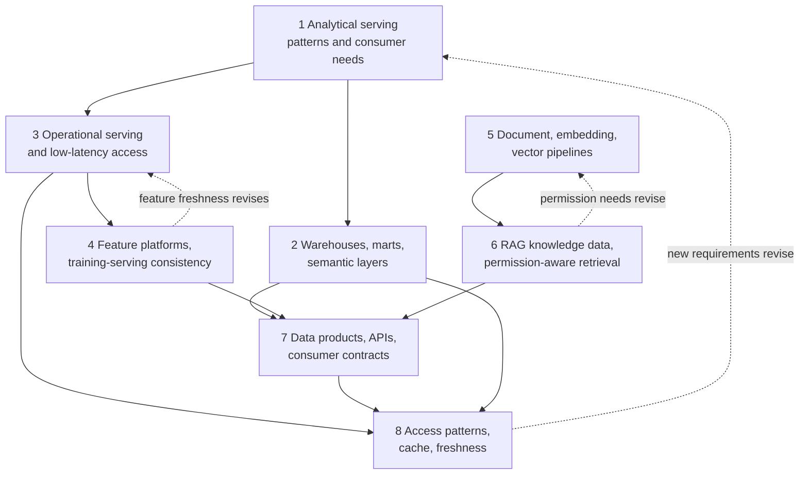
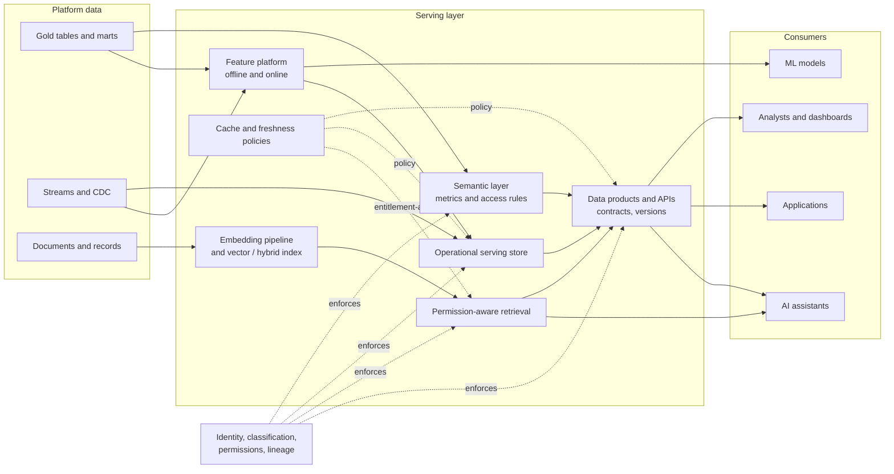

# Roadmap — Module 2D.14: Data Access, Serving, Semantic and AI Data Architecture

This is the learning roadmap for the fourteenth module of Stage 2D, **Data
Architecture**. It tells you **what** to learn, **in what order**, **how** to study
and practise each topic from beginner to advanced level, **how to prove** you have
learned it, and **how to complete** the module's final analytics and AI
data-serving architecture project.

Earlier modules built, protected, cleaned, scaled and costed the data estate. This
module is about the **last mile**: how the right data reach the right consumer, in
the right shape, at the right speed, with the right permissions, whether that
consumer is an analyst, an application, a machine learning model or an AI
assistant.

> **Repository note (source-of-truth limits).** The eight topic files,
> `practice-questions.md`, `README.md`, `Projects/README.md` and
> `Projects/14-analytics-and-ai-data-serving-architecture.md` currently exist but
> are **empty**, as are the Stage 2D overview files; the target roadmap file
> existed but was empty. This roadmap therefore cannot be grounded in their
> contents. It is the first written statement of the module's scope, derived from
> the file names, the Stage 2D structure and the earlier module roadmaps. It does
> **not** claim that any topic file already contains the material below. Every
> exercise, template, scenario and target is a **recommendation**, not a
> documented requirement. When the topic files and the project file are written,
> their scope governs and this roadmap should be updated to match.
>
> **Directory name.** The prompt that requested this roadmap referred to
> `STAGE 2D - DATA ARCHITECURE/`. The actual directory is
> `Stage 2D — Data Architecture/`, and the actual name is preserved.
>
> **Illustrative content.** Every number, system and organisation here is an
> **illustrative assumption**. The module is vendor-neutral: no database, cloud,
> feature store, vector store, embedding model, API framework or AI platform is
> assumed. Product *categories* are used; where a name appears it is only an
> example to investigate. Exercises use diagrams, tables, small synthetic data and
> documented analysis; none requires deployment or real personal data.

## Table of contents

- [A. Module overview](#a-module-overview)
- [B. Module learning outcomes](#b-module-learning-outcomes)
- [C. Prerequisites and knowledge dependencies](#c-prerequisites-and-knowledge-dependencies)
- [D. Recommended learning sequence](#d-recommended-learning-sequence)
- [E. Detailed learning roadmap for every topic](#e-detailed-learning-roadmap-for-every-topic)
  - [E.1 Analytical serving patterns and consumer needs](#e1-topic-01--analytical-serving-patterns-and-consumer-needs)
  - [E.2 Warehouses, marts and semantic layers](#e2-topic-02--warehouses-marts-and-semantic-layers)
  - [E.3 Operational data serving and low-latency access](#e3-topic-03--operational-data-serving-and-low-latency-access)
  - [E.4 Feature platforms and training-serving consistency](#e4-topic-04--feature-platforms-and-training-serving-consistency)
  - [E.5 Document data, embedding and vector pipelines](#e5-topic-05--document-data-embedding-and-vector-pipelines)
  - [E.6 RAG knowledge data and permission-aware retrieval](#e6-topic-06--rag-knowledge-data-and-permission-aware-retrieval)
  - [E.7 Data products, APIs and consumer contracts](#e7-topic-07--data-products-apis-and-consumer-contracts)
  - [E.8 Access patterns, cache strategy and freshness](#e8-topic-08--access-patterns-cache-strategy-and-freshness)
- [F. Cross-topic integration](#f-cross-topic-integration)
- [G. Practice-question integration](#g-practice-question-integration)
- [H. Module completion checklist](#h-module-completion-checklist)
- [I. Final project guide — Analytics and AI data-serving architecture](#i-final-project-guide--analytics-and-ai-data-serving-architecture)

---

## A. Module overview

### A.1 What data access and data serving mean

**Data access** is how a consumer obtains data (query, API, file, stream, search).
**Data serving** is the architecture that prepares data so that access is fast,
correct, understandable and permitted. Storing data is not serving them: a
perfectly stored table may be unusable to a dashboard (wrong shape), an
application (too slow), a model (inconsistent with training) or an AI assistant
(not retrievable, or retrievable by the wrong person).

### A.2 Why serving architecture matters

| Without deliberate serving design | With it |
| --- | --- |
| Every consumer builds its own extracts | Shared, governed access paths |
| Same metric, different numbers | Common definitions (semantic layer) |
| Applications query analytical stores and time out | Serving fit to the access pattern |
| Models trained on data that differ from serving data | Training-serving consistency |
| AI assistants reveal data a user may not see | Permission-aware retrieval |
| APIs change and break consumers | Explicit contracts and versioning |

### A.3 Consumers differ

| Consumer | Typical need | Typical serving pattern (to be validated per scenario) |
| --- | --- | --- |
| **Analytical** (analysts, BI, finance, risk) | Flexible aggregation over history; consistent definitions | Warehouse/marts, semantic layer, extracts |
| **Operational** (applications, services) | Single-entity lookups in milliseconds; high concurrency | Key-value / operational serving store, cache, APIs |
| **ML** (training and online inference) | Consistent features offline and online; point-in-time correctness | Feature platform |
| **AI** (RAG assistants, agents) | Relevant, permitted, fresh knowledge passages | Document/embedding pipelines, vector/hybrid retrieval, permission filters |

### A.4 The main building blocks

| Block | Role |
| --- | --- |
| Warehouse / mart | Governed, modelled analytical data for a purpose |
| Semantic layer | Business-facing definitions (metrics, dimensions, relationships) over data |
| Operational serving store | Low-latency access to current entity state |
| Feature platform | Managed features for training and online serving |
| Document, embedding and vector pipelines | Prepare unstructured content for similarity retrieval |
| RAG retrieval layer | Retrieve permitted knowledge to ground AI responses |
| Data products / APIs | Packaged, contract-bound interfaces |
| Caches and freshness policies | Reuse results within explicit staleness limits |

### A.5 How serving decisions affect usability, performance, governance, complexity and cost

Each serving layer is another system to build, secure, monitor and pay for. More
layers can mean faster, simpler consumption but more copies, more lag, more
places to enforce permissions and more cost (2D.13). Serving decisions therefore
belong in the same trade-off framework used throughout the stage.

### A.6 What you should be able to do by the end

Analyse consumers; choose analytical, operational, ML and AI serving patterns;
design semantic layers and data products; design feature and embedding pipelines;
design permission-aware retrieval; define contracts; set cache and freshness
policies; and integrate and defend a coherent analytics and AI data-serving
architecture.

### A.7 How the module connects to broader work

| Connection | How |
| --- | --- |
| `../03-Data-Architecture-Patterns-and-Reference-Architectures/` | Data products, mesh, fabric, event-driven sharing |
| `../04-Conceptual-Logical-and-Physical-Data-Modeling/` | Dimensional models, schema evolution |
| `../05-Database-and-Storage-Architecture/` | Serving store categories, layout |
| `../06-Data-Integration-and-Interoperability/` | Data contracts, compatibility, virtualization and sharing |
| `../07-Enterprise-Data-Platform-and-Lakehouse-Architecture/` | Gold layer, data products, self-service |
| `../09-Streaming-and-Real-Time-Data-Architecture/` | Serving stores, materialized views, freshness |
| `../10-Data-Governance-Security-Privacy-and-Compliance/` | Access control, masking, purpose, residency, deletion |
| `../11-Metadata-Lineage-Quality-and-Master-Data/` | Catalogue, lineage, quality, entity consistency |
| `../12-Reliability-Resilience-and-Disaster-Recovery/` | Serving availability and degradation |
| `../13-Performance-Scalability-and-Cost-Architecture/` | Caching, materialization, cost, testing |
| `../15-Architecture-Documentation-Reviews-and-Operating-Model/` | Documenting and reviewing serving designs |
| `../16-Enterprise-Data-Architecture-Case-Studies-and-Capstone/` | Case study use of serving architecture |

### A.8 Terminology (expanded at first use)

| Term | Meaning |
| --- | --- |
| Data mart | A subset of analytical data modelled for a business area |
| Semantic layer | A business-facing model of metrics, dimensions and relationships over data |
| Feature | A measurable input to a model, derived from data |
| Feature platform / store | System managing feature definitions, computation and serving |
| Training-serving skew | Difference between features seen in training and in production use |
| Point-in-time correctness | Using only data available at the prediction time when building training sets |
| Embedding | A numeric vector representing the meaning of content |
| Vector index | A structure for finding nearest vectors quickly |
| Chunk | A piece of a document prepared for embedding and retrieval |
| RAG (Retrieval-Augmented Generation) | Retrieving relevant content to ground an AI model's answer |
| ACL (access control list) | Rules listing who may access a resource |
| Data product | Data packaged with an owner, interface and service promises |
| Consumer contract | An explicit agreement on structure, meaning, quality and service |
| TTL (time to live) | How long a cached item remains valid |
| Freshness | How up to date the served data are |

---

## B. Module learning outcomes

After completing the module you will be able to:

1. **Analyse** consumer needs and **select** appropriate analytical serving
   patterns.
2. **Explain** the roles of warehouses, marts and semantic layers.
3. **Evaluate** operational serving and low-latency data access.
4. **Explain** feature platforms and training-serving consistency.
5. **Describe** document ingestion, embedding generation and vector-data
   pipelines.
6. **Design or evaluate** RAG knowledge-data and permission-aware retrieval flows.
7. **Define** data products, API contracts and consumer expectations.
8. **Evaluate** access patterns, cache strategies and freshness requirements.
9. **Integrate** relevant serving patterns into a coherent analytics and AI
   data-serving architecture.
10. **Justify** architecture decisions with requirements, assumptions, constraints
    and trade-offs.

Each outcome is demonstrated through the exercises, deliverables and gates in
Sections E, H and I.

---

## C. Prerequisites and knowledge dependencies

### C.1 Prerequisite table

| # | Prerequisite (plain terms) | Why needed | Needed by topics | Essential? | Provided by |
| --- | --- | --- | --- | --- | --- |
| P1 | Analytical vs operational workloads; OLTP/OLAP | Different consumers need different stores | 1, 2, 3 | Essential | `../05-Database-and-Storage-Architecture/01-oltp-olap-and-operational-analytical-separation.md` |
| P2 | Dimensional modeling, grain, facts and dimensions | Marts and semantic layers sit on these | 1, 2 | Essential | `../04-Conceptual-Logical-and-Physical-Data-Modeling/04-dimensional-modeling-facts-dimensions-and-grain.md` |
| P3 | Warehouse, lakehouse, table formats; gold layer and data products | Where analytical serving data live | 1, 2, 7 | Essential | `../05-Database-and-Storage-Architecture/04-warehouse-lakehouse-and-table-format-design.md`, `../07-Enterprise-Data-Platform-and-Lakehouse-Architecture/03-bronze-silver-gold-and-data-product-boundaries.md` |
| P4 | Operational stores: key-value, relational, specialised; consistency | Operational and low-latency serving | 3, 4, 8 | Essential | `../05-Database-and-Storage-Architecture/02-relational-nosql-and-specialized-database-selection.md`, `06-replication-consistency-and-transaction-boundaries.md` |
| P5 | Serving stores, materialized views, upserts, freshness | Direct foundation for Topics 3, 8 | 3, 8 | Essential | `../09-Streaming-and-Real-Time-Data-Architecture/06-real-time-serving-stores-and-materialized-views.md` |
| P6 | Caching, materialization, hit ratio, cost and performance testing | Topic 8 and performance of every serving layer | 3, 5, 6, 8 | Essential | `../13-Performance-Scalability-and-Cost-Architecture/05-caching-materialization-and-serving-trade-offs.md`, `07-performance-testing-and-capacity-validation.md` |
| P7 | Data products, mesh, fabric; data contracts and compatibility | Data products, APIs and contracts | 7 | Essential | `../03-Data-Architecture-Patterns-and-Reference-Architectures/04-data-mesh-principles-and-domain-data-products.md`, `../06-Data-Integration-and-Interoperability/05-data-contracts-schema-registry-and-compatibility.md` |
| P8 | Access control, classification, masking, purpose and residency, deletion | Permission-aware retrieval; governed serving | 2, 6, 7 | Essential | `../10-Data-Governance-Security-Privacy-and-Compliance/03-identity-access-control-and-least-privilege.md`, `05-pii-masking-tokenization-and-de-identification.md`, `06-consent-purpose-limitation-and-data-residency.md`, `07-retention-deletion-legal-holds-and-auditability.md` |
| P9 | Metadata, catalogue, glossary, lineage, quality, entity consistency | Semantic layer definitions, feature lineage, knowledge-data provenance | 2, 4, 5, 6, 7 | Essential | `../11-Metadata-Lineage-Quality-and-Master-Data/02-data-catalogs-discovery-and-classification.md`, `03-end-to-end-lineage-and-impact-analysis.md`, `04-data-quality-dimensions-and-critical-data-elements.md` |
| P10 | Event/streaming basics, replay, CDC | Online feature freshness; index updates | 4, 5, 6, 8 | Useful | `../09-Streaming-and-Real-Time-Data-Architecture/05-cdc-event-backbones-and-replay.md` |
| P11 | Reliability objectives and degradation | Serving availability, graceful degradation | 3, 6, 7, 8 | Useful | `../12-Reliability-Resilience-and-Disaster-Recovery/01-reliability-objectives-sli-slo-and-sla.md` |
| P12 | Basic ML concepts (training vs inference, features, labels); embedding intuition | Topics 4–6 | 4, 5, 6 | Useful additional knowledge, **learned in the topics** | Taught at Beginner level in Topics 4 and 5 |

### C.2 Dependency map across the eight topics



The numeric order is a sound default. The dotted arrows show feedback: later
findings (freshness, permissions, feature timing) change earlier designs.

---

## D. Recommended learning sequence

Effort estimates are **recommendations** (about 6–8 hours per week assumed).
The recommended order **matches the numeric order**, following *who needs what →
analytical serving → operational serving → ML features → document/vector data →
retrieval with permissions → packaging as products/APIs → freshness and caching
across all*.

| Seq | File | Title | Why here | Prerequisite topics | Primary concepts | Practical activity | Expected output | Readiness criteria | Effort (rec.) |
| --- | --- | --- | --- | --- | --- | --- | --- | --- | --- |
| 1 | `01-analytical-serving-patterns-and-consumer-needs.md` | Analytical serving patterns and consumer needs | Everything starts with who the consumer is | P1–P3 | Consumer personas, access patterns, serving options | Consumer-requirement matrix | Matrix with pattern proposals | Each pattern justified by requirements | 6–8 h |
| 2 | `02-warehouse-marts-and-semantic-layers.md` | Warehouses, marts and semantic layers | Turns analytical data into governed, understandable models | Seq 1, P2, P3, P9 | Mart design, semantic layer, metric definitions | Analytical serving design | Design with metric definitions | Definitions consistent; layers distinguished | 6–8 h |
| 3 | `03-operational-data-serving-and-low-latency-access.md` | Operational data serving and low-latency access | Applications need a different serving shape | Seq 1, P4, P5 | Point lookups, latency budget, concurrency | Serving comparison | Comparison against explicit latency needs | Access pattern drives choice | 6–8 h |
| 4 | `04-feature-platforms-and-training-serving-consistency.md` | Feature platforms and training-serving consistency | Introduces ML consumers; builds on operational serving | Seq 3, P9, P10 | Offline/online features, point-in-time, skew | Feature flow diagram | Diagram and consistency checks | Skew risks and validations identified | 7–9 h |
| 5 | `05-document-data-embedding-and-vector-pipelines.md` | Document data, embedding and vector pipelines | Prepares unstructured content for retrieval | Seq 1, P9, P10 | Ingest, chunk, embed, index, refresh | Pipeline design | Pipeline with validation checks | Stages, dependencies and refresh defined | 7–9 h |
| 6 | `06-rag-knowledge-data-and-permission-aware-retrieval.md` | RAG knowledge data and permission-aware retrieval | Uses the pipelines; adds access control and AI consumption | Seq 5, P8 | Retrieval, filters, ACL propagation | Retrieval architecture | Diagram with permission enforcement and tests | Permissions enforced at retrieval, validated | 7–9 h |
| 7 | `07-data-products-apis-and-consumer-contracts.md` | Data products, APIs and consumer contracts | Packages the above for consumers with explicit promises | Seq 2, 4, 6, P7 | Product spec, API contract, versioning | Spec and contract | Product specification and contract | Contract testable and versioned | 6–8 h |
| 8 | `08-access-patterns-cache-strategy-and-freshness.md` | Access patterns, cache strategy and freshness | Applies to every serving path; needs them designed | Seq 2, 3, 7, P6 | Hit ratio, TTL, invalidation, freshness SLO | Decision matrix | Matrix with freshness and validation | Staleness bounded and tested | 6–8 h |
| — | `practice-questions.md` | Validation | After each topic and fully before the project | Seq 1–8 | — | Gap log | Gap log | — | 3–4 h |
| — | `Projects/14-analytics-and-ai-data-serving-architecture.md` | Final project | Integrates all eight | All | — | Integrated architecture | Architecture package | — | 14–18 h |

**Revisiting earlier topics.**

| When | Revisit |
| --- | --- |
| A consumer needs fresher data than the mart provides | Topics 1, 3, 8 |
| A metric differs between dashboard and API | Topics 2, 7 |
| Online features differ from training features | Topics 4, 3 |
| A retrieved passage exposes content to the wrong user | Topics 6, 5 |
| An API change breaks consumers | Topic 7 |
| Cache serves outdated data after a change | Topics 8, 3 |

---

## E. Detailed learning roadmap for every topic

Each topic uses the same twelve parts. Levels are cumulative. Examples use the
**illustrative** scenario of *Northbridge Bank* (Section I.2), a fictional
mid-sized bank, with synthetic data. Because the source topic files are empty,
specific subtopics named below are **recommended** learning focuses.

---

### E.1 Topic 01 — Analytical serving patterns and consumer needs

Source: [`01-analytical-serving-patterns-and-consumer-needs.md`](01-analytical-serving-patterns-and-consumer-needs.md)

#### 1. Topic overview

Analytical consumers (BI users, analysts, finance, risk, data scientists) ask
questions across history. Their needs differ: some want pre-built dashboards,
some want ad hoc SQL, some want governed extracts, some want raw data for
exploration. This topic teaches you to **start from the consumer**, document what
they need, and match serving patterns to those needs.

#### 2. Learning objectives

1. Identify analytical consumer types and their needs.
2. Document access patterns, concurrency, freshness and usability requirements.
3. Describe analytical serving patterns (dashboards, ad hoc query, marts,
   extracts, APIs, embedded analytics).
4. Select a pattern per consumer with stated reasons.
5. Analyse trade-offs among usability, performance, freshness and complexity.
6. Document the result as a consumer-requirement matrix.

#### 3. Prerequisites

P1–P3. Review `../05-Database-and-Storage-Architecture/01-oltp-olap-and-operational-analytical-separation.md` if the workload distinction is unclear.

#### 4. Beginner level — understand the fundamentals

- **Concepts:** consumer, persona, access pattern, ad hoc vs scheduled query,
  concurrency, freshness, self-service, governed data.
- **Typical analytical consumers (illustrative):**

  | Consumer | Typical need | Skill level |
  | --- | --- | --- |
  | Executive | A few trusted headline numbers, simple views | Low technical |
  | Business analyst | Slice and dice with consistent definitions | Medium |
  | Finance / regulatory reporter | Reconciled, auditable, point-in-time figures | Medium, strict |
  | Data scientist | Detailed history, flexible access | High technical |
  | Operations manager | Near-current operational views | Low–medium |

- **Analogy:** a restaurant serving different diners: a set menu (dashboard), à la
  carte (ad hoc), takeaway (extract), the kitchen tour (raw data).
- **Learn in this order:** who → what question → how often → how fresh → how many
  at once → what skill.
- **Questions to answer:** Why can one serving pattern not suit all of these? What
  does "self-service" require from the data?
- **Small exercise:** list five consumers of a customer-exposure dataset and one
  question each asks.

#### 5. Intermediate level — apply the concepts

- **Consumer-requirement matrix (template):**

  | Consumer | Questions | Access pattern | Concurrency | Freshness | Latency | Sensitivity | Skill | Candidate serving pattern |
  | --- | --- | --- | --- | --- | --- | --- | --- | --- |
  | Risk analyst | Exposure by segment | Ad hoc + dashboard | 20 | Daily | < 5 s | Restricted | Medium | Mart + semantic layer |

- **Serving patterns (conceptual):**

  | Pattern | Fits | Limit |
  | --- | --- | --- |
  | Governed dashboards over a mart | Many business users; fixed questions | Limited flexibility |
  | Ad hoc SQL over curated tables | Analysts, data scientists | Needs skills and guardrails |
  | Semantic layer / metrics API | Consistent metrics across tools | Needs definition governance |
  | Scheduled extracts / files | Partners, regulators, legacy tools | Stale copies, governance burden |
  | Embedded analytics / API | Applications showing analytics | Latency and contract needs |
  | Direct raw/lake access | Exploration, ML | Weak governance if uncontrolled |

- **Translating needs to requirements:** convert vague statements ("fast", "live")
  into measurable ones (2D.2 Topic 4): p95 query latency, freshness SLO,
  concurrent users, availability.
- **Constraints:** classification and permissions (row/column), residency, cost per
  query (2D.13).
- **Trade-offs:** flexibility vs consistency; freshness vs cost; self-service vs
  governance.
- **Practical exercise:** produce a consumer-requirement matrix for six consumers and
  propose a serving pattern for each.
- **Check:** each pattern cites at least two requirements; unmet requirements and
  assumptions are listed.

#### 6. Advanced level — design and evaluate production-ready architectures

- **Multiple consumers on shared data:** workload isolation (separate compute or
  queues), priority classes, quotas, and the effect of heavy ad hoc queries on
  dashboards (2D.5 Topic 1, 2D.7 Topic 7).
- **Serving tiers:** tier consumers by criticality and sensitivity; differentiate
  freshness, availability and support (2D.7 Topic 8).
- **Pattern combination:** a mart for governed reporting, a semantic layer for
  consistent metrics, a sandbox for exploration, an API for embedding; define the
  authoritative path for each metric.
- **Conflicting requirements:** analysts want raw detail; compliance wants masking;
  finance wants reconciled monthly figures; marketing wants hourly freshness.
  Resolve by tiering, masking views, separate products, documented trade-offs.
- **Cost and usage:** per-query/per-scan cost and cost allocation by consumer
  (2D.13 Topic 6); governing runaway queries.
- **Adoption and usability:** discovery via the catalogue (2D.11 Topic 2),
  documentation, training; measuring usage and satisfaction.
- **Evidence and validation:** representative workloads tested (2D.13 Topic 7);
  user acceptance on real questions; metric reconciliation.
- **Document** consumer segmentation and pattern choices in an ADR.
- **Advanced exercise:** for a platform with seven consumer types, define tiers,
  serving patterns, isolation, freshness and cost allocation, and show where
  requirements conflict and how each is resolved.

#### 7. Industry-style practical exercises

| Level | Scenario | Objective | Inputs / assumptions | Task | Constraints | Expected output | Validation | Demonstrates |
| --- | --- | --- | --- | --- | --- | --- | --- | --- |
| Beginner | Customer-exposure dataset | Identify consumers and questions | Description | List five consumers with questions | None | List | Questions concrete | You start from consumers |
| Intermediate | Six Northbridge consumers | Build the requirement matrix and choose patterns | Synthetic personas | Matrix and pattern per consumer | Sensitivity | Matrix with justification | Each choice cites requirements | You can map needs to patterns |
| Advanced | Seven consumers with conflicts | Tiered serving design with isolation and cost | Concurrency and cost placeholders | Tiers, isolation, conflict resolution, ADR | Governance | Design document | Conflicts resolved with reasons | You can design for diverse consumers |

#### 8. Real-world scenarios and architectural trade-offs

| Scenario | Consumer need / problem | Options | Benefits / limits | Dependencies / constraints | Security / permissions | Performance / freshness | Cost / complexity | Evidence to validate |
| --- | --- | --- | --- | --- | --- | --- | --- | --- |
| Executives want "live" numbers | Headline KPIs | (a) Real-time pipeline; (b) 15-min refreshed mart | (a) fresh, costly; (b) adequate | Source latency | Aggregated only | 15 min acceptable? | (a) high | Decision log: does 15 min change decisions? |
| Analysts bypass the mart | Use raw lake | (a) Block; (b) governed sandbox with masking | (a) friction; (b) controlled | Catalogue | Row/column controls | Query cost | (b) moderate | Usage and incident review |

#### 9. Expected deliverables

- Consumer personas and requirement matrix.
- Serving-pattern comparison and recommendation per consumer.
- Tiering and isolation notes.
- ADR.

#### 10. Common mistakes and misconceptions

| Mistake | Why problematic | Recognise / correct |
| --- | --- | --- |
| One pattern for every consumer | Poor fit | Start from consumers |
| Requirements stated as adjectives | Unmeasurable | Add numbers |
| Ignoring sensitivity differences | Over-exposure | Capture classification |
| Ad hoc access without guardrails | Cost and risk | Quotas, masking, sandboxes |
| Forgetting adoption | Unused platform | Discovery, docs, feedback |

#### 11. Mastery criteria

- Build a measurable requirement matrix from persona descriptions.
- Justify a serving pattern for each consumer and name its limit.
- Resolve a conflict between two consumers' requirements.

#### 12. Completion gate

- [ ] Matrix, pattern recommendations and ADR reviewed by another person.
- [ ] Every requirement is measurable or flagged as an assumption.
- [ ] Practice questions attempted and gaps logged (Section G).
- [ ] Readiness: you can now design the governed models consumers use (Topic 2).

---

### E.2 Topic 02 — Warehouses, marts and semantic layers

Source: [`02-warehouse-marts-and-semantic-layers.md`](02-warehouse-marts-and-semantic-layers.md)

#### 1. Topic overview

A **warehouse** holds integrated, modelled analytical data. A **mart** is a focused
slice shaped for a business area. A **semantic layer** sits between the data and
the consumer tools and defines **business meaning once**: metrics, dimensions,
relationships, hierarchies and (often) access rules. It is a layer of
**definitions**, not a replacement for the underlying storage.

#### 2. Learning objectives

1. Distinguish warehouse, mart, lakehouse gold layer and semantic layer.
2. Design a mart from business questions and grain.
3. Define metrics, dimensions and relationships in a semantic layer.
4. Explain how consistent definitions are governed.
5. Explain how semantic models map to underlying tables and how changes propagate.
6. Evaluate design trade-offs (centralised vs domain marts, virtual vs physical).

#### 3. Prerequisites

Seq 1; P2 (grain, facts, dimensions), P3, P9 (glossary).

#### 4. Beginner level — understand the fundamentals

- **Concepts and distinctions:**

  | Term | What it is | Not |
  | --- | --- | --- |
  | Warehouse | Integrated analytical store and models | A semantic layer |
  | Data mart | Subject-focused subset or model for a business unit | A copy with no governance |
  | Gold layer (platform term) | Consumption-shaped data in the platform (2D.7) | Necessarily a data product |
  | Semantic layer | Business definitions (metrics, dimensions, joins, access) over data | The storage |
  | Metric | A defined calculation, e.g. "net exposure" | A column |

- **Analogy:** the warehouse is the stockroom; a mart is a shop section; the
  semantic layer is the price list and product catalogue that makes everyone
  describe items the same way.
- **Why a semantic layer:** "revenue" computed differently in five dashboards; the
  semantic layer defines it once.
- **Questions to answer:** Where should the definition of "active customer" live?
  What happens when two teams define it differently?
- **Small exercise:** write definitions (formula, filters, grain) for three metrics.

#### 5. Intermediate level — apply the concepts

- **Mart design from questions:** list business questions → grain (2D.4 Topic 4) →
  facts and dimensions → conformed dimensions shared across marts.
- **Semantic layer components:** entities and relationships (joins and cardinality),
  dimensions (with hierarchies), measures/metrics (formulas, additivity rules),
  filters, time handling, security (row/column rules), documentation and
  ownership.
- **Metric definition example (illustrative):**

  | Metric | Formula | Grain | Additivity | Filters | Owner |
  | --- | --- | --- | --- | --- | --- |
  | Net exposure | `SUM(amount_base) − SUM(collateral_base)` | customer × day | Additive across customers, semi-additive across time | Active accounts | Risk data owner |

- **Virtual vs materialised semantic models:** semantic definitions compile to
  queries at run time (flexible, query cost) vs precomputed aggregates (fast,
  refresh cost) (2D.13 Topic 5).
- **Governance of definitions:** version control, review, certification, change
  notification; link to the catalogue/glossary (2D.11).
- **Access control:** row-level and column-level rules defined once and applied
  across tools (2D.10 Topic 3); masking for sensitive columns.
- **Failure scenarios:** same metric different numbers; join fan-out inflating
  sums; semantic model drifting from schema changes.
- **Practical exercise:** design a small mart and semantic model for exposure
  reporting with five metrics and three dimensions.
- **Check:** every metric has formula, grain, additivity and owner; joins documented;
  test queries reproduce known totals.

#### 6. Advanced level — design and evaluate production-ready architectures

- **Centralised vs domain-owned marts and semantics:** one enterprise semantic layer
  (consistency, bottleneck) vs federated domain semantics with shared conformed
  dimensions and certified metrics (2D.3 Topics 1, 4).
- **Layered semantics:** certified enterprise metrics vs local self-service
  metrics; rules for promotion.
- **Performance:** aggregate awareness, caching, pre-aggregations; the cost of
  complex joins and many-to-many relationships; query generation quality.
- **Change management:** schema evolution upstream (2D.4 Topic 7); impact analysis
  via lineage (2D.11 Topic 3); deprecation and parallel versions of metrics;
  restating history when definitions change.
- **Historical correctness:** slowly changing dimensions and point-in-time reporting
  (2D.4 Topics 4–5); consistent "as of" semantics.
- **Interoperability:** serving the same semantics to multiple BI tools, notebooks
  and APIs; limits of tool-specific features.
- **Governance and compliance:** purpose-based access, audit of metric usage,
  masking rules central.
- **Cost and operations:** semantic query cost allocation; monitoring metric
  freshness and correctness (2D.11 Topic 5).
- **Evidence and validation:** reconciliation of metrics to source totals;
  regression tests on certified metrics; user acceptance.
- **Document** semantic layer scope, ownership and promotion process in an ADR.
- **Advanced exercise:** define a two-tier (certified/local) semantic architecture
  for three domains with conformed customer and date dimensions, a metric change
  process, and a reconciliation test.

#### 7. Industry-style practical exercises

| Level | Scenario | Objective | Inputs / assumptions | Task | Constraints | Expected output | Validation | Demonstrates |
| --- | --- | --- | --- | --- | --- | --- | --- | --- |
| Beginner | Three KPIs | Define metrics unambiguously | Business descriptions | Formula, grain, filters | None | Definitions | A colleague computes the same value | You can define metrics |
| Intermediate | Exposure reporting | Mart plus semantic model | Synthetic tables | Model, metrics, joins, access rules | Additivity | Design note | Test totals reproduce | You can design a semantic layer |
| Advanced | Three domains | Two-tier semantics with change process | Overlapping definitions | Tier design, promotion, versioning, reconciliation | Conflicting definitions | Architecture and ADR | Change scenario traced | You can govern semantics |

#### 8. Real-world scenarios and architectural trade-offs

| Scenario | Consumer need / problem | Options | Benefits / limits | Dependencies / constraints | Security / permissions | Performance / freshness | Cost / complexity | Evidence |
| --- | --- | --- | --- | --- | --- | --- | --- | --- |
| Two teams, two "active customer" definitions | Conflicting dashboards | (a) Pick one; (b) certified plus local variants with distinct names | (a) simple, contested; (b) explicit | Governance forum | Same access rules | Same data | (b) moderate | Reconciliation showing both |
| Slow dashboards from complex joins | Latency | (a) Pre-aggregate; (b) simplify model; (c) larger compute | (a) fast, refresh; (b) permanent; (c) cost | Query plans | Row filters preserved | Refresh cadence | Varies | Before/after tests |

#### 9. Expected deliverables

- Mart design (grain, facts, dimensions).
- Semantic model definition (entities, relationships, metrics, access rules).
- Metric catalogue with owners.
- Change/versioning process.
- Reconciliation tests and ADR.

#### 10. Common mistakes and misconceptions

| Mistake | Why problematic | Recognise / correct |
| --- | --- | --- |
| Treating the semantic layer as storage | Misplaced effort | It defines meaning over storage |
| Metrics defined in each dashboard | Divergence | Define once, reuse |
| Ignoring additivity | Wrong totals | Document additivity |
| Join fan-out unnoticed | Inflated numbers | Test with known totals |
| No owner for metrics | Decay | Assign owners |
| Changing definitions without versioning | Silent report changes | Version and notify |

#### 11. Mastery criteria

- Distinguish warehouse, mart, gold layer and semantic layer.
- Define metrics with formula, grain and additivity.
- Design a change process that protects consumers.

#### 12. Completion gate

- [ ] Model, metric catalogue and tests reviewed; totals reproduced.
- [ ] Layers clearly distinguished in your design.
- [ ] Practice questions attempted and gaps logged.
- [ ] Readiness: you can now design serving for applications that need
      millisecond access (Topic 3).

---

### E.3 Topic 03 — Operational data serving and low-latency access

Source: [`03-operational-data-serving-and-low-latency-access.md`](03-operational-data-serving-and-low-latency-access.md)

#### 1. Topic overview

Applications and services need **current data about one entity** (a customer's
balance, a limit, a risk flag) in **milliseconds**, at high concurrency, with
predictable availability. That is a different job from analytical queries. This
topic covers how to expose analytical and stream-derived data to operational
consumers without harming either side.

#### 2. Learning objectives

1. Distinguish operational from analytical serving requirements.
2. Specify access patterns, latency budgets and concurrency.
3. Compare serving approaches (key-value, relational, cache-in-front, search,
   materialised views).
4. Design data loading (upserts) and freshness.
5. Reason about availability, consistency and failure behaviour.
6. Validate against explicit requirements.

#### 3. Prerequisites

Seq 1; P4, P5, P6.

#### 4. Beginner level — understand the fundamentals

- **Concepts:** point lookup, key, latency percentile, concurrency, throughput,
  upsert, read replica, cache, serving store, read-your-writes.
- **Operational vs analytical:**

  | Aspect | Operational serving | Analytical serving |
  | --- | --- | --- |
  | Typical request | Get entity by key | Aggregate over many rows |
  | Latency | Milliseconds | Seconds |
  | Concurrency | High | Moderate |
  | Data horizon | Current state | History |
  | Failure impact | Customer-facing | Delayed insight |

- **Analogy:** a bank teller looking up one account (operational) vs an auditor
  reviewing the ledger (analytical).
- **Questions to answer:** Why does an analytical warehouse often fail as an
  application backend? What is a latency budget?
- **Small exercise:** state, for three application calls, key, expected latency and
  freshness.

#### 5. Intermediate level — apply the concepts

- **Access pattern specification:** keys, request mix, read/write ratio, payload
  size, concurrency, p95/p99 latency, availability, consistency expectation.
- **Capacity arithmetic.**

  ```text
  required_throughput = peak_requests/s × safety_factor
  e.g. 3,000 requests/s × 1.5 = 4,500 requests/s
  payload bandwidth = requests/s × payload_size = 4,500 × 2 KB = 9 MB/s
  ```

- **Serving options (concept):**

  | Option | Strength | Limit |
  | --- | --- | --- |
  | Key-value store | Very fast point reads | Limited querying |
  | Relational operational DB | Transactions, flexible queries | Scale/latency at extremes |
  | Cache in front of a store | Hot read latency | Staleness, invalidation |
  | Search/index store | Filtered lookups | Not a system of record |
  | Materialised view (stream-maintained) | Fresh aggregates | Maintenance complexity |
  | Direct analytical query | Flexibility | Latency, cost, concurrency |

- **Loading and freshness:** upserts from batch or streams with versions; handling
  out-of-order updates; backfills; freshness SLO (2D.9 Topic 6).
- **Isolation from analytical load:** serving store independent of the warehouse;
  protect with quotas.
- **Availability:** replicas and zones (2D.12 Topic 3); degraded modes (serve
  stale, return defaults, fail closed for sensitive data).
- **Failure scenarios:** serving store behind the source; hot key; cache outage;
  inconsistent view after partial load.
- **Practical exercise:** compare three serving approaches for a "customer limit
  lookup" service against requirements.
- **Check:** each option evaluated against latency, concurrency, freshness,
  availability, cost.

#### 6. Advanced level — design and evaluate production-ready architectures

- **Latency budget decomposition:** network, authentication, service logic, store
  read, serialisation; set a budget per stage and measure (2D.9 Topic 1;
  2D.13 Topic 2). Tail latency from fan-out, GC, cold caches.
- **Consistency semantics:** eventual consistency between source and serving store;
  stale reads; read-your-writes for operational flows; define what a consumer may
  assume.
- **Hot keys and skew:** large customers, popular products; mitigations (caching,
  replication of hot keys, splitting) (2D.13 Topic 4).
- **Multi-region serving:** locality vs replication lag; residency (2D.8, 2D.10).
- **Write-back and CQRS-style separation (concept):** keep the system of record for
  writes separate from the read-optimised serving model; manage lag.
- **Security:** authenticated access, authorisation per entity, masking, encryption,
  audit; avoid broad service credentials.
- **Cost:** in-memory stores, replication, over-provisioning for peaks (2D.13).
- **Operational complexity:** keeping serving data in sync, reconciliation (2D.6
  Topic 7), monitoring freshness and error rates.
- **Evidence and validation:** load tests with realistic key distributions; failure
  injection; freshness measurements (2D.13 Topic 7; 2D.12 Topic 8).
- **Document** serving choice, consistency contract and degraded modes in an ADR.
- **Advanced exercise:** design the serving path for real-time limit checks (key
  lookup + recent aggregate) with a latency budget, hot-key handling, degraded
  mode, reconciliation and a test plan.

#### 7. Industry-style practical exercises

| Level | Scenario | Objective | Inputs / assumptions | Task | Constraints | Expected output | Validation | Demonstrates |
| --- | --- | --- | --- | --- | --- | --- | --- | --- |
| Beginner | Three application calls | Specify access patterns | Descriptions | Key, latency, freshness per call | None | Table | Specific values | You can specify |
| Intermediate | Customer limit lookup | Compare serving options | 3,000 req/s peak (assumed) | Option evaluation with capacity arithmetic | Latency p95 ≤ 50 ms | Comparison | Arithmetic reproducible | You can compare |
| Advanced | Real-time limit checks | Full serving design | Skew, failure modes (assumed) | Budget, hot keys, degradation, reconciliation, test plan | Governance | Design and ADR | Failure behaviour defined | You can design for production |

#### 8. Real-world scenarios and architectural trade-offs

| Scenario | Consumer need / problem | Options | Benefits / limits | Dependencies / constraints | Security / permissions | Performance / freshness | Cost / complexity | Evidence |
| --- | --- | --- | --- | --- | --- | --- | --- | --- |
| App calls warehouse directly | Timeouts at peak | (a) Scale warehouse; (b) key-value serving store loaded by stream; (c) cache | (a) costly; (b) fit; (c) partial | Stream exists | Entity-level auth | ms vs seconds | (b) moderate | Load test |
| Serving store lags source | Users see old values | (a) Accept; (b) read-through to source for critical fields; (c) reduce lag | (a) simple; (b) fresh, load; (c) cost | Source capacity | Same | Freshness SLO | Varies | Lag measurements |

#### 9. Expected deliverables

- Access-pattern specification.
- Serving-option comparison with capacity arithmetic.
- Loading/freshness design and consistency contract.
- Degraded-mode description.
- ADR and test plan.

#### 10. Common mistakes and misconceptions

| Mistake | Why problematic | Recognise / correct |
| --- | --- | --- |
| Using the warehouse as an application backend | Latency and concurrency failures | Separate serving store |
| No latency budget | Cannot locate delay | Decompose |
| Ignoring hot keys | Uneven load | Test with skew |
| Unversioned upserts | Stale overwrites | Version or compare timestamps |
| No degraded mode | Hard outage | Define fallback |
| Overlooking authorisation at entity level | Data exposure | Per-request checks |

#### 11. Mastery criteria

- Specify access patterns with measurable targets.
- Compare serving options with capacity arithmetic.
- Define consistency semantics and degraded behaviour.

#### 12. Completion gate

- [ ] Specification, comparison, design and ADR reviewed.
- [ ] Arithmetic reproduced; failure behaviour documented.
- [ ] Practice questions attempted and gaps logged.
- [ ] Readiness: you can now serve features consistently to models (Topic 4).

---

### E.4 Topic 04 — Feature platforms and training-serving consistency

Source: [`04-feature-platforms-and-training-serving-consistency.md`](04-feature-platforms-and-training-serving-consistency.md)

#### 1. Topic overview

A **feature** is an input to a machine learning model (for example "customer's
transaction count in the last 30 days"). A **feature platform** defines, computes,
stores and serves features for **training** (large historical sets) and **online
inference** (single-entity, low latency). The core risk is **training-serving
skew**: the model sees features computed one way in training and another way in
production.

#### 2. Learning objectives

1. Explain features, labels, training and inference data needs.
2. Describe offline and online feature stores and their roles.
3. Explain point-in-time correctness and leakage.
4. Identify sources of training-serving skew and controls.
5. Describe the feature lifecycle (definition, computation, storage, serving,
   monitoring, retirement).
6. Design validation checks and feature flows.

#### 3. Prerequisites

Seq 3; P9 (lineage), P10; P12 learned here.

#### 4. Beginner level — understand the fundamentals

- **ML in one paragraph:** a model learns a mapping from inputs (features) to an
  outcome (label) using historical examples (training), then predicts for new
  cases (inference).
- **Terms:** feature, label, entity, feature definition, offline store, online
  store, materialisation, point-in-time join, leakage, skew, drift.
- **Offline vs online:**

  | | Offline store | Online store |
  | --- | --- | --- |
  | Purpose | Build training sets; batch scoring | Serve features at inference time |
  | Shape | Large history, scans | Latest value per entity, key lookups |
  | Latency | Seconds–minutes | Milliseconds |
  | Typical storage | Warehouse/lake tables | Low-latency key-value |

- **Analogy:** a recipe (feature definition) used both in the test kitchen (training)
  and the live restaurant (serving); skew is cooking it differently in each.
- **Questions to answer:** Why must the training feature equal the serving feature?
  What is leakage?
- **Small exercise:** define one feature precisely (entity, window, aggregation,
  source, timestamp column).

#### 5. Intermediate level — apply the concepts

- **Feature definition as a contract:** entity key, source, transformation, window,
  time semantics, freshness, owner, version.
- **Point-in-time correctness.** Training rows need feature values **as of each
  example's timestamp**, never later:

  ```text
  for each training example (entity, t):
      use feature values with event_time ≤ t   (and available at t)
  ```

  A join that uses the latest value leaks future information, inflating offline
  accuracy that collapses in production.
- **Sources of skew:** different code paths for offline and online; different data
  sources; time-window boundary differences; late-arriving data; null handling;
  unit/timezone differences; stale online store.
- **Controls:** one definition used for both paths (shared transformation code or
  engine), versioned definitions, backfills from the same logic, comparing
  distributions and sample values between training and serving, logging served
  features and replaying them offline, monitoring drift.
- **Online freshness:** streaming or micro-batch materialisation into the online
  store; freshness SLO; write path idempotency (2D.6 Topic 7).
- **Data flow diagram (conceptual):** sources → transformation → offline store →
  training set → model; sources → transformation → online store → inference
  service.
- **Governance:** classification and purpose of training data (2D.10 Topic 6);
  access to features; lineage from model to features to sources (2D.11).
- **Practical exercise:** diagram a feature flow for a fraud model; list five skew
  risks and a validation for each.
- **Check:** every feature has a single definition, a time semantic and an owner;
  validations are testable.

#### 6. Advanced level — design and evaluate production-ready architectures

- **Skew detection in operation:** log online feature vectors; compare with
  offline recomputation for the same entity and time (shadow recomputation);
  population stability and distribution comparison (awareness level); alert
  thresholds (assumptions).
- **Freshness vs cost vs consistency:** per-feature freshness tiers; on-demand
  computation at request time for features needing request context; precomputed
  for heavy aggregates.
- **Backfill and replay for features:** rebuilding historical feature values
  when a definition changes (2D.12 Topic 6); versioned feature sets; reproducible
  training datasets (snapshot IDs).
- **Feature reuse and governance:** discoverability, ownership, deprecation,
  dependency tracking; cost of duplicated features; access control per feature
  group.
- **Online store design:** key design, hot entities, TTL for stale features,
  default values when missing; availability and degraded behaviour (what does the
  model do without a feature?).
- **Latency budget:** feature retrieval is part of inference latency; batch feature
  fetches; co-locate online store with inference (2D.13 Topic 2).
- **Streaming features:** event-time windows, late events and corrections (2D.9
  Topic 3); exactly-once effects through idempotent upserts (2D.9 Topic 4).
- **Privacy and deletion:** features derived from personal data; deletion
  propagation to offline sets and online stores; purpose restrictions (2D.10).
- **Cost and operations:** dual storage, backfill compute, monitoring.
- **Evidence and validation:** unit tests for feature logic, parity tests,
  point-in-time tests with seeded leakage, shadow mode before launch.
- **Document** the feature platform scope, consistency controls and freshness tiers
  in an ADR.
- **Advanced exercise:** design the feature architecture for batch and real-time
  features of a fraud model; define parity tests, skew monitoring, backfill
  procedure and a deletion propagation path.

#### 7. Industry-style practical exercises

| Level | Scenario | Objective | Inputs / assumptions | Task | Constraints | Expected output | Validation | Demonstrates |
| --- | --- | --- | --- | --- | --- | --- | --- | --- |
| Beginner | One feature | Define precisely | Description | Entity, window, aggregation, source, timestamp | None | Definition card | No ambiguity | You can define a feature |
| Intermediate | Fraud model | Feature flow and skew risks | Synthetic flow | Diagram; 5 risks; validations | Offline and online paths | Diagram and table | Each risk has a test | You can spot skew |
| Advanced | Batch + real-time features | Full feature architecture | Late events, deletions (assumed) | Parity tests, monitoring, backfill, deletion | Latency budget | Architecture and ADR | Leakage test designed | You can design consistency |

#### 8. Real-world scenarios and architectural trade-offs

| Scenario | Consumer need / problem | Options | Benefits / limits | Dependencies / constraints | Security / permissions | Performance / freshness | Cost / complexity | Evidence |
| --- | --- | --- | --- | --- | --- | --- | --- | --- |
| Model great offline, poor online | Skew suspected | (a) Retrain; (b) parity analysis; (c) shadow compare | (a) may not fix; (b) finds cause; (c) real evidence | Logged features | Feature access | Online latency | (b)(c) moderate | Distribution and sample comparison |
| Definition change needed | New window logic | (a) Overwrite; (b) new version with backfill | (a) breaks models; (b) safe | Model registry | Same | Backfill time | (b) compute | Version lineage |

#### 9. Expected deliverables

- Feature definition cards.
- Feature data-flow diagram (offline/online).
- Point-in-time and parity validation plan.
- Skew-risk register.
- ADR.

#### 10. Common mistakes and misconceptions

| Mistake | Why problematic | Recognise / correct |
| --- | --- | --- |
| Different code for training and serving | Skew | Share definitions |
| Using latest values in training | Leakage | Point-in-time joins |
| No feature owner/version | Unmanaged change | Version and own |
| Ignoring missing-feature behaviour | Unpredictable predictions | Defaults and alerts |
| Treating the feature store as only a database | Misses lifecycle | Define governance |
| Forgetting deletion | Compliance gap | Propagate deletions |

#### 11. Mastery criteria

- Explain skew and leakage with examples and controls.
- Produce a feature flow with validations.
- Define freshness tiers and degraded behaviour.

#### 12. Completion gate

- [ ] Definitions, flow and validation plan reviewed.
- [ ] Leakage/parity tests are specified, not merely mentioned.
- [ ] Practice questions attempted and gaps logged.
- [ ] Readiness: you can now handle unstructured knowledge data for retrieval
      (Topic 5).

---

### E.5 Topic 05 — Document data, embedding and vector pipelines

Source: [`05-document-data-embedding-and-vector-pipelines.md`](05-document-data-embedding-and-vector-pipelines.md)

> **Scope note.** No embedding model, chunking method or vector store is assumed.
> Follow whatever the topic file specifies; this roadmap teaches the pipeline
> concepts generally.

#### 1. Topic overview

AI assistants and semantic search need unstructured content (policies, contracts,
manuals, emails) in a form that supports finding passages by **meaning**. The
pipeline: **ingest** documents → **extract and clean** text → **chunk** → **embed**
(turn text into vectors) → **index** vectors with **metadata** → **refresh** as
sources change. Each stage has quality, cost, governance and lifecycle
implications.

#### 2. Learning objectives

1. Describe the stages of a document-to-vector pipeline.
2. Explain chunking, embeddings and similarity at a conceptual level.
3. Design metadata for filtering, provenance and access control.
4. Plan refresh, versioning and deletion.
5. Define validation of text extraction, chunks and retrieval quality.
6. Estimate storage and compute for a corpus.

#### 3. Prerequisites

Seq 1; P9 (metadata, lineage), P10; P12 learned here.

#### 4. Beginner level — understand the fundamentals

- **Terms:** document, extraction (e.g. from PDF/HTML/office formats), cleaning,
  chunk, token, embedding, vector, dimension, similarity (cosine / dot product),
  nearest-neighbour search, vector index, metadata.
- **Idea of embeddings:** a model maps text to a list of numbers so that texts with
  similar meaning have vectors that are close together.
- **Analogy:** placing sentences on a very large map where similar meanings sit
  near each other; search is "find the closest points to my question".
- **Pipeline stages:**

  ```text
  Source documents → Ingest → Extract/clean → Chunk → Embed → Index (vector + metadata)
                                   ↑                                   │
                                refresh/versioning ←───── retrieval ───┘
  ```

- **Questions to answer:** Why are documents split into chunks? Why keep the source
  and position of each chunk?
- **Small exercise:** split a short synthetic policy into 5 chunks and write the
  metadata (document id, section, version, classification) for each.

#### 5. Intermediate level — apply the concepts

- **Extraction and cleaning:** formats, tables, scanned documents (OCR as a
  quality risk), boilerplate removal, language detection, deduplication of
  near-identical documents.
- **Chunking choices:** size and overlap, respecting structure (headings,
  paragraphs), keeping context; trade-off: small chunks are precise but lack
  context; large chunks carry context but dilute meaning.
- **Corpus size arithmetic (illustrative):**

  ```text
  chunks = documents × average_chunks_per_document
  50,000 documents × 20 chunks = 1,000,000 chunks
  vector_storage = chunks × dimensions × bytes_per_value
  1,000,000 × 768 × 4 B = 3.072 × 10^9 B ≈ 3.1 GB (raw vectors, before index overhead and metadata)
  ```

  Index structures add overhead (state as an assumption to measure).
- **Embedding compute:** tokens processed = chunks × average tokens; e.g.
  1,000,000 × 400 = 400 M tokens; re-embedding on model change repeats this.
- **Metadata design:** document id, source system, version, section, timestamps,
  language, owner, classification, **access control information** (Topic 6),
  retention class.
- **Refresh and lifecycle:** detect changes (hashes, modified time, CDC from the
  document store); re-embed only changed chunks; versions; **deletion** of
  chunks when documents are deleted or access revoked (2D.10 Topic 7).
- **Model versioning:** vectors from different embedding models are not
  comparable; changing the model requires re-embedding and a cut-over plan.
- **Validation:** extraction accuracy on samples; chunk integrity (no cut
  mid-table); metadata completeness; retrieval tests with known question-passage
  pairs.
- **Practical exercise:** design a document-to-vector pipeline for policy
  documents with stages, outputs, refresh rules and validation checks.
- **Check:** each stage has input, output, owner, failure handling and a validation.

#### 6. Advanced level — design and evaluate production-ready architectures

- **Retrieval quality measurement.** With labelled question→relevant-passage pairs:

  ```text
  recall@k = (# questions where a relevant passage is in the top-k) / (# questions)
  ```

  Tune chunking, embedding model and retrieval (including keyword + vector
  hybrid) against recall@k and downstream answer quality; avoid tuning on the test
  set.
- **Index trade-offs (concept):** exact vs approximate nearest-neighbour search —
  approximate indexes are faster and smaller but may miss neighbours; measure
  recall vs latency vs memory (2D.13 Topic 2).
- **Pipeline operation:** idempotent, restartable stages; backfills; rate limits of
  embedding services; cost control; retries; poison documents; observability of
  document counts, failure rates and freshness (2D.11 Topic 5).
- **Freshness:** time from a document change to its availability in the index;
  event-driven updates vs scheduled; consistency between source and index.
- **Governance:** classification propagates to chunks; exclusion of documents not
  permitted for AI use; purpose restrictions; residency of vector stores and
  embedding services (2D.10 Topics 2, 6); personal data in text; retention.
- **Security and leakage:** vectors can leak information about the source text;
  treat vector stores as holding sensitive data; access control on the index
  itself.
- **Multimodal and structured data (awareness):** images, tables, structured
  records require extraction and different embedding approaches; do not assume
  all data fit one pipeline.
- **Lineage and provenance:** every chunk traceable to document version and
  extraction run (2D.11 Topic 3).
- **Cost:** storage, embedding compute, re-embedding after model change,
  query-time cost.
- **Evidence and validation:** regression suite of retrieval tests; re-run after
  any pipeline change; sample audits for permissions and deletion.
- **Document** pipeline design, versioning and re-embedding strategy in an ADR.
- **Advanced exercise:** design the pipeline for a million-chunk corpus with model
  change, deletion propagation, hybrid retrieval and a recall@k test harness;
  estimate storage and re-embedding effort.

#### 7. Industry-style practical exercises

| Level | Scenario | Objective | Inputs / assumptions | Task | Constraints | Expected output | Validation | Demonstrates |
| --- | --- | --- | --- | --- | --- | --- | --- | --- |
| Beginner | Synthetic policy | Chunk and describe metadata | Short text | Five chunks with metadata | None | Table | Each chunk traceable | You understand the basics |
| Intermediate | Policy corpus | Pipeline design | 50,000 docs, 20 chunks (assumed) | Stages, refresh, validation, storage arithmetic | No model assumed | Pipeline design | Arithmetic reproducible; validations testable | You can design a pipeline |
| Advanced | Million-chunk corpus | Operational pipeline with model change and deletion | Rates and costs (placeholders) | Re-embedding plan, deletion propagation, recall@k harness | Governance | Design, ADR, test plan | Deletion path verified on paper | You can design for operation |

#### 8. Real-world scenarios and architectural trade-offs

| Scenario | Consumer need / problem | Options | Benefits / limits | Dependencies / constraints | Security / permissions | Performance / freshness | Cost / complexity | Evidence |
| --- | --- | --- | --- | --- | --- | --- | --- | --- |
| Policy updated weekly | Assistant cites old text | (a) Full re-index weekly; (b) incremental by hash | (a) simple, costly; (b) efficient | Change detection | Version-aware access | Freshness hours | (b) moderate | Staleness measurement |
| Switching embedding model | Better quality promised | (a) Switch in place; (b) parallel index and cut-over | (a) breaks comparability; (b) safe, double cost | Re-embedding compute | Same | Cut-over window | (b) high temporarily | Recall@k on both |

#### 9. Expected deliverables

- Document-to-vector pipeline diagram and stage specifications.
- Chunking and metadata design.
- Storage/compute estimate with assumptions.
- Refresh, versioning and deletion design.
- Validation plan (extraction, chunk, retrieval tests).
- ADR.

#### 10. Common mistakes and misconceptions

| Mistake | Why problematic | Recognise / correct |
| --- | --- | --- |
| Treating embedding and vector storage as the whole architecture | Ignores ingestion quality, metadata, refresh, permissions | Design all stages |
| Dropping metadata | Cannot filter, trace or control access | Metadata by design |
| Mixing vectors from different models | Incomparable | Version and re-embed |
| No deletion path | Stale or unauthorised content remains | Propagate deletes |
| Evaluating by eye only | Hidden failures | Labelled retrieval tests |
| Ignoring extraction errors | Garbage in | Validate extraction |

#### 11. Mastery criteria

- Describe the pipeline stages and what can fail at each.
- Estimate storage and re-embedding effort.
- Design validation that measures retrieval quality.

#### 12. Completion gate

- [ ] Pipeline design, estimate and validation plan reviewed.
- [ ] Deletion, versioning and model-change handling present.
- [ ] Practice questions attempted and gaps logged.
- [ ] Readiness: you can now design retrieval that respects permissions (Topic 6).

---

### E.6 Topic 06 — RAG knowledge data and permission-aware retrieval

Source: [`06-rag-knowledge-data-and-permission-aware-retrieval.md`](06-rag-knowledge-data-and-permission-aware-retrieval.md)

> **Scope note.** No particular AI platform or model is assumed. Permissions are
> treated as a core requirement, not an afterthought.

#### 1. Topic overview

**Retrieval-Augmented Generation (RAG)** answers a user's question by first
**retrieving** relevant knowledge passages and then giving them to an AI model to
**generate** a grounded answer. The **knowledge data** (documents, records,
chunks, metadata) must be prepared, kept current and, above all, **restricted to
what the asking user may see**. A RAG system that ignores permissions can reveal
confidential data through its answers.

#### 2. Learning objectives

1. Describe the RAG flow and its data dependencies.
2. Explain how knowledge data relate to source documents and the index.
3. Design permission-aware retrieval and where to enforce it.
4. Handle permission changes, deletion and freshness.
5. Define validation tests for relevance, grounding and access behaviour.
6. Identify operational and governance considerations.

#### 3. Prerequisites

Seq 5; P8 (access control, masking, purpose, deletion).

#### 4. Beginner level — understand the fundamentals

- **Terms:** query, retrieval, top-k, context, prompt, generation, grounding,
  citation, access control list, entitlement, filter, leakage.
- **Flow:**

  ```text
  User question ─▶ [identity + permissions] ─▶ Retrieve top-k permitted passages
        ─▶ Assemble context ─▶ AI model generates answer ─▶ Answer + citations
  ```

- **Analogy:** a librarian who fetches only the books you are allowed to borrow,
  then summarises them.
- **Why permissions matter:** the model repeats whatever it is given; if a passage
  the user may not see enters the context, it may appear in the answer.
- **Questions to answer:** Where in the flow could a forbidden passage slip in?
  Why can't we rely on the model to "hide" it?
- **Small exercise:** list four users with different entitlements and mark which of
  six passages each may retrieve.

#### 5. Intermediate level — apply the concepts

- **Knowledge data model:** chunk → document (id, version) → source system;
  metadata includes classification, owner, ACL/entitlement attributes, purpose
  tags, language, timestamps.
- **Where to enforce permissions:**

  | Point | Approach | Strength | Risk |
  | --- | --- | --- | --- |
  | **Pre-filter in the retrieval query** | Restrict candidates to permitted chunks before ranking | Best: forbidden content never retrieved | Needs ACL metadata in the index |
  | Post-filter retrieved results | Remove forbidden chunks after retrieval | Simple | Fewer results; leakage via ranking or logs |
  | Context assembly check | Verify each chunk before building the prompt | Defence in depth | Late; not a substitute |
  | Output check | Scan the answer | Last line | Unreliable alone |

  Use pre-filtering plus a context check; do not rely on output filtering alone.
- **Post-filter arithmetic (illustrative).** If a user may see 10% of the corpus
  and you retrieve top-10 then filter, the expected permitted results ≈
  10 × 0.10 = 1; to obtain 10 permitted results you would need about
  10 / 0.10 = 100 candidates, costing latency and compute. This is a reason to
  pre-filter.
- **ACL propagation:** permissions originate in source systems (document
  repositories, directory groups); the index copy must be synchronised:
  grant, revoke, group-membership changes, ownership changes; define the maximum
  staleness of permissions (assumption) and the revocation path (2D.10 Topic 3).
- **Identity:** the caller's identity (not a shared service account) must reach the
  retrieval layer; on-behalf-of flows.
- **Freshness and deletion:** source change → re-chunk/re-embed → index update;
  document deletion → chunk and cache deletion (2D.10 Topic 7).
- **Quality and grounding:** citations to source chunks; "no answer" behaviour when
  retrieval returns nothing permitted; avoid answering from model memory for
  restricted topics.
- **Logging and audit:** record who asked, what was retrieved (chunk ids), with
  care for sensitivity of logs.
- **Validation tests:** relevance (known Q→passage), permission tests (user A must
  never retrieve B's chunks), revocation tests, deletion tests, leakage probes.
- **Practical exercise:** design a RAG retrieval architecture for internal policies
  with three user groups, showing where permissions are enforced and how
  changes propagate.
- **Check:** every path from question to answer passes a permission check; tests
  for each are defined.

#### 6. Advanced level — design and evaluate production-ready architectures

- **Hybrid and multi-source retrieval:** combine vector and keyword search and
  structured lookups; apply permissions uniformly across sources; avoid one
  source bypassing the check.
- **Granularity of permissions:** document-level vs section-level vs field-level;
  redaction and masking of sensitive fragments inside otherwise permitted
  documents (2D.10 Topic 5); derived content (summaries) inherit the most
  restrictive classification of their sources.
- **Group and attribute-based entitlements at scale:** expanding group membership
  at query time vs denormalising ACLs into the index; trade-offs in update cost
  and revocation speed; caching entitlements with bounded staleness.
- **Purpose and residency:** retrieval for a purpose not permitted for the data;
  region restrictions on index and model services (2D.10 Topic 6).
- **Prompt and context risks:** instructions embedded in documents attempting to
  override behaviour (indirect prompt injection awareness); treat retrieved text
  as untrusted input; limit tool actions; never let retrieved content change
  authorisation.
- **Multi-tenant isolation:** per-tenant indexes or strict filters; preventing
  cross-tenant leakage (2D.7 Topic 7).
- **Operational concerns:** latency budget (retrieval + generation), throughput,
  caching of retrieval results (must be per-entitlement), failure modes (index
  stale, permissions service down — **fail closed** for restricted content),
  monitoring relevance and access-denied rates.
- **Evaluation:** relevance metrics (recall@k), answer groundedness checks,
  adversarial permission tests, red-team probes; automated regression.
- **Cost:** embedding, index, model tokens per query; cost of larger candidate sets.
- **Governance and auditability:** evidence that restricted content was never
  retrieved for unauthorised users (retained test results, access logs, 2D.10
  Topic 8).
- **Document** the permission model, enforcement points, fail-closed rules and test
  strategy in an ADR.
- **Advanced exercise:** design retrieval for a bank knowledge assistant over
  policies, client contracts and risk reports with group- and attribute-based
  entitlements, revocation SLA, fail-closed behaviour, tenant isolation and a
  permission regression suite.

#### 7. Industry-style practical exercises

| Level | Scenario | Objective | Inputs / assumptions | Task | Constraints | Expected output | Validation | Demonstrates |
| --- | --- | --- | --- | --- | --- | --- | --- | --- |
| Beginner | Four users, six passages | Determine permitted retrieval | Entitlement table | Mark allowed passages | None | Table | Matches rules | You understand permissions in retrieval |
| Intermediate | Internal policy assistant | Retrieval architecture with enforcement points | Three groups (synthetic) | Diagram, ACL propagation, tests | Pre-filter required | Architecture and test list | Every path checked | You can design permission-aware RAG |
| Advanced | Bank knowledge assistant | Full design with fail-closed, revocation SLA, isolation | Mixed sources (synthetic) | Permission model, caching rules, adversarial tests, ADR | Governance | Design and test suite | Revocation and leakage tests defined | You can defend a secure design |

#### 8. Real-world scenarios and architectural trade-offs

| Scenario | Consumer need / problem | Options | Benefits / limits | Dependencies / constraints | Security / permissions | Performance / freshness | Cost / complexity | Evidence |
| --- | --- | --- | --- | --- | --- | --- | --- | --- |
| Employee moves department | Old access should end | (a) Nightly ACL sync; (b) event-driven revocation; (c) check entitlement at query time | (a) simple, window of exposure; (b) fast; (c) strongest, latency | Directory events | Revocation SLA | Seconds–hours | (b)(c) higher | Revocation test timing |
| Permissions service outage | Cannot verify access | (a) Fail open; (b) fail closed; (c) cached entitlements | (a) unsafe; (b) safe, outage; (c) bounded risk | Cache TTL | Sensitive content | Availability | (b) | Failure test |

#### 9. Expected deliverables

- RAG architecture diagram with permission enforcement points.
- Knowledge-data model (chunk, document, ACL, classification).
- Permission propagation and revocation design.
- Validation plan: relevance, permission, revocation, deletion, leakage tests.
- Fail-closed policy and ADR.

#### 10. Common mistakes and misconceptions

| Mistake | Why problematic | Recognise / correct |
| --- | --- | --- |
| Filtering only the final answer | Leakage via context and logs | Filter at retrieval |
| Using a service account for all queries | Privilege escalation | Propagate user identity |
| ACLs copied once and never updated | Revoked users retain access | Continuous sync, SLA |
| Caching retrieval results across users | Cross-user leakage | Cache per entitlement |
| Trusting retrieved text | Injection risk | Treat as untrusted |
| No "no permitted answer" behaviour | Model answers from memory | Define refusals |
| Permissions as an afterthought | Costly redesign | Design from the start |

#### 11. Mastery criteria

- Place permission checks correctly and justify pre-filtering.
- Design ACL propagation with a revocation SLA.
- Specify tests that would catch cross-user leakage.

#### 12. Completion gate

- [ ] Architecture, propagation design and test plan reviewed by a security-minded
      reviewer.
- [ ] Fail-closed behaviour and cache rules documented.
- [ ] Practice questions attempted and gaps logged.
- [ ] Readiness: you can now package these capabilities as contract-bound
      products and APIs (Topic 7).

---

### E.7 Topic 07 — Data products, APIs and consumer contracts

Source: [`07-data-products-apis-and-consumer-contracts.md`](07-data-products-apis-and-consumer-contracts.md)

#### 1. Topic overview

A **data product** is data packaged for others to use, with an **owner**, a
documented **interface**, **quality and freshness promises** and **support**.
Consumers reach it through **interfaces** such as APIs, queries, files or streams.
A **consumer contract** states what each side may rely on: structure, meaning,
quality, availability, change policy and responsibilities.

#### 2. Learning objectives

1. Define a data product and distinguish it from a table or a dataset.
2. Specify product interfaces (API, query, file, event) and choose among them.
3. Write consumer contracts with structure, semantics, quality, service level and
   change terms.
4. Plan versioning, compatibility, deprecation and communication.
5. Define validation (contract tests, monitoring) and support.
6. Address security and access in the interface.

#### 3. Prerequisites

Seq 2, 4, 6; P7 (data products, contracts).

#### 4. Beginner level — understand the fundamentals

- **Terms:** data product, owner, interface, API (application programming
  interface), schema, endpoint, version, contract, SLO, deprecation, consumer
  registry.
- **What makes a data product (illustrative checklist):** named owner, defined
  purpose and consumers, discoverable (catalogue), documented schema and
  semantics, quality checks, service levels, versioning policy, access model,
  support route.
- **Analogy:** a packaged product with a label, warranty and customer service,
  versus a loose pile of parts.
- **Interfaces:**

  | Interface | Fits | Limit |
  | --- | --- | --- |
  | Query access (tables/views) | Analysts, BI | Schema coupling |
  | REST/GraphQL-style API | Applications, small payloads | Not for bulk |
  | Bulk file/export | Partners, large transfers | Stale, handling |
  | Event stream | Reactive consumers | Contract discipline |
  | Retrieval/semantic endpoint | AI consumers | Permissions, quality |

- **Questions to answer:** Who is responsible when a consumer's report breaks after
  a change? What belongs in a contract?
- **Small exercise:** write a one-page product description for a "customer
  exposure" product (purpose, owner, consumers, interface).

#### 5. Intermediate level — apply the concepts

- **Data-product specification (template):**

  | Field | Content |
  | --- | --- |
  | Name, purpose | What it is for |
  | Owner, steward, support | Who is accountable |
  | Consumers | Known consumers and use cases |
  | Interfaces | Endpoints/tables/files/streams |
  | Schema and semantics | Fields, meanings, units, nulls, keys |
  | Quality | Rules and thresholds (2D.11 Topic 4) |
  | Service levels | Availability, latency, freshness |
  | Access | Roles, classification, masking |
  | Versioning/change policy | Notice period, compatibility mode |
  | Lineage | Sources and transformations |

- **API contract elements:** resource model, request/response schema, error
  semantics, pagination, rate limits, authentication/authorisation, idempotency
  for writes, versioning, deprecation policy, examples.
- **Compatibility:** additive changes are usually safe; removals, renames, type
  changes and meaning changes are breaking (2D.6 Topic 5; 2D.4 Topic 7);
  structural vs semantic compatibility.
- **Contract tests:** automated checks that the product's output matches the
  contract (schema, ranges, freshness) and that consumers' expectations still hold
  (consumer-driven tests).
- **Service-level definition:** SLIs/SLOs per product (2D.12 Topic 1; 2D.11 Topic
  5); error budget.
- **Consumer registry:** know who depends on what to enable impact analysis (2D.11
  Topic 3).
- **Practical exercise:** write a data-product specification and consumer contract
  for the exposure product, including two interfaces.
- **Check:** every promise is testable; every interface has an auth model.

#### 6. Advanced level — design and evaluate production-ready architectures

- **Product boundaries:** granularity (too large = unmanageable, too small =
  consumer burden); one product per cohesive purpose and owner; avoid exposing
  internal layers (2D.7 Topic 3).
- **Versioning strategies:** URL/header versions, parallel versions during
  migration, sunset policy, tolerant readers; semantic changes get a new field or
  version.
- **Contract negotiation and governance:** consumer-driven requirements,
  prioritisation, conflicting needs, who may veto breaking changes; federated
  governance (2D.3 Topic 4).
- **Operational promises:** availability and latency under load (2D.13), capacity
  per consumer (rate limits, quotas), noisy consumers, backpressure; degraded
  modes; incident communication (2D.12 Topic 7).
- **Security and privacy:** per-consumer authorisation, row/column filtering,
  masking, purpose limitation and audit in the API (2D.10); data minimisation in
  responses.
- **Interface choice at scale:** APIs for lookups, bulk exports for large pulls,
  events for reactions, query access for analytics; avoid forcing one interface
  for all.
- **Cost and usage:** metering, chargeback/showback, cost per call or per query
  (2D.13 Topic 6).
- **AI consumers:** machine-readable descriptions, stable schemas for tools/
  agents, permission-aware responses, rate and cost control.
- **Evidence and validation:** contract test suite in CI, synthetic monitoring of
  SLOs, consumer acceptance, breaking-change simulations.
- **Document** the product portfolio, versioning policy and consumer-contract
  governance in an ADR.
- **Advanced exercise:** design a product family (exposure summary, customer
  profile, knowledge retrieval) with consistent contracts, a versioning and
  deprecation process, per-consumer quotas and a contract test suite; walk a
  breaking-change scenario through it.

#### 7. Industry-style practical exercises

| Level | Scenario | Objective | Inputs / assumptions | Task | Constraints | Expected output | Validation | Demonstrates |
| --- | --- | --- | --- | --- | --- | --- | --- | --- |
| Beginner | Exposure data | Describe a data product | Description | One-page description | None | Product sheet | Owner, consumers, interface named | You understand the idea |
| Intermediate | Exposure product | Specification and contract | Two consumers (synthetic) | Spec; API contract; quality and SLOs; change policy | Compatibility rules | Spec and contract | Promises testable | You can write contracts |
| Advanced | Product family | Portfolio, versioning, governance, tests | Breaking change scenario | Policies, quotas, tests, walkthrough | Governance | Portfolio design and ADR | Scenario traced end to end | You can govern products |

#### 8. Real-world scenarios and architectural trade-offs

| Scenario | Consumer need / problem | Options | Benefits / limits | Dependencies / constraints | Security / permissions | Performance / freshness | Cost / complexity | Evidence |
| --- | --- | --- | --- | --- | --- | --- | --- | --- |
| Producer wants to rename a field | Consumers use it | (a) Rename; (b) add new, deprecate old with notice | (a) breaks; (b) safe | Consumer registry | Same | None | (b) temporary duplication | Consumer migration status |
| Many consumers, one heavy | Fair use | (a) Shared capacity; (b) quotas and priorities; (c) dedicated instance | (a) noisy; (b) fair; (c) isolated, costly | Metering | Per-consumer keys | Latency | (b) moderate | Load test per consumer |

#### 9. Expected deliverables

- Data-product specification(s).
- API/interface contract(s).
- Versioning and deprecation policy.
- Contract test plan and consumer registry design.
- Service-level definition and ADR.

#### 10. Common mistakes and misconceptions

| Mistake | Why problematic | Recognise / correct |
| --- | --- | --- |
| Exposing tables as "products" without an owner | No accountability | Owner, SLOs, support |
| API without explicit consumer contract | Breakage and disputes | Written, tested contract |
| Treating structural compatibility as sufficient | Meaning changes break consumers | Review semantics |
| One interface for all consumers | Poor fit | Choose per consumer |
| No consumer registry | Unknown impact | Track subscriptions |
| Ignoring per-consumer quotas | Noisy neighbours | Rate limits |

#### 11. Mastery criteria

- Write a specification where each promise is testable.
- Classify changes as compatible or breaking, including semantic changes.
- Design versioning and deprecation with consumer communication.

#### 12. Completion gate

- [ ] Specification, contract, policy and test plan reviewed.
- [ ] A breaking-change scenario is traced through the process.
- [ ] Practice questions attempted and gaps logged.
- [ ] Readiness: you can now decide how fresh and how cached each served path
      should be (Topic 8).

---

### E.8 Topic 08 — Access patterns, cache strategy and freshness

Source: [`08-access-patterns-cache-strategy-and-freshness.md`](08-access-patterns-cache-strategy-and-freshness.md)

#### 1. Topic overview

Across every serving path, three questions recur: **how is the data accessed**
(the access pattern), **can we reuse earlier results** (caching), and **how
up-to-date must they be** (freshness). Freshness is not the same as speed: a
query can be fast and stale, or slow and current. This topic ties together the
module by choosing cache and freshness policies from access patterns and
consumer expectations.

#### 2. Learning objectives

1. Characterise access patterns (read/write mix, skew, repetition, key vs scan).
2. Distinguish freshness from latency and define freshness SLOs.
3. Select cache strategies (client, application, serving, query-result,
   materialisation) and TTL/invalidation approaches.
4. Quantify hit ratio, staleness bounds and backend load.
5. Address consistency, permissions and failure behaviour in caches.
6. Validate policies with measurements.

#### 3. Prerequisites

Seq 2, 3, 7; P6.

#### 4. Beginner level — understand the fundamentals

- **Terms:** access pattern, hot data, hit/miss, hit ratio, TTL, invalidation,
  write-through / write-back / cache-aside (conceptual), staleness, freshness,
  consistency.
- **Freshness vs latency:**

  | | Meaning | Example |
  | --- | --- | --- |
  | Latency | Time to respond | Query returns in 80 ms |
  | Freshness | Age of the data returned | Returned balance is 10 minutes old |

  A cache lowers latency and usually lowers freshness.
- **Analogy:** a newspaper (cheap, quick to read, yesterday's news) vs a live
  broadcast.
- **Questions to answer:** What is the maximum staleness the consumer can accept
  and why? Which requests repeat?
- **Small exercise:** for five consumers, state acceptable staleness and justify
  from the decision they make.

#### 5. Intermediate level — apply the concepts

- **Characterise the workload:** requests per second, repetition (how often the
  same key/query recurs), key distribution (skew), read/write ratio, result size,
  variability of filters.
- **Staleness bound.** With a TTL of T and source updates arriving at random, the
  data served may be up to T old (plus propagation lag):

  ```text
  worst_case_staleness ≈ pipeline_lag + cache_TTL
  e.g. 30 s pipeline lag + 60 s TTL = 90 s
  ```

- **Hit-ratio and load (recall from 2D.13 Topic 5).**

  ```text
  backend_load = requests/s × (1 − hit_ratio)
  2,000 req/s with hit ratio 0.85 → 300 req/s reach the backend
  ```

- **Strategy options:**

  | Strategy | Good for | Risk |
  | --- | --- | --- |
  | TTL cache | Tolerant staleness, repeated reads | Staleness up to TTL |
  | Event-driven invalidation | Tight freshness | Complexity, missed events |
  | Write-through | Read-after-write needs | Write latency |
  | Cache-aside | Simplicity | Stampedes, inconsistency windows |
  | Precomputed/materialised | Heavy aggregates | Refresh cost, lag |
  | No cache | Always fresh, low repetition | Backend load |

- **Permissions and caching:** cache keys must include the caller's entitlement
  scope; never share results across users with different access (Topic 6).
- **Consistency:** read-your-writes expectations; stale-while-revalidate;
  versioned keys.
- **Decision matrix (template):**

  | Access path | Pattern | Repetition | Allowed staleness | Strategy | Backend protection | Permissions in key? | Validation |
  | --- | --- | --- | --- | --- | --- | --- | --- |

- **Practical exercise:** create an access-pattern and freshness decision matrix for
  six serving paths.
- **Check:** each row has numbers (staleness, hit ratio assumption) and a
  validation.

#### 6. Advanced level — design and evaluate production-ready architectures

- **Multi-layer caching:** client, edge, service, query-result and storage caches
  stack; staleness adds up across layers (sum of TTLs) and invalidation must be
  coordinated or deliberately omitted; document ownership per layer.
- **Failure behaviour:** stampedes, cold starts, cache outage (miss path capacity),
  stale-on-error policies, circuit breakers (2D.13 Topic 5; 2D.12 Topic 3).
- **Freshness SLOs:** define "age of newest data visible", measurement points,
  percentile targets and error budgets (2D.11 Topic 5); link to upstream
  pipeline freshness; the achievable freshness bound is limited by the slowest
  upstream stage.
- **Consistency across paths:** the dashboard, the API and the AI assistant may
  show different values for the same metric if their freshness differs; decide
  what is acceptable and communicate "as of" timestamps in responses.
- **Cost trade-off:** fresher data cost more (more frequent refresh, more
  invalidation); plot cost vs staleness; choose the knee (2D.13 Topic 6).
- **Security/privacy:** caches hold sensitive data: encryption, TTL limits,
  deletion propagation, residency (2D.10).
- **AI paths:** retrieval-result caching must respect entitlements; embedding
  caches keyed by content hash and model version; answer caches risk serving stale
  or unauthorised answers.
- **Access-pattern evolution:** patterns change with launches and seasons; monitor
  hit ratio, eviction, key skew and adjust (2D.13 Topic 8).
- **Evidence and validation:** replay real access logs against candidate policies
  (simulation) to estimate hit ratio and staleness; load tests with and without
  caches; correctness checks comparing cached vs live samples.
- **Document** cache layers, TTLs, invalidation and freshness SLOs in an ADR.
- **Advanced exercise:** design the cache and freshness policy for the integrated
  platform (dashboard, application API, feature lookup, RAG retrieval): layer map,
  TTLs, entitlement-aware keys, miss-path capacity, freshness SLOs with the
  upstream chain, and a simulation plan using access logs.

#### 7. Industry-style practical exercises

| Level | Scenario | Objective | Inputs / assumptions | Task | Constraints | Expected output | Validation | Demonstrates |
| --- | --- | --- | --- | --- | --- | --- | --- | --- |
| Beginner | Five consumers | State acceptable staleness | Descriptions | Staleness with reasons | None | Table | Reasons tied to decisions | You separate freshness from speed |
| Intermediate | Six serving paths | Decision matrix with numbers | Rates, hit ratios (assumed) | Matrix; staleness and load arithmetic | Permission-aware keys | Matrix | Arithmetic reproducible | You can set cache policy |
| Advanced | Integrated platform | Multi-layer policy with SLOs | Access logs (synthetic) | Layer map, TTLs, miss path, SLOs, simulation plan | Governance | Policy and ADR | Staleness sums computed; entitlements in keys | You can design across paths |

#### 8. Real-world scenarios and architectural trade-offs

| Scenario | Consumer need / problem | Options | Benefits / limits | Dependencies / constraints | Security / permissions | Performance / freshness | Cost / complexity | Evidence |
| --- | --- | --- | --- | --- | --- | --- | --- | --- |
| Dashboard and API disagree | Different staleness | (a) Align TTLs; (b) show "as of" timestamps; (c) single source cache | (a) consistency, cost; (b) transparent; (c) coupling | Shared metric definitions | Same filters | Staleness | Moderate | Reconciliation under load |
| Cache outage at peak | Backend overload | (a) Overprovision; (b) stale-on-error and rate limits; (c) multi-zone cache | (a) costly; (b) degraded; (c) resilient | Capacity | Degraded access rules | Latency | Varies | Failure test |

#### 9. Expected deliverables

- Access-pattern characterisation.
- Cache/freshness decision matrix with numbers.
- Freshness SLO definitions and staleness calculation.
- Failure-behaviour description.
- Validation (simulation/load-test) plan and ADR.

#### 10. Common mistakes and misconceptions

| Mistake | Why problematic | Recognise / correct |
| --- | --- | --- |
| Equating freshness with query performance | Different properties | Measure each |
| Stacking TTLs without summing staleness | Surprising old data | Add worst cases |
| Caching without entitlement-aware keys | Cross-user leakage | Include scope in key |
| Assuming a hit ratio | Overstated benefit | Measure from logs |
| No invalidation plan | Persistent staleness | TTL/events/versioning |
| Ignoring the miss path | Outage on cache failure | Size and test |

#### 11. Mastery criteria

- Separate freshness from latency and compute worst-case staleness across layers.
- Select strategies from access patterns with numerical reasoning.
- Specify tests that validate freshness and hit-ratio assumptions.

#### 12. Completion gate

- [ ] Matrix, SLOs, failure behaviour and ADR reviewed; arithmetic reproduced.
- [ ] Entitlement-aware caching rules documented.
- [ ] Practice questions attempted and gaps logged.
- [ ] Readiness: you can now integrate all eight topics into one serving
      architecture (Section F) and complete the project (Section I).

---

## F. Cross-topic integration

### F.1 The integrated learning workflow

An illustrative workflow (not every production architecture needs every
component):

1. **Identify consumers** and document needs (Topic 1).
2. **Select analytical serving patterns** (Topic 1).
3. **Define warehouse, mart and semantic-layer responsibilities** (Topic 2).
4. **Evaluate operational serving and low-latency access** (Topic 3).
5. **Design feature data flows and training-serving consistency** (Topic 4).
6. **Design document, embedding and vector pipelines** (Topic 5).
7. **Integrate RAG knowledge data and permission-aware retrieval** (Topic 6).
8. **Define data products, APIs and consumer contracts** (Topic 7).
9. **Evaluate access patterns, caching and freshness** (Topic 8).
10. **Integrate and validate** the architecture against consumer requirements.

### F.2 How the pieces interact



Read the diagram: curated data feed a semantic layer and APIs; streams feed
operational serving and features; documents feed the embedding pipeline and
permission-aware retrieval; every consumer reaches data through governed
interfaces; caches and freshness policy apply along the paths; governance
(identity, classification, permissions, lineage) is enforced at every serving
point. It is a **logical** view.

### F.3 Decisions and what drives them

| Decision | Driven by | Interacts with | Trade-off to evaluate | Evidence needed |
| --- | --- | --- | --- | --- |
| Serving pattern per consumer | Requirement matrix (Topic 1) | Everything | Flexibility vs consistency | Acceptance on real questions |
| Semantic layer scope | Metric consistency needs | Products, caches | Central vs domain | Reconciliation |
| Operational store | Latency, concurrency | Features, caches | Freshness vs cost | Load test |
| Feature design | Model needs | Operational store | Skew vs complexity | Parity tests |
| Vector pipeline | Corpus, refresh | Retrieval, governance | Quality vs cost | Recall@k |
| Permission model | Entitlements | Index, cache, logs | Latency vs safety | Leakage tests |
| Contracts | Consumer expectations | Versioning | Stability vs agility | Contract tests |
| Cache/freshness | Access patterns | All paths | Staleness vs load | Simulation, load test |

### F.4 Integrated exercise (recommended; not a repository requirement)

**Scenario (illustrative).** Northbridge wants one platform to serve: a risk
dashboard (analysts), a limit-check API (applications), a fraud model (ML), and a
policy assistant (AI), all over shared data with strict permissions. All data are
synthetic.

**Tasks.** Produce **one coherent architecture**, not eight documents:

1. Consumer-requirement matrix for the four consumers (Topic 1).
2. Mart and semantic model for exposure metrics (Topic 2).
3. Operational serving design for limit checks with a latency budget (Topic 3).
4. Feature flow and parity checks for the fraud model (Topic 4).
5. Document-to-vector pipeline for policies (Topic 5).
6. Permission-aware retrieval design with enforcement points (Topic 6).
7. Data-product specification and API contract for the limit-check product
   (Topic 7).
8. Cache and freshness matrix across the four paths (Topic 8).
9. A table separating **requirements, assumptions, architecture decisions, data
   flows, consumer interfaces, access-control considerations, validation criteria
   and known limitations**.

**Deliverables.** A 5–6 page design, the separation table and one ADR.

**Validation criteria.** Every consumer requirement maps to a decision; every path
to a consumer passes a permission check; worst-case staleness per path is
computed; metric definitions agree between dashboard and API; unnecessary
components are identified and removed or justified.

**Completion gate.** A reviewer can follow a request from each consumer to the
data, see where permissions and freshness are enforced, and find the test that
would detect a failure.

### F.5 Integration questions (original, supplementary)

1. Which requirement is the main reason for each serving component, and what would
   happen if it were removed?
2. Which metric appears on more than one path, and how do you keep its value
   consistent?
3. Where could a user obtain data they should not see, and which control stops it?
4. What is the worst-case staleness on each path, and does each consumer accept it?
5. Which features exist offline and online, and how would you detect skew?
6. What changes if the embedding model changes, and who is affected?
7. How would a breaking change travel from producer to each consumer?
8. Which components are unnecessary for this scenario?

---

## G. Practice-question integration

### G.1 Source status

[`practice-questions.md`](practice-questions.md) is currently **empty**. This
roadmap does not assume any question numbers, headings, groups, categories or
difficulty levels exist, and it does not modify the file. The method below is a
**proposed study method**. If the file is not organised by topic, match questions
to topics by subject using the Section D list; do not rely on a mapping this
roadmap has not verified.

### G.2 When to attempt questions

| When | What | Purpose |
| --- | --- | --- |
| After each topic's beginner level | Vocabulary and simple scenarios | Check fundamentals |
| After each topic's intermediate exercise | Scenario and calculation questions on that topic | Check application |
| After each topic's gate | The topic's full set | Gate evidence |
| After Topics 1–3 | Mixed analytical and operational serving questions | Test the serving core |
| After Topics 4–6 | Mixed feature, vector and retrieval questions | Test the AI/ML core |
| After Topics 7–8 | Mixed product, contract, cache and freshness questions | Test packaging and operation |
| Before the project | The complete set | Readiness check |
| After the project | Re-attempt missed questions | Close gaps |

### G.3 Using incorrect answers

1. Mark each answer correct / partly correct / wrong, with a one-sentence reason.
2. Classify the error: *consumer need missed*, *wrong pattern*, *freshness vs
   latency confusion*, *permissions overlooked*, *contract/compatibility error*,
   *calculation*.
3. Return to the topic, repeat its exercise with a different scenario.
4. Keep a **gap log**: question, topic, error type, remedial exercise, re-attempt
   date.
5. Re-attempt after several days; two consecutive failures mean redoing the topic
   exercise.

### G.4 Definitions vs design

An answer shows design ability when it starts from the consumer, states
requirements as numbers, names the serving pattern and its limit, says where
permissions are enforced, gives worst-case staleness, and states what evidence
would validate it. Practise by converting each definition answer into a mini
scenario.

### G.5 Readiness check before the project

- [ ] All eight topic gates signed off.
- [ ] Average at least 85% correct on the full set (*recommended threshold*), with
      no topic below 70%.
- [ ] Integrated exercise (Section F.4) completed.
- [ ] Gap log has no unresolved items older than one week.

### G.6 Gaps in testing design and the supplementary exercises

Recall questions seldom test architecture. Add these **supplementary exercises**
(recommendations):

1. Given consumer descriptions, build the requirement matrix and choose patterns.
2. Given two dashboards with different numbers, locate the definition conflict.
3. Given an application timeout, decide whether the serving store is wrong and why.
4. Given a feature definition, list three skew risks and tests.
5. Given a corpus, estimate vector storage and re-embedding effort.
6. Given an entitlement table, find where a leakage could occur in a retrieval flow.
7. Given a proposed API change, classify it as compatible or breaking.
8. Given TTLs across three layers, compute worst-case staleness.
9. Defend your architecture to a sceptical security lead and a sceptical product
   owner.

---

## H. Module completion checklist

### H.1 Status definitions

| Status | Meaning |
| --- | --- |
| **Not started** | No work done on the item |
| **In progress** | Topic read and exercises started; gate not yet met |
| **Completed** | Gate met, deliverables reviewed by another person, practice questions answered with gaps closed |
| **Needs revision** | A reviewer found a weakness, or later work exposed a contradiction; redo the specific exercise |

Reading a topic file alone is **not** mastery.

### H.2 Per-topic checklist

| Topic | Status | Beginner done | Intermediate exercise | Advanced exercise | Deliverables | Trade-offs reviewed | Questions attempted | Evidence required |
| --- | --- | --- | --- | --- | --- | --- | --- | --- |
| 1 Analytical serving | ☐ | ☐ | ☐ | ☐ | ☐ | ☐ | ☐ | Requirement matrix, pattern ADR |
| 2 Warehouses, marts, semantic | ☐ | ☐ | ☐ | ☐ | ☐ | ☐ | ☐ | Model, metric catalogue, reconciliation |
| 3 Operational serving | ☐ | ☐ | ☐ | ☐ | ☐ | ☐ | ☐ | Specification, comparison, degraded mode |
| 4 Feature platforms | ☐ | ☐ | ☐ | ☐ | ☐ | ☐ | ☐ | Feature flow, parity/leakage tests |
| 5 Document/vector pipelines | ☐ | ☐ | ☐ | ☐ | ☐ | ☐ | ☐ | Pipeline design, estimate, validation |
| 6 RAG and permissions | ☐ | ☐ | ☐ | ☐ | ☐ | ☐ | ☐ | Architecture, propagation, test plan |
| 7 Data products and APIs | ☐ | ☐ | ☐ | ☐ | ☐ | ☐ | ☐ | Spec, contract, versioning policy |
| 8 Access, cache, freshness | ☐ | ☐ | ☐ | ☐ | ☐ | ☐ | ☐ | Decision matrix, SLOs, validation plan |

### H.3 Module-level checklist

- [ ] All eight topic roadmaps are **Completed**.
- [ ] Beginner, intermediate and advanced exercises done for each topic.
- [ ] Expected topic deliverables produced and reviewed.
- [ ] Architecture trade-offs in each topic can be explained without notes.
- [ ] Relevant practice questions attempted; gap log current.
- [ ] Integrated analytics and AI serving exercise (Section F.4) completed.
- [ ] Final project (Section I) completed.
- [ ] Project validated against its actual requirements.
- [ ] Remaining knowledge gaps and further learning needs recorded.
- [ ] No topic is in **Needs revision**.

---

## I. Final project guide — Analytics and AI data-serving architecture

Project file:
[`Projects/14-analytics-and-ai-data-serving-architecture.md`](Projects/14-analytics-and-ai-data-serving-architecture.md)
and its index [`Projects/README.md`](Projects/README.md).

> **Source status.** Both project files are currently **empty**. There is no
> existing specification to preserve. This guide therefore proposes a project shape
> consistent with the file name. Everything in it (scenario, steps, deliverables,
> templates, criteria) is a **recommendation**. If the project file is later
> written with different requirements, **its content governs** and this guide
> should be adjusted to it. **ML-feature and RAG components are optional** here:
> include them only if the real project requires them; do not treat them as
> universally mandatory.

### I.1 Project overview

- **Objective (proposed):** design a data-serving architecture that gives analytical,
  operational and (where required) ML and AI consumers governed, appropriately
  fast and fresh access to platform data.
- **Problem addressed:** consumers each build their own pipelines and extracts;
  metrics disagree; applications and assistants cannot reach data safely or
  quickly.
- **Intended consumers (proposed):** analysts, an application, optionally a model
  and an AI assistant.
- **Learning outcomes:** consumer-driven design, semantic and operational serving,
  contract-based products, and (where required) feature and retrieval design with
  permissions.
- **Contribution of topics:** 1–2 → analytical; 3 → operational; 4 → ML features;
  5–6 → AI knowledge data and retrieval; 7 → products/APIs; 8 → caching and
  freshness.
- **Evidence of success:** traceability from consumer requirement to decision;
  explicit permissions and freshness; testable contracts.

### I.2 Scenario and requirements

**Scenario (proposed assumption; not from the project file).** *Northbridge Bank*
(fictional) wants a shared serving architecture over its curated exposure and
customer data. All data are synthetic.

| Assumption (all illustrative) | Value |
| --- | --- |
| Consumers | Risk analysts (dashboards, ad hoc), finance reporters (reconciled monthly), a limit-check application, a fraud model, an internal policy assistant |
| Analytical needs | Consistent exposure metrics; daily freshness; p95 ≤ 5 s dashboard queries; 50 concurrent users |
| Operational needs | Limit lookup p95 ≤ 50 ms at 3,000 requests/s peak; freshness ≤ 60 s |
| ML needs (optional) | Batch and real-time features for a fraud model; no training-serving skew |
| AI needs (optional) | Retrieval over ~50,000 policy documents; answers only from documents the user may access; revocation within 15 minutes |
| Governance | Role- and attribute-based access; masking of sensitive fields; in-country data |
| Constraints | No mandatory paid infrastructure for this exercise; contract-based interfaces; freshness "as of" shown to consumers |

**Unspecified details to clarify (as assumptions):** actual consumer list, exact
metrics, entitlement sources, document sources, regulators' expectations and cost
limits. If the real project omits ML or AI, say so and justify rather than adding
them. If you use your own scenario, label observed facts vs assumptions.

### I.3 Prerequisites

| Prerequisite | Why it matters | Reusable earlier artefact |
| --- | --- | --- |
| Consumer matrix (Topic 1) | Drives all choices | Requirement matrix |
| Semantic model (Topic 2) | Analytical serving | Metric catalogue |
| Operational serving design (Topic 3) | Application path | Serving comparison, budget |
| Feature flow (Topic 4, if ML is in scope) | Model path | Feature cards, parity plan |
| Pipeline and retrieval design (Topics 5–6, if AI is in scope) | Assistant path | Pipeline, permission design |
| Data-product spec and contract (Topic 7) | Interfaces | Spec, contract |
| Cache/freshness matrix (Topic 8) | Policy | Matrix, SLOs |
| Integrated exercise (F.4) | Project backbone | Separation table |

### I.4 Step-by-step project execution plan

A proposed workflow; adapt to the real project file when populated. For each
step: **purpose, tasks, output, check**.

| Step | Purpose | Tasks | Output | Check |
| --- | --- | --- | --- | --- |
| 1 — Understand the project requirements | Know scope | Read brief; business problem, consumers, outcomes; constraints, assumptions, questions | Requirements summary | Facts/assumptions/questions separated |
| 2 — Identify consumers and access patterns | Start from consumers | Analytical, operational, ML or AI consumers (only those in scope); access patterns and expectations; latency, freshness, usability, access requirements | Consumer-requirement matrix | All requirements measurable or flagged |
| 3 — Design the high-level serving architecture | Overall shape | Patterns needed; roles of storage, transformation, semantic and serving components; major flows and dependencies | High-level architecture diagram | Every component traces to a consumer need |
| 4 — Design analytical serving components | Analytical path | Warehouse, mart and semantic-layer requirements; how consumer models are supported; modelling and serving decisions | Analytical serving design | Metric definitions complete; layers distinguished |
| 5 — Design operational and low-latency serving | Application path | Operational access requirements; suitable approaches; performance, consistency and operational trade-offs | Operational serving design (if required) | Latency budget; degraded mode |
| 6 — Design feature data flows (if applicable) | ML path | Feature requirements; training and serving flows; skew risks; validation | Feature flow and checks (or a documented "not needed") | Point-in-time and parity tests specified |
| 7 — Design document, embedding, vector and RAG workflows (if applicable) | AI path | Whether document-based retrieval is required; ingestion, preparation, embedding, storage, retrieval; dependencies and validation; permission-aware retrieval where required | Pipeline and retrieval design (or "not needed") | Permissions enforced at retrieval; deletion path |
| 8 — Define data products, APIs and consumer contracts | Interfaces | Consumer-facing interfaces; product and API requirements; expectations and contract boundaries; validation | Product spec and contracts | Promises testable; versioning stated |
| 9 — Define access, cache and freshness strategies | Policy | Access patterns; caching options; freshness expectations; trade-offs; validation | Access/freshness policy or decision matrix | Staleness computed; entitlement-aware keys |
| 10 — Integrate governance and permissions | Safe access | Restrictions; how they affect serving and retrieval; how the architecture respects them; access validation | Governance integration notes and access tests | Every path to every consumer checked |
| 11 — Integrate and review the complete architecture | One coherent design | Combine components and flows; map each requirement to a decision; dependencies and trade-offs; remove unnecessary components; contradictions | Integrated architecture design | No orphan components or requirements |
| 12 — Validate the design | Verify | Compare with requirements; access patterns, interfaces, freshness, permissions; data-flow consistency; unverified assumptions | Validation checklist and review summary | Gaps logged with owners |
| 13 — Present and defend the architecture | Communicate | Summarise; major decisions and alternatives; how it satisfies requirements; limitations and revision triggers | Presentation and defence notes | Five reviewer challenges answered with evidence |

### I.5 Project deliverables

**Required by the project file:** to be taken from the file when populated (it is
empty at present, so none can be asserted).

**Recommended deliverables (not required unless the project file says so;
include only those relevant to scope):**

| # | Deliverable | Contents | Supporting topics | How to validate |
| --- | --- | --- | --- | --- |
| D1 | Requirements and assumptions summary | Scope, constraints, questions | All | Items labelled |
| D2 | Consumer-requirement matrix | Consumers, patterns, targets | 1 | Measurable |
| D3 | Serving architecture and data-flow diagrams | Components, flows, responsibilities | All | Traces to requirements |
| D4 | Semantic-layer / mart design | Entities, metrics, access rules | 2 | Reconciliation test |
| D5 | Operational serving design | Store, loading, budget, degraded mode | 3 | Arithmetic reproduced |
| D6 | Feature data-flow diagram and checks (if ML in scope) | Offline/online flow, skew controls | 4 | Parity tests specified |
| D7 | Document and vector pipeline design (if AI in scope) | Stages, metadata, refresh, validation | 5 | Deletion and versioning present |
| D8 | RAG retrieval and permission-flow diagram (if AI in scope) | Enforcement points, ACL propagation, tests | 6 | Leakage tests defined |
| D9 | Data-product specification and API contract | Owner, interface, schema, SLO, change policy | 7 | Promises testable |
| D10 | Cache and freshness decision matrix and SLOs | Strategy, staleness, validation | 8 | Staleness computed |
| D11 | Architecture decision records | Decisions, alternatives | All | Alternatives, triggers |
| D12 | Validation checklist and review summary | Evidence per requirement | All | Reviewer sign-off |

### I.6 Project validation checklist

Map each applicable requirement to evidence:

- [ ] **Consumer requirements documented** (D2) and measurable.
- [ ] **Serving patterns justified** for each consumer.
- [ ] **Data flows and component responsibilities clear** (D3).
- [ ] **Analytical and operational needs addressed**; no consumer lacks a path.
- [ ] **AI and ML components included only where required,** with reasons
      recorded for exclusion.
- [ ] **Data products and interfaces have clear expectations** (versioning, SLOs).
- [ ] **Access permissions addressed** at every serving point, including caches and
      retrieval.
- [ ] **Freshness and caching justified** with worst-case staleness.
- [ ] **Architecture trade-offs documented** with alternatives.
- [ ] **Validation criteria explicit** (reconciliation, parity, leakage, contract,
      load tests).
- [ ] **Metric consistency** across dashboard and API shown.
- [ ] **Limitations and unresolved assumptions recorded.**
- [ ] **Synthetic data only.**

### I.7 Project completion gate

The project is complete only when **all** hold:

- [ ] The project's stated requirements are addressed (or D1–D12, as relevant to
      scope, if none are specified).
- [ ] Deliverables exist, are version-dated and use consistent identifiers.
- [ ] Relevant topic concepts are integrated; excluded components are justified.
- [ ] Major decisions and trade-offs are explained.
- [ ] Consumer interfaces and data flows are documented.
- [ ] Permissions and freshness are addressed wherever required, with computed
      staleness and tested access behaviour.
- [ ] Validation checks are defined for each critical claim.
- [ ] Limitations and unresolved assumptions are listed with owners.
- [ ] You have defended the architecture against at least five reviewer questions
      (for example from Section F.5) using recorded evidence.
- [ ] The project's own acceptance criteria are met.

*(The criteria above are suggested; no official acceptance criteria could be read
from the empty project file.)*

### I.8 Connection to later learning

Suggested connections (not formal repository dependencies):

| Later area | How this project helps |
| --- | --- |
| `../15-Architecture-Documentation-Reviews-and-Operating-Model/` | A concrete architecture, contracts and ADRs to document and review |
| `../16-Enterprise-Data-Architecture-Case-Studies-and-Capstone/` | A reusable serving design (including governed RAG) for case studies and the capstone |
| Analytics engineering | Semantic layers, metrics, marts |
| ML engineering | Feature platforms and parity testing |
| AI engineering | Knowledge data, retrieval, permission design |
| Platform architecture | Product and interface governance, caching and freshness policy |

Do not add requirements to those modules beyond what their own files specify.

---

## Where this module leads

Module 2D.15, **Architecture Documentation, Reviews and Operating Model**, takes
the architectures, contracts, decision records and risk registers produced across
this stage and asks how they are communicated and governed: context and container
diagrams, data-flow and trust-boundary diagrams, architecture descriptions and
viewpoints, decision logs, design and threat reviews, reference standards,
team boundaries and operating models, migration roadmaps, and communicating
trade-offs to technical and business stakeholders.
