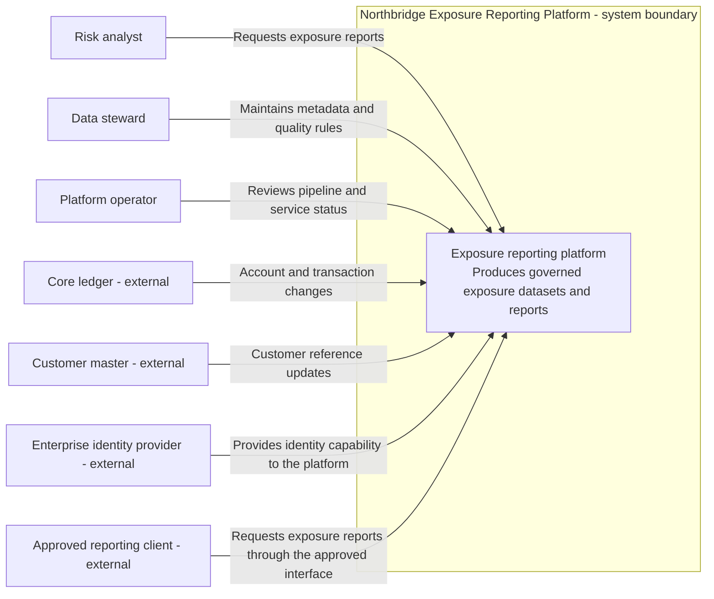
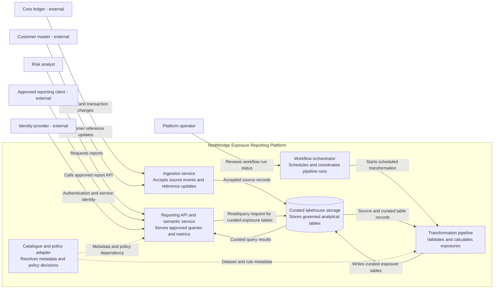
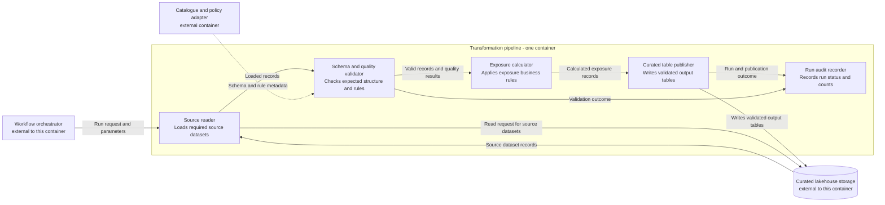
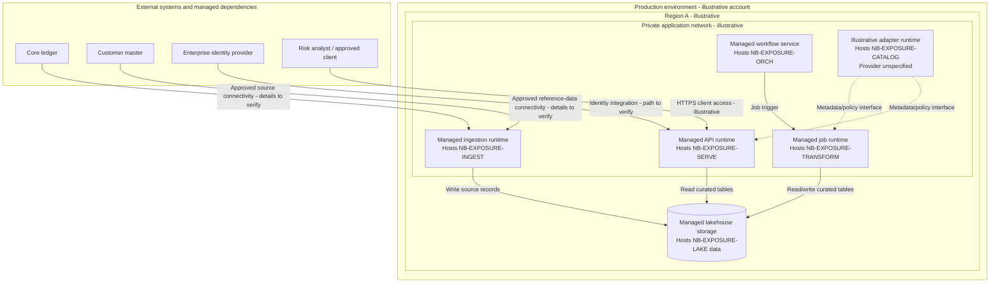

# Context, Container, Component and Deployment Diagrams

**Stage:** Stage 2D — Data Architecture  
**Module:** 15 — Architecture Documentation, Reviews and Operating Model  
**Topic:** 01  
**Learning level:** Beginner → Intermediate → Advanced  
**Recommended effort:** 6–8 hours  
**Status:** Learning material with explicitly synthetic examples  
**Scenario:** Northbridge Bank (fictional)

> **Source and method note.** This lesson follows Topic 01 of `roadmap-Architecture-Documentation-Reviews-and-Operating-Model.md` and the target location in `Roadmap_ptree.md`. The roadmap says its methods and exercises are recommendations, not existing organisational standards. The C4 vocabulary is used as an illustrative approach only; this lesson does not claim Northbridge Bank or the repository has adopted C4, Mermaid, or any particular notation standard. All Northbridge Bank systems, relationships, environments, identifiers, and infrastructure examples below are synthetic assumptions for learning.

## Table of contents

- [1. Learning outcomes and how to use this lesson](#1-learning-outcomes-and-how-to-use-this-lesson)
- [2. Foundations: what architecture diagrams do](#2-foundations-what-architecture-diagrams-do)
- [3. Boundaries, actors, systems, interfaces and relationships](#3-boundaries-actors-systems-interfaces-and-relationships)
- [4. Choose the right level of abstraction](#4-choose-the-right-level-of-abstraction)
- [5. Context diagrams](#5-context-diagrams)
- [6. Container diagrams](#6-container-diagrams)
- [7. Component diagrams](#7-component-diagrams)
- [8. Deployment diagrams](#8-deployment-diagrams)
- [9. Make the four diagrams consistent](#9-make-the-four-diagrams-consistent)
- [10. Diagram metadata, readability and accessibility](#10-diagram-metadata-readability-and-accessibility)
- [11. Traceability, evidence and documentation drift](#11-traceability-evidence-and-documentation-drift)
- [12. Trade-offs and advanced architecture concerns](#12-trade-offs-and-advanced-architecture-concerns)
- [13. Beginner exercise: exposure reporting context](#13-beginner-exercise-exposure-reporting-context)
- [14. Intermediate exercise: Northbridge Bank four-level set](#14-intermediate-exercise-northbridge-bank-four-level-set)
- [15. Advanced exercise: reconcile diagrams with inventory and IaC](#15-advanced-exercise-reconcile-diagrams-with-inventory-and-iac)
- [16. Review checklist and correction catalogue](#16-review-checklist-and-correction-catalogue)
- [17. Expected deliverables and completion checklist](#17-expected-deliverables-and-completion-checklist)
- [18. Mastery criteria and readiness for Topic 02](#18-mastery-criteria-and-readiness-for-topic-02)
- [Appendix A. Diagram-set consistency worksheet](#appendix-a-diagram-set-consistency-worksheet)
- [Appendix B. Short practice questions](#appendix-b-short-practice-questions)

---

## 1. Learning outcomes and how to use this lesson

By completing this lesson, you should be able to:

1. Explain why architecture diagrams exist, what they can and cannot prove, and how they fit into architecture documentation.
2. Identify the system boundary, actors, external systems, dependencies, interfaces, and relationships.
3. Create and interpret context, container, component, and deployment diagrams.
4. Select an abstraction level and amount of detail for a named audience and concern.
5. Label relationships with direction, purpose, and relevant interface or protocol information.
6. Distinguish logical architecture (responsibilities and relationships) from physical/deployment architecture (where runtime elements execute).
7. Keep names, responsibilities, relationships, and mappings consistent across a four-level diagram set.
8. Reconcile a diagram set with a synthetic inventory or infrastructure-as-code (IaC) excerpt, where IaC means machine-readable definitions used to provision or configure infrastructure.
9. Define ownership, metadata, review triggers, version control, and drift checks so diagrams remain useful over time.

### Learning sequence

Work through the lesson in order: concepts → boundaries and relationships → four views → cross-view consistency → documentation hygiene → exercises → review. Do not begin with drawing boxes. First write down the question the diagram must answer and the system boundary. This prevents a visually polished but misleading diagram.

### Prerequisite check

You should have a basic understanding of a system, a software service, a database, an interface, and the difference between logical design and deployed infrastructure. If these are unfamiliar, use the glossary in this lesson and keep the first exercise small. You do not need cloud-specific knowledge or special diagramming software.

---

## 2. Foundations: what architecture diagrams do

### 2.1 What is an architecture diagram?

An **architecture diagram** is a selective visual representation of a system's structure, relationships, or deployment, created to answer a particular question for a particular audience. It is selective: it should show enough detail to support the decision or discussion, not every implementation fact.

Architecture documentation is the broader collection of material used to explain an architecture. It can include diagrams, written descriptions, requirements, assumptions, constraints, decision records, interface contracts, risk records, ownership, and change history. A diagram is one artefact within that package, not a replacement for the package.

### 2.2 Why diagrams matter

- **Shared understanding:** teams can discuss the same named components and boundaries instead of relying on different mental pictures.
- **Dependency visibility:** consumers, providers, data sources, and critical shared services become easier to identify.
- **Change impact:** a proposed change can be traced to the systems and interfaces it may affect.
- **Risk discovery:** missing authentication paths, single points of failure, cross-boundary dependencies, or unexplained external services can be noticed during review.
- **Communication:** a business stakeholder, engineer, security reviewer, and operator can each get a view suited to their concerns.
- **Operational handover:** deployment views help clarify where workloads run and which infrastructure boundaries matter.

### 2.3 What a diagram cannot prove

A diagram alone cannot prove that an implementation exists, is secure, performs adequately, or matches the drawing. It may be based on a target-state proposal, stale documentation, incomplete interviews, or assumptions. It normally does not fully express timing, retries, error semantics, schemas, access policies, capacity, or failure behaviour unless these are specifically in scope.

Treat a diagram as a **claim about architecture**. Important claims should be supported by appropriate evidence: an inventory, interface contract, repository, IaC, runtime configuration, telemetry, lineage metadata, or a verified owner statement. No single evidence source is always complete: IaC may omit manually configured resources; runtime discovery may not explain intended design; traffic logs may miss rare paths.

### 2.4 Common diagram families and their questions

| Diagram/view | Primary question | Typical audience | Main content |
|---|---|---|---|
| Context | What system is in scope, who uses it, and what external systems does it depend on? | Business, product, architecture, delivery teams | System boundary, actors, neighbouring systems, major relationships |
| Container | What are the major runnable or deployable parts, and how do they interact? | Architects, engineers, platform and operations teams | Applications/services, jobs, databases, queues, stores, interfaces |
| Component | What are the responsibilities and dependencies inside one selected container? | Developers and reviewers of that container | Internal building blocks, interfaces, dependencies |
| Deployment | Where do runtime units execute, and within which environments, regions, networks, or failure domains? | Platform, operations, security, reliability | Runtime instances, infrastructure nodes, placement and network paths |

The four views answer different questions. A context diagram is not a tiny deployment diagram; a deployment diagram is not a component design. A coherent set links the views without forcing all detail into one picture.

### 2.5 How diagrams work with other documentation

| Related artefact | What it adds beyond a diagram |
|---|---|
| Architecture description | Organises views around stakeholder concerns and explains scope and assumptions |
| Architecture Decision Record (ADR) | Captures a significant decision, context, alternatives, and consequences |
| Interface contract | Defines request/response or event shape, semantics, authentication, compatibility and error behaviour |
| Data-flow diagram | Emphasises movement of data through processes and stores; trust-boundary analysis is a later topic |
| Inventory/catalogue | Provides structured identifiers, ownership and metadata about assets |
| IaC and deployment configuration | Provides evidence of declared infrastructure and configuration, but may not represent all runtime reality |
| Runbook | Explains operational actions during routine work or incidents |

**Use a diagram when** structure, dependency, scope, or placement is easier to understand visually. **Use prose or a table when** exact semantics, constraints, ownership, or exhaustive inventories are more important than visual relationships. Often both are required.

### 2.6 Trade-offs and limitations

A highly detailed diagram can be comprehensive but unreadable. A very abstract diagram can be readable but hide critical dependencies. Multiple diagrams improve focus but create a consistency burden. Diagram-as-code makes diffs and reviews easier, but syntax and renderer differences can affect presentation. Automatically generated diagrams can reflect machine-readable sources well, but generated output may still be hard to read and cannot infer business intent reliably.

**Correction principle:** optimise for a defined question, not for maximum box count. Split views when audiences or concerns differ; use stable identifiers and a consistency check to keep them aligned.

**Exercise 2A:** Pick one system you know (or invent one). Write one sentence each for: (a) a question a context diagram should answer, (b) a question a deployment diagram should answer, and (c) one claim neither diagram can prove by itself.

**Validation:** the questions are distinct; the third answer names evidence that would be needed to verify the claim.

---

## 3. Boundaries, actors, systems, interfaces and relationships

### 3.1 System boundary

A **system boundary** defines what the diagram treats as the system being described. Inside the boundary are the responsibilities owned by that system for this view; outside are users, neighbouring systems, providers, or infrastructure that the diagram treats as external. A boundary is a modelling decision, not necessarily a network perimeter, cloud account, team boundary, or security trust boundary.

State the boundary in words before drawing. For example: “This view describes the Northbridge Exposure Reporting Platform, including ingestion, processing, curated storage, catalogue/policy integration, and analyst serving; the core ledger and identity provider are external.” This statement prevents a reader from assuming the core ledger is operated by the platform team.

### 3.2 Actors and external systems

An **actor** is a person, role, or external process that interacts with the system to achieve a goal. Examples include a risk analyst, data steward, scheduler, or partner file sender. An **external system** is a separately managed system that exchanges data or requests with the system in scope. Examples include a core ledger, enterprise identity provider, or reporting consumer.

Do not label every box “system” without saying what it does. Use a name and concise responsibility. Actors and external systems may appear in the same context view, but distinguish their nature in the label or legend.

### 3.3 Dependency, interface and relationship

A **dependency** exists when one element relies on another element's capability or availability. An **interface** is the defined means through which elements interact, such as an HTTPS API, SQL endpoint, SFTP drop, event topic, or file contract. A **relationship** is the specific interaction being represented by an arrow or connector.

A useful relationship label answers as many of these as the diagram's purpose requires:

- **Direction:** which element initiates or sends, and which receives?
- **Purpose/content:** what request, dataset, event, or capability is involved?
- **Mechanism:** API, SQL, SFTP, event stream, or another interface?
- **Timing/cadence:** synchronous request, near-real-time event, hourly batch, or daily file?
- **Security/contract:** only where relevant to the diagram's purpose, e.g. authenticated HTTPS or schema-governed event.

Example: `Risk analyst -> Reporting API: queries exposure report over HTTPS` is more informative than `Risk analyst -> API`. At a context level, avoid implementation clutter: `requests exposure reports` may be sufficient. At container level, protocol and data contract may matter.

### 3.4 Arrow direction and meaning

Arrows are not decoration. A directed arrow usually indicates an interaction or dependency in the direction shown. Define whether arrows mean data movement, request initiation, dependency, or control. These are not always the same: an HTTP request and response travel in opposite directions, while a diagram may simplify them into one labelled interaction. If direction could be misread, label it explicitly, or use separate arrows where both directions matter.

Do not infer a flow merely from box placement. A line without a label leaves unclear whether it means data, control, deployment, ownership, or logical dependency.

### 3.5 Relationship types to distinguish

| Relationship | Example | What it means |
|---|---|---|
| Data exchange | Ledger publishes change events to ingestion | Data are transferred |
| Request/response | Analyst queries reporting API | One element requests a result from another |
| Dependency/governance | Catalogue supplies policy metadata to serving service | One capability influences another; not necessarily data-plane traffic |
| Deployment mapping | Ingestion service runs on a managed job runtime | A logical runtime unit is placed on infrastructure |
| Ownership | Data Platform team owns ingestion service | Accountability, not runtime traffic |

Use different line styles or separate diagrams for different relationship types if one drawing would otherwise be ambiguous. A legend must explain every special connector style.

### 3.6 External does not mean unimportant

A system outside the boundary can be critical. The identity provider, encryption key service, network gateway, or upstream ledger may be outside the product boundary yet be a hard availability or security dependency. Show important external dependencies and make their ownership clear where known. If ownership or behaviour is unknown, mark it as an assumption or open question rather than inventing certainty.

### 3.7 Common mistakes and corrections

| Mistake | Why it fails | Correction |
|---|---|---|
| Boundary not stated | Readers disagree about what is included | Add scope statement and visible system boundary |
| External system shown as internal container | Implies ownership or deployment that may not exist | Move outside boundary or explicitly mark shared/external ownership |
| Arrow has no label | Interaction and direction are ambiguous | Label purpose and, when useful, protocol/cadence |
| Every dependency is omitted to simplify | Hides critical failure and security dependencies | Retain dependencies material to the stated concern |
| Dashed line has no legend | Readers invent their own meaning | Define it or use a normal labelled arrow |
| “API” used as the whole label | Does not identify the contract or purpose | Add capability, data/request, and protocol as appropriate |

**Exercise 3A:** Draw a system boundary around a fictional data-quality service. List two internal responsibilities, two actors, three external dependencies, and one interface for each dependency.

**Validation:** every element is classified as inside/outside; each external relationship has direction and a meaningful label; assumptions are explicit.

---

## 4. Choose the right level of abstraction

### 4.1 What abstraction means

**Abstraction** means omitting detail that is not needed to answer the current question while preserving the details that matter. A diagram can be accurate but still inappropriate if it shows too much or too little for its audience. An **audience** is the intended reader group; a **concern** is a question or interest that matters to that group.

### 4.2 Logical versus physical architecture

**Logical architecture** describes responsibilities, capabilities, conceptual components, and relationships without committing to specific infrastructure placement. **Physical architecture** describes concrete runtime placement and infrastructure characteristics: cloud resources, networks, regions, clusters, virtual machines, managed runtimes, and deployment instances.

These are related but not interchangeable. “Batch transformation service” is a logical role. “A scheduled container task in the production account in region A” is a deployment statement. One logical service may have many deployed instances; several logical components may run within one process or deployment unit. Conversely, one logical capability can be implemented by multiple physical services.

**Avoid mixing levels** in one diagram unless the mixed view is deliberate and the visual convention makes it unmistakable. A box labelled “Schema Validator” next to a box labelled “Production VPC” is mixing internal software decomposition with infrastructure placement. Use a component view for the former and a deployment view for the latter.

### 4.3 Audience-driven selection

| Audience / concern | Preferred starting view | Include | Usually omit unless relevant |
|---|---|---|---|
| Executive sponsor | Context | Business purpose, users, major dependencies, system boundary | Internal modules, subnet identifiers |
| Domain architect | Context + container | Responsibilities, major contracts, dependencies, key shared services | Every library or table |
| Application engineer | Container + component | Runtime units, internal responsibilities, interfaces and error boundaries | Unrelated enterprise systems |
| Platform / operations engineer | Deployment | Environment, region, runtime placement, networks, managed services, failure boundaries | Internal functions unless operationally significant |
| Security reviewer | Context + deployment and relevant focused views | External identities, boundary crossings, privileged dependencies, exposure points | Decorative detail that obscures control paths |
| Data governance / steward | Context + container, possibly a separate data-flow view later | Source/consumer systems, catalogue, policy services, data-product boundaries | Low-level infrastructure detail |

These are starting points, not rigid rules. A security reviewer may need component details if sensitive logic resides there. An executive may need a deployment risk summary, but not a full network topology.

### 4.4 Practical decision rule

Before drawing, complete this sentence: **“This diagram helps [audience] decide/understand [question] within [scope].”** Then ask:

1. What must the reader identify in under a minute?
2. Which relationships change the decision?
3. Which details belong in another view or a linked artefact?
4. What assumptions or omitted details could cause a wrong conclusion?
5. Is a table or written note more precise than a connector?

### 4.5 Trade-offs

- **One comprehensive diagram:** fewer files and one place to look, but high cognitive load and poor readability.
- **Several focused diagrams:** easier to read and tailor, but consistency and navigation require discipline.
- **Logical-first diagrams:** stable through infrastructure changes, but may not answer operational placement questions.
- **Physical-first diagrams:** actionable for deployment and incident response, but can become stale as resources change and may obscure responsibilities.
- **Tool-generated diagrams:** reproducible, but may inherit naming noise or show everything equally without architectural judgement.

**Exercise 4A:** For each audience—executive, developer, operator—write a diagram title and the three most important things it should show. State one thing each diagram should omit.

**Validation:** each diagram has a distinct question and appropriate abstraction; no diagram attempts to serve all audiences equally.

---

## 5. Context diagrams

### 5.1 Definition, purpose and contents

A **context diagram** presents the system of interest as one coherent unit and shows its relationship with actors and neighbouring systems. It answers: *What is this system, who interacts with it, and which external systems does it depend on or serve?*

A context diagram commonly includes:

- one clearly named system of interest and its boundary;
- relevant human or machine actors;
- important external systems;
- labelled, directed interactions;
- scope, purpose, audience, date/version, owner and legend.

It usually excludes internal containers, individual databases, detailed cloud resources, and low-level protocols unless those details are central to the context question.

### 5.2 How to construct one

1. Write a one-sentence purpose and audience.
2. Define the system of interest and what is outside scope.
3. Identify the user roles and external systems that materially interact with it.
4. Add only relationships relevant to the purpose; label direction and purpose.
5. Mark known ownership boundaries and distinguish assumptions from verified facts.
6. Add a legend and document omissions.
7. Ask a reader unfamiliar with the system to explain the diagram back to you.

### 5.3 Context diagram: Northbridge Bank (synthetic)

**Diagram ID:** `NB-EXPOSURE-CTX-001`  
**Title:** Northbridge Exposure Reporting Platform — Context View  
**Purpose:** Explain the boundary and major external relationships of the exposure reporting platform.  
**Audience:** Business sponsor, data architect, engineering leads.  
**Scope:** One logical system; no deployment or internal decomposition shown.  
**Status:** Illustrative conceptual view.  
**Owner:** Illustrative architecture owner (fictional role, not an actual Northbridge organisational assignment).  
**Version:** 1.0 (teaching example).  
**Last reviewed:** 2026-10-21 (documentation audit only; architecture scenario remains synthetic and unverified).  
**Evidence:** Scenario assumptions only; no production evidence.  
**Assumptions:** All named systems and interactions are fictional; relationship labels are illustrative, not verified production facts.



**Legend:** solid arrows indicate an interaction or exchange in the arrow direction; the label states its purpose. “External” means outside the system boundary, not unimportant. The diagram does not specify physical network paths, protocols, authentication implementation, or deployment locations.

### 5.4 Interpretation and review

A reader should be able to identify the platform's purpose, users, major data sources, identity dependency, and external consumer. If the core ledger were drawn inside the platform boundary, the picture could falsely imply that the platform owns the ledger. If the identity provider were omitted, a reviewer might miss an important dependency.

### 5.5 Limitations and common mistakes

A context diagram cannot explain internal pipeline stages or prove that all data sources are represented. It can become too crowded if it lists every downstream consumer. Use a separate domain context or a consumer catalogue if necessary. Avoid generic labels such as “Database” when the business identity of the external system matters. Avoid showing infrastructure nodes at this level.

**Context review questions:**

- Is the system of interest unmistakable?
- Is the boundary explained in words and visible in the diagram?
- Are the important actors and external systems included?
- Are interactions labelled with meaningful purpose and direction?
- Are external dependencies distinguished from internal responsibilities?
- Are assumptions and omissions recorded?

---

## 6. Container diagrams

### 6.1 Definition and purpose

In this lesson, a **container** means a separately runnable or deployable unit, such as an API service, scheduled pipeline, stream processor, database, object store, queue, or independently operated application. It does **not** mean only a Docker container. The term describes an architectural unit of execution or storage, not a specific packaging technology.

A **container diagram** decomposes the system of interest into its major runnable/deployable units and shows how they interact. It answers: *What are the principal parts, what responsibility does each have, and how do they communicate?*

### 6.2 What to show

- containers with stable names, type/technology where useful, and one-line responsibilities;
- interactions with direction and interface/protocol details appropriate to the audience;
- external systems or actors that connect to these containers;
- data platform capabilities such as ingestion, landing/storage, transformation, serving, catalogue/policy, and orchestration/control where in scope;
- important shared services and dependencies.

Do not expand every container into its internal classes. Do not show cloud subnets or runtime replicas unless deployment is the question. A container view is often a logical architecture view, though it can name a technology when that detail is useful and known.

### 6.3 Northbridge Bank container diagram (synthetic)

**Diagram ID:** `NB-EXPOSURE-CNT-001`  
**Title:** Northbridge Exposure Reporting Platform — Container View  
**Purpose:** Show major platform runtime/storage units and their primary interactions.  
**Audience:** Architects, engineers, platform operators.  
**Boundary:** Same logical platform as `NB-EXPOSURE-CTX-001`; the ledger, customer master, identity provider and reporting client remain external.  
**Status:** Illustrative logical view.  
**Owner:** Illustrative architecture owner (fictional role, not an actual Northbridge organisational assignment).  
**Version:** 1.0 (teaching example).  
**Last reviewed:** 2026-10-21 (documentation audit only; architecture scenario remains synthetic and unverified).  
**Evidence:** Scenario assumptions only; no production evidence.  
**Assumptions:** Relationship labels are synthetic. Governance relationships are shown as dependencies, not as a claim that every interaction is synchronous runtime traffic.



**Legend:** solid arrows indicate the explicitly labelled interaction or data/request path; dashed arrows indicate a supporting metadata/policy dependency. This convention is local to this diagram. The same names should be used in the component and deployment views. Storage is drawn as a cylinder to distinguish it visually; the label, not the shape alone, defines its role.

**Traceability note:** the context view includes a data-steward interaction, but this container view does not invent a steward-facing UI or workflow. The scenario does not specify that interface. Record it as an open question and add the relevant container/relationship when its mechanism is established; do not assume the catalogue/policy adapter provides the user interface.

### 6.4 Relationship labels and interaction contracts

At container level, labels should be specific enough to inform design review. “Writes curated exposure tables” is more useful than “uses lake.” Where the decision depends on implementation, add a protocol or contract: `HTTPS/JSON query`, `CDC event stream`, `SFTP daily CSV`, `SQL read`, or `scheduled job trigger`. Do not invent protocol details when the source does not establish them; use “protocol unspecified” in the inventory or note the assumption.

An arrow does not automatically define a complete interface contract. Schema, authentication, retry behaviour, idempotency, ordering, freshness, and error handling may need linked documentation. This lesson focuses on structure; data-flow and trust-boundary detail is Topic 02.

### 6.5 When to split or group containers

Split units when they have distinct responsibilities, deployment/lifecycle, scaling, security, ownership, or interfaces. Group them when they are inseparable for the audience's question or when additional detail would distract. Avoid splitting merely because a code repository has multiple folders. Avoid grouping independent services into a vague “data platform” box if the key question is their interaction or ownership.

### 6.6 Common mistakes and corrections

| Mistake | Correction |
|---|---|
| Calling every storage service a “container” without saying what it stores | Give the store a stable name and responsibility |
| Showing an internal function as a separately deployable unit without evidence | Keep it in the component view unless it runs/deploys independently |
| Missing the orchestration/control service | Include it when scheduling or control dependencies matter to the purpose |
| Drawing governance as if it were data movement | Use a distinct line style and legend for metadata/policy dependency |
| Showing all possible tables and jobs | Show the major units; use a catalogue or inventory for exhaustive detail |
| Labeling an arrow “data” | State which data or capability, and relevant mechanism/cadence if known |

**Exercise 6A:** Using the context diagram, propose four to seven containers. For each, write one responsibility and one interface. Mark which are storage, compute, serving, or control/governance roles.

**Validation:** every container has a single primary responsibility, interactions are directional and labelled, and all external systems retained from context have a corresponding interaction or a documented reason for omission.

---

## 7. Component diagrams

### 7.1 Definition and purpose

A **component** is a building block inside a selected container. It may be a module, service layer, adapter, worker, or cohesive subsystem. A component diagram answers: *How is this particular container internally decomposed, what does each part own, and what interfaces or dependencies connect them?*

A component is not necessarily independently deployable. If it is independently runnable/deployable, consider whether it should instead be represented as a separate container at the appropriate system level. The exact boundary depends on architecture purpose and actual runtime/lifecycle characteristics.

### 7.2 Scope discipline

Choose one container to decompose. State its name and identifier. Show only its important internal responsibilities and the external interfaces it uses or exposes. Do not draw components from several unrelated containers in the same component view unless the view explicitly models a cross-container collaboration and labels that scope.

### 7.3 Component example: Transformation pipeline

**Diagram ID:** `NB-EXPOSURE-CMP-TRANSFORM-001`  
**Title:** Transformation Pipeline — Component View  
**Parent container:** `NB-EXPOSURE-TRANSFORM` (Transformation pipeline)  
**Purpose:** Explain internal responsibilities and dependencies of the transformation pipeline.  
**Audience:** Data engineers and reviewers of transformation changes.  
**Status:** Illustrative logical decomposition.  
**Owner:** Illustrative architecture owner (fictional role, not an actual Northbridge organisational assignment).  
**Version:** 1.0 (teaching example).  
**Last reviewed:** 2026-10-21 (documentation audit only; architecture scenario remains synthetic and unverified).  
**Evidence:** Scenario assumptions only; no production evidence.  
**Assumptions:** Component names and sequence are illustrative. The view shows responsibility/dependency, not every execution step or code module.



**Legend:** solid arrows represent the explicitly labelled request, returned data, write, trigger, or outcome relationship; dashed arrows represent metadata dependencies. A read request is shown from reader to store, while returned records are shown from store to reader. The boundary encloses components belonging to the Transformation pipeline container. The lake, orchestrator, and catalogue adapter are outside this container even though the pipeline interacts with them.

### 7.4 Responsibilities and interfaces

A component should have a coherent responsibility. The **Source reader** obtains required datasets; the **Schema and quality validator** checks input structure and rules; the **Exposure calculator** applies domain logic; the **Curated table publisher** writes outputs; the **Run audit recorder** records outcomes. This separation helps review change impact, testing, and error handling.

Interfaces should identify the contract between components at the level required. For example, “valid records and quality results” implies that validation does not silently discard rejected records without recording them. The diagram does not define the exact schema; that belongs in an interface contract or code-level documentation.

### 7.5 Component decomposition trade-offs

Too few components can hide responsibilities and make ownership/testing unclear. Too many can turn the diagram into a source-code map that changes with every refactor. Decompose at stable responsibility boundaries rather than every function or class. A component diagram is most useful when a reviewer can explain why the components exist and what changes should remain local to each one.

### 7.6 Common mistakes

- **Mistake:** component boxes appear to run on separate machines. **Correction:** label the parent container and clarify that the components are internal logical building blocks unless independent deployment is known.
- **Mistake:** external services are placed inside the component boundary. **Correction:** move them outside and draw the interface across the boundary.
- **Mistake:** arrows show a sequence that is not guaranteed. **Correction:** call the view “logical dependencies” or use a sequence/activity diagram if execution order is the actual concern.
- **Mistake:** all component-to-component relationships are bidirectional by assumption. **Correction:** show the actual dependency direction and use separate arrows if requests and responses matter.
- **Mistake:** component labels duplicate technology names but omit responsibility. **Correction:** add one-line responsibility text.

**Exercise 7A:** Select the ingestion service as a parent container and define three to five components. Include source adapter, schema validator, deduplication/idempotency logic, and event publisher only if those responsibilities fit the stated design. Mark any assumption.

**Validation:** every component belongs to the selected parent; each has one clear responsibility; external dependencies are outside the boundary; all arrows are labelled and technically plausible.

---

## 8. Deployment diagrams

### 8.1 Definition and purpose

A **deployment diagram** shows how logical runtime units map to physical or managed infrastructure in a specified environment. It answers: *Where does this run, under what deployment boundaries, and what infrastructure/network dependencies matter?*

It may include:

- environment (development, test, production);
- account, subscription, project, or tenancy boundary;
- region and availability zone/failure domain where relevant;
- network/VPC/VNet, subnet, private endpoint, gateway, or on-premises boundary;
- managed runtime, cluster, server, job runner, database, object store, queue, or service endpoint;
- placement of logical containers onto infrastructure nodes;
- critical external network and identity dependencies.

A **node** is a runtime or infrastructure location/resource that can host or provide a capability. A **region** is a geographic cloud deployment area. A **failure domain** is a scope in which a shared failure can affect multiple components. A **tenancy boundary** separates workloads or customers with distinct isolation/ownership requirements. These boundaries are not interchangeable and should be shown only when relevant to the question.

### 8.2 Deployment is not the same as logical architecture

A logical container such as `NB-EXPOSURE-INGEST` may map to one managed ingestion service, several replicas, or a set of scheduled jobs. A logical storage container may be backed by a managed object store and a table/catalogue service. The deployment view must not imply a one-to-one mapping unless the deployment evidence supports it.

Show actual placement for a current-state diagram and proposed placement for a target-state diagram. Label the view explicitly as **current**, **target**, or **illustrative**. Never present synthetic placement as a real deployment.

### 8.3 Northbridge production deployment example (synthetic target-state)

**Diagram ID:** `NB-EXPOSURE-DEP-PROD-001`  
**View status:** Illustrative target-state, not a real deployment.  
**Purpose:** Show environment boundaries and example placement for the logical containers.  
**Audience:** Platform, operations, security and architecture reviewers.  
**Assumptions:** Cloud resources and network arrangement below are hypothetical. The catalogue/policy adapter is shown on a generic illustrative runtime; its provider and any backend catalogue service are unspecified and not represented. The single region shown does not assert multi-region disaster recovery.



**Legend:** solid arrows are labelled logical connectivity paths; dashed arrows are metadata/policy dependencies. Enclosing boxes represent illustrative environment, region, and private application network boundaries. These boundaries are conceptual and do not specify a real cloud provider or exact network topology. “Details to verify” is intentional: a diagram must not invent connectivity specifics.

### 8.4 Environments, regions and failure domains

Do not put development, test, and production into one undifferentiated cluster if environment separation is a key control. Use separate deployment views or clearly separated boundaries. Likewise, show multiple regions only when the design or current state actually uses them. If a production service has replicas across availability zones, represent the zones and placement where that matters to availability; do not imply high availability merely by drawing two boxes.

When showing tenancy, be explicit about the meaning: separate customer data, separate accounts, separate namespaces, separate credentials, or another isolation boundary. A box labelled “tenant” without explaining the isolation model can create false assurance.

### 8.5 Network and protocol precision

Deployment diagrams should show relevant network boundaries and paths, not every routing table. Include protocol/port details only when useful and known. Do not label a link “private” unless the actual connectivity model supports that statement. A private endpoint does not by itself prove end-to-end private connectivity, correct identity policy, or absence of other routes.

### 8.6 Common mistakes and corrections

| Mistake | Why it matters | Correction |
|---|---|---|
| No environment label | Readers cannot tell dev from prod | Name the environment and status of the view |
| Logical service drawn as a cloud node | Conflates responsibility and placement | Show the container hosted by a node/runtime |
| One box labelled “cloud” | Hides meaningful regions, networks and failure domains | Add only the deployment boundaries relevant to the question |
| Multiple zones imply resilience without evidence | Redundancy may not cover state, failover or dependencies | Label redundancy assumptions and validate failover design separately |
| Network lines omit endpoints | Readers cannot see which service connects to which | Draw endpoint-to-endpoint paths and label purpose/protocol where known |
| Current and target placements mixed | Reviewers cannot identify what exists today | Separate diagrams or mark every proposed element clearly |

**Exercise 8A:** Create a deployment view for one environment of your platform. Show one region, one application network, two runtime units, one data store, one identity dependency, and one external source. Label uncertain connectivity as an assumption.

**Validation:** every logical container in scope maps to a runtime/storage node or is explicitly marked external/not deployed; environment and boundaries are clear; no unsupported high-availability or security claim is implied.

---

## 9. Make the four diagrams consistent

A diagram set is coherent when the views describe the same system, with the same identities and compatible relationships, while each view adds the details appropriate to its level. Consistency does not mean every box must be repeated in every diagram; it means each element that should carry across a boundary is traceable, and omissions are intentional.

### 9.1 Parent-child mapping

Use stable identifiers to relate elements:

| Element ID | Name | Type | Parent / mapping |
|---|---|---|---|
| `NB-EXPOSURE-SYS` | Northbridge Exposure Reporting Platform | System boundary | Context view |
| `NB-EXPOSURE-INGEST` | Ingestion service | Container | `NB-EXPOSURE-SYS` |
| `NB-EXPOSURE-LAKE` | Curated lakehouse storage | Container | `NB-EXPOSURE-SYS` |
| `NB-EXPOSURE-TRANSFORM` | Transformation pipeline | Container | `NB-EXPOSURE-SYS` |
| `NB-EXPOSURE-SERVE` | Reporting API and semantic service | Container | `NB-EXPOSURE-SYS` |
| `NB-EXPOSURE-CATALOG` | Catalogue and policy adapter | Container | `NB-EXPOSURE-SYS` |
| `NB-EXPOSURE-ORCH` | Workflow orchestrator | Container | `NB-EXPOSURE-SYS` |
| `NB-EXPOSURE-TRANSFORM-READER` | Source reader | Component | `NB-EXPOSURE-TRANSFORM` |
| `NB-EXPOSURE-TRANSFORM-VALIDATOR` | Schema and quality validator | Component | `NB-EXPOSURE-TRANSFORM` |
| `NB-EXPOSURE-TRANSFORM-CALCULATOR` | Exposure calculator | Component | `NB-EXPOSURE-TRANSFORM` |
| `NB-EXPOSURE-TRANSFORM-PUBLISHER` | Curated table publisher | Component | `NB-EXPOSURE-TRANSFORM` |
| `NB-EXPOSURE-TRANSFORM-AUDIT` | Run audit recorder | Component | `NB-EXPOSURE-TRANSFORM` |

Each component has exactly one parent container in this model. If a shared library or shared service is reused, distinguish code reuse from runtime ownership: a library dependency is not automatically a separate container. If a logical container maps to multiple runtime instances, record a one-to-many deployment mapping rather than duplicating the logical identity.

### 9.2 Five minimum consistency rules

1. **Boundary rule:** the same system of interest and external/internal classification are maintained across views. Any exception is explained.
2. **Parent-child rule:** each component belongs to one selected parent container; container-to-system membership is explicit.
3. **Deployment rule:** every in-scope deployed container maps to a deployment node or is marked as external, managed outside scope, or not deployed in that environment.
4. **Relationship rule:** names, direction, purpose, and protocol/interface claims agree wherever the same relationship appears. Do not force every high-level relationship into every lower-level view if the view's scope does not include it; record the traceability instead.
5. **Legend/metadata rule:** every diagram explains symbols and states title, purpose, audience, scope, date/version, status, and owner.

### 9.3 Additional advanced checks

- **External dependency coverage:** each material external system in context is either represented in the container view or has a documented reason for omission.
- **No phantom elements:** components or containers must not appear only in a deployment diagram without a logical parent, unless explicitly infrastructure-only.
- **No impossible placement:** a component is not independently mapped to infrastructure unless it is independently deployed or the diagram explains the grouping.
- **Naming consistency:** the same identifier refers to the same responsibility across the inventory and all views.
- **Direction semantics:** every arrow direction must be interpretable from its label and legend. If a view mixes request initiation, response/data movement, policy dependencies, or deployment mappings, distinguish them explicitly by labels and/or line styles; never rely on line direction alone.
- **Environment consistency:** production relationships are not silently copied into dev/test if the topology differs.
- **Assumption visibility:** unknown protocols, owners, and placements remain marked as unknown or assumed.

### 9.4 Repeatable consistency-check procedure

1. Export or maintain a simple element inventory with ID, name, type, parent ID, owner, status, and source evidence.
2. Extract every box and connector from each diagram into an element/relationship list.
3. Compare names and IDs; resolve aliases explicitly rather than silently treating different names as identical.
4. Verify system boundary and external dependencies against the context view.
5. Verify every container's deployment mapping for each environment in scope.
6. Verify each component's parent container and each cross-container dependency's endpoint.
7. Compare relationship direction, interface/protocol, and purpose against interface contracts, inventory, and known configuration.
8. Check legend, title, purpose, audience, scope, date, version, status and owner.
9. Record each mismatch as confirmed defect, acceptable abstraction difference, assumption, or open question.
10. Assign an owner and due date to material defects; update diagrams and re-run the checks.

### 9.5 Example consistency worksheet

| Check | Evidence | Result options | Required action on failure |
|---|---|---|---|
| Context external systems represented in container view | Context + container inventory | Pass / Fail / N/A with reason | Add dependency or document why omitted |
| Every container mapped in production deployment | Container inventory + deployment view | Pass / Fail / Not deployed | Add mapping or correct status |
| Component parent is valid | Component IDs + parent IDs | Pass / Fail | Correct parent or model the actual boundary |
| Direction/protocol consistent | Interface contract, config, owner confirmation | Pass / Fail / Unknown | Resolve or mark as unverified |
| Metadata complete | Diagram header and legend | Pass / Fail | Add missing metadata |

**Important:** “Unknown” is not a pass. It can be an acceptable documented state for a conceptual or target-state view, but it must not be presented as verified current-state fact.

---

## 10. Diagram metadata, readability and accessibility

### 10.1 Required header metadata

Each diagram should begin with a small metadata block. Use a consistent template:

```text
Diagram ID: NB-EXPOSURE-CNT-001
Title: Northbridge Exposure Reporting Platform — Container View
Purpose: Show major runnable/storage units and their interactions.
Audience: Architects, engineers, platform operators.
Scope/boundary: Logical platform; excludes external ledger internals and physical deployment.
Status: Illustrative / current-state / target-state / deprecated
Owner: Data Platform Architecture (synthetic example owner)
Version: 1.0
Last reviewed: YYYY-MM-DD
Evidence: Inventory revision, IaC path/revision, interface contract IDs, or owner confirmation
Assumptions/omissions: Protocols are illustrative; exact cloud placement is out of scope.
```

For a real repository, use actual dates, owners and evidence references. The example owner above is fictional. Never use a date or evidence reference to imply a review occurred when it did not.

### 10.2 Titles, scope and status

A useful title tells the reader the system and view type. “Architecture” is too vague. Prefer “Exposure Reporting Platform — Production Deployment View.” Add a status such as current-state or target-state because a target diagram is not proof of the current deployment. If a view is deliberately partial, say so: “Primary request path only; batch backfill path omitted.”

### 10.3 Labels and legends

Use consistent names and one-line responsibilities. Keep labels short enough to read at normal zoom. Label meaningful arrows. The legend should explain shapes and line styles, especially if dashed arrows mean governance while solid arrows mean data/request flow. Do not rely on colour alone to convey a category or security boundary.

### 10.4 Readability and accessibility

- Use a clear reading direction (left-to-right or top-to-bottom) and avoid unnecessary crossing connectors.
- Group related elements and keep external systems visually outside the boundary.
- Use adequate text size and contrast; ensure the diagram remains interpretable in grayscale and when printed.
- Pair colours with labels, line styles, or shapes so meaning does not depend on colour perception.
- Provide alt text or a short text description for screen-reader users and for contexts where the diagram cannot render.
- Avoid overly long labels, unexplained abbreviations, decorative icons, and layout that implies an unintended sequence.
- Provide a text equivalent of critical relationships when accessibility or auditability requires it.

### 10.5 Version control and change management

Keep diagrams close to the documentation or code they describe. For diagram-as-code, review the source diff and, when practical, the rendered result. A change to a container, interface, infrastructure boundary, identity path, region, or ownership should trigger a review of affected diagrams. Use commit history to explain what changed and why; a diagram version number is useful but does not replace source-control history.

**Exercise 10A:** Write metadata for one of your diagrams and identify three change events that should trigger an update.

**Validation:** metadata includes purpose, audience, scope, status, owner, version/date, legend and evidence/assumptions; triggers are concrete architecture changes rather than vague “when needed.”


### 10.6 Reusable diagram style note template

Use this short note when a team needs a repeatable convention. It is a **template**, not an adopted repository standard; tailor and approve it through the relevant governance process before treating it as binding.

```text
Diagram style note ID: [stable ID]
Status: Draft / proposed / approved / retired
Scope: [systems, domains, or diagram types covered]
Notation and renderer: [notation, tool, version; state if rendering has not been checked]
View definitions: Context = system and surroundings; container = major runnable/deployable units; component = internals of one selected container; deployment = runtime/infrastructure placement.
Identifiers: Use stable element IDs; display-name changes do not silently create new identities.
Boundaries: State the system boundary and distinguish logical ownership boundaries from network/trust boundaries.
Relationships: Label source, target, purpose, and direction. Explicitly distinguish request, response/data movement, control, governance/policy dependency, and deployment mapping where these are mixed.
Metadata: Every view has ID, title, purpose, audience, scope, status, owner, version/date, evidence, assumptions, and legend.
Evidence labels: Confirmed / inferred / assumed / unknown; absent evidence is not proof of absence.
Visual conventions: [shapes and line styles]; do not encode meaning by colour alone; diagrams must remain readable in grayscale and have a text description.
Maintenance: Named owner; update triggers; review cadence; version-control location; discrepancy/exception process.
Approval and exceptions: [approver/decision process]; record the reason, owner, and review date for exceptions.
```

**Validation:** a reviewer can interpret each line type without guessing; all metadata fields are present or explicitly marked not applicable; the note does not claim approval until approval evidence exists.

---

## 11. Traceability, evidence and documentation drift

### 11.1 Stable identifiers and inventories

A **stable identifier** is a durable ID that does not change merely because a display label changes. For example, `NB-EXPOSURE-TRANSFORM` can remain the identifier even if the friendly name changes from “Transformation pipeline” to “Exposure calculation pipeline.” IDs allow traceability across diagrams, inventory records, catalogues, deployment configuration, ownership registers, and review findings.

A lightweight inventory may contain:

| Field | Purpose |
|---|---|
| Element ID | Stable identity across artefacts |
| Name and type | Human-readable label and classification |
| Responsibility | What the element does |
| Parent ID | Logical parent system/container |
| Owner | Accountable team or role |
| Environment/status | Current, target, retired, external, or not deployed |
| Interfaces/dependencies | Named relationships and contracts |
| Evidence reference | IaC path, repository, inventory record, interface contract, or confirmation |
| Last verified | Date and method of verification |

The inventory is not necessarily a full Configuration Management Database (CMDB). A **CMDB** is a structured store of configuration items and relationships, commonly used in service management. A data catalogue may hold metadata about datasets and lineage, but it may not contain all runtime infrastructure facts. Choose evidence sources according to the claim being verified.

### 11.2 What different evidence can establish

| Evidence | Useful for | Limitations |
|---|---|---|
| IaC repository | Declared resources, modules, parameters and intended placement | May omit manually created resources, runtime drift, or external services |
| Deployment manifests/configuration | Declared workloads, replicas, endpoints and environment settings | May not show all cloud networking or external dependencies |
| Asset/service inventory | Known resources, ownership, environment and lifecycle | Can be stale or incomplete |
| Runtime discovery/API | Resources currently visible to the discovery identity | Permissions and API coverage may omit resources |
| Logs/telemetry/network observations | Observed interactions and operational behaviour | May miss rare, scheduled, dormant, or failed paths |
| Data lineage/catalogue | Data dependencies, datasets and transformation relationships | May not reveal infrastructure or all control-plane relationships |
| Owner confirmation | Intent, exceptions and undocumented constraints | Needs corroboration for high-risk claims |

Evidence should be triangulated for critical claims. If IaC says one thing and runtime discovery says another, do not silently pick the preferred source; record a discrepancy and determine whether it is drift, an intentional exception, or an incomplete source.

### 11.3 Documentation drift

**Documentation drift** occurs when the diagram and the system diverge over time. Causes include unreviewed releases, manual infrastructure changes, renames, migrations, ownership changes, and target diagrams never updated after implementation. Drift is not only a documentation quality issue: it can cause incorrect incident response, missed dependencies, flawed security reviews, and unsafe change plans.

A practical control loop is:

1. Define a diagram owner and authoritative evidence sources.
2. Establish change triggers and review cadence based on risk.
3. Compare diagram elements and relationships with inventory/IaC/deployment evidence.
4. Record differences with severity, confidence, owner and due date.
5. Correct the diagram or correct the system, depending on which is wrong.
6. Re-run the consistency checks and retain review evidence.

Automation can compare IDs, resource names, parent relationships, and known endpoints. It cannot reliably decide whether a dependency is architecturally important, whether a relationship label expresses the correct business meaning, or whether a diagram is appropriate for its audience. Keep human review for intent and legibility.

### 11.4 Ownership and review triggers

Assign one accountable owner for each diagram set. Contributors may include service owners, platform engineers, data engineers, security, and governance. Triggers include:

- new or retired container, component boundary, or external dependency;
- changed interface, protocol, data contract, or direction;
- environment, region, network, tenancy, or identity changes;
- changes to critical failure domains or recovery topology;
- changed ownership, operational responsibility, or support model;
- a material incident or architecture review finding;
- migration from target state into current state.

A calendar-based review is a safety net, not a substitute for change-triggered updates.

---

## 12. Trade-offs and advanced architecture concerns

### 12.1 Multiple environments and regions

A diagram set for a large platform may have one logical container view and separate deployment views for development, test, and production. If environments materially differ, show those differences rather than implying they are identical. For multi-region systems, distinguish active-active, active-passive, backup/restore, and “resources exist in two regions” designs. Two region boxes do not prove data replication, failover automation, consistency, or recovery objectives.

### 12.2 Tenancy and isolation

If the platform serves multiple business units or customers, identify the relevant tenancy boundary and its meaning. Isolation may be enforced through separate accounts, databases, schemas, namespaces, identities, encryption keys, or policy filters. A deployment diagram can show the boundary, but detailed authorization and threat analysis belongs in other artefacts. Avoid a vague “tenant isolation” label without evidence of the actual mechanism.

### 12.3 Failure domains and critical dependencies

A **critical dependency** is a service whose unavailability or incorrect behaviour materially affects a system capability. A failure domain is the scope that may fail together due to shared infrastructure or control. For architecture reviews, highlight dependencies such as identity, catalogue/policy, orchestration, network gateways, key management, and source systems when their failure can stop ingestion or serving.

Do not turn every diagram into a resilience model. Add failure-domain annotations when they affect the question, or produce a separate focused reliability view. The next module topics address other review artefacts; Topic 02 specifically focuses on data movement and trust boundaries.

### 12.4 Logical and physical mapping is not always one-to-one

Examples:

- One logical API container can have multiple replicas behind a gateway.
- One managed database may provide storage for several logical datasets.
- Several components can run in one pipeline process.
- A logical storage container may rely on separate object storage, catalogue metadata, and access-control services.
- A workflow orchestrator may trigger jobs without carrying the business data itself.

Represent the mapping at the level necessary to explain the architecture. Do not duplicate logical boxes for each replica unless the deployment question needs instance-level detail; preserve a stable logical ID and show the instance multiplicity in the deployment view or inventory.

### 12.5 Diagram hierarchy for large estates

Use a hierarchy rather than a single diagram with dozens of boxes:

1. Enterprise or domain context — major systems and external dependencies.
2. System context — one system boundary and its neighbours.
3. Container — major runtime/storage units.
4. Component — one selected container's internal responsibilities.
5. Deployment — environment-specific runtime placement.

The levels are a practical organisation, not a requirement to create every level for every system. Create a view when it answers a real question. A small service may need context, container, and deployment views but no component diagram if its internals are trivial or better documented elsewhere.

### 12.6 Diagram notation and C4 as an illustration

The C4 model is a well-known way to organise software architecture diagrams into context, container, component, and code-level views, with deployment views often used to show deployment. The terminology in this lesson resembles that approach. It is used for learning convenience, not as an adopted Northbridge Bank or repository standard. An organisation may use another notation, UML, cloud-specific diagrams, architecture-description viewpoints, or a locally governed standard. The important controls are clear scope, consistent semantics, suitable abstraction, traceability, and reviewability.

### 12.7 Advanced trade-off scenarios

| Scenario | Option A | Option B | Trade-off and evidence to use |
|---|---|---|---|
| One 60-box diagram | Keep one diagram | Create focused linked views | One diagram is easy to find but hard to read; linked views improve focus but need stable IDs and consistency checks. Run a reader test and verify navigation. |
| Manually drawn deployment | Human-maintained diagram | Generate from IaC/inventory, then curate | Manual work captures intent but may drift; generation improves repeatability but can include noise or miss runtime drift. Compare output with runtime discovery and human review. |
| Logical and physical detail together | One mixed diagram | Separate logical and deployment views | Mixed view may answer a narrow mapping question but easily confuses levels; separate views improve clarity and require traceability. |
| Exact protocols unknown | Guess a likely protocol | Mark unknown and create a verification task | Guessing looks complete but creates false evidence; explicit unknowns preserve honesty and create follow-up work. |
| Multi-region design | Draw two regions as “HA” | Show replication, routing, state and failover assumptions | The second view is more accurate but takes more detail. Validate against deployment config and resilience evidence. |

### 12.8 Advanced exercise framing

When reconstructing a system from imperfect evidence, do not aim to make the diagram look complete. Aim to make the state of knowledge clear. Separate **confirmed facts**, **inferences**, **assumptions**, and **unknowns**. A well-labelled unknown is safer than a fabricated connection.

---

## 13. Beginner exercise: exposure reporting context

### Scenario

Northbridge Bank is considering a fictional customer exposure reporting platform. Risk analysts request reports. Data stewards maintain metadata and quality rules. The platform receives account/transaction changes from a core ledger and customer reference updates from a customer master. An enterprise identity provider authenticates users. An approved reporting client consumes report results.

All names and interactions are synthetic. You are designing a context diagram only; do not invent internal pipeline units or deployment locations.

### Task

Create one context diagram with:

- the system boundary and one-line platform responsibility;
- three user/actor roles (risk analyst, data steward, and optionally a scheduled consumer or operations role);
- four external systems (core ledger, customer master, identity provider, approved reporting client);
- directed, labelled relationships;
- title, purpose, audience, scope, legend, date/version and assumptions.

### Expected output

One Mermaid `flowchart` or equivalent diagram, plus a short metadata header and a paragraph stating what the diagram intentionally omits.

### Model answer

The context diagram in [Section 5.3](#53-context-diagram-northbridge-bank-synthetic) is a valid model answer. Alternative layouts are acceptable if the boundary and relationships are correct. The diagram need not use the same visual arrangement.

### Scoring rubric (10 points)

| Criterion | Points | Pass evidence |
|---|---:|---|
| Correct system boundary and responsibility | 2 | One platform boundary; external systems are outside |
| Actors and four external systems | 2 | Required roles/systems represented or justified |
| Direction and meaningful relationship labels | 2 | Every connector has a clear direction and purpose |
| Metadata and legend | 2 | Title, purpose, audience, scope, status/date/version, legend |
| Assumptions and omissions | 2 | Synthetic/unknown details not presented as facts |

**Pass threshold:** 8/10, with no critical boundary error. A critical boundary error means a key external system is shown as part of the platform without explanation, or the platform boundary cannot be identified.

---

## 14. Intermediate exercise: Northbridge Bank four-level set

### Scenario and fixed assumptions

Use the same fictional platform and the six logical containers named in Section 6.3: ingestion service, curated lakehouse storage, transformation pipeline, reporting API/semantic service, catalogue/policy adapter, and workflow orchestrator. Decompose only the transformation pipeline for the component view. Create a deployment view for one illustrative production environment.

Fixed modelling rules for this exercise:

1. The core ledger, customer master, identity provider, and approved reporting client are external to the platform.
2. The catalogue/policy adapter is a logical container in the platform boundary, but its physical provider is unspecified in the exercise.
3. The deployment view is an illustrative target-state, not evidence of a real deployment.
4. The component view's source reader, validator, calculator, publisher and audit recorder are components of the transformation pipeline; they are not independently deployed containers.
5. Protocols are only specified where explicitly labelled illustrative or confirmed by the scenario. Do not invent exact network endpoints.

### Tasks

1. Produce the context view.
2. Produce the container view.
3. Produce a component view for the transformation pipeline.
4. Produce a production deployment view with an environment boundary, region, application network, runtime units, storage, and identity dependency.
5. Create a cross-view inventory with stable IDs.
6. Run the consistency checks in Section 9.4 and record Pass, Fail, Unknown, or N/A with rationale.

### Expected deliverables

- Four diagrams with metadata and legends.
- Element inventory (minimum fields: ID, name, type, parent, environment/status, evidence/assumption).
- Relationship inventory (source ID, target ID, direction, purpose, interface/protocol, evidence status).
- Consistency-check record and a list of open questions.

### Worked consistency solution

| Rule | Model result | Reason |
|---|---|---|
| Context boundary remains the same in container view | Pass | The four external systems remain outside the platform boundary |
| Context actors and major external systems are represented or dispositioned in container view | Pass with open question | Ledger/CRM connect to ingestion; identity and reporting client connect to serving; analyst and operator have paths. The steward-facing interface is not specified and is intentionally omitted pending evidence. |
| Each component has one parent container | Pass | All five components belong to `NB-EXPOSURE-TRANSFORM` |
| Every logical container maps to deployment | Pass for illustrative target | Ingestion, lake, transform, serving, catalogue, orchestrator have a logical placement in the deployment view; catalogue provider details remain abstract |
| Relationship protocols agree across views | Unknown / not applicable in part | Most relationships describe purpose only; exact protocols are intentionally unspecified. No protocol mismatch can be asserted without evidence |
| Legend explains line styles | Pass | Solid and dashed connectors are defined per diagram |
| Current-state claims are supported | Not applicable | The set is explicitly illustrative target-state, not a real production representation |

### Common acceptable variations

A learner may place the catalogue/policy capability outside the system boundary if they explicitly change the boundary definition and update all views consistently. That is a different architecture assumption, not automatically an error. A learner may also split reporting API and semantic layer into two containers if the scenario justifies distinct runtime, ownership, scaling, or security boundaries. If split, update IDs, relationships, and deployment mapping across all views.

### Validation criteria

The exercise passes when all four views answer their intended questions, all required elements have stable IDs, component parentage is valid, deployment mappings are explicit, the line-style legend is complete, and every discrepancy/unknown is honestly recorded. Visual similarity to the examples is not required.

---

## 15. Advanced exercise: reconcile diagrams with inventory and IaC

### 15.1 Purpose

This exercise tests whether you can challenge a diagram against evidence rather than simply redraw what someone says. The inventory and IaC below are synthetic and deliberately contain mismatches with the illustrative diagrams. They do not describe a real bank or deployment.

### 15.2 Synthetic inventory snapshot

| ID | Name | Type | Environment | Declared parent / mapping | Evidence status |
|---|---|---|---|---|---|
| `NB-EXPOSURE-INGEST` | Ingestion service | Container | prod | `runtime-ingest-prod` | Inventory record |
| `NB-EXPOSURE-LAKE` | Curated lakehouse storage | Container | prod | `lake-prod` | Inventory record |
| `NB-EXPOSURE-TRANSFORM` | Transformation pipeline | Container | prod | `job-transform-prod` | Inventory record |
| `NB-EXPOSURE-SERVE` | Reporting API and semantic service | Container | prod | `api-report-prod` | Inventory record |
| `NB-EXPOSURE-CATALOG` | Catalogue and policy adapter | Container | prod | `catalog-prod` | Inventory record |
| `NB-EXPOSURE-ORCH` | Workflow orchestrator | Container | prod | `workflow-prod` | Inventory record |
| `NB-EXPOSURE-TRANSFORM-READER` | Source reader | Component | prod (logical parent) | parent `NB-EXPOSURE-TRANSFORM` | Design inventory |
| `NB-EXPOSURE-TRANSFORM-VALIDATOR` | Schema and quality validator | Component | prod (logical parent) | parent `NB-EXPOSURE-TRANSFORM` | Design inventory |
| `NB-EXPOSURE-TRANSFORM-CALCULATOR` | Exposure calculator | Component | prod (logical parent) | parent `NB-EXPOSURE-TRANSFORM` | Design inventory |
| `NB-EXPOSURE-TRANSFORM-PUBLISHER` | Curated table publisher | Component | prod (logical parent) | parent `NB-EXPOSURE-TRANSFORM` | Design inventory |
| `NB-EXPOSURE-TRANSFORM-AUDIT` | Run audit recorder | Component | prod (logical parent) | parent `NB-EXPOSURE-TRANSFORM` | Design inventory |
| `NB-EXPOSURE-IDENTITY` | Enterprise identity provider | External system | prod | external managed service | Owner confirmation required |
| `NB-EXPOSURE-CRM` | Customer master | External system | prod | external managed system | Inventory record |

### 15.3 Synthetic IaC excerpt

This is pseudocode-like Terraform-style configuration for analysis, not a deployable module. It is intentionally incomplete.

```hcl
# Illustrative only: not valid as a complete Terraform configuration.
resource "example_managed_job" "transform" {
  name        = "job-transform-prod"
  environment = "prod"
  region      = "region-a"
  network     = "private-app-net"
  image       = "exposure-transform:1.4"
}

resource "example_managed_api" "report" {
  name        = "api-report-prod"
  environment = "prod"
  region      = "region-a"
  network     = "private-app-net"
  identity    = "enterprise-idp"
}

resource "example_object_store" "lake" {
  name        = "lake-prod"
  environment = "prod"
  region      = "region-a"
}

resource "example_managed_job" "ingest" {
  name        = "runtime-ingest-prod"
  environment = "prod"
  region      = "region-a"
  network     = "private-app-net"
}

resource "example_workflow" "orchestrator" {
  name        = "workflow-prod"
  environment = "prod"
  region      = "region-a"
  target_job  = "job-transform-prod"
}

# No catalogue resource, network definition, source connectivity, or explicit
# CRM/ledger integration appears in this excerpt. Absence here is not proof
# that these resources do not exist elsewhere.
```

### 15.4 Existing diagram claims to audit

Assume a draft deployment diagram claims:

1. The production API is deployed in `region-b`.
2. The transformation pipeline runs in `public-app-net`.
3. The orchestrator triggers `runtime-ingest-prod` and `job-transform-prod`.
4. The catalogue adapter is deployed as `catalog-prod` in the same region.
5. The identity provider is inside the platform's private application network.
6. The CRM is connected directly to the transformation job.

### 15.5 Task

For each claim, classify it as **contradicted by available evidence**, **supported by available evidence**, or **unknown/not established**. Then propose a correction or evidence request. Do not infer nonexistence merely because a resource is absent from an incomplete IaC excerpt.

### 15.6 Worked answer

| # | Claim | Classification | Evidence-based reasoning | Corrective action |
|---:|---|---|---|---|
| 1 | API in `region-b` | Conflicts with the IaC declaration; live placement remains unverified | `api-report-prod` declares `region-a`, while the draft claims `region-b`. IaC shows declared configuration, not necessarily effective runtime state. | Reconcile the IaC revision with runtime discovery or deployment evidence; use `region-a` only for the declared configuration until live placement is confirmed |
| 2 | Transform in `public-app-net` | Conflicts with the IaC declaration; live attachment remains unverified | The job declares `private-app-net`, while the draft claims `public-app-net`. The excerpt does not prove the effective runtime attachment. | Reconcile the configuration revision with network/resource evidence; do not label the current deployment confirmed until attachment is verified |
| 3 | Orchestrator triggers ingestion and transform | Partially supported; ingestion trigger is not established | The excerpt declares `job-transform-prod` as a target. It does not show an ingestion target, but the excerpt is incomplete, so that absence is not a contradiction. | Retain the declared transform target; inspect the complete workflow configuration and runtime evidence before confirming or rejecting an ingestion trigger |
| 4 | Catalogue deployed as `catalog-prod` in same region | Unknown | Inventory lists it, but excerpt has no catalogue resource | Find its owning module/provider configuration or runtime inventory; do not remove it solely from this excerpt |
| 5 | Identity provider inside private app network | Unknown / not established | “External managed service” describes management or system scope; it does not prove whether connectivity uses a private endpoint, a route inside the application network, or a public endpoint. The API reference does not establish network placement. | Keep the network placement unconfirmed; inspect endpoint, DNS, routing, firewall and provider configuration evidence before changing the deployment view |
| 6 | CRM connects directly to transform job | Unknown / unsupported by evidence | Inventory lists CRM as external, but neither the excerpt nor inventory relationship records establish a direct path | Check interface configuration, lineage, logs or owner confirmation; do not draw a direct connection until verified |

### 15.7 Additional reconciliation questions

1. Does the `region-a` declaration reflect the deployed resource or only intended configuration?
2. Is `private-app-net` defined in another module, and which subnets or routes does it contain?
3. Where is `catalog-prod` provisioned and operated?
4. Does ingestion receive CRM updates, or does another component load them?
5. Does the API use the identity provider directly, through a gateway, or via a shared authentication layer?
6. Are there additional regions, environments, or manually provisioned resources not represented in this excerpt?

### 15.8 Evidence-led correction process

1. Preserve the original claim and its source; do not silently rewrite history.
2. Identify the strongest available evidence and its revision/date.
3. Compare the claim with inventory, IaC, runtime discovery, interface contracts, and owner knowledge as appropriate.
4. Classify the result as confirmed, contradicted, unknown, or acceptable abstraction difference.
5. Correct the diagram only when evidence supports the correction; otherwise annotate the uncertainty and assign a follow-up.
6. Update affected container and context relationships if the discovered reality changes logical scope or dependencies.
7. Record owner, action, due date, and closure evidence.
8. Re-run the full diagram-set consistency checks.

### 15.9 Advanced acceptance criteria

The exercise passes if you identify both region and network mismatches, do not overclaim about missing resources, distinguish declaration from deployed reality, identify unsupported connectivity claims, and produce a traceable correction list with evidence requests. A solution that labels every missing IaC item “does not exist” fails the evidence discipline criterion.

---

## 16. Review checklist and correction catalogue

Use this checklist in peer reviews. A diagram should not be accepted solely because it looks polished.

### 16.1 Purpose and scope

- [ ] Title identifies the system and view type.
- [ ] Purpose is a specific question or decision, not “show architecture.”
- [ ] Audience is named.
- [ ] System boundary and exclusions are stated.
- [ ] Status is clear: current-state, target-state, illustrative, or deprecated.
- [ ] Assumptions and unknowns are explicit.

### 16.2 Elements and relationships

- [ ] Each box has a meaningful name and responsibility/type.
- [ ] Actors and external systems are distinguished from internal units.
- [ ] Every material relationship has direction and a meaningful label.
- [ ] Protocol, interface, cadence, or data content is included when relevant and known.
- [ ] Special line styles and shapes are defined in the legend.
- [ ] Critical shared and external dependencies are visible.
- [ ] No unsupported flow, ownership, security, or availability claim is implied.

### 16.3 Abstraction and consistency

- [ ] The view stays at the intended abstraction level.
- [ ] Logical responsibilities are not confused with infrastructure placement.
- [ ] Component parentage is explicit.
- [ ] Container-to-deployment mappings are accounted for by environment.
- [ ] Names, IDs, directions, and relationship claims are consistent across views.
- [ ] Any deliberate omission has a reason.

### 16.4 Governance and usability

- [ ] Diagram ID, owner, version/date and evidence references are present.
- [ ] Text is readable and the layout supports a clear reading path.
- [ ] Meaning does not depend on colour alone.
- [ ] A text description/alt text is available where needed.
- [ ] Source is version-controlled where practical; changes are reviewable.
- [ ] A review trigger and maintenance owner are defined.
- [ ] Current-state claims have been compared with appropriate evidence.

### 16.5 Common defect severity

| Severity | Example | Required response |
|---|---|---|
| Critical | Boundary or identity path is materially wrong in a security/operational review; diagram may lead to unsafe action | Stop approval/use for the affected decision; correct and re-review with evidence |
| Major | Missing critical dependency, incorrect deployment region, inconsistent parent-child mapping, or false protocol claim | Correct before accepting the diagram set; re-run consistency checks |
| Moderate | Unclear relationship label, missing metadata, or confusing layout that impedes interpretation | Correct in the review cycle; document if temporarily deferred |
| Minor | Small style inconsistency or nonessential layout issue | Correct when practical; do not let cosmetic work hide substantive defects |

Severity depends on the decision and context. A missing region label may be major for disaster recovery planning and moderate for a purely logical concept diagram.

---

## 17. Expected deliverables and completion checklist

### 17.1 Expected deliverables

For this topic, produce:

1. **Context diagram** with boundary, actors, external systems and labelled interactions.
2. **Container diagram** with major runnable/deployable units, responsibilities and interactions.
3. **Component diagram** for one selected container, showing internal responsibilities and dependencies.
4. **Deployment diagram** for a named environment, mapping containers to runtime/infrastructure and showing relevant network/region boundaries.
5. **Diagram metadata** for every view: ID, title, purpose, audience, scope, legend, status, date/version, owner, evidence and assumptions.
6. **Consistency-check record** covering parent-child relationships, external dependencies, names, direction, protocols/interfaces, deployment mappings and legend completeness.
7. **Element/relationship inventory** with stable IDs and evidence status.
8. **Correction/open-question log** for mismatches, assumptions, unknowns and owners.
9. **Maintenance note** describing update triggers, version control, review cadence and evidence sources.

A style guide or Architecture Decision Record (ADR) can record a chosen notation and its trade-offs if the team needs to formalise a convention. Do not claim a style guide is an organisational standard until it is actually approved.

### 17.2 Completion checklist

- [ ] I can explain the purpose and limitations of architecture diagrams.
- [ ] I can define a system boundary and classify actors and external systems.
- [ ] I can label relationships so direction and purpose are clear.
- [ ] I can distinguish context, container, component and deployment views.
- [ ] I can explain logical architecture versus physical deployment.
- [ ] I can produce the four views for one consistent fictional system.
- [ ] Every component has a parent container; every in-scope container has an explicit deployment status/mapping.
- [ ] Diagram names and IDs are consistent and traceable.
- [ ] I can identify and correct at least three mismatches against synthetic evidence.
- [ ] I can distinguish contradicted, supported, and unknown claims.
- [ ] Each diagram includes metadata, a legend, assumptions and omissions.
- [ ] I have reviewed readability, grayscale use, and text alternatives.
- [ ] I have an owner and change-trigger plan for keeping diagrams current.
- [ ] I attempted the practice questions and recorded gaps.

### 17.3 Completion gate

Topic 01 is complete when the four-level set has been reviewed by another person (or by a structured self-review if a reviewer is unavailable), every critical/major issue is corrected or explicitly blocked pending evidence, and the consistency worksheet is complete. A documented unknown may remain open; it must not be represented as a confirmed fact.

---

## 18. Mastery criteria and readiness for Topic 02

### 18.1 Mastery criteria

You have demonstrated mastery of Topic 01 when you can:

1. **Select:** choose the correct view for a stated audience and question, explaining what should be omitted.
2. **Model:** draw a clear boundary, actors, external systems, containers, components, and deployment nodes appropriate to each view.
3. **Explain:** describe the responsibility of each important element and the meaning/direction of each material relationship.
4. **Reconcile:** trace a component to its parent container and a container to its deployment mapping/status.
5. **Verify:** compare claims against inventory/IaC or other evidence, classify mismatches accurately, and avoid treating missing evidence as proof of absence.
6. **Govern:** assign ownership, maintain metadata, identify update triggers, and use version control/review practices.

### 18.2 Readiness scorecard

Score each item 0–2: **0** = not yet; **1** = partially correct or needs prompting; **2** = independently correct and explainable.

| Skill | Score (0–2) |
|---|---:|
| Choose view and audience | ___ |
| Boundary and external dependencies | ___ |
| Container responsibilities and relationships | ___ |
| Component parentage and internal dependencies | ___ |
| Deployment placement and environment boundaries | ___ |
| Cross-view consistency and traceability | ___ |
| Evidence-based drift reconciliation | ___ |
| Metadata, accessibility and maintenance | ___ |
| **Total / 16** | **___** |

**Readiness target:** at least 13/16, with no zero for boundary correctness, relationship direction, or deployment mapping. A score is a learning aid, not a formal organisational certification.

### 18.3 Readiness for Topic 02 — Data flow and trust boundary diagrams

Topic 02 adds a more explicit view of how data move and where trust/control changes. Before proceeding, you should be able to identify source and consumer systems, distinguish data relationships from control/governance dependencies, and explain which interactions cross a boundary. You do not need to have completed a full security threat model yet.

**Ready to continue when:**

- [ ] The four-level set has no unresolved critical/major structural inconsistency.
- [ ] Important external systems and their relationships are represented or intentionally omitted with reasons.
- [ ] I can trace the direction of a data exchange and name the interface at a high level.
- [ ] I can identify likely trust-boundary crossings without claiming the current lesson has fully analysed them.
- [ ] I can explain the difference between structural diagrams in this topic and data-flow/trust-boundary diagrams in Topic 02.

If these criteria are not met, revisit Sections 3, 4, 9 and the intermediate exercise before moving on.

---

## Appendix A. Diagram-set consistency worksheet

Copy and complete this worksheet for your own four-level diagram set.

### A1. Diagram inventory

| Diagram ID | View type | Purpose | Audience | Scope/status | Owner | Version/date |
|---|---|---|---|---|---|---|
|  | Context |  |  |  |  |  |
|  | Container |  |  |  |  |  |
|  | Component |  |  |  |  |  |
|  | Deployment |  |  |  |  |  |

### A2. Element mapping

| Element ID | Name | Type | Parent ID | Deployment mapping/status | Evidence reference | Confidence (confirmed/inferred/assumed/unknown) |
|---|---|---|---|---|---|---|
|  |  |  |  |  |  |  |

### A3. Relationship mapping

| Source ID | Target ID | Relationship type | Direction/purpose | Interface/protocol/cadence | Evidence | Status / open question |
|---|---|---|---|---|---|---|
|  |  |  |  |  |  |  |

### A4. Findings log

| Finding ID | Severity | Diagram/element | Evidence and discrepancy | Correction or question | Owner | Due date | Closure evidence |
|---|---|---|---|---|---|---|---|
|  |  |  |  |  |  |  |  |

### A5. Review outcome

- **Decision:** Accept / Accept with documented follow-ups / Reject pending correction
- **Critical findings open:** ___
- **Major findings open:** ___
- **Unknowns that could change the architecture decision:** ___
- **Reviewer and date:** ___

---

## Appendix B. Short practice questions

Answer without looking at the model answers first. Record any gap and revisit the referenced section.

1. **Why is a diagram not the architecture itself?** (Section 2)  
   *Model answer:* It is a selective representation and does not, by itself, preserve all assumptions, decisions, interface semantics, risks, ownership, or proof that the implementation matches it.

2. **What is the difference between a container and a component in this lesson?** (Sections 6–7)  
   *Model answer:* A container is a separately runnable/deployable architectural unit; a component is an internal building block of a selected container and need not be independently deployable.

3. **Can a system outside the boundary be a critical dependency?**  
   *Model answer:* Yes. External describes scope/ownership in the view, not importance. Identity, source systems, and shared control services can be critical external dependencies.

4. **Why should current-state and target-state deployment views be distinguished?**  
   *Model answer:* They make different claims. A target-state proposal is not evidence of what is currently deployed.

5. **What does an absent resource in an IaC excerpt prove?** (Section 15)  
   *Model answer:* Only that the excerpt does not declare it. The resource may be declared elsewhere, manually provisioned, managed by another provider, or genuinely absent; further evidence is needed.

6. **Why is “API” a weak relationship label?**  
   *Model answer:* It does not state purpose, direction, contract, or protocol. Add details appropriate to the view and only when known.

7. **When is it reasonable not to create a component diagram?**  
   *Model answer:* When the container's internal decomposition is trivial or not relevant to a stakeholder concern; create views for a purpose rather than mechanically producing every level.

8. **Name three change events that should trigger diagram review.** (Section 11)  
   *Model answer:* New/retired container or dependency; changed interface/protocol; changed region/network/identity path; changed ownership; material incident; migration from target to current state.

9. **How can diagrams remain accessible when colour is unavailable?** (Section 10)  
   *Model answer:* Use labels, shapes, line styles, sufficient contrast and grayscale-safe conventions; do not encode meaning by colour alone, and provide a text description.

10. **What makes a four-level set coherent?** (Section 9)  
    *Model answer:* Shared boundaries and identities, explicit parent-child and deployment mappings, compatible relationship names/directions/interfaces, complete legends/metadata, and documented omissions or unknowns.

---

**End of Topic 01.** The next lesson is `02-data-flow-and-trust-boundary-diagrams.md`; it builds on the structural model here by making data movement and trust/control crossings explicit.
