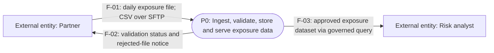
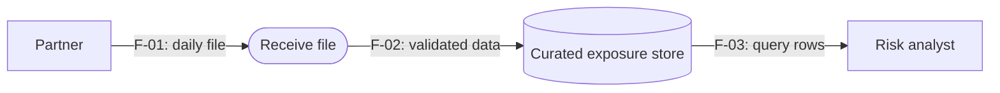

# Data-Flow and Trust-Boundary Diagrams

> **Module:** Stage 2D — Data Architecture / 15 — Architecture Documentation, Reviews and Operating Model  
> **Topic:** 02 of 09  
> **Learning path:** Beginner → Intermediate → Advanced  
> **Scenario:** Fictional Northbridge Bank; every system, identity, flow, volume, control and evidence item in the worked examples is synthetic unless explicitly described as a modelling assumption.  
> **Status:** Learning material, not an organisational standard.

## Table of contents

1. [Purpose and learning outcomes](#1-purpose-and-learning-outcomes)
2. [Prerequisites and key vocabulary](#2-prerequisites-and-key-vocabulary)
3. [Beginner level: understand data-flow diagrams](#3-beginner-level-understand-data-flow-diagrams)
4. [Beginner worked example: partner-file ingestion](#4-beginner-worked-example-partner-file-ingestion)
5. [Intermediate level: decomposition and trust boundaries](#5-intermediate-level-decomposition-and-trust-boundaries)
6. [Build a DFD step by step](#6-build-a-dfd-step-by-step)
7. [Flow inventory and interface annotations](#7-flow-inventory-and-interface-annotations)
8. [Security review at boundary crossings](#8-security-review-at-boundary-crossings)
9. [Intermediate exercise: Northbridge exposure reporting](#9-intermediate-exercise-northbridge-exposure-reporting)
10. [Advanced level: hidden flows, evidence and reconciliation](#10-advanced-level-hidden-flows-evidence-and-reconciliation)
11. [Advanced exercise: reconcile the DFD with synthetic evidence](#11-advanced-exercise-reconcile-the-dfd-with-synthetic-evidence)
12. [Consistency with Topic 01 architecture diagrams](#12-consistency-with-topic-01-architecture-diagrams)
13. [Threat-review questions and illustrative methods](#13-threat-review-questions-and-illustrative-methods)
14. [Common defects and corrective actions](#14-common-defects-and-corrective-actions)
15. [Review, maintenance and governance](#15-review-maintenance-and-governance)
16. [Exercises, model answers and validation rubric](#16-exercises-model-answers-and-validation-rubric)
17. [Expected deliverables and completion gate](#17-expected-deliverables-and-completion-gate)
18. [Readiness for Topic 03](#18-readiness-for-topic-03)

---

## 1. Purpose and learning outcomes

### 1.1 What this topic teaches

An **architecture diagram** describes some selected aspect of a system. A **data-flow diagram (DFD)** focuses on data moving between people or systems, through processes, and into or out of stores. A **trust boundary** marks a point or region where trust, control, identity, tenancy, ownership, or security responsibility changes. A DFD makes those crossings visible so a reviewer can ask what crosses, who controls either side, and what controls protect the crossing.

Topic 01 introduced context, container, component and deployment diagrams. Those views explain the system's surroundings, major runnable units, internal building blocks and runtime placement. A DFD complements them by describing movement and processing of data. It is not a replacement for them and is not a network topology diagram.

### 1.2 Learning objectives

By completing this topic, you should be able to:

1. Draw a DFD with processes, data stores, external entities and labelled flows.
2. Identify and place trust boundaries for changes in trust or control.
3. Identify dependencies and important interfaces.
4. Mark security- and architecture-relevant review points at boundary crossings.
5. Validate a DFD against evidence such as lineage, logs and configuration.
6. State which questions the diagram enables reviewers to answer.
7. Produce a flow inventory and a list of known evidence gaps.
8. Identify hidden flows, including logs, backups, support access and exports.
9. Keep DFD names and boundaries consistent with Topic 01 diagrams.

### 1.3 Why it matters

A platform can have a convincing structural diagram and still be unsafe or misunderstood if the movement of sensitive data is invisible. Examples include a partner file copied to a temporary bucket, a support engineer exporting a sample, a backup replicated to another region, or a notebook writing data to a personal workspace. These flows may not be part of the intended “happy path,” but they can change exposure, residency, retention, and access risk.

A DFD helps teams:

- discover where sensitive data enter, move, transform, persist and leave;
- identify owners and dependencies at interfaces;
- ask targeted security and privacy questions;
- compare intended data movement with lineage, logs and configuration;
- record unknowns instead of silently treating assumptions as facts.

### 1.4 What a DFD cannot prove

A DFD is a model, not direct evidence that a control works. A line labelled “TLS” does not prove certificate validation is configured correctly. A boundary does not itself enforce access control. A diagram may omit flows, describe intended rather than deployed behaviour, or become stale. Use it alongside source evidence, interviews, tests, configuration, and operational records.

**Source alignment:** The module roadmap identifies this topic as a recommended learning scope because the topic file was previously empty. Its required sequence is fundamentals, intermediate DFDs and boundaries, then advanced evidence-based review and maintenance. Named methods in this lesson are illustrative options, not adopted organisational standards.

---

## 2. Prerequisites and key vocabulary

### 2.1 Prerequisites

The roadmap lists **Topic 01** and the following useful foundations:

- **P6 — Security basics:** identity, access control, encryption, network boundaries and privacy.
- **P7 — Cloud and hybrid connectivity:** private connectivity, networking and on-premises integration.
- **P8 — Lineage and dependencies:** how data products, transformations and owners are traced.

You do not need to know every cloud service. You do need to understand the difference between a system, a process, a data store, an interface and a security boundary. If these are unfamiliar, use the definitions below before starting the exercises.

### 2.2 Terms used in this lesson

| Term | Meaning | Why it matters in a DFD |
|---|---|---|
| **External entity** | A person, organisation or system outside the diagram's chosen scope that sends or receives data | Establishes an endpoint and a dependency without pretending it is inside the system boundary |
| **Process** | An activity that receives, transforms, validates, routes, queries or otherwise acts on data | Shows what happens to data, not just where data sit |
| **Data store** | A durable or temporary location from which data can later be retrieved | Makes persistence and copies visible |
| **Data flow** | A named movement of data from a source to a destination | Makes direction, content and interface reviewable |
| **Transformation** | A change to data, such as validation, filtering, masking, aggregation or schema conversion | Helps explain why classification or meaning may change |
| **Trust boundary** | A boundary where trust, control, identity, ownership, tenancy or security responsibility changes | Focuses review on crossings rather than only on technology boxes |
| **Interface** | The defined way two participants exchange data or requests, including protocol and contract | Clarifies compatibility, authentication and operational responsibility |
| **Protocol** | A set of rules used to communicate, such as HTTPS, SFTP, JDBC or a broker protocol | Identifies a communication mechanism, but not by itself the security properties of the connection |
| **Authentication** | Establishing who or what an actor is | Answers “who is connecting?” |
| **Authorisation** | Determining what an authenticated identity is permitted to do | Answers “what may it do?” |
| **Encryption in transit** | Protecting data against disclosure or modification while moving over a connection | Reduces interception risk; does not replace endpoint access controls or data protection at rest |
| **Data classification** | A label indicating sensitivity or handling requirements, such as Public, Internal, Confidential or Restricted | Helps determine appropriate controls; use the organisation's actual scheme where known |
| **Data lineage** | Evidence describing source-to-target relationships and transformations | Helps check whether the model's path matches observed or declared processing |
| **Control plane** | Services that configure, govern or operate other services, such as identity, catalogue or deployment tooling | Can indirectly alter data access or processing even when it does not carry the primary business dataset |
| **Hidden flow** | A flow often omitted from the main business path, such as logs, backups, exports, support access or test copies | Prevents a “happy-path-only” diagram from understating exposure |
| **Evidence gap** | A flow or control that is unknown, unverified or supported only by an assumption | Makes uncertainty explicit and assignable |

### 2.3 Facts, reported facts and assumptions

Use these labels when working from mixed evidence:

- **Observed:** directly seen in a source available to the reviewer, such as a configuration excerpt or log record. Observed evidence still has scope and time limits.
- **Reported:** stated by an owner or stakeholder but not independently corroborated.
- **Assumed:** adopted temporarily to make the exercise or design possible; it requires confirmation before being treated as current-state fact.
- **Inferred:** a conclusion drawn from one or more sources. State the reasoning and confidence rather than presenting it as a directly observed fact.

In this lesson, Northbridge Bank is fictional. Every evidence extract and system detail is synthetic. Labels such as **[ASSUMED]** and **[SYNTHETIC OBSERVATION]** are teaching cues, not evidence about a real bank.

---

## 3. Beginner level: understand data-flow diagrams

### 3.1 The five basic elements

| Element | What it represents | Typical notation | Main question |
|---|---|---|---|
| External entity | Source or recipient outside the scope | Rectangle | Who or what exchanges data with the system? |
| Process | Activity that changes or routes data | Rounded rectangle or circle | What happens to the data? |
| Data store | Persistent or temporary stored data | Cylinder or labelled store box | Where can data be read again? |
| Data flow | Directed movement | Arrow with a label | What data move, and in which direction? |
| Trust boundary | Change in trust or control | Dashed box or line with a label | Which security or ownership context changes here? |

Notation varies across DFD traditions and tools. The shapes above are a practical convention for this lesson, not a mandated standard. **Meaning and consistency matter more than decorative shape.** Include a legend so readers do not have to guess.

### 3.2 Analogy: sorting mail

Imagine a partner sends a parcel of documents. The sender is an external entity; an intake desk checks the parcel; a warehouse stores accepted documents; an analyst retrieves a permitted subset. Arrows show parcel movement. The public loading area and controlled warehouse may have different trust and access conditions. The analogy is imperfect—digital flows can be copied, replayed and transmitted instantly—but it helps distinguish sender, processing, storage and boundary.

### 3.3 Rules of thumb, with limitations

1. **Every flow has a direction and a meaningful label.** Label the data, not only the protocol. “HTTPS” is a protocol, not a description of the payload.
2. **Every process has an input and an output.** Some processes also have error outputs, audit events or control interactions. A process that intentionally discards data should show the relevant outcome or explain it in a note.
3. **Represent store-to-store movement through a process or transfer activity when that activity matters.** A direct arrow can be acceptable for a clearly defined replication or copy operation if the diagram's convention explicitly treats it as a transfer process. Do not hide meaningful validation, filtering or orchestration.
4. **Draw boundaries where control or trust changes, not merely where a technology changes.** Two services may use different technologies but share one administrative and identity domain; conversely, two tenants on the same platform may have a meaningful trust boundary.
5. **A DFD shows selected data movement, not every packet or every infrastructure detail.** Use deployment/network views for topology. Include infrastructure detail only when it changes the data-flow or security review.
6. **Distinguish current state from target state.** A target-state control must not be drawn as though it is already deployed.

These are modelling heuristics, not universal laws. If a particular DFD convention differs, state the convention and apply it consistently.

### 3.4 Data-flow labels

A useful flow label answers, at minimum, “what data move?” Improve it with attributes that affect design or review:

`Daily exposure CSV (Restricted customer exposure data; 2 GB/day; SFTP; partner-owned source)`

Do not overload the arrow until it becomes unreadable. Put detailed attributes in a flow inventory keyed by a stable flow ID, for example `F-01`. The diagram can show `F-01: daily exposure file` while the inventory records protocol, frequency, owner and controls.

### 3.5 Context-level and decomposed DFDs

A **context-level DFD** represents the system as one process and shows its external entities and data exchanges. It answers “what data enter or leave this system, and with whom?” A **decomposed DFD** expands that single process into major processing steps and stores. It answers “how does data move inside the scope?”

A context-level DFD should not be mistaken for a Topic 01 system-context diagram. They may look similar, but they answer different questions:

- A **system-context diagram** emphasizes the system, users, neighbouring systems and dependencies.
- A **context-level DFD** emphasizes data entering and leaving a scoped process, including the type and direction of those exchanges.

One diagram may be adapted to serve both purposes if the purpose and conventions are explicitly stated, but do not assume that a box-and-arrow picture automatically communicates both.

### 3.6 When to use a DFD

Use one when reviewing data handling, integration contracts, privacy exposure, sensitive-data movement, lineage gaps, boundary crossings, exports, backups or third-party calls. It is less suitable as the sole artefact for infrastructure placement, detailed sequence timing, class-level software design or a full network topology. Pair it with the appropriate view instead.

---

## 4. Beginner worked example: partner-file ingestion

### 4.1 Scenario and scope

**Scenario:** A fictional partner sends a daily exposure file. Northbridge Bank's ingestion process validates the file, stores accepted data in a lake zone, and an analyst queries the approved data through a serving interface.

- **Purpose:** Show the main data path and first trust crossing.
- **Audience:** Data engineers, data architect, security reviewer and analyst representative.
- **Boundary:** The ingestion-and-analysis service is in scope. The partner's systems and the analyst's managed workstation are external entities.
- **Synthetic assumptions:** The file is a CSV; the transfer uses SFTP; accepted data are stored in a controlled lake zone; analyst access uses a query service. These details are assumed for practice, not reported production facts.
- **Out of scope for this first diagram:** Detailed network subnets, key rotation workflow, backups, logs and support access. These are deliberately deferred and must be reconsidered in advanced review.

### 4.2 Context-level DFD



**Legend:** Rectangle = external entity; rounded rectangle = process; arrow = directed data flow. F-01 to F-03 are synthetic flow IDs. The single process is a context-level abstraction; it intentionally hides internal stores and transformations.

**Interpretation:** The diagram shows a partner-to-platform input, an output back to the partner, and a query-oriented output to an analyst. It does not yet show where data persist or what happens during validation. The output back to the partner is important: error messages can disclose schema, account or processing details, so their content and access should be reviewed.

### 4.3 Decomposed DFD

```mermaid
flowchart LR
    subgraph PartnerZone[Partner-controlled zone]
        Partner[Partner file producer]
    end

    subgraph BankZone[Northbridge Bank controlled platform zone]
        Intake([P1: Receive file])
        Validate([P2: Validate schema and business rules])
        Raw[(D1: Quarantine / raw landing store)]
        Curate([P3: Normalize and publish accepted records])
        Lake[(D2: Curated exposure store)]
        Query([P4: Authorize and execute analyst query])
    end

    Analyst[Risk analyst]
    Partner -->|F-01: daily CSV file via SFTP| Intake
    Intake -->|F-02: received file object and transfer metadata| Raw
    Raw -->|F-03: candidate file and object metadata for validation| Validate
    Validate -->|F-04: accepted records and validation result| Curate
    Validate -->|F-05: rejected-file report| Partner
    Curate -->|F-06: normalized exposure records| Lake
    Analyst -->|F-07: SQL query request; authentication to verify| Query
    Lake -->|F-08: query result rows for authorization filtering| Query
    Query -->|F-09: query result set; field filtering to verify| Analyst
```



**Important modelling note:** The diagram includes an intentional quarantine/raw landing store and separates the query process from the curated store. That is an illustrative design choice, not a statement about an actual Northbridge deployment. The process-to-store arrows represent logical data operations; the detailed physical storage and network placement belong in a deployment view.

**Sequence assumption:** This example assumes the received object and transfer metadata are written to quarantine first; the validator then reads the quarantined object and its metadata. A real implementation may validate the incoming stream before landing instead. Choose the sequence from configuration, lineage or a walkthrough, and update the diagram to match the evidence. The flow IDs in this diagram are local to this example and are not reused as identifiers for the other worked examples below.

### 4.4 Beginner exercise

Create your own DFD for the same scenario. Include:

1. Partner as an external entity.
2. Receive and validate processes.
3. A store for received or accepted data.
4. A serving/query process and risk analyst.
5. A directed, labelled arrow for every data exchange.
6. A legend, purpose, audience, scope and assumptions.

**Validation criteria:**

- Every arrow names the data or request that moves.
- Arrow direction follows the described sender and recipient.
- Processes describe actions, not product names alone.
- Stores are distinguishable from processes.
- At least one external boundary is described in words, even if the first drawing does not yet use a dashed boundary box.
- The diagram does not imply that validation, access control or encryption exists unless the scenario explicitly assumes it.

**Model answer:** The context-level DFD in §4.2 is a valid minimal answer. A stronger answer adds a rejected-file response and states that the transfer protocol and storage design are assumptions. There is no single required layout; semantic completeness and honest scope are the criteria.

---

## 5. Intermediate level: decomposition and trust boundaries

### 5.1 What is a trust boundary?

A **trust boundary** is a modelling boundary across which the security context changes. That change may involve different administrators, identities, tenants, legal entities, network controls, data owners, operational teams or levels of assurance. A boundary does not necessarily mean “untrusted versus trusted” in a simplistic binary sense. It means a crossing requires explicit reasoning about what is allowed and what evidence supports that decision.

**Why it matters:** Most serious data-flow questions occur at transitions: a partner uploads data, a pipeline assumes a service identity, an application queries a database, a production dataset is copied to a test environment, or a backup is replicated to another region.

**How to model it:** Draw a dashed boundary around the relevant zone or annotate a flow crossing a labelled line. State what distinguishes the zones, such as “Partner-controlled / bank-controlled,” “Production / non-production,” or “Tenant A / shared platform.” Do not rely on colour alone.

**Trade-off:** Too few boundaries hide risk; too many make the drawing unreadable and can imply that every technical component has a distinct trust domain. Draw boundaries that matter to the review and put detailed boundary definitions in a table.

### 5.2 Common boundary types

| Boundary | Why it can matter | Review focus |
|---|---|---|
| Internet ↔ corporate/private network | Exposure to external clients and attackers changes | Authentication, rate limiting, filtering, monitoring, denial-of-service handling |
| Partner/on-premises ↔ cloud | Administrative, network and operational control changes | Mutual identity where appropriate, private connectivity or secure transfer, endpoint validation, logging and ownership |
| Cloud account/project/subscription ↔ another | IAM, policy and administrative blast radius may differ | Cross-account roles, least privilege, audit logs, ownership and policy enforcement |
| Platform ↔ tenant | Data isolation and delegated administration may differ | Tenant identity propagation, row/object isolation, key and policy scope, cross-tenant testing |
| Production ↔ non-production | Data handling, access and operational assurance often differ | Masking or synthetic data, restricted access, copy controls, retention and deletion |
| Application ↔ database | Application identity may have broader privileges than end users | Service credentials, database grants, query restrictions, audit trail and injection defence |
| Human operator ↔ system | Interactive access may bypass normal application paths | Privileged access, approval, session logging, break-glass controls and export restrictions |
| Platform ↔ third-party API/model | Data leaves a control domain or is processed under another party's terms | Data minimisation, contract, residency, retention, training-use terms, response handling |
| Primary region ↔ backup/DR region | Data may cross geography and administrative boundaries | Residency, encryption, access, retention, recovery tests and deletion semantics |
| Workload ↔ shared control plane | Identity, catalogue or CI/CD may change access or runtime behaviour | Privilege separation, change approval, integrity and auditability |

A boundary is not defined by physical geography alone. A single region may contain several security domains; a private connection may still cross an ownership boundary. Conversely, not every network hop is a meaningful trust boundary.

### 5.3 Boundary crossings require questions, not decorative lines

For every crossing, record:

- **What crosses?** Data, metadata, credentials, control commands, logs or query results.
- **Who sends and receives it?** Include service identities and human actors where relevant.
- **Who owns each side?** Include the party responsible for configuration, incident response and retention.
- **How is identity established?** User identity, workload identity, certificate, key or another mechanism.
- **What is authorised?** Which actions and datasets are permitted, not merely whether a connection is possible.
- **How is it protected?** Encryption in transit, validation, filtering, integrity checks and safe error handling as appropriate.
- **What is recorded?** Audit events, access decisions, transfer status, failures and correlation identifiers.
- **What is the data classification and purpose?** Include minimisation, retention, residency and onward-transfer constraints.
- **What happens on failure?** Retry, quarantine, dead-letter handling, partial writes, duplicate delivery and operator intervention.
- **What evidence supports the answer?** Configuration, logs, contract, lineage, test or owner report.

### 5.4 Intermediate DFD with boundaries

The following diagram is synthetic. Dashed subgraphs indicate control zones; the labelled flow crosses are the review focus. Mermaid supports subgraphs but does not guarantee that every renderer draws subgraph boundaries in a particular dashed style, so the textual zone names are part of the meaning.

```mermaid
flowchart LR
    subgraph External[Boundary B-01: partner-controlled environment]
        Partner[Partner transfer client]
    end

    subgraph BankProd[Boundary B-02: Northbridge production data platform]
        Gateway([P1: SFTP intake and file registration])
        Quarantine[(D1: Quarantine store)]
        Validator([P2: Schema, malware and business-rule validation])
        Curator([P3: Normalize and classify])
        Curated[(D2: Curated exposure store)]
        Query([P4: Authorize analyst query])
    end

    subgraph AnalystZone[Boundary B-03: managed analyst workspace]
        Analyst[Risk analyst]
    end

    Partner -->|F-01: daily exposure file; Restricted; SFTP| Gateway
    Gateway -->|F-02: file object and transfer metadata| Quarantine
    Quarantine -->|F-03: candidate file for validation| Validator
    Validator -->|F-04: accepted records plus validation status| Curator
    Validator -->|F-05: rejected file ID and error code; safe content to verify| Partner
    Curator -->|F-06: normalized exposure records| Curated
    Analyst -->|F-07: SQL request; user identity and authentication to verify| Query
    Curated -->|F-08: query result rows; filtering status to verify| Query
    Query -->|F-09: result set; field filtering to verify| Analyst
```



**Legend and interpretation**

- Rectangles are external entities; rounded boxes are processes; cylinders are data stores; arrows show direction.
- `B-01`, `B-02` and `B-03` identify trust/control zones. Their labels are illustrative assumptions; they must be replaced with evidence-backed boundary definitions for a real system.
- F-01 crosses from partner control to bank control. F-09 crosses from the platform to the analyst's workspace. F-05 crosses in the opposite direction and can disclose operational information.
- The diagram does not prove SFTP configuration, encryption, malware scanning, field-level authorisation or any other control. Those are review questions until evidence confirms them.
- “Restricted” is an illustrative classification label. Use the organisation's actual data classification policy when available.

### 5.5 Classification propagation through transformations

A transformation may change data sensitivity, but the change must be justified. For example:

- **Masking:** direct identifiers are replaced or obscured. The result may still be sensitive if it can be re-identified or linked with other data.
- **Aggregation:** records are summarised. Small groups or rare combinations may still reveal information.
- **Filtering:** some rows or columns are removed. This reduces exposure only if the filter is correct and enforced.
- **Tokenisation:** identifiers are replaced with tokens. Risk depends on who controls the token mapping and whether the mapping is accessible.

Do not automatically relabel data “Public” or “non-sensitive” merely because a transformation occurred. Record the input classification, transformation, output classification, rationale, and approving policy or owner. If unknown, mark the output classification as unverified.

### 5.6 Asynchronous and streaming flows

A message broker or queue is often both a store and a trust intermediary. Show producers, topics/queues, consumers and relevant persistence or replay behaviour when it affects the review. Important questions include who can publish, subscribe, replay, inspect dead-letter messages or change consumer configuration; how long messages persist; and whether duplicate delivery is possible.

For a streaming platform, a single arrow labelled “events” may hide several distinct flows: publish, consume, retry, dead-letter, replay and administrative access. Split them when they have different permissions, retention or failure behaviour. Do not draw every internal broker packet unless it affects the architecture question.

---

## 6. Build a DFD step by step

Use this repeatable process for a new DFD or a review of an existing one.

### Step 1 — Write the purpose and scope

Write one sentence answering what the diagram is intended to help someone decide. Define the system boundary, audience, environment, state (current, target or proposed) and exclusions. “Show current production movement of Restricted partner exposure data from arrival through analyst query” is more useful than “Data architecture.”

### Step 2 — Identify external entities

List the people, organisations and systems that exchange data with the scoped system. Include upstream producers, downstream consumers, operators and third parties. Avoid placing an in-scope process outside the boundary merely because another team owns it; scope is a modelling decision, while ownership is a separate attribute.

### Step 3 — Identify processes and stores

Start with the major transformations and durable or temporary stores. Use verbs for processes: receive, validate, normalize, mask, aggregate, publish, authorize, query, export, replicate. Use nouns for stores: quarantine files, curated exposure tables, audit log, backup snapshot. If a box name is a vendor/product, add the actual responsibility.

### Step 4 — Draw the intended business path

Connect source to destination with arrows. For each arrow, state what moves and in which direction. Separate distinct payloads or directions when they have different controls or meanings. Include error responses when they cross a boundary or reveal useful information.

### Step 5 — Add the non-happy-path flows

Ask about rejection, retry, dead-letter handling, audit logs, metrics, support access, backups, replication, temporary files, notebooks, exports, test copies and restore paths. Include them if relevant to the scope; otherwise record the exclusion and rationale. “Not shown” should not silently mean “does not exist.”

### Step 6 — Place trust boundaries

Identify where control, identity, ownership, tenancy, environment or regulatory context changes. Give each boundary a stable ID and a definition. A boundary can enclose multiple elements; a crossing is the movement from one zone to another. A flow can cross more than one boundary.

### Step 7 — Annotate review-relevant flow attributes

At a minimum include data name/type, direction and classification. Add protocol, authentication mode, owner, volume/frequency, retention or residency where these affect the decision. Use a separate flow inventory for detailed attributes.

### Step 8 — Generate reviewer questions

Every boundary crossing should have at least one question that can be answered with evidence. Examples: “Which workload identity uploads the file?”, “Does the receiving service validate the sender and file schema?”, “Can an analyst query another tenant's rows?”, “Which regions receive backup copies?”

### Step 9 — Validate against independent evidence

Compare the model with available lineage, interface inventories, network/IAM configuration, logs, job definitions, storage settings and interviews. Evidence sources may conflict or cover different time periods. Record source, observation date, scope, confidence and unresolved discrepancies.

### Step 10 — Review and publish

Walk through the diagram with a system owner and a security or privacy reviewer. Confirm the direction, payload and owner of each material flow. Save the flow inventory, boundary-crossing question list and evidence gaps alongside the diagram. Give the artefact an ID, version, date and owner.

### Step 11 — Keep it current

Update the DFD when integrations, transformations, storage, identities, exports, backup regions, access paths or trust boundaries change. Link changes to the relevant change request or architecture decision record (ADR). An ADR records a significant decision and its rationale; it is not a substitute for updating the diagram.

---

## 7. Flow inventory and interface annotations

### 7.1 Why an inventory is needed

A diagram is optimised for visual comprehension; an inventory is optimised for review, traceability and maintenance. The inventory gives each flow a stable ID so it can be referenced in review findings, evidence records and change tickets. It also avoids forcing long security notes onto arrows.

### 7.2 Recommended flow inventory fields

| Field | Required? | Guidance |
|---|---|---|
| Flow ID | Yes | Stable ID such as `F-01`; avoid reusing an ID for a materially different flow |
| Source and destination | Yes | Use exact diagram element IDs/names |
| Data/payload | Yes | Name the business data, metadata, query, control message or credential involved |
| Direction | Yes | Source → destination; model reverse/error flows separately when materially different |
| Classification | Yes | Use approved labels; otherwise mark `unknown / to confirm` |
| Protocol/interface | Yes where known | E.g. SFTP, HTTPS API, SQL/JDBC, broker topic; distinguish protocol from security configuration |
| Source owner / destination owner | Yes | Name accountable teams or roles, not only vendors |
| Frequency / volume | Required when relevant | Batch schedule, events/second, typical and peak size; label estimates and units |
| Authentication | Review-relevant | Identity type and how it is established; avoid putting secrets in documentation |
| Authorisation | Review-relevant | Allowed actions/data scope and enforcement point |
| Transit protection | Review-relevant | TLS or other mechanism and evidence of configuration; do not infer from protocol name alone |
| Validation / integrity | Review-relevant | Schema, signature, checksum, malware/content scan or business-rule checks, as applicable |
| Logging / monitoring | Review-relevant | What is logged, correlation ID, alerting, sensitive-field redaction |
| Retention / deletion | When data persist | Source, landing, retries, dead letters, exports and backups can differ |
| Residency / region | When applicable | Record data location and cross-region transfers; verify against configuration and policy |
| Evidence reference | Yes for validated flows | Source ID/path, timestamp/window, query/job/config identifier, or interview record |
| Confidence/status | Yes | Observed, reported, assumed, inferred, verified, partially verified or unknown |
| Review question / action | Yes for gaps | A concrete question, owner and due date if this is a live review |

### 7.3 Example flow inventory (synthetic)

This is a **standalone sample inventory**, not the inventory for any one diagram in §§4, 5 or 9. Its `INV-` identifiers are local to this table; when building a real deliverable, use one stable identifier set shared by the diagram and inventory.

| Flow ID | Source → destination | Data and classification | Interface / frequency | Owner(s) | Controls to verify | Evidence status |
|---|---|---|---|---|---|---|
| INV-01 | Partner client → SFTP intake | Daily exposure CSV; Restricted **[ASSUMED]** | SFTP; daily; 2 GB **[ASSUMED]** | Partner data team → Bank ingestion team **[ASSUMED]** | Sender identity, host key/certificate handling, encryption, file integrity, size limits, audit event | Assumed; no real evidence supplied |
| INV-02 | Intake → quarantine store | Received file and transfer metadata; Restricted **[ASSUMED]** | Object write; per file | Ingestion team **[ASSUMED]** | Workload identity, write scope, encryption at rest, retention, object versioning | Assumed |
| INV-03 | Quarantine store → validator | Candidate file; Restricted **[ASSUMED]** | Internal read; per file | Ingestion team **[ASSUMED]** | Read permission, parser limits, malware/content checks where appropriate, schema validation | Assumed |
| INV-04 | Validator → curator | Accepted records and validation result; classification to confirm | Internal job handoff; per batch | Data engineering **[ASSUMED]** | Reject invalid rows, record counts, lineage, safe error handling | Assumed |
| INV-05 | Validator → partner | File ID and safe rejection code; Internal **[ASSUMED]** | SFTP response/notification; on rejection | Ingestion team → partner support **[ASSUMED]** | Do not expose credentials, record contents or stack traces; authenticate recipient | Assumed |
| INV-06 | Curator → curated store | Normalized exposure rows; Restricted **[ASSUMED]** | Batch write; daily | Data platform team **[ASSUMED]** | Least privilege, schema/version contract, audit, retention and classification propagation | Assumed |
| INV-07 | Analyst → query service | SQL/query request; may reveal identifiers or intent | SQL/API; analyst sessions | Analytics platform team **[ASSUMED]** | User authentication, dataset/column/row authorisation, query limits, audit | Assumed |
| INV-08 | Curated store → query service | Authorized rows; Restricted **[ASSUMED]** | Internal query; on demand | Data platform team **[ASSUMED]** | Service identity, scoped grants, query isolation, audit | Assumed |
| INV-09 | Query service → analyst workspace | Approved query results; classification depends on fields | SQL result; on demand | Analytics platform → analyst team **[ASSUMED]** | Field minimisation, managed endpoint, export restrictions, session logging, retention | Assumed |

Do not treat this inventory as evidence that these flows or controls exist. It is a template populated with synthetic assumptions to demonstrate the expected level of detail.

### 7.4 Distinguish protocol from security properties

- `SFTP` identifies a file-transfer protocol. It does not establish that the correct server host key is verified, the partner identity is constrained, or the landing permissions are least-privilege.
- `HTTPS` does not alone prove correct TLS versions, certificate validation, client authentication, authorisation or safe application behaviour.
- `SQL` describes a query interface family; it does not prove that database access is encrypted or that row/column restrictions are enforced.
- A private network route does not automatically establish application identity or authorisation.

Document what the configuration shows and what still needs testing. Avoid claiming a control is effective based only on a protocol label.

---

## 8. Security review at boundary crossings

### 8.1 Control categories

Controls should be selected based on the flow, threat, data classification, applicable policy and operating context. Not every flow needs every control, and a control's presence is not proof of effectiveness.

| Control area | Purpose | Questions to ask | Common limitation |
|---|---|---|---|
| Authentication | Establish identity of user, service or partner | Which identity connects? How is it issued, rotated and revoked? | A valid identity can still be over-privileged or compromised |
| Authorisation | Limit actions and data access | Is access scoped to this dataset, tenant, operation and environment? | Network reachability or successful authentication is not authorisation |
| Encryption in transit | Protect data on the connection | Is encryption negotiated and validated? Are endpoints authenticated? | Does not protect data after decryption at endpoints or prevent authorised misuse |
| Input validation | Reject malformed or unexpected inputs | Are schema, size, encoding, type, content and business rules checked? | A valid schema can still contain malicious or semantically wrong data |
| Logging and monitoring | Support audit and detection | Are success/failure and identity recorded? Are sensitive payloads redacted? | Logs may themselves leak sensitive data; logging is not prevention by itself |
| Rate/size limiting | Bound resource use and abuse | Are quotas and limits applied per identity/tenant? | Limits can affect legitimate bulk workloads if poorly tuned |
| Data minimisation | Transfer only what is needed for the purpose | Can fields, rows or precision be removed? | Redaction may not prevent re-identification or inferential disclosure |
| Residency and jurisdiction | Ensure location and onward transfer fit obligations | Where are primary, replica, log, backup and support copies located? | A region label may not reveal all subprocessors or support access paths |
| Integrity and replay controls | Detect corruption, tampering or duplicate processing | Is there a checksum/signature, idempotency key or replay protection where needed? | A checksum detects accidental change only if the expected checksum is trusted |
| Retention and deletion | Limit how long copies remain | What happens to raw files, retry queues, exports, logs and backups? | Deleting a primary object may not delete snapshots or downstream copies |
| Privileged operations | Constrain operator access and emergency actions | Who can inspect, export, impersonate, change policy or restore backups? | Break-glass paths can bypass routine workflows unless audited and reviewed |

### 8.2 Boundary-crossing review worksheet

Complete one worksheet for each material crossing. Use `unknown` when evidence is missing rather than guessing.

| Question | Response / evidence reference |
|---|---|
| Boundary ID and definition |  |
| Flow ID(s) crossing it |  |
| Source identity and owner |  |
| Destination identity and owner |  |
| Data/payload and classification |  |
| Business purpose and minimum required fields |  |
| Protocol and endpoint authentication |  |
| Authorisation scope and enforcement point |  |
| Transit protection and evidence |  |
| Validation, integrity and replay handling |  |
| Logs, monitoring and sensitive-data redaction |  |
| Rate, size and resource limits |  |
| Residency, retention and deletion implications |  |
| Failure, retry, quarantine and escalation path |  |
| Open question, risk, owner and due date |  |

### 8.3 Human-to-system and support paths

Do not limit the DFD to application-to-application data. Include operator access where an operator can read, export, alter or restore data. A support workflow may include a ticketing system, privileged session, temporary extract and deletion step. If these are material to the scope, show them as flows and identify the trust boundary between the operator's environment and the platform.

### 8.4 Production and non-production

A production-to-test copy is a distinct flow even when it uses the same storage technology. Ask whether the copy is masked, synthetic, minimised, access-restricted, time-limited and deleted. “Non-production” does not automatically mean lower risk; it may have weaker monitoring or broader developer access. Conversely, some non-production environments may have strong controls. Model actual differences, not stereotypes.

### 8.5 Residency and backup paths

Backups and disaster-recovery copies are data flows. Show the source store, backup/replication process, destination region or account where relevant, and who can restore or access the copy. A backup crossing a regional or legal boundary requires review of residency, retention, encryption, access and deletion behaviour. Do not omit it simply because it is not part of the normal business path.

---

## 9. Intermediate exercise: Northbridge exposure reporting

### 9.1 Brief

Build a decomposed DFD for a fictional exposure-reporting platform. The partner sends a daily file. The platform validates, stores, transforms and serves exposure records. Analysts query results. A platform catalogue/policy service provides dataset metadata and access-policy configuration. An operator may investigate failed ingestion runs.

**Synthetic assumptions for this exercise:**

- Partner files are transferred using SFTP.
- The ingestion platform has a quarantine store and curated store.
- Analysts use a query service; policy configuration is held in a catalogue/policy service.
- For this exercise only, a restricted sample of curated data is copied to a non-production test store; the copy's masking status is unknown and must be reviewed.
- An operator can inspect failed-run metadata, but should not automatically be assumed to have unrestricted access to payloads.
- The exact cloud, network, identity product, volumes and retention periods are unspecified.

### 9.2 Tasks

1. Draw a context-level DFD and a decomposed DFD.
2. Mark the four required trust-boundary crossings: partner-to-platform, platform-to-analyst, production-to-non-production, and operator-to-platform. The test-copy flow is a synthetic exercise assumption so the production/non-production crossing is in scope.
3. Give every flow a stable ID and label its payload and direction.
4. Populate the flow inventory with classification, protocol/interface, owner, frequency/volume where known, and controls to verify.
5. Write at least ten reviewer questions. At least one must address each of the following: identity, authorisation, encryption, input validation, logging, data minimisation, residency, retention/deletion, hidden copies, and operator access.
6. Mark facts as observed, reported, assumed or unknown. Since the scenario supplies no real configuration or logs, do not label controls “verified.”

### 9.3 Example decomposed diagram

```mermaid
flowchart LR
    subgraph Partner[ B-01: partner-controlled environment ]
        Producer[Partner file producer]
    end

    subgraph Prod[ B-02: bank production platform ]
        Intake([P1: Receive and register file])
        Quarantine[(D1: Quarantine store)]
        Validate([P2: Validate schema and content])
        Transform([P3: Normalize and classify])
        Curated[(D2: Curated exposure store])
        Query([P4: Authorize and run query])
        Policy[(D3: Catalogue and policy metadata])
        Ops([P5: Operator failure investigation])
        Audit[(D4: Audit and job metadata])
    end

    subgraph AnalystZone[ B-03: managed analyst workspace ]
        Analyst[Risk analyst]
    end

    subgraph NonProd[ B-04: non-production test environment ]
        TestCopy[(D5: Test copy of curated exposure data; masking status unknown)]
    end

    subgraph OperatorZone[ B-05: operator-controlled administrative environment ]
        Operator[Authorized platform operator]
    end

    Producer -->|F-01: daily exposure file; classification to confirm| Intake
    Intake -->|F-02: file and transfer metadata| Quarantine
    Quarantine -->|F-03: candidate file| Validate
    Validate -->|F-04: accepted rows and validation outcome| Transform
    Validate -->|F-05: rejection status; message safety to verify| Producer
    Transform -->|F-06: normalized exposure records| Curated
    Query -->|F-07: policy lookup request| Policy
    Policy -->|F-08: policy decision and metadata| Query
    Analyst -->|F-09: query request| Query
    Curated -->|F-10: candidate query rows; authorization filtering to verify| Query
    Query -->|F-11: query result set; approved-field filtering to verify| Analyst
    Intake -->|F-12: transfer event and file ID| Audit
    Validate -->|F-13: validation outcome and counts| Audit
    Operator -->|F-14: diagnostic request; authentication to verify| Ops
    Audit -->|F-15: job status and diagnostic metadata; redaction to verify| Ops
    Curated -->|F-16: sample data copy to non-production; masking and approval unknown| TestCopy
    Ops -->|F-17: investigation status and approved diagnostic response| Operator
```

**Diagram note:** Policy lookup requests and policy decision responses are separate directional flows (F-07 and F-08). Keeping them separate makes their payloads, identities, logging and controls independently reviewable. B-01/B-02, B-02/B-03, B-02/B-04 and B-05/B-02 are the four required crossings. F-16 is a synthetic assumed flow added so the production/non-production boundary is explicitly reviewable; it is not evidence that a real test copy exists. The diagram is illustrative, and its flow IDs must be mirrored exactly in the exercise inventory.

#### Example flow inventory for the intermediate diagram

All statuses below are **assumed or unknown**, because the exercise supplies no real configuration, logs or lineage. The owner roles are placeholders for the exercise, not claims about a real organisation.

| Flow ID | Source → destination | Payload / classification | Interface and illustrative owner | Evidence status and review focus |
|---|---|---|---|---|
| F-01 | Producer → Intake | Daily exposure file; classification to confirm | SFTP; partner data owner / ingestion owner | Assumed; verify sender identity, endpoint validation, transfer protection and file limits |
| F-02 | Intake → Quarantine | File object and transfer metadata; classification to confirm | Object write; ingestion owner | Assumed; verify workload identity, write scope, retention and integrity metadata |
| F-03 | Quarantine → Validate | Candidate file; classification to confirm | Internal object read; ingestion owner | Assumed; verify read scope, parser limits and quarantine access |
| F-04 | Validate → Transform | Accepted rows and validation outcome; classification to confirm | Job handoff; data engineering owner | Assumed; verify reject rules, counts, lineage and safe failure handling |
| F-05 | Validate → Producer | Rejection status; message safety to verify; Internal label illustrative | SFTP response/notification; ingestion owner | Assumed; verify recipient identity and that payload details/secrets are not exposed |
| F-06 | Transform → Curated | Normalized exposure records; classification to confirm | Batch write; data product/platform owner | Assumed; verify classification propagation, schema contract and retention |
| F-07 | Query → Policy | Policy lookup request; may contain user/dataset identifiers | Internal API; query/platform owner | Assumed; verify identity propagation, minimum request data and audit |
| F-08 | Policy → Query | Policy decision and metadata; may reveal policy details | Internal API response; governance/platform owner | Assumed; verify response integrity, fail-closed/fail-open behaviour and logging |
| F-09 | Analyst → Query | Query request; may reveal identifiers or intent | SQL/API; analytics access owner | Assumed; verify user authentication, query limits and audit |
| F-10 | Curated → Query | Candidate query rows; classification to confirm | Query interface; data platform owner | Assumed; verify service identity, grants and row/column filtering before release |
| F-11 | Query → Analyst | Query result set; classification depends on fields; approved-field filtering to verify | SQL/API result; analytics access owner | Assumed; verify field minimisation, managed endpoint, export and session controls |
| F-12 | Intake → Audit | Transfer event and file ID; metadata classification to confirm | Job/audit event; ingestion owner | Assumed; verify event completeness, correlation ID, redaction and retention |
| F-13 | Validate → Audit | Validation outcome and counts; metadata classification to confirm | Job/audit event; data engineering owner | Assumed; verify counts, failure events, sensitive-field redaction and alerting |
| F-14 | Operator → Ops | Diagnostic request; may contain incident identifiers | Privileged console/API; operations owner | Assumed; verify privileged identity, approval, least privilege and session audit |
| F-15 | Audit → Ops | Job status and diagnostic metadata; redaction to verify | Internal console read; operations owner | Assumed; confirm actual metadata scope, redaction and whether payload download is separately controlled |
| F-16 | Curated → TestCopy | Sample copy of curated exposure data; classification and masking status unknown | Copy/export job; data product and non-production owners | Explicit synthetic assumption; verify approval, masking/minimisation, access, residency, retention and deletion |
| F-17 | Ops → Operator | Investigation status and approved diagnostic response; content to confirm | Privileged console response; operations owner | Assumed; verify response minimisation, access scope, audit and prevention of payload disclosure |

The table deliberately uses “to confirm” and “assumed” where the scenario does not provide evidence. In a real review, replace placeholder owners with accountable roles and link each verified claim to a configuration, log, lineage record, test or documented owner statement.

### 9.4 Ten model reviewer questions

1. Which partner identity is permitted to upload, and how is the remote endpoint verified?
2. Is the receiving workload restricted to the intended landing path and file types?
3. Which protocol settings and endpoint evidence establish protection in transit?
4. Are file size, encoding, schema, row counts and business rules validated before publication?
5. Can invalid records or files be quarantined without exposing payloads in rejection messages?
6. What identity authorizes an analyst query, and are dataset, row and column permissions enforced?
7. Do logs include identities, flow IDs, outcomes and correlation IDs while avoiding full sensitive payloads?
8. Are only necessary fields copied into the curated store and query results?
9. Where are raw, curated, audit and backup copies stored, and are residency requirements known?
10. Can operators read or export the original payload, and are privileged actions approved and audited?
11. Is the non-production copy masked or minimised, who can access it, and how is its retention/deletion controlled?

Other valid questions include duplicate delivery, idempotency, replay, retries, retention, delete propagation, cross-tenant access, test copies, support exports and policy-service failure behaviour.

### 9.5 Intermediate validation rubric

Score each criterion as `Pass`, `Needs correction`, or `Unknown`:

- All in-scope entities, processes and stores are present.
- Every flow has a direction, unique ID and data/payload label.
- Every flow has a classification or an explicit “to confirm” marker.
- Each of the four required crossings (partner/platform, platform/analyst, production/non-production, operator/platform) is visible and has a boundary definition.
- Each material crossing has a review question.
- Flow inventory names and IDs match the diagram.
- No control is represented as verified without evidence.
- Hidden flows are included or explicitly excluded with rationale.
- The DFD is consistent with Topic 01 names and scope.
- Assumptions and unresolved questions are recorded.

A result of `Unknown` is not automatically a defect in the diagram if the uncertainty is visible and assigned for follow-up. It is a defect if the diagram silently converts the unknown into a confident claim.

---

## 10. Advanced level: hidden flows, evidence and reconciliation

### 10.1 Why advanced DFDs need evidence

A review-grade DFD is not drawn from memory alone. It is reconciled against independent sources that reveal what is configured, executed or observed. Different sources answer different questions:

| Evidence source | Useful for | Limitations |
|---|---|---|
| Data lineage / transformation metadata | Source-to-target relationships, jobs, transformations and dependencies | May omit manual exports, operational logs, ad hoc queries or unregistered jobs |
| Integration/interface inventory | Declared APIs, file transfers, owners, schedules and contracts | Can be stale or incomplete; declaration is not proof of runtime use |
| Network flow logs | Observed network connections during a time window | May not reveal payload semantics; encrypted traffic limits content visibility; sampling/retention may omit events |
| IAM and resource configuration | Configured identities, roles, grants, endpoints and policies | Configuration may not prove actual use or effective permissions in every path |
| Storage and backup configuration | Locations, replication, lifecycle and retention settings | Does not by itself prove all copies or downstream exports are captured |
| Application/job logs | Execution outcomes, counts, error paths and identities when logged | Logging may be incomplete, redacted, sampled or disabled; logs may themselves contain sensitive data |
| Query/audit logs | Data access, user/service identities, query activity | May omit cached results, offline copies or activity outside the logging scope |
| CI/CD and infrastructure-as-code (IaC) | Declared deployment and infrastructure configuration | Deployed state may drift from code; manual changes may not be represented |
| Interviews and walkthroughs | Operational knowledge, undocumented manual steps and ownership | Reported information should be corroborated when the risk warrants it |
| Tests and controlled observations | Whether specific paths or controls behave as expected | Test coverage is limited to tested conditions, identities and time |

**Evidence principle:** no single source proves completeness. Reconcile multiple sources and state the coverage and limitations of each.

### 10.2 Hidden-flow checklist

For each platform, ask whether the following are in scope:

- success and failure logs, audit events, traces, metrics and alert payloads;
- backups, snapshots, replication, exports and restore paths;
- retry queues, dead-letter queues, replay and temporary staging files;
- notebooks, query-result caches, local downloads and analyst extracts;
- support access, break-glass access, vendor support and debugging sessions;
- test data, copied production datasets, masked datasets and sample files;
- catalogue metadata, lineage events, policy decisions and identity/control-plane requests;
- CI/CD artefacts, configuration bundles, secrets references and deployment jobs;
- third-party API/model requests and responses, including prompts, documents, embeddings and retrieved context where relevant;
- data deletion, retention expiry and downstream deletion propagation.

Not every item belongs on the main DFD. Use a companion DFD or inventory for a dense class of flows, but cross-reference it and record exclusions. A diagram can be intentionally scoped without being misleading.

### 10.3 Indirect trust and control-plane flows

A catalogue, identity provider, policy engine or CI/CD system may not carry the main business dataset, but it can determine who reads that dataset or which code processes it. Model control-plane interactions when they materially affect the question under review. For example, an identity administrator who can change a service role may indirectly gain access to a store. That is an administrative dependency or privilege path even if the administrator never downloads the data directly.

**Trade-off:** drawing every control-plane API can overwhelm a business DFD. Create a security-focused companion view for high-impact dependencies and link it by stable IDs. Do not hide a control-plane dependency merely because it is “metadata” rather than the primary dataset.

### 10.4 Classification propagation and derived data

Track data classification across transformations and copies. A flow inventory can record `input classification`, `transformation`, `output classification`, `rationale` and `approver`. If a masking or aggregation step claims to lower sensitivity, require evidence of the transformation and an assessment of re-identification risk. Do not assume embeddings, feature vectors, model prompts, metadata or logs are harmless because they are not raw source rows.

### 10.5 Streaming, replay and duplication

For asynchronous systems, include the broker/topic, producer and consumer identities, retention, dead-letter path and replay capability when relevant. Replay can cause duplicate writes or reprocess old sensitive data. A queue's retention and access policy may create a second data store with a different audience. Document idempotency and deduplication behaviour where the architecture depends on it.

### 10.6 AI-related flows as an optional example

An AI-enabled analytics platform may send documents to chunking and embedding processes, persist vectors, retrieve authorised chunks and send prompts/context to a model endpoint. If the model endpoint is a third party, the DFD should identify the data sent, its classification, the provider boundary, retention/processing terms and the response path. Permission-aware retrieval is a control design question; the existence of a vector store does not prove source permissions are enforced. This example is included because the roadmap explicitly names AI-related flows as an advanced consideration, not because every Northbridge exercise requires AI.

---

## 11. Advanced exercise: reconcile the DFD with synthetic evidence

### 11.1 Objective

Reconcile a proposed DFD against a small synthetic evidence pack. Identify which flows are supported, contradicted, missing or still unverified. Correct the DFD and maintain a discrepancy log. Do not claim that the synthetic evidence describes a real deployment.

### 11.2 Proposed diagram (intentionally incomplete)



This proposed diagram omits a quarantine store, validation process, rejection flow, audit events, backup replication and operator diagnostic access. Those omissions may be legitimate for a narrowly scoped diagram, but the stated purpose is “current production data movement from partner arrival through operations and analyst use,” so the omitted paths need investigation.

### 11.3 Synthetic evidence pack

All records below are invented for the exercise. Treat them as **synthetic observations within the exercise only**.

| Evidence ID | Synthetic extract | What it supports / does not support |
|---|---|---|
| E-01 — interface inventory | `partner-exposure-prod`: SFTP intake; daily 02:00 UTC; owner `Data Ingestion`; payload `exposure.csv`; classification field blank | Supports a declared daily SFTP integration and owner; classification remains unknown |
| E-02 — job configuration | `receive_partner_file` writes to `quarantine/exposure/`; `validate_exposure` reads that path; `publish_exposure` writes `curated.exposure_daily` | Supports a quarantine store and three job stages in declared configuration; does not prove every run succeeded |
| E-03 — job log sample | At 02:04 UTC, file ID `NBX-204` received; 1 file quarantined; 1 schema rejection; status notification `REJECT_SCHEMA` sent to partner endpoint | Observes one sample event and a rejection notification; does not prove all failures are logged or that the notification is safe |
| E-04 — lineage extract | `quarantine/exposure/*` → `validate_exposure` → `curated.exposure_daily`; lineage freshness timestamp `2026-10-20 02:15 UTC` | Supports declared lineage for that path at the given timestamp; does not cover operator exports, backups or all ad hoc access |
| E-05 — storage configuration | Curated dataset has replication enabled to `region-b`; backup policy lists daily snapshots with 35-day retention | Supports configured replication and snapshots; residency suitability and deletion semantics remain unverified |
| E-06 — audit-log sample | Principal `svc-exposure-query` queried `curated.exposure_daily`; one record includes query ID, principal, timestamp and row count | Observes one query audit record; does not prove all access paths are logged or identify the human behind every service request |
| E-07 — support runbook | “Operator may inspect failed-run metadata in the operations console; payload download requires separate elevated role.” | Reported/documented procedure; configuration and actual enforcement not independently shown |
| E-08 — IAM excerpt | `svc-exposure-query` has read access to `curated.exposure_daily`; `ops-investigator` has read access to job metadata. No grant excerpt for quarantine payload access supplied | Supports listed grants within the excerpt; cannot prove no other grants exist |
| E-09 — network flow sample | One observed SFTP session from partner gateway to intake endpoint; TLS details not included in the extract | Supports a connection in the sample window; does not establish exact encryption configuration or completeness |

### 11.4 Tasks

1. Build an evidence matrix linking each proposed or discovered flow to one or more evidence IDs.
2. Classify each claim as `supported within scope`, `contradicted`, `assumed`, or `unknown`.
3. Identify at least six discrepancies or omissions.
4. Correct the DFD to include supported paths and clearly mark unresolved ones.
5. Produce an updated flow inventory and a gap list with an owner role and next evidence needed.
6. Explain why the evidence pack does not justify claiming that all security controls are effective.

### 11.5 Worked discrepancy log

| ID | Finding | Evidence / reasoning | Correction or next action | Status |
|---|---|---|---|---|
| D-01 | Proposed diagram skips quarantine and validation | E-02 and E-04 name both | Add quarantine store and validation process | Corrected in model |
| D-02 | Proposed flow jumps from intake to curated store | E-02 shows a validation stage between landing and publish | Split into receive → quarantine → validate → publish | Corrected in model |
| D-03 | Rejection path is absent | E-03 records a schema rejection notification | Add a rejection-status flow to partner; review message content and endpoint identity | Flow observed in one sample; control details unknown |
| D-04 | Replication and snapshots are absent | E-05 lists region-b replication and 35-day snapshots | Add backup/replication flow and store or create a companion operational DFD | Configured in synthetic evidence; residency/deletion review open |
| D-05 | Operator path is absent | E-07 reports metadata inspection; E-08 lists metadata access | Add operator and operations console flow; mark payload-download permissions unverified | Partly supported / reported |
| D-06 | Classification is stated nowhere in E-01 | Interface inventory classification field is blank | Set classification to `unknown / confirm with data owner`; do not infer Restricted as fact | Open gap |
| D-07 | Diagram says “query rows” but does not identify the service identity | E-06 and E-08 identify `svc-exposure-query` | Add query process and service identity to inventory; map human identity propagation separately | Partly supported |
| D-08 | Encryption claims cannot be confirmed | E-09 lacks TLS details | Inspect endpoint and client configuration and relevant connection logs; avoid claiming encryption verified | Open gap |
| D-09 | Audit completeness is unknown | E-06 is one sample record | Compare expected access paths against audit configuration and test alternate paths | Open gap |
| D-10 | The evidence does not establish all possible exports or copies | E-04 covers a lineage path, not notebooks/downloads | Query export controls, notebook inventory and storage access logs; document scope limits | Open gap |

### 11.6 Corrected DFD (based on the synthetic evidence)

```mermaid
flowchart LR
    Partner[Partner system]
    Intake([P1: Receive SFTP file])
    Quarantine[(D1: Quarantine path)]
    Validate([P2: Validate exposure file])
    Publish([P3: Publish accepted data])
    Curated[(D2: curated.exposure_daily)]
    Query([P4: Query service; svc-exposure-query])
    Analyst[Risk analyst]
    Ops[Authorized operator]
    Console([P5: Operations console])
    Audit[(D3: Job and query audit records)]
    Replica[(D4: Region-b replica / snapshots)]

    Partner -->|F-01: daily exposure.csv via SFTP; classification unknown| Intake
    Intake -->|F-02: received file| Quarantine
    Quarantine -->|F-03: candidate file| Validate
    Validate -->|F-04: accepted data| Publish
    Validate -->|F-05: REJECT_SCHEMA status; payload details unknown| Partner
    Publish -->|F-06: daily exposure records| Curated
    Analyst -->|F-07: query request; identity propagation to confirm| Query
    Curated -->|F-08: query result rows; filtering status unknown| Query
    Query -->|F-09: query results; authorization and field filtering not verified| Analyst
    Intake -->|F-10: receive event / file ID| Audit
    Validate -->|F-11: validation status and counts| Audit
    Query -->|F-12: query ID, principal, time and row count where logged| Audit
    Ops -->|F-13: diagnostic request; metadata access reported| Console
    Audit -->|F-14: job metadata / diagnostic details| Console
    Curated -->|F-15: configured replication / backup copy| Replica
    Console -->|F-16: job status / approved diagnostic response; exact fields unknown| Ops
```



**Evidence qualification:** The corrected diagram reflects the synthetic evidence pack's reported/configured/observed paths, but it is not a complete production model. F-15 combines replication and snapshots for readability; a review-grade inventory should split them if their destination, schedule, retention, ownership or controls differ. The diagram does not assert that encryption, classification, authorisation effectiveness or complete audit coverage has been verified. E-07 is a runbook statement, not independent proof of enforcement. Unverified paths remain in the gap list.

### 11.7 Evidence matrix model answer

| Flow / claim | Evidence | Assessment | Confidence and limitation |
|---|---|---|---|
| F-01 SFTP daily partner file | E-01, E-03, E-09 | Supported within sample/configuration scope | A declared schedule and sample session exist; complete coverage and TLS settings unknown |
| F-02 file to quarantine | E-02, E-03 | Supported within configuration/sample scope | Configuration and one event support the path; all runs not proven |
| F-03 quarantine to validation | E-02, E-04 | Supported within declared configuration/lineage scope | Lineage timestamp is finite; manual paths may be absent |
| F-04 validation to publish | E-02, E-04 | Supported as declared path | Successful execution across all files not proven |
| F-05 rejection status to partner | E-03 | Observed for one sample event | Does not prove safe content or every rejection path |
| F-06 curated store write | E-02, E-04 | Supported within configuration/lineage scope | Exact classification and all downstream copies unknown |
| F-07/F-08/F-09 analyst query path | E-06, E-08 | Partly supported | Service identity and one query audit event seen; human identity propagation and all result paths unknown |
| F-10/F-11 job audit events | E-03 | Observed in sample | Audit completeness, retention and redaction unknown |
| F-12 query audit | E-06 | Observed in sample | Does not prove complete access audit |
| F-13/F-14 operator diagnostics | E-07, E-08 | Reported/configuration excerpt | Runbook says metadata access; actual access enforcement not independently tested |
| F-15 replica/snapshots | E-05 | Configured in synthetic storage settings | Exact copy contents, region obligations, restore access and deletion behaviour unresolved |
| F-16 console response to operator | E-07, E-08 | Reported/documented path; exact response fields not established | Confirm actual response, access enforcement and whether payload access is prevented |

### 11.8 Why this is not a security certification

Evidence can show that a configuration exists or that an event occurred; it may not show that the control is correctly scoped, always enabled, resistant to bypass or effective under failure. To verify a control, identify the exact claim, configuration or test evidence, environment and time window. For example, a single audit event proves that one event was recorded—not that every access path is audited. A network session record proves a connection was observed—not that every transfer is encrypted correctly.

---

## 12. Consistency with Topic 01 architecture diagrams

Topic 01 produced context, container, component and deployment views. A DFD should align with that set without forcing all details into one picture.

### 12.1 Consistency rules

1. **Scope:** DFD purpose and boundary agree with the Topic 01 system boundary, or explicitly explain the difference.
2. **Names and IDs:** systems, containers and major components use the same canonical names or stable IDs across views.
3. **External dependencies:** every material external entity in the DFD can be traced to a context/container dependency, or its absence is explained by scope.
4. **Processes:** a DFD process maps to a responsibility in a container/component view; it need not be a separate deployable unit.
5. **Stores:** logical data stores map to a container or storage resource in the structural/deployment view when the deployment mapping is in scope.
6. **Interfaces:** protocol and direction are consistent with the interface inventory and deployment/network evidence.
7. **Deployment:** region, account, tenant and environment annotations do not contradict the deployment view.
8. **Trust boundaries:** boundaries align with known ownership/security domains; they need not match every deployment box.
9. **Current versus target:** all views identify their state and date; a target-state control must not appear as current-state fact in the DFD.
10. **Known gaps:** discrepancies are recorded, assigned and resolved or accepted explicitly.

### 12.2 Example mapping table

| DFD element | Related Topic 01 artefact | Consistency question |
|---|---|---|
| Partner entity | Context/container diagram external dependency | Is this the same partner/system and is the direction consistent? |
| Intake process | Ingestion container/component | Which deployed responsibility performs intake? Is the DFD process merely logical or separately deployed? |
| Quarantine store | Container/deployment view | Where is the store deployed, who administers it and which environment/region hosts it? |
| Query process | Serving container/component | Does the actual interface support the shown request and result flow? |
| Catalogue/policy service | Container/component and possibly deployment view | Is it a dependency or a control-plane service? What happens if unavailable? |
| Backup/replication flow | Deployment view and storage configuration | Are the source, destination region/account and failure domain consistent? |
| Operator flow | Deployment and access-control views | Does the documented access path exist and is it included in scope? |

### 12.3 A practical cross-diagram check

For each DFD flow, ask: “Can I identify its source and destination in the structural views? Can I find evidence for the interface and placement? If not, is it external, logical-only, omitted by scope, or an undocumented dependency?” Do not force every DFD process into a separate container. A DFD process describes behaviour; a container describes a runnable/deployable unit. Several processes can run in one container, and one logical process may span multiple technical units.

---

## 13. Threat-review questions and illustrative methods

### 13.1 Start with the diagram, not a checklist alone

A useful threat review follows actual elements, flows and crossings. Ask what could go wrong with each source, process, store and destination. Examples include spoofed sender identity, excessive permissions, malicious input, sensitive-data disclosure, tampering, replay, denial of service, unaudited access and misuse of a support path.

### 13.2 STRIDE as an illustrative option

**STRIDE** is a commonly known threat-analysis mnemonic: Spoofing, Tampering, Repudiation, Information disclosure, Denial of service and Elevation of privilege. It is mentioned here only as an illustrative option. The supplied roadmap does not establish it as an organisational standard, and a checklist does not replace a context-specific threat assessment.

| STRIDE category | Example question for a data flow | Example question for a process/store |
|---|---|---|
| Spoofing | Can an unauthorised sender impersonate the partner? | Can a workload use another service's identity? |
| Tampering | Can a file or message be altered in transit or replayed? | Are integrity checks and write permissions appropriate? |
| Repudiation | Can a sender deny uploading a file? | Are actor, time, flow ID and outcome logged adequately? |
| Information disclosure | Can an error response or log reveal sensitive fields? | Can an analyst or operator access data outside their purpose? |
| Denial of service | Can oversized files or high request rates exhaust resources? | Are queue depth, query cost, retry storms and storage growth controlled? |
| Elevation of privilege | Can a partner or analyst obtain a more privileged role? | Can a catalogue/IAM/CI-CD administrator indirectly alter access? |

Not every category applies equally to every element. Record why a threat is relevant or not relevant, the evidence, the existing controls, residual risk and owner. This lesson prepares the diagram and questions; the module's later design-review topic covers formal threat and risk treatment in greater depth.

### 13.3 Questions by data-flow stage

- **Entry:** Is the sender authentic? Are files constrained by size, type and schema? Are malformed payloads safely quarantined?
- **Transformation:** Is the transformation versioned and traceable? Can rules accidentally remove or expose fields? Is classification propagated correctly?
- **Storage:** Who can read/write? Where are copies, snapshots and logs? What is retained and deleted?
- **Serving:** Is the caller authenticated and authorised for the requested tenant, rows and fields? Are query results minimised?
- **Operations:** Can operators export payloads? Are privileged sessions audited? How is emergency access revoked?
- **Exit/third party:** What leaves the control domain? Are destination, contract, residency, retention and onward processing understood?
- **Failure paths:** Do retries, dead letters and error messages contain payloads? Can replay cause duplicates or reintroduce deleted data?

---

## 14. Common defects and corrective actions

| Defect | Why it is a problem | Correction |
|---|---|---|
| Only the happy path is shown | Hides rejection, retry, backup, support and export paths | Add material hidden flows or record explicit scope exclusions |
| Arrows have no payload labels | Reviewers cannot determine what data are exposed | Label the payload and use a flow inventory for detail |
| Arrow direction is ambiguous | Source and destination can be misunderstood | Use directional arrows and separate request/response flows where they differ |
| Protocol is treated as proof of security | `HTTPS` or `SFTP` does not prove all controls | Record authentication, authorisation and encryption configuration evidence separately |
| Boundaries are drawn around vendor products | Product boundaries may not match trust or control boundaries | Define boundaries by identity, ownership, tenancy, environment or control responsibility |
| A trust boundary has no crossing review | Boundary becomes decorative rather than useful | Add flow IDs, review questions and evidence references for each material crossing |
| Classification is missing or guessed | Sensitive-data controls may be misapplied | Use approved classification or mark it unknown and assign an owner |
| Stores are omitted | Copies, retention and access are hidden | Include persistent and material temporary stores, including quarantine and dead-letter queues |
| Logs are ignored | Logs may duplicate or disclose sensitive data | Model relevant logging flows and review redaction, access, retention and residency |
| Backup/replication is omitted | Residency, deletion and recovery exposure are missed | Add replica/snapshot flows or link a companion view with clear IDs |
| DFD is treated as a network diagram | Topology obscures data semantics and processing | Keep DFD focused on payload movement; reference deployment/network views |
| Every process is treated as a deployable container | Logical behaviour is confused with runtime packaging | Map DFD processes to container responsibilities without forcing one-to-one mapping |
| One diagram tries to show everything | Dense and unreadable; detail becomes stale | Split into context, decomposed, operational or security-focused views with shared IDs |
| Controls are drawn as present without evidence | Target or desired controls are mistaken for deployed reality | Mark assumptions and evidence status; distinguish current from target state |
| Evidence is treated as complete because one log exists | A sample event does not prove full coverage | State source scope/time window and reconcile independent evidence |
| Unknown paths are omitted silently | Reviewers may assume no such path exists | Maintain a gap list, owner and next evidence needed |
| Diagram has no owner or update trigger | Documentation drifts from reality | Assign owner, version, review date and change triggers |

---

## 15. Review, maintenance and governance

### 15.1 Review checklist

Use this checklist during a walkthrough with data engineering, platform, security/privacy and business owners.

**Scope and readability**
- [ ] Title, purpose, audience, scope, state (current/target), version and date are present.
- [ ] System boundary and out-of-scope items are explicit.
- [ ] Legend explains shapes, arrows, boundary notation and IDs.
- [ ] The diagram is readable at normal zoom and does not rely on colour alone.

**Data-flow correctness**
- [ ] Every in-scope entity, process and material store is represented.
- [ ] Every arrow has a direction and payload label.
- [ ] Request, response, error and administrative flows are separated where material.
- [ ] Transformations and classification changes are visible or referenced.
- [ ] Names and IDs match the flow inventory and Topic 01 diagrams.

**Trust and controls**
- [ ] Boundaries are based on meaningful trust/control changes.
- [ ] Every material crossing has a review question and control/evidence status.
- [ ] Authentication and authorisation are distinguished.
- [ ] Encryption, validation, logging, rate/size limiting and data minimisation are considered where relevant.
- [ ] Residency, retention, backups and deletion propagation are addressed when applicable.
- [ ] Human operator, support and control-plane paths have been considered.

**Evidence and uncertainty**
- [ ] Flows are reconciled against independent sources where available.
- [ ] Evidence source, date/window, scope and confidence are recorded.
- [ ] Reported facts and assumptions are not presented as observed facts.
- [ ] Contradictions, unknown flows and control gaps have owners or explicit acceptance.
- [ ] The diagram does not claim control effectiveness beyond the evidence.

**Maintenance**
- [ ] A named role owns the DFD and inventory.
- [ ] Change triggers include new integrations, stores, identities, transformations, exports, regions and backup policies.
- [ ] Version history and review outcomes are retained.
- [ ] Relevant ADRs, change requests and source inventories are linked.

### 15.2 Version control and stable IDs

Keep text-based diagrams in version control where practical. Use stable IDs such as `P-01` for processes, `D-01` for stores, `B-01` for boundaries and `F-01` for flows. If an ID's meaning changes substantially, create a new ID and document the replacement rather than silently repurposing the old one. Review diffs for changes in direction, data classification, boundaries and external destinations—not just visual rearrangement.

### 15.3 Change triggers

Update the DFD when any of the following changes:

- new or retired external partner, API, event topic or file exchange;
- new data field, classification, transformation or derived dataset;
- changed identity, role, grant, trust boundary or tenancy model;
- new environment, account, region, backup, replication or disaster-recovery path;
- change to logging, observability, support access, export or notebook workflow;
- new third-party processing or AI/model endpoint;
- retention, deletion, residency or regulatory requirement changes;
- an incident, review finding or evidence discrepancy reveals an undocumented flow.

### 15.4 Ownership and evidence freshness

The diagram owner coordinates updates but may not own every control. Record responsible roles for the source integration, destination store, identity, network, classification and policy. Evidence freshness should be judged by the claim: a stable interface inventory may be reviewed periodically, while runtime flow logs and grants may need to be checked around a change or security review. Avoid a universal freshness interval unless the organisation defines one.

---

## 16. Exercises, model answers and validation rubric

### 16.1 Exercise A — beginner: draw the daily partner file path

**Task:** Draw a context-level DFD showing the partner, a single scoped ingestion-and-serving process, a daily file input, a validation outcome back to the partner, and analyst query output.

**Expected output:** One DFD with title, purpose, audience, scope, legend, assumptions and labelled arrows.

**Validation:**
- Every arrow is directional and payload-labelled.
- External entities are outside the scoped process.
- The diagram distinguishes a context-level DFD from a detailed decomposition.
- Unknown security controls are identified as questions, not facts.

**Model answer:** §4.2. A different layout is acceptable if it conveys the same relationships and labels.

### 16.2 Exercise B — intermediate: annotate trust boundaries

**Task:** Extend the diagram with partner-controlled, bank production, analyst workspace and operator-access zones. Create a flow inventory and at least ten boundary review questions.

**Expected output:** Decomposed DFD, flow inventory, boundary worksheet and open-question list.

**Validation:**
- At least four meaningful boundaries or a written justification for fewer.
- Every flow has ID, direction and payload.
- Each material crossing has a question and a control/evidence status.
- Classification is present or explicitly unknown.
- Hidden flows are considered.

**Model answer:** §§9.3–9.4 and the synthetic inventory in §7.3. All control claims remain assumed until evidence is provided.

### 16.3 Exercise C — advanced: evidence reconciliation

**Task:** Use the synthetic evidence pack in §11.2–§11.3 to correct the proposed DFD. Identify at least six discrepancies, link flows to evidence, and list remaining unknowns.

**Expected output:** Corrected DFD, evidence matrix, discrepancy log, revised flow inventory and gap list.

**Validation:**
- At least six findings trace to named evidence IDs.
- Observed, reported, assumed and unknown claims are distinguished.
- Configured replication and snapshots are represented or explicitly scoped out with rationale.
- Rejection and operator paths are considered.
- The solution does not claim full audit coverage or encryption effectiveness from incomplete evidence.
- Each unresolved gap has a next step or reason it remains unknown.

**Model answer:** §§11.5–11.7. Alternative answers can pass if they preserve the evidence limitations and explain any differing scope decisions.

### 16.4 Flow inventory validation checklist

- [ ] Every flow ID on the diagram appears in the inventory.
- [ ] Every inventory flow appears on a diagram or is explicitly classified as an inventory-only hidden flow.
- [ ] Source and destination names match the diagrams.
- [ ] Direction and request/response semantics are correct.
- [ ] Data payload and classification are present or marked unknown.
- [ ] Protocol is not conflated with authentication, authorisation or encryption evidence.
- [ ] Owners are roles/teams with responsibility, not merely product names.
- [ ] Frequency and volume include units and are labelled observed/reported/assumed.
- [ ] Boundary crossings have review questions.
- [ ] Evidence references are traceable and their limits are documented.

### 16.5 Suggested scoring rubric

Use this rubric for self-review or peer review. It is a suggested learning aid, not a mandated organisational scoring standard.

| Dimension | 0 — Missing | 1 — Partial | 2 — Competent | 3 — Review-ready |
|---|---|---|---|---|
| DFD semantics | Elements/flows unclear | Main path shown, gaps not explained | Entities, processes, stores and labelled flows are coherent | Main and relevant non-happy paths are scoped and justified |
| Trust boundaries | Absent or arbitrary | Boundaries shown but poorly defined | Meaningful boundaries and crossings identified | Boundaries tied to owners, identities, controls and evidence |
| Flow inventory | Absent | Some attributes missing | IDs, payload, direction, classification/status and owners recorded | Interfaces, frequency/volume, controls, evidence and gaps trace cleanly |
| Evidence quality | Claims unsupported | One source used without caveats | Sources linked and limitations stated | Multiple sources reconciled; contradictions and confidence explicitly handled |
| Topic 01 consistency | Names/scopes conflict | Some mapping exists | Names and dependencies align or differences explained | Full traceability across views, inventory and deployment mapping |
| Reviewability | No purpose/legend | Readability or metadata weak | Purpose, audience, scope, legend and review questions included | Maintained, accessible, owned and change-linked artefact |

A reasonable mastery target is at least **2 in every dimension**, with no unresolved critical ambiguity about sensitive data flows or boundary crossings. A score is not a substitute for a reviewer judgement; explain any exception.

---

## 17. Expected deliverables and completion gate

### 17.1 Required learning outputs

Produce and retain:

1. **Context-level DFD** showing external entities and labelled input/output flows.
2. **Decomposed DFD** showing major processes, stores, transformations and material trust boundaries.
3. **Flow inventory** containing flow ID, source, destination, payload, classification, interface/protocol, owner, frequency/volume where relevant, controls to verify and evidence status.
4. **Boundary-crossing question list** with review questions for every material crossing.
5. **Evidence matrix and discrepancy/gap list** showing supported, contradicted, assumed and unknown claims.
6. **Consistency record** showing how DFD names and dependencies map to Topic 01 diagrams.
7. **Review metadata** including purpose, audience, scope, legend, version/date, owner and update triggers.

### 17.2 Completion checklist

- [ ] I can explain the difference between a system-context diagram and a context-level DFD.
- [ ] I can correctly identify external entities, processes, data stores, transformations and directed flows.
- [ ] Every material flow has a payload label and stable ID.
- [ ] I can identify meaningful trust boundaries and explain why each exists.
- [ ] I can create a decomposed DFD without confusing logical processes with deployable containers.
- [ ] I can annotate flow classification, interface, owner, frequency/volume where relevant, and controls to verify.
- [ ] I have considered error responses, logs, backups, exports, support access, retries and other hidden flows.
- [ ] Every material boundary crossing has reviewer questions.
- [ ] I can distinguish authentication from authorisation and protocol from security configuration.
- [ ] I have reconciled the DFD with available lineage, logs, configuration or inventories.
- [ ] I have marked evidence gaps instead of inventing facts.
- [ ] I have checked consistency with Topic 01 diagrams.
- [ ] A peer or reviewer has walked through the DFD and flow inventory, or I have documented that peer review is pending.
- [ ] Practice questions were attempted and remaining gaps were logged.

### 17.3 Mastery criteria from the roadmap

You have met the Topic 02 mastery objectives when you can:

- draw a DFD with labelled flows and correctly placed trust boundaries;
- identify hidden flows and justify whether each is included or excluded; and
- prepare concrete reviewer questions from boundary crossings.

For review-grade work, also demonstrate that you can validate the model against independent evidence and document unresolved uncertainty.

### 17.4 Completion gate

Do not mark Topic 02 complete until:

- [ ] DFD, flow inventory and question list have been reviewed.
- [ ] Every sensitive flow has a classification and relevant control noted, or an explicit owner/action to resolve the unknown.
- [ ] Practice questions have been attempted and gaps logged.
- [ ] The diagram is consistent with Topic 01 or discrepancies are documented.
- [ ] Evidence-backed claims are distinguished from assumptions and reports.

---

## 18. Readiness for Topic 03

Topic 03 is **Architecture Description and Viewpoints**. It organises architecture artefacts around stakeholders and their concerns. You are ready when you can explain not only how data move, but which readers need which view and what each view helps them decide.

Before advancing, confirm that you can answer these questions without relying on the diagram alone:

1. What question does the context-level DFD answer, and what does it intentionally omit?
2. Which stakeholder needs the decomposed DFD, and which needs a simpler context or deployment view?
3. Which concerns are addressed by the DFD: data exposure, lineage, interface ownership, retention, residency, auditability or failure behaviour?
4. Which concerns require a different view or supporting artefact, such as a deployment diagram, data lineage, policy matrix or risk register?
5. Where does the evidence remain incomplete, and how should that uncertainty be communicated?
6. What stable IDs, source references and ownership metadata let another reader navigate between the DFD, flow inventory and Topic 01 diagrams?

**Readiness criterion:** You can produce a coherent DFD set, flow inventory, boundary-crossing question list and evidence-gap record, then explain which stakeholder concern each artefact addresses and where another view is required. That is the foundation for Topic 03's architecture description and stakeholder-oriented viewpoints.

---

## Final reminder

A DFD is useful when it makes data movement, responsibility, trust transitions and uncertainty visible. It is not a security control, a complete inventory by default, or proof that the deployed system matches the picture. Draw the flow, label the payload, define the boundary, ask the review question, find the evidence, record the gap, and keep the artefact aligned with the architecture it describes.
