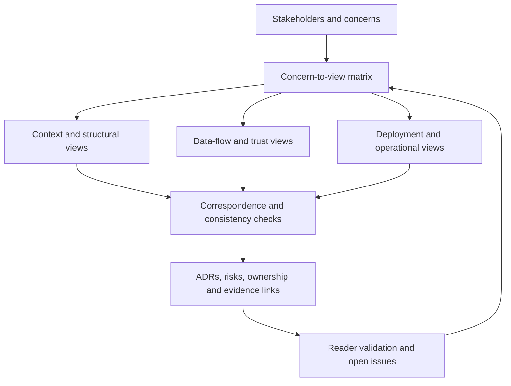

# Architecture Description and Viewpoints

**Stage:** Stage 2D — Data Architecture  
**Module:** 15 — Architecture Documentation, Reviews and Operating Model  
**Topic:** 03  
**Learning level:** Beginner → Intermediate → Advanced  
**Recommended effort:** 6–8 hours  
**Scenario:** Fictional Northbridge Bank; examples and evidence are synthetic teaching material

> **Source and method note.** This lesson follows Topic 03 of `roadmap-Architecture-Documentation-Reviews-and-Operating-Model.md` and the target location in `Roadmap_ptree.md`. The roadmap describes its scenarios, methods and targets as recommendations, not as evidence of existing organizational decisions. No architecture-description standard, notation, tool, governance process, or Northbridge implementation is asserted to be formally adopted. ISO/IEC/IEEE architecture-description guidance, C4-style diagrams, UML, docs-as-code, and other named methods are options to investigate when useful—not repository mandates.

## Table of contents

- [1. Learning outcomes](#1-learning-outcomes)
- [2. Prerequisites and connection to Topics 01–02](#2-prerequisites-and-connection-to-topics-0102)
- [3. Beginner foundations](#3-beginner-foundations)
- [4. Stakeholders, concerns and architectural drivers](#4-stakeholders-concerns-and-architectural-drivers)
- [5. View versus viewpoint](#5-view-versus-viewpoint)
- [6. Select views from concerns](#6-select-views-from-concerns)
- [7. Architecture-description structure](#7-architecture-description-structure)
- [8. Viewpoint definition and modelling conventions](#8-viewpoint-definition-and-modelling-conventions)
- [9. Cross-view consistency, correspondence and traceability](#9-cross-view-consistency-correspondence-and-traceability)
- [10. Supporting artefacts and evidence](#10-supporting-artefacts-and-evidence)
- [11. Advanced description design and governance](#11-advanced-description-design-and-governance)
- [12. Northbridge worked example](#12-northbridge-worked-example)
- [13. Beginner exercise: stakeholders and concerns](#13-beginner-exercise-stakeholders-and-concerns)
- [14. Intermediate exercise: outline and concern-to-view matrix](#14-intermediate-exercise-outline-and-concern-to-view-matrix)
- [15. Advanced exercise: audit a flawed description](#15-advanced-exercise-audit-a-flawed-description)
- [16. Reader validation and review checklist](#16-reader-validation-and-review-checklist)
- [17. Common failures and corrections](#17-common-failures-and-corrections)
- [18. Deliverables, mastery criteria and completion gate](#18-deliverables-mastery-criteria-and-completion-gate)
- [19. Readiness for Topic 04](#19-readiness-for-topic-04)
- [Appendix A. Reusable architecture-description template](#appendix-a-reusable-architecture-description-template)
- [Appendix B. Viewpoint definition template](#appendix-b-viewpoint-definition-template)
- [Appendix C. Practice questions with answers](#appendix-c-practice-questions-with-answers)

---

## 1. Learning outcomes

After completing this lesson, you should be able to:

1. Define an architecture description, stakeholder, concern, view, viewpoint, architectural driver, assumption, constraint and evidence item.
2. State the purpose, scope, audience, limitations, owner and currency of an architecture description.
3. Identify stakeholder concerns and turn vague interests into answerable architecture questions.
4. Select views and viewpoints that support named concerns and decisions, rather than drawing diagrams by habit.
5. Create a concern-to-view matrix and identify uncovered concerns, weak coverage and unnecessary views.
6. Define a viewpoint's audience, concerns, model kinds, notation, construction rules and validation checks.
7. Maintain correspondence and traceability across context, container, component, deployment, data-flow, security, operational and migration views where relevant.
8. Link views to requirements, assumptions, evidence, ADRs, risks, standards, ownership records and migration plans without duplicating their authoritative content.
9. Organize a navigable architecture description, record uncertainty and open questions, and manage versions and change triggers.
10. Test whether intended readers can find and correctly interpret the information they need.

The target is not maximal documentation. It is a description that is **complete for its declared purpose**, understandable to its intended readers, traceable, internally consistent, evidence-aware, current enough for its use, and owned.

## 2. Prerequisites and connection to Topics 01–02

### 2.1 Required prerequisites

Topic 03 follows Topic 01, **Context, container, component and deployment diagrams**, and Topic 02, **Data flow and trust boundary diagrams**. Before proceeding, you should be able to:

- State a system boundary and distinguish internal elements from external actors and systems.
- Explain the different questions answered by context, container, component and deployment views.
- Label data-flow arrows with direction and meaning, identify processes, stores and external entities, and mark trust boundaries.
- Recognize that a logical relationship does not automatically prove a physical network path, deployed resource, security control or production fact.
- Reconcile a diagram against available inventories, lineage, configuration, logs or owner confirmation, while recording what remains unverified.

If those skills are weak, revisit the relevant sections of Topics 01 and 02. This lesson does not reproduce their complete diagramming instruction; it organizes their artefacts into a description that readers can navigate and evaluate.

### 2.2 What Topic 03 adds

| Earlier artefact or skill | Topic 03 contribution | Question answered |
|---|---|---|
| Context/container/component/deployment diagrams (Topic 01) | Audience, purpose, viewpoint rules, cross-view references | Why is this view here, and what concern does it address? |
| Data-flow and trust-boundary diagrams (Topic 02) | Classification, boundary questions, evidence and control references in the description | Where does data move, where does trust change, and what is known? |
| Requirements and constraints from earlier architecture work | Driver-to-view traceability | Which requirement or constraint is this architecture intended to satisfy? |
| Architecture artefacts scattered across files | Navigable description and authoritative links | Where should each reader go for a reliable answer? |
| Unresolved assumptions or discrepancies | Explicit uncertainty, owner and follow-up | What is not yet established, and who will resolve it? |

**Dependency rule:** a description cannot make weak source artefacts trustworthy merely by placing them in a polished document. It should preserve their limitations and expose gaps rather than hide them.

## 3. Beginner foundations

### 3.1 What is an architecture description?

An **architecture description** is an organized set of information about an architecture, structured to address stakeholder concerns. It normally includes a scope statement, stakeholders and concerns, relevant architectural drivers, one or more views governed by viewpoints, explanations of important relationships, and links to supporting artefacts such as decisions, risks, evidence and ownership records.

It is not necessarily one file. A compact system may use one Markdown document. A large enterprise may use a top-level description with domain- or system-level descriptions linked beneath it. The form should match the complexity, change rate and reader needs.

**Why it matters:** diagrams without context invite readers to infer meaning that the author did not intend. A description tells readers what is in scope, which question each view answers, how to interpret symbols, what is known versus assumed, and where to find the reasoning or evidence.

**How it works:** start with stakeholder concerns; select the minimum useful views; define conventions; connect shared elements through identifiers; link decisions and evidence; test with readers; assign ownership and maintenance triggers.

**When to use it:** when multiple stakeholders need a shared architecture understanding, when decisions span teams, when an audit or review needs traceability, or when the architecture must evolve over time. Keep it lightweight for a small, stable design; do not create ceremony without a reader or decision need.

### 3.2 Purpose, scope, audience and limitations

A description should answer four questions near the beginning.

| Field | What to state | Example (synthetic) | Failure if omitted |
|---|---|---|---|
| Purpose | The job this description should perform | Support review of a proposed exposure-reporting platform | Readers cannot tell what “complete” means |
| Scope | Included systems, capabilities, lifecycle states and exclusions | Ingestion, curated data, policy integration and analyst serving; core ledger remains external | Boundary assumptions diverge |
| Audience | Roles or groups expected to use it | Risk, security, platform operations, data engineering, architecture review | Detail and terminology mismatch readers |
| Limitations | What the description does not establish | Target-state proposal; not proof of production deployment or control effectiveness | Proposal is mistaken for verified reality |

Also state the version or revision, owner, status (for example draft, under review, approved for a stated purpose), date last reviewed, and the basis of evidence. “Approved” should always specify what was approved and by whom; approval is not proof that the implementation matches the description.

### 3.3 Core vocabulary

| Term | Definition | Example |
|---|---|---|
| **Stakeholder** | Person, group or organization with an interest in the system or its outcomes | Risk director, data steward, platform operator |
| **Concern** | A matter important to a stakeholder that the architecture must address | Can a report be reproduced for a historical date? |
| **Requirement** | A stated capability or property that must be met, ideally testable | Reports must be available by a defined business deadline |
| **Constraint** | A limit on the solution space | A source system cannot be changed in the first migration phase |
| **Assumption** | A proposition temporarily accepted for analysis but not yet verified | Partner files arrive once per business day |
| **Evidence** | Information used to support or challenge a claim | A reviewed interface contract, inventory export or observed test result |
| **View** | A representation of the architecture from a particular perspective, addressing selected concerns | Deployment view showing runtime placement and failure domains |
| **Viewpoint** | The conventions and rules for constructing and interpreting a kind of view | Audience, concerns, model elements, notation and validation rules for a deployment view |
| **Architectural driver** | A requirement, constraint, risk, principle or business objective that materially shapes design | Reproducibility and access control for exposure reports |
| **Correspondence** | A defined relationship between elements or facts represented in different views or artefacts | Container `NB-EXPOSURE-LAKE` runs on deployment node `NB-D-02` |
| **Traceability** | An explicit path from a concern or driver to the architecture response and its supporting evidence | Concern → requirement → view → decision → verification evidence |

A stakeholder is not the same thing as a concern. “Security team” names a stakeholder; “demonstrate that only authorized analysts can read restricted exposure data” is a concern. Good concerns are concrete enough to guide a view or a test.

### 3.4 Views are selective models, not reality itself

Every view omits details. This is a feature when the omissions are deliberate and do not undermine the view's purpose. A context view may omit internal components; a deployment view may omit business semantics; a security view may abstract away some implementation detail. The description must make these boundaries visible.

**Trade-off:** more detail may improve analysis for one reader but increase cognitive load, update cost and inconsistency risk. Less detail improves navigation but may hide a decision-critical dependency. Select detail by concern, decision and consequence of misunderstanding—not by a universal “more is better” rule.

## 4. Stakeholders, concerns and architectural drivers

### 4.1 Identify stakeholders systematically

Start with the lifecycle and data path, then ask who funds, owns, builds, uses, governs, operates, depends on, audits or is affected by the system. Include internal and external parties where relevant. A stakeholder can be a role or group rather than a named individual; avoid putting personal names into long-lived documentation unless there is a clear need.

Typical enterprise data-platform stakeholder categories include:

- Business sponsor or product owner: value, scope, delivery and cost.
- Data consumer or analyst: discoverability, meaning, access, freshness and usability.
- Data owner or steward: definitions, quality, classification and lifecycle.
- Data engineer: ingestion, transformation, contracts, lineage and recoverability.
- Security and privacy: identity, authorization, data minimization, trust boundaries and evidence of controls.
- Risk, compliance or audit: traceability, reproducibility, retention and demonstrable control operation.
- Platform operations / SRE: availability, observability, incident response, recovery and change safety.
- Enterprise or domain architect: dependencies, principles, reuse and cross-domain consistency.
- Finance or funding delegate: cost drivers, forecast, allocation and options.
- External source/provider: interface contract, delivery obligations, data handling and failure notification.

This is a discovery checklist, not a required roster. Include stakeholders relevant to the stated scope and record exclusions.

### 4.2 Turn interests into actionable concerns

A useful concern can usually be expressed as a question a reader should be able to answer. Compare:

| Vague interest | Actionable concern | Potential evidence or test |
|---|---|---|
| “Security” | Which identities can read restricted curated exposure data, through which interface, and how is access reviewed? | Access-control view, role mapping, policy configuration, access review record |
| “Performance” | Can the serving path meet the agreed report deadline at expected concurrency? | Serving/operational view, workload assumptions, SLO and load-test results |
| “Auditability” | Can a historical report be traced to source versions, transformations and the governing rule version? | Data-flow/lineage view, versioned transformation and report metadata |
| “Cost” | Which workload and storage choices dominate expected recurring cost, and what assumptions drive the estimate? | Cost view/model with unit rates, volumes and sensitivity assumptions |
| “Reliability” | What failure domains can interrupt the report path, and what recovery is expected? | Deployment/operational view, dependency inventory, recovery objectives and test evidence |

The “potential evidence” column is not a claim that such evidence exists. It says what could be needed to substantiate the answer.

### 4.3 Requirements, constraints, assumptions and evidence must not be conflated

| Type | Example | How to document it |
|---|---|---|
| Requirement | “A report must be available by 07:00 local business time.” | Give an ID, owner, acceptance measure and status; avoid treating an aspiration as a committed SLO |
| Constraint | “The core ledger interface cannot change in phase one.” | Record source, scope, expiry/review date and implications |
| Assumption | “The daily partner file arrives before 04:00.” | Label `ASSUMPTION`, assign a validation owner and due point |
| Evidence | “The synthetic interface contract specifies a daily file by 04:00.” | Record source/version/date, what it supports, and limitations |
| Inference | “Late files may delay the morning report.” | State the reasoning and the assumptions on which it depends |
| Unknown | “Actual production arrival-time distribution is not available.” | Keep it open; do not replace the unknown with a made-up number |

Evidence strength is claim-specific. A diagram proves what the diagram asserts, not that the real system behaves that way. A configuration export may show intended configuration but not successful operation. An interview is useful but may need corroboration. State the distinction between **proposed**, **reported**, **observed**, **verified** and **unknown** where it affects decisions.

### 4.4 Prioritize concerns

Not every concern needs its own view. Rank concerns by impact, urgency, risk, decision relevance, and whether an existing view can answer them clearly. One view may serve several related concerns; one concern may require multiple views and evidence artefacts. A matrix exposes gaps but does not automatically prove that the coverage is adequate.

## 5. View versus viewpoint

### 5.1 The essential distinction

A **viewpoint** defines how a kind of view is designed and interpreted. A **view** is a particular instance built using that viewpoint for a particular architecture and purpose.

Analogy: a map legend and map are not the same thing. The legend explains the symbols and rules; the map applies them to a particular place. Likewise, a deployment viewpoint specifies what deployment views should show and how to check them; a deployment view shows the actual or proposed placement for the Northbridge platform.

| Dimension | Viewpoint | View |
|---|---|---|
| Role | Defines a reusable approach | Describes a particular architecture subject |
| Typical contents | Audience, concerns, model kinds, notation, rules, checks | Elements, relationships, labels, scope, explanatory text, evidence/status |
| Reuse | Can be applied to multiple systems | Usually specific to one subject/version/state |
| Change example | Change the convention for identifying deployment nodes | Update the platform's node placement after a deployment change |
| Quality question | Does this viewpoint produce useful, unambiguous views? | Does this view accurately and sufficiently address its stated concerns? |

Do not label a diagram itself as the viewpoint. Do not define a viewpoint so vaguely that it is only a title such as “security view.”

### 5.2 What a viewpoint should specify

At minimum, a usable viewpoint definition should name:

1. **Name and purpose** — why this kind of view exists.
2. **Intended audience** — who will use it and what they need to decide or understand.
3. **Concerns addressed** — explicit concerns, preferably linked to IDs in the concern register.
4. **Model kinds and elements** — which entities and relationships are in scope.
5. **Notation and semantics** — symbols, line types, arrow direction, labels, IDs, abbreviations and meaning.
6. **Construction rules** — inclusion/exclusion rules, level of detail, boundaries and required metadata.
7. **Consistency rules** — correspondence with other views or records.
8. **Validation checks** — tests a reviewer can apply, including completeness and evidence checks.
9. **Limitations** — what the view cannot establish.
10. **Owner and change process** — who maintains the viewpoint and how changes are reviewed.

### 5.3 Choosing a viewpoint is a design decision

Choose a viewpoint by asking: what question is the stakeholder asking; what elements and relationships are necessary to answer it; what decision or action depends on the answer; what evidence would validate it; and what level of detail is safe and useful? Reuse a viewpoint if it works. Adapt it if needed, but document material changes so readers do not compare unlike views as if they used identical semantics.

## 6. Select views from concerns

### 6.1 A practical selection method

1. List stakeholders and concrete concerns.
2. Identify the decision, action or assurance each concern implies.
3. Select candidate views and supporting artefacts that answer the question.
4. Specify what evidence is needed; distinguish available evidence from planned evidence.
5. Check for uncovered concerns and views that serve no identified concern.
6. Define the viewpoint and its validation rules for each selected view type.
7. Test the mapping with a stakeholder or reviewer.

### 6.2 Common data-architecture views (illustrative catalogue)

| View type | Typical questions | Often useful for | Important limitation |
|---|---|---|---|
| Context | What is in scope, who interacts with it, and what are the external dependencies? | Business sponsors, architects, reviewers | Does not explain internal decomposition or prove interfaces exist |
| Container / logical service | Which major applications, services, stores and interfaces make up the system? | Engineers, architects, operators | May omit implementation-level responsibilities |
| Component | How are responsibilities divided inside a container or service? | Engineering and maintainers | Can become too detailed or stale if used for every implementation detail |
| Deployment | Where do runtime elements execute, and which zones, nodes or failure domains matter? | Operations, infrastructure, security | Does not by itself prove current runtime state or effective resilience |
| Data-flow / lineage | How does data move, transform, persist and reach consumers? | Engineers, data owners, risk, audit | A logical flow may not specify physical routing or all hidden flows |
| Security / trust | Where are trust boundaries, identities, permissions, sensitive assets and controls? | Security, privacy, risk | A proposed control is not proof of implementation or effectiveness |
| Operational / reliability | What are the critical paths, SLOs, failure modes, monitoring and recovery responsibilities? | Operations, service owners, risk | Needs operational evidence; architecture alone cannot establish achieved SLOs |
| Data model / semantic | What do key entities, measures and definitions mean? | Analysts, stewards, consumers | Does not fully describe movement, access or deployment |
| Cost / capacity | Which volumes, workloads and design choices drive cost and capacity? | Product, finance, platform teams | Results depend on explicit assumptions and current rates/measurements |
| Migration / transition | How does the current state reach the target, in what sequence, with what dependencies and rollback points? | Sponsors, delivery teams, operations | A target diagram alone does not establish a feasible transition |
| Ownership / operating | Who owns each capability, data product, control and operational action? | Domain teams, platform, governance | A role label is not an accepted assignment; confirm with accountable owners |

Use the views relevant to the concerns, not every view in the catalogue by default. A regulator, for example, may need a concise data-location and lineage answer with supporting evidence rather than a giant all-purpose diagram. An operator may need a deployment and recovery view, not a business-context-only description.

### 6.3 Concern-to-view mapping rules

Use a simple coverage scale:

- **A — Addressed:** the view directly answers the concern at the required level and has a validation path.
- **P — Partial:** useful information exists, but a material aspect or evidence is missing.
- **N — Not covered:** no selected view or linked artefact adequately answers it.
- **NA — Not applicable:** explicitly justified for the declared scope.

Avoid marking a concern “addressed” merely because a view mentions a related term. For example, a deployment diagram containing a database box does not answer who can read restricted data. The security view or access evidence must answer that question.

### 6.4 Sample concern-to-view matrix

All roles, concerns and IDs below are synthetic learning assumptions for Northbridge Bank's fictional exposure-reporting platform.

| Concern ID / stakeholder | Concern stated as a question | Candidate view(s) | Supporting artefact/evidence | Coverage | Gap / follow-up |
|---|---|---|---|---|---|
| C-01 Risk director | Can the exposure report be traced to source inputs and transformation rules? | Context; data-flow/lineage; operational | Flow inventory, lineage records, transformation version metadata | P | Confirm whether historical rule versions are retained; evidence not supplied in this exercise |
| C-02 Security lead | Where does restricted data cross trust boundaries, and what controls apply? | Data-flow/trust; security; deployment | Boundary inventory, IAM policy, encryption configuration, review evidence | P | Diagram identifies candidate crossings; control operation remains unverified |
| C-03 Platform operations | Which runtime dependencies can interrupt report delivery and how is recovery performed? | Deployment; operational/reliability | Dependency list, runbook, recovery test record | P | Recovery evidence and named on-call owner are missing |
| C-04 Data steward | Where are definitions, quality rules and authoritative data ownership recorded? | Container; data model/semantic; ownership | Data catalogue, quality-rule inventory, owner register | P | Owner assignment needs confirmation |
| C-05 Product owner | What capabilities are in scope for the first release and what is explicitly excluded? | Context; container; migration | Scope statement, release plan | P | Scope is stated, but release/transition detail is not supplied in this exercise |
| C-06 Finance delegate | What are the major cost drivers and what assumptions drive the estimate? | Cost/capacity; deployment | Cost model, workload assumptions, rate card version | N | No cost model or agreed workload baseline supplied |
| C-07 Analyst consumer | How do I request access and interpret the report's measures and freshness? | Context; semantic; operational/service | Access procedure, metric definitions, freshness target | P | Semantic definitions and actual freshness target not yet evidenced |
| C-08 Data engineer | Which interfaces, formats and contracts govern source ingestion? | Container; data-flow; interface/contract view | Interface specification, schema contract, validation rules | P | Logical flow is represented; detailed contract is only a planned linked artefact |
| C-09 Privacy reviewer | Where is sensitive data stored, copied, masked, retained and deleted? | Data-flow; security; deployment; lifecycle | Classification inventory, retention/deletion evidence, backup handling | P | Backups and debug/test copies require explicit confirmation |
| C-10 Delivery lead | What sequence moves from current state to target, and what blocks each phase? | Migration/transition; deployment; ADR links | Migration plan, dependency and rollback register | N | No approved sequence or transition acceptance criteria in the synthetic pack |

**How to read this matrix:** coverage is intentionally conservative. A view may exist but be only partial because it lacks evidence or the detail needed for the concern. `A` is not a declaration of real-world control effectiveness; it means the concern is adequately represented for the defined exercise and supported by the referenced artefacts. Update coverage when evidence changes.

### 6.5 Detect uncovered concerns and orphan views

Two checks are required:

- **Concern coverage:** every in-scope concern maps to at least one view or linked artefact, or is explicitly marked not applicable with rationale.
- **View justification:** every view supports at least one concern, decision, required review or maintenance activity. Remove or demote views that have no purpose, unless they are explicitly retained as reference material.

Multiple views may be necessary for one concern. For example, “can the report be reproduced?” may need a data-flow view for source-to-output lineage, an operational view for run history, and a semantic view for measure definitions. No single diagram needs to carry all detail.

## 7. Architecture-description structure

### 7.1 Recommended outline

A practical description can use the following order. Scale sections to the architecture; mark non-applicable sections rather than filling them with boilerplate.

1. **Document control:** title, system/domain, owner, status, version, dates, reviewers and change history.
2. **Executive summary:** purpose, major capabilities, current/target status, critical constraints and material open issues.
3. **Purpose, scope and limitations:** boundaries, included lifecycle state, exclusions and what the description does not prove.
4. **Stakeholders and concerns:** role, concern IDs, decisions/actions, priority and acceptance questions.
5. **Architectural drivers:** requirements, constraints, principles, assumptions, risks and evidence references.
6. **Architecture context:** system boundary, external actors/systems and major dependencies.
7. **Selected views:** each with its viewpoint, purpose, scope, diagram/model, legend, explanatory narrative, status, evidence and known limitations.
8. **Cross-view correspondence and consistency:** shared identifiers, mappings, mismatches and resolution status.
9. **Security, data governance and operations:** include separate views or linked artefacts where concerns require them.
10. **Decisions and alternatives:** links to ADRs; do not replace full decision rationale with a diagram caption.
11. **Risks, unresolved questions and deviations:** impact, owner, due point, evidence needed and status.
12. **Migration / transition:** current and target states, phases, dependencies, validation, cutover and rollback if relevant.
13. **Ownership and maintenance:** accountable roles, review triggers, source-of-truth links, update workflow and retirement policy.
14. **Glossary and references:** terminology, identifiers, external references and applicable standards/policies with status.
15. **Appendices:** inventories, matrices, detailed contracts or supplementary material when they improve navigation.

### 7.2 Organize around reader questions, not the author's chronology

A reader should not need to know which engineer created a diagram first. Structure the document around the questions that readers ask. Use concise summaries and links to authoritative artefacts rather than copying the same control description into several files. Duplication creates drift: one copy changes while another remains stale.

### 7.3 Architecture description versus supporting artefacts

| Artefact | Primary job | What the description should do |
|---|---|---|
| Architecture view/diagram | Represent selected structure, behavior or placement | Explain purpose, viewpoint, scope, status, limitations and relevant links |
| ADR | Preserve context, alternatives, rationale and consequences of a decision | Link the affected views and concerns to the decision; show status |
| Risk register | Track uncertainty/threat/event, impact, likelihood or priority, response and owner | Link relevant risks and identify which views expose the condition |
| Requirement/constraint register | Define drivers and acceptance expectations | Reference stable IDs and show which views address them |
| Standards/policy catalogue | State applicable obligations or conventions | Identify exact version, applicability, owner and any deviation; do not imply adoption without evidence |
| Ownership register | Record accountable owner or role | Link architecture elements/data products/controls to accepted ownership records |
| Migration plan | Sequence transitions, dependencies, milestones and rollback | Link current/target views to transition steps and acceptance gates |
| Evidence pack | Preserve source material supporting claims | Cite the relevant source and its date, scope and limitations; avoid unsupported “verified” labels |

A diagram can reference an ADR, but it should not try to replace the ADR. A risk record can point to a trust-boundary crossing, but the architecture description should not duplicate the risk register's entire lifecycle history.

## 8. Viewpoint definition and modelling conventions

### 8.1 Reusable viewpoint definition

A viewpoint should be concrete enough that two competent authors could create comparable views and reviewers could check them consistently. The template in Appendix B is reusable. At minimum, define audience, concerns, model elements, notation, construction rules and validation checks, as the roadmap requires.

Example: a **data-flow/trust viewpoint** could require named processes, data stores, external entities, directed and labelled flows, trust boundaries, data classification where known, protocol/interface where known, and evidence status. It would also define how to mark unknowns and how to check that each sensitive flow has a classification/control note. The actual Northbridge diagrams in Topic 02 can be reused and linked; do not silently redefine their semantics in Topic 03.

### 8.2 Model and notation rules

For every view, define the meaning of shapes, lines, arrows, colors (if used), labels, IDs, and abbreviations. Avoid relying on color alone; use text or line style as a redundant cue. State whether a view represents current state, target state, transition state, or an explicitly mixed picture. Label a logical relationship as logical rather than allowing readers to infer a verified network route.

Recommended conventions:

- Every view has a title, unique ID, version/date, purpose, scope and status.
- Every diagram has a legend where symbols or line styles are not self-explanatory.
- Elements that appear in multiple views use stable identifiers where practical.
- Relationships are directional where direction matters and labelled with their meaning.
- Unknown or unverified facts have explicit markers and are not visually indistinguishable from verified facts.
- The level of detail matches the stated audience and question.
- Each view links to the requirements/concerns and evidence it is intended to address.

These are recommended local conventions for this learning package, not claims about an existing repository-wide standard.

### 8.3 Construction and review checks

| Check category | Example question | Failure response |
|---|---|---|
| Scope | Does the view clearly show what is included and excluded? | Correct the boundary statement before adding details |
| Completeness | Are all elements and relationships needed for the concern present? | Add the missing element or explicitly state the limitation |
| Semantics | Does each symbol/arrow have one defined meaning? | Correct the legend or notation |
| Evidence | Is a claim supported by a named source, or marked assumed/proposed? | Downgrade the claim and create an evidence gap |
| Correspondence | Do shared elements match other views and records? | Record a discrepancy, assign an owner and reconcile the source of truth |
| Traceability | Can the reviewer move from concern to view to evidence/decision? | Add stable IDs and links |
| Readability | Can the intended reader answer the intended question without author help? | Simplify, add explanation or provide a targeted view |
| Currency | Does the view reflect the relevant architecture state and review date? | Revalidate against current sources or mark stale |

## 9. Cross-view consistency, correspondence and traceability

### 9.1 Why consistency matters

Views intentionally differ in content, but they must not contradict each other about shared facts. A container may be deployed on several nodes, so correspondence need not be one-to-one. A logical flow may traverse multiple physical hops. The goal is not identical diagrams; it is an explicit, explainable relationship between their representations.

### 9.2 Use stable identifiers and a correspondence table

Names alone can drift. Give important elements stable IDs such as `NB-EXPOSURE-SYS` for the system, `NB-EXPOSURE-LAKE` for a container, `NB-D-02` for a deployment node, `NB-F-07` for a flow, `C-02` for a stakeholder concern and `ADR-004` for a decision. Choose an ID scheme that is simple and consistent; these example IDs are synthetic.

| Element ID | Context view | Container view | Deployment view | Data-flow/security view | Owner record | Status / note |
|---|---|---|---|---|---|---|
| NB-EXPOSURE-SYS | Exposure Reporting Platform | Platform boundary | Production deployment scope | Trust-boundary scope | Owner to confirm | Synthetic system identifier |
| NB-EXPOSURE-INGEST | Not normally shown at this level | File intake service | Runs on NB-D-01 (proposed) | Receives partner file F-01 | Ingestion owner (proposed) | Placement is a target assumption |
| NB-EXPOSURE-TRANSFORM | Not normally shown at this level | Transformation pipeline | Runs on NB-D-01 (proposed) | Normalizes accepted records before curated storage | Data engineering (proposed) | Runtime placement is a target assumption |
| NB-EXPOSURE-TRANSFORM-VALIDATOR | Not normally shown at this level | Schema and quality validator component within NB-EXPOSURE-TRANSFORM | Part of NB-EXPOSURE-TRANSFORM; not independently deployed in this model | Validates schema/content and sends rejected records to quarantine | Data engineering (proposed) | Confirm actual retry/quarantine behavior |
| NB-EXPOSURE-LAKE | Platform capability represented | Curated data store | Storage service/node NB-D-02 (proposed) | Receives accepted records; queried by serving path | Data owner to confirm | Do not infer access control from placement |
| NB-F-07 | Partner dependency may be summarized | Intake interface | Ingress boundary to confirm | Partner → intake, labelled daily exposure file | Partner interface owner to confirm | Synthetic flow ID; protocol not established |
| NB-EXPOSURE-SERVE | Platform capability represented | Reporting API and semantic service | Runtime placement not yet evidenced | Serves approved analyst queries from curated data | Product/platform owner to confirm | Access-control evidence is an open gap |

This table deliberately includes uncertainty. “Owner to confirm” is not a real assignment, and “proposed” does not mean deployed. Correspondence tables should expose gaps rather than make the architecture look more complete than it is.

### 9.3 Traceability chain

A useful traceability chain can be represented as:

```text
Stakeholder → Concern ID → Requirement/constraint → View(s) → Decision/ADR
                                              ↘ Evidence / test ↗
                        → Risk or open question → Owner → Follow-up status
```

The chain need not be strictly linear. One requirement may affect multiple views; one view may address several concerns; one ADR may resolve a conflict among drivers. Use stable references rather than embedding lengthy copied content.

Example:

| Link | Synthetic example | Validation question |
|---|---|---|
| Stakeholder → concern | Risk director → C-01 reproducible report | Is the concern stated concretely? |
| Concern → requirement | C-01 → R-12 retain transformation-version metadata for each report run | Is the requirement approved/testable or still proposed? |
| Requirement → view | R-12 → data-flow/lineage and operational views | Do the views show where metadata is produced and retained? |
| Requirement conflict → ADR | R-12 retention cost versus auditability → ADR-004 (proposed) | Are options and consequences honestly recorded? |
| View → evidence | Data-flow view → lineage extract or test record | Does the source support the claim and relevant version? |
| Gap → owner | No historical rule-version evidence → data platform owner to confirm | Is the owner accepted and follow-up tracked? |

Do not create an ADR merely to decorate the matrix. A decision record is useful when a consequential choice or trade-off needs durable rationale; Topic 04 explains its structure and selection criteria.

### 9.4 Consistency check across selected views — worked example

Assume a synthetic draft contains these statements:

- Context view: the approved reporting client is an external consumer of the platform.
- Container view: `NB-EXPOSURE-SERVE Reporting API and semantic service` exposes report results to the approved client.
- Deployment view: `NB-EXPOSURE-SERVE` is shown in the production platform zone.
- Data-flow view: analyst requests go to `NB-EXPOSURE-SERVE`, then query `NB-EXPOSURE-LAKE Curated lakehouse storage`.
- Security view: all analyst access is “encrypted and authorized.” No policy or configuration evidence is linked.

A consistency review finds:

1. The elements and broad interaction are correspondent across context, container and data-flow views.
2. The deployment view needs a mapping from `NB-EXPOSURE-SERVE` to a runtime endpoint or deployment unit; merely placing the logical container in a zone may be insufficient for the stated deployment viewpoint.
3. The phrase “all analyst access is encrypted and authorized” is an unsupported claim unless backed by policy/configuration and validation evidence. Mark it as proposed or unverified until substantiated.
4. The security view should identify the identity/policy enforcement point and the trust boundary crossed, if those details are in scope. Do not infer that the presence of an identity provider proves correct authorization.
5. The data-flow and security views should use the same interface/flow IDs or a documented mapping. If the context view abstracts the exact flow, that is acceptable if the abstraction is explicit.

| Finding | Type | Severity for this exercise | Correction / follow-up |
|---|---|---|---|
| Logical container has no deployment mapping | Correspondence gap | Major if deployment placement is a required concern | Add mapping or mark placement unknown; validate with deployment source |
| Encryption/authorization stated without evidence | Unsupported claim | Critical if used as assurance | Downgrade to unverified; identify needed evidence and owner |
| Flow IDs differ across DFD and security view | Traceability weakness | Moderate | Add stable IDs or correspondence table |
| Context view omits detailed request sequence | Acceptable abstraction if declared | Low / no defect | Keep context concise; link to detailed view |

Severity depends on purpose and risk. A gap may be acceptable for an early concept proposal but unacceptable for a control assurance review. Record the reason for the rating.

## 10. Supporting artefacts and evidence

### 10.1 Evidence-aware documentation

For each material factual claim, ask: what is the source; what version/date does it describe; does it refer to current, target or historical state; what does it prove; what does it not prove; and who can resolve a discrepancy? Evidence can include inventories, source contracts, lineage outputs, deployment configuration, IAM policy, test records, operational metrics, owner confirmation or a review record. Use only what is actually available.

Suggested evidence status labels:

- `OBSERVED`: directly observed in a specified source or test, with scope/date.
- `REPORTED`: stated by a person/team or document but not independently checked.
- `INFERRED`: conclusion drawn from other information; reasoning is stated.
- `ASSUMED`: temporarily accepted; validation required.
- `PROPOSED`: intended future design, not claimed as implemented.
- `UNKNOWN`: evidence is absent or contradictory.

These labels are a proposed teaching convention. If an organization already has controlled status terminology, use and cite that instead.

### 10.2 Evidence register template

| Evidence ID | Claim / element supported | Source and version/date | Status | Scope / limitation | Owner / next action |
|---|---|---|---|---|---|
| E-01 | Partner file is expected daily | Synthetic partner interface note, v0.1 | REPORTED (synthetic) | Does not establish actual arrival distribution | Confirm source contract in real deployment |
| E-02 | Intake service is proposed inside controlled platform zone | Synthetic target diagram, v0.1 | PROPOSED | Not deployment evidence | Validate against deployment configuration when available |
| E-03 | Analyst access is authorized | No evidence supplied | UNKNOWN | Claim cannot be relied on | Obtain policy/configuration and test evidence |

The IDs and records above are fabricated for practice. They are not real bank evidence. A source can support one part of a claim without supporting the whole claim; write the limitation explicitly.

### 10.3 Link risks, standards and ownership without overclaiming

- **Risks:** link to risk IDs and the views that reveal or mitigate the condition. A risk is not closed just because a diagram was updated.
- **Standards and policies:** state exact name/version, applicability, source and adoption status if known. Distinguish “candidate reference to evaluate” from “formally adopted and applicable.” The module roadmap names architecture-description standards/frameworks as options to investigate; it does not establish an adopted standard.
- **Ownership:** link to an authoritative owner record where available. If an owner is proposed or unknown, say so and create a follow-up; do not assign accountability by implication.
- **Migration:** link each transition phase to affected current/target views, dependencies, acceptance criteria and rollback or recovery arrangements where relevant.
- **ADRs:** link the decision that shaped the view, including status and supersession. If a decision is unresolved, state that instead of fabricating a final rationale.

## 11. Advanced description design and governance

### 11.1 Scale by modularity, not by copy-paste

For a multi-domain enterprise, use a top-level description that explains shared boundaries, cross-domain dependencies, common conventions and links to domain descriptions. Each domain description owns its local detail. Avoid copying the same system fact into multiple pages; link to a source of truth and define which description owns which concern.

**Trade-offs:** centralization improves consistency and discoverability but can bottleneck updates and overwhelm readers. Full decentralization improves local autonomy but increases terminology drift and inconsistent assumptions. A federated model often works well: shared minimum conventions and cross-domain governance, with domain-owned views and review responsibilities. This is a design option, not a claim about the repository's current operating model.

### 11.2 Audience-specific publications from a common model

A business summary, engineering pack and audit pack may present different selections of the same architecture information. They should not become three conflicting architectures. Use shared IDs, common source data, links and automated generation where practical. If views are maintained manually, define an explicit reconciliation step.

| Audience | Likely emphasis | Avoid |
|---|---|---|
| Business sponsor | Scope, value, material risks, cost drivers, transition | Implementation detail that obscures the decision |
| Data engineer | Interfaces, contracts, transformations, dependencies, lineage | Vague “data flows to platform” statements |
| Security/privacy | Trust boundaries, sensitive data, identity, controls, evidence gaps | Treating planned controls as proven controls |
| Operations/SRE | Runtime placement, failure domains, SLOs, runbooks, recovery | Deployment boxes without operational ownership |
| Risk/audit | Provenance, retention, reproducibility, ownership, evidence references | Unsupported assurances and undocumented assumptions |

### 11.3 Living documentation and change management

Treat the description as a maintained product. Recommended controls include:

- Version the text, diagrams, matrices and viewpoint definitions together where practical.
- Require review when a change alters a boundary, interface, sensitive-data path, runtime placement, owner, requirement, material risk or decision.
- Use a pull-request or equivalent review workflow if the source is maintained in version control; do not adopt tooling just for ceremony.
- Check links, required metadata, duplicate IDs and simple correspondence rules automatically where feasible.
- Record last-reviewed date, reviewer/role, architecture state and evidence freshness.
- Mark superseded views and link to replacements rather than silently deleting history needed to understand decisions.
- Retire pages that no longer serve a concern, but preserve necessary decision and audit history under applicable retention rules.

Automation can detect missing links or duplicate IDs; it cannot reliably decide whether a view answers a nuanced stakeholder concern. Human review and reader testing remain necessary.

### 11.4 Uncertainty and unresolved questions

Maintain a visible issue list. Each item should include ID, question/claim, impact if unresolved, current evidence, owner or owner-to-confirm, next action, target review point and status. Use “unknown” when evidence is missing. Do not hide uncertainty in a footnote or convert a guess into a requirement.

### 11.5 Communicating architectural trade-offs

A description should show tensions rather than pretend all concerns can be maximized simultaneously. Example: retaining detailed history may improve reproducibility but increase storage cost and privacy exposure; caching may reduce latency but create freshness and invalidation risks; centralizing policy may improve consistency but introduce dependency and availability concerns.

For each material trade-off, state the competing concerns, feasible options, constraints, expected consequences, evidence/assumptions, and decision status. If a choice has been made and needs durable rationale, link an ADR (Topic 04). If no decision has been made, state the open decision and its owner.

### 11.6 Standards and frameworks: use disciplined language

The roadmap mentions architecture-description standards/frameworks as possible references if adopted. Before using a named standard, verify its current scope, version, licensing/access conditions where relevant, and fit for the organization. Then document whether it is exploratory, selectively used, formally adopted, or contractually required. Do not imply that a standard is mandatory simply because it is well known. A standard can guide structure, but it cannot substitute for clear concerns, accurate evidence, or reader validation.

## 12. Northbridge worked example

### 12.1 Scenario and assumptions

**Synthetic scenario:** Northbridge Bank is considering an exposure-reporting platform. Risk analysts request reports; data stewards maintain metadata and quality rules; a core ledger provides account/transaction changes; a customer master provides reference updates; an enterprise identity provider authenticates users; and an approved reporting client consumes results. The platform receives a daily partner exposure file in one exercise. These are teaching assumptions, not facts about a real bank or an implemented production system.

The Topic 01 and Topic 02 lessons provide context/container/deployment and data-flow/trust-boundary examples for this scenario. Reuse those views as linked source artefacts when assembling the description; do not redraw them just to make this lesson self-contained. If the details differ across files, record the discrepancy and reconcile it against evidence instead of assuming one diagram is automatically correct.

### 12.2 Purpose and scope statement — example

> **Purpose:** organize the proposed Northbridge Exposure Reporting Platform architecture for stakeholder review, with emphasis on scope, data movement, trust boundaries, runtime dependencies and operational readiness.  
> **Scope:** proposed ingestion, validation/quarantine, curated storage, policy/catalogue integration and analyst serving; external source systems and identity provider are shown as dependencies.  
> **Audience:** risk, data engineering, data stewardship, security/privacy, platform operations and architecture reviewers.  
> **Limitations:** this is a synthetic target-state learning description. It does not prove that any component exists, that controls are implemented, that owners have accepted assignments, or that operational objectives have been achieved.

This statement makes the intended use and epistemic status explicit. A real description would replace generic roles with confirmed accountable roles and link to the actual approved scope and evidence.

### 12.3 Selected views and why they are selected

| View ID | View | Primary concern(s) | Reused or required artefact | Status in this exercise |
|---|---|---|---|---|
| V-01 | Context | Scope, stakeholders and external dependencies | Topic 01 context diagram | Synthetic example; proposed |
| V-02 | Container / logical service | Responsibility boundaries and interfaces | Topic 01 container diagram | Synthetic example; proposed |
| V-03 | Deployment | Runtime placement and zones | Topic 01 deployment diagram | Target assumptions only; needs validation for a real system |
| V-04 | Data-flow / trust | Data movement and trust-boundary crossings | Topic 02 DFD and flow inventory | Synthetic example; detailed controls/evidence may remain open |
| V-05 | Security / access | Sensitive assets, identity, policy enforcement and controls | Security view plus policy evidence | Partial until evidence is supplied |
| V-06 | Operational / reliability | Report path, failure dependencies, recovery and support | Operational view, runbook, SLO and recovery evidence | Gap list required; no actual operating evidence supplied |
| V-07 | Migration / transition | Current-to-target sequence and acceptance | Migration plan | Not yet covered by the supplied synthetic exercise; keep as open work if migration is in scope |

The view catalogue is intentionally selective. Cost and semantic views may be added if the review scope includes cost approval or measure-definition concerns. Do not add them simply to satisfy a fixed count.

### 12.4 Description-level diagram relationship

The description can explain how views fit together without combining every model into one overloaded diagram:



This is a process/relationship illustration, not a claim about a deployed system. It shows that reader feedback and discovered gaps should update the mapping and artefacts.

### 12.5 Example open-issue register

| Issue ID | Question / gap | Why it matters | Current status | Next action | Owner |
|---|---|---|---|---|---|
| Q-01 | What is the actual source-file delivery contract and late-file behavior? | Affects freshness and recovery expectations | Unknown in this synthetic pack | Confirm contract and failure handling | Interface owner to confirm |
| Q-02 | Which roles can read restricted curated data, and where is authorization enforced? | Security/privacy concern | Not evidenced | Obtain policy/configuration and test evidence | Security/platform owner to confirm |
| Q-03 | Which runtime service and zone host the serving interface? | Deployment correspondence | Proposed only | Reconcile target view with deployment source | Platform owner to confirm |
| Q-04 | Is historical transformation/rule metadata retained for report reproduction? | Risk/audit concern | Partial | Inspect lineage/report metadata and retention design | Data platform owner to confirm |
| Q-05 | What are the agreed report deadline and recovery objectives? | Operational readiness | Not specified | Obtain stakeholder-approved targets and test plan | Product/operations owner to confirm |

Do not close an issue because a document section exists. Close it when the question is answered to the required level, supporting evidence is linked, and the accountable reviewer accepts the resolution.

## 13. Beginner exercise: stakeholders and concerns

### Scenario

Use the synthetic Northbridge platform in Section 12. Assume only the described capabilities are in scope. You do not have production evidence, approved requirements or confirmed named owners.

### Tasks

1. Identify at least five stakeholder roles.
2. Write at least two concrete concerns for each role as questions.
3. For each concern, identify the decision or action the answer would support.
4. Label which information is known from the scenario and which would require evidence.
5. Select one concern that is currently uncovered or only partially covered.

### Expected output template

| Stakeholder role | Concern ID and question | Decision/action supported | Candidate view/evidence | Known, assumed or unknown? |
|---|---|---|---|---|
| Risk director | C-01: Can a historical report be traced to source inputs and transformation versions? | Accept report reproducibility approach | Data-flow/lineage; report metadata evidence | Concern is a proposed exercise requirement; implementation unknown |

### Worked solution (one valid answer)

| Stakeholder role | Concern | Decision/action | Candidate view/evidence | Status |
|---|---|---|---|---|
| Risk director | Can report values be reproduced for a prior reporting date? | Accept or reject auditability design | Data-flow/lineage, operational run history, metadata retention evidence | Need requirement and evidence |
| Security lead | Where does restricted data cross trust boundaries and what enforces access? | Review access and boundary controls | Data-flow/trust, security, deployment, policy/configuration | Need evidence; not established by diagrams alone |
| Data steward | Where are quality rules, definitions and accountable data owners recorded? | Approve data governance responsibilities | Semantic/data model, ownership view, catalogue | Owner and catalogue details unknown |
| Platform operator | What dependencies can interrupt report delivery and how is recovery tested? | Decide operational readiness and runbook requirements | Deployment, operational/reliability view, recovery test | Actual behavior unknown |
| Data engineer | What file/schema/interface contract governs ingestion and rejection? | Implement validation and exception handling | Container, data-flow, interface contract, validation rules | Daily file is scenario context; exact schema/contract unknown |
| Finance delegate | What workloads and storage choices dominate cost? | Assess funding and design options | Cost/capacity view and model | Cost inputs unavailable; do not invent them |

**Validation:** at least five roles, two concrete concerns each, a plausible view/evidence path, and explicit unknowns. “Security” alone is not a concern. A concern does not need its own diagram if a suitable existing view and supporting evidence answer it.

## 14. Intermediate exercise: outline and concern-to-view matrix

### Scenario and constraints

A review group asks for a description of the Northbridge exposure-reporting target. Use synthetic assumptions only. Your description must include at least five selected views, a document outline, a concern-to-view matrix, viewpoint definitions and a correspondence/consistency worksheet. Do not claim that the design is approved or deployed.

### Tasks

1. Draft purpose, scope, audience and limitations.
2. Build a matrix for at least eight concerns across at least five stakeholder roles.
3. Define at least five views and the viewpoint rules used to construct them.
4. Write the architecture-description outline and identify the authoritative supporting artefact for each major claim.
5. Fill a correspondence table for at least five shared elements.
6. Identify uncovered concerns, orphan views and unsupported claims.
7. Run the reader test in Section 16 with at least five questions.

### Worked solution: outline

1. Document control and status.
2. Purpose, scope, audience and limitations.
3. Stakeholders, concern register and priority.
4. Drivers: requirements, constraints, assumptions and evidence status.
5. V-01 context view (Topic 01 reference).
6. V-02 container view (Topic 01 reference).
7. V-03 deployment view (Topic 01 reference; target status stated).
8. V-04 data-flow/trust view (Topic 02 reference, flow inventory and boundary controls).
9. V-05 security/access view (control questions and evidence gaps).
10. V-06 operational/reliability view (dependencies, service objectives, recovery and support).
11. Concern coverage and correspondence table.
12. ADR links and unresolved decisions (do not invent ADRs as if they exist; use “proposed/open” placeholders only when clearly labelled).
13. Risk/open-question register and ownership gaps.
14. Migration/transition links if current-to-target change is in scope.
15. Glossary, references and change history.

### Worked solution: concern-to-view matrix

The matrix in Section 6.4 is a model answer. A valid submission may select different views if it demonstrates that every concern is adequately answered and the limitations are explicit. For example, C-06 cost remains uncovered because no cost model is supplied. Marking it “addressed” because a deployment diagram contains storage would be incorrect.

### Worked solution: viewpoint mini-definitions

| Viewpoint | Audience and concerns | Model elements / notation | Minimum checks |
|---|---|---|---|
| Context | Sponsor and reviewers; scope and dependencies | System boundary, actors, external systems, labelled relationships | Scope/exclusions stated; external dependencies named; no claim that an interface is verified unless evidence supports it |
| Container | Engineers/architects; responsibilities and interfaces | Logical services, stores, interfaces, directed labelled relationships | Each element has responsibility; interface purpose is labelled; names/IDs correspond to other views |
| Deployment | Operations/security; placement and failure domains | Runtime units, nodes/zones, environments, connections where in scope | Logical-to-runtime mapping is explicit; proposed versus observed state is clear; deployment evidence linked |
| Data-flow/trust | Engineers, security, risk; movement and trust crossings | External entities, processes, stores, directed flows, boundaries | Flows labelled; boundaries identified; sensitive data classification/control status recorded or marked unknown |
| Operational/reliability | Operations and product; service objectives and recovery | Critical path, dependencies, failure modes, SLOs, monitoring, runbooks | Objectives have owner/status; failure and recovery assumptions explicit; test evidence linked or gap recorded |
| Security/access | Security/privacy; identity, authorization, sensitive data | Principals, policy enforcement points, assets, boundaries, controls | Every in-scope sensitive path has a control/evidence reference or open gap; design intent not confused with verified effectiveness |

These are local illustrative viewpoint definitions. An organization may adapt them or use another governed approach.

### Worked solution: correspondence checks

| Shared fact | View A | View B | Check result in synthetic exercise | Action |
|---|---|---|---|---|
| Analyst uses serving interface | Context | Container | Consistent at the level shown | Keep detailed request path in data-flow view |
| Serving interface queries curated store | Container | Data-flow | Consistent if same IDs and direction are used | Record IDs in correspondence table |
| Serving interface runtime placement | Container | Deployment | Not evidenced in the synthetic evidence pack | Mark proposed/unknown; validate before claiming deployed placement |
| Restricted data access is authorized | Data-flow | Security | Claim lacks policy/configuration/test evidence | Downgrade to unverified; request evidence |
| Historical report reproduction | Data-flow/lineage | Operational | Metadata retention and run history are not established | Keep concern partial; assign follow-up |

### Objective validation criteria

- Every in-scope concern is A, P, N or justified NA; no blank coverage cells remain.
- Every view has a named purpose and at least one concern/decision it serves.
- Each viewpoint defines audience, concerns, model kinds, notation/conventions and checks.
- At least five shared elements are mapped with stable IDs or explicit name mapping.
- Proposed, reported, observed, inferred and unknown information is not conflated.
- The outline links to supporting artefacts rather than copying their content without ownership.
- At least five reader questions are tested and failures are recorded.

## 15. Advanced exercise: audit a flawed description

### 15.1 Synthetic evidence pack

Treat the following as a fabricated exercise pack, not production evidence:

- **E-01:** A draft context view names the Exposure Reporting Platform, core ledger, customer master, identity provider and analyst client.
- **E-02:** The logical architecture view names `NB-EXPOSURE-INGEST` (ingestion service), `NB-EXPOSURE-TRANSFORM` (transformation pipeline), `NB-EXPOSURE-TRANSFORM-VALIDATOR` (validator component), `NB-EXPOSURE-LAKE` (curated lakehouse storage) and `NB-EXPOSURE-SERVE` (reporting API and semantic service).
- **E-03:** A data-flow view shows partner file → intake → validation → curated store → reporting API → analyst client.
- **E-04:** A deployment view places `NB-EXPOSURE-INGEST`, `NB-EXPOSURE-TRANSFORM` and `NB-EXPOSURE-LAKE` in a “production zone,” but does not show `NB-EXPOSURE-SERVE` placement. The validator is a component of the transformation pipeline in this model, not an independently deployed container.
- **E-05:** A security paragraph says, “All data is encrypted and only authorized users can access it.” No configuration, policy or test record is attached.
- **E-06:** A report-reproducibility concern is listed, but no view or evidence reference shows retention of transformation/rule versions.
- **E-07:** The owner column says “Platform Team” for every component, but no owner confirmation or ownership record is linked.
- **E-08:** The document title says “Current Production Architecture,” while its introductory note says “Proposed target state.”
- **E-09:** The description has no version, last-reviewed date, status or change history.
- **E-10:** A migration view shows a direct cutover from legacy warehouse to target platform, with no data reconciliation, rollback or acceptance criteria.

### 15.2 Flawed description excerpt

> Northbridge's production platform uses the logical elements shown in the diagrams. All data is encrypted and fully authorized. The platform is owned by the Platform Team. The target migration will happen in one cutover. The architecture follows the standard architecture-description framework. The design is complete and audit-ready.

The excerpt contains several unsupported or contradictory claims. Do not repair it by making up missing evidence.

### 15.3 Tasks

1. Identify at least eight findings. Classify each as scope/status contradiction, concern coverage gap, cross-view inconsistency, unsupported claim, traceability weakness, ownership gap, migration gap or document-control failure.
2. Rank findings by impact for an architecture review.
3. Identify which source item supports each finding and what it does or does not establish.
4. Rewrite the excerpt into a truthful status summary.
5. Propose a remediation list with owner-to-confirm, evidence required and closure test.
6. Run a reader test with ten questions and report whether the answer is findable, supported and understandable.
7. Design a reusable viewpoint library for a hypothetical six-domain enterprise. Define a common minimum convention set and state which rules should be shared versus adapted by each domain.
8. Draft an ADR outline for adopting or piloting the architecture-description structure, viewpoint library and maintenance process. If the evidence is insufficient for a decision, record the decision as proposed/open rather than inventing approval.

### 15.4 Worked audit findings

| ID | Finding | Classification | Impact | Evidence basis | Correction / closure test |
|---|---|---|---|---|---|
| F-01 | “Current Production” conflicts with “Proposed target state” | Scope/status contradiction | Critical | E-08 | Choose and state one architecture state; verify every view carries compatible status |
| F-02 | “All data is encrypted” is unsupported | Unsupported claim | Critical | E-05 has no configuration/test evidence | Mark unverified/proposed; link relevant in-transit/at-rest evidence; test coverage against in-scope paths |
| F-03 | “Only authorized users” is unsupported and too broad | Unsupported claim / vague control | Critical | E-05 | Identify identities, enforcement points and policy evidence; validate positive and negative access cases |
| F-04 | Reporting API and semantic service are absent from deployment mapping | Cross-view correspondence gap | Major | E-02 and E-04 | Map `NB-EXPOSURE-SERVE` to runtime placement or explicitly mark unknown; validate against deployment source |
| F-05 | Reproducibility concern has no supporting view/evidence | Concern coverage gap | Major | E-06 | Add lineage/metadata retention view or linked artefact and a verification test, or record the gap as unresolved |
| F-06 | Ownership asserted without accepted ownership record | Ownership gap | Major | E-07 | Confirm accountable owners and link the register; otherwise label owner unknown/to confirm |
| F-07 | “One cutover” lacks reconciliation, rollback and acceptance criteria | Migration gap | Major | E-10 | Define phased options or justify cutover; add reconciliation, rollback, dependencies and acceptance checks |
| F-08 | “Follows the standard framework” names no standard or adoption evidence | Unsupported standards claim | Major | No exact standard/version/adoption record in pack | State exact reference and status if verified; otherwise remove the claim or label as candidate to evaluate |
| F-09 | “Complete and audit-ready” is an unsubstantiated assurance | Unsupported conclusion | Critical | E-05–E-10 show open gaps | Replace with bounded status statement and list open issues; define the review criteria for readiness |
| F-10 | No version, review date or status | Document-control failure | Major | E-09 | Add control metadata and review history; verify current source links |
| F-11 | Owner “Platform Team” applied indiscriminately | Ownership/modeling weakness | Moderate to major | E-07 | Map component/data/control ownership separately; confirm responsibility and escalation paths |
| F-12 | Description claims four containers are “used” though target state is proposed | State/evidence mismatch | Critical | E-02, E-08 | Use “proposed target includes” until implementation is verified |

Impact rankings are exercise judgements based on the risk of a reader relying on the claim. In a real review, document the severity rationale and relevant risk criteria.

### 15.5 Truthful rewritten status summary

> **Status: draft synthetic target-state description; not production assurance.** The current exercise pack contains proposed context, container, data-flow and partial deployment views. The deployment mapping for the Reporting API and semantic service is missing. Claims about encryption and authorization are not supported by linked configuration or test evidence. Report reproducibility, component ownership and migration acceptance/rollback arrangements remain unresolved. No adopted architecture-description standard is evidenced in this pack. The description is not yet complete for a production-readiness or audit-assurance decision. The next review should resolve or explicitly accept these gaps against agreed criteria.

This is more useful than a confident but unsupported statement because it separates what the pack contains from what it proves.

### 15.6 Remediation and closure worksheet

| Priority | Action | Evidence needed | Owner | Closure test |
|---|---|---|---|---|
| P0 | Resolve current-versus-target state labels | Agreed scope/status and consistent labels on all views | Architecture owner to confirm | No conflicting state labels remain |
| P0 | Validate encryption and authorization claims | Policy/configuration references and relevant tests | Security owner to confirm | Every in-scope path is covered or has a documented exception/gap |
| P0 | Remove “audit-ready” conclusion until criteria are met | Defined readiness criteria and reviewed evidence | Review lead to confirm | Each criterion is evidenced or explicitly not met |
| P1 | Map Reporting API to deployment | Deployment source/configuration or confirmed target placement | Platform owner to confirm | Correspondence row complete and status evidence-linked |
| P1 | Address reproducibility concern | Retention design, metadata lineage and sample verification result | Data platform owner to confirm | Reviewer can trace one report through source and rule versions, or gap is accepted explicitly |
| P1 | Confirm ownership | Authoritative owner register and acceptance | Governance/management owner to confirm | Each critical component/data/control has an accountable role |
| P1 | Complete migration plan | Reconciliation, cutover/rollback, dependencies and acceptance criteria | Migration lead to confirm | Walkthrough demonstrates a safe, testable transition approach |
| P2 | Resolve standard reference | Exact reference and adoption/applicability status, if any | Architecture governance owner to confirm | Wording accurately distinguishes option, guidance and formal requirement |
| P2 | Add document control | Version, owner, status, last reviewed, change history | Description owner to confirm | Metadata complete and review trigger defined |

### 15.7 Ten-question reader test

| # | Reader question | Expected source | Result on flawed pack | Why |
|---|---|---|---|---|
| 1 | Is this current state or target state? | Scope/status statement and view metadata | Fail | E-08 conflicts |
| 2 | Which external systems interact with the platform? | Context view | Partial pass | E-01 names them, but the actual view should be inspected for labelled relationships |
| 3 | What are the major containers and responsibilities? | Container view and element descriptions | Partial pass | E-02 gives names but not necessarily responsibility detail |
| 4 | Where does the Reporting API run? | Deployment view/correspondence table | Fail | E-04 omits it |
| 5 | Where does data cross trust boundaries? | DFD/security view | Unknown/partial | E-03 shows flow but evidence of boundary controls is not supplied |
| 6 | What proves encryption is enabled? | Config/test evidence linked from security view | Fail | E-05 provides no evidence |
| 7 | How is authorization enforced and tested? | Security view, policy and test evidence | Fail | E-05 has only a broad assertion |
| 8 | Can a historical report be reproduced? | Lineage/metadata and retention evidence | Fail | E-06 leaves concern uncovered |
| 9 | Who is accountable for each component and control? | Ownership register | Fail | E-07 lacks confirmation/evidence |
| 10 | How is migration validated and rolled back? | Migration view/plan | Fail | E-10 lacks acceptance and rollback criteria |

Reader-test outcomes should be recorded as `PASS`, `PARTIAL` or `FAIL` with the source, explanation and remediation. A “pass” requires that the answer be findable, understandable and supported at the level needed for the stated purpose—not merely that a sentence exists.

### 15.8 Six-domain viewpoint library and governance ADR

The Topic 03 roadmap's advanced exercise calls for a viewpoint library for a six-domain enterprise, plus a ten-question reader test. The following is one **illustrative solution**; the six domain names and roles are synthetic, not claims about the repository or a real Northbridge organization.

| Hypothetical domain | Shared viewpoint(s) to use | Domain-specific additions or emphasis | Minimum consistency / validation check |
|---|---|---|---|
| Customer | Context, data-flow/trust, semantic, ownership | Identity resolution, sensitive attributes, stewardship | Customer identifiers and classification agree across data-flow, semantic and access views |
| Accounts | Context, container, data-flow/trust, operational | Account lifecycle, source contract, reconciliation | Every source-to-curated flow has direction, owner, contract status and reconciliation evidence or a gap |
| Payments | Data-flow/trust, deployment, operational, security/access | Time-sensitive processing, duplicate handling, failure recovery | Replay/idempotency assumptions and operational recovery are explicit where applicable |
| Risk and exposure | Context, lineage, semantic, migration | Report reproducibility, transformation/rule versions, model/report consumers | A report can be traced to source and rule versions, or the missing evidence is recorded |
| Regulatory reporting | Lineage, semantic, security/access, operational | Retention, report definitions, controlled publication | Report definition, lineage and retention claims point to authoritative evidence or open issues |
| Shared data platform | Container, deployment, operational/reliability, ownership | Platform services, tenancy, common controls and cost allocation | Shared service identifiers, runtime mapping, service owner and operating responsibilities are consistent |

**Common minimum conventions for every domain:** document purpose/scope/status; identify audience and concerns; use stable element and flow IDs; distinguish current, proposed, observed, reported, inferred, assumed and unknown states; define arrow/relationship semantics and legends; link evidence and authoritative records; include a concern-to-view matrix; record correspondence gaps; name an owner or mark owner-to-confirm; define review triggers. Domains may add views or fields when their concerns require them, but should not silently redefine shared terms or identifiers.

**Library governance ADR — outline (not a pre-approved decision):**

| ADR field | What the learner should record |
|---|---|
| Title/status | “Architecture-description structure and viewpoint library”; proposed, under review, accepted or rejected, with decision date if known |
| Context | Six-domain scale, reader needs, duplication/drift problem, available tooling and maintenance constraints; label synthetic assumptions |
| Decision drivers | Concern coverage, consistency, reader usability, low duplication, ownership and maintenance cost |
| Options | (A) independent domain-specific formats; (B) shared minimum viewpoint library with domain extensions; (C) centrally authored single description |
| Evaluation | Compare reader fit, consistency, local autonomy, update bottlenecks, maintenance effort and evidence quality; do not invent measured outcomes |
| Decision/rationale | Select only if the exercise's stated assumptions support it; otherwise leave decision open and name evidence needed |
| Consequences | Shared conventions to maintain, domain adaptation boundaries, review workflow, migration effort, risks and rejected alternatives |
| Ownership and maintenance | Library owner role to confirm, domain contributors/reviewers, versioning, change process, periodic review and retirement rules |
| Revisit triggers | Repeated cross-domain inconsistency, inability to answer reader questions, material architecture change, high update burden or a new concern class |
| Evidence and links | Concern matrix, viewpoint definitions, ten-question reader-test results, correspondence checks and unresolved issues |

**Objective validation criteria for this advanced extension:**

- Six domains are represented, and each uses shared conventions while identifying justified domain-specific additions.
- Every viewpoint in the library states audience, concerns, model elements/notation and validation checks.
- The ten-question reader test records expected source, PASS/PARTIAL/FAIL, rationale and remediation.
- The ADR distinguishes evidence from assumptions, compares at least two plausible options, records consequences and assigns maintenance ownership or marks it to confirm.
- The exercise does not assert formal adoption, approval or production readiness without supporting evidence.

## 16. Reader validation and review checklist

### 16.1 The “find the answer” test

Ask at least five questions for the minimum Topic 03 completion gate; use ten or more for an advanced review. Include different stakeholder roles. Give readers the document without live coaching, time their search if useful, and record whether the answer was found, understood and supported.

Good questions are concrete:

- Which systems are inside the platform boundary and which are external?
- Where does restricted data move and cross trust boundaries?
- Which component is responsible for validation and quarantine?
- What evidence supports the claim that analyst access is authorized?
- Which requirements are not yet covered by a view?
- Which architecture decisions shaped the target design?
- Who owns the unresolved issue and what is the next action?
- What is current, proposed or unverified?
- What is the migration acceptance criterion?
- When was the description last reconciled with the implementation?

### 16.2 Review checklist

**Purpose and readership**
- [ ] Purpose, scope, audience, exclusions and limitations are explicit.
- [ ] Stakeholders are named by role/group and concerns are stated as answerable questions.
- [ ] The level of detail matches the decisions and reader tasks.

**Views and viewpoints**
- [ ] Each view has a stated purpose and concern mapping.
- [ ] Each viewpoint defines audience, concerns, model kinds, notation/rules and checks.
- [ ] Legends, arrow directions, IDs, boundaries and status labels are unambiguous.
- [ ] No view exists without a purpose unless explicitly retained as reference material.

**Coverage and traceability**
- [ ] Every in-scope concern is covered, partially covered with a gap, or justified NA.
- [ ] Requirements, constraints, assumptions and risks have stable references where useful.
- [ ] Views link to supporting evidence and relevant ADRs, ownership and migration artefacts.
- [ ] Unresolved questions have status, impact, owner/to-confirm, next action and review point.

**Consistency and evidence**
- [ ] Shared elements have stable IDs or documented mappings.
- [ ] Context/container/component/deployment/DFD/security/operational views do not contradict shared facts.
- [ ] Current, target and transition states are distinguished.
- [ ] Material claims are supported or explicitly labelled proposed/reported/inferred/assumed/unknown.
- [ ] Evidence has source/version/date and limitations; a diagram is not treated as proof of implementation.

**Maintenance and reader validation**
- [ ] Owner, version, status, last-reviewed date and change history are present.
- [ ] Change triggers and review workflow are defined.
- [ ] At least five reader questions are tested and failures recorded.
- [ ] Stale views and unresolved discrepancies are visible, not silently ignored.

## 17. Common failures and corrections

| Failure | Why it matters | Correction |
|---|---|---|
| Treating the description as one diagram | Most concerns remain unaddressed | Organize views and supporting artefacts around stakeholder concerns |
| Naming stakeholders but not concerns | No clear coverage test | Phrase concerns as questions tied to decisions/actions |
| Confusing view and viewpoint | Reuse and review rules are unclear | Document reusable viewpoint rules separately from each architecture-specific view |
| Drawing all possible views by default | Cost and noise exceed value | Select views based on concerns and decisions; justify each view |
| Marking a concern covered because a diagram mentions it | False assurance | Check whether the view answers the question and has required evidence |
| Using inconsistent element names or IDs | Cross-view reasoning breaks | Use stable identifiers and a correspondence table |
| Treating a logical relationship as a physical route | Network/deployment conclusions may be wrong | State the abstraction and validate against deployment/network evidence |
| Presenting a proposed control as implemented | Creates security/compliance assurance risk | Label status and link configuration/test evidence |
| Treating assumptions as facts | Hides uncertainty and distorts decisions | Label assumptions, assign validation action and retain unknowns |
| Duplicating facts across documents | Copies drift out of sync | Link to an authoritative source; automate generation only where useful |
| “Audit-ready” without defined criteria | Unsupported conclusion | Define the review purpose and evidence thresholds; report unmet criteria |
| Assigning one generic owner to everything | Accountability becomes ambiguous | Distinguish system, data, control, platform and operational ownership |
| Omitting migration/transition detail | Target may be architecturally plausible but undeliverable | Link phases, dependencies, reconciliation, acceptance and rollback criteria |
| Standards name-dropping | Implies adoption without authority | State exact source, version, applicability and adoption status, or call it an option to investigate |
| Documentation never reviewed | Becomes misleading | Define triggers, owners, dates, versioning and retirement rules |
| Writing for the author rather than reader | Readers cannot find answers unaided | Run role-based reader walkthroughs and record failures |

## 18. Deliverables, mastery criteria and completion gate

### 18.1 Required learning deliverables

For this topic, prepare:

1. **Stakeholder–concern–view matrix** covering relevant stakeholder roles and concerns.
2. **Architecture-description outline/template** stating purpose, scope, audience, drivers, views, decisions, risks, evidence, ownership and document control.
3. **Viewpoint definitions** for the view types selected, including audience, concerns, model kinds, notation/conventions and checks.
4. **Correspondence table** mapping shared elements across relevant views and identifying unresolved mismatches.
5. **Consistency and traceability check record** showing concern coverage, view-to-artefact links, evidence status and open gaps.
6. **Reader-test record** with at least five questions, outcomes and corrective actions.
7. **Open-issue list** for uncovered concerns, unsupported claims and evidence gaps.

### 18.2 Mastery criteria

You have demonstrated mastery when you can:

- Map stakeholder concerns to suitable views without uncovered in-scope concerns being hidden.
- Explain why each selected view exists and what it does not prove.
- Define a viewpoint with audience, concerns, model kinds, notation/conventions and validation checks.
- Maintain a correspondence table without unexplained orphan elements or conflicting shared facts.
- Trace a concern to the relevant view, requirement/constraint, ADR or open decision, evidence and follow-up.
- Distinguish proposed, observed, reported, inferred, assumed and unknown information accurately.
- Run a reader test and use its failures to improve the description.
- State who owns maintenance and what changes trigger review.

### 18.3 Completion gate

- [ ] Stakeholder–concern–view matrix reviewed; every in-scope concern is covered, partial with a recorded gap, or justified not applicable.
- [ ] Architecture-description outline and viewpoint definitions reviewed.
- [ ] Correspondence table and cross-view consistency check completed; unresolved mismatches have an explicit status and action.
- [ ] At least five reader questions tested; failures and gaps logged.
- [ ] Practice questions attempted and learning gaps recorded.
- [ ] Claims and evidence are separated; no unsupported assurance is presented as fact.
- [ ] Ready to preserve the context, alternatives, rationale and consequences behind architectural choices in Topic 04: Architecture Decision Records and the Decision Log.

The gate is a learning readiness test, not a declaration that a real platform is approved or production-ready.

## 19. Readiness for Topic 04

Topic 04 explains how to preserve the reasoning behind architectural choices in Architecture Decision Records (ADRs) and a decision log. Bring forward from this lesson:

- The concern and driver IDs that create the need for a decision.
- The affected views and correspondence relationships.
- The requirements, constraints, assumptions and evidence available at decision time.
- The alternatives and trade-offs that need to be evaluated.
- The risks, consequences, unresolved questions and owner/follow-up.
- The current decision status, including when no decision has been made.

Do not pre-write an invented accepted decision just to complete the description. A clear unresolved decision with an owner and next step is more honest than a fabricated rationale. Once a real or exercise decision is evaluated, Topic 04 provides the structure for its durable record and links it back to the architecture description.

---

## Appendix A. Reusable architecture-description template

Copy and adapt this outline for a new architecture. Remove irrelevant sections only with a stated reason.

```markdown
# <Architecture / system name> — Architecture Description

- ID:
- Owner / accountable role:
- Status: draft | under review | accepted for <purpose> | superseded
- Version:
- Last reviewed:
- Review trigger / next review:
- Architecture state: current | target | transition | mixed (explain)

## 1. Purpose, scope and limitations
- Purpose and decisions supported:
- Included systems/capabilities/lifecycle states:
- Exclusions and external dependencies:
- Intended audience:
- What this description does not prove:

## 2. Stakeholders and concerns
| Stakeholder role | Concern ID/question | Priority | Decision/action | Acceptance question |

## 3. Architectural drivers
| ID | Type: requirement/constraint/assumption/principle/risk | Statement | Source/status | Owner |

## 4. Views and viewpoints
For each view:
- View ID/title and architecture state:
- Purpose and concern IDs:
- Viewpoint definition/reference:
- Model/diagram and legend:
- Explanation and rationale:
- Evidence references and limitations:
- Known gaps/open questions:

## 5. Cross-view correspondence and consistency
| Element ID | View A representation | View B representation | Relationship | Status / gap |

## 6. Decisions, risks and supporting artefacts
- ADR links and statuses:
- Risk register links:
- Standards/policy references and adoption status:
- Ownership records:
- Interface/data contracts and lineage:
- Migration/transition plan:

## 7. Evidence and unresolved questions
| ID | Claim/question | Evidence/status | Impact | Owner | Next action | Review point |

## 8. Reader validation
| Reader role | Question | Source expected | Outcome | Remediation |

## 9. Maintenance and change history
- Source of truth and update workflow:
- Change triggers:
- Review responsibilities:
- Change history:

## 10. Glossary and references
```

## Appendix B. Viewpoint definition template

```markdown
# Viewpoint: <name>

- Purpose:
- Intended audience:
- Concerns addressed (IDs):
- Decisions/actions supported:
- Model kinds and required elements:
- Relationship types and semantics:
- Notation, labels, identifiers and legend:
- Construction rules and level of detail:
- Inclusion/exclusion rules and boundaries:
- Required metadata and evidence status:
- Correspondence/consistency rules with other views:
- Validation/review checks:
- Known limitations:
- Owner and change process:
- Version / last reviewed:
```

## Appendix C. Practice questions with answers

### Questions

1. What is the difference between an architecture description and a view?
2. What is the difference between a view and a viewpoint?
3. Why is “the security team cares about security” not a sufficiently actionable concern?
4. Can one concern map to more than one view? Give an example.
5. Can one view address more than one concern? What risk should be checked?
6. Why does a deployment diagram not prove that authorization is effective?
7. What should you do when no evidence supports a material claim?
8. What is the purpose of a correspondence table?
9. How should a named standard be referenced if adoption is not established?
10. What is the minimum useful output of a reader test?
11. Why should ADRs and risk records be linked rather than copied in full into the architecture description?
12. What should happen when a stakeholder concern remains uncovered?

### Answer key

1. The description is the organized whole for stakeholders, including scope, concerns, views, rationale and links; a view is one representation addressing selected concerns.
2. A viewpoint defines reusable audience, concern, model, notation and validation rules; a view is a particular architecture representation constructed using those rules.
3. It does not state what question must be answered or what evidence would demonstrate the answer. Phrase it as a concrete question about identity, access, data paths, controls or assurance.
4. Yes. Report reproducibility may require data-flow/lineage plus operational run-history and metadata-retention information.
5. Yes. A data-flow view can support engineering, risk and security concerns. Check that it remains readable and each concern is answered sufficiently; otherwise use linked, focused views.
6. Placement shows where a runtime element is intended or observed to run, not whether policy is correctly configured or enforced. Authorization requires policy/configuration and appropriate test/evidence.
7. Label the claim unknown, assumed or proposed as appropriate; state the limitation, identify evidence needed, and assign a follow-up rather than inventing proof.
8. It maps shared elements/facts across views and records consistency, mapping and unresolved correspondence gaps.
9. State the exact reference and version only when known, and distinguish candidate option, exploratory use, selective use, formal adoption and mandatory applicability. Do not claim adoption without evidence.
10. The question, intended reader role, expected source, pass/partial/fail result, explanation and corrective action. A pass means the answer was findable, understandable and adequately supported.
11. Those artefacts have their own lifecycle, status and ownership. Linkage avoids duplication and drift while preserving traceability to rationale and risk.
12. Mark it uncovered/partial, state the impact and evidence gap, assign an owner or owner-to-confirm, define a next action and review point, and decide whether the description is fit for its stated purpose.

---

**End of Topic 03.** The description is ready to support Topic 04 when its concerns, views, evidence gaps and unresolved choices are traceable enough that an ADR can explain the context and trade-offs without inventing missing facts.
