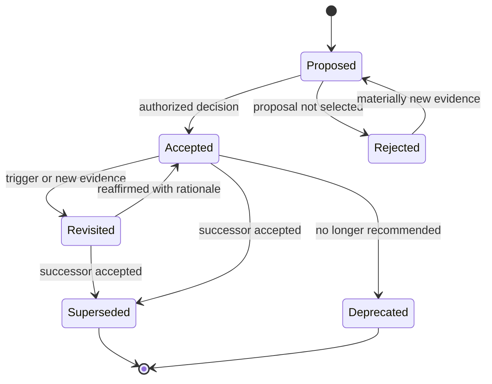

# Architecture Decision Records and Decision Log

**Module:** Stage 2D — Data Architecture / Architecture Documentation, Reviews and Operating Model  
**Topic:** 04  
**Level:** Beginner → Intermediate → Advanced  
**Status of examples:** All Northbridge Bank scenarios, dates, IDs, requirements, metrics, and decisions in this lesson are synthetic and illustrative. They are not claims about a real bank, an actual deployment, or decisions made by the repository owner.

> **Purpose of this lesson:** Learn to preserve the reasoning behind architecturally significant choices, evaluate genuine alternatives fairly, record consequences and uncertainty, and maintain a decision history that can be traced to requirements, risks, diagrams, standards, implementation evidence, and migration plans.

## Table of contents

- [1. Learning objectives](#1-learning-objectives)
- [2. Prerequisites and connection to Topics 01–03](#2-prerequisites-and-connection-to-topics-0103)
- [3. Beginner: foundations](#3-beginner-foundations)
- [4. Decide when an ADR is warranted](#4-decide-when-an-adr-is-warranted)
- [5. The anatomy of a useful ADR](#5-the-anatomy-of-a-useful-adr)
- [6. Evaluate alternatives fairly](#6-evaluate-alternatives-fairly)
- [7. Decision status and lifecycle](#7-decision-status-and-lifecycle)
- [8. Intermediate: worked Northbridge Bank ADR](#8-intermediate-worked-northbridge-bank-adr)
- [9. Decision logs and traceability](#9-decision-logs-and-traceability)
- [10. Relationship to architecture artefacts](#10-relationship-to-architecture-artefacts)
- [11. Advanced: uncertainty, reversibility and governance](#11-advanced-uncertainty-reversibility-and-governance)
- [12. Advanced worked example: paired decisions and supersession](#12-advanced-worked-example-paired-decisions-and-supersession)
- [13. Review and audit procedures](#13-review-and-audit-procedures)
- [14. Common mistakes and corrections](#14-common-mistakes-and-corrections)
- [15. Practical exercises](#15-practical-exercises)
- [16. Reusable ADR and decision-log templates](#16-reusable-adr-and-decision-log-templates)
- [17. Mastery criteria and completion gate](#17-mastery-criteria-and-completion-gate)
- [18. Readiness for Topic 05](#18-readiness-for-topic-05)
- [Appendix A. Practice questions with answers](#appendix-a-practice-questions-with-answers)

---

## 1. Learning objectives

After completing this lesson, you should be able to:

1. Distinguish architecturally significant decisions from routine implementation choices.
2. Explain why architecture diagrams and descriptions need a durable record of the reasoning behind important choices.
3. Write an ADR with a self-contained context, decision drivers, constraints, assumptions, genuine alternatives, evaluation, decision, rationale, consequences, risks, links, ownership, status, and revisit triggers.
4. Compare alternatives against criteria established before scoring, disclose uncertainty, and avoid false precision or straw-man options.
5. Maintain a decision log with stable identifiers, status, dates, deciders, links, supersession, and review information.
6. Trace decisions to requirements, constraints, risks, diagrams, evidence, standards, ownership, implementation, and migration phases.
7. Handle proposed, accepted, rejected, superseded, deprecated, and revisited decisions without rewriting history.
8. Apply proportional governance based on impact, uncertainty, reversibility, and decision rights.
9. Audit a decision log for contradictions, missing alternatives, unsupported claims, stale decisions, and broken traceability.
10. Prepare evidence and decision records that support the design review, threat-model, and risk-register work in Topic 05.

The quality target is not the largest possible ADR library. It is a small, discoverable set of credible records that lets a future reader reconstruct what was decided, why it was reasonable at the time, what was traded away, what evidence was available, and what could cause the decision to change.

## 2. Prerequisites and connection to Topics 01–03

### 2.1 Prerequisites

The module roadmap identifies **sequence 3** and prerequisites **P3 and P4**, including the earlier learning material on architecture decision records and decision criteria. For this lesson, you should be able to:

- Identify requirements, constraints, assumptions, and quality attributes that shape a design.
- Explain trade-offs and compare options against explicit decision criteria.
- Read context, container, component, deployment, data-flow, and trust-boundary views.
- Explain what an architecture description is for, who its readers are, and which concerns its views address.
- Recognize the difference between a verified fact, a stakeholder statement, an assumption, and an inference.

If decision criteria and trade-off analysis are unfamiliar, review the earlier module material referenced in the roadmap: `../02-Requirements-Constraints-and-Architecture-Decisions/06-architecture-trade-offs-and-decision-criteria.md` and `07-architecture-decision-records-adrs.md`, where available in the project. Those are prerequisites, not evidence that any particular decision or standard has been adopted in this module.

### 2.2 How Topics 01–03 feed this lesson

| Earlier topic | Artefact or skill reused here | How this lesson uses it |
|---|---|---|
| Topic 01 — Context, container, component and deployment diagrams | Diagram set, element names, boundaries, deployment assumptions | An ADR explains a meaningful choice represented by the views and links to the affected views. |
| Topic 02 — Data-flow and trust-boundary diagrams | Flow inventory, trust boundaries, classifications, controls, unresolved flows | Decisions about movement, trust, identity, encryption, storage, and replay should link to the relevant flow and boundary evidence. |
| Topic 03 — Architecture description and viewpoints | Stakeholder concerns, requirements, viewpoint-to-concern coverage, evidence and open questions | ADRs preserve reasoning for selected architecture choices and connect to concerns; they do not replace the architecture description. |
| Earlier requirements and decision-criteria material | Requirement IDs, constraints, criteria, trade-off reasoning | ADR context and evaluation should cite stable identifiers rather than rely on vague phrases such as “performance is important.” |

**Core distinction:** diagrams and architecture descriptions communicate *what the architecture is intended to be and how it is represented*. ADRs communicate *why a significant choice was made and what consequences followed*. A decision log makes that history findable. None of these artefacts alone proves that production implementation conforms to the design.

### 2.3 Scope and source discipline

The module roadmap calls for ADRs, a decision log, traceability, a review checklist, and an audit exercise. It does not establish a repository-wide ADR tool, mandatory schema, approval board, cloud vendor, or adopted external standard. The templates in this lesson are practical proposals for learning and may be adapted. Named formats and tooling are options to investigate, not assumed repository mandates.

---

## 3. Beginner: foundations

### 3.1 What is an architecture decision?

An **architecture decision** is a choice that materially shapes the structure, behaviour, quality attributes, operating model, or evolution of a system or platform. It narrows the solution space and creates consequences that matter beyond a single local coding task.

Examples in enterprise data architecture include:

- choosing managed streaming versus operating a broker platform;
- choosing a canonical event contract and compatibility policy;
- selecting where a regulated data product is stored and which regions may hold replicas;
- deciding whether transformations occur before landing, in a curated layer, or at serving time;
- defining whether a feature store is a shared platform service or a domain-owned capability;
- setting the replay and retention model for event data;
- choosing an identity and authorization boundary for cross-domain data access;
- selecting a migration strategy that temporarily runs legacy and target platforms in parallel.

A **routine implementation choice** is usually local, easy to reverse, and does not materially alter architecture constraints, cross-team contracts, security posture, cost structure, or long-term operations. For example, choosing a private helper function name normally does not warrant an ADR. If a seemingly local choice establishes a public schema, changes a shared contract, or creates significant lock-in, its significance changes.

### 3.2 Why preserve the reasoning?

Without an ADR, future readers may see only the outcome and wrongly assume it was arbitrary, inevitable, or based on evidence that never existed. The team may repeat old debates, reintroduce rejected risks, or miss the fact that a key constraint has changed.

An ADR should preserve **decision-time reasoning**, not create a polished story after the fact. It should answer:

- What problem or question needed a decision?
- Why did the question matter now?
- Which requirements, constraints, assumptions, and dependencies shaped the options?
- Which plausible alternatives were considered, including the status quo where relevant?
- What criteria were used, and what evidence informed the comparison?
- What was selected, by whom, and why?
- What benefits, costs, risks, obligations, and follow-up work resulted?
- What new evidence or change would justify revisiting it?

**Analogy:** a ship's log records not only where the ship is, but why its course changed, what conditions were known, and what hazards remain. A log is useful precisely because conditions can change after the decision.

### 3.3 ADR versus meeting minutes, specification, and architecture description

| Artefact | Primary purpose | Typical contents | What it should not be expected to do |
|---|---|---|---|
| Architecture Decision Record (ADR) | Preserve the reasoning and consequences of one significant decision | Context, drivers, alternatives, evaluation, outcome, consequences, status, links | Record every discussion or replace detailed technical specifications |
| Meeting minutes | Record what happened in a meeting | Attendees, discussion topics, actions, agreements | Substitute for a clear, durable decision rationale |
| Architecture description | Organize views and information around stakeholder concerns | Scope, stakeholders, concerns, views, conventions, evidence, related artefacts | Explain every decision in full inside each diagram or view |
| Requirement / constraint record | State a need or limit | Identifier, statement, source, priority, acceptance evidence | Explain which design option was selected unless linked to a decision |
| Risk register | Track uncertain events and exposures requiring treatment | Risk statement, likelihood/impact, owner, treatment, due date, status | Replace the decision rationale for choosing a treatment |
| Implementation specification | Tell implementers what to build or configure | Interfaces, schemas, deployment settings, tests, operational details | Preserve the full history of alternatives and decision trade-offs |

An ADR may link to minutes or specifications, but it should stand on its own enough that a new team member can reconstruct the decision without interviewing the original author.

### 3.4 What makes a decision architecturally significant?

Use heuristics, not a mechanical rule that every choice needs a record. A decision is more likely to deserve an ADR when it is:

- difficult or expensive to reverse;
- influential across multiple teams, systems, or domains;
- a material trade-off among availability, consistency, latency, security, privacy, portability, operability, or cost;
- likely to be questioned by reviewers, auditors, operators, or future maintainers;
- a deviation from an agreed standard or platform pattern;
- a dependency for multiple later decisions;
- important to migration sequencing or coexistence with a legacy platform;
- sensitive to uncertain evidence or a changing regulatory/business constraint.

**Use a proportionality test:** if the choice is easy to reverse, local, low impact, and unlikely to constrain future work, a short pull-request note may be sufficient. If it establishes a shared contract or materially changes a risk or quality attribute, record it even if the code change itself is small.

### 3.5 A quick significance decision tree

1. Does the choice affect a shared interface, trust boundary, data contract, platform pattern, deployment topology, quality attribute, or migration path?
2. Could reversing it require significant cost, downtime, coordination, data migration, or contractual change?
3. Does it resolve a real trade-off or rely on an uncertain assumption?
4. Would a future engineer reasonably ask “why did we choose this?”

If one or more answers are yes, consider an ADR. Record the significance judgement briefly if the choice is borderline. The goal is to capture decisions with durable architectural consequences while keeping the record system usable.

---

## 4. Decide when an ADR is warranted

### 4.1 Decision, task, or open question?

| Situation | Classification | Recommended record |
|---|---|---|
| Choose a shared event envelope and compatibility policy | Significant decision | ADR linked to contract/schema and affected views |
| Rename a private variable with no contract impact | Routine implementation detail | Code review or commit message |
| Decide whether to keep a managed service or self-operate a broker | Significant decision | ADR with cost, staffing, reliability and portability criteria |
| No one knows whether a source system can publish events | Open question / evidence gap | Question or investigation item; do not present it as a decided fact |
| Agree to test two options next sprint | Experiment plan, not yet final decision | Experiment record or proposed ADR with an explicit pending status |
| Choose a service based only on a vendor presentation | Incomplete decision evidence | Record the decision only if it was actually made; flag evidence limitations and validation actions |
| Accept a temporary migration exception | Significant, time-bounded decision | ADR plus exception/risk record, owner, expiry and revisit trigger |

### 4.2 The significance test in practice

Ask five questions:

- **Scope:** Who or what is affected beyond the immediate implementation?
- **Duration:** How long could the consequences persist?
- **Reversal:** What is the likely cost and operational risk of changing course?
- **Uncertainty:** Which assumptions or missing evidence could alter the choice?
- **Governance:** Does the choice require a decision right, risk acceptance, or exception?

These questions help scale the record. A low-impact decision may use a compact ADR. A platform-wide decision may need explicit criteria, an evidence appendix, risk links, a review forum, and a migration plan.

### 4.3 One ADR, one decision

A useful ADR focuses on one decision question. Do not bundle “choose streaming technology, define data retention, choose schema registry, and select disaster recovery region” into one giant record merely because the topics were discussed together. If the decisions depend on each other, create separate ADRs and link them. This allows one decision to be superseded without obscuring the status of unrelated choices.

There are exceptions: if a set of choices is inseparable and only meaningful as one coherent architecture option, the record may describe that bounded decision package. State the boundary explicitly and identify any sub-decisions that need separate lifecycle management.

---

## 5. The anatomy of a useful ADR

### 5.1 Minimum structure

The module roadmap gives this minimal shape: title/ID; status, date, deciders; context; options; decision and rationale; consequences; links to requirements, risks, diagrams and other ADRs. A production-quality record normally makes several of these fields more explicit.

| Field | Questions answered | Quality test |
|---|---|---|
| ID and title | What decision is this? | Stable, unique identifier; title states the decision question or outcome clearly |
| Status | Is it proposed, accepted, rejected, superseded, deprecated, or under reconsideration? | Status matches actual governance state |
| Date / version | When was it recorded or updated? | Distinguish decision date from later edit date where necessary |
| Deciders and owner | Who had authority, and who maintains the record? | Roles and named decision authority are clear; no invented approval |
| Context | What problem, forces, and timing required a decision? | A reader unfamiliar with the project can understand the problem without hunting for meeting notes |
| Drivers / requirements | What outcomes matter? | Stable requirement/concern IDs and measurable targets where available |
| Constraints | What options are ruled out or bounded? | Source and status of each constraint are clear |
| Assumptions and evidence | What is not yet verified? What supports claims? | Confidence and validation path are stated; assumption is not silently promoted to fact |
| Alternatives | What plausible options were available? | Alternatives are real, sufficiently described, and compared on the same criteria |
| Criteria and evaluation | How were options compared? | Criteria reflect stakeholder drivers; weights and evidence are disclosed if scoring is used |
| Decision and rationale | What was chosen and why? | Outcome is unambiguous and reasoning follows from evidence and criteria |
| Consequences | What becomes easier/harder? | Positive and negative effects, obligations, and accepted trade-offs are explicit |
| Risks and actions | What could go wrong, and who will do what? | Risk links, mitigations, owners and due dates are recorded where needed |
| Dependencies and links | Which artefacts or decisions are related? | Links are stable, specific and maintained |
| Revisit triggers | What could invalidate this decision? | Trigger is observable; owner and review date are stated where practical |

Not every ADR needs a large scoring table. It does need enough information to explain the choice honestly. Empty fields should be omitted or marked “not yet known” with an owner/action—not filled with generic boilerplate.

### 5.2 Write context that stands alone

Weak context: “We discussed streaming options and chose Service A.”

Stronger context: “The proposed fraud-event pipeline needs to ingest bursty transaction events from three source domains, retain replayable events for a defined investigation window, and support a team that currently has limited broker operations capacity. The exact peak rate and service recovery objectives are not yet validated. The decision concerns the platform operating model for ingestion; it does not decide event schema compatibility or retention policy.”

The stronger version states the problem, drivers, uncertainty, and boundary of the decision. It avoids pretending that missing capacity figures are known.

### 5.3 Record assumptions and evidence separately

| Kind | Example | How to record it |
|---|---|---|
| Verified evidence | A tested prototype sustained a stated rate under documented conditions | Link the test report, environment, date and limitations |
| Stakeholder statement | Operations says no team is staffed for 24×7 broker on-call | Attribute it to the role/source and date; confirm whether it is a binding constraint |
| Assumption | Peak traffic will be below a provisional threshold | Label it as an assumption, give confidence, owner and validation date |
| Inference | Managed operation may reduce routine patching burden | Explain the reasoning and avoid presenting it as measured fact |
| Unknown | Contractual exit fees have not been reviewed | Keep it as an open question and assign an action |

A citation is not automatically strong evidence. “See slide deck” is weak if it does not identify the relevant claim, date, source, or limitation. Link directly to the evidence that bears on the decision.

### 5.4 Consequences must include costs

A decision is not fully documented by listing only benefits. Consequences can include:

- **Positive:** lower operational burden, clearer ownership, faster delivery, stronger isolation.
- **Negative:** higher recurring cost, vendor dependence, new skills required, increased data duplication, more complex local testing.
- **Neutral but important:** changed team responsibilities, new runbooks, a required contract version, or an extra migration stage.
- **Risks:** outcomes that may occur but are uncertain, with likelihood/impact and mitigation captured in the risk register if that is the repository's chosen process.
- **Follow-up work:** load test, security review, contract review, observability, exit plan, or migration task.

Separate a consequence from a risk: “The service has a recurring per-throughput charge” is a consequence of the pricing model; “traffic growth may exceed budget” is a risk. Link both to evidence or a follow-up action when material.

### 5.5 Rejected alternatives still matter

Record a rejected option if it was genuinely plausible and important to the decision. State why it was not selected under the decision criteria and evidence available at the time. Do not create a deliberately weak “straw man” to make the chosen option look inevitable. If an option was not evaluated, say so; if it remains viable under different conditions, document those conditions.

---

## 6. Evaluate alternatives fairly

### 6.1 Define criteria before scoring

Criteria should be derived from stakeholder concerns and requirements, not reverse-engineered after the team already prefers an option. Typical data-platform criteria include:

- service availability and recovery behaviour;
- latency, throughput and burst handling;
- replay, retention and delivery semantics;
- data quality and schema evolution;
- security, privacy, residency and auditability;
- operational effort, on-call burden and skills;
- integration fit and migration complexity;
- portability and exit cost;
- cost at expected and stressed volumes;
- delivery lead time and organizational ownership.

Not every criterion matters equally. State which are mandatory constraints (pass/fail) and which are preferences. If a mandatory requirement fails, a high weighted score elsewhere should not conceal that failure.

### 6.2 A fair comparison procedure

1. **Define the decision boundary.** State what this ADR decides and what it does not.
2. **List drivers and constraints.** Link to requirement IDs or source evidence.
3. **Identify plausible alternatives.** Include the status quo or “defer” where it is a real option; do not add fictional options for completeness theatre.
4. **Choose criteria before rating.** Make them relevant to the decision and stakeholder concerns.
5. **Gather comparable evidence.** Use similar assumptions, time horizons, workload profiles, and cost boundaries across options.
6. **State unknowns.** Use ranges or qualitative judgements where evidence is insufficient; do not invent precision.
7. **Compare benefits and disadvantages.** Explain how each option performs against each important criterion.
8. **Check sensitivity.** Ask whether a different plausible weight or uncertain input would change the result.
9. **Record the rationale and dissent.** Explain the decisive criteria and any disagreement that matters.
10. **Define conditions to revisit.** Name the measurement, threshold, date, or external change that would justify reconsideration.

### 6.3 Worked comparison: managed service versus self-operated broker

**Illustrative context:** Northbridge Bank is considering an event-ingestion capability for a hypothetical fraud analytics platform. The following options and ratings are synthetic teaching material, not vendor measurements or real bank facts.

Options:

- **A — Managed streaming service:** provider operates much of the broker control plane and routine infrastructure lifecycle.
- **B — Self-operated broker:** platform team deploys, patches, scales, monitors, and recovers broker infrastructure.
- **C — Defer streaming and use scheduled batch transfer for the initial phase:** only plausible if the initial business latency requirement allows it; this option must be excluded if it fails a mandatory freshness requirement.

Illustrative criteria and qualitative assessment:

| Criterion | Importance | A: Managed | B: Self-operated | C: Batch-first | Evidence caveat |
|---|---|---|---|---|---|
| Meet required event freshness | Mandatory | Potentially suitable; test required | Potentially suitable; test required | Likely fails if near-real-time is mandatory | No benchmark is supplied here |
| 24×7 operational burden | High | Usually less infrastructure work for the platform team; service-specific duties remain | Higher staffing and operational responsibility | Lower broker burden but batch operations remain | Validate actual support boundaries and staffing |
| Control over runtime configuration | Medium | Depends on service capabilities | Generally more direct control | Control concentrated in batch pipeline | Verify specific requirements before deciding |
| Portability / exit effort | High | Potentially higher coupling to provider-specific APIs | Depends on deployment automation and protocol choices | May be simpler for some transfer contracts | Exit design must be evaluated, not assumed |
| Cost predictability | High | Usage and service tiers may create variable charges | Infrastructure plus engineering/on-call cost | Transfer and processing cost; freshness trade-off | Compare total cost, not infrastructure bill alone |
| Time to initial delivery | High | May be faster if service and security integration are ready | Requires platform build and operating capability | Could be fastest if latency permits | Depends on local readiness |

The table intentionally does not declare a winner. It demonstrates how to compare options without manufacturing evidence. A decision requires actual requirements, validated service capabilities, cost estimates, operations input, and security review. If the data is missing, the correct outcome may be a **proposed** ADR with investigation actions rather than a falsely confident accepted ADR.

### 6.4 Weighted scoring: useful, not scientific truth

Weighted scoring can make assumptions visible, but the total is not objective truth. A common method is to rate each option on a defined scale, multiply by criterion weights, and sum. Use it only when:

- the criteria and weights are agreed before the scores are known;
- the rating scale is defined consistently;
- evidence and confidence are shown next to ratings;
- mandatory constraints are evaluated separately;
- sensitivity is checked; and
- the record explains why the final choice follows from the evidence.

Do not use a score such as `4.37` when the inputs are subjective labels. A simple low/medium/high assessment with clear caveats may be more honest. If one criterion dominates for a sound reason, say so directly instead of hiding it in a spreadsheet.

### 6.5 Sensitivity and pre-mortem

**Sensitivity analysis:** vary uncertain assumptions or plausible criterion weights. If a small change reverses the preferred option, the decision is fragile and may need more evidence, a staged experiment, or an explicit conditional outcome.

**Pre-mortem:** imagine that the selected architecture has failed after a year. Ask why. For a managed streaming service, plausible failure modes could include unexpected cost growth, provider-specific coupling, misunderstood service limits, or unclear ownership of application-level recovery. Record these as risks or follow-up actions only when relevant; do not claim they have occurred.

---

## 7. Decision status and lifecycle

### 7.1 Status meanings

The roadmap names proposed, accepted, superseded, and deprecated as core statuses. Rejected and revisited are also useful states when the process defines them clearly. Avoid status ambiguity.

| Status | Meaning | What should happen next |
|---|---|---|
| **Proposed** | A candidate decision is under evaluation and has not been accepted by the authorized decider | Gather evidence, review alternatives, record open questions and a decision deadline |
| **Accepted** | The authorized decider has selected the outcome | Implement or plan implementation; track consequences, conformance, and revisit triggers |
| **Rejected** | The proposed outcome was explicitly not selected | Preserve the reason and conditions under which it might be reconsidered; do not confuse with a rejected alternative inside an accepted ADR |
| **Superseded** | A later, accepted ADR replaces an already accepted decision, wholly or for a stated scope | Link the accepted successor and preserve the historical record unchanged in meaning; do not use this status merely to close an abandoned proposal |
| **Deprecated** | The decision is no longer recommended or applicable, but may not have a direct replacement | State why, scope, transition guidance, owner and any removal plan |
| **Revisited / under reconsideration** | The decision is being actively reassessed because a trigger occurred or evidence changed | Link the review or proposed successor; keep the accepted historical decision intact until a new outcome is authorized |

A project may choose a smaller status vocabulary. The key is to define meanings and apply them consistently. Do not use “approved,” “implemented,” and “accepted” as synonyms: decision acceptance, implementation status, and implementation conformance are different dimensions.

### 7.2 Lifecycle



This is an illustrative lifecycle, not a mandated workflow. Teams may implement statuses differently. It models supersession of an accepted decision by an accepted successor. If a proposal is abandoned before acceptance, close it as rejected or withdrawn according to the team's defined vocabulary; do not imply that an accepted decision was replaced. Whatever the lifecycle, preserve the original decision date, decision authority, and reasoning; record later changes as new history rather than silently rewriting the past.

### 7.3 Do not confuse three dimensions

Track separately where useful:

- **Decision status:** proposed, accepted, superseded, etc.
- **Implementation status:** not started, in progress, implemented, partially implemented, rolled back.
- **Conformance status:** conforms, deviates, not yet verified, not applicable.

For example, ADR-004 may be accepted while implementation is in progress. Another ADR may be accepted and implemented but not yet checked against production configuration. A decision can be valid while the implementation is nonconformant; that is a finding, not a reason to alter the historical ADR to pretend the intended architecture was different.

---

## 8. Intermediate: worked Northbridge Bank ADR

### 8.1 Scenario and evidence boundaries

Northbridge Bank is a fictional teaching scenario. Assume a proposed fraud analytics platform receives transaction events from multiple internal domains and produces risk signals for downstream consumers. The precise workload, regulatory interpretation, vendor capabilities, and operating constraints are **not** supplied as real evidence. All details below are invented for practice and are labelled accordingly.

For the exercise, use these synthetic requirements:

- **REQ-FRAUD-01:** event freshness target is under 60 seconds for the initial risk signal.
- **REQ-FRAUD-02:** events must be replayable for a defined investigation window; the exact duration remains to be agreed.
- **REQ-OPS-01:** an on-call and recovery model must have a named accountable team before production launch.
- **CON-PLAT-01:** the first release has limited capacity for building and operating new infrastructure.
- **ASM-LOAD-01:** initial peak event rate is unknown; a load test is required before final capacity commitment.

These identifiers and statements are synthetic. They are used to demonstrate traceability, not to assert that the repository or a real bank has adopted them.

### 8.2 Completed illustrative ADR

# ADR-NB-001: Select the initial event-ingestion operating model

- **Status:** Proposed (illustrative; no real authorization implied)
- **Recorded:** 2026-10-21 (teaching example date)
- **Decision owner:** Hypothetical Data Platform Architecture Lead
- **Deciders:** To be confirmed by the fictional platform's decision-rights process
- **Scope:** Operating model for event ingestion in the first fraud-platform release
- **Out of scope:** Event schema evolution policy, exact retention duration, downstream feature-store design, and production service selection

## Context

The proposed fraud analytics platform needs to receive events from multiple internal domains and make them available to risk processing with a target freshness under 60 seconds (synthetic requirement REQ-FRAUD-01). Events need to support replay for investigations (REQ-FRAUD-02), but the required retention duration and expected peak rate are not yet established. The initial release has limited capacity for creating and operating new infrastructure (synthetic constraint CON-PLAT-01). The team must choose an ingestion operating model without presenting unvalidated load, cost, or service-capability assumptions as facts.

## Decision drivers and constraints

1. Meet the freshness requirement, subject to a representative load and failure test.
2. Establish clear 24×7 ownership and recovery responsibilities before production (REQ-OPS-01).
3. Support replay and the eventual approved retention policy.
4. Keep initial operational burden within the team's actual staffing and skills.
5. Avoid unacceptable lock-in and cost exposure.
6. Treat peak rate as unknown until the load profile is measured (ASM-LOAD-01).

## Alternatives considered

**A. Use a managed streaming service.** The provider operates parts of the service infrastructure; the platform team still owns event contracts, application behaviour, permissions, observability, consumer recovery, and service-specific responsibilities. Capabilities and operational boundaries must be verified for the chosen service.

**B. Operate a broker platform ourselves.** The platform team controls deployment and more infrastructure details, but must provide patching, capacity management, monitoring, incident response, upgrades, and recovery procedures.

**C. Start with scheduled batch transfer.** This can reduce the need for a streaming runtime in an early phase, but is only acceptable if the freshness requirement can be changed or the batch interval can demonstrably satisfy it. Under the stated under-60-second target, it is not currently a viable default unless a documented exception is approved.

## Evaluation

| Criterion | A: Managed streaming | B: Self-operated broker | C: Batch-first |
|---|---|---|---|
| Freshness target | Plausible, but needs end-to-end validation | Plausible, but needs end-to-end validation | Appears incompatible with the stated target unless the requirement changes |
| Operations | May reduce infrastructure operations; application-level duties remain | Requires stronger internal operational capability | Simpler runtime model, but batch scheduling and delay handling remain |
| Replay | Must validate service retention/replay capability and cost | Configurable in principle; team must operate it correctly | Replay depends on retained source files and batch reprocessing design |
| Cost | Unknown until workload, retention and service pricing are modelled | Unknown until infrastructure and staffing are included | Unknown; may trade lower runtime complexity for slower freshness |
| Portability | Provider-specific features may increase exit effort | Can be portable if deployment and interfaces are deliberately designed; not automatic | Depends on file formats and transfer contracts |
| Evidence confidence | Low at this stage: no vendor-specific validation supplied | Low at this stage: no operational readiness assessment supplied | Medium for the conceptual latency mismatch; actual schedule still must be specified |

No numeric score is assigned because workload, pricing, support boundaries, and operational capacity have not been validated. A numeric winner would imply false precision.

## Decision / rationale

**Proposed outcome:** Prefer evaluating option A, managed streaming, as the leading candidate for the first release because the stated constraint is limited capacity to build and operate new infrastructure. This is a proposal, not an accepted architecture decision. Do not commit to a provider or production deployment until the team validates service capabilities, security requirements, operating responsibilities, representative load, replay needs, total cost, and exit implications.

The rationale is conditional: if the managed option cannot meet the freshness, replay, security, or cost requirements, or if its support boundaries leave an unacceptable operational gap, option B must be reassessed. Option C remains unavailable under the current freshness target unless the requirement is formally changed.

## Consequences

**Expected positive consequences if option A is validated and accepted:** less platform effort spent on routine broker infrastructure operations; potentially shorter initial delivery path; a clearer focus on event contracts and consumer reliability.

**Negative consequences and obligations:** ongoing service charges; possible provider-specific coupling; dependence on service quotas and regional capabilities; continued responsibility for application-level reliability, identity, schema governance, and end-to-end monitoring; a need for a documented exit strategy.

**Risks / actions:**

- Run a representative throughput, burst, and recovery test. **Owner:** hypothetical platform engineering lead. **Due:** before final acceptance.
- Confirm event replay and retention capability against the approved investigation window. **Owner:** data engineering lead. **Due:** before final acceptance.
- Obtain a total-cost estimate for expected and stressed workloads. **Owner:** platform product owner / FinOps role. **Due:** before final acceptance.
- Review identity, network, encryption, audit, and data-residency controls. **Owner:** security and platform specialists. **Due:** before production approval.
- Define service-provider versus platform-team incident responsibilities. **Owner:** operations lead. **Due:** before launch readiness review.
- Record the measured peak rate and confidence level. **Owner:** source-domain and platform teams. **Due:** after load-profile discovery.

## Revisit triggers

Revisit this proposal if the representative test fails REQ-FRAUD-01; replay requirements exceed service capabilities or budget; the total cost exceeds the approved envelope; security review identifies an unresolved blocker; service terms or regional availability change; or the operating team cannot meet its obligations. Set a formal review date after the required evidence has an owner and target date.

## Related artefacts (synthetic placeholders)

- Requirements: `REQ-FRAUD-01`, `REQ-FRAUD-02`, `REQ-OPS-01`
- Constraint: `CON-PLAT-01`
- Assumption: `ASM-LOAD-01`
- Context/container/deployment views: `VIEW-NB-CONTEXT-01`, `VIEW-NB-CONTAINER-01`, `VIEW-NB-DEPLOYMENT-01` (proposed placeholders; not verified repository artefacts)
- Data-flow/trust-boundary view: `VIEW-NB-DATAFLOW-01` (proposed placeholder)
- Risk records: `RISK-NB-01` cost uncertainty; `RISK-NB-02` recovery ownership gap (proposed placeholders)
- Follow-up migration phase: `MIG-NB-01` initial ingestion enablement (proposed placeholder)
- Related ADRs: none yet

## Record integrity note

This is an illustrative proposed ADR written for learning. It must not be presented as an actual Northbridge Bank decision or a repository decision. The fictional decision authority, requirements, artefact IDs, and dates would need to be replaced with verified project data in a real architecture record.

### 8.3 Why this ADR is stronger than a short outcome note

- It states the scope and explicitly excludes adjacent decisions.
- It links requirements, a constraint, and an assumption rather than using generic drivers.
- It compares genuine alternatives, including a batch option that is rejected only under the current stated latency requirement.
- It distinguishes plausible capability from measured evidence.
- It marks the outcome as proposed, not accepted.
- It records negative consequences and actions with owners and gates.
- It states observable revisit triggers.
- It uses clearly labelled placeholders for artefacts not supplied as real evidence.

---

## 9. Decision logs and traceability

### 9.1 What is a decision log?

A **decision log** is an index of ADRs that makes the decision history searchable and shows status, ownership, links, and supersession. It is not a replacement for the full ADR. Keep the log compact enough to scan and link each row to its authoritative record.

The module roadmap's example fields are: ID, title, status, date, decider, supersedes/superseded by, related requirement/risk/diagram, and review date. A practical log may also include owner, implementation/conformance status, scope, and a last-checked date.

### 9.2 Synthetic decision log

Every row below is illustrative. The IDs are fictional and do not imply decisions actually made by Northbridge Bank or the repository owner.

| ID | Title | Decision status | Decision date | Decider / owner | Supersedes / superseded by | Related artefacts | Implementation / conformance | Review / trigger |
|---|---|---|---|---|---|---|---|---|
| ADR-NB-001 | Select initial event-ingestion operating model | Proposed | 2026-10-21 (example) | Decider TBC / platform architecture lead (fictional) | None / None | REQ-FRAUD-01; REQ-FRAUD-02; CON-PLAT-01; VIEW-NB-DATAFLOW-01; RISK-NB-01 | Not started / not applicable | Revisit after load, cost, security and replay evidence |
| ADR-NB-002 | Define canonical event envelope and compatibility policy | Proposed | 2026-10-21 (example) | Data architecture lead (fictional) | None / None | REQ-FRAUD-01; event contract `CONTRACT-NB-01`; VIEW-NB-COMPONENT-01 | Not started / not verified | Revisit on new producer type or incompatible consumer requirement |
| ADR-NB-003 | Reassess initial ingestion operating model after evidence | Proposed reassessment | TBD | Authorized decider TBC | Reassesses ADR-NB-001 / no supersession relationship yet | Same requirements plus load test `EVID-NB-LOAD-01`; RISK-NB-01; VIEW-NB-DEPLOYMENT-01 | Not started / not verified | Decide only after evidence and decision authority are confirmed |

**Important:** this log is a coherent illustrative snapshot in which ADR-NB-001 and ADR-NB-002 remain proposed and ADR-NB-003 is only a proposed reassessment. ADR-NB-003 does **not** supersede ADR-NB-001: because ADR-NB-001 is still proposed, the log records a reassessment link, not a supersession. If the original proposal is abandoned, close it as rejected/withdrawn under the chosen workflow; if it is first accepted and later replaced, an accepted successor may supersede it. Other lifecycle states are demonstrated separately in later worked examples. Do not copy the table as a real project record.

### 9.3 Traceability graph

A useful relationship chain is:

`Stakeholder concern → Requirement / constraint → ADR → View / model → Risk / control → Implementation / test evidence → Migration task or operational procedure`

This is not a mandatory one-to-one mapping. One requirement can influence several ADRs; one ADR can affect several views and risks; a diagram can represent the outcome of several decisions. The goal is to make important relationships discoverable and maintainable.

Example:

| Link | Example relationship | Verification question |
|---|---|---|
| Concern → requirement | Risk operations needs timely signals → `REQ-FRAUD-01` | Is the requirement owned and testable? |
| Requirement → ADR | `ADR-NB-001` evaluates ingestion models against freshness | Does the ADR explain the decision impact of the requirement? |
| ADR → view | `ADR-NB-001` affects the deployment and data-flow views | Do the views show the selected pattern, or still show a rejected proposal? |
| ADR → risk | Provider cost uncertainty → `RISK-NB-01` | Is the risk owner and treatment current? |
| ADR → evidence | Load test → `EVID-NB-LOAD-01` | Does the evidence support the claim and match the workload? |
| ADR → migration | Ingestion enablement → `MIG-NB-01` | Is the selected option reflected in sequencing, dependencies and cutover criteria? |
| ADR → successor | New constraint triggers reconsideration | Is the old ADR preserved and correctly marked superseded only after a new decision is accepted? |

### 9.4 Stable identifiers and links

Use stable identifiers for ADRs and related artefacts. An ID should not change merely because a title is improved. Links should point to the authoritative source, not a copied paragraph that can drift. If the repository does not yet have IDs for requirements or risks, introduce a minimal local identifier convention only with the project's agreement; do not imply that the illustrative `REQ-*` or `RISK-*` names are already adopted.

Useful link types include:

- **Depends on:** this decision relies on another decision or constraint.
- **Constrains:** this decision limits later design options.
- **Implements:** a design or component realizes the accepted decision.
- **Supersedes:** a new accepted ADR replaces a prior decision.
- **Related to:** there is a meaningful connection but no direct dependency.
- **Validates:** a test or evidence artefact checks an outcome or assumption.

Avoid vague links such as “related docs” when the relationship can be named. This makes impact analysis more useful when requirements, standards, or risks change.

---

## 10. Relationship to architecture artefacts

### 10.1 ADRs and diagrams

Diagrams show the selected structure or flow; ADRs explain important reasons for selecting it. If an ADR changes the data path, trust boundary, deployment model, or ownership boundary, update the affected views and cross-view references. Do not put a full decision essay inside the diagram. Add the ADR ID to a diagram caption or artefact register where useful, then link to the record.

**Consistency check:** if an accepted ADR says “data is retained in a region-restricted store” but the deployment view shows a cross-region replica, either the view is stale, the decision is misunderstood, or an exception has not been recorded. The inconsistency must be resolved or explicitly logged; it should not be silently rationalized.

### 10.2 ADRs and requirements / constraints

Requirements express what needs to be achieved; constraints limit the solution space; ADRs explain how a significant choice responds to them. If a requirement changes, search for linked ADRs, then identify affected views, tests, risks, and migration work. Do not assume that changing a requirement automatically invalidates every linked decision; assess the impact and record the result.

### 10.3 ADRs and risks

A risk register tracks uncertain exposure, treatment, ownership, and status. An ADR records the decision reasoning, including which risks were accepted or mitigated and why. A risk acceptance may require a distinct authority or formal record under the organization's process; an ADR alone should not be treated as proof of authorized risk acceptance unless the process explicitly says so.

### 10.4 ADRs and standards

If a choice follows a standard, link the relevant version and explain applicability. If it deviates, document the deviation, rationale, owner, and exception process. The module roadmap does not declare any specific architecture standard as adopted; do not write “the repository standard requires…” unless an actual source establishes it.

### 10.5 ADRs and ownership records

Decisions can change who operates a capability, responds to incidents, approves access, maintains a contract, or pays a service bill. Link the relevant ownership record and make the operational consequences explicit. “The platform team owns it” is insufficient if the record does not define what “owns” means: delivery, service operation, incident response, data quality, security controls, or lifecycle maintenance.

### 10.6 ADRs and migration plans

A decision can affect sequencing, coexistence, data backfill, dual-write duration, reconciliation, cutover, rollback, and decommissioning. Link the ADR to the migration phase and its entry/exit criteria. If the decision is conditional, do not start irreversible migration work before the condition is met or an authorized exception is recorded.

### 10.7 Avoid duplicated authority

A decision log should not become a second copy of every ADR paragraph. A diagram should not become a second risk register. The ADR should link to authoritative artefacts and summarize only what is necessary to explain its reasoning. Duplicated facts drift; clear ownership and links reduce the risk.

---

## 11. Advanced: uncertainty, reversibility and governance

### 11.1 Reversibility and timing

A decision's urgency depends on the cost of waiting, the cost of changing course, and the value of additional information. A reversible decision with cheap experiments can often be made quickly and revisited. A decision that locks in a data format, contractual commitment, region boundary, or multi-year migration path deserves stronger evidence and explicit authority.

| Decision profile | Recommended approach | Documentation emphasis |
|---|---|---|
| Low impact, highly reversible | Make the decision close to the work; keep a concise record if useful | Owner, brief rationale, simple revisit trigger |
| High impact, reversible with a measured experiment | Time-box an experiment before committing | Hypothesis, test design, decision threshold, evidence, deadline |
| High impact, costly to reverse | Slow down enough to test critical assumptions and review alternatives | Decision rights, constraints, alternatives, sensitivity, consequences, rollback/exit path |
| Urgent decision under incomplete evidence | Make uncertainty explicit; consider a bounded, conditional or temporary decision | What is known, what is unknown, expiry/review date, stop conditions, authority |
| Decision that depends on a future capability | Record dependency and gate; do not present the dependent outcome as unconditional | Dependency owner, delivery condition, fallback option |

Do not use “two-way door” or similar shorthand as a substitute for analysis. Explain what reversal would actually cost: data conversion, consumer coordination, contractual exit, operational downtime, or retraining.

### 11.2 Conditional decisions

A conditional decision is appropriate when the team can identify a leading option but a key fact is unresolved. State:

- the provisional outcome and what it permits now;
- the condition that must be met before full commitment;
- evidence that will resolve the uncertainty;
- who owns the evidence and by when;
- what happens if the condition fails; and
- when the decision expires or must be revisited.

“Accepted pending confirmation” is ambiguous. Prefer a clear status such as **Proposed** while evidence is gathered, or a formally defined **Conditional acceptance** if the organization's process supports that status. Do not invent a new status without defining its governance implications.

### 11.3 Decision hierarchy and precedence

The roadmap calls out enterprise-level principles and standards, platform-level decisions, and system-level decisions. A local decision should not contradict a higher-level decision silently. If an exception is necessary, record its scope, rationale, approving authority, duration, risk implications, and revisit condition.

| Level | Typical scope | Example question | Escalation trigger |
|---|---|---|---|
| Enterprise | Cross-domain principles, shared standards, regulatory or strategic boundaries | Which data residency constraints apply across platforms? | A local design requires an exception to an enterprise constraint |
| Platform | Shared runtime, identity, event contracts, service operations | Which ingestion capabilities and operating model are supported? | Multiple domains need conflicting platform behaviour |
| System / product | One application or data product within established boundaries | How does this product retry failed events? | Local choice breaks a shared contract or quality requirement |

This hierarchy is a reasoning aid, not a claim about a particular organization's actual governance structure. The relevant decision rights must be obtained from the project's own operating model.

### 11.4 Decision rights and proportional governance

Clarify who proposes, evaluates, decides, reviews, implements, and owns the consequences. These roles may be different. The person who writes the ADR is not automatically the authorized decider. Security, privacy, operations, data governance, finance, and product stakeholders may advise or hold approval rights depending on the decision and the organization.

Use light-touch review for low-risk, reversible decisions and a more deliberate forum for cross-domain, high-impact, or exception decisions. Keep governance time-boxed: specify what evidence is needed, who will decide, and when. “Architecture board to review later” without a decision date can become indefinite delay.

### 11.5 Dissent and uncertainty

Do not erase a meaningful disagreement just to create an appearance of consensus. Record the competing concern, the evidence or value judgement behind it, how the decision authority resolved it, and what would reopen the question. Dissent should be factual and respectful, not a list of personal attributions.

Confidence labels can help, but define them. For example:

- **High:** supported by direct, recent evidence under representative conditions.
- **Medium:** supported by indirect evidence or a limited test with known gaps.
- **Low:** mostly assumption, analogy, or unverified stakeholder statement.

These labels are only useful when the basis is described. Do not attach a confidence label to the entire ADR if different claims have different confidence levels.

### 11.6 Decision debt and architecture drift

**Decision debt** accumulates when important choices are undocumented, assumptions expire, records lack owners, or no one checks whether implementation still follows the accepted design. It creates repeated debates, hidden exceptions, and unsafe migrations.

Detect it by:

- sampling important production behaviours and locating the ADR that explains them;
- sampling accepted ADRs and checking whether implementation matches them;
- reviewing decisions when a linked constraint, standard, risk, or service dependency changes;
- checking for accepted ADRs with no owner, no relevant artefact links, or stale revisit dates;
- looking for multiple accepted ADRs that prescribe incompatible outcomes for the same scope.

A missing ADR does not justify inventing a contemporary rationale. If the team reconstructs a past decision from old commits, tickets, interviews, or deployed behaviour, label the record **retrospective / reconstructed**, list the evidence and its limitations, and distinguish confirmed history from inference.

### 11.7 Storage, version control and automation

The roadmap suggests keeping ADRs in version control near code or infrastructure-as-code, using templates, generating the log from metadata, and enabling search. These are options, not mandatory repository decisions. Choose a location that provides stable links, access controls, review history, discoverability, and long-term retention appropriate to the decision.

Automation can check required fields, duplicate IDs, broken links, invalid status values, and missing supersession references. It cannot determine by itself whether alternatives were fair, evidence is representative, a rationale is honest, or the chosen architecture is appropriate. Human review remains necessary.

---

## 12. Advanced worked example: paired decisions and supersession

This section demonstrates how linked ADRs evolve. All content is fictional and illustrative.

### 12.1 ADR-NB-010 — Adopt a canonical event envelope

- **Status:** Accepted (hypothetical teaching state)
- **Decision date:** 2026-10-21 (example date only)
- **Owner:** Fictional data architecture lead
- **Decision scope:** Required metadata envelope for events entering the fraud analytics platform

**Context.** Multiple source domains produce events with different field names and metadata. Downstream consumers need to identify the event type, producer, event time, schema version, and correlation identifier. A canonical envelope can improve routing, observability, and compatibility, but excessive central normalization may slow domain teams or erase domain-specific semantics.

**Drivers.** Traceability across ingestion and processing; explicit schema evolution; consistent handling of event time and producer identity; low ambiguity for downstream consumers.

**Alternatives.**

1. **A — Canonical envelope plus domain-owned payloads.** Standardize a small set of metadata fields and keep domain payloads owned by producing domains.
2. **B — Fully canonicalized enterprise schema.** Transform every event into a single enterprise-wide payload model before downstream use.
3. **C — No common envelope.** Let each producer publish its own metadata and require consumers to adapt.

**Evaluation.** Option A is selected in this hypothetical example because it standardizes cross-cutting metadata while leaving domain meaning with domain owners. Option B may simplify some consumers but creates broader central modeling and change-coordination obligations. Option C minimizes producer changes initially but makes consumer integration and cross-event tracing more inconsistent. This is a reasoned illustrative choice, not a measured result from a real platform.

**Decision.** Use a canonical metadata envelope with domain-owned payload schemas. Require an explicit compatibility policy and schema versioning before production onboarding. The exact registry or tooling choice is out of scope for this ADR.

**Consequences.** Positive: common event identity and tracing fields; clearer compatibility review. Negative: producers need adapters and validation; envelope evolution itself becomes governed work; consumers must still understand domain payload semantics. Risk: teams may misuse generic fields or bypass validation. Action: publish a contract, add conformance tests, and assign an owner for envelope evolution.

**Links (fictional placeholders).** `REQ-FRAUD-TRACE-01`; `VIEW-NB-DATAFLOW-01`; `VIEW-NB-COMPONENT-01`; `RISK-NB-SCHEMA-01`; `ADR-NB-001` (ingestion operating model).

**Revisit triggers.** New event classes reveal that the envelope cannot represent required metadata; compatibility breaks repeatedly despite the policy; or the shared envelope creates unacceptable release coupling.

### 12.2 ADR-NB-011 — Revisit the ingestion operating model after load validation

- **Status:** Proposed reassessment; does not supersede ADR-NB-001
- **Date:** TBD (not yet decided)
- **Owner / decider:** To be assigned in the fictional decision-rights process
- **Decision scope:** Whether the initial ingestion operating model remains suitable after measured workload and operating evidence

**Context.** ADR-NB-001 proposed evaluating a managed streaming service, but left load, replay, security, cost, and support boundaries unverified. Assume, only for this exercise, that a future synthetic load test and service review become available. Their results must be entered as evidence before this record can be accepted; this lesson does not invent the test outcome.

**Alternatives.**

1. **A — Confirm the managed service.** Accept it if the test evidence meets the defined freshness, replay, security, operational, and cost thresholds.
2. **B — Choose a self-operated broker.** Reassess if the managed option fails mandatory requirements and internal operations capability is demonstrated.
3. **C — Reduce scope or stage the release.** Use a constrained rollout or temporary architecture only if business owners approve the impact on requirements and a time-bounded plan is documented.

**Evaluation method.** Use the same workload profile and explicit thresholds across options. Do not claim that option A has passed until the test is complete and reviewed. Treat option C as a scope/business decision as well as a technical choice because it may affect freshness or coverage.

**Proposed outcome.** No final option is selected in this record. The immediate decision is to collect and review the evidence, name the authorized decider, and set a decision date. This is a legitimate outcome: the record captures the decision process without fabricating a result.

**Consequences.** Delivery commitment remains conditional; the team must fund and complete the evidence work; the existing proposal cannot be described as an accepted decision. If ADR-NB-001 is later accepted and an authorized new decision replaces it, the accepted successor should explicitly supersede ADR-NB-001 and update the log and affected views. If ADR-NB-001 remains proposed and is no longer pursued, close it as rejected/withdrawn according to the defined workflow; do not label it superseded as if an accepted decision had been replaced.

**Dependencies.** `ADR-NB-001`; `ADR-NB-010`; load-test evidence placeholder `EVID-NB-LOAD-01`; risk placeholders `RISK-NB-01` and `RISK-NB-02`; deployment and data-flow views; migration gate `MIG-NB-01`.

**Revisit trigger.** The evidence package is complete, or the deadline passes without evidence. If the deadline passes, the owner must escalate or record an authorized fallback rather than leave the proposal indefinitely unresolved.

### 12.3 Supersession rules illustrated

1. ADR-NB-001 remains the original proposal and preserves its original meaning.
2. ADR-NB-011 is a proposed reassessment record, not a superseding decision.
3. If ADR-NB-001 is accepted and an authorized later decision replaces it, the new accepted ADR names ADR-NB-001 as the record it supersedes.
4. Only then is the prior accepted ADR's status updated to **Superseded**, with a link to the accepted successor. Its context, original rationale, and decision-time evidence are not rewritten to match the new outcome.
5. If ADR-NB-001 remains proposed and is no longer pursued, close it as rejected/withdrawn under the defined workflow and link the reassessment for context; do not use **Superseded** unless an accepted decision was replaced.
6. The decision log, architecture views, requirements traceability, risk register, and migration plan are updated together when the decision outcome changes.
7. If the reassessment reaffirms an accepted original decision, record the review and new evidence. Do not create a supersession relationship unless a new decision actually replaces the old one.

---

## 13. Review and audit procedures

### 13.1 Step-by-step ADR writing procedure

1. **Name the decision question.** Use a clear title and define what is in and out of scope.
2. **Identify the authorized decider.** If unknown, record the gap and resolve it before treating the outcome as accepted.
3. **Collect drivers.** Link stakeholder concerns, requirements, constraints, standards, and risks.
4. **Separate facts from assumptions.** Cite evidence, note date and limitations, and assign validation owners.
5. **List genuine alternatives.** Include the status quo or defer only when these are viable options; document why any apparently obvious option is infeasible.
6. **Set criteria before scoring.** Identify mandatory pass/fail conditions and weighted preferences separately.
7. **Compare consistently.** Use the same workload, scope, time horizon, and cost boundaries for each alternative.
8. **Check uncertainty and sensitivity.** Identify which unknowns could reverse the decision and whether more evidence is worth the delay.
9. **State one unambiguous outcome.** Distinguish proposed from accepted; avoid a paragraph that never actually says what was chosen.
10. **Record positive and negative consequences.** Include operating responsibilities, costs, risks, migration work, and follow-up actions.
11. **Add traceability links.** Requirements, risks, diagrams, evidence, related ADRs, standards, owners, and migration tasks as applicable.
12. **Set revisit triggers.** Define observable conditions, a review date, and the responsible role.
13. **Review with a reader unfamiliar with the project.** Ask them to reconstruct the rationale without oral explanation.
14. **Update the log and affected artefacts.** Keep status, links, and architecture views aligned.

### 13.2 ADR review checklist

- [ ] The decision question and scope are clear.
- [ ] Context is self-contained and states why a decision is needed now.
- [ ] Requirements, constraints, assumptions, and dependencies are distinguishable.
- [ ] Evidence is cited at claim level where practical, with date and limitations.
- [ ] Alternatives are genuine, plausible, and compared fairly; no straw-man option is used.
- [ ] Criteria derive from stakeholder concerns and are not reverse-engineered to justify a preferred answer.
- [ ] Mandatory requirements are treated as constraints rather than hidden in a weighted score.
- [ ] Unknowns, confidence, and sensitivity are explicit.
- [ ] The decision and rationale are unambiguous and supported by the evaluation.
- [ ] Positive and negative consequences are recorded.
- [ ] Risks, accepted trade-offs, actions, owners, and due dates are captured where relevant.
- [ ] Status, date, decider, and owner are accurate.
- [ ] Revisit triggers are observable and actionable.
- [ ] Links include relevant requirements, risks, views, evidence, other ADRs, and migration work.
- [ ] Any deviation from a higher-level standard or decision has an explicit exception path.
- [ ] A reader unfamiliar with the project can reconstruct the reasoning.

### 13.3 Decision-log audit procedure

1. Export or list the complete decision log and confirm the audit scope and date.
2. Check unique IDs, required fields, valid statuses, and broken links.
3. For every superseded record, verify that the successor exists and is accepted; for every successor, verify the supersedes relationship is reciprocal where the chosen format expects it.
4. Find records with no alternatives, no stated criteria, or consequences that contain only benefits.
5. Identify records with unsupported claims, stale assumptions, or no evidence owner.
6. Search for multiple accepted decisions that conflict within the same scope.
7. Sample important production behaviours and locate the ADR that explains them.
8. Sample accepted ADRs and compare the decision with current diagrams, configuration, deployment, and operational evidence.
9. Identify decisions whose linked requirements, constraints, standards, risks, or services changed.
10. Report each finding with evidence, impact, correction, owner, and due date; distinguish confirmed defects from questions requiring investigation.

### 13.4 Findings should be evidence-based

A good audit finding states:

- **Finding:** what is missing, inconsistent, or unsupported;
- **Evidence:** the exact ADR field, log row, view, or source checked;
- **Impact:** why the gap matters;
- **Correction:** a specific action that resolves the gap;
- **Owner / due date:** who will act and when;
- **Confidence:** confirmed discrepancy, likely issue, or unverified question.

Do not label a decision “wrong” merely because another option is now preferred. Evaluate whether the original decision was reasonable given the evidence and constraints available at the time, then separately assess whether changed conditions require a new decision.

---

## 14. Common mistakes and corrections

| Mistake | Why it fails | Better practice |
|---|---|---|
| Recording only the outcome | Future readers cannot reconstruct why it was chosen | Capture context, criteria, alternatives, rationale and consequences |
| Writing the ADR after the outcome and inventing evidence | Creates a false history and undermines trust | Label retrospective reconstruction; cite source material and distinguish facts from inference |
| Straw-man alternatives | Makes evaluation look biased | Describe the strongest plausible version of each option and compare it fairly |
| Adding alternatives that were never considered | Manufactures apparent diligence | Record only genuine options; identify unassessed options as such |
| Choosing criteria after seeing scores | Bakes in the preferred outcome | Agree criteria and weights before rating, then run sensitivity checks |
| Treating a weighted score as objective truth | Hides judgement and uncertainty behind arithmetic | Show evidence, confidence, assumptions and sensitivity; use qualitative comparison if appropriate |
| Hiding negative consequences | Prevents informed acceptance of trade-offs | Record costs, operational duties, lock-in, risks and follow-up work |
| One ADR for many unrelated decisions | Makes status and supersession ambiguous | Use one decision per record and explicit links between dependent ADRs |
| ADRs for every trivial choice | Creates noise and makes important decisions hard to find | Apply the significance test and use proportional records |
| Editing an accepted ADR to change its meaning | Erases decision history | Create a successor ADR and preserve the original reasoning |
| Confusing accepted with implemented | Gives false assurance about actual architecture | Track decision status, implementation status, and conformance separately |
| No stable IDs or broken links | Impact analysis becomes manual and unreliable | Use stable identifiers, authoritative links, and automated link checks where feasible |
| No owner or revisit trigger | Records become stale and nobody knows who should act | Assign an accountable role and observable trigger/date |
| Treating an ADR as risk acceptance authority | May bypass required governance | Link to the formal risk acceptance record and verify the authorized process |
| Using “standard” without a source | Turns a preference into a false mandate | Cite the actual standard/version or label the statement as a proposal |
| Log never updated | Index misrepresents architecture history | Update log and linked artefacts during the same change workflow |
| Decision conflicts with implementation but is silently edited | Hides architecture drift | Record a conformance finding and decide whether to correct implementation or supersede the ADR |

---

## 15. Practical exercises

All Northbridge Bank exercise material is fictional. Use the facts given; label any additional assumption you introduce. There is no single correct technology choice where the inputs do not establish one. Assessment focuses on reasoning quality, evidence discipline, and traceability.

### 15.1 Beginner exercise — decision or routine choice?

**Scenario.** A fictional Northbridge Bank data team is preparing a risk analytics pipeline. Classify each item as (A) likely ADR-worthy architecture decision, (B) routine implementation choice, or (C) open question / investigation. Explain the reasoning and note any missing facts.

1. Select a managed streaming service or self-operated broker for several source domains.
2. Name a private helper function in one ingestion module.
3. Determine whether transaction events may be replicated into a second region.
4. A developer says a source can publish events, but no interface contract or test exists.
5. Choose a common event envelope used by eight producers and twelve consumers.
6. Select a temporary batch interval while the business freshness target is still disputed.
7. Change the colour of an internal architecture diagram.
8. Decide whether failed events are replayed automatically and who owns duplicate handling.

**Expected output:** a classification table with one-sentence rationale per item, one potential ADR title for each ADR-worthy decision, and an owner/evidence action for each open question.

**Worked answer:**

| # | Classification | Reasoning / next step |
|---|---|---|
| 1 | A | Affects cross-team operation, availability, cost, skills and portability; write an ADR with genuine alternatives and evidence gaps. |
| 2 | B | Normally local and reversible unless the name is part of a public contract or policy. |
| 3 | A | Could affect residency, security, recovery and cost; require verified constraints and appropriate specialist review. |
| 4 | C | Capability is unverified; gather interface evidence before treating it as a fact or decision. |
| 5 | A | A shared contract has broad compatibility and governance consequences. |
| 6 | A or C, depending on authority | If a temporary interval is being selected with material service consequences, record a bounded/conditional decision; if the freshness target is unresolved, the first action is an open question and business decision. |
| 7 | B | Usually a presentation detail, not an architecture decision. If the diagram convention is being standardized across the repository, the standardization itself may warrant a decision. |
| 8 | A | Replay and duplicate handling affect correctness, operations and downstream consumers; document the contract and ownership. |

**Validation criteria:** classification is based on impact, reversibility, scope and uncertainty; the learner does not equate every unknown with a decision; no unsupported technical facts are introduced.

### 15.2 Intermediate exercise — write an ADR for a streaming choice

**Synthetic input.** The platform needs a freshness target under 60 seconds. The team has limited capacity to operate infrastructure. Peak rate, cost estimates, replay duration, provider service limits, and final on-call ownership are unknown. Consider managed streaming, self-operated broker, and batch-first only if it can meet the current requirement or an approved requirement change is recorded.

**Task:** create a one-to-three-page ADR using the template in Section 16. Include at least two plausible alternatives; list drivers and constraints; compare options on common criteria; mark unknowns; state an unambiguous status; capture positive and negative consequences; link at least two other artefact types; and define revisit triggers.

**Model answer summary:** ADR-NB-001 in Section 8 is a model. It remains **Proposed** because critical evidence and decision authority are unverified. It conditionally prefers investigating managed streaming but does not claim it is the final or actual choice.

**Objective validation criteria:**

- [ ] One bounded decision question is stated.
- [ ] Context includes synthetic requirement and constraint IDs.
- [ ] At least two genuine options are compared against the same criteria.
- [ ] No unprovided performance, cost, vendor, or regulatory facts are stated as facts.
- [ ] Positive and negative consequences are explicit.
- [ ] At least two artefact types are linked, such as a requirement and a diagram, risk or evidence item.
- [ ] Owner, decision authority, follow-up action and revisit trigger are present or explicitly marked unknown.
- [ ] A stranger can reconstruct why the proposed direction is being considered.

### 15.3 Intermediate exercise — create a decision log and superseding ADR

**Task:** add the ADR from Exercise 15.2 to a decision log. Then imagine a later evidence review shows that a mandatory criterion was not met. Do not invent test results. Write a second ADR in **Proposed** status that reassesses the choice, links to the original record, names the evidence still required, and defines the lifecycle handling for both possibilities: if the original decision had already been accepted and is later replaced, the accepted successor may supersede it; if the original is still only proposed and is no longer pursued, close it as rejected/withdrawn under the defined workflow instead of calling it superseded.

**Expected output:** two linked ADR records and a log with consistent statuses.

**Worked approach:** use ADR-NB-001 and the structure of ADR-NB-011. Keep the reassessment proposed while evidence and decision authority are unresolved. If the original ADR is still proposed and the option is abandoned, close it as rejected/withdrawn according to the chosen workflow; if an accepted decision is later replaced, mark the old accepted ADR superseded only after the successor is accepted. The log should show the unresolved state and owner/date for resolution.

### 15.4 Advanced exercise — document two dependent decisions

**Task:** using the fictional fraud analytics platform, write two ADRs:

1. One for the ingestion operating model (managed streaming versus self-operated broker, with batch considered only if latency permits).
2. One for a canonical event envelope versus a fully canonical enterprise payload versus no shared envelope.

For each, include context, drivers, at least two genuine alternatives, evaluation criteria, rationale, positive and negative consequences, risks, dependencies, artefact links, owner, status, and revisit triggers. Explain how the decisions relate without bundling them into one record.

**Model answer:** Sections 8 and 12.1 demonstrate suitable structures. A sound answer may choose a different option if it states assumptions and applies criteria fairly. The event-envelope choice should not be treated as automatically dependent on the ingestion vendor: the envelope is a contract decision that can often be separated from the runtime choice. If the chosen runtime imposes material schema constraints, record that dependency with evidence.

**Validation criteria:**

- Each ADR answers one bounded decision question.
- Both records link to at least two other artefact types.
- Dependencies are explicit and not overstated.
- Criteria are set before evaluation and applied consistently.
- Consequences include organizational and operational impacts.
- Revisit triggers are observable, not vague statements such as “review later.”
- A later successor is not marked as superseding an earlier decision until accepted.

### 15.5 Advanced exercise — audit a synthetic 20-entry decision log

The module roadmap asks for an audit of a synthetic 20-entry log. The compact log below is deliberately seeded with defects. It is a teaching dataset, not an actual repository log.

| ID | Title | Status | Links / note | Seeded condition to investigate |
|---|---|---|---|---|
| ADR-001 | Event ingestion model | Accepted | REQ-01; VIEW-DEPLOY-01; RISK-01 | No evidence link for claimed latency capability |
| ADR-002 | Event envelope | Accepted | REQ-02; VIEW-DATAFLOW-01 | No negative consequences recorded |
| ADR-003 | Region placement | Accepted | STD-RES-01; VIEW-DEPLOY-02 | View appears to show cross-region replication contrary to decision |
| ADR-004 | Retention duration | Superseded | ADR-009 | Successor ADR-009 is only Proposed |
| ADR-005 | Broker operations | Accepted | No owner; no linked artefacts | Missing ownership and traceability |
| ADR-006 | Consumer retry policy | Proposed | REQ-03; RISK-04 | No decider or decision deadline |
| ADR-007 | Data quality checks | Accepted | REQ-04; TEST-07 | Implementation status marked “complete” but test link is broken |
| ADR-008 | Schema registry choice | Accepted | ADR-002; CONTRACT-01 | No alternative options or criteria |
| ADR-009 | New retention duration | Proposed | ADR-004; RISK-05 | Incorrectly treated as superseding accepted ADR-004 |
| ADR-010 | Encryption key ownership | Accepted | VIEW-SEC-01; OWNER-02 | Owner record conflicts with operations runbook |
| ADR-011 | Backfill strategy | Accepted | MIG-03; RISK-07 | No rollback or reconciliation consequence |
| ADR-012 | Warehouse partitioning | Accepted | PERF-TEST-02 | Scope unclear; likely local tuning or architecture decision not justified |
| ADR-013 | API data contract | Accepted | REQ-08; API-SPEC-02 | API spec shows a different field contract |
| ADR-014 | Monitoring platform | Deprecated | None | No reason, owner, or transition guidance |
| ADR-015 | Identity federation | Accepted | STD-IAM-01; VIEW-SEC-02 | Uses a standard reference without version or applicability assessment |
| ADR-016 | Cross-domain sharing | Accepted | REQ-10; RISK-10; VIEW-DATAFLOW-04 | No risk treatment or evidence for authorization claim |
| ADR-017 | Legacy cutover | Accepted | MIG-05 | Decision has no date or decider; cutover gate is unclear |
| ADR-018 | Managed ingestion service | Accepted | ADR-001; COST-04 | Contradicts ADR-001 scope/status; supersession relationship unclear |
| ADR-019 | Archive file format | Accepted | CODE-CHANGE-21 | No evidence it is architecturally significant; no consumers or contract impact described |
| ADR-020 | Disaster recovery mode | Accepted | RTO-REQ-01; DR-TEST-03 | Decision appears to claim recovery objective met, but linked test is outdated |

**Task:** identify at least eight defects or audit questions. For each, provide the evidence, impact, correction, owner role, and priority. Distinguish confirmed defects from questions requiring inspection of the referenced artefacts. Do not invent the content of missing files.

**Worked audit findings (sample):**

| Finding | Evidence | Impact | Correction | Priority |
|---|---|---|---|---|
| Supersession status invalid | ADR-004 is Superseded while ADR-009 is Proposed | The log implies an accepted replacement that does not exist | Restore ADR-004's actual status until an authorized successor is accepted; clarify ADR-009's relationship | Critical for status integrity |
| Region placement may conflict with view | ADR-003 and VIEW-DEPLOY-02 are described as inconsistent | Readers cannot know the approved placement or replica behaviour | Inspect view and configuration evidence; correct stale artefact or record an authorized exception/new decision | High |
| Missing evidence for latency claim | ADR-001 has no evidence link for its latency claim | Decision rationale may rely on an unsupported capability assertion | Link representative test or change claim to assumption and assign validation | High |
| No negative consequences | ADR-002 omits downsides | Trade-offs are hidden from decision makers | Add contract migration cost, governance overhead, or other evidence-supported negatives; do not invent them without review | Medium-high |
| Missing owner and traceability | ADR-005 has no owner or artefact links | No accountable maintenance and no impact analysis path | Assign owner and link relevant requirements/views/risks; if unknown, create action | High |
| Broken test link | ADR-007's TEST-07 link is broken | Implementation status cannot be validated from the log | Repair link and re-run the stated validation; do not assume “complete” is true | High |
| Alternatives absent | ADR-008 lacks alternatives and criteria | Reader cannot reconstruct why this choice was made | Review contemporaneous evidence; add genuine options if known or label as retrospective reconstruction | High |
| Conflicting ownership | ADR-010 owner conflicts with runbook | Incident responsibility may be unclear | Reconcile authoritative ownership, then update ADR or create a successor if decision changes | High |
| Unclear deprecation | ADR-014 lacks reason, owner and transition | Consumers may continue using an unsupported platform | Add deprecation rationale, transition path, expiry/removal plan and owner | Medium-high |
| Conflicting API contract | ADR-013 and API-SPEC-02 differ | Producers and consumers may implement incompatible fields | Establish authoritative contract, check deployed behaviour, and resolve via an explicit decision/change record | High |
| No standard version/applicability | ADR-015 cites STD-IAM-01 without version | Reviewer cannot verify the applicable obligation | Add version/date and applicability evidence or mark as unresolved | Medium-high |
| DR test is stale | ADR-020 links outdated DR-TEST-03 | Recovery claim may no longer be valid | Run or identify a current representative test; state the claim as unverified until then | High |
| Scope may be routine | ADR-012 lacks scope and architecture impact | Decision log may contain noise or obscure meaningful decisions | State affected workloads, reversibility and shared impact; retain a concise record or classify as routine with rationale | Medium |
| Supersession ambiguity | ADR-018 conflicts with ADR-001 and relationship unclear | Two accepted records may imply incompatible operating models | Inspect both scopes and dates; determine whether one supersedes the other or scope differs; update links and views | Critical if same scope |

These are audit hypotheses based on the synthetic rows. Some are direct defects in the supplied table (for example a proposed ADR named as a superseding record); others require checking linked artefacts before the reviewer can conclude a true contradiction. A rigorous audit records that distinction.

### 15.6 Reader test: can a stranger reconstruct the decision?

Give one ADR to a colleague who has not attended the design meetings. Ask them to answer, without oral coaching:

1. What exact question was decided?
2. What constraints and requirements mattered most?
3. What alternatives were considered and why were they not selected?
4. What evidence supports the chosen option?
5. What negative consequences were accepted?
6. Who authorized the decision and who owns follow-up?
7. What could cause the decision to be revisited?
8. Which diagrams, risks, requirements and migration tasks are affected?

If the reader cannot answer, do not merely add more prose. Identify which field, link, or evidence source is missing and improve that part.

---

## 16. Reusable ADR and decision-log templates

### 16.1 ADR template

Copy this template for one significant decision. Remove fields that are genuinely irrelevant, but do not remove a field simply because its answer is currently unknown. Use an explicit open question and owner instead.

```markdown
# ADR-<stable-id>: <decision title>

- Status: Proposed | Accepted | Rejected | Superseded | Deprecated | Revisited
- Decision date: <date or TBD>
- Record created / last updated: <date>
- Decider(s): <authorized role/person, or unresolved>
- Owner: <role responsible for maintenance and follow-up>
- Scope: <what this decision covers>
- Out of scope: <adjacent decisions explicitly excluded>
- Supersedes: <prior ADR IDs, if accepted successor>
- Superseded by: <successor ID, if applicable>

## Context
<Problem, timing, stakeholder concerns, system boundary, why a decision is needed. Make this section understandable without meeting notes.>

## Drivers, requirements and constraints
- <Requirement / concern ID and source>
- <Constraint ID, owner and source>

## Assumptions, evidence and open questions
| Item | Type (fact / statement / assumption / inference / unknown) | Source / confidence | Owner and validation date |
|---|---|---|---|

## Alternatives considered
### A — <name>
- Description:
- Benefits:
- Costs / limitations:
- Evidence and unknowns:

### B — <name>
- Description:
- Benefits:
- Costs / limitations:
- Evidence and unknowns:

<Add only genuine alternatives; include status quo/defer when viable.>

## Decision criteria and evaluation
| Criterion | Mandatory or preference | Evidence / confidence | A | B | C |
|---|---|---|---|---|---|

## Decision and rationale
<State the outcome unambiguously. Explain how the evidence and criteria lead to it. If proposed or conditional, state the condition and what is not yet authorized.>

## Consequences
### Positive
- ...
### Negative / trade-offs
- ...
### Risks and treatments
- ...
### Actions
| Action | Owner | Due date | Completion evidence |
|---|---|---|---|

## Dependencies and related artefacts
- Requirements / constraints:
- Architecture views / diagrams:
- Risks / threat or control records:
- Standards / exceptions:
- Related ADRs:
- Evidence / tests:
- Ownership / operating model:
- Migration phase / runbook:

## Revisit triggers
- Trigger / threshold:
- Review date:
- Responsible owner:
- Fallback if condition fails:

## Dissent / decision notes (if material)
<Relevant unresolved concern and how it was handled. Avoid personal or speculative attribution.>

## Record integrity
<If retrospective, reconstructed, or illustrative, state that explicitly. Separate contemporaneous evidence from later inference.>
```

### 16.2 Decision log template

| ID | Title | Status | Decision date | Decider | Owner | Supersedes / superseded by | Related requirements / risks / views | Implementation status | Conformance status | Review date / trigger |
|---|---|---|---|---|---|---|---|---|---|---|
| ADR-001 | `<title>` | Proposed | TBD | `<role>` | `<role>` | None / None | `<IDs and links>` | Not started | Not verified | `<date or trigger>` |

**Log rules:** stable IDs; one row per ADR; status matches the authoritative record; supersession links are accurate; implementation and conformance are not confused with decision status; links point to maintained artefacts; no placeholder is presented as a real project fact.

### 16.3 ADR review record template

| Finding ID | ADR / field | Finding and evidence | Impact | Type (confirmed / investigate) | Correction | Owner | Due date | Status |
|---|---|---|---|---|---|---|---|---|
| ADR-AUD-001 | `<ID / field>` | `<specific evidence>` | `<why it matters>` | `<confirmed or investigate>` | `<action>` | `<role>` | `<date>` | Open |

### 16.4 Minimal metadata for automation

If the project later chooses to generate the log, a minimal metadata record could include `id`, `title`, `status`, `decision_date`, `decider`, `owner`, `supersedes`, `superseded_by`, `links`, and `review_trigger`. This is a proposed schema for consideration, not a repository-mandated format. Keep the full reasoning in the ADR; do not attempt to compress the decision into metadata fields.

---

## 17. Mastery criteria and completion gate

### 17.1 Expected deliverables

Aligned with the module roadmap, produce:

1. **At least two ADRs**, each with genuine alternatives and explicit consequences.
2. **A decision log** with correct statuses, dates, owners/deciders, traceability links, and supersession where applicable.
3. **A reusable ADR template** and **ADR review checklist**.
4. **Traceability links** to requirements, risks, and architecture diagrams/views; where applicable, also link standards, evidence, ownership and migration phases.
5. **Decision-log audit findings** with evidence, impact, correction, owner and priority.
6. A record of practice questions attempted and gaps that need further work.

### 17.2 Mastery rubric

| Dimension | Not yet mastered | Meets expectations | Strong / advanced |
|---|---|---|---|
| Significance | Records trivial choices or misses shared-impact decisions | Uses impact, reversibility, uncertainty and scope to decide | Explains proportionality and captures borderline cases without noise |
| Context | Depends on meeting memory | A stranger can understand the decision question | Clearly separates scope, drivers, constraints, assumptions and unknowns |
| Alternatives | Straw men or options not actually considered | At least two plausible options compared fairly where appropriate | Evidence and limitations are comparable; sensitivity and conditional paths are considered |
| Rationale | Outcome asserted without criteria | Decision follows from stated criteria and evidence | Explains decisive factors, uncertainty, dissent and what could change the outcome |
| Consequences | Only benefits listed | Positive and negative consequences, risks and actions included | Operational, organizational, migration and exit implications are traceable |
| Status / lifecycle | Accepted, implemented and superseded are conflated | Status and supersession are accurate | History is preserved and conditional decisions are governed clearly |
| Traceability | Links absent or vague | Links to at least two relevant artefact types | Relationships support impact analysis across requirements, views, risks, evidence and migration |
| Audit quality | Opinions without evidence | Findings cite evidence and specific corrections | Distinguishes confirmed defects from investigation questions and prioritizes by impact |

### 17.3 Completion checklist

- [ ] I can explain what makes a decision architecturally significant.
- [ ] I can write a self-contained ADR with one bounded decision.
- [ ] Alternatives are genuine and compared against criteria selected before scoring.
- [ ] The record distinguishes facts, stakeholder statements, assumptions, inference and unknowns.
- [ ] The decision and rationale are clear, and consequences include negative trade-offs.
- [ ] Status, decider, owner, dates, dependencies and revisit triggers are accurate.
- [ ] I have at least two ADRs and a decision log with correct lifecycle/supersession.
- [ ] Each ADR links to at least two other relevant artefacts; the links are meaningful and valid.
- [ ] I have checked for consistency between selected ADRs and the architecture views.
- [ ] I have completed a log audit and documented evidence-based findings.
- [ ] Another person has reviewed the ADRs and log.
- [ ] Practice questions are attempted and learning gaps are logged.

**Completion gate:** ADRs, the log, and the audit must be reviewed by another person; each ADR must link to at least two other artefacts; practice questions must be attempted and gaps logged. If any of these conditions is not met, record the gap and owner rather than declaring the gate passed.

---

## 18. Readiness for Topic 05

Topic 05 covers **design reviews, threat models, and risk registers**. This lesson prepares you by ensuring that significant choices, their assumptions, consequences, and related risks are visible before the review begins.

Before moving on, you should be able to:

- explain why a selected design choice exists and which requirements or constraints drove it;
- locate the diagrams and flows affected by a decision;
- identify which risks were accepted, mitigated, or left unresolved, and who owns them;
- distinguish an authorized decision from an unverified proposal or a reconstructed historical account;
- detect when implementation evidence no longer supports an accepted ADR; and
- convert a decision or architecture discrepancy into a review question, risk record, corrective action, or new ADR as appropriate.

An ADR does **not** certify a design as secure, compliant, reliable, or correctly implemented. Topic 05 will examine the design systematically, test assumptions, identify threats and risks, and record findings with appropriate owners and treatment.

---

## Appendix A. Practice questions with answers

### A1. What is the difference between an ADR and a decision log?

**Answer:** An ADR is the detailed record of one significant decision and its reasoning. The decision log indexes many ADRs and tracks their status, ownership, links and supersession. The log should point to the ADR rather than duplicate its full content.

### A2. Why record rejected options?

**Answer:** A future reader needs to know what was genuinely considered and why it was not selected under the constraints and evidence available at the time. This prevents repeated debates and makes changed assumptions easier to identify. Record real options only; never invent a rejected option to make the chosen one appear stronger.

### A3. When should an accepted ADR be edited?

**Answer:** Correct factual or clerical errors transparently without changing the historical meaning. If the decision itself changes, create a new ADR that references and supersedes the old one after the new decision is accepted. Preserve the original reasoning and decision-time context.

### A4. Can a proposed ADR supersede an accepted ADR?

**Answer:** No—not as a completed status transition. A proposal can state that it intends to replace a prior decision, but the prior record remains accepted until an authorized successor is accepted. The log should make the pending relationship clear.

### A5. What if the team cannot remember why a past decision was made?

**Answer:** Do not fabricate a contemporary rationale. Reconstruct only from available evidence such as version history, tickets, test results, or attributed interviews. Label the record retrospective, cite the evidence and its limitations, and mark inferences as inferences.

### A6. Is a weighted score sufficient to justify a decision?

**Answer:** No. Scores depend on criteria, weights, scales, assumptions and evidence quality. Criteria should be set before scoring; mandatory constraints should be treated separately; sensitivity should be checked; and the ADR should explain the decisive trade-offs in plain language.

### A7. Does an accepted ADR prove that the architecture is implemented?

**Answer:** No. Acceptance records a decision. Implementation and conformance require separate evidence such as configuration, deployment inspection, tests, or operational validation. Track those states separately.

### A8. What should happen when a requirement changes?

**Answer:** Trace the requirement to linked ADRs, views, risks, tests and migration tasks. Assess each affected decision; do not automatically assume all linked ADRs are invalid. Record the impact review and create a successor ADR if the decision changes.

### A9. How many alternatives are required?

**Answer:** The roadmap expects at least two plausible alternatives for the intermediate exercise, but quality matters more than a fixed count. Include options that were genuinely available and relevant, such as the status quo where viable. If only one option is feasible, explain why the alternatives are infeasible and what evidence supports that conclusion.

### A10. What does it mean for a decision to be reversible?

**Answer:** It means changing course later is possible at a known and acceptable cost and risk. Assess actual consequences—data migration, interface changes, downtime, contractual exit, retraining and coordination—rather than using a slogan as a substitute for analysis.

---

**End of lesson.** The fictional scenario and identifiers are teaching aids. In real architecture work, replace them with verified project facts, authoritative links, actual decision rights, and evidence appropriate to the decision.
