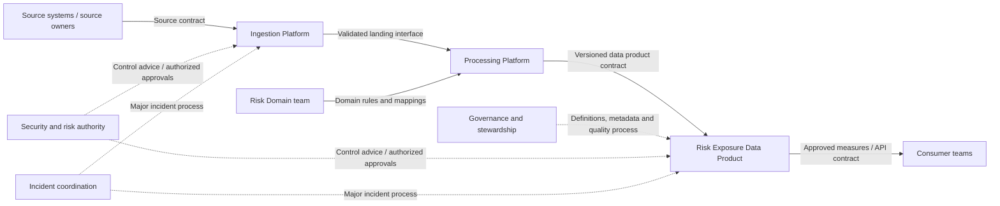

# Team Boundaries, Ownership and Platform Operating Model

**Stage:** Stage 2D — Data Architecture  
**Module:** 15 — Architecture Documentation, Reviews and Operating Model  
**Topic:** 07  
**Learning level:** Beginner → Intermediate → Advanced  
**Recommended effort:** 6–8 hours (roadmap estimate)  
**Scenario:** Fictional Northbridge Bank; all organization names, assignments, metrics, incidents, and evidence in examples are synthetic teaching material.

> **Source and method note.** This lesson follows Topic 07 of `roadmap-Architecture-Documentation-Reviews-and-Operating-Model.md` and the module location in `Roadmap_ptree.md`. The roadmap defines learning objectives and proposed exercises; it does not establish a real Northbridge organization, an adopted organizational framework, or production evidence. Team Topologies and Conway's observation are discussed as illustrative ideas, not as repository mandates. RACI is a responsibility-mapping technique, not a substitute for decision authority, service contracts, or operational procedures.

## Table of contents

- [1. Learning objectives and success criteria](#1-learning-objectives-and-success-criteria)
- [2. Prerequisites and connections](#2-prerequisites-and-connections)
- [3. Beginner: operating-model foundations](#3-beginner-operating-model-foundations)
- [4. Beginner: ownership, responsibility and accountability](#4-beginner-ownership-responsibility-and-accountability)
- [5. Beginner exercise: assign five component owners](#5-beginner-exercise-assign-five-component-owners)
- [6. Intermediate: map ownership across the data platform](#6-intermediate-map-ownership-across-the-data-platform)
- [7. Intermediate: choose an operating-model shape](#7-intermediate-choose-an-operating-model-shape)
- [8. Intermediate: team interfaces and service contracts](#8-intermediate-team-interfaces-and-service-contracts)
- [9. Intermediate: decision rights and governance](#9-intermediate-decision-rights-and-governance)
- [10. Worked Northbridge exposure-platform example](#10-worked-northbridge-exposure-platform-example)
- [11. Advanced: detect and repair boundary failures](#11-advanced-detect-and-repair-boundary-failures)
- [12. Advanced: scale and evolve the operating model](#12-advanced-decision-quality-patterns-and-trade-offs)
- [13. Practical exercises with model answers](#13-practical-exercises-with-model-answers)
- [14. Reusable operating-model templates](#14-reusable-operating-model-templates)
- [15. Operational responsibility checklist](#15-operational-responsibility-checklist)
- [16. Common mistakes and corrections](#16-common-mistakes-and-corrections)
- [17. Review questions and model answers](#17-review-questions-and-model-answers)
- [18. Deliverables, mastery criteria and completion gate](#18-deliverables-mastery-criteria-and-completion-gate)
- [19. Readiness for Topic 08: migration roadmaps and modernization](#19-readiness-for-topic-08-migration-roadmaps-and-modernization)

---

## 1. Learning objectives and success criteria

After completing this lesson, you should be able to:

1. Explain how architecture boundaries and team boundaries influence one another.
2. Distinguish an operating model from an organization chart and from an informal list of names.
3. Define ownership for components, services, data products, data, architecture decisions, standards, risks, exceptions, and technical debt.
4. Distinguish accountability (being answerable for an outcome) from responsibility (performing or coordinating work), consultation, and notification.
5. Build an ownership matrix with exactly one accountable party for each clearly defined item or decision.
6. Map who builds, runs, changes, secures, supports, and pays for each relevant platform capability.
7. Compare central, platform-plus-domain, federated, and hybrid operating models using explicit constraints and trade-offs.
8. Define team interfaces through contracts, service expectations, change notices, escalation, and handover procedures.
9. Identify ownership gaps, duplicated responsibilities, conflicting decision rights, unsupported dependencies, and unsafe hand-offs.
10. Propose operating-model changes with transition controls, measurable outcomes, and continuous accountability.
11. Link the operating model to architecture views, ADRs, threat models, risk registers, platform standards, and service objectives.
12. Produce a reviewable operating-model note, responsibility matrix, interface contracts, gap list, and decision record.

**Success is demonstrated by evidence, not by naming teams.** A reader should be able to determine who is answerable for an outcome, who performs the work, who has change authority, how a dependency is consumed, how incidents are handled, and how ownership changes safely when the architecture or organization changes.

## 2. Prerequisites and connections

### 2.1 Roadmap prerequisites

The module roadmap lists **Sequence 3 and Sequence 6; prerequisites P2, P5 and P11** for Topic 07. Follow the repository's prerequisite definitions where available; do not infer that this lesson replaces them. At a practical level, Topic 07 builds on:

- **Topic 03 — Architecture description and viewpoints:** stakeholder concerns, views, architecture scope, cross-view consistency, evidence, and links to authoritative artefacts.
- **Topic 06 — Reference architectures, standards and reusable patterns:** applicability, platform principles, reusable patterns, adaptation, deviation, exception approval, and decision rationale.
- Earlier context, data-flow, trust-boundary, governance, security, reliability, and data-product concepts where they apply to the architecture being assessed.

### 2.2 How Topics 03 and 06 feed Topic 07

| Upstream topic | Input to the operating model | Question Topic 07 must answer |
|---|---|---|
| Topic 03: architecture description and viewpoints | Named components, data flows, stakeholders, concerns, dependencies, and evidence limits | Who owns each element and each cross-boundary interface? |
| Topic 06: reference architectures, standards and reusable patterns | Platform principles, reusable capabilities, standards, deviations, exceptions, and decision records | Who maintains the pattern or standard, who approves exceptions, and who operates adopted capabilities? |
| Security/governance material | Classification, access duties, policy interpretation, risk ownership, evidence expectations | Who implements controls, who assures them, and who accepts residual risk under the applicable governance? |
| Reliability/resilience material | Service objectives, on-call, recovery, incident roles, dependency failure modes | Who restores the service and coordinates recovery when a dependency fails? |

A diagram can show that Service A calls Platform B; it cannot, by itself, establish who owns the service, who receives alerts, who approves a breaking change, or who accepts a residual risk. These must be documented explicitly and linked back to the architecture description.

### 2.3 Source-derived requirements versus illustrative recommendations

The module roadmap requires an ownership matrix, interface outline, operating-model options comparison, gap list, and ADR/charter. It also requires exactly one accountable party per matrix item, defined contracts or recorded gaps for cross-team interfaces, and readiness to plan the transition in Topic 08. Specific team names, metrics, and role allocations below are **illustrative design proposals**, not facts about Northbridge Bank or the repository.

---

## 3. Beginner: operating-model foundations

### 3.1 What is an operating model?

An **operating model** describes how an organization turns its purpose and architecture into repeatable delivery and operation. For a data platform, it defines the capabilities and teams involved, their responsibilities and decision rights, how work crosses boundaries, how services are supported, how performance and risk are governed, and how the model changes over time.

An operating model answers practical questions such as:

- Who builds and operates ingestion, storage, processing, serving, and metadata capabilities?
- Who is accountable for the meaning and quality of a domain data product?
- Who can approve a schema change that affects multiple consumers?
- Who handles a failed pipeline at 03:00, and who coordinates if the incident crosses several teams?
- Who maintains a reusable ingestion pattern or platform service?
- Who approves a standards exception and tracks its expiry?
- How can a team request a capability, get support, and propose a platform improvement?

**Why it matters:** unclear operating responsibility becomes an architectural risk. It creates long hand-offs, conflicting changes, fragile services, inconsistent controls, unowned costs, and dependencies that nobody can resolve.

### 3.2 Operating model versus organization chart

| Artefact | Primarily describes | Useful for | What it does not prove |
|---|---|---|---|
| Organization chart | Reporting lines and formal positions | Escalation hierarchy, management relationships | Who operates a pipeline or approves a schema change |
| Team directory | Team names and contact routes | Finding a team | Scope, authority, service expectations, on-call duties |
| Ownership register | Named owners for defined assets or decisions | Accountability discovery | How work crosses teams or how incidents are resolved |
| Responsibility matrix | Who is responsible, accountable, consulted, or informed for specific work | Clarifying execution and answerability | The detailed contract, runbook, or technical interface |
| Operating model | Capabilities, ownership, decision rights, interfaces, workflows, support, governance, and evolution | Designing how architecture is delivered and operated | That the model is actually followed; implementation evidence is still required |

An organization chart may be part of the evidence, but it is not the operating model. A name beside a component is also insufficient unless the scope, authority, operational duty, backup, and escalation path are defined.

### 3.3 Core vocabulary

| Term | Practical definition | Data-platform example |
|---|---|---|
| Team boundary | The point where ownership, work, expertise, or decision authority changes | Platform team owns ingestion runtime; Risk Domain team owns the risk data product |
| Component owner | Party answerable for a defined technical component's lifecycle and outcomes | Ingestion Platform team owns the shared connector service |
| Service owner | Party accountable for a service's end-to-end service outcomes and lifecycle | Serving team owns the query API service objectives and release policy |
| Data owner | Business-authorized party accountable for data meaning, permitted use, and agreed quality decisions | Risk Data Owner approves definitions of exposure measures |
| Data steward | Role that coordinates definitions, quality rules, metadata, and issue resolution under delegated authority | Steward maintains glossary definitions and triages quality exceptions |
| Product owner | Party accountable for product value, prioritization, and consumer outcomes | Domain product lead prioritizes the risk exposure data product backlog |
| Decision owner | Party authorized and accountable to make a specified decision | Architecture decision authority for a cross-domain schema contract |
| Responsible | Performs or coordinates the work | Engineer implements a schema migration |
| Accountable | Ultimately answerable for the defined outcome or decision | Named role accepts the release decision within its authority |
| Consulted | Provides input before a decision or action | Security specialist reviews a sensitive-data access change |
| Informed | Receives a decision or status update | Downstream consumer is notified of a compatible schema release |
| Interface contract | Explicit expectations between provider and consumer | Data schema, freshness target, availability window, versioning and support route |
| Handover | Transfer of context or responsibility between people/teams | Incident passes from domain pipeline owner to shared platform on-call |
| Dependency | A capability, service, decision, team, or external party required for progress or operation | Domain pipeline depends on the shared metadata catalogue |
| Cognitive load | Mental effort required for a team to understand and operate its responsibilities | One team owns too many unrelated services and cannot keep their failure modes clear |
| On-call | Scheduled operational availability to respond to alerts and incidents | Primary and secondary rota for the ingestion runtime |
| Service catalogue | Discoverable list of services/capabilities, owners, consumers, interfaces, support, and service expectations | Catalogue entry for the governed batch-ingestion service |

### 3.4 Conway-style effects: architecture and communication structure

The roadmap introduces Conway's observation as an idea: systems tend to mirror the communication structures of the organizations that build them. Treat it as a useful design lens, not a deterministic law or a substitute for evidence.

If a platform architecture requires five teams to coordinate for every routine schema change, the design may create a communication bottleneck. Conversely, if a domain team owns a data product end to end but lacks access to shared security or reliability capabilities, its nominal autonomy may be illusory.

Use the idea to ask:

1. Which teams must coordinate to deliver a common user outcome?
2. Which dependencies are stable enough to be handled through a service contract?
3. Which collaboration is temporary and should have a clear end condition?
4. Do team boundaries align with meaningful architecture or data-product boundaries?
5. Is a team accountable for a service it cannot change, observe, or operate?

**Trade-off:** reorganizing teams to match an architecture can reduce routine coordination but has transition cost, people impact, and risk. Sometimes the better answer is to simplify the architecture or clarify an interface instead of reorganizing.

### 3.5 A basic operating-model chain

Work from architecture elements toward operational outcomes rather than starting with team names.

1. **Identify the asset or outcome:** component, service, data product, decision, control, or operational process.
2. **Define the boundary:** scope, consumers, provider, dependencies, and what is explicitly out of scope.
3. **Assign lifecycle roles:** build, run, change, secure, support, cost, and data responsibility where relevant.
4. **Define decision rights:** local decision, cross-team decision, enterprise policy, and escalation route.
5. **Specify interfaces:** contract, support channel, change notice, and service expectations.
6. **Test failure and change scenarios:** alert, incident, breaking schema change, staff absence, supplier failure, and deprecation.
7. **Keep evidence current:** owner confirmation, runbook, access review, incident records, deployment configuration, or service catalogue entry.

### 3.6 When to define the operating model

Define it early enough to shape architecture and delivery, and revisit it when:

- A platform capability becomes shared across more domains.
- A new data classification, trust boundary, or external dependency is introduced.
- A component changes from project delivery to continuous operation.
- Incidents expose unclear escalation or handovers.
- A team is reorganized or a vendor/service boundary changes.
- A reusable pattern becomes a centrally supported platform service.
- Modernization splits a monolith, introduces parallel operation, or retires a legacy component.

Do not wait for an incident to discover that nobody owns a critical dependency.

---

## 4. Beginner: ownership, responsibility and accountability

### 4.1 A named owner is necessary but not sufficient

A record such as `Owner: Data Platform` is weak if “Data Platform” contains several teams and the record does not say what that owner must do. Effective ownership specifies:

- **Identity:** a named accountable role or team, with a reachable contact route.
- **Scope:** asset, service, decision, or outcome covered; explicit exclusions.
- **Authority:** changes, approvals, prioritization, and risk decisions the owner may make.
- **Duties:** lifecycle tasks, monitoring, quality, support, security coordination, cost, and documentation as applicable.
- **Operational cover:** primary/secondary on-call or a defined support-hours and escalation arrangement.
- **Interfaces:** upstream providers, downstream consumers, contract, and change-notification expectations.
- **Evidence:** service catalogue, repository ownership, runbook, approval record, or other verifiable artefact.
- **Continuity:** deputy/backup, succession, reassignment process, and periodic review date.

A component can have a named technical owner and still have no one accountable for business data meaning, incident restoration, access approval, or end-of-life decisions. Model these as distinct ownership dimensions.

### 4.2 Accountability versus responsibility

**Responsibility** is doing or coordinating work. **Accountability** is being answerable for the defined result or decision and ensuring that the work is appropriately completed. A person can be responsible without being authorized to accept the outcome. One accountable party avoids the “everyone owns it” failure mode.

For this lesson, use the roadmap's RACI-style rule: **exactly one Accountable party per defined matrix item**. In real organizations, a decision may require several approvals under law, policy, or delegated authority. Represent that correctly as separate decision/approval items or a clearly specified approval workflow; do not disguise multiple final decision-makers in a single ambiguous RACI cell.

| Code | Meaning | Example | Typical failure if omitted or misused |
|---|---|---|---|
| R — Responsible | Performs or coordinates the work | Engineer runs reconciliation and deploys the change | Work has no executor |
| A — Accountable | Answerable for the outcome/decision | Data Product Owner accepts the data-product release against agreed criteria | Nobody can resolve a disagreement or own the result |
| C — Consulted | Gives input before action/decision; two-way communication | Security reviewer advises on access design | Consultation happens too late or is mistaken for approval authority |
| I — Informed | Receives status or outcome; generally one-way communication | Consumer is notified of schema version availability | Consumers discover changes only after breakage |

RACI is a compact communication aid. It is not itself an incident runbook, service-level agreement, access-control mechanism, legal delegation, or substitute for a decision record.

### 4.3 Define the unit before assigning RACI

A common mistake is to assign a single RACI row to an entire platform, mixing build, run, security, data quality, and cost decisions. Split the work into clear items, for example:

- Build a shared connector capability.
- Operate the connector runtime and restore it after failure.
- Approve a new source's data classification and access purpose.
- Define the business meaning of a data-product field.
- Approve a breaking schema change affecting consumers.
- Review a standards exception.
- Accept a residual risk within delegated authority.
- Decommission a legacy pipeline and prove consumers have migrated.

Each row should have one accountable party for that row. Different rows can have different accountable parties.

### 4.4 Ownership dimensions for a data platform

| Dimension | Accountable question | Common evidence |
|---|---|---|
| Build | Who ensures the component is designed and delivered to agreed acceptance criteria? | Backlog, code ownership, design review, release acceptance |
| Run | Who ensures service health, on-call response, restoration, and operational readiness? | Runbook, rota, SLO dashboard, incident review |
| Data meaning | Who defines business semantics and acceptable use? | Glossary, data contract, stewardship record |
| Data quality | Who defines rules, monitors results, triages defects, and accepts remediation? | Quality rule catalogue, issue workflow, quality dashboard |
| Change | Who authorizes changes that affect interfaces, risk, or consumers? | Change policy, ADR, compatibility test, release notice |
| Security | Who implements controls and who authorizes access or risk acceptance? | Access policy, review evidence, threat model, risk record |
| Metadata and lineage | Who maintains technical metadata and business ownership links? | Catalogue, lineage graph, freshness/ownership checks |
| Cost | Who observes, allocates, and acts on usage and cost? | Cost dashboards, tags, budget/chargeback rules |
| Support | Who handles requests, triages issues, and escalates dependencies? | Service catalogue, support channel, response expectations |
| Lifecycle | Who approves deprecation, retention, archival, and retirement? | Lifecycle policy, consumer inventory, retirement plan |

The same role may cover several dimensions in a small organization. The important point is to state the duties and authority explicitly, not to create roles for their own sake.

### 4.5 Ownership levels and granularity

Ownership should be neither too coarse nor needlessly fragmented.

- **Enterprise level:** principles, mandatory policies, enterprise-wide risk and architecture governance within delegated scope.
- **Platform capability:** shared ingestion, orchestration, catalogue, observability, access tooling, or common serving infrastructure.
- **Domain/data-product level:** business meaning, product roadmap, quality expectations, consumer contract, and domain-specific operation.
- **Component/service level:** deployability, runtime health, dependencies, release and incident duties.
- **Decision/control level:** a particular decision, standard, risk, exception, or control with its own authority and review path.

Avoid one owner field standing in for all these levels. A shared platform team may operate the catalogue service while a domain data owner remains accountable for the correctness and meaning of a domain's metadata content.

---

## 5. Beginner exercise: assign five component owners

### 5.1 Scenario (synthetic)

Northbridge Bank is planning a fictional risk-exposure data platform. Five components are in scope. Team names are hypothetical placeholders only.

| ID | Component | Function | Initial ambiguity |
|---|---|---|---|
| C1 | Source Connector Service | Reads approved source extracts | The source integration squad built it, but no on-call is documented |
| C2 | Landing Storage | Holds received source files before validation | Platform team manages storage; domain team owns the data classification |
| C3 | Quality and Standardization Pipeline | Applies schema checks and standardization | Both platform and risk domain teams edit transformation code |
| C4 | Exposure Data Product | Publishes agreed risk measures to consumers | No named role owns semantic definitions |
| C5 | Consumer API | Serves approved exposure data to downstream applications | API team runs it; domain team controls which measures are approved |

### 5.2 Task

For each component, identify (a) one accountable technical/service owner, (b) the party responsible for the relevant business/data decision, if different, and (c) one missing operational or interface fact. Do not assume that technical ownership transfers business authority.

### 5.3 Model answer

| Component | Accountable technical/service owner (illustrative) | Separate data/decision accountability | Gap to close |
|---|---|---|---|
| C1 Source Connector Service | Ingestion Platform team | Source data owner authorizes source use and meaning | Define 24×7 vs business-hours support, alert routing, and source-provider escalation |
| C2 Landing Storage | Data Platform Storage team | Data owner/security authority defines classification and permitted access under applicable policy | Document retention, access provisioning, deletion, and evidence responsibilities |
| C3 Quality and Standardization Pipeline | Data Processing Platform team for shared runtime; Risk Domain team for domain transformation logic | Risk Data Owner approves business rules and accepted quality thresholds | Split shared framework from domain rules; define code ownership and release coordination |
| C4 Exposure Data Product | Risk Domain Product team | Risk Data Owner is accountable for business definitions and permitted use | Name a product/service owner, quality issue route, and consumer contract |
| C5 Consumer API | Data Serving team | Risk Data Owner approves exposed measures; API service owner owns runtime and API contract | Define schema/version policy, service objectives, and incident hand-off |

**Validation:** every component has one accountable technical/service owner for its stated scope; distinct business decisions are assigned explicitly; each gap has a concrete closure action. If the team cannot identify an accountable party, record an ownership gap rather than inventing certainty.

---

## 6. Intermediate: map ownership across the data platform

### 6.1 Build an ownership matrix that can be operated

The roadmap proposes these core columns: **Build, Run, Data owner, Change approval, Security, Cost, Support**. Add metadata, quality, lifecycle, and decision columns when they matter. Avoid a giant matrix with unclear row granularity; use linked registers when a platform has many hundreds of assets.

A useful matrix contains:

- Stable item ID and type (component, data product, decision, risk, standard, exception, or operational activity).
- Scope and accountable party.
- RACI roles for the defined activity.
- Support and escalation route.
- Interface or contract reference.
- Evidence/reference link, last reviewed date, and reassignment trigger.

### 6.2 Illustrative responsibility matrix for a data platform

The following hypothetical teams are used only to demonstrate the method:

- **Platform Engineering (PE):** shared runtime, infrastructure, deployment paths, observability tooling.
- **Risk Domain (RD):** domain product, business rules, product roadmap, consumer outcomes.
- **Data Governance (DG):** catalogue conventions, stewardship process, quality policy coordination.
- **Security & Risk (SR):** security architecture advice, control assurance, risk-process coordination within delegated scope.
- **Data Operations (DO):** incident coordination and shared operational process; not automatically the owner of every service.

Codes are R/A/C/I as defined above. Each row is a separate work item. **This is a teaching draft with deliberate unresolved-authority examples, not a completed operational RACI.** Rows with `A*` are conditional and must not be treated as approved until the relevant delegation is evidenced. The residual-risk-acceptance row intentionally has no A because the scenario does not identify an authorized risk acceptor; it is an open governance gap and fails the completion gate until resolved. This distinction lets the learner detect a real gap without inventing authority.

| Work item | PE | RD | DG | SR | DO | Notes / evidence to maintain |
|---|---:|---:|---:|---:|---:|---|
| Operate shared ingestion runtime | A/R | C | I | C | R | Runbook, rota, SLO and incident link |
| Configure a domain source mapping | C | A/R | C | C | I | Source mapping and domain acceptance test |
| Define exposure metric semantics | I | A/R | C | C | I | Glossary and data contract; RD accountability assumes a delegated Risk Data Owner authority |
| Execute shared quality framework | A/R | C | C | I | I | Framework health and release history |
| Set domain quality rules and triage defects | C | A/R | C | I | I | Quality rule owner and remediation SLA/target |
| Maintain catalogue platform service | A/R | C | C | C | I | Service entry, availability, catalogue incident route |
| Curate business glossary definitions | I | A | R | C | I | Stewardship workflow and approval record |
| Approve an access request to domain data | I | A* | C | C | I | `A*` applies only if the domain data owner is authorized by the applicable access policy; otherwise use the formally delegated approver. SR provides review input but is not presumed to approve |
| Implement platform-level identity/access controls | A/R | C | I | C | I | Control evidence and configuration |
| Accept residual security risk | I | C | C | R | I | **OPEN GAP: no A assigned intentionally.** Name the formally authorized risk acceptor before use; SR may coordinate the process but is not presumed to accept the risk |
| Publish platform cost allocation | A/R | C | I | I | C | Allocation rules, tags, reconciliation evidence |
| Prioritize domain data-product improvements | I | A/R | C | I | I | Product backlog and outcome measures |
| Coordinate cross-team major incident | C | C | I | C | A/R | Incident commander authority, communications and timeline |
| Approve cross-domain breaking schema change | C | A* | C | C | I | `A*` is conditional, not a confirmed assignment. Establish one formally authorized cross-domain decision owner or a documented approval workflow before treating this row as complete |
| Deprecate a shared platform API | A/R | C | C | C | C | Consumer inventory, notice period, migration and rollback plan |

**Important audit rule:** placeholder cells marked `A*` are deliberately conditional. They are not ready for operational use until the authority is explicitly confirmed. The “accept residual security risk” row is also intentionally not finalized: the exercise must replace the placeholder with the authorized role. Do not mark a matrix complete while any such authority is unresolved.

### 6.3 Separate accountability by decision, not by broad team label

The matrix above demonstrates why a row such as “security” is too broad. Separate at least:

1. Implement platform security controls.
2. Review a proposed design or threat model.
3. Authorize an individual data-access request.
4. Accept residual risk.
5. Monitor control effectiveness and escalate a breach.

These may belong to different authorized roles. Likewise, “schema ownership” can mean business semantics, implementation of schema evolution, approval of breaking changes, and consumer notification. Specify the decision being made before assigning an accountable party.

### 6.4 Matrix consistency rules

Use these rules when auditing a responsibility matrix:

1. Every row represents one defined activity, asset outcome, or decision.
2. Exactly one A is assigned to each row; no row has zero or multiple A assignments.
3. Every row that requires work has at least one R. A may also be R when appropriate.
4. C is used where input must be obtained before action; I is used for notification. Do not mark every team C by default.
5. A has enough authority, capacity, access, and information to discharge accountability.
6. Responsibility is not assigned to a team that cannot deploy, operate, or change the relevant thing without a stated dependency contract.
7. For data products, technical service ownership and business data ownership are not silently collapsed.
8. For cross-team interfaces, record provider, consumer, contract, change route, support route, and escalation.
9. Every unresolved assignment is recorded as a gap with owner and due date; it is not disguised as a completed matrix.
10. Review the matrix after reorganizations, service migrations, major incidents, or boundary-changing ADRs.

### 6.5 From matrix to an ownership register

For large estates, keep a searchable register with fields such as:

| Field | Required meaning |
|---|---|
| Asset/decision ID | Stable identifier that matches architecture diagrams and repository metadata |
| Name and type | Component, service, data product, decision, risk, standard, exception, activity |
| Scope and criticality | What is covered, impact if unavailable or incorrect |
| Accountable role/team | One answerable party for the defined scope |
| Responsible role/team | Who performs the work or coordinates delivery |
| Business/data owner | Semantic, quality, permitted-use and product accountability where relevant |
| Build/run/change authority | Distinct responsibilities and approval boundaries |
| Support/on-call | Route, hours, rota, severity path and fallback |
| Dependencies and contracts | Upstream/downstream assets, interface version and service expectations |
| Evidence | Runbook, ADR, catalogue, repository, service objective, control record |
| Reviewed / review due | Freshness of the ownership record |
| Reassignment trigger | Team change, service transfer, incident, product retirement |

Do not copy full runbooks, contracts, or ADRs into the register. Link to authoritative sources and define how stale links or orphaned assets are detected.

---

## 7. Intermediate: choose an operating-model shape

### 7.1 Common operating-model options

The module roadmap lists four options. These are useful comparison categories, not mandatory stages or a universal maturity ladder.

| Model | Basic idea | Fits when | Benefits | Risks / limitations |
|---|---|---|---|---|
| Central team does everything | One central team builds and runs most capabilities and products | Small organization, early platform, strong need for consistency | Clear central control; fewer duplicate stacks | Bottleneck, weak domain ownership, limited domain context, queues for routine changes |
| Platform + domain teams | Platform provides supported shared capabilities; domain teams build and own data products | Multiple domains need common capabilities but domain meaning differs | Reuse and guardrails with domain accountability; can enable self-service | Platform may become a gatekeeper; unclear boundary between platform runtime and domain logic |
| Fully federated | Domains operate their own stacks and processes | Strong autonomy is needed and domains can staff/run capabilities independently | Local control, contextual decisions, reduced central queue | Duplication, inconsistent controls, fragmented metadata, uneven reliability and cost |
| Hybrid by capability | Some capabilities are shared; others are domain-owned or federated | Enterprise has mixed scale, risk, capability and workload needs | Places centralization where it adds value; autonomy where context matters | More complex interfaces, decision-rights design, and cost allocation |

A hybrid model is not automatically best because it appears balanced. It must state exactly which capabilities are centralized, federated, or shared under a contract, and why.

### 7.2 Choose based on constraints and evidence

Evaluate operating models against explicit factors:

- Number of domains and teams; geographic/time-zone distribution.
- Variability of domain semantics and processing requirements.
- Need for enterprise-wide controls and evidence.
- Demand for self-service and expected platform request volume.
- Team skill, on-call capacity, and ability to manage operational risk.
- Workload criticality, latency, freshness, availability and recovery needs.
- Duplication cost versus coordination cost.
- Existing systems, migration constraints, and dependency coupling.
- Funding and cost allocation model.
- Ability to measure adoption, lead time, service health, and consumer outcomes.

Separate **hard constraints** from preferences. For example, an approach that cannot provide the required access control or incident coverage should not win because it scores well on autonomy. If a hard constraint is not yet evidenced, record it as an unresolved condition, not as a pass.

### 7.3 Worked operating-model comparison (synthetic)

**Assumptions:** Northbridge has six hypothetical data domains, shared regulatory reporting needs, a small central platform group, inconsistent domain engineering capacity, and a goal of reducing an eight-week platform request backlog. These are invented exercise assumptions, not claims about an actual bank.

Score 1–5 (5 = more favorable). Weights and scores are illustrative judgments to make reasoning explicit, not empirical facts. The options must still pass any hard governance and reliability gates.

| Criterion | Weight | Central team | Platform + domain | Federated | Hybrid by capability |
|---|---:|---:|---:|---:|---:|
| Consistency of shared controls | 20% | 5 | 4 | 2 | 4 |
| Domain autonomy and product ownership | 15% | 2 | 4 | 5 | 4 |
| Ability to reduce routine request queue | 15% | 2 | 4 | 5 | 4 |
| Fit with uneven team capability | 15% | 4 | 4 | 2 | 4 |
| Cost and duplication control | 10% | 4 | 4 | 2 | 4 |
| Interface simplicity | 10% | 4 | 3 | 2 | 2 |
| Scalability across domains | 15% | 2 | 4 | 4 | 4 |
| **Weighted total / 5** | **100%** | **3.30** | **4.10** | **3.20** | **3.80** |

**Calculation:** weighted total = sum of `(score × weight)`; e.g., Platform + domain = `5×0.20 + 4×0.15 + 4×0.15 + 4×0.15 + 4×0.10 + 3×0.10 + 4×0.15 = 4.10`.

**Conclusion:** under these assumptions, platform-plus-domain scores highest. A hybrid-by-capability model is a close alternative if some domains cannot operate all capabilities independently or if particular controls need a shared service. Do not treat the 0.30 difference as statistically meaningful: scores are ordinal and subjective. Validate the choice with actual request volumes, lead times, incident data, team capability, cost, and control requirements. If the platform team continues to own every domain transformation, the chosen model will not achieve the intended autonomy.

### 7.4 Interaction modes between teams

The roadmap describes three interaction modes as illustrative, drawing on Team Topologies terminology. They are options for shaping collaboration, not an assertion that the repository has adopted that framework.

| Interaction mode | Meaning | Use when | Risk / control |
|---|---|---|---|
| Collaboration | Teams work closely for a defined period to solve a problem or discover an interface | A new data product, migration, or complex integration has unresolved design questions | Can become permanent dependency; define purpose, participants, end condition and transfer of ownership |
| X-as-a-service | A team consumes a capability through a stable interface and documented service | Capability is understood and can be supported through a contract | Bad abstraction or poor support may push hidden work onto consumers; measure adoption and friction |
| Facilitation | An enabling team helps another team acquire a capability, then reduces ongoing dependence | A domain team needs help with quality, security, platform tooling or operational practice | Training can be mistaken for transfer of accountability; name who owns operation after facilitation |

Choose interaction mode per dependency, not as a label for an entire organization. Temporary collaboration should end with an agreed outcome such as a stable contract, capability transfer, or explicit decision to continue shared ownership under a defined process.

### 7.5 Platform as a product

A shared platform should be treated as a product for internal consumers, not merely a ticket queue. It needs:

- Identified user groups and use cases.
- A published service catalogue and supported paths (“paved roads”) where appropriate.
- A roadmap based on consumer friction, reliability, security, and cost.
- Service expectations, support routes, and change/deprecation policies.
- Adoption and experience measures, not only infrastructure uptime.
- A contribution and exception model for needs that the standard path does not cover.

**Trade-off:** platform product thinking requires product management, support, feedback loops, and investment. It is not a justification for forcing every workload into a pattern that does not meet its requirements.

---

## 8. Intermediate: team interfaces and service contracts

### 8.1 An interface is more than a diagram arrow

An architecture diagram may show a dependency, but a team interface must explain how the dependency is used and operated. A useful interface contract specifies:

1. Provider and consumer, including accountable contacts.
2. Purpose, scope, supported use, and exclusions.
3. Technical contract: schema/API/event format, versioning, compatibility, authentication and authorization expectations.
4. Data contract: semantics, classification, quality expectations, freshness, retention, lineage and permitted use where applicable.
5. Service expectations: availability window, latency/freshness target, capacity, support hours and incident severity path.
6. Change process: notice period, deprecation, compatibility window, migration support and rollback.
7. Failure behavior: retries, idempotency, backpressure, replay, data correction, recovery, and who coordinates incidents as relevant.
8. Cost model: attribution, quotas, usage visibility, and charge disputes where applicable.
9. Security/governance duties: control evidence, access reviews, logging and escalation paths.
10. Version, owner, review date, and links to the architecture view, ADR, runbook and risk record.

Not every interface needs a long SLA document. Use a proportionate contract. But if a required field is unknown, record a gap, an owner and a due date instead of silently assuming agreement.

### 8.2 Example: shared ingestion service contract (synthetic)

| Field | Example value (illustrative only) |
|---|---|
| Provider | Ingestion Platform team |
| Consumer | Risk Domain data-product team |
| Supported purpose | Ingest approved batch files and publish validated landing events |
| Inputs | Versioned source schema and source-specific configuration |
| Security boundary | Approved identity, encrypted transfer/storage where required by the applicable design and policy; exact controls must be verified in the security design |
| Data responsibility | Domain data owner approves source use, classification, and business interpretation; platform provider owns ingestion runtime |
| Service expectation | Example target: 99.5% successful scheduled runs per month; target is an exercise assumption and not an SLA or compliance requirement |
| Freshness | Example: 95% of eligible files available within 30 minutes of arrival; measurement window and exclusions must be defined before adoption |
| Failure handling | Provider pages its on-call for shared runtime faults; consumer investigates source-data and domain-mapping defects; incident commander coordinates cross-team major incidents |
| Schema change | Provider gives a proposed notice period, consumer tests compatibility, and breaking changes require named approval under the change policy |
| Support | Service catalogue route and escalation path; hours and severity definitions must be confirmed |
| Evidence | Contract version, runbook, dashboard, ADR and data-flow view |
| Review trigger | Repeated freshness misses, new data class, major incident, or source-interface change |

This example intentionally distinguishes a target proposed for discussion from an adopted service objective. A contract is not complete until its assumptions, measurement method, ownership and approval are confirmed.

### 8.3 Interface map and boundary diagram

The following is a conceptual map. Team labels and relationships are hypothetical.



Dashed links are governance/operational interactions, not necessarily runtime data flows. The diagram is not a deployment diagram and does not prove that any control is implemented. Maintain separate architecture/data-flow views where needed and use stable IDs to cross-reference components, owners, contracts, and decisions.

### 8.4 Hand-offs and escalation

A safe hand-off defines both the transfer and the authority to act. For an incident that crosses boundaries, record:

- Who detects and declares severity.
- Who is incident commander and can coordinate the response.
- Which team owns each technical remediation.
- Who communicates with consumers and business stakeholders.
- What evidence and context must be transferred.
- When the receiving team accepts the hand-off.
- What happens if the primary owner does not respond.
- Who owns the post-incident review and tracks corrective actions.

Avoid “send it to the platform team” as a complete procedure. The platform team may own the shared runtime while the domain team owns a malformed transformation, and a designated incident commander may coordinate both without owning either component.

### 8.5 Interface failure modes

| Failure mode | Symptom | Corrective design |
|---|---|---|
| No provider/consumer contract | Disputes about schema, freshness or support | Name provider and consumer; agree contract and version policy |
| Unbounded central intake | Long queue for routine provisioning | Identify self-service paths and guardrails; retain escalation for exceptions |
| “Shared” on-call without authority | Responders cannot deploy or make decisions | Define primary owner, incident commander, access, authority and escalation |
| Change notice is informal | Consumer breaks after a release | Versioned notice, compatibility tests, notice period and deprecation process |
| No cost boundary | Unexpected usage bills and blame | Define metering, allocation, budgets, quotas and dispute owner |
| Support hand-off loses context | Repeated triage and delayed recovery | Minimum hand-off record and explicit acceptance of responsibility |
| Enabling team remains permanent bottleneck | Domains cannot operate independently | Time-box facilitation and define capability/ownership transfer criteria |

---

## 9. Intermediate: decision rights and governance

### 9.1 Decision rights are not the same as participation

For every material decision, identify the scope of authority and how input is gathered. Examples include platform standards, architecture patterns, data definitions, access requests, schema evolution, production release, residual-risk acceptance, and exception expiry.

| Decision category | Typical decision scope | Illustrative accountable authority | Input / control to preserve |
|---|---|---|---|
| Domain data meaning | Definitions, business rules, acceptable quality | Authorized domain data owner | Steward, consumers, governance, risk stakeholders |
| Shared platform implementation | Runtime, deployment path, supported capability | Platform service owner within platform charter | Domain consumers, reliability, security, FinOps |
| Cross-domain interface | Shared schema/API contract and breaking-change policy | One designated cross-domain decision owner or defined delegated authority | Affected data owners, platform owner, consumers, security as relevant |
| Enterprise architecture principle | Principle or constraint within enterprise scope | Formally delegated architecture authority | Domain/platform architects and affected owners |
| Standard/pattern maintenance | Supported reusable pattern, version and deprecation | Named standard/pattern maintainer or governance owner | Implementing teams, security, operations, platform users |
| Exception approval | Deviation from a specific applicable standard | Authority named by the actual standard/governance process | Standard owner, affected service owner, risk/security as relevant |
| Residual-risk acceptance | Acceptance of a defined risk within delegated limits | Formally authorized risk acceptor | Risk owner, control owner, security and business stakeholders |
| Production change | Release of a particular service/change | Service owner or delegated release authority | Operators, consumers, security/control reviewers when required |
| Incident coordination | Command of a declared incident | Designated incident commander for that incident | Technical owners and communications roles |
| Cost allocation | Rules for attribution, budgets or chargeback | Budget/cost authority named in the operating model | Platform, finance/FinOps, domain owners |

These are role categories, not claims about Northbridge or universal prescriptions. The actual authority must be grounded in applicable policy, delegation, contracts, and risk governance. A reviewer who advises on a risk should not be assumed to have authority to accept it.

### 9.2 Governance mechanisms that keep ownership actionable

- **Architecture decision records (ADRs):** record the decision, context, alternatives, authority, consequences, affected teams, and revisit triggers.
- **Threat models and risk registers:** identify threats, controls, risk owners, treatment, residual risk, and review dates. Link a risk to the team that can act, but do not equate that team with the authorized risk acceptor automatically.
- **Platform principles and standards:** define scope, must/should/may status where useful, maintainer, evidence of conformance, exception process and deprecation.
- **Service catalogue:** makes owners, interfaces, support routes, service expectations and lifecycle visible.
- **Ownership register and RACI:** show answerability and work allocation for assets, activities and decisions.
- **Change management:** coordinates changes with cross-team impact, compatibility, validation, communication and rollback.
- **Incident/problem management:** clarifies command, technical remediation, communication, post-incident learning and action ownership.
- **Communities of practice / architecture guilds:** share practices and review recurring problems; they do not automatically acquire approval authority.

### 9.3 Link the operating model to architecture artefacts

| Artefact | Operating-model link | Example of traceability |
|---|---|---|
| Architecture description/view (Topic 03) | Component boundaries, stakeholders, interfaces and assumptions | Component `DP-04` links to its owner and contract |
| ADR (Topic 04) | Decision owner, consulted teams, consequences and implementation owner | ADR names the team responsible for the chosen pattern and migration actions |
| Threat model/risk register (Topic 05) | Control implementation, risk ownership, acceptance and escalation | Threat `T-07` links to control owner and risk `R-03` |
| Reference pattern/standard (Topic 06) | Maintainer, adopters, support model, exceptions and retirement | Pattern `PAT-ING-02` lists service owner and exception route |
| Service catalogue | Discoverability, support, service objectives and consumer contract | Service entry links to runbook, on-call and SLO dashboard |
| Migration roadmap (Topic 08) | Transition ownership, temporary dual running, decommission and handover | Migration work item has accountable team before, during and after cutover |
| Operational runbook | Who responds, what they may do, when to escalate | Incident steps include service owner, backup and escalation |

Avoid duplicating authoritative data across documents. Store a stable ID and link to the source of truth; set a maintenance process for stale references.

---

## 10. Worked Northbridge exposure-platform example

### 10.1 Scenario and assumptions

This is a fictional teaching scenario. Assume Northbridge Bank is building an exposure platform from source extracts, shared ingestion and processing services, a domain-owned risk data product, and downstream analytical and operational consumers. The exercise assumes three kinds of team: shared platform, risk domain, and cross-cutting governance/security/operations roles. No real Northbridge organizational structure or operating practice is implied.

### 10.2 Component inventory and proposed boundaries

| ID | Component/capability | Proposed boundary | Accountable owner (illustrative) | Primary consumer(s) | Key dependency |
|---|---|---|---|---|---|
| EXP-01 | Source connector service | Shared connector runtime and deployment | Ingestion Platform | Domain pipelines | Source availability and credentials |
| EXP-02 | Landing storage | Shared storage controls and lifecycle mechanism | Storage Platform | Ingestion and processing | Identity, encryption configuration, retention policy |
| EXP-03 | Domain mappings | Risk-specific source interpretation | Risk Domain Engineering | Processing pipeline | Source schema and data owner definitions |
| EXP-04 | Quality framework | Reusable technical rules engine | Data Processing Platform | Domain pipelines | Metadata and rule configuration |
| EXP-05 | Exposure transformations | Risk-specific measures and business logic | Risk Domain Engineering | Exposure data product | Approved business definitions |
| EXP-06 | Exposure data product | Published risk measures and product contract | Risk Domain Product team | Analytics and risk consumers | Quality checks, lineage, approval of definitions |
| EXP-07 | Metadata catalogue service | Catalogue application and technical operation | Metadata Platform | All data teams | Metadata ingestion and identity |
| EXP-08 | Business glossary/definitions | Business terms and stewardship workflow | Risk Data Owner (accountable for risk terms) | Risk domain and consumers | Governance process |
| EXP-09 | Consumer API | Shared runtime for API serving | Data Serving Platform | Consumer applications | Product contract, identity and availability |
| EXP-10 | Incident coordination | Major incident command process, not component runtime | Data Operations duty role (illustrative) | All service owners | On-call contacts and severity policy |

Note the deliberate separation between `EXP-07` the technical catalogue service and `EXP-08` the business definitions it contains. One can operate the tool without being accountable for the correctness of every business term. Likewise, `EXP-10` coordinates incidents but does not replace technical ownership of each service.

### 10.3 Sample interface and dependency register

| Interface ID | Provider → consumer | Contract | Owner(s) | Failure / escalation path | Status (synthetic) |
|---|---|---|---|---|---|
| IF-01 | Source owner → EXP-01 | File format, delivery schedule, schema version, contact | Source owner + ingestion service owner | Source issue to source owner; connector runtime issue to platform on-call | Needs confirmation |
| IF-02 | EXP-01 → EXP-02 | Landing path, identity, encryption/configuration, retention and replay rules | Ingestion + storage owners | Shared incident command if both services affected | Draft |
| IF-03 | EXP-03 → EXP-05 | Mapping output schema and data-quality expectations | Risk domain owner | Domain engineering lead triages mapping defects | Draft |
| IF-04 | EXP-05 → EXP-06 | Versioned data contract, semantics, quality and freshness | Risk data owner + product/service owners | Domain product incident route | Draft |
| IF-05 | EXP-06 → EXP-09 | API schema, authorization, freshness and deprecation | Product owner + serving service owner | Serving on-call; domain owner for semantic defect | Draft |
| IF-06 | EXP-07 ↔ EXP-08 | Technical metadata sync and glossary stewardship process | Metadata platform + risk data owner | Catalogue issue vs definition issue routed separately | Needs confirmation |

A “Draft” status means the example contract needs confirmation before it is treated as operationally binding. The “Needs confirmation” rows are gaps, not evidence that the interfaces already exist.

### 10.4 Five boundary issues and proposed repairs

| ID | Finding | Why it matters | Repair | Accountable follow-up (illustrative) | Validation evidence |
|---|---|---|---|---|---|
| B-01 | Platform and domain engineers both change shared quality framework code | Conflicting releases and unclear regression responsibility | Platform owns framework code; domain owns rule configuration; changes to shared extension points use a contract and review | Data Processing Platform owner | Repository ownership, CI ownership and release policy |
| B-02 | No accountable owner for exposure metric definitions | Consumers may interpret measures inconsistently | Name authorized Risk Data Owner for semantics; document glossary and product contract | Risk Data Owner | Approved glossary entries and consumer acceptance |
| B-03 | Connector has a build team but no operational rota | Incidents may go unhandled outside office hours | Assign run owner and support window; if 24×7 is required, confirm staffing and escalation | Ingestion Platform service owner | Published rota, tested alert and runbook |
| B-04 | Catalogue service team is assumed to own all metadata correctness | Tool operation and business accountability are conflated | Metadata team owns service availability; domain data owners own business definitions; stewards maintain content under delegated process | Metadata service owner and Risk Data Owner for separate rows | Catalogue ownership fields and stewardship workflow |
| B-05 | Cross-domain schema changes have no single authorized decider | Teams can veto indefinitely or ship breaking changes without coordination | Define a designated change authority or documented delegated approval workflow, compatibility policy and escalation | Architecture governance authority (to be confirmed) | Approved change policy and test release |

### 10.5 Sample operating-model note

**Title:** Exposure Platform — Operating Model (illustrative proposal)  
**Status:** Draft for review; not an adopted Northbridge policy  
**Scope:** shared ingestion, landing storage, reusable processing/quality framework, risk-domain transformations, exposure data product, catalogue and consumer API. Source-system internal operations are out of scope except for documented interfaces.

**Boundary principles**

1. Shared platform teams own the lifecycle, reliability, release process and support of their shared technical services.
2. Risk Domain owns the exposure product roadmap, domain transformations, semantic definitions through its authorized data owner, and resolution of domain-data defects.
3. A shared tool owner does not automatically own business content stored in the tool.
4. Security, governance and risk roles advise, assure, or approve only within explicitly delegated authority. Risk acceptance is assigned to the authorized risk acceptor, not inferred from a team label.
5. Cross-team interfaces require a named provider and consumer, contract, change process, support path, and escalation.

**Interaction model**

- Routine use of a stable ingestion or serving capability follows its published service contract.
- New or materially changed interfaces use time-boxed collaboration between provider and consumer teams until contract, tests, monitoring, and handover criteria are agreed.
- An enabling role may help a domain adopt quality, metadata or security practices, but the domain's operating duties remain explicitly assigned after the engagement.
- Exceptions to a platform standard reference the specific standard, scope, reason, compensating controls, authorized approver, owner, expiry and review date.

**Operational model**

- Each production service has an accountable service owner, support route, runbook, monitoring, recovery procedure and documented support coverage.
- The service owner leads technical remediation for that service. A designated incident commander coordinates a major incident across services and manages communication; this does not transfer component accountability.
- Domain data defects are triaged by Risk Domain; shared runtime defects by the relevant platform owner. Cross-boundary incidents are coordinated using a common incident process.
- Service objectives are proposed per criticality and consumer need; targets are not treated as adopted until measurement definitions, exclusions, ownership and approval are documented.

**Governance and review**

- ADRs record significant boundary, platform, and cross-domain decisions.
- The ownership register and service catalogue are reviewed after a reorganization, service transfer, major incident, or architecture change affecting a boundary.
- Unresolved ownership or interface gaps have a named interim risk owner, action owner, due date and escalation path; interim assignment does not imply permanent acceptance.
- Proposed metrics: unowned production assets, time to route an incident to the correct owner, time spent waiting on cross-team dependencies, change lead time, platform adoption, consumer satisfaction, and recurring boundary-related incidents. Baselines and targets must be measured or agreed before use.

**Open decisions before adoption**

1. Confirm the authorized owner for cross-domain breaking schema changes.
2. Confirm the actual authority for residual-risk acceptance and exceptions.
3. Agree support coverage and service objectives for each critical service.
4. Approve interface notice periods and compatibility windows.
5. Confirm cost attribution and escalation for disputed allocations.

This note is intentionally explicit about unresolved decisions. It is not ready to be treated as a final operating policy until the authorities, contracts and support arrangements are confirmed.

---

## 11. Advanced: detect and repair boundary failures

### 11.1 A systematic boundary review

Review boundaries across the architecture, ownership register, interfaces, and operating evidence. Do not rely only on interviews or an org chart.

1. **Inventory:** enumerate production components, data products, services, shared libraries, standards, key decisions, and operational activities.
2. **Trace architecture:** use Topic 03 views and data-flow diagrams to identify provider-consumer relationships and trust boundaries.
3. **Trace ownership:** map each item to accountable and responsible roles, decision rights, on-call/support, and evidence.
4. **Trace interfaces:** verify each cross-team dependency has a contract or a recorded gap with owner and due date.
5. **Test real workflows:** follow a recent change, incident, access request, quality defect, and deprecation from detection to closure.
6. **Look for structural symptoms:** queues, repeat escalations, duplicate tooling, undocumented shadow processes, excessive coordination, and teams accountable without authority.
7. **Propose repairs:** clarify scope, simplify an interface, transfer a capability, create self-service, change a decision right, or reorganize only when justified.
8. **Validate:** test the proposed model against incidents and changes; define baseline and outcome measures; preserve accountability throughout transition.

### 11.2 Ownership-gap taxonomy

| Gap type | Diagnostic question | Typical repair |
|---|---|---|
| Orphaned asset | Is any production asset missing an accountable owner? | Assign interim owner immediately, assess risk, then confirm permanent ownership and operational cover |
| Duplicate accountability | Do two teams each believe they have final authority for the same decision? | Split the decision into distinct scopes or designate one authorized decision owner with consultation rules |
| Responsibility without authority | Is the named owner expected to fix a service but unable to deploy, access logs, or approve changes? | Grant appropriate authority/access or change the responsibility assignment |
| Authority without capacity | Can the owner approve but not perform or fund required work? | Add responsible capacity, funding, delegated actions or revise the design |
| Unowned interface | Are provider and consumer roles, contract, or escalation unclear? | Name both parties and agree a proportionate contract; track open fields |
| Hidden operational duty | Is a component “owned” but has no alerting, runbook, recovery or support arrangement? | Establish service readiness and operational acceptance criteria |
| Business/technical conflation | Is a platform team treated as owner of domain semantics or vice versa? | Separate service ownership from data/product decision ownership |
| Shared control ambiguity | Is it unclear who implements, assures, monitors, or accepts risk? | Separate those activities and map each to its authorized owner |
| Temporary collaboration that never ends | Is a partner team required for routine changes long after design discovery? | Define a stable interface or explicitly fund and govern ongoing joint operation |
| Transition gap | Is ownership being removed before the successor is ready? | Use a transfer checklist, dual-running period where needed, explicit acceptance and rollback |

### 11.3 Advanced exercise: a 20-team organization with an eight-week queue

**Synthetic evidence supplied for the exercise:** 20 domain teams depend on a central platform group. Median wait for a platform request is eight weeks. Several domain teams have different on-call capability. Three recent releases required cross-team coordination; two incidents had delayed routing because the service owner was unclear. No baseline is supplied for platform adoption, request mix, or cost. These facts are exercise inputs only.

**Do not jump to “federate everything.”** First classify the queue:

- Routine provisioning that could be self-service under guardrails.
- Work requiring platform engineering because it changes shared runtime or security boundaries.
- Requests that are really missing domain capability or unclear product requirements.
- Requests caused by poor documentation, an unusable API, or a broken service contract.
- Mandatory reviews that are waiting for a decision authority rather than technical work.

**Illustrative target proposal:**

- Central platform team maintains a limited set of supported shared capabilities, golden paths, runtime controls, and platform service contracts.
- Domain teams own product semantics, domain transformations, product quality outcomes, consumer contracts, and domain-specific backlog.
- Domains may self-serve routine configurations through tested guardrails; risky exceptions and shared-runtime changes follow defined review/approval paths.
- An enabling capability helps teams adopt observability, data quality and secure patterns, then hands ongoing operation to the designated owner.
- A cross-domain change authority is defined only for decisions that genuinely cross domain boundaries; it does not approve every local change.
- Incident command is separated from technical service ownership.

**Transition safeguards:** maintain an accountable owner for every service throughout transfer; inventory assets and dependencies; publish interim support; pilot with two domains; define acceptance tests, access, runbooks, service objectives and rollback; measure request lead time and failure rates; expand only when evidence supports it.

**Metrics to establish, not assume:** request volume by type, wait time versus active work time, change failure rate, time to detect/route/restore incidents, dependency wait time, adoption of supported paths, duplicate capability spend, control defects, domain autonomy, and user satisfaction. Set targets after collecting baselines and understanding workload mix.

### 11.4 Cognitive load and team scope

The roadmap asks teams to own what they can understand and operate. Cognitive load is not simply “number of services”: a few highly coupled services may be harder than many stable services. Consider:

- Domain complexity and frequency of change.
- Number of distinct technology stacks and operational modes.
- On-call burden, failure modes and recovery procedures.
- Number of external dependencies and cross-team hand-offs.
- Security and governance obligations attached to the service.
- Whether a team can deploy, observe, diagnose, and roll back its own changes.

If scope exceeds capability, options include simplifying the architecture, narrowing the service boundary, improving automation and observability, transferring a capability to a better-equipped team, adding enablement, or changing staffing. Splitting a team without reducing dependencies can increase coordination cost rather than reduce it.

### 11.5 Shared components and inner-source

Shared libraries, templates, deployment modules and data contracts need ownership too. A practical shared-component policy identifies:

- Maintainer and accountable service/product owner.
- Contribution process, review criteria, compatibility policy and release cadence.
- Security/quality checks and support expectations.
- Versioning, deprecation and migration guidance.
- Who funds maintenance and handles urgent defects.
- How adopters report issues and request capabilities.

Inner-source can let other teams contribute to shared code while retaining clear maintainership and release authority. “Anyone can contribute” does not mean “nobody is accountable.”

### 11.6 Measuring the operating model

Measure outcomes and friction, not just the existence of documentation.

| Measure | What it may reveal | Caveat |
|---|---|---|
| Count of production assets with no accountable owner | Ownership completeness | Must define production asset inventory and verify data freshness |
| Time from alert to correct owner engagement | Routing and contact quality | Segment by severity and service coverage |
| Cross-team dependency wait time | Coordination bottlenecks | Separate waiting from active engineering time |
| Change lead time and change failure rate | Delivery flow and change safety | Avoid optimizing speed while weakening controls |
| Platform self-service adoption | Whether paved paths are useful | High adoption alone does not prove quality or suitability |
| Consumer satisfaction / effort | Platform usability and service quality | Combine survey with observed behavior and support demand |
| Repeat incidents involving ownership/hand-offs | Structural boundary failures | Root-cause categories must be consistent |
| Exception age and overdue reviews | Drift and unresolved constraints | Some exceptions are legitimate; review quality matters more than raw count alone |
| Cost attribution completeness and variance | Visibility and accountability for spend | Allocation can be approximate; disclose methodology and limitations |

Metrics are hypotheses about system behavior, not automatic performance targets. Establish definitions, baselines, segments, data quality, and incentives before using them to compare teams.

### 11.7 Changing the operating model safely

An organizational change is an architecture and operational change if it alters who builds, changes, secures, supports or operates a component. Treat it as a controlled transition:

1. Record the driver and target outcomes in an ADR or operating-model decision note.
2. Inventory affected assets, contracts, decisions, access, runbooks, on-call, costs and risks.
3. Identify old and new accountable parties, including the exact transfer point.
4. Confirm receiving-team capability, access, training, funding and capacity.
5. Transfer documentation, dashboards, alerts, secrets/access through approved processes, incident history and known risks.
6. Define parallel support or dual-running where required; avoid conflicting change authority during overlap.
7. Test service ownership, incident routing, recovery, consumer notification and rollback.
8. Obtain explicit acceptance from the receiving accountable owner.
9. Retire old access and duties only after acceptance and the agreed transition conditions.
10. Update diagrams, ownership register, service catalogue, ADRs, contracts, runbooks and escalation lists.
11. Review after the transition using measured outcomes and incidents.

**Continuity rule:** never remove the old accountable owner before the new owner accepts the responsibility, unless an explicit emergency arrangement names an interim accountable role and records the risk.

---

## 12. Advanced: decision-quality patterns and trade-offs

### 12.1 Centralize decisions, not every task

Central control can be appropriate for shared security guardrails, enterprise-wide naming or interoperability constraints, platform runtime, or cross-domain standards. It can be harmful when routine domain choices are sent to a central board without a meaningful cross-domain impact. Define a decision-rights map:

- **Local:** domain-specific implementation inside approved guardrails and contracts.
- **Shared/platform:** platform capability behavior, service contracts, and changes that affect platform consumers.
- **Cross-domain:** shared schemas, semantics, interfaces or risks with multiple domain impact.
- **Enterprise:** principles, policy, risk decisions and standards within formally delegated scope.

For each category, specify examples, thresholds, approver, consultation, expected evidence, decision time expectation, and escalation. Do not use “architecture board” as an answer unless its scope, membership/authority, decision types and service expectations are documented.

### 12.2 Avoid “everyone owns it” and avoid false simplicity

One accountable party per item does not mean every outcome can be delivered by one team alone. Complex work often needs multiple responsible parties and consultation. The goal is to make the final answerability and coordination model explicit while preserving the real dependencies.

Conversely, do not assign one party all accountability just to make a table tidy if that party has no legitimate authority. The right response is to clarify the scope or authority, create distinct decision items, and record unresolved governance as a gap.

### 12.3 Boundary choice trade-offs

| Choice | Potential benefit | Cost / risk | Evidence to seek |
|---|---|---|---|
| One shared platform service | Consistent operations and controls | Central bottleneck, shared blast radius | Queue, incidents, utilization, service objectives, consumer needs |
| Domain-owned implementation | Domain fit and autonomy | Duplicated tooling and uneven capability | Domain skill, cost, control evidence, change volume |
| Shared runtime + domain configuration | Reuse without centralizing all domain logic | Interface complexity; configuration can become code | Configuration model, tests, ownership of extensions |
| Central governance review | Consistent treatment of high-impact decisions | Review queue and decision delay | Risk impact, review time, defect/exception history |
| Delegated decision rights | Faster local delivery | Drift if guardrails and audit are weak | Decision scope, conformance checks, incident trends |
| Temporary cross-team collaboration | Fast discovery and joint design | Persistent coupling if not time-boxed | Exit criteria, contract maturity, capability transfer |
| Shared on-call pool | Broad coverage and resource efficiency | Confusion about authority and context | Alert routing, access, runbooks, hand-off quality |

### 12.4 Evidence standards for operating-model claims

Classify every important claim as one of:

- **Documented requirement:** explicitly stated in the supplied roadmap or approved source policy.
- **Observed evidence:** supported by a reviewed inventory, incident record, deployment configuration, service metric, interview, or other identified source.
- **Assumption:** provisionally accepted for analysis; must include rationale and validation plan if material.
- **Illustrative recommendation:** proposed design for the learning scenario, not a claim about current practice.
- **Open question:** information needed before a decision can be finalized.

Do not say “the platform team owns all pipelines” because a diagram has a platform box. Do not say “Team Topologies is adopted” because an interaction pattern is inspired by its vocabulary. Do not call a target an SLA unless it has been agreed and defined through the appropriate process.

---

## 13. Practical exercises with model answers

### 13.1 Beginner exercise — assign ownership to five components

Use the five components in Section 5. Produce a table with columns `Component`, `Accountable technical/service owner`, `Business/data decision owner`, `Run/support`, `Missing fact`, and `Evidence required`.

**Expected output:** five rows; a clear technical/service owner for each; distinct data accountability where applicable; at least one operational/interface gap per component where the supplied facts leave one open.

**Model answer:** Section 5.3 is a valid starting answer. For full credit, add evidence required for each gap (for example, rota and tested alert; approved data definition; retention/access configuration; or versioned consumer contract). Do not treat a hypothetical team assignment as confirmed organizational evidence.

**Objective validation:**

- [ ] Five components are represented exactly once.
- [ ] Every component has one accountable technical/service owner for the stated scope, or a clearly recorded ownership gap.
- [ ] Business/data authority is not silently assigned to the platform team.
- [ ] Operational coverage and escalation are addressed.
- [ ] Every unresolved fact has an owner and due date in the learner's answer.

### 13.2 Intermediate exercise — build the responsibility matrix

Use the ten components in Section 10.2. Create RACI rows for at least these activities:

1. Build and release shared connector runtime.
2. Operate landing storage and restore it after failure.
3. Define risk metric semantics.
4. Configure domain-specific quality rules.
5. Release the shared quality framework.
6. Approve a cross-domain breaking schema change.
7. Approve an access request.
8. Accept residual risk.
9. Coordinate a major incident.
10. Deprecate the consumer API.

Include teams/roles, exactly one A per row, at least one R where work is performed, and a link or evidence field. Treat any authority not established by the scenario as an explicit gap.

**Model answer guidance:**

- Platform service owner is a reasonable A for operating/releasing its own shared runtime, if its charter grants that authority.
- Risk Data Owner is a reasonable A for domain semantics if formally delegated that responsibility.
- A cross-domain breaking change requires one designated decision authority or a documented approval workflow; the scenario does not establish who that is, so record it as a gap until assigned.
- Access approval and risk acceptance must follow the applicable delegated authority; do not infer the authorized party from the names “Security” or “Risk.”
- Data Operations can be A/R for incident coordination if the operating model grants incident-command authority; technical remediation remains with component owners.

**Objective validation:** no row has zero or multiple A assignments; work rows have R; every unresolved authority is visible; all cross-team interfaces have a contract or gap record; no team is accountable for work it cannot authorize or perform without a stated dependency.

### 13.3 Intermediate exercise — compare operating-model options

Use the scenario and criteria in Section 7.3, but first write at least three assumptions and identify any hard gates. Then score all four models using the same criteria and weights. Include the weighted total, evidence that would validate the assumptions, the strongest counterargument to your selected model, and a revisit trigger.

**Model answer:** under the illustrative scores, Platform + domain totals 4.10, Hybrid by capability 3.80, Central team 3.30, and Fully federated 3.20. Platform + domain is a provisional preference because it combines shared capabilities with domain product accountability. Hybrid may be preferable if domain capability varies materially or a subset of controls must remain shared. The scores are not measured facts; actual queue decomposition, domain capability, incident history, cost, and control needs could change the result.

**Objective validation:** weights total 100%; arithmetic is correct; hard gates are not hidden inside scores; score assumptions and uncertainty are visible; conclusion follows from stated evidence and trade-offs rather than model preference.

### 13.4 Advanced exercise — repair a flawed operating model

**Synthetic situation:** a 20-team organization has an eight-week platform request backlog. Domain engineers edit shared framework code. The catalogue team is assumed to own business definitions. A service has no on-call owner. Two teams claim final approval of a breaking schema change. An enabling team still performs routine domain releases after a six-month adoption effort. A recent incident moved between three queues without a declared incident commander.

**Tasks:**

1. Classify each issue as orphaned asset, duplicate authority, responsibility without authority, unowned interface, cognitive-load problem, or interaction-mode failure (more than one may apply).
2. Create a gap register with severity/impact, interim containment, permanent action, accountable owner, due date, evidence of closure, and residual risk.
3. Propose a target operating model and explain why it fits the assumptions.
4. Define at least four interface contracts and at least three decision-rights boundaries.
5. Produce an ADR or operating-model decision note with alternatives, rationale, consequences, transition stages, metrics and revisit triggers.
6. Keep ownership continuous through migration; define explicit receiving-team acceptance.

**Model answer (summary):**

| Issue | Diagnosis | Repair / closure evidence |
|---|---|---|
| Eight-week request backlog | Possible central bottleneck; queue cause not yet decomposed | Classify requests, publish self-service for safe routine tasks, define supported service contracts; compare lead-time baseline after pilot |
| Domain engineers edit shared framework | Duplicate/unclear code ownership | Platform owns shared framework; domains own configuration and domain logic; repository rules and release process prove boundary |
| Catalogue team owns business definitions by assumption | Tool/content accountability conflated | Catalogue service owner owns runtime; domain data owner is accountable for semantics; approved glossary and catalogue ownership fields verify |
| No on-call owner | Orphaned operational responsibility | Interim owner and support route assigned immediately; rota, alert test, runbook and service readiness check close gap |
| Two final schema approvers | Conflicting decision rights | Designate one authorized cross-domain decision owner or document a valid approval workflow; publish policy and test one change |
| Enabling team runs domain releases indefinitely | Facilitation did not transfer capability | Agree capability transfer, domain release acceptance, training, runbook and exit criteria; enablement team steps back only after evidence |
| Incident bounced through three queues | Unowned interface and no incident command | Declare severity/commander, assign technical remediation by service, define routing and post-incident action owners; tabletop test validates |

**Model target:** a platform-plus-domain arrangement with self-service for routine supported work and hybrid central ownership for capabilities that require consistent shared operation. This is provisional: if the request analysis shows most work is genuinely high-risk platform engineering, staffing and service design may matter more than decentralization.

**Model decision-record outline:**

- **Context:** eight-week wait, unclear ownership, duplicate approvals, poor incident routing (synthetic evidence).
- **Decision:** establish clear platform/domain boundaries; platform owns shared runtime/framework; domains own product semantics and domain logic; assign one cross-domain change authority; define incident commander role.
- **Alternatives:** centralize all work; federate every stack; platform-plus-domain with selective hybrid controls.
- **Rationale:** targets routine queue and accountability defects while retaining shared guardrails; evidence is incomplete, so use staged pilot.
- **Consequences:** investment in self-service, contracts, ownership catalogue and training; short-term transition work; residual risk of uneven domain capability.
- **Transition:** inventory → pilot two domains → prove operations → expand → retire old queues/permissions after acceptance.
- **Metrics:** request wait/active time, incident routing, change failure, ownership coverage, adoption and cost; establish baselines first.
- **Revisit:** after pilot data, repeated control defects, incident regression, or evidence that domain capability is insufficient.

**Objective validation:** every finding has an action owner, interim control, due date and closure evidence; each matrix item has one A; cross-team contracts or gaps are documented; the ADR explains trade-offs; no responsibility is transferred without explicit acceptance.

### 13.5 Review exercise — exactly one accountable party per item

Audit this intentionally flawed sample:

| Item | Platform | Domain | Security | Problem |
|---|---:|---:|---:|---|
| Shared runtime operation | A/R | A | C | Two A assignments |
| Domain metric definition | R | C | I | No A; the business authority is unclear |
| Residual risk acceptance | I | A | A/R | Two A assignments and authority unsupported |
| Major incident coordination | R | R | C | No A and no commander authority |
| Schema breaking-change approval | A | A | C | Conflicting final authority |

**Model repair:**

- Shared runtime operation: Platform A/R; Domain C; Security C as required.
- Domain metric definition: Domain A/R only if its authorized data owner has that authority; Governance is C on the semantics decision; if Governance performs stewardship maintenance, model that as a separate row with Governance as R. Otherwise mark the authority gap and assign an interim decision route.
- Residual risk acceptance: do not assume Platform, Domain or Security is authorized. Name the formally delegated risk acceptor as A; risk/control owners are R/C as applicable. If the authority is unknown, the row remains an open governance gap and must not be marked complete.
- Major incident coordination: the designated incident commander A/R for coordination; technical service owners R for remediation; other teams C/I as appropriate.
- Breaking schema approval: one authorized cross-domain decision owner A, with affected domains/platform/security C as required. If policy requires several approvals, document the approval workflow as separate decisions or explicit gates, not multiple ambiguous A assignments in one RACI row.

**Validation rule:** an unresolved authority is a finding, not a license to choose a convenient team. “Exactly one A” is a completion criterion after the authority has been validly established, not a reason to fabricate it.

---

## 14. Reusable operating-model templates

### 14.1 Component/service ownership record

```text
Asset ID and name:
Asset type (component / service / data product / library / other):
Purpose and scope:
Explicit exclusions:
Criticality and consumers:
Accountable owner (role/team):
Responsible delivery/operation roles:
Business/data owner (if distinct):
Build and release authority:
Run/on-call coverage and backup:
Change approval authority:
Security/control responsibilities:
Data quality, metadata and lifecycle duties:
Cost allocation / budget owner:
Provider-consumer dependencies:
Interface contract(s):
Runbook / dashboard / ADR / architecture-view links:
Escalation path:
Evidence that ownership is active:
Last reviewed / next review:
Reassignment trigger and transfer acceptance:
Open gaps, interim owner, due date:
```

### 14.2 RACI matrix template

| Item ID | Defined activity / decision | Responsible (R) | Accountable (A — exactly one) | Consulted (C) | Informed (I) | Authority/evidence | Gap / due date |
|---|---|---|---|---|---|---|---|
|  |  |  |  |  |  |  |  |

**Instructions:** split broad items; define the outcome; verify A's authority; identify at least one R where work is performed; use C and I intentionally; add an evidence link; leave unresolved authority visible as a gap instead of filling it with a guess.

### 14.3 Team-interface contract template

```text
Interface ID / version:
Provider team and accountable service owner:
Consumer team and accountable consumer owner:
Purpose, supported use and exclusions:
Architecture component IDs / views:
Technical contract (schema/API/event/versioning):
Data contract (meaning, classification, quality, freshness, lineage):
Security/access expectations and approval path:
Service expectations and measurement method:
Support hours, alerting and incident severity path:
Provider duties:
Consumer duties:
Change notification and compatibility window:
Deprecation / migration / rollback process:
Failure handling, replay and recovery:
Cost / quota / usage allocation:
Evidence and monitoring links:
Known gaps, interim treatment and action owner:
Approved by / authority / date:
Review trigger / expiry (if applicable):
```

### 14.4 Decision-rights record

| Field | Record |
|---|---|
| Decision ID and exact question |  |
| Scope and affected architecture/data products |  |
| Decision class (local/platform/cross-domain/enterprise) |  |
| Accountable decision authority |  |
| Delegation/policy basis for authority |  |
| Responsible analysis/implementation roles |  |
| Consulted stakeholders and why |  |
| Required evidence and hard constraints |  |
| Decision deadline and escalation |  |
| Outcome / rationale / consequences |  |
| ADR or policy link |  |
| Review trigger / effective date |  |

### 14.5 Boundary-gap register

| Gap ID | Asset/interface/decision | Observed symptom/evidence | Impact and urgency | Interim containment | Permanent action | Accountable action owner | Due date | Closure evidence | Residual risk / escalation |
|---|---|---|---|---|---|---|---|---|---|
|  |  |  |  |  |  |  |  |  |  |

A gap record is not closed because a team has been named. Close it only when the responsibility, authority, interface or operational control is implemented and verified against a stated acceptance criterion.

### 14.6 Operating-model ADR / charter template

```text
Title and status (draft / accepted / superseded):
Decision ID and date:
Decision owner and authority basis:
Context and evidence (separate facts from assumptions):
Scope and target outcomes:
Current boundary/operating problem:
Requirements and hard constraints:
Options considered:
Evaluation criteria, weights and uncertainty (if scored):
Decision and rationale:
Team boundaries and ownership:
Decision rights and escalation:
Team interaction modes and time-boxes:
Interface contracts and service expectations:
Operational model (on-call, incidents, recovery, support):
Governance links (ADRs, standards, threat models, risks, exceptions):
Consequences and trade-offs:
Risks, compensating controls and residual uncertainty:
Transition stages, acceptance and rollback:
Measures, baselines and review date:
Revisit triggers:
Approvals / consulted parties / notifications:
Related architecture views, service catalogue and runbooks:
```

### 14.7 Responsibility transfer / handover checklist

- [ ] Old and new accountable owners are named for each affected asset and decision.
- [ ] New owner accepts scope, authority, capacity and funding.
- [ ] Access, deployment authority, monitoring, logs and dashboards are available through approved processes.
- [ ] Runbooks, recovery steps, known errors, incident history and open risks are transferred.
- [ ] Contracts, consumers, support hours, service objectives and escalation routes are understood.
- [ ] On-call/backup coverage is tested; alerts route to the correct team.
- [ ] Change authority during overlap is unambiguous.
- [ ] Consumer and stakeholder notifications are complete.
- [ ] Acceptance tests, transition date, rollback and interim arrangements are recorded.
- [ ] Old access and responsibilities are retired only after explicit acceptance and agreed conditions.
- [ ] Architecture views, ADRs, registers, catalogue and runbooks are updated.

---

## 15. Operational responsibility checklist

Use this checklist during architecture review and service readiness. Not every item applies to every asset; mark not applicable with a reason.

### 15.1 Delivery and change

- [ ] Accountable owner and responsible implementation team are defined.
- [ ] Scope, consumers, dependencies and interface contracts are documented.
- [ ] Change approval and breaking-change authority are explicit.
- [ ] Build/release pipeline, rollback and acceptance criteria have owners.
- [ ] Documentation and ownership records update as part of change, not as an optional afterthought.

### 15.2 Run and reliability

- [ ] Service owner, support hours, primary/backup contacts and on-call arrangements are explicit.
- [ ] Alerts, dashboards, runbook, escalation and incident severity definitions exist where required.
- [ ] Recovery, replay, reconciliation, backup/restore or disaster recovery duties are assigned as applicable.
- [ ] Incident commander authority is defined separately from technical service ownership.
- [ ] Post-incident actions have accountable owners and closure evidence.

### 15.3 Data, governance and security

- [ ] Business/data owner and technical service owner are distinct where necessary.
- [ ] Definitions, classification, permitted use, quality rules and lineage have owners.
- [ ] Access approval, control implementation, control assurance and residual-risk acceptance are distinguished.
- [ ] Standards and exceptions have maintainers, approval authority, expiry/review, and compensating controls where needed.
- [ ] Retention, deletion, archival and decommissioning duties are assigned where relevant.

### 15.4 Interfaces, cost and lifecycle

- [ ] Each cross-team dependency has a contract or a recorded gap with action owner and due date.
- [ ] Provider/consumer support and change notifications are defined.
- [ ] Cost attribution, budgets, quotas and optimization duties have owners where applicable.
- [ ] Service catalogue and ownership register are current and discoverable.
- [ ] Deprecation includes consumer inventory, migration support, acceptance and retirement of old duties.
- [ ] Ownership transfer is explicit and continuous; no critical asset becomes temporarily ownerless.

---

## 16. Common mistakes and corrections

| Mistake | Why it fails | Correction |
|---|---|---|
| Treating the organization chart as the operating model | Reporting lines do not define service ownership or decision rights | Document scope, responsibilities, interfaces, support and governance |
| “The platform team owns everything” | Central queue and weak business accountability | Separate shared runtime from domain semantics, product outcomes and local rules |
| “Everyone owns the data product” | Accountability becomes diffuse | Name one accountable party per defined decision/outcome and list responsible contributors |
| A name without authority or operational duties | Owner cannot act during change or incident | Define authority, scope, run duties, access, escalation, evidence and backup |
| RACI row has two As or none | Final answerability is ambiguous or absent | Split the item or establish a valid single accountable authority; record unknown authority as a gap |
| Every stakeholder is Consulted | Decisions become slow and consultation loses meaning | Consult those whose input materially informs the decision; inform others appropriately |
| Security team is assumed to accept all risk | Advisory/control roles may lack delegated risk-acceptance authority | Verify actual delegation and identify the authorized risk acceptor |
| Data catalogue operator is treated as business data owner | Tool availability is conflated with content correctness | Separate catalogue service ownership from domain semantics and stewardship |
| Team boundary follows technology only | Domain context, product outcomes and consumer contracts may be ignored | Evaluate both technical lifecycle and business/data accountability |
| No contract between teams | Expectations, schema changes, support and failure handling are disputed | Define a proportionate provider-consumer contract and review triggers |
| Temporary collaboration never ends | Routine work remains dependent on another team | Time-box collaboration; define contract, transfer or explicit ongoing joint operation |
| Reorganization without architecture/operational updates | Old access, diagrams, runbooks and alerts remain wrong | Treat the change as a controlled transition with acceptance and rollback |
| Team is accountable but cannot deploy or observe | Accountability is nominal, not actionable | Grant necessary authority and capability or change the assignment/boundary |
| Metrics are introduced without baselines | Targets can reward wrong behavior or hide workload differences | Define measures, baseline, segments, data quality and incentives first |
| RACI table is treated as proof that operations work | Documentation may not match actual incident behavior | Validate with incident/tabletop tests, deployment evidence, owner interviews and change traces |

---

## 17. Review questions and model answers

### 17.1 Concept checks

**Q1. How does an operating model differ from an organization chart?**  
**Model answer:** the chart shows reporting relationships; the operating model describes how capabilities are delivered and run, including ownership, decision rights, interfaces, support, governance and change. A chart can inform it but does not prove operational accountability.

**Q2. Can a team be Responsible without being Accountable?**  
**Model answer:** yes. An engineer may implement a schema change while a designated data-product or change authority is answerable for the defined decision. The RACI row should state the work and authority clearly.

**Q3. Why can a named owner still be an ownership gap?**  
**Model answer:** the owner may lack scope, authority, capacity, on-call coverage, access, interface obligations or a backup. A label is not proof that the responsibility can be discharged.

**Q4. Who owns business definitions in a catalogue?**  
**Model answer:** the authorized domain/business data owner is normally accountable for domain meaning; stewards may maintain content under a defined process, and the catalogue platform team operates the tool. The actual assignment must be confirmed in the relevant governance model.

**Q5. Does exactly one A mean only one team contributes?**  
**Model answer:** no. Multiple teams may be Responsible or Consulted. One accountable party is named for each defined item; separate decision gates may be necessary where formal policy requires distinct approvals.

**Q6. When is a central operating model appropriate?**  
**Model answer:** when scale and complexity are low or consistency/control needs justify central delivery, provided the queue and domain accountability remain acceptable. It can become a bottleneck as demand grows.

**Q7. Why is platform-plus-domain not automatically the best answer?**  
**Model answer:** it requires a useful platform product, stable interfaces and sufficient domain capability. If the platform contract is weak or domains cannot safely operate their products, the model may shift complexity rather than reduce it.

**Q8. What should happen when a cross-team interface has no agreed contract?**  
**Model answer:** record the missing contract as a gap, name an action owner and due date, define interim risk containment, and do not claim the interface is ready merely because both teams are known.

**Q9. Who should be incident commander?**  
**Model answer:** the role designated by the incident process and authorized to coordinate the response. This role coordinates technical owners but does not automatically become accountable for every component's remediation.

**Q10. How should residual risk be assigned?**  
**Model answer:** identify the risk owner and the party authorized to accept risk within delegated limits. These may be different roles. Verify authority from the actual governance process; do not infer it from a team name.

**Q11. How does architecture influence team boundaries?**  
**Model answer:** components and data products create dependencies and change surfaces. If every change crosses many team boundaries, lead time and coordination may rise; if boundaries are split without stable contracts, duplication and inconsistency may rise. Validate using real change and incident traces.

**Q12. What is required before ownership transfer is complete?**  
**Model answer:** explicit acceptance by the receiving owner, scope and authority, access and capacity, runbooks/monitoring, contracts, on-call and escalation, open risks, and updated records. The previous owner remains accountable until transfer conditions are met or a documented interim arrangement takes effect.

### 17.2 Scenario questions

**Q13. Two teams each claim they approve a breaking schema change. What do you do?**  
**Model answer:** clarify the exact decision and scope, check the actual delegation/policy, then establish one authorized decision owner or a documented approval workflow with distinct gates. Record the decision in an ADR and update the contract and escalation path. Do not simply pick the more senior-sounding team.

**Q14. The platform queue is eight weeks. Should all work be delegated to domains?**  
**Model answer:** not without diagnosis. Segment requests into safe routine provisioning, platform engineering, missing domain capability, poor documentation, and governance waits. Automate or delegate suitable work under guardrails; retain central work that truly needs shared expertise; measure the pilot.

**Q15. A service has a named owner but no on-call rota or runbook. Is it owned?**  
**Model answer:** it has nominal ownership but not a complete operating responsibility. Record a readiness gap and assign interim support/containment immediately; close only when support, runbook, alerting and escalation are validated.

**Q16. The enabling team still deploys a domain's pipelines after months of coaching. What is the issue?**  
**Model answer:** facilitation has not transferred the capability or the organization has deliberately retained a managed service without documenting it. Define an exit/transfer plan or formalize the ongoing service, its contract and accountability.

**Q17. What evidence can validate that a proposed operating model works?**  
**Model answer:** trace recent incidents and changes, measure request waiting and active time, verify on-call routing, inspect service contracts and deployment permissions, interview consumers/owners, and compare outcomes against baselines. A polished matrix alone is insufficient.

### 17.3 Scoring guide

For each question, score 0–2:

- **0:** incorrect, unsupported, or misses the accountability issue.
- **1:** partially correct but lacks authority, evidence, trade-offs, or operational consequences.
- **2:** precise answer that distinguishes known facts from assumptions and identifies validation or closure evidence.

A recommended readiness threshold is 80% overall, with no zero on questions about conflicting decision authority, residual-risk acceptance, incident command, or ownership transfer. This threshold is a suggested learning aid, not a repository-mandated assessment score.

---

## 18. Deliverables, mastery criteria and completion gate

### 18.1 Expected deliverables (aligned to the module roadmap)

1. **Ownership and responsibility matrix:** RACI-style entries for components, data products, decisions and operational activities.
2. **Interface-contract outlines:** provider/consumer, contract, service expectations, change notice, support and escalation.
3. **Operating-model description and options comparison:** selected model, assumptions, trade-offs, risks and reasons.
4. **Gap list:** unowned assets, conflicting authority, weak interfaces, duplicated responsibilities, missing operational duties and corrective actions.
5. **ADR or charter:** decision rationale, ownership boundaries, interaction modes, governance, transition and revisit triggers.

These are the roadmap's expected deliverables; the particular content and team assignments in the Northbridge examples are illustrative.

### 18.2 Mastery criteria

You have demonstrated mastery when you can:

- Produce an ownership matrix with exactly one accountable party per defined item and responsible parties for the work.
- Explain the evidence or delegated authority behind each accountable assignment.
- Choose an operating model with explicit assumptions, hard constraints, criteria, trade-offs and risks.
- Identify and repair boundary issues using contracts, decision rights, operational procedures or justified structural changes.
- Distinguish technical service ownership, business data ownership, control implementation, control assurance and risk acceptance.
- Demonstrate that every cross-team interface has a contract or a recorded gap.
- Preserve accountability through an ownership transfer and describe validation/rollback.
- Link operating-model decisions to architecture views, ADRs, threat/risk artefacts, standards and service records.

### 18.3 Completion gate

Before moving to Topic 08, verify all of the following:

- [ ] Ownership matrix, gap list and operating-model ADR/charter have been reviewed by another person.
- [ ] Every defined matrix item has exactly one valid accountable party; unresolved authority is recorded as a gap, not fabricated.
- [ ] Every cross-team interface has a defined contract or a recorded gap with owner and due date.
- [ ] Operational responsibilities include support/on-call, escalation and handover where relevant.
- [ ] Practice questions have been attempted and knowledge gaps logged.
- [ ] The chosen operating model has explicit reasons, risks, assumptions and measures for review.
- [ ] Transition/transfer preserves continuous accountability and includes acceptance criteria.
- [ ] Architecture views and decision records identify affected teams and dependencies.

**Readiness statement:** you are ready for Topic 08 when you can explain not only who should own the target state, but how current responsibilities, interfaces, access, runbooks, support and decision rights will move safely to that target without creating an ownership vacuum.

---

## 19. Readiness for Topic 08: migration roadmaps and modernization

Topic 08 addresses current-state assessment, target-state definition, gap analysis, sequencing, dependencies, risks, incremental modernization and validation checkpoints. Topic 07 prepares for that work by making ownership and operating responsibilities explicit.

Before planning a migration, use these questions:

1. Who is accountable for each current-state asset before migration begins?
2. Who is accountable for the target-state service and data product after acceptance?
3. Which team owns the migration work, and who authorizes each cutover decision?
4. Which consumers and interfaces are affected, and how will they be notified?
5. Who operates old and new systems during parallel run, reconciliation and rollback?
6. How are data quality, lineage, security, access, reliability and cost responsibilities maintained during transition?
7. What evidence proves the receiving team can operate the target service?
8. Who approves retirement, archive/deletion and access removal for the legacy system?
9. How will the plan handle a delayed dependency, unavailable owner or failed cutover?
10. Which ADRs, diagrams, contracts, registers, runbooks and service catalogue entries must change at each phase?

**Final principle:** architecture and organization are coupled, but neither can be changed safely by drawing a new diagram or moving names on a chart alone. A viable operating model makes ownership, authority, interfaces, operational duties and transition evidence explicit—and verifies that people can execute them in practice.
