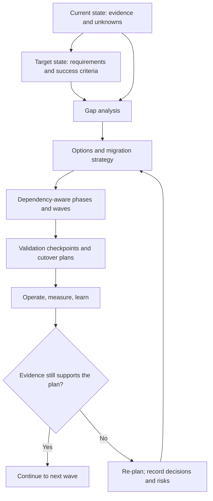
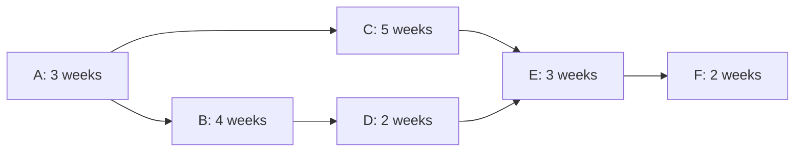

# Migration Roadmaps and Architecture Modernization

> **Module:** Stage 2D — Data Architecture / 15 — Architecture Documentation, Reviews, and Operating Model  
> **Topic:** 08 of 09  
> **Audience:** Learners progressing from foundational data architecture to enterprise migration planning  
> **Scenario:** Northbridge Bank is fictional. All inventories, durations, capacities, costs, metrics, risks, decisions, and results attributed to it are synthetic teaching examples—not production evidence or claims about a real institution.

## How to use this lesson

Work through the beginner, intermediate, and advanced levels in order. Try the exercises before reading the model answers. Treat every numerical estimate as an assumption unless it is explicitly labelled as observed evidence. A roadmap is a planning hypothesis that must be revised as evidence changes; it is not a promise that an unvalidated plan is feasible.

This lesson follows the module roadmap's Topic 08 scope: assess the current state, define the target state and success criteria, perform gap analysis, sequence changes with dependencies and a critical path, choose migration styles, and define validation, rollback, tracking, and decommissioning. It depends on architecture descriptions and viewpoints (Topic 03), ADRs and decision logs (Topic 04), design reviews/threat models/risk registers (Topic 05), reference architectures and patterns (Topic 06), and team boundaries/ownership/operating model (Topic 07).

## 1. Learning objectives

By the end of this lesson, you should be able to:

1. Assess and document the current architecture using evidence labels rather than memory or assumption.
2. Describe a target architecture in terms of capabilities, constraints, architecture views, decisions, ownership, and measurable success criteria.
3. Build a gap analysis that traces each current limitation to a target requirement and migration activity.
4. Compare big-bang, phased, strangler, parallel-run, and other workload-appropriate transition strategies, explaining their trade-offs.
5. Decompose migration into phases, waves, milestones, tasks, prerequisites, dependencies, and acceptance checkpoints.
6. Calculate and verify a critical path, identify slack, and explain what the calculation does—and does not—prove.
7. Design safe coexistence, data reconciliation, compatibility, cutover, rollback, and decommissioning arrangements.
8. Link migration risks to named owners, treatments, triggers, contingency actions, and review dates.
9. Measure progress and outcomes, revise the roadmap when evidence invalidates assumptions, and record material changes through governance and ADRs.
10. Explain the roadmap's constraints and trade-offs in preparation for Topic 09: communicating trade-offs to technical and business stakeholders.

## 2. Prerequisites and dependencies

| Prerequisite | Why it matters here | How to apply it |
|---|---|---|
| Topic 03 — architecture description and viewpoints | Migration planning needs a trustworthy baseline and a comprehensible target, not only a list of technologies. | Reuse context, component, deployment, data-flow, dependency, and viewpoint descriptions; identify stale or missing views. |
| Topic 04 — ADRs and decision log | The roadmap must be consistent with decisions already made and expose decisions still open. | Link phases to relevant ADRs; record choices such as migration style, coexistence mechanism, and cutover strategy. |
| Topic 05 — reviews, threat models, and risk registers | Migration introduces temporary trust boundaries, parallel systems, access changes, and failure modes. | Carry forward risks, threat scenarios, mitigations, owners, and residual-risk acceptance. Reassess risks introduced by the transition. |
| Topic 06 — reference architectures and reusable patterns | A target pattern is a candidate, not a substitute for workload-specific fit analysis. | Verify that the selected pattern fits requirements, constraints, skills, security, reliability, and operational capacity. |
| Topic 07 — team boundaries and operating model | Tasks need accountable owners, support interfaces, decision rights, and on-call readiness. | Assign a single accountable party for each decision or deliverable; define handover and service ownership before cutover. |
| P3 — requirements, constraints, assumptions, and risks | These bound what can be migrated and what counts as success. | Maintain an assumption log and explicit non-functional requirements. |
| P7/P8/P9 — connectivity, lineage, and resilience | Hybrid dependencies, hidden consumers, failure domains, and restore capability can dominate the plan. | Validate connectivity, consumer lineage, backup/restore, recovery, and operational dependencies. |
| P10 — cost and performance evidence | Cost and performance claims should be measured or transparently estimated. | Label estimates, state units and ranges, and replace assumptions with pilot results. |
| P12 — migration planning | This topic introduces phases, dependencies, critical path, and checkpoints. | Learn the planning method in the sequence below; prior project-management expertise is not assumed. |

**Source alignment note:** The module roadmap prescribes these dependency relationships and the expected deliverables. The detailed Northbridge design, task durations, scoring, and metrics in this lesson are illustrative additions for practice, not facts established by the roadmap.

## 3. The migration-planning mental model

A target-state diagram answers, “What should exist?” A migration roadmap answers, “How can the organization move from what exists to the target, in a safe and testable sequence, while continuing to operate?” The second question is usually harder because the old and new states may need to coexist.

A useful planning chain is:

The roadmap is a **living, versioned decision-support artifact**. It should show the current plan, the assumptions on which it rests, the evidence needed to validate those assumptions, and the conditions that trigger a pause or redesign.

---

# Part I — Beginner level: understand the journey

## 4. Core vocabulary

| Term | Meaning | Why it matters | Northbridge illustration (synthetic) |
|---|---|---|---|
| Current state | The architecture and operating reality that exist now, including workarounds and undocumented dependencies. | Prevents planning against an imaginary baseline. | A legacy warehouse runs nightly batch pipelines and serves regulatory and finance reports. |
| Target state | The intended future architecture and operating capability, bounded by requirements and constraints. | Gives migration work a purpose and acceptance criteria. | A governed lakehouse provides managed ingestion, curated data products, cataloguing, lineage, and controlled serving. |
| Gap | A material difference between current capability and a target requirement. | Converts aspiration into actionable work. | Current lineage is incomplete; the target requires lineage sufficient to assess impact before a report is switched. |
| Migration | Moving data, workloads, interfaces, operations, or users from one arrangement to another. | May involve more than copying data. | Move a reporting workload, validate outputs, switch consumers, then retire its old job. |
| Modernization | Improving architecture or operations to meet changed needs; it may include migration but is not synonymous with it. | Avoids changing technology without improving outcomes. | Retire an unused pipeline instead of re-platforming it. |
| Phase | A meaningful stage of the overall transition, often separated by a decision or readiness gate. | Provides governance and risk control. | Foundation readiness, pilot, migration waves, decommissioning. |
| Wave | A group of related workloads moved together under shared criteria. | Enables repeatable delivery and capacity planning. | A wave of low-dependency finance pipelines with known owners. |
| Milestone | A point at which a significant outcome or decision is reached. | Makes progress visible without confusing activity with outcome. | Pilot reconciliation and business acceptance approved. |
| Dependency | A condition, task, capability, decision, team, or external party that must be ready before another activity can proceed safely. | Hidden dependencies create rework and schedule failure. | A consumer cannot move until its source data contract and access policy are available. |
| Critical path | The longest-duration path through a dependency network; it determines the earliest possible finish under the model's assumptions. | Shows which tasks directly constrain the modeled end date. | Foundation work, ingestion migration, consumer cutover, and retirement may form the longest path. |
| Cutover | The controlled change that makes the new path authoritative for a workload or consumer. | This is a risk-bearing event, not just a deployment. | Route a report to the new curated data product after validation and approval. |
| Rollback / backout | A rehearsed action to restore the previous safe service path or otherwise contain failure. | Avoids improvisation during an incident. | Route consumers back to the old serving path while preserving captured change data. |
| Parallel run | Running old and new implementations at the same time to compare results or protect continuity. | Increases confidence but adds cost and consistency complexity. | Produce the same report from both systems and compare totals and business rules. |
| Coexistence | A transition period during which old and new components, data, or interfaces both operate. | Requires explicit ownership, synchronization, lineage, security, and retirement rules. | A legacy warehouse and new lakehouse are both active for selected reports. |
| Technical debt | The future cost or risk created by shortcuts, obsolete design, or deferred remediation. | Migration can accidentally move debt rather than resolve it. | An undocumented report dependency is reproduced in the new platform without an owner. |

### Why the current state must be documented first

Planning from memory omits “invisible” work: scheduler dependencies, manual corrections, file drops, credentials, downstream extracts, report subscriptions, recovery procedures, and tacit knowledge held by a small number of people. A migration plan based on an incomplete inventory may have a clean diagram but still fail at cutover.

Current-state assessment is not a demand for perfect documentation before any work begins. Instead:

1. Inventory the workloads and critical consumers.
2. Gather evidence proportionate to impact and risk.
3. Label uncertainty rather than hiding it.
4. Prioritize discovery where an unknown can change the sequence, safety, or cost.
5. Revisit the baseline when a pilot reveals new dependencies.

## 5. Evidence, assumptions, and uncertainty

Every important statement in a migration plan should have a status. The following labels are useful; use the repository's established vocabulary if it defines one elsewhere.

| Label | Meaning | Example | Appropriate treatment |
|---|---|---|---|
| Observed | Directly checked in a system, artifact, test, log, or interview record. | Scheduler export shows a job runs at 02:00. | Record source, date, scope, and limitations. |
| Reported | Stated by a person or team but not independently verified. | Finance says a spreadsheet is refreshed manually after month-end. | Identify who reported it and validate if material. |
| Inferred | A conclusion derived from available evidence. | A report appears to depend on a table based on query history and lineage. | Record reasoning and confidence; seek corroboration for critical paths. |
| Assumed | Temporarily accepted for planning, without adequate evidence. | Assume the new platform can ingest the source over the existing private link. | Assign an owner and a validation date; define a fallback if false. |
| Unknown | A relevant question has no reliable answer yet. | No one can confirm whether an old extract is still used. | Create a discovery task and do not decommission until resolved or explicitly accepted. |

**Evidence record template**

| Field | Entry |
|---|---|
| Claim / planning statement | `[What is believed to be true]` |
| Status | `Observed / Reported / Inferred / Assumed / Unknown` |
| Evidence location and identifier | `[Link, query, log, diagram, interview note, test run]` |
| Scope and timestamp | `[What was checked, when, and for which workload]` |
| Confidence / limitations | `[Coverage gaps, stale evidence, sampling limits]` |
| Owner | `[Person or team accountable for validating the claim]` |
| Next action and due date | `[How uncertainty will be resolved]` |
| Consequence if false | `[Schedule, safety, cost, or design impact]` |

### When this is useful

Use explicit evidence labels for high-impact migration assumptions: hidden consumers, data volumes, data quality, source change rates, access rules, recovery behavior, external-party lead times, and actual workload costs. Low-impact details can be validated just in time, but an unknown that gates a critical-path activity should be resolved early.

## 6. Current-state and target-state architecture

The current and target descriptions should be comparable. If the current state is described only in terms of technology names but the target is described in terms of business capabilities, the gap analysis will be unreliable.

Describe both states across the same dimensions:

- **Business and consumers:** business outcomes, critical reports, service hours, consumer contracts, and user acceptance.
- **Data and lineage:** sources, data products, transformations, quality rules, retention, and downstream dependencies.
- **Technology and interfaces:** ingestion, storage, processing, serving, orchestration, connectivity, and integration protocols.
- **Security and governance:** identities, permissions, classification, encryption, auditability, ownership, and policy enforcement.
- **Reliability and operations:** freshness, availability, recovery, alerting, support, runbooks, and on-call responsibilities.
- **Performance and capacity:** volume, throughput, concurrency, latency, growth, and scaling limits.
- **Economics:** current run cost, transition cost, parallel-run cost, expected steady-state cost, and uncertainty.
- **People and process:** skills, support model, decision rights, change controls, and vendor or partner dependencies.

### Worked comparison: Northbridge baseline and target (synthetic)

| Dimension | Current state (synthetic baseline) | Target requirement (synthetic) | Evidence status / gap |
|---|---|---|---|
| Ingestion | Nightly batch jobs; some file arrivals are monitored manually. | Repeatable ingestion with observable completion and replay capability for selected sources. | Reported; scheduler and source logs must verify actual failure and replay behavior. |
| Storage and organization | Legacy warehouse schemas and a shared staging area. | Governed raw, standardized, and curated zones with documented data-product boundaries. | Partly observed in a hypothetical inventory; classification and retention mapping remain unknown. |
| Lineage | Lineage exists for a subset of jobs. | Critical reports can be traced to source and transformation dependencies. | Gap to measure by critical consumer coverage. |
| Data quality | Several checks are embedded in SQL and manual reconciliations. | Versioned quality rules and reconciliation evidence for migrated workloads. | Reported; rules need extraction and owner confirmation. |
| Access | Permissions are maintained separately in legacy and target environments. | Least-privilege access, reviewed mappings, and audit evidence for each migrated consumer. | Gap; access equivalence cannot be assumed from matching role names. |
| Serving | Reports query legacy warehouse tables. | Consumers use governed, versioned data products or compatible interfaces. | Gap includes contract design, compatibility, and consumer migration. |
| Reliability | Existing recovery steps are unevenly documented. | Recovery objectives and tested restore/cutover procedures for critical workloads. | Unknown until runbooks and exercises are reviewed. |
| Ownership | Some jobs have technical contacts but no confirmed business owner. | Each workload, data product, and migration decision has clear accountability. | Gap; resolve before high-risk cutovers or retirement. |
| Cost | Legacy run costs are available only at platform level in this example. | Compare transition and steady-state costs with stated allocation assumptions. | Incomplete cost attribution; estimates must show ranges and assumptions. |

A target is not a list of preferred technologies. It must express required outcomes, constraints, and acceptance measures. “Move to a lakehouse” is not a measurable success criterion. “Critical reports reconcile within agreed tolerances, meet their freshness target, pass access review, and have tested recovery procedures” is closer to an acceptance statement.

## 7. Gap analysis: convert differences into work

A gap is actionable when it is connected to a requirement, evidence, a migration activity, an owner, and a way to verify closure. Do not classify every difference as a defect: a current capability that the target intentionally retires may not need replacement.

**Gap-analysis workflow**

1. State the target capability or requirement in testable terms.
2. Record the current capability and evidence status.
3. Describe the gap, including its business or operational consequence.
4. Identify one or more activities that close it—or document why the capability is retired.
5. Record dependencies, effort range, risk, owner, and priority rationale.
6. Define acceptance evidence and link relevant ADRs, review findings, and risk records.
7. Reassess priority when new evidence changes impact or dependency order.

**Gap-analysis template**

| ID | Capability / requirement | Current state and evidence | Target state / acceptance measure | Gap / consequence | Activity / work item | Dependencies | Effort range and basis | Risk / owner | Priority rationale | Closure evidence |
|---|---|---|---|---|---|---|---|---|---|---|
| G-01 | `[Requirement]` | `[Observed/reported/assumed + source]` | `[Measurable target]` | `[Difference and impact]` | `[Work item]` | `[IDs]` | `[Range; assumptions]` | `[Risk ID / owner]` | `[Value, urgency, constraints]` | `[Test/report/approval]` |

### Example: selected synthetic gaps

| ID | Gap | Proposed migration activity | Dependency / gate | Exit evidence |
|---|---|---|---|---|
| G-01 | Critical source-to-report lineage is incomplete. | Inventory consumers and reconstruct lineage for the pilot scope. | Before selecting pilot cutover scope and before legacy retirement. | Owner-reviewed lineage map; unresolved consumers tracked. |
| G-02 | Existing transformations contain undocumented business rules. | Extract rules, compare legacy outputs, and define versioned target transformations. | Before parallel-run comparison is meaningful. | Rule catalogue and approved reconciliation results. |
| G-03 | Access policies differ between old and target environments. | Map identities and entitlements; test least-privilege access and denied access. | Before business acceptance and production cutover. | Access test evidence and security review outcome. |
| G-04 | New ingestion replay behavior is unproven. | Run failure/replay tests using representative source data and duplicate scenarios. | Before expanding from pilot to high-volume waves. | Repeatable replay test and duplicate-handling evidence. |
| G-05 | Old consumers and extracts are not fully identified. | Analyze query/usage logs, scheduler metadata, lineage, and owner interviews. | Before decommissioning approval. | Consumer register, notices, and unresolved-use disposition. |
| G-06 | Recovery responsibilities are unclear. | Assign operational owners; rehearse restore, rollback, and escalation. | Before cutover gate. | Successful rehearsal record and approved runbook. |

## 8. Migration styles and modernization choices

No migration style is universally safest or cheapest. Choose per workload, dependency shape, risk, reversibility, data consistency needs, business deadline, and ability to operate both paths.

| Style | How it works | Advantages | Trade-offs / risks | Suitable when | Avoid or reconsider when |
|---|---|---|---|---|---|
| Big bang | Switch a broad scope at one coordinated point. | Shorter coexistence period; fewer long-lived duplicate paths. | High cutover risk, large blast radius, difficult rollback, many coupled teams. | Scope is small, well understood, rehearsed, and reversible. | Consumers/dependencies are unknown or service continuity is critical. |
| Phased / incremental | Move bounded capabilities or workloads in successive phases. | Smaller blast radius, learning between waves, measurable checkpoints. | Longer program, temporary duplication, repeated coordination. | Workloads can be separated by business capability or dependency group. | The design has hidden coupling that makes partial operation inconsistent. |
| Strangler | Route selected functions or consumers to the new implementation over time while the old path remains for others. | Gradual transition and controlled exposure. | Routing, compatibility, observability, and dual-path complexity. | Interfaces can be mediated and scope can be moved incrementally. | No reliable routing boundary exists or both implementations cannot remain consistent. |
| Parallel run | Run old and new implementations and compare results before switching authority. | Stronger confidence in semantic and numerical parity. | Extra compute/storage, duplicate operational effort, reconciliation complexity. | Outputs can be compared and the cost is justified by impact. | Comparison rules are undefined or source changes make outputs incomparable. |
| Re-platform | Move a workload to a new runtime/service with limited changes. | Can reduce infrastructure burden and preserve familiar logic. | May carry forward poor data models, weak observability, or technical debt. | Current workload is understood and target platform fit is proven. | The old design itself fails target requirements. |
| Re-architect | Change structure or behavior to meet new quality attributes. | Can address fundamental limits and improve operability. | Higher uncertainty, more testing and retraining, longer path to benefits. | Measured gaps justify redesign and the organization can absorb change. | Business value is unclear or a simpler retirement/re-platforming option suffices. |
| Replace | Substitute a product or service with another capability. | May remove unsupported technology or simplify operations. | Conversion, vendor, interface, lock-in, and skills risks. | Requirements and exit paths are clear and migration is testable. | New capability is selected without evidence of fit or exit planning. |
| Retire | Stop a workload or capability that is no longer needed. | Avoids moving unused functionality and may reduce cost and risk. | Hidden consumers, retention obligations, or undocumented use can cause disruption. | Usage and business ownership confirm no continuing need, or a replacement is accepted. | Consumer discovery, retention review, or legal/operational checks are incomplete. |
| Hybrid coexistence | Keep some workloads on the old platform while others move to the target. | Supports dependency-aware migration and constrained workloads. | Cross-platform governance, identity, lineage, networking, and cost complexity. | Workloads have different readiness, constraints, or value profiles. | The organization cannot monitor and govern the combined estate. |

**Selection rule:** pick the least complex transition that meets the target requirements and controls the risk within the organization's real operating capacity. Do not modernize a workload merely because it exists; determine whether it should be migrated, redesigned, replaced, or retired.

## 9. Beginner exercise — compare current and target states

### Scenario

Northbridge Bank's fictional analytics group has ten nightly pipelines in a legacy warehouse. Four feed critical finance reports; three feed internal dashboards; two are duplicate extracts; one has an unknown consumer. The inventory is synthetic and incomplete. The target is a governed lakehouse with documented lineage, quality checks, and named owners.

### Tasks

1. List five current-state facts that must be verified before migration planning.
2. Write three measurable target-state requirements.
3. Identify at least four gaps.
4. Group the ten pipelines into three candidate waves, stating what evidence is needed before finalizing the groups.
5. Name one workload that might be retired rather than migrated and state the evidence required.

### Model answer (illustrative)

1. Verify actual source schedules and arrival patterns; business/report consumers; transformation rules; access and classification; recovery behavior and support owner. The unknown-consumer extract needs query/usage-log review and interviews.
2. Example targets: (a) each critical report has owner-reviewed source-to-report lineage; (b) migrated reports reconcile under an agreed business-approved tolerance over a representative period; (c) access tests demonstrate authorized and unauthorized access behavior, with evidence retained. Exact tolerances and freshness values must be agreed from requirements, not invented by the learner.
3. Missing lineage, undocumented rules, weak owner coverage, untested target replay, and unknown consumers are candidate gaps.
4. Candidate wave 1: low-risk, well-understood dashboards with few dependencies; wave 2: finance reports after lineage/rule/access work; wave 3: complex or unknown-dependency workloads after discovery. The exact grouping must be justified by evidence and dependency graph, not merely by count.
5. The duplicate extract may be retired only after the business owner confirms its purpose is redundant, logs and lineage show no consumers, retention and audit requirements are checked, stakeholders are notified, and a rollback/restore approach is agreed where feasible.

### Objective validation criteria

- Every claimed current-state fact has an evidence status and a source or next validation action.
- Each target requirement has an observable acceptance measure.
- Every gap maps to a migration activity or a documented retirement decision.
- Wave order respects source/consumer dependencies and includes unknowns as explicit work.
- No workload is marked safe to retire solely because it appears redundant.

---

# Part II — Intermediate level: build a dependency-aware roadmap

## 10. Define scope, objectives, and success measures

A roadmap should begin with a bounded scope: which domains, sources, pipelines, data products, consumers, environments, and operational responsibilities are included? Explicitly record exclusions and their rationale. Scope creep is not controlled by a slide title; it is controlled by traceable work and change governance.

### Migration charter template

| Field | Required content |
|---|---|
| Business driver | `[Problem, opportunity, deadline, risk reduction, or supportability issue]` |
| Scope in / out | `[Workloads, consumers, domains, environments; explicit exclusions]` |
| Current-state baseline | `[Inventory and evidence references; known gaps]` |
| Target outcomes | `[Measurable business, data, security, reliability, performance, and cost outcomes]` |
| Constraints | `[Service windows, source limitations, fixed dates, skills, contracts, connectivity, funding]` |
| Assumptions / unknowns | `[Owner, validation date, impact if false]` |
| Migration strategy | `[Per workload: phase, strangler, parallel run, re-platform, re-architect, replace, retire]` |
| Governance | `[Decision owner, review forum, ADR and risk-register links, change authority]` |
| Operational model | `[Service owner, on-call, incident route, support readiness, handover]` |
| Benefits and costs | `[Baseline, calculation method, range, tracking owner, realization date]` |
| Success criteria | `[Thresholds, evidence source, approver, measurement window]` |
| Stop / re-plan triggers | `[Observable conditions that cause pause, rollback, or plan revision]` |

### Quality of a success criterion

A useful criterion names the measure, scope, threshold or tolerance, time window, evidence source, and accountable approver. For example: “The pilot finance report is accepted when the business owner approves a reconciliation report covering an agreed representative period, every material variance is explained, access tests pass, and the rollback rehearsal succeeds.” This is stronger than “data is correct and migration is complete.”

Do not invent numeric tolerances. Agree them with the data owner and relevant control owners based on business semantics, materiality, and service expectations. Some fields may require exact equality; some aggregates may allow a documented tolerance; some freshness objectives may depend on source availability.

## 11. Work decomposition and dependency modelling

Break work down far enough that ownership, dependencies, estimates, and completion evidence can be assigned. Avoid both extremes: an entire migration as one task is not manageable; a thousand microtasks create administrative noise without improving control.

Common work categories include:

1. **Discovery:** inventory, consumer mapping, lineage, data classification, dependency validation, baseline metrics.
2. **Foundation:** identity, networking, environment provisioning, catalog/metadata, orchestration, observability, security controls.
3. **Data movement:** source connectivity, ingestion, backfill, CDC/replay where needed, schema and contract handling.
4. **Transformation:** business-rule extraction, model conversion, data quality, idempotency, late-arriving data behavior.
5. **Serving and consumers:** APIs, reports, dashboards, compatibility views, client changes, consumer acceptance.
6. **Assurance:** reconciliation, performance and load tests, access validation, threat/risk review, recovery and rollback rehearsal.
7. **Cutover:** readiness review, freeze/change capture if required, routing change, monitoring, acceptance, backout decision.
8. **Stabilization:** hypercare, issue remediation, SLO monitoring, ownership handover, runbook validation.
9. **Decommissioning:** consumer confirmation, retention/archive checks, final export or backup as required, access revocation, contract and resource termination, deletion evidence.
10. **Benefits and learning:** cost comparison, operational measures, retrospective, updated standards and reusable patterns.

### Dependency types

| Type | Example | Planning response |
|---|---|---|
| Technical prerequisite | Target private connectivity must work before source ingestion testing. | Make it an explicit predecessor; test early. |
| Data dependency | Consumer migration depends on validated source data and transformation rules. | Use lineage and contract dependencies to order work. |
| Decision dependency | Pattern choice requires a decision on consistency and freshness. | Assign a decision owner and decision deadline; show it on the plan. |
| Organizational dependency | Support team must be trained and on-call coverage established before cutover. | Treat readiness as a deliverable, not an informal handover. |
| External dependency | Source owner, partner, or vendor must provide access or approve a change. | Record lead time, contact, escalation, and contingency. |
| Control / governance dependency | Security review or risk acceptance is required before production exposure. | Identify the approval evidence and accountable authority; do not imply approval exists before it does. |
| Resource dependency | One specialist is required by multiple concurrent tasks. | Level resources or revise schedule; a logical dependency graph alone does not solve capacity conflicts. |
| Conditional dependency | If pilot tests reveal a schema issue, a redesign task is required. | Define the trigger and branch; include contingency allowance or re-plan rule. |

A dependency graph should express real prerequisites, not merely the order that tasks appear in a table. If task B needs task A's output, B cannot begin until the relevant acceptance condition for A is met. If two tasks can proceed independently, avoid adding a dependency simply to make the plan look orderly.

## 12. Worked migration roadmap: legacy warehouse to lakehouse

### Scenario assumptions (synthetic)

- Scope: one pilot source, a small set of finance pipelines, and their critical report consumers; this is not the whole bank estate.
- Target: governed lakehouse zones, documented transformations, lineage, access controls, observable ingestion, tested recovery, and owned data products.
- The old warehouse must remain available during migration until each consumer has accepted the replacement.
- The illustrative plan below uses relative phases and sample durations for teaching. Durations are not validated estimates for a real environment and exclude unknown calendar constraints unless noted.
- Teams are represented by role labels, not actual Northbridge organization units.

### Phased roadmap table

| Phase | Work and deliverables | Entry criteria | Exit criteria / evidence | Dependencies | Accountable role (illustrative) | Key risk / control |
|---|---|---|---|---|---|---|
| 0. Discover and baseline | Inventory sources, pipelines, consumers, owners, lineage, access, run costs, recovery, and data quality. | Sponsor and scope owner identified. | Critical scope has evidence labels; unknown consumers and assumptions have owners/dates; baseline measures recorded. | None, though source access may be external. | Migration lead | Hidden dependencies; require discovery sign-off for pilot scope. |
| 1. Design and foundations | Confirm target pattern; provision environments/connectivity; establish identity, catalog, observability, orchestration, and recovery mechanisms. | Current/target views and key requirements reviewed. | Foundation tests pass; ADRs approved or unresolved decisions explicitly gate further work; operational owners named. | Phase 0; access/network approvals. | Platform owner | Foundation gaps; test in non-production and verify security boundaries. |
| 2. Pilot and prove | Move a bounded workload; implement transformations and quality checks; run old/new comparison; test replay and failure recovery. | Foundation ready; business rules and pilot consumers known. | Reconciliation accepted; access and performance checks pass; runbooks and rollback rehearsed; defects dispositioned. | Phase 1; source owner availability. | Data-product owner | Pilot not representative; choose a pilot that tests important uncertainties without excessive blast radius. |
| 3. Wave migration | Group workloads by dependency and risk; migrate, reconcile, obtain consumer acceptance, and switch bounded consumers. | Pilot gate passed; wave-specific prerequisites met. | Each workload has validation evidence, owner approval, support readiness, and tested backout. | Phase 2; waves may have internal parallelism subject to capacity. | Domain migration lead | Capacity contention and repeated defects; track throughput and defect escape rate. |
| 4. Stabilize and transfer | Monitor freshness, reliability, incidents, cost, and adoption; complete support handover and resolve known issues. | Cutover accepted for the wave. | Agreed stabilization window passed; on-call and escalation tested; runbook and ownership records current. | Phase 3 per wave. | Service owner | Premature handover; require operational acceptance rather than elapsed time alone. |
| 5. Decommission legacy slice | Confirm no consumers remain; archive/retain as required; revoke access; stop jobs and terminate resources. | Consumers accepted; retention/hold checks and notices complete; no unresolved critical dependency. | Shutdown verified; deletion/retention evidence recorded; cost and asset inventories updated. | Stabilization and governance checks for that slice. | Legacy service owner with data owner | Hidden consumer or retention failure; staged disable/brownout and rollback where practical. |
| 6. Benefits and improve | Compare baseline with actual costs and service measures; update patterns, standards, ADRs, and next-wave plan. | Reliable baseline and post-migration data available. | Benefit variances explained; lessons incorporated; roadmap version updated. | Phases 2–5 produce evidence. | Program owner / FinOps role | Benefits assumed rather than measured; publish calculation and confidence. |

**Important:** phases are not necessarily one single global sequence. A large estate may execute wave-level migration, stabilization, and decommissioning as repeated cycles. Do not decommission the entire legacy platform merely because one wave has completed.

## 13. Critical path: calculate it, then challenge it

The critical path is calculated from task durations and finish-to-start dependencies. It is a schedule model, not proof that the durations are accurate, the resources are available, or all dependencies have been discovered.

### Worked dependency graph (synthetic)

| Task | Work | Duration (weeks) | Immediate predecessor(s) |
|---|---|---:|---|
| A | Confirm access/connectivity and foundation design gate | 3 | None |
| B | Build and test ingestion foundation | 4 | A |
| C | Build catalogue/lineage baseline for pilot scope | 5 | A |
| D | Implement and test pilot ingestion | 2 | B |
| E | Complete pilot reconciliation and consumer acceptance | 3 | C, D |
| F | Execute production cutover and stabilization gate | 2 | E |

Network logic:

### Forward pass

Use time zero as the start. For each task:

- `ES` (earliest start) = maximum `EF` of all predecessors, or 0 if there are none.
- `EF` (earliest finish) = `ES + duration`.

| Task | Duration | ES | EF | Calculation |
|---|---:|---:|---:|---|
| A | 3 | 0 | 3 | 0 + 3 = 3 |
| B | 4 | 3 | 7 | 3 + 4 = 7 |
| C | 5 | 3 | 8 | 3 + 5 = 8 |
| D | 2 | 7 | 9 | 7 + 2 = 9 |
| E | 3 | 9 | 12 | max(EF of C=8, D=9) + 3 = 12 |
| F | 2 | 12 | 14 | 12 + 2 = 14 |

Earliest modeled finish = **14 weeks**.

### Backward pass and slack

- `LF` (latest finish) = minimum `LS` among successor tasks, or the project finish for terminal tasks.
- `LS` (latest start) = `LF − duration`.
- `Slack` = `LS − ES` (equivalently `LF − EF`).

| Task | Duration | LS | LF | Slack | Interpretation |
|---|---:|---:|---:|---:|---|
| F | 2 | 12 | 14 | 0 | Critical |
| E | 3 | 9 | 12 | 0 | Critical |
| D | 2 | 7 | 9 | 0 | Critical |
| C | 5 | 4 | 9 | 1 | One week of modeled float |
| B | 4 | 3 | 7 | 0 | Critical |
| A | 3 | 0 | 3 | 0 | Critical |

Two path totals:

- A → B → D → E → F = `3 + 4 + 2 + 3 + 2 = 14 weeks`.
- A → C → E → F = `3 + 5 + 3 + 2 = 13 weeks`.

Therefore, the critical path is **A → B → D → E → F**, totaling **14 weeks**. Task C has one week of float in this simplified model. If C slips by more than one week without recovery, it delays E and therefore the project finish. If B or D slips, the current critical path finish is directly affected.

### What the calculation does not prove

The calculation assumes durations are additive, dependencies are complete, resources are available, work can start at the modeled time, and no calendar or external constraints intervene. It excludes resource leveling, holidays, approval queues, uncertainty, and rework unless those are explicitly represented. Real plans should use duration ranges, confidence levels, resource calendars, and contingency appropriate to the uncertainty.

A critical path can change as task durations and dependencies change. Recalculate after significant scope changes, pilot findings, resource conflicts, or a new external constraint. Do not report a precise finish date from synthetic durations as if it were a commitment.

### Additional arithmetic from the module roadmap

The supplied module roadmap gives a second simplified example: A (foundations) takes 8 weeks; then B1 (ingestion migration) takes 10 weeks and B2 (catalogue) takes 6 weeks in parallel; C (consumers) takes 12 weeks after both B tasks; D (decommissioning) takes 4 weeks after C. Under those stated dependencies:

`A + max(B1, B2) + C + D = 8 + max(10, 6) + 12 + 4 = 34 weeks`.

B2 has `10 − 6 = 4 weeks` of float because C waits for the longer B1 branch. This is the roadmap’s illustrative calculation, not an estimate for Northbridge or any real migration. The result assumes B1 and B2 can actually run in parallel and that no resource or approval constraint prevents that.

## 14. Prioritization and wave design

A sensible sequence respects hard dependencies first, then makes trade-offs among business value, risk reduction, cost, effort, uncertainty, and learning value. Scoring can support discussion, but it must not override a mandatory prerequisite or conceal a severe risk.

### Practical prioritization criteria

| Criterion | Questions to ask | Evidence examples |
|---|---|---|
| Dependency readiness | Are source, identity, network, data contracts, and consumers ready? | Dependency graph, access tests, source-owner confirmation. |
| Business value / urgency | What outcome becomes available, and by when? | Sponsor objective, consumer criticality, agreed deadline. |
| Risk reduction | Does the work remove a fragile dependency or test a high-impact assumption? | Risk register, failure history, threat model, recovery gap. |
| Reversibility / blast radius | Can the change be contained and undone? | Routing design, restore test, bounded pilot scope. |
| Complexity / effort | How much engineering, testing, coordination, and retraining is required? | Work breakdown, estimates with ranges, prior pilot throughput. |
| Learning value | Will the wave test assumptions relevant to later waves? | Explicit hypotheses, measurable pilot questions. |
| Operational readiness | Are owners, monitoring, support, runbooks, and escalation ready? | Readiness checklist, on-call rehearsal, handover acceptance. |
| Cost and benefit | What is the transition cost and expected steady-state effect? | Cost baseline, dual-run estimate, measured pilot cost. |
| Data/control sensitivity | Does the workload require special access, retention, or review? | Classification, control mapping, review records. |

### Worked wave-selection matrix (synthetic)

Suppose three candidate workloads have been assessed. Scores use a 1–5 scale where 5 means more favorable for early migration. For “risk if migrated now,” a higher score means **lower** assessed migration risk. These are illustrative judgments, not measured facts. A hard dependency or unresolved safety gate still blocks a workload regardless of score.

| Criterion | Weight | W1: known dashboard | W2: finance report | W3: unknown extract |
|---|---:|---:|---:|---:|
| Dependency readiness | 25% | 5 | 3 | 1 |
| Business value / urgency | 20% | 2 | 5 | 2 |
| Risk / reversibility | 20% | 5 | 3 | 1 |
| Learning value | 15% | 3 | 4 | 4 |
| Effort favorability | 10% | 4 | 2 | 2 |
| Operational readiness | 10% | 4 | 3 | 1 |
| **Weighted score** | **100%** | **3.90** | **3.45** | **1.75** |

Calculations (weighted sum):

- W1 = `5×0.25 + 2×0.20 + 5×0.20 + 3×0.15 + 4×0.10 + 4×0.10 = 3.90`.
- W2 = `3×0.25 + 5×0.20 + 3×0.20 + 4×0.15 + 2×0.10 + 3×0.10 = 3.45`.
- W3 = `1×0.25 + 2×0.20 + 1×0.20 + 4×0.15 + 2×0.10 + 1×0.10 = 1.75`.

**Conclusion:** W1 is the strongest candidate for an early learning wave under these assumptions. W2 has greater stated business urgency but needs more readiness work; it may be prepared in parallel, then migrated when gates pass. W3 should not be migrated or retired until discovery resolves its unknown consumer and operational readiness. The scores are not probabilities and should not be read as objective measurements. The ranking is sensitive to weights and evidence quality; show the reasoning and run sensitivity checks if the decision is consequential.

### Avoid scoring traps

- Do not score a hard security, retention, or continuity requirement as just another weighted preference.
- Do not compare workloads with inconsistent evidence quality without flagging the difference.
- Do not double-count related criteria (for example, readiness and risk) without understanding their correlation.
- Do not use the score to justify a decision already made for unrelated reasons.
- Record who owns the criteria and when scores should be revisited.

## 15. Intermediate exercise — create the roadmap

### Scenario

The fictional Northbridge team plans to retire a legacy warehouse slice and move selected pipelines to a lakehouse. Synthetic inventory:

- P1: nightly customer aggregation, feeds two reports.
- P2: transaction enrichment, depends on P1 and a reference-data file.
- P3: finance reconciliation, depends on P2 and has a named business owner.
- P4: dashboard extract, may duplicate another product but has unknown consumers.
- The target catalogue is not yet populated; target access mappings and replay behavior are untested.
- For exercise purposes only, assume foundation work takes 3 weeks, ingestion work 4 weeks, transformation work 3 weeks, consumer validation 2 weeks, and cutover preparation 1 week. These are arbitrary teaching durations, not estimates for a real project.

### Tasks

1. Build a gap-analysis table with at least five gaps.
2. Propose at least four phases and explicit entry/exit criteria.
3. Show task dependencies and identify which activities can proceed in parallel.
4. Identify one critical-path risk and one non-critical-path uncertainty.
5. Define validation checkpoints for data, access, performance, and operations.
6. Create a migration-risk register with at least five risks, owners, treatments, and triggers.
7. State what must be true before P4 can be retired.

### Model answer (one defensible approach)

- **Gaps:** incomplete lineage/consumer inventory; missing catalogue metadata; unextracted P1/P2/P3 business rules; untested access mapping; untested replay/idempotency; missing rollback rehearsal; incomplete cost baseline.
- **Phases:** discovery and lineage; foundation and controls; pilot P1/P2 with old/new comparison; migrate P3 after P2 acceptance; migrate remaining known consumers; stabilize; retire each legacy slice only after consumer and retention gates.
- **Dependencies:** source/reference-file access and foundation must precede ingestion tests; P1 must validate before P2; P2 must validate before P3; consumer acceptance and operational readiness precede cutover; consumer discovery and retention review precede P4 retirement. Catalogue design and P4 usage-log discovery can proceed in parallel if resource capacity permits.
- **Critical-path risk:** a source access or transformation-rule delay blocks P1 → P2 → P3. **Non-critical uncertainty:** a low-priority dashboard's preferred display layout may be resolved outside the critical path if no release gate depends on it.
- **Checkpoints:** counts and key aggregates; row-level or business-key reconciliation where appropriate; duplicate and late-arrival tests; allow/deny access tests; representative load and latency tests; freshness monitoring; recovery and rollback rehearsal; business owner sign-off; on-call readiness.
- **P4 retirement:** usage and lineage review; named business owner confirmation; notice and migration of consumers if any; retention/archive and legal-hold checks; access revocation plan; staged disable/brownout where practical; evidence that the resource was stopped and no required consumer was disrupted.

### Validation rubric

| Check | Pass condition |
|---|---|
| Traceability | Each gap links to a target requirement and a work item. |
| Dependency correctness | P2 cannot be accepted before P1 and reference-data readiness; P3 cannot be accepted before P2. |
| Phase gates | Every phase has entry and exit criteria with evidence, not only dates. |
| Risk ownership | Each risk has one accountable owner, treatment, trigger, and review date. |
| Safety | Access, data correctness, operational readiness, and rollback are explicit before cutover. |
| Decommissioning | P4 is not retired while consumers, retention, or legal-hold questions remain unresolved. |

## 16. Migration risk register

The risk register should link to Topic 05 artifacts and evolve during migration. Include risks created by the transition itself, not only risks inherited from the old architecture.

| ID | Risk event and consequence | Likelihood / impact | Trigger or early signal | Treatment / contingency | Accountable owner | Due / review | Residual risk / status |
|---|---|---|---|---|---|---|---|
| MR-01 | Hidden consumer is disrupted when a legacy table is switched off. | `[Scale and rationale]` | Unknown queries, scheduled extracts, or ownerless downstream dependency. | Analyze logs and lineage; notify consumers; staged brownout; preserve reversible route where feasible. | Legacy service owner | `[Date]` | `[After treatment]` |
| MR-02 | Transformation semantics differ and financial totals do not reconcile. | `[Scale and rationale]` | Unexplained variance in parallel-run reports. | Extract rules; business-approved tolerances; compare representative periods; block cutover until variances are resolved or explicitly dispositioned. | Data-product owner | `[Date]` | `[After treatment]` |
| MR-03 | Target access is broader or narrower than intended. | `[Scale and rationale]` | Access test mismatch or unexpected denied requests. | Map entitlements; run positive and negative tests; review least privilege; retain evidence. | Security/control owner | `[Date]` | `[After treatment]` |
| MR-04 | Dual-run data diverges because change capture or replay is incomplete. | `[Scale and rationale]` | Lag exceeds agreed threshold; duplicate/missing records. | Define source of truth; test CDC/replay; reconcile lag; pause cutover or route back. | Ingestion owner | `[Date]` | `[After treatment]` |
| MR-05 | Support team cannot diagnose incidents after cutover. | `[Scale and rationale]` | Missing alerts/runbooks or failed operational rehearsal. | Observability, on-call training, escalation rehearsal, readiness gate. | Service owner | `[Date]` | `[After treatment]` |
| MR-06 | Parallel running exceeds budget or capacity. | `[Scale and rationale]` | Dual-run spend or resource consumption exceeds agreed envelope. | Measure per-workload cost; cap coexistence duration; prioritize wave; re-plan if threshold crossed. | Program/FinOps owner | `[Date]` | `[After treatment]` |
| MR-07 | External source or approval lead time blocks the schedule. | `[Scale and rationale]` | No response by agreed checkpoint. | Early request, escalation path, alternative wave, contingency buffer. | Dependency owner | `[Date]` | `[After treatment]` |

Risk scores should use the method agreed by the project; ordinal likelihood/impact scales support prioritization but do not create precise probabilities. Acceptance of material residual risk must be performed by the authorized role under the organization's actual governance. Do not assume a project lead can accept every risk.

## 17. Coexistence, synchronization, and data consistency

During transition, the old and new environments may both contain data or serve consumers. The design must say which system is authoritative for each dataset and time period, how changes propagate, how divergence is detected, and what happens when synchronization fails.

### Common synchronization choices

| Approach | Mechanism | Benefits | Risks / limitations | Important design questions |
|---|---|---|---|---|
| Single writer plus replication/CDC | One system owns writes; changes are propagated to the other. | Clearer source of truth; may reduce conflicting updates. | Lag, schema changes, ordering, delete propagation, replay and duplicate handling. | What is the maximum acceptable lag? How are gaps detected and repaired? |
| Dual write | Application writes to both systems. | May make both paths current when it works. | Partial failure can create divergence; retries can duplicate; distributed atomicity is not automatic. | What happens if only one write succeeds? Is there an outbox or reconciliation mechanism? |
| Event log / replay | Durable events or change records are replayed into the target. | Supports recovery and rebuild if event semantics and retention are adequate. | Replay ordering, schema evolution, retention, idempotency, and historical compatibility. | Can the target be rebuilt deterministically? How are poison records handled? |
| Snapshot plus delta | Initial consistent snapshot followed by changes since a defined boundary. | Common for bulk migration with ongoing source updates. | Snapshot boundary and delta capture can leave gaps or duplicates if poorly coordinated. | How is the boundary recorded and verified? |
| Read-only parallel comparison | Old path remains authoritative while the target computes equivalent outputs. | Reduces write-path complexity and enables output comparison. | Does not prove write behavior; adds compute and may compare inconsistent snapshots. | Are inputs/time windows aligned and comparison semantics approved? |

There is no universally best mechanism. Choose according to write ownership, consistency requirements, source capabilities, volume, recovery needs, and operational skills. For a high-impact workload, prove the selected mechanism in a representative test before committing the migration wave.

### Coexistence checklist

- [ ] Name the system of record for each dataset, field, and transition period.
- [ ] Define synchronization mechanism, direction, lag objective, and failure behavior.
- [ ] Define idempotency, deduplication, ordering, deletes, late arrivals, schema changes, and replay.
- [ ] Align comparison windows and define business-approved reconciliation rules.
- [ ] Preserve end-to-end lineage and metadata across old and new paths.
- [ ] Apply appropriate identity, access, encryption, audit, and retention controls in both environments.
- [ ] Monitor lag, divergence, duplicate rates, failed records, and cost of parallel operation.
- [ ] Assign incident ownership and escalation for cross-platform failures.
- [ ] Define the maximum intended coexistence duration and the condition for extending it.
- [ ] Ensure rollback does not lose accepted writes or create a second source of truth.

## 18. Validation checkpoints and acceptance evidence

A checkpoint is a decision point with explicit evidence and a defined outcome: proceed, remediate, pause, rollback, or re-plan. “Testing completed” is not enough; identify what was tested, the expected result, actual result, unresolved defects, and who accepted them.

| Checkpoint | Evidence to collect | Example pass condition | Failure response |
|---|---|---|---|
| Source and lineage readiness | Source inventory, lineage, consumer register, owner confirmation. | In-scope dependencies and unresolved unknowns are visible and dispositioned. | Expand discovery or reduce scope; do not assume absent lineage means absent dependency. |
| Data reconciliation | Counts, key aggregates, business keys, duplicates, nulls, control totals, variance analysis. | Results meet approved tolerances for a representative period; all material variances explained. | Block cutover, correct transformation or mapping, repeat comparison. |
| Semantic compatibility | Business-rule mapping, schema and contract tests, report/API behavior. | Consumers accept intended semantics and any version changes are managed. | Fix mapping, provide compatibility layer, or revise migration sequence. |
| Security and privacy | Identity mapping, allow/deny tests, classification and retention review, audit evidence. | Required access behavior and control review are accepted by authorized owners. | Block exposure; correct permissions and retest. |
| Performance and freshness | Representative load, throughput, latency, freshness, concurrency, resource usage. | Agreed workload targets met under documented conditions. | Tune, resize, narrow scope, or re-plan; do not infer production performance from a tiny sample. |
| Reliability and recovery | Failure injection where appropriate, backup/restore, replay, rollback rehearsal, alerting. | Recovery behavior matches agreed objectives and responders can execute runbooks. | Remediate and repeat; keep old path available if that is the approved contingency. |
| Operational readiness | On-call rota, dashboards, runbooks, ownership, escalation, support training. | Named service owner accepts the operational handover and support route is tested. | Delay cutover or retain supervised hypercare with explicit exit criteria. |
| Business acceptance | Reconciliation summary, known limitations, owner sign-off, communication record. | Accountable consumer approves outcomes against stated criteria. | Resolve critical issues or obtain a properly governed, time-bounded disposition. |
| Decommission readiness | Consumer discovery, notices, retention/hold review, archive/recovery plan, dependency scan. | No unresolved required consumer or retention/control blocker; retirement authority approves. | Continue coexistence, run a staged brownout, or revisit scope. |

### Entry and exit criteria pattern

For each phase, document:

- **Entry:** required upstream outputs, approvals, resources, environments, source access, and risk conditions.
- **Exit:** evidence that must exist, tests that must pass, owners who must approve, and issues that may remain.
- **Stop condition:** an observable condition that blocks progression.
- **Recovery / rollback:** safe response, decision authority, time limit, and data-consistency implications.
- **Record:** where results, defects, approvals, and revised assumptions are stored.

## 19. Cutover and rollback planning

A cutover plan is a time-ordered operational procedure. A rollback plan is not simply “switch back.” If new writes, state changes, or consumer behavior occurred after cutover, returning to the old system may require reverse synchronization, replay, reconciliation, or a forward-fix decision. Rollback is safe only if the data and interface design support it.

### Cutover checklist

**Before the change**

- [ ] Scope and affected consumers are confirmed; change window and communications are approved.
- [ ] Required ADRs, design review findings, security decisions, and residual risks are current.
- [ ] Data reconciliation, contract tests, performance/freshness checks, access tests, and recovery tests have passed.
- [ ] Target monitoring, alert routing, runbooks, dashboards, and on-call coverage are active.
- [ ] Backups/snapshots or other recovery points are verified where applicable; restore procedure has been tested.
- [ ] Source-of-truth and synchronization behavior are explicit; no ambiguous dual-writer condition exists.
- [ ] Cutover commands, responsible roles, verification queries, and time limits are rehearsed.
- [ ] Rollback conditions, decision owner, route-back steps, and data-loss/divergence implications are documented.
- [ ] Consumer owners know how to report issues and how acceptance will be confirmed.

**During the change**

- [ ] Record timestamps and actions; avoid untracked manual changes.
- [ ] Verify routing, ingestion, permissions, freshness, error rates, and key business outputs.
- [ ] Compare actual results to the defined thresholds; do not rely on “looks normal.”
- [ ] Maintain a single accountable incident lead and a clear proceed/hold/rollback decision path.
- [ ] Preserve evidence and track every deviation from the approved procedure.

**After the change**

- [ ] Confirm consumer acceptance and monitor through the agreed stabilization window.
- [ ] Reconcile changes made during the transition and investigate delayed or duplicate data.
- [ ] Update lineage, architecture views, runbooks, ownership records, and ADR status.
- [ ] Record incidents, defects, residual risks, and lessons for the next wave.
- [ ] Do not decommission the old path until separate retirement gates are met.

### Define rollback triggers in advance

Triggers should be measurable and workload-specific. Examples include: a material reconciliation variance exceeds the approved tolerance; freshness breaches the agreed objective for a defined window; unauthorized access is detected; data loss or duplication cannot be bounded; the target cannot recover within the agreed recovery objective; a critical consumer cannot complete its business process; or a severe defect remains unresolved at the cutover deadline.

For each trigger, define: the observation source, threshold/window, who declares it, who executes rollback, the latest safe decision time, the steps to preserve or reconcile writes, and the conditions required before attempting cutover again. A trigger is not operationally useful if no one can observe it or no safe response is available.

## 20. Decommissioning and benefit tracking

Decommissioning is a migration workstream, not a cleanup task to postpone indefinitely. Delayed retirement can keep licenses, compute, support obligations, identities, network paths, and duplicated controls alive. Premature retirement can disrupt unknown consumers or violate retention and evidence requirements.

### Decommissioning sequence

1. **Discover:** inspect lineage, query/usage logs, schedules, extracts, service accounts, report subscriptions, and owner interviews.
2. **Notify:** communicate the intended retirement, replacement interface, dates, and support route; provide a migration path where needed.
3. **Prove replacement:** validate consumer acceptance, data reconciliation, access, and operational readiness.
4. **Check retention and holds:** identify applicable retention, archival, legal-hold, audit, and contractual requirements with authorized control owners. Do not invent obligations; verify which ones apply.
5. **Stage disablement:** where feasible, use a warning period, read-only mode, brownout, or reversible routing change to detect hidden dependencies.
6. **Retire safely:** stop jobs and resources, revoke obsolete access, remove routes and secrets, terminate contracts where applicable, and archive required data.
7. **Verify:** retain evidence of shutdown, access revocation, required archive/retention, deletion where authorized, and inventory/cost updates.
8. **Close:** update architecture diagrams, lineage, CMDB/catalogue, ADRs, runbooks, and the migration roadmap.

### Benefits and cost

Separate at least these categories:

- One-time migration engineering and testing.
- Parallel-run and temporary integration costs.
- Training, operational transition, and support costs.
- Legacy decommissioning and contract termination costs.
- Steady-state target cost and continuing shared-platform costs.
- Measurable benefits such as reduced incident toil, improved freshness, retired resources, or shorter delivery lead time.

Illustrative calculation only: if an assumed migration cost is `$600,000` and assumed monthly **net** savings after recurring target costs are `$50,000`, simple payback is `$600,000 / $50,000 per month = 12 months`. This result is valid only under those assumptions; it ignores discounting, uncertainty, timing of cash flows, and possible non-cash benefits. If monthly net savings are zero or negative, this simple payback calculation does not produce a finite positive payback period.

Track benefits against a documented baseline and calculation method. If savings or service improvements do not materialize, explain the variance and update the roadmap rather than reporting the forecast as realized value.

---

# Part III — Advanced level: govern uncertainty and multi-wave modernization

## 21. Risk-sequenced versus value-sequenced roadmaps

A value-first roadmap prioritizes visible business outcomes; a risk-first roadmap tests the assumptions most likely to invalidate the target or create serious harm. These are not mutually exclusive. A well-designed pilot can deliver useful value while reducing uncertainty about data quality, throughput, consistency, access, or operational support.

| Strategy | Strength | Risk | Use when | Guardrail |
|---|---|---|---|---|
| Value-sequenced | Produces early outcomes and stakeholder evidence. | May defer hard technical risks until late. | Dependencies are understood and early workloads are safe to move. | Run risk discovery in parallel; do not bypass readiness gates. |
| Risk-sequenced | Tests critical assumptions early and reduces late surprises. | May spend early effort on work with no immediate visible outcome. | Unknowns could invalidate architecture, schedule, or safety. | Link experiments to decisions and stop criteria; avoid open-ended research. |
| Learning-sequenced pilot | Selects a bounded workload that tests important assumptions. | Pilot may be unrepresentative or overfit. | Later waves share architecture or migration mechanics. | Choose representative risks and explicitly state what the pilot does not prove. |
| Deadline-driven slice | Delivers a constrained capability by a business date. | Can create temporary paths and deferred modernization. | A fixed date is real and the slice can be isolated. | Record temporary exceptions, expiry, follow-on work, and residual risk. |

### Risk burn-down plan

For each high-impact assumption, define a test, owner, deadline, evidence, and decision that depends on the result. Example: “Can the source deliver changes with sufficient completeness and latency for the target freshness objective?” The test might use representative load and failure conditions. If the result fails, options may include a different ingestion pattern, a changed freshness requirement, a bounded batch fallback, or a revised target architecture. Record the decision in an ADR rather than silently changing the roadmap.

A risk is not “burned down” because a meeting occurred. It is reduced when evidence changes the assessed uncertainty or exposure and the remaining risk is accepted, mitigated, or otherwise treated by the proper authority.

## 22. Dependencies, capacity, and uncertainty in larger estates

The module roadmap includes an advanced exercise for a 300-pipeline estate over a multi-year horizon. Such a roadmap should not assume all pipelines are independent or that a fixed team throughput applies uniformly.

### Model the estate at multiple levels

- **Portfolio level:** business domains, migration objectives, funding envelopes, external deadlines, platform foundations, and major decisions.
- **Wave level:** groups of pipelines/data products, dependency clusters, consumer cutovers, readiness gates, and retirement units.
- **Work-item level:** build, test, review, access, operational readiness, and remediation tasks with explicit dependencies.

### Capacity and throughput

A simple estimate such as `pipeline count / pipelines migrated per period` is only a starting point. If a synthetic estate contains 120 pipelines and an assumed sustainable throughput is 15 pipelines per quarter, the arithmetic is `120 / 15 = 8 quarters`. It is not a reliable forecast unless the pipelines are comparable, the throughput includes testing and operational work, resource availability is stable, and dependencies do not block waves. Parallel run, complexity variation, defects, holidays, and scarce specialists can all change effective throughput.

Use classes of work (for example, low/medium/high complexity), pilot-derived throughput ranges, capacity constraints, and explicit buffers. Track actual cycle time and defect rates by class; update the forecast as evidence accumulates. Do not hide resource contention behind a purely logical critical path.

### Dependency management checklist

- [ ] Record upstream/downstream dependencies from lineage and validated interviews.
- [ ] Distinguish hard prerequisites from preferences and coordination tasks.
- [ ] Include non-technical dependencies: access approvals, data-owner decisions, legal/control review, procurement, and training.
- [ ] Assign an owner and due date to every external dependency.
- [ ] Record the consequence if a dependency misses its date and the fallback wave or design.
- [ ] Identify shared specialists and level work when concurrent tasks compete for them.
- [ ] Recalculate the critical path when dependencies or durations change.
- [ ] Track assumptions with a validation deadline and decision trigger.
- [ ] Keep unresolved dependencies visible; do not convert them into arbitrary dates.

## 23. Architecture modernization choices and trade-offs

Modernization decisions should begin with workload outcomes and constraints. A pattern selected in Topic 06 is a candidate solution; the migration plan must validate that it works under the actual transition conditions. For example, a streaming ingestion target may require replay, schema evolution, and operational expertise that the source or team does not yet have. A lakehouse organization pattern may be appropriate in the target but still require a staged consumer contract migration.

| Modernization choice | Typical driver | Benefit sought | Migration concern | Evidence before scaling |
|---|---|---|---|---|
| Lift-and-shift | Reduce immediate infrastructure/support pressure. | Faster move with limited code change. | Existing flaws and cost patterns may persist; target platform semantics may differ. | Compatibility, performance, access, recovery, and cost tests. |
| Re-platform | Move to a supported runtime or managed capability. | Better operational support or platform integration. | Runtime differences, scheduler changes, identity/network configuration. | Representative pipeline run, failure/replay test, runbook readiness. |
| Re-architect | Meet unmet quality attributes or enable new capabilities. | Improve scale, reliability, maintainability, or serving model. | Highest design and validation uncertainty; business-rule drift. | Pilot proving the key architectural hypotheses and consumer acceptance. |
| Replace | Remove a capability that no longer fits. | Simplify estate or meet new requirements. | Conversion, vendor dependencies, contract and exit planning. | Fit analysis, data portability, interface and operational tests. |
| Retire | Eliminate unused or duplicate capability. | Avoid migration effort and ongoing cost. | Hidden dependencies, retention and audit requirements. | Consumer discovery, ownership confirmation, retention/hold review, retirement evidence. |
| Hybrid transition | Different workloads have different readiness or constraints. | Avoid forcing all workloads into one wave. | Cross-platform lineage, identity, network, cost, and operational complexity. | Observability and governance across both environments; bounded coexistence plan. |

### Advanced adaptation principles

1. **Adapt per workload, not per slogan.** Different sources and consumers can need different migration styles.
2. **Preserve business semantics deliberately.** SQL conversion or schema compatibility does not prove that a metric retains its meaning.
3. **Use reversible boundaries where possible.** Routing, versioned contracts, and bounded consumer migration can reduce blast radius, but only if the state and write paths are understood.
4. **Make temporary architecture explicit.** Mark adapters, dual paths, exceptions, and planned retirement dates so that temporary complexity does not become permanent by neglect.
5. **Treat operating readiness as part of architecture.** Monitoring, on-call, access management, runbooks, ownership, and support contracts are migration deliverables.
6. **Do not move what should be retired.** Validate the business need before spending effort reproducing a legacy workload.
7. **Use pilot evidence to revise patterns.** If observed behavior contradicts the assumed architecture, revisit the ADR and target design rather than only adding workarounds.

## 24. Governance, ADRs, and roadmap revision

A roadmap should link to architecture and governance artifacts rather than duplicate them without traceability.

| Artifact | Role in migration | Example link from roadmap |
|---|---|---|
| Architecture views (Topic 03) | Explain current/target components, flows, deployments, and boundaries. | Phase 1 depends on target deployment and data-flow views being reviewed. |
| ADRs (Topic 04) | Capture significant choices, alternatives, rationale, and consequences. | ADR-008 selects the pilot transition pattern and records rejected alternatives. |
| Review findings / threat model (Topic 05) | Surface design gaps and threats introduced by the target or coexistence. | Cutover is blocked until a high-severity access finding is closed or formally dispositioned. |
| Risk register (Topic 05) | Tracks uncertainty, exposure, treatment, owners, and residual risk. | MR-04 is reviewed before the parallel-run gate. |
| Reference patterns (Topic 06) | Provide reusable options and assumptions. | A pattern is adapted for source replay limits; the deviation is documented. |
| Operating model / ownership matrix (Topic 07) | Establishes accountable teams, interfaces, support and escalation. | Cutover gate requires service owner and on-call acceptance. |
| Migration roadmap (this topic) | Sequences activities, dependencies, gates, and retirement. | Versioned wave plan links to tasks, evidence, decisions, and risks. |
| Operational runbooks and service measures | Support the new service after transition. | Stabilization exits only after alerting, recovery, and support measures are accepted. |

### Change and re-planning triggers

Examples of triggers that should cause a formal review include:

- Pilot throughput or defect rate materially differs from the planning range.
- A source cannot provide the assumed change capture or access mechanism.
- A reconciliation variance reveals an unrecognized business rule.
- A critical consumer or retention dependency is discovered.
- A high-severity threat or control gap invalidates a cutover assumption.
- A required external approval or vendor deliverable misses its decision date.
- Parallel-run cost exceeds the approved envelope or target economics change.
- Team capacity or operational ownership changes enough to affect readiness.
- A target requirement or business deadline changes.

When a trigger fires: capture evidence, assess scope/schedule/risk/cost impact, identify options, consult the accountable decision owners, update the ADR/risk register and roadmap version, and communicate the new plan. Do not silently alter milestones or thresholds to make progress appear on track.

## 25. Advanced exercise — 300-pipeline modernization strategy

### Scenario and assumptions

Northbridge Bank is fictional. Assume, for this exercise only, an estate of 300 pipelines across finance, customer analytics, and risk reporting. Some are batch; some have frequent updates. Consumer lineage is incomplete for 15% of the estate. A new platform is available, but source connectivity, target cost, team capacity, and exact migration complexity have not been validated. The organization must maintain business continuity and must not retire required data without the appropriate retention review.

Do not invent a precise three-year delivery commitment from these inputs. Produce a plan structure with ranges, discovery tasks, decision points, and triggers that could later support a defensible forecast.

### Tasks

1. Define a current-state evidence plan and segment pipelines by complexity, criticality, dependency, and consumer certainty.
2. Propose a target-state summary with measurable outcomes, while identifying requirements that need business/control-owner agreement.
3. Create an initial wave strategy that balances business value and risk burn-down.
4. Model dependencies and identify which missing data prevents a credible critical-path or capacity estimate.
5. Select coexistence approaches for at least two workload types and justify the choice.
6. Define cutover gates, rollback conditions, and decommissioning controls.
7. Create a risk register with owners, treatments, triggers, and residual-risk review.
8. Define progress and benefit measures and explicit re-planning triggers.
9. Draft an ADR summary comparing at least two viable strategies.

### Model answer outline

- **Discovery:** validate inventory and owner coverage; map source-to-consumer lineage; inspect schedules, logs, data volumes, freshness, data classes, transformation rules, and recovery; label evidence. Resolve or isolate the 15% unknown-lineage group before any related retirement.
- **Segmentation:** use a portfolio matrix of criticality, dependency depth, complexity, change rate, operational readiness, and reversibility. Do not equate pipeline count with effort.
- **Wave strategy:** begin with a bounded pilot chosen to test important assumptions; prepare high-value critical workloads in parallel; move dependent chains in source-to-consumer order; keep unknown-consumer workloads behind discovery gates.
- **Critical path:** calculate only after task dependencies and duration ranges are credible. Include approval, source access, team capacity, test, stabilization, and external-party lead times. Use scenario ranges where estimates remain uncertain.
- **Coexistence:** for an immutable or replayable batch source, snapshot plus delta/replay may be viable if the boundary and duplicates are testable. For a frequently changing source, CDC/single-writer replication may be preferable if source capabilities and lag tolerance support it. Do not assume dual write is safe without explicit partial-failure handling.
- **Cutover:** require reconciliation, semantic compatibility, access tests, performance/freshness evidence, recovery and rollback rehearsal, operational acceptance, and consumer approval. State trigger thresholds and the decision authority.
- **Retirement:** discover consumers, communicate, verify replacement, check retention/holds, stage disablement, revoke access, stop resources, and retain evidence.
- **Metrics:** completed workloads by complexity class; pass rate at first validation; reconciliation defect rate; migration lead time; cutover incidents; freshness and reliability after cutover; parallel-run cost; retired-resource cost; benefit realization. Define denominators and baselines.
- **Re-planning:** trigger if pilot throughput, defects, cost, source capability, or unresolved dependency rate crosses agreed thresholds. Threshold values must be set by the real accountable owners; they are not supplied by this synthetic scenario.

### Objective validation criteria

- The strategy does not assert that all 300 pipelines can be migrated in a fixed period without capacity evidence.
- Unknown lineage is explicitly treated as a risk and discovery workstream.
- The dependency graph distinguishes hard prerequisites, conditional branches, and resource constraints.
- Each cutover has measurable acceptance and rollback criteria.
- Coexistence design names source of truth, synchronization behavior, and divergence handling.
- Decommissioning has consumer, retention, access, and evidence gates.
- The ADR compares real alternatives and records consequences, uncertainty, and revisit triggers.

## 26. Worked ADR / migration decision record

The following is a synthetic example. It is not an actual Northbridge Bank decision.

### ADR-008 — Migrate the pilot reporting slice using phased parallel run

**Status:** Proposed for exercise; approval not implied.  
**Decision owner:** Illustrative data-platform architecture authority, with finance data owner and service owner as required reviewers.  
**Date:** `[Set by the exercise team]`  
**Related artifacts:** current/target views (Topic 03); migration strategy ADRs (Topic 04); risk register MR-01–MR-07 (Topic 05); selected reference pattern and adaptation record (Topic 06); ownership/operating model (Topic 07); roadmap phases 0–6.

**Context**

The synthetic legacy warehouse supports critical finance reports. Current transformation rules and consumer lineage are incomplete. The target lakehouse is intended to improve governance and operational visibility, but replay, access equivalence, and output parity are not yet proven. A broad big-bang cutover would combine several unresolved risks.

**Decision criteria**

- Protect business continuity and prevent unvalidated financial output from becoming authoritative.
- Test data semantics and access behavior before cutover.
- Keep rollback feasible for the pilot scope.
- Bound the cost and duration of coexistence.
- Produce reusable evidence for later waves.

**Options considered**

| Option | Advantages | Disadvantages / risks | Decision assessment |
|---|---|---|---|
| A. Big-bang cutover | Short coexistence period. | High blast radius; current lineage and rule gaps make rollback and diagnosis difficult. | Not preferred for this pilot under the stated uncertainty. Could be reconsidered for a small, well-understood workload after evidence. |
| B. Phased migration with parallel comparison | Allows bounded scope, output comparison, learning, and controlled consumer cutover. | Duplicate run cost; requires aligned comparison windows, operational ownership, and clear end date. | Preferred candidate if cost and reconciliation gates are met. |
| C. Re-platform without semantic change, then cut over | May limit code changes. | Does not by itself prove business-rule correctness or solve ownership/lineage gaps. | Could be a technical workstream but is insufficient as the complete transition strategy. |

**Decision**

Select Option B for the pilot, conditional on approval of the reconciliation method, access tests, operational readiness, rollback procedure, and maximum coexistence window. Keep the old path authoritative until the business owner approves the target outputs and the cutover gate passes.

**Consequences**

Positive: bounded blast radius; measurable evidence; safer learning for later waves. Negative: temporary cost duplication; additional comparison logic and on-call coordination; risk of coexistence lasting longer than planned. The roadmap must assign an owner and target retirement date for the old pilot path.

**Risks and controls**

- Unexplained output variance: block cutover; classify and resolve differences with the finance data owner.
- Access mismatch: block exposure; repair and retest permissions.
- Synchronization/replay failure: pause or back out according to the tested procedure.
- Cost overrun: review coexistence duration and scope; do not waive correctness gates solely to save cost.
- Unknown consumer: keep the affected legacy object active until consumer discovery and disposition are complete.

**Validation and acceptance**

- Data reconciliation covers a representative, agreed period and all material variances are explained.
- Required allow/deny access tests pass.
- Freshness/performance tests meet approved objectives under documented conditions.
- Rollback and recovery rehearsal passes and responders know their roles.
- Business and service owners accept outputs and operational handover.

**Revisit triggers**

Reopen this decision if the source cannot support the chosen synchronization method, reconciliation requires a target redesign, the cost of coexistence exceeds the approved envelope, a material consumer is discovered, or the target fails agreed reliability/security requirements. Record any new decision in a superseding ADR rather than silently editing history.

## 27. Roadmap tracking and status reporting

Track outcomes and evidence, not just activity completion. A task marked “done” is not proof that the migrated workload is safe or accepted.

| Measure | Definition example | Why track it | Caution |
|---|---|---|---|
| Scope coverage | Number of in-scope workloads with validated inventory / total in-scope workloads. | Shows baseline completeness. | State whether workloads are weighted by complexity or criticality. |
| Migration throughput | Workloads accepted per period, segmented by complexity class. | Improves forecast quality. | A count-only metric rewards easy items and may hide critical work. |
| First-pass validation rate | Workloads passing defined acceptance on first attempt / workloads tested. | Indicates quality of preparation and migration tooling. | Define what counts as a test attempt and exclude no failures silently. |
| Reconciliation defect rate | Material reconciliation defects per workload or comparison window. | Measures semantic/data correctness risk. | Define materiality and comparison scope. |
| Cutover incident rate | Migration-related incidents over an agreed window, with severity and impact. | Measures operational safety. | Include denominator and observation window. |
| Freshness / reliability | Agreed service measures before and after migration. | Tests whether the target improves or preserves service. | Compare equivalent workload and time conditions. |
| Coexistence cost | Incremental old+new transition cost over a defined period. | Makes temporary duplication visible. | Separate one-time migration costs from recurring run costs. |
| Retirement completion | Legacy assets retired with consumer/retention/access evidence / assets planned for retirement. | Prevents indefinite dual operation. | Do not count shutdown without required evidence. |
| Benefit realization | Actual benefit versus baseline and forecast, with method documented. | Checks whether the business case holds. | Distinguish realized savings from forecast savings and avoided cost. |
| Unresolved dependency aging | Number and age of dependencies past due, by criticality. | Surfaces schedule threats. | Assign owners and escalation; avoid using one aggregate number without severity. |

A roadmap review should answer: What changed? What evidence supports the status? Which assumptions were disproved? What is on the critical path now? Which risks increased or decreased? Are benefits emerging? What decision is needed, from whom, and by when? What changed in the next version of the roadmap?

## 28. Sample migration operating note

Use this as a concise operational companion to the detailed roadmap. Adapt the roles to the actual organization rather than copying the illustrative labels.

> **Purpose and scope:** Move the approved workload set from the legacy warehouse to the target data platform while preserving business continuity and measurable data correctness. Workloads outside the signed scope remain on the current platform until separately assessed.
>
> **Source of truth:** The roadmap identifies the authoritative system for each dataset and transition window. Dual writes are prohibited unless a specific design, failure-handling mechanism, and accountable approval are documented. Replication lag and divergence are monitored against agreed thresholds.
>
> **Ownership:** Each workload and data product has a named technical/service owner and a business/data owner where applicable. The migration lead coordinates the plan but does not automatically own every source, target, risk, or business acceptance decision. The service owner accepts operational readiness; the data owner accepts semantics and reconciliation; authorized control owners accept applicable security/control decisions.
>
> **Readiness:** No production cutover proceeds without completed reconciliation, access and compatibility checks, performance/freshness evidence, a tested rollback/recovery procedure, an active monitoring and escalation route, and required approvals. Any exception is recorded with rationale, compensating controls, owner, expiry/review date, and authorized acceptance.
>
> **Incidents and escalation:** The on-call service owner leads operational response. Cross-platform incidents name one incident lead, preserve logs and reconciliation evidence, and involve source/target owners as needed. If a cutover trigger is met, the designated decision authority chooses hold, rollback, or forward fix under the rehearsed procedure. Escalation contacts and time limits are maintained in the operational runbook.
>
> **Change governance:** Material scope, target, migration-style, risk, cost, or milestone changes require impact assessment and roadmap versioning. Significant architecture choices are recorded in ADRs; new or changed risks are updated in the risk register. The roadmap is reviewed at each wave gate and after any trigger event.
>
> **Retirement:** A legacy component is not decommissioned until consumer discovery, replacement acceptance, retention/hold checks, access revocation, required archive/deletion evidence, and retirement approval are complete. Coexistence extensions require explicit rationale, cost review, owner, and revised end date.

## 29. Reusable templates

### 29.1 Roadmap phase card

| Field | Template |
|---|---|
| Phase / wave ID and name | `[ID, scope, intended outcome]` |
| Workloads and consumers | `[Inventory IDs and criticality]` |
| Objective / requirement addressed | `[Trace to target requirement or gap ID]` |
| Entry criteria | `[Upstream work, decisions, resources, approvals]` |
| Tasks and dependencies | `[Task IDs, predecessor relationships, external dependencies]` |
| Duration / confidence | `[Range, estimate basis, confidence, assumptions]` |
| Accountable owner and contributors | `[One accountable role; supporting teams]` |
| Risks and controls | `[Risk IDs, treatment, trigger, contingency]` |
| Validation checkpoint | `[Test, threshold, evidence source, approver]` |
| Cutover / rollback | `[Procedure, trigger, authority, data consistency steps]` |
| Exit criteria | `[Evidence and acceptance]` |
| Cost / benefits | `[Estimate range, coexistence cost, benefit measure]` |
| Status / last reviewed | `[Status supported by evidence, date, roadmap version]` |
| Re-plan triggers | `[Observable events and decision path]` |

### 29.2 Dependency record

| Field | Template |
|---|---|
| Dependency ID | `[DEP-###]` |
| Dependent task / outcome | `[What cannot safely proceed]` |
| Prerequisite | `[Task, decision, team, source, approval, or external deliverable]` |
| Dependency type | `[Technical / data / decision / organizational / external / resource / control]` |
| Evidence that prerequisite is ready | `[Test, artifact, confirmation]` |
| Owner and due date | `[Accountable party and date]` |
| Impact if late or false | `[Critical-path, scope, cost, risk effect]` |
| Fallback / contingency | `[Alternate sequence, bounded scope, or re-plan action]` |
| Status / review date | `[Status and last validated date]` |

### 29.3 Cutover decision record

| Field | Template |
|---|---|
| Workload / consumer / change | `[Exact scope]` |
| Planned window | `[Date/time and constraints]` |
| Preconditions | `[Approved readiness evidence]` |
| Verification steps | `[Ordered checks, expected values, evidence location]` |
| Acceptance thresholds | `[Approved data, access, performance, freshness, reliability criteria]` |
| Stop / rollback triggers | `[Observable condition, threshold, window]` |
| Decision authority | `[Who can proceed, pause, or rollback]` |
| Execution and incident roles | `[Named role/rotation and backup]` |
| Data-state handling | `[Writes, replay, reconciliation, source of truth]` |
| Communications | `[Consumers, support, escalation channel, timing]` |
| Outcome and deviations | `[Actual evidence, decision, incident/defect links]` |
| Follow-up / closure | `[Actions, owners, dates, acceptance]` |

### 29.4 Roadmap change log

| Version / date | Trigger and evidence | Impact on scope, dates, cost, risk | Decision / ADR | Approver | Follow-up owner | Communication record |
|---|---|---|---|---|---|---|
| `[vX.Y]` | `[What changed and evidence]` | `[Impact and uncertainty]` | `[ADR or decision link]` | `[Authorized role]` | `[Owner/date]` | `[Who was informed and when]` |

## 30. Common migration failures and corrections

| Failure pattern | Why it fails | Detection signal | Corrective action |
|---|---|---|---|
| Target-state without a feasible path | Design does not account for coexistence, dependencies, capacity, or transition risk. | Roadmap contains target diagrams but no executable waves or gates. | Decompose into tasks and dependency-aware phases; validate through a pilot. |
| Current state based on memory | Hidden consumers and manual operations surface late. | Conflicting inventories; unknown owners; untracked extracts. | Use logs, lineage, scheduler metadata, interviews, and explicit evidence labels. |
| “Migrate everything” scope | Different workloads have different risk, value, complexity, and retirement options. | One schedule/strategy for all workloads. | Segment by dependency and characteristics; retire where justified. |
| Big-bang by default | Large blast radius and little opportunity to learn. | Cutover includes many coupled consumers with no staged acceptance. | Use bounded slices or justify big bang with evidence, rehearsals, and rollback. |
| Critical path omitted or miscalculated | Dependencies and bottlenecks remain invisible. | Dates are based on effort sums despite parallel tasks or gating tasks omitted. | Build dependency graph; forward/backward pass; include approval and operational readiness tasks. |
| False schedule precision | Estimates are treated as commitments without evidence. | Dates lack assumptions, ranges, resource constraints, or contingency. | Label estimates, use ranges, pilot-derived throughput, and trigger-based replanning. |
| No rollback or rollback not data-safe | A route-back can lose or duplicate accepted writes. | “Switch back” is the only documented instruction. | Rehearse data-state recovery, source-of-truth handling, and decision thresholds. |
| No coexistence cost control | Old and new systems continue indefinitely. | No maximum duration, owner, or retirement date. | Track incremental cost and require time-bounded extension approval. |
| Decommissioning ignored | Duplicate costs, access paths, and operational obligations remain. | “Migration complete” while legacy jobs and identities persist. | Make retirement a phase with consumer, retention, access, and evidence gates. |
| No semantic reconciliation | Syntactically valid output can be business-wrong. | Row counts pass but business totals or rules differ. | Validate business semantics, representative periods, and material variances with owners. |
| Unclear ownership | Incidents and decisions wait while teams dispute responsibility. | Tasks without accountable owner; handover accepted informally. | Apply Topic 07 ownership model and explicit operational acceptance. |
| Risks copied but not re-assessed | Transition adds new threats that baseline risks do not cover. | Risk register unchanged despite dual running and access changes. | Re-run design/threat review for coexistence and cutover; assign treatment and triggers. |
| Pilot is unrepresentative | Early success does not generalize to complex workloads. | Pilot avoids key source patterns, scale, or consumer behavior. | State pilot coverage and limitations; use additional targeted experiments. |
| Benefits assumed | Forecast savings are reported as realized. | No baseline, calculation method, or actual post-migration measures. | Track outcomes and explain variance; revise the business case. |
| Roadmap never revised | Plan diverges from evidence while status remains green. | Repeated missed dates and unchanged assumptions. | Version the roadmap, define triggers, update ADRs and risks, communicate impact. |

## 31. Review questions

Answer in your own words before consulting model answers.

1. Why is a target architecture insufficient without a migration roadmap?
2. What is the difference between an observed fact, a reported claim, an inference, and an assumption?
3. Why should current and target states be described using comparable dimensions?
4. When might retirement be better than migration?
5. What is the difference between a phase, a wave, a milestone, and a checkpoint?
6. How can two tasks run in parallel but still delay the same downstream task?
7. What does a critical path tell you, and what does it not tell you?
8. Why is a weighted priority score not a substitute for a hard safety gate?
9. What problems can dual write create during coexistence? Name at least two mitigations or alternatives.
10. Why is data reconciliation more than comparing row counts?
11. What evidence should exist before a critical consumer is cut over?
12. Why is rollback not always equivalent to routing traffic to the old system?
13. What must be verified before a legacy warehouse slice is decommissioned?
14. How should a roadmap respond when pilot throughput is materially lower than expected?
15. Which artifacts should change when a migration pattern changes after pilot evidence?

### Model answers

1. A target says what should exist; a roadmap establishes a feasible, dependency-aware, governed path that protects current service and defines how success is proven.
2. Observed is directly checked; reported is asserted by a source; inferred is reasoned from evidence; assumed is temporarily accepted without sufficient proof. Each needs different confidence and follow-up treatment.
3. Comparable dimensions reveal real capability gaps rather than superficial technology differences, and support traceability from current evidence to target acceptance.
4. When a workload is genuinely unused or duplicated and ownership, consumer, retention, and control checks confirm it can safely stop. Lack of documentation alone is not evidence of non-use.
5. A phase is a major stage; a wave is a bounded group of workloads; a milestone is an outcome point; a checkpoint is an evidence-based proceed/stop decision.
6. Both may be prerequisites of a downstream task, which cannot start until all required predecessors finish. The later predecessor controls the earliest start.
7. It gives the longest modeled dependency path and earliest modeled finish under stated assumptions. It does not prove estimates, resource availability, or dependency completeness.
8. A mandatory security, retention, or continuity condition cannot be compensated for by high scores on unrelated criteria.
9. Partial writes can leave systems divergent; retries can duplicate data; ordering and failures can differ. Consider single-writer plus CDC, durable event/replay, idempotency, reconciliation, and explicit failure handling.
10. Counts can match while values, business rules, keys, duplicates, timing, and semantics differ. Reconciliation must cover relevant business invariants and representative windows.
11. Reconciliation, contract compatibility, access tests, performance/freshness evidence, recovery/rollback rehearsal, monitoring, operational readiness, and owner acceptance.
12. New writes or state changes may exist only on the target. A route-back can lose accepted changes or create conflicting sources unless synchronization and reconciliation are designed and rehearsed.
13. Consumer discovery and notification, replacement acceptance, retention/hold review, archive/deletion controls, access revocation, shutdown evidence, and updates to inventory/lineage/operations.
14. Investigate by complexity class, defect rate, dependency and resource constraints; update throughput ranges and critical path; choose to reduce scope, add capacity, change sequence, or revise the target through governance.
15. The ADR, roadmap version, risk register, target/current architecture views as appropriate, reference-pattern adaptation, operating/runbook details, and communications to affected owners.

## 32. Mastery criteria

You have demonstrated Topic 08 mastery when you can:

- Produce an evidence-labelled current-state assessment that identifies meaningful unknowns.
- Define a target state using measurable outcomes and explicit constraints.
- Trace each material gap to work, dependencies, an owner, and closure evidence.
- Compare migration approaches and justify a workload-specific choice.
- Build a phased roadmap with entry/exit criteria, critical path, milestones, and realistic uncertainty.
- Reproduce the critical-path arithmetic and explain slack and limitations.
- Define data validation, access/security checks, operational readiness, cutover, and data-safe rollback conditions.
- Maintain a risk register with treatments, owners, triggers, and review points.
- Plan coexistence costs, consumer transition, decommissioning, and benefit tracking.
- Link roadmap changes to ADRs, architecture views, review findings, and the operating model.
- Explain what evidence is missing and refuse to overstate feasibility when assumptions remain unvalidated.

## 33. Topic 08 completion gate

Use this gate before progressing to Topic 09. Record evidence for each item; a checked box without an artifact or reproducible result is not sufficient.

- [ ] Current-state assessment completed with inventory, diagrams/lineage references, and evidence labels.
- [ ] Target-state summary includes requirements, constraints, assumptions, and measurable success criteria.
- [ ] Gap analysis reviewed; each important gap maps to an activity, dependency, owner, priority rationale, and closure evidence.
- [ ] Migration strategy is justified per workload or wave, including trade-offs of big bang, phased/strangler, parallel run, and retirement where relevant.
- [ ] Roadmap contains phases/waves, milestones, prerequisites, external dependencies, resource considerations, and entry/exit criteria.
- [ ] Critical path independently reproduced; task durations, predecessor logic, forward/backward pass, and slack are shown.
- [ ] Validation checkpoints cover data correctness, semantic compatibility, access, performance/freshness, reliability, and operational readiness as applicable.
- [ ] Every production cutover has explicit acceptance criteria, stop triggers, decision authority, and rehearsed rollback/recovery steps.
- [ ] Migration risk register links to owners, treatments, triggers, residual risk, and review dates.
- [ ] Coexistence plan names the source of truth, synchronization mechanism, divergence handling, and cost/duration controls.
- [ ] Decommissioning plan covers consumer discovery, communications, retention/hold review, access revocation, archive/deletion evidence, and shutdown verification.
- [ ] Benefit measures use a baseline and transparent calculation; forecasts are not reported as realized outcomes.
- [ ] ADR(s), architecture views, risk register, reference-pattern adaptations, and ownership/operating records are linked and updated.
- [ ] Practice questions attempted; gaps and follow-up learning tasks recorded.
- [ ] Another reviewer has challenged assumptions, dependency order, risk treatment, cutover/rollback, and retirement gates.

**Readiness for Topic 09:** You can explain the recommendation, alternatives, cost and time uncertainty, business impact, risks, evidence, and decision required to technical and business stakeholders without changing the underlying facts. The roadmap is reviewed and reproducible, but it is not declared production-ready until real owners validate its estimates, controls, capacity, and operational constraints.

## 34. Final reference checklist

Before presenting a roadmap for approval, ask:

1. What evidence says the current state is real and sufficiently complete for this scope?
2. Which target requirements are measurable, and who agreed the thresholds?
3. What unknown could invalidate the plan, and when will it be tested?
4. Which dependencies are hard gates, and who owns each one?
5. Is the critical path calculated from a complete dependency model and defensible duration assumptions?
6. Does the pilot test the riskiest important assumptions without an excessive blast radius?
7. How will the old and new systems coexist, and which is authoritative?
8. How will the team prove correctness, access, performance, recovery, and consumer acceptance?
9. What exact condition causes pause, rollback, or re-planning, and who decides?
10. What is the full transition cost, including parallel operation and decommissioning?
11. What must happen before old assets, access, contracts, and data stores can be retired?
12. Which architecture, risk, decision, ownership, and operating artifacts must change when the plan changes?
13. What evidence will demonstrate benefits after migration rather than merely forecast them?
14. What remains uncertain, and is that uncertainty visible to the people approving the roadmap?

A strong migration roadmap is not the most detailed calendar. It is a traceable, dependency-aware plan whose assumptions can be tested, risks have owners, checkpoints can stop unsafe progression, and decisions can be revised when evidence changes.
