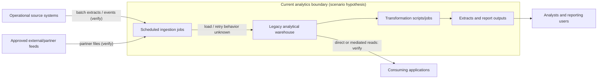
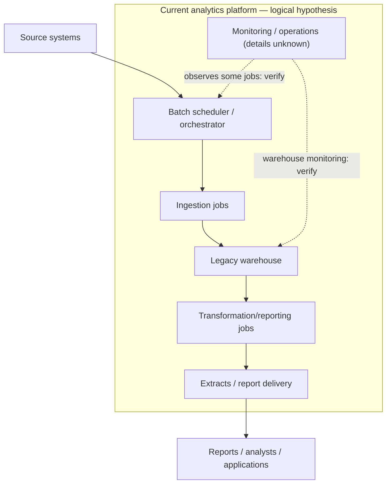
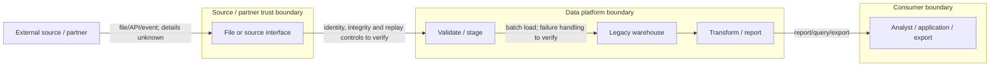
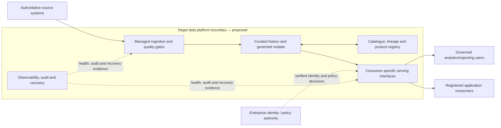
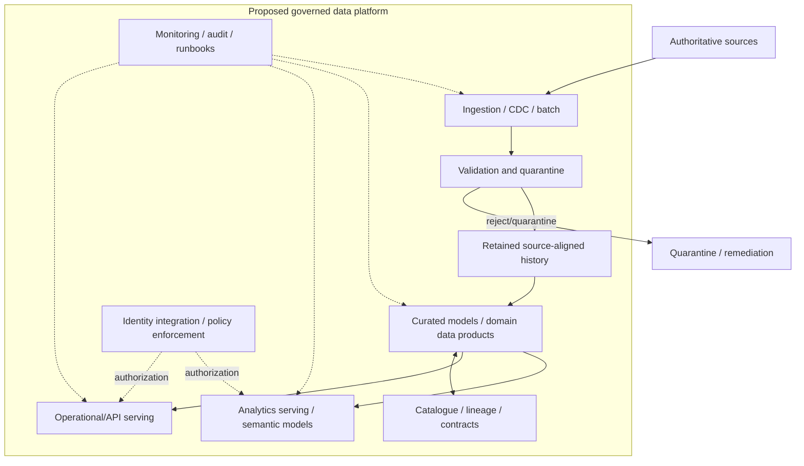

# Project 15 — Current-State-to-Target-State Architecture Review

> **Roadmap:** Stage 2D — Data Architecture / Module 2D.15 — Architecture Documentation, Reviews and Operating Model  
> **Project type:** Integrated enterprise data-architecture review and modernization plan  
> **Scenario:** Northbridge Bank (fictional; all names, systems, requirements, figures, dates, estimates, scores and outcomes are synthetic)  
> **Status:** Reference project and learning exercise; not a real bank architecture or production approval  
> **Methodology:** Evidence-led, stakeholder-driven, vendor-neutral, and proportional to risk

---

## 0. Project overview

### 0.1 What this project is about

This capstone takes a fictional data platform from an evidence-based understanding of its current state to a target-state architecture and a feasible, risk-managed migration roadmap. It combines architecture documentation, design review, decision governance, security/threat analysis, operating-model design, modernization planning, and stakeholder communication.

The outcome is not merely a set of diagrams. It is an integrated review package that answers:

- What exists today, and how do we know?
- What do stakeholders need, and what constraints govern the design?
- What should exist in the target state, and which requirements does it satisfy?
- What are the material gaps, risks, dependencies and unresolved decisions?
- Why were the selected patterns and migration strategy chosen over credible alternatives?
- Who is accountable for each component, decision, risk and operational outcome?
- How can the organization transition safely while continuing to operate?
- What evidence would justify approval, cutover, rollback, or rejection?
- How should the recommendation be explained to technical and business audiences without changing the underlying facts?

### 0.2 Scenario

Northbridge Bank is a fictional institution with a legacy analytics warehouse, scheduled batch ingestion, a collection of independently managed data extracts, a risk reporting workflow, and several application and analytics consumers. Some source ownership and data lineage are poorly documented. The organization is considering a modernized governed data platform with clearer interfaces, traceable data products, improved operational controls, and staged migration.

This scenario is illustrative. It does not establish the real state of any organization, prove that any named technology exists, or claim that a framework, standard, security control, or operating model has been formally adopted.

### 0.3 Intended audience

- data and enterprise architects;
- data engineering and platform engineering teams;
- security, privacy, risk and governance reviewers;
- application and analytics owners;
- SRE/operations and service owners;
- delivery/program managers;
- business sponsors, finance stakeholders and decision authorities.

### 0.4 Outcomes

At completion, the learner should be able to produce and defend:

1. a source-backed current-state baseline;
2. a target-state architecture tied to measurable requirements;
3. consistent context, container, component, deployment, and data-flow/trust-boundary views where applicable;
4. an architecture description with stakeholder concerns, viewpoints, correspondence and evidence limitations;
5. at least two meaningful ADRs and a decision log;
6. a structured design-review report, threat model, risk register and closure tracker;
7. an applicability assessment for reference architectures, standards and reusable patterns;
8. an ownership matrix and operating-model note with clear accountability;
9. a dependency-aware migration roadmap with critical path, checkpoints, cutover, rollback and decommissioning;
10. a technical brief and a business brief with one consistent fact base;
11. a requirement-to-decision-to-evidence traceability matrix;
12. a final review record with findings, open questions, residual risks and explicit approval status.

### 0.5 Scope

**In scope**

- project initiation, stakeholder identification, requirements and evidence planning;
- current-state inventory, diagrams, data flows, trust boundaries and operational reality;
- target-state capabilities and views;
- gap analysis and options evaluation;
- ADRs and decision log;
- architecture review, threat scenarios, risk treatment and closure criteria;
- standards/reference-pattern applicability and documented deviations;
- team boundaries, ownership, decision rights, service interfaces and operating responsibilities;
- migration strategy, dependencies, critical path, parallel operation, validation, cutover, rollback and decommissioning;
- technical/business communication, reviewer challenge and final validation.

**Out of scope unless separately authorized**

- connecting to real production systems or collecting sensitive customer data;
- making legal, regulatory, compliance, or certification claims;
- asserting that an illustrative control is implemented or effective;
- selecting a cloud vendor or product without requirements, due diligence and evidence;
- making production changes, deploying infrastructure, or approving real residual risk;
- inventing a real organization chart, decision authority, budget, or project schedule.

### 0.6 Source-of-truth and repository caveat

The Module 2D.15 roadmap identifies the nine lesson topics and describes the final project as integrating all nine. It also notes that the project file and certain module overview files were empty when the roadmap was authored. Accordingly, this is a proposed project specification derived from the roadmap and lesson scope; it does not claim to preserve requirements from a pre-existing project file.

The recommended outputs in this document are learning-project deliverables. If an actual project file, approved policy, or repository instruction later supplies stricter requirements, those sources take precedence and the project should be reconciled explicitly.

### 0.7 Evidence labels

Use these labels throughout the project:

- **OBSERVED:** directly verified from an identified source, configuration, inventory, log, interview record, or test.
- **REPORTED:** stated by an accountable owner but not independently verified.
- **INFERRED:** derived from available evidence; explain the reasoning.
- **ASSUMPTION:** provisional statement used to progress design; owner and validation action required.
- **UNKNOWN:** insufficient evidence to make a defensible claim.
- **PROPOSED:** target design or control not yet implemented.
- **TESTED:** a defined test was executed in a named environment and its evidence is linked.
- **APPROVED:** the relevant authorized decision-maker approved the specific item for a stated purpose and scope.

Never label an assumption as observed, a proposal as implemented, a planned mitigation as a completed control, or a draft as approved.

---


### 0.8 Explicit source-file alignment

This project integrates the following nine module lessons. These filenames are references to the supplied roadmap structure; the project does not assert that any method named within them is formally adopted as an organizational standard.

| Topic | Source lesson file | Integrated project sections |
|---|---|---|
| 01 | `01-context-container-component-and-deployment-diagrams.md` | Steps 3–5; diagram metadata and consistency rules |
| 02 | `02-data-flow-and-trust-boundary-diagrams.md` | Steps 3, 7 and 12; data-flow and threat review |
| 03 | `03-architecture-description-and-viewpoints.md` | Step 5; viewpoint register, correspondence and reader tests |
| 04 | `04-architecture-decision-records-and-decision-log.md` | Step 6; ADRs, decision log and audit checklist |
| 05 | `05-design-reviews-threat-models-and-risk-registers.md` | Step 7; review plan, findings, threats, risks and closure |
| 06 | `06-reference-architectures-standards-and-reusable-patterns.md` | Step 8; applicability, comparison, adaptations and exceptions |
| 07 | `07-team-boundaries-ownership-and-platform-operating-model.md` | Step 9; operating-model choices, responsibility and ownership gaps |
| 08 | `08-migration-roadmaps-and-architecture-modernization.md` | Step 10; gap analysis, dependencies, critical path, rollback and retirement |
| 09 | `09-communicating-trade-offs-to-technical-and-business-stakeholders.md` | Step 11; technical/business briefs, fact consistency and reviewer Q&A |

The roadmap and module `README.md`, `practice-questions.md`, and `Projects/README.md` should also be reviewed during repository integration. Where those files are empty or do not specify project acceptance criteria, this project treats its deliverables as recommendations and records that limitation rather than inventing repository requirements.

## 1. Project governance and success criteria

### 1.1 Roles

| Role | Primary accountability | Expected contribution |
|---|---|---|
| Business sponsor | Business outcomes, funding direction and business acceptance | Confirms goals, impact, priorities and decision deadlines |
| Architecture review lead | Scope, evidence quality, review process and integrated package | Maintains traceability and drives review to closure |
| Data architect | Architecture views, patterns, decisions and target-state coherence | Owns technical architecture recommendations |
| Source-system owners | Accuracy of source facts, interfaces and lifecycle behavior | Validate inventory, dependencies and migration constraints |
| Data product/domain owners | Data semantics, quality, contracts and consumer fit | Approve definitions and consumer requirements |
| Security/identity owner | Identity, access, trust boundaries and security review | Validates threats, controls and access decisions |
| Privacy/governance owner | Classification, retention, deletion, lineage and policy | Confirms governance requirements and evidence |
| Platform/SRE owner | Operability, reliability, recovery and service objectives | Validates supportability, runbooks and cutover readiness |
| Delivery/migration lead | Sequencing, dependencies, resourcing and milestones | Maintains the plan and reports variance |
| Finance/FinOps | Cost assumptions, budget constraints and cost evidence | Validates unit economics and estimate boundaries |
| Business/technical reviewers | Challenge evidence, requirements and trade-offs | Review package and record dissent or open issues |
| Decision authority | Approves only the decisions within its delegated remit | Records decision, conditions and any residual-risk acceptance |

One person may hold several roles in a small exercise, but accountability and decision rights must still be explicit. Do not assume the architect has authority to accept business, privacy, security or operational risk.

### 1.2 Governance cadence

Suggested learning-project checkpoints:

1. initiation and scope approval;
2. current-state evidence review;
3. requirements and target-state review;
4. options and ADR review;
5. security/threat/risk review;
6. operating-model and migration feasibility review;
7. stakeholder brief review;
8. final integrated-package challenge;
9. closure review and next-step decision.

The cadence is illustrative. A real organization should scale review formality to materiality, reversibility, uncertainty, and impact.

### 1.3 Definition of success

The package is ready for a final architecture review when:

- every material current-state claim has an evidence label and traceable source or is explicitly marked unknown;
- each in-scope stakeholder concern maps to a view, decision, or recorded gap;
- target-state requirements map to architecture elements and acceptance evidence;
- diagrams and supporting artefacts use stable identifiers and have no unexplained contradictions;
- significant decisions include credible alternatives, rationale, consequences and status;
- review findings and risks have owners, due dates, treatment and objective closure evidence;
- applicable patterns/standards are justified, and deviations or exceptions are documented;
- each material component, data product, interface, decision and operational responsibility has an accountable owner;
- the migration plan includes dependencies, a reproducible critical path, validation, cutover, rollback and decommissioning;
- technical and business briefs communicate the same facts and uncertainty;
- unresolved issues, residual risks, limitations and approval status are visible;
- a reviewer can trace at least three important claims to evidence and challenge at least five design choices.

### Gate 1 — Initiation

- [ ] Sponsor, review lead and decision authority are identified.
- [ ] Scope, exclusions, intended decisions and audience are stated.
- [ ] Evidence collection plan and evidence labels are agreed.
- [ ] Sensitive-data handling and synthetic-data rules are documented.
- [ ] Review participants and required approvals are known.
- [ ] Success criteria and completion gate are agreed.

---

## 2. Step 1 — Initiate, frame the problem, and plan evidence collection

### 2.1 Define the decision problem

Write a concise problem statement:

> Northbridge needs to determine whether its current data architecture and operating model meet validated business, data, security, reliability, performance, cost and changeability requirements; if not, it needs a target state and a safe, evidence-based transition plan.

This statement is a scenario framing, not an observed diagnosis. Refine it after discovery.

### 2.2 Identify decisions to be made

Examples of review decisions:

- retain, improve, replace, or decommission a legacy component;
- centralize a shared platform capability or keep a domain-owned implementation;
- adopt, adapt, or reject a reusable pattern;
- use phased migration, parallel run, strangler migration, or another transition strategy;
- accept a temporary coexistence risk or delay a cutover;
- approve a target-state recommendation for further design, implementation, or a pilot.

Each decision needs a named authority, decision deadline, required inputs and explicit consequences of deferral.

### 2.3 Evidence collection plan

| Evidence ID | Evidence sought | Candidate source | Owner | Status | What it can support | Limitation |
|---|---|---|---|---|---|---|
| EV-001 | System inventory and deployment footprint | CMDB, cloud inventory, IaC, platform catalog | Platform owner | Unknown until collected | Components and runtime placement | May omit shadow assets or stale entries |
| EV-002 | Data lineage and pipeline schedule | Orchestrator, catalog, code, job logs | Data engineering | Unknown | Data flows, dependencies and freshness | Job definitions do not prove successful operation |
| EV-003 | Interface/API contracts | API specs, consumer registry, source code | Application owner | Unknown | Interfaces, schemas and consumers | Docs may be stale; verify implementation |
| EV-004 | Data classification and access policy | Governance catalog, IAM/policy records | Governance/security | Unknown | Classification and intended access rules | Policy text does not prove enforcement |
| EV-005 | Performance and cost measurements | Monitoring, billing, workload reports | SRE/FinOps | Unknown | Baseline latency, throughput, spend | Validate time window and workload representativeness |
| EV-006 | Incident and recovery history | Incident tickets, postmortems, restore tests | SRE | Unknown | Failure modes and operational pain points | Reporting bias and incomplete history possible |
| EV-007 | Stakeholder interviews | Structured interviews and review notes | Review lead | Planned | User needs and reported constraints | Reported statements require confirmation where material |
| EV-008 | Security/control test evidence | Approved test reports, configuration evidence | Security owner | Unknown | Control behavior within tested scope | Test scope/date may not cover current state |
| EV-009 | Contracts, retention and deletion obligations | Data governance and legal-approved policy sources | Governance owner | Unknown | Lifecycle constraints | Interpretation requires authorized owner |
| EV-010 | Architecture decisions and change history | ADRs, decision log, change records | Architecture lead | Unknown | Existing commitments and rationale | Absence of an ADR does not prove no decision occurred |

Use only sources that are authorized for the exercise. Do not copy secrets, customer records, or restricted documents into the project artifact.

### 2.4 Evidence quality rubric

| Quality | Meaning | Treatment |
|---|---|---|
| Strong | Current, authoritative, scope-matched and independently verifiable | May support a factual claim within its scope |
| Moderate | Credible but incomplete, indirect or not independently verified | State limitations and seek corroboration for high-impact claims |
| Weak | Anecdotal, stale, undocumented or inconsistent | Treat as a lead or reported statement, not proof |
| Missing | No evidence available | Mark unknown, assign owner and define evidence action |

### 2.5 Assumption and open-question register

| ID | Statement/question | Type | Impact if wrong | Owner | Validation action | Due/trigger | Status |
|---|---|---|---|---|---|---|---|
| AS-001 | Legacy warehouse supports all critical finance reports | Assumption | High | Finance/data owner | Reconcile report inventory to consumers and schedules | Before target approval | Open |
| AS-002 | All downstream consumers are registered | Assumption | High | Platform owner | Compare query logs, access logs and known consumer list | Before migration design | Open |
| AS-003 | Current source interfaces support parallel reads | Unknown | High | Source owner | Confirm semantics, load limits and vendor/source constraints | Before pilot | Open |
| AS-004 | Data can be retained in the proposed target region | Unknown | High | Governance/security | Validate approved residency policy | Before product selection | Open |
| AS-005 | Teams can support new on-call duties | Assumption | Medium/High | Engineering managers | Capacity and skills review | Before cutover | Open |

Add rows rather than silently resolving uncertainty. Assumptions with high impact must have an owner and a deadline before dependent decisions are approved.

### Outputs

- charter and decision list;
- stakeholder list and review calendar;
- evidence plan and evidence register;
- assumption/dependency/open-question register;
- synthetic-data and information-handling rules.

### Gate 2 — Evidence plan accepted

The review has a credible plan for validating high-impact claims. Missing evidence is visible and does not get silently replaced by plausible architecture assumptions.

---

## 3. Step 2 — Discover stakeholders, concerns, requirements, and constraints

### 3.1 Stakeholder–concern–view matrix

| Stakeholder role | Concern ID | Concern phrased as an answerable question | Candidate view/evidence | Priority | Decision/action |
|---|---|---|---|---|---|
| Business sponsor | C-01 | Which business outcomes and service risks justify the investment? | Business brief, options table, cost assumptions | High | Fund, defer or reject |
| Finance/reporting owner | C-02 | Can a reporting result be reproduced for an approved cutoff? | Data flow, lineage, snapshot/retention design, test evidence | High | Accept reporting design |
| Data engineering | C-03 | What dependencies, retries, schedules and quality checks exist? | Container/deployment views, DFD, pipeline inventory | High | Plan remediation/migration |
| Application owner | C-04 | Which interfaces and consumer behaviors could break during transition? | Context/container view, contract inventory, migration plan | High | Approve compatibility/cutover |
| Security/identity | C-05 | Where do identity, data, tenant or control boundaries change? | DFD, trust-boundary map, threat model | Critical | Approve controls or block |
| Privacy/governance | C-06 | How are classification, retention, deletion and lineage enforced? | Data lifecycle view, policy sources, evidence register | Critical | Approve governance conditions |
| SRE/operations | C-07 | Can the target be monitored, recovered, supported and rolled back? | Deployment view, SLOs, runbooks, restore evidence | High | Accept operational readiness |
| Domain/data product owner | C-08 | Who owns semantics, quality, freshness and consumer contracts? | Product inventory, ownership matrix, contracts | High | Accept product accountability |
| Architecture authority | C-09 | Are target decisions traceable and alternatives fairly evaluated? | ADRs, requirements traceability, review findings | High | Accept/reject recommendation |
| Delivery lead | C-10 | Is the sequence feasible with dependency constraints and capacity? | Migration roadmap, critical path, resource assumptions | High | Approve plan baseline |

This matrix is illustrative; interview real stakeholders and replace it with validated concerns. A view is useful only if it answers the concern, not merely because the concern's name appears in a caption.

### 3.2 Requirement register

Every requirement must have an ID, type, source, priority, acceptance criteria, owner and verification method.

| ID | Type | Illustrative requirement | Acceptance criteria | Verification |
|---|---|---|---|---|
| REQ-001 | Business | Critical risk reports remain available through migration | All in-scope reports have agreed service window and tested transition | Consumer inventory and parallel-run evidence |
| REQ-002 | Data correctness | Key measures reconcile between old and new paths | Differences are zero or within explicitly approved tolerance and explained | Reconciliation report |
| REQ-003 | Lineage | Material outputs trace to authoritative inputs | Each critical output has source, transform, version/cutoff and owner | Lineage walkthrough |
| REQ-004 | Security | Access is least-privilege and trust crossings are explicit | Required identity, authorization and audit tests pass for the defined scope | Security evidence and review |
| REQ-005 | Privacy/lifecycle | Retention, correction and deletion propagate to derived data | Defined lifecycle tests pass for each required derived copy | Deletion/correction test evidence |
| REQ-006 | Reliability | Critical path has defined recovery behavior | RTO/RPO or equivalent business recovery objectives approved and tested | Restore/game-day evidence |
| REQ-007 | Performance | Target meets agreed workload objectives | Representative workload test meets approved latency/throughput/error criteria | Load-test report |
| REQ-008 | Operability | Each critical component has owner and support route | Ownership, alert route, runbook and escalation tested | Operational readiness review |
| REQ-009 | Changeability | Interfaces and semantic changes are managed | Consumer inventory, compatibility policy and migration notice defined | Contract tests and change review |
| REQ-010 | Cost | Investment and ongoing cost can be explained | Assumptions, units, date, cost boundary and sensitivity recorded | FinOps review |
| REQ-011 | Migration | Cutover and rollback are feasible | Rehearsed runbook, data reconciliation, abort triggers and rollback evidence | Migration rehearsal |
| REQ-012 | Governance | Decision and risk ownership are explicit | Each material decision/risk has owner, status and review trigger | Decision/risk-log audit |

These are candidate requirements, not validated requirements or achieved outcomes. Replace or refine them after stakeholder discovery.

### 3.3 Constraints and quality attributes

Capture at least:

- business continuity and critical reporting deadlines;
- source system limits and maintenance windows;
- data volume, growth, update frequency and retention;
- latency, throughput, concurrency and freshness;
- correctness, reproducibility, schema compatibility and lineage;
- availability, recovery, backup/restore and failure domains;
- identity, authorization, privacy, classification and residency;
- delivery capacity, skill availability and on-call coverage;
- commercial contracts, existing commitments and exit costs;
- regulatory or policy obligations confirmed by authorized owners.

Do not infer an exact regulatory obligation from an industry label. Record the authoritative source and responsible reviewer.

### Gate 3 — Requirements baseline

- [ ] Material concerns are answerable and prioritized.
- [ ] Requirements distinguish business outcomes from proposed solutions.
- [ ] Acceptance criteria and verification methods are specified.
- [ ] Constraints, assumptions, dependencies and unknowns are visible.
- [ ] Stakeholders have validated the baseline or recorded dissent.

---

## 4. Step 3 — Establish and document the current-state architecture

### 4.1 Current-state discovery method

Build the current-state model from multiple evidence sources. Do not begin by drawing the architecture that people remember.

1. Inventory systems, services, pipelines, stores, APIs, schedules, consumers and ownership.
2. Inspect source code, configuration, IaC, deployment inventory, orchestration, lineage/catalog, access records, logs and operational documentation as permitted.
3. Interview system and data owners; record reported facts separately from observed evidence.
4. Trace critical data products from source through ingestion, transformation, storage, access and consumer.
5. Include secondary/control-plane flows where relevant: credentials, logs, monitoring, retries, replay, backups, exports, admin interfaces and support access.
6. Record stale documentation, undocumented dependencies, shadow extracts, duplicate transformations and unknown ownership.
7. Assign confidence and evidence references to material claims.
8. Reconcile diagrams against inventory and runtime/configuration evidence.
9. Review the baseline with system owners and record unresolved contradictions.

### 4.2 Synthetic current-state component inventory

The following is a **scenario hypothesis** used to demonstrate the method. Every item must be validated in a real engagement.

| Element ID | Element | Responsibility | State/evidence status | Known or hypothesized concern | Owner status |
|---|---|---|---|---|---|
| CUR-SYS-01 | Operational source systems | Authoritative customer/account/transaction records | Assumed in scenario | Interface and change constraints unknown | Source owner to identify |
| CUR-ING-01 | Scheduled ingestion jobs | Batch extract and load | Assumed | Failure/retry/late-data behavior needs evidence | Data engineering owner to identify |
| CUR-STO-01 | Legacy analytical warehouse | Historical analytics/reporting store | Assumed | Capacity, cost, lineage and lifecycle evidence required | Platform owner to identify |
| CUR-TR-01 | Transformation scripts/jobs | Curate/reporting datasets | Assumed | Logic duplication and version control unknown | Domain owner to identify |
| CUR-EXP-01 | Ad hoc extracts | Local analyst/consumer copies | Assumed | Access, freshness and retention unclear | Consumer/owner unknown |
| CUR-RPT-01 | Risk and finance reports | Business decisions and periodic reporting | Assumed | Criticality and exact report inventory need validation | Business owner to identify |
| CUR-ACC-01 | Identity/access services | Authenticate users and govern access | Unknown implementation details | Effective enforcement not yet evidenced | Security owner to identify |
| CUR-OPS-01 | Monitoring and recovery | Alerting, backup, restore and incident response | Unknown | Actual restore evidence and on-call coverage unknown | SRE owner to identify |

Do not present this table as a real asset inventory. Replace the status column with verified evidence when collecting actual source material.

### 4.3 Current-state context diagram



**View metadata:** `CUR-VIEW-CTX-01`; purpose: establish system boundary and external relationships; audience: business, architecture and engineering; status: illustrative current-state hypothesis; owner: review lead pending assignment; version: 0.1; evidence: scenario assumptions only; limitation: no live inventory has been validated.

### 4.4 Current-state container diagram



This logical view does not prove physical deployment, network routes, authorization, high availability, or that every arrow exists in the actual environment.

### 4.5 Current-state data-flow and trust-boundary sketch



The diagram marks logical trust boundaries for investigation; it does not assert the actual network, tenancy, identity, encryption or authorization implementation. Every crossing requires evidence for data type/classification, identity, authorization, transport, validation, audit, failure handling and ownership.

### 4.6 Current-state evidence and discrepancy log

| ID | Observation/discrepancy | Evidence | Severity | Owner | Action |
|---|---|---|---|---|---|
| CUR-GAP-01 | A consumer or extract is not represented in the inventory | Unknown; validate from query/access logs and interviews | Open | Platform owner | Reconcile inventory |
| CUR-GAP-02 | Diagram flow and actual scheduled job may differ | Unknown until job configuration/log review | Open | Data engineering | Verify schedule, direction and failure path |
| CUR-GAP-03 | Access control is shown conceptually but not proven | No evidence in scenario | High pending evidence | Security owner | Review policy, configuration and negative tests |
| CUR-GAP-04 | Recovery capability is undocumented in this scenario | No restore evidence supplied | High pending evidence | SRE owner | Find latest restore test or run one |
| CUR-GAP-05 | Extract lifecycle/retention may be unmanaged | Hypothesis only | High pending evidence | Governance owner | Inventory copies and validate lifecycle policy |

### 4.7 Current-state quality gate

The current state is not accepted because it looks complete. It is accepted for a declared review purpose when critical assets, flows, consumers, trust boundaries and operational responsibilities are supported by evidence or clearly marked unknown. Unresolved unknowns must flow into risks, target constraints and migration prerequisites.

### Outputs

- current-state inventory;
- context/container/component/deployment views as applicable;
- data-flow and trust-boundary diagrams;
- source-to-consumer lineage for critical paths;
- evidence-backed discrepancy/open-question log;
- current-state limitations and confidence statement.

### Gate 4 — Current-state baseline

- [ ] Every critical asset and consumer is represented or explicitly excluded.
- [ ] Every material flow has direction, content/purpose, producer, consumer and evidence status.
- [ ] Trust boundaries and secondary/control-plane paths are considered.
- [ ] Diagrams carry metadata, legend, scope, version, owner and limitations.
- [ ] Current-state claims have evidence labels.
- [ ] Unknowns have owners and validation actions.

---

## 5. Step 4 — Define target state from requirements, not technology preference

### 5.1 Target-state principles

Proposed principles for the exercise:

1. **Consumer-driven interfaces:** each consumer accesses data through a documented interface fit for its pattern.
2. **Authoritative ownership:** every source, data product, service and important decision has a named owner.
3. **Traceable semantics:** shared metrics and transformations have definitions, lineage and versioning.
4. **Least privilege:** identity and authorization are enforced at the correct boundaries and tested.
5. **Lifecycle by design:** correction, retention, deletion, backup and derived-copy behavior are defined.
6. **Operationally supportable:** every critical path has observability, a runbook, recovery behavior and on-call ownership.
7. **Incremental and reversible where practical:** migrate in bounded waves with validation and rollback.
8. **Evidence over assertion:** performance, recovery, access and correctness claims need appropriate proof.
9. **Reuse with judgment:** patterns and standards are assessed for applicability; exceptions are explicit.
10. **Cost transparency:** cost assumptions and unit economics are traceable and revisited when evidence changes.

These are proposed project principles, not claims of organizational adoption.

### 5.2 Target capability map

| Capability | Target responsibility | Requirement(s) supported | Owner to assign | Validation |
|---|---|---|---|---|
| Source ingestion and change capture | Reliable, observable acquisition with schema/quality checks | REQ-001, 003, 005 | Data platform/domain | Replay, freshness and lineage tests |
| Curated data and governed models | Reusable history, transformations and semantics | REQ-002, 003, 009 | Domain/data product owner | Reconciliation and data-quality tests |
| Catalogue, lineage and product registry | Discoverability, ownership, contracts and impact analysis | REQ-003, 008, 009, 012 | Data governance/platform | Reader and lineage walkthrough |
| Consumer-serving interfaces | Fit-purpose APIs, analytics, extracts and data products | REQ-001, 007, 009 | Product/service owners | Contract and workload tests |
| Identity, access and audit | Controlled access, identity propagation and traceability | REQ-004, 005 | Security owner | Positive/negative authorization tests |
| Observability and recovery | Monitoring, alerts, backup/restore and incident response | REQ-006, 008 | SRE/platform | Game day and restore test |
| Governance and lifecycle | Classification, retention, correction/deletion, approvals | REQ-005, 012 | Governance/domain owners | Lifecycle test evidence |
| Migration control plane | Reconciliation, dual-run, cutover, rollback and progress tracking | REQ-001, 002, 011 | Migration lead | Rehearsal and exit criteria |

### 5.3 Target-state context diagram



**View metadata:** `TGT-VIEW-CTX-01`; purpose: explain target capabilities and external relationships; audience: all reviewers; status: proposed; version: 0.1; owner: data architect pending appointment; assumptions: capabilities can be delivered within approved constraints; limitations: logical concept, no vendor/product or deployment decision made.

### 5.4 Target-state container view



This view defines responsibilities, not a mandated physical architecture. The target may use a lakehouse, warehouse, event platform, API layer, or other products only after requirements and evidence justify the choice.

### 5.5 Target deployment view template

The final deployment view must be created for a named environment and include, as applicable:

- account/subscription/project boundaries;
- region and availability zones;
- network segments and private/public endpoints;
- compute/runtime placement;
- data-store placement, replication and encryption/key boundaries;
- identity and secret-management integration;
- backup/restore location and failure domain;
- observability/logging path;
- ingress/egress and external dependencies;
- environment separation (development, test, staging, production);
- data residency and retention constraints;
- evidence status for each placement claim.

Do not fill in specific regions, cloud products, network ranges, encryption algorithms or availability claims without approved requirements and evidence.

### 5.6 Target acceptance criteria

For each target capability define:
- requirement IDs addressed;
- owner and support model;
- architecture views and interfaces;
- expected data quality, freshness and correctness;
- access and lifecycle controls;
- reliability/performance objective;
- validation evidence;
- failure/degraded behavior;
- dependencies and migration prerequisites;
- cost boundary and estimate status.

### Gate 5 — Target-state review

- [ ] Each target capability maps to at least one requirement or a justified operational need.
- [ ] Proposed components have a reason and accountable owner.
- [ ] Logical architecture is not misrepresented as deployed infrastructure.
- [ ] Security, data lifecycle, recovery and operational needs are included.
- [ ] Target acceptance criteria are measurable or clearly blocked pending evidence.

---

## 6. Step 5 — Build the architecture description, viewpoints, and correspondence model

### 6.1 Architecture-description structure

Use a navigable description with these sections:

1. title, owner, status, version, date and review trigger;
2. purpose, scope, exclusions, audience and limitations;
3. stakeholder register and concern-to-view matrix;
4. requirements, constraints, assumptions and quality attributes;
5. current-state architecture views;
6. target-state architecture views;
7. data-flow/trust-boundary and lifecycle views;
8. architecture decisions and decision-log references;
9. review findings, threats and risks;
10. standards/patterns and exception records;
11. ownership and operating model;
12. migration roadmap, transition states and rollback;
13. evidence register, open questions and unresolved decisions;
14. glossary, references and change history.

The description is the navigable whole; individual views answer selected questions. Avoid duplicating full ADRs and risk registers in the description—link to their authoritative records.

### 6.2 Viewpoint register

| Viewpoint ID | Audience | Concern | Model/view | Required elements | Validation |
|---|---|---|---|---|---|
| VP-CTX | Business, architecture, product | Scope and external dependencies | Context diagram | Actors, system boundary, labelled interactions | Stakeholder walkthrough |
| VP-CONT | Architecture, engineering, operations | Major responsibilities and interfaces | Container diagram | Runtime/service/data capability boundaries | Parent-child and interface consistency |
| VP-COMP | Developers/maintainers | Internal responsibility and dependencies | Component diagram for selected critical container | Components, interfaces, dependency direction | Code/configuration comparison where available |
| VP-DEP | SRE, security, platform | Runtime placement and failure boundaries | Deployment diagram | Environments, regions, nodes, network and data placement | Inventory/IaC/operations evidence |
| VP-DFD | Security, data, engineering | Data movement and trust crossings | Data-flow diagram | Actors, processes, stores, labelled flows, trust boundaries | Flow inventory and threat review |
| VP-OPS | SRE, service owners | Reliability, support, recovery | Operational/dependency view | SLOs, owners, alerts, recovery and failure modes | Runbook and game-day review |
| VP-MIG | Delivery, business, engineering | Transition and cutover feasibility | Migration roadmap/transition view | Waves, dependencies, validation, rollback | Critical path and rehearsal |
| VP-GOV | Governance, risk, architecture authority | Decisions, ownership and residual risk | Decision/risk/ownership views | IDs, statuses, owners, evidence and review triggers | Register audit |

These are proposed viewpoints. Select and tailor them to actual concerns; do not generate views that add no decision value.

### 6.3 Correspondence and cross-view consistency table

| Element ID | Current-state representation | Target-state representation | Related artefacts | Consistency question | Status |
|---|---|---|---|---|---|
| SYS-SOURCE | `CUR-SYS-01` source systems | Source systems remain authoritative | Inventory, DFD, ADR | Is ownership and interface behavior verified? | Open |
| DATA-INGEST | `CUR-ING-01` scheduled jobs | Managed ingestion/quality capability | Container, DFD, migration wave | Does every source have a migration/replay plan? | Open |
| DATA-STORE | `CUR-STO-01` legacy warehouse | Curated governed storage/model | Deployment, data model, ADR | Can consumers reconcile and migrate safely? | Open |
| DATA-CONSUMER | Reports/extracts | Registered governed interfaces/products | Context, contracts, ownership | Are all consumers identified and assigned? | Open |
| IDENTITY | Existing access mechanisms (unknown) | Verified identity/policy enforcement | DFD, threat model, security findings | Is effective authorization demonstrated? | Open |
| OPERATIONS | Current monitoring/recovery (unknown) | Target observability/runbooks/recovery | Deployment, SLOs, operating model | Are alerts, on-call and restore tested? | Open |

### 6.4 Diagram consistency rules

- stable element IDs and names across views;
- every component has an explicit parent container;
- every in-scope container has a deployment mapping or a clearly stated “not deployed / not applicable” status for each relevant environment;
- all material arrows have direction and meaningful labels;
- protocol, cadence, data content and trust boundary are included when relevant and known;
- external dependencies and failure paths are not hidden;
- logical links are not presented as physical network routes;
- current, target, transition and deprecated views are labelled distinctly;
- unsupported claims are marked unknown or proposed;
- each view has purpose, audience, scope, owner, version/date, legend, evidence and limitations;
- deliberate omissions have reasons;
- accessibility and readability are reviewed; meaning does not rely on color alone.

### 6.5 Reader validation

Ask at least five reviewers or role-based readers to answer specific questions using only the package:

1. Which systems are inside the review boundary?
2. Where does critical data originate and where is it consumed?
3. Which access or trust-boundary crossings are most sensitive?
4. Which decisions remain open, and who can decide them?
5. What must be true before the first migration wave can cut over?
6. Who owns recovery if the new serving path fails?
7. What evidence supports the claim that the target meets a critical requirement?

Record whether each reader found the answer, the time/ambiguity, missing source links, and remediation. A self-review is acceptable for practice if no independent reviewer is available, but mark it as self-review.

### Outputs

- architecture description;
- viewpoint definitions and concern-to-view matrix;
- correspondence table;
- diagram consistency report;
- reader-test report and open-issue list.

### Gate 6 — Description quality

All in-scope concerns are covered, partially covered with a recorded gap, or justified as not applicable. Cross-view mismatches are resolved or owned. Readers can locate key answers without relying on undocumented verbal explanation.

---

## 7. Step 6 — Create ADRs and maintain the decision log

### 7.1 ADR decision criteria

For every material choice, define criteria before scoring alternatives. Criteria may include:

- requirement fit and correctness;
- security/privacy and trust boundaries;
- reliability and recovery;
- performance, capacity and freshness;
- interoperability and portability;
- implementation and lifecycle cost;
- operational burden and team capability;
- migration complexity, reversibility and lock-in;
- time to validate and delivery risk.

Use qualitative scoring when evidence is insufficient. If numeric scoring is used, explain scale, weights, evidence and sensitivity. Do not sum ordinal scores and present the result as objective truth.

### 7.2 ADR template

```markdown
# ADR-<ID>: <decision title>

- Status: proposed | accepted | rejected | superseded | deprecated | revisited
- Decision owner/decider:
- Author:
- Created / last reviewed:
- Related requirements, views, risks and evidence:
- Revisit trigger:

## Context and problem
## Decision drivers and constraints
## Assumptions and unknowns
## Options considered
## Evaluation criteria and evidence
## Decision and rationale
## Positive consequences
## Negative consequences and trade-offs
## Risks, mitigations and follow-up actions
## Migration and operational implications
## Dissent / unresolved questions
## Approval and decision history
```

### 7.3 ADR-001 — Migration strategy

- **Status:** Proposed; not approved.
- **Context:** The current estate has unverified consumers and critical reporting dependencies. A single cutover may create unacceptable continuity and reconciliation risk.
- **Options:**
  1. big-bang replacement;
  2. phased migration by data product/consumer;
  3. parallel-run with controlled cutover;
  4. strangler pattern for selected interfaces.
- **Candidate decision:** Use a phased migration with parallel validation for critical reporting and a strangler approach where consumer interfaces permit it.
- **Rationale:** This limits the blast radius of each wave and allows reconciliation before switching critical consumers. This is a hypothesis to validate against source constraints, operating capacity and actual cost.
- **Trade-offs:** Dual-run adds cost and temporary complexity; consumer discovery and reconciliation must be complete; parallel systems can drift unless ownership and cutover rules are explicit.
- **Evidence required:** Consumer inventory, source constraints, rehearsal results, reconciliation tolerance, rollback feasibility and cost estimate.
- **Revisit triggers:** Source cannot support coexistence, dual-run results are unreliable, migration costs exceed approved bounds, or requirements favor a different transition style.

### 7.4 ADR-002 — Shared platform capability versus domain-local implementation

- **Status:** Proposed; not approved.
- **Context:** Shared ingestion, catalogue, lineage, security integration and observability may reduce duplication, while domain teams need autonomy over data semantics and delivery.
- **Options:** fully centralized platform; platform-plus-domain ownership; fully federated domain stacks; hybrid model.
- **Candidate decision:** Evaluate a platform-plus-domain model: platform team owns shared paved-road capabilities and reliability; domain teams own data meaning, quality and consumer contracts within agreed standards.
- **Rationale:** It can balance reuse and domain accountability, but only if service boundaries and decision rights are real rather than informal.
- **Trade-offs:** Requires explicit contracts, platform service levels, exception governance and a way to avoid a central bottleneck.
- **Evidence required:** Team capability, demand profile, ownership gap analysis, platform adoption/experience and operational cost.
- **Revisit triggers:** Platform becomes a bottleneck, domains cannot operate safely, or shared capabilities have no sustainable owner.

### 7.5 ADR-003 — Evidence and architecture-view conventions

- **Status:** Proposed.
- **Context:** Current and target diagrams can be mistaken for facts if they lack status, owner, date and evidence references.
- **Candidate decision:** Use stable IDs, explicit current/target/transition status, evidence labels, legends and correspondence checks for all material views.
- **Alternatives:** informal diagrams; separate documentation conventions per team; a single heavyweight standard for all artefacts.
- **Rationale:** Minimum common metadata supports traceability while leaving notation choices proportional to audience and need.
- **Trade-offs:** Some authoring overhead; conventions require maintenance and review.
- **Evidence required:** Reader tests and diagram consistency review.
- **Revisit triggers:** The conventions do not help readers or the organization formally adopts a different documentation standard.

### 7.6 Decision log

| Decision ID | Decision question | Status | Decider | Date | Related requirements/views/risks | Revisit trigger |
|---|---|---|---|---|---|---|
| ADR-001 | How to migrate critical consumers safely? | Proposed | To be assigned | Pending | REQ-001/002/011; migration views; RK-01 | Pilot or source constraints change |
| ADR-002 | How should shared and domain responsibilities be divided? | Proposed | To be assigned | Pending | REQ-008/009/012; ownership matrix; RK-04 | Operating model fails service expectations |
| ADR-003 | What minimum metadata/evidence convention is required? | Proposed | To be assigned | Pending | REQ-003/012; viewpoint register | Reader tests or governance changes |
| ADR-004 | Which target products and deployment pattern fit the workload? | Open | To be assigned | Pending | Requirements and evidence register | Workload/security/price evidence available |

Do not mark a decision “accepted” because an example is written. Record the actual authority and date only after the decision has been made.

### 7.7 ADR audit checklist

- [ ] Decision is architecturally significant and bounded.
- [ ] Context, constraints, assumptions and unknowns are explicit.
- [ ] At least two credible alternatives are compared where appropriate.
- [ ] Criteria were established before evaluating options.
- [ ] Evidence and uncertainty are visible.
- [ ] Positive and negative consequences are documented.
- [ ] Owner, decider, status, date and revisit triggers are accurate.
- [ ] Links to requirements, views, risks, evidence and migration are valid.
- [ ] Superseded history is preserved rather than erased.

### Gate 7 — Decision integrity

The package explains why the target is recommended and what would change the recommendation. Open decisions remain open, with owners and next steps.

---

## 8. Step 7 — Conduct design reviews, threat modelling, and risk assessment

### 8.1 Review plan

Define before the review:

- purpose, scope, system boundary and exclusions;
- review criteria and applicable requirements;
- required participants and decision rights;
- input artefacts and evidence cutoff date;
- review method and severity rubric;
- process for recording findings, dissent and unresolved questions;
- finding/risk owners and due dates;
- closure evidence and escalation route.

A review is not a meeting whose success is measured by consensus. It is a process that identifies evidence-backed findings and drives them to a defensible disposition.

### 8.2 Finding versus threat versus risk

- **Finding:** an evidence-backed observation that a criterion is met, unmet, contradicted, or not demonstrable.
- **Threat scenario:** a plausible way an actor, event or condition could compromise an asset or objective.
- **Risk:** an uncertain event or condition with impact, assessed under explicit assumptions.
- **Issue:** a problem that has already occurred or is currently present.
- **Assumption:** a provisional statement used without sufficient verification.
- **Open question:** a material unknown requiring investigation or decision.

Do not use these terms interchangeably.

### 8.3 Severity rubric

| Severity | Meaning | Typical response |
|---|---|---|
| Critical | Could cause severe unauthorized exposure, loss/corruption of critical data, or unsafe/irreversible action; evidence indicates a material blocker | Stop affected approval/cutover; contain and escalate immediately |
| High | Material requirement or control not met, or high-impact uncertainty blocks a safe decision | Must be resolved or formally handled by authorized decision before dependent milestone |
| Medium | Important defect with bounded impact or workable mitigation | Owner and due date; closure required by agreed gate |
| Low | Limited impact, documentation or usability issue | Track and resolve proportionately |
| Observation | Improvement opportunity or non-blocking uncertainty | Record rationale and decide whether to act |

Severity must be justified by context and impact, not merely by a numeric score.

### 8.4 Threat-model inventory

Use the DFD to identify assets, actors, entry points, data stores, trust boundaries, privileged paths, and secondary/control-plane flows. A mnemonic such as STRIDE may be used as a prompt if appropriate, but it does not prove completeness and is not assumed to be formally adopted.

| Threat ID | Asset/flow | Scenario | Potential impact | Existing control evidence | Required treatment/test | Owner |
|---|---|---|---|---|---|---|
| TH-01 | Source-to-ingestion flow | Malformed or malicious input bypasses validation | Corruption, injection or downstream failure | Unknown | Validate schema/content, quarantine, test invalid inputs and replay | Data engineering/security |
| TH-02 | Identity/trust boundary | Unauthorized principal accesses sensitive data | Confidentiality breach | Unknown | Verify policy enforcement and negative tests | Security owner |
| TH-03 | Data exports/extracts | Untracked copy escapes lifecycle controls | Retention/privacy exposure | Unknown | Inventory exports, restrict, expire and audit copies | Governance/domain owner |
| TH-04 | Migration dual-run | Old and new paths use different transformations | Incorrect business reporting | Unknown | Reconciliation, versioned definitions, discrepancy escalation | Data product owner |
| TH-05 | Admin/control plane | Privileged action changes access or pipeline behavior without trace | Unauthorized change or silent corruption | Unknown | Least privilege, change audit, separation of duties | Platform/security |
| TH-06 | Recovery path | Backup cannot be restored or restore omits required dependencies | Extended outage or data loss | Unknown | Restore rehearsal, dependency recovery and integrity check | SRE owner |
| TH-07 | Consumer interface | Breaking schema/semantic change reaches an unregistered consumer | Outage or wrong decision | Unknown | Consumer discovery, compatibility tests, staged rollout | Product owner |
| TH-08 | Parallel migration | Writes/updates diverge between old and new targets | Lost or inconsistent data | Unknown | Define authority per phase, idempotency and reconciliation | Migration lead |
| TH-09 | Observability/logs | Sensitive payloads or credentials are copied to logs | Confidentiality/secret exposure | Unknown | Redaction, log access and retention tests | SRE/security |
| TH-10 | External dependency | Source or identity provider fails during cutover | Unsafe fallback or prolonged disruption | Unknown | Timeout/degraded behavior and fault injection | Service owner |

### 8.5 Risk register

Use risk statements in the form: **because of [cause], [event] may occur, resulting in [impact]**.

| Risk ID | Risk statement | Likelihood | Impact | Current status | Treatment | Risk owner | Action owner | Due/trigger | Residual risk/acceptance |
|---|---|---|---|---|---|---|---|---|---|
| RK-01 | Because consumer inventory is incomplete, a hidden dependency may be missed, causing a broken critical report at cutover | Unknown | High | Open | Reconcile access/query logs, interviews and scheduled jobs; gate cutover on coverage | Business/platform owner | Migration lead | Before pilot | Pending |
| RK-02 | Because current metric logic is not fully traced, old/new results may diverge and lead to incorrect decisions | Unknown | High | Open | Metric lineage, golden datasets and reconciliation | Data owner | Analytics team | Before parallel run | Pending |
| RK-03 | Because access controls are not evidenced, the target may expose data across an unintended boundary | Unknown | Critical/High | Open | Threat review, policy validation, negative tests | Security owner | Platform team | Before security gate | No acceptance until reviewed |
| RK-04 | Because operational ownership is unclear, incidents may remain unresolved during migration | Unknown | High | Open | Assign one accountable owner, on-call, escalation and runbooks | Platform executive/owner | SRE manager | Before pilot | Pending |
| RK-05 | Because parallel operation adds cost and duplicate work, budget or team capacity may be exceeded | Unknown | Medium/High | Open | Estimate duration, cost, capacity and exit criteria; review weekly | Sponsor/FinOps | Delivery lead | Before plan baseline | Pending |
| RK-06 | Because restore behavior is untested, a failure may exceed business recovery tolerance | Unknown | High | Open | Perform restore rehearsal and record results | Service owner | SRE | Before production cutover | Pending |
| RK-07 | Because reference patterns may not fit source constraints, the target may introduce lock-in or operational gaps | Unknown | Medium/High | Open | Applicability assessment and ADR with alternatives | Architecture authority | Data architect | Before target approval | Pending |
| RK-08 | Because migration dependencies are inaccurate, critical-path dates may be misleading | Unknown | High | Open | Validate predecessor relationships and task estimates; re-baseline from evidence | Delivery lead | Project manager | Each planning gate | Pending |
| RK-09 | Because ownership changes are not planned, data quality and interface contracts may lose stewardship | Unknown | High | Open | Transition RACI, shadowing and acceptance of ownership | Domain owner | Engineering managers | Before handover | Pending |
| RK-10 | Because stakeholder briefs overstate estimates, business approval may be based on false certainty | Unknown | Medium/High | Open | Shared fact base, estimate labels and reviewer consistency check | Review lead | Authors | Before steering review | Pending |
| RK-11 | Because old copies are not inventoried, deletion/retention requirements may not propagate | Unknown | High | Open | Copy inventory and lifecycle tests | Governance owner | Data owners | Before cutover | Pending |
| RK-12 | Because target deployment assumptions are not verified, region/network/failure-domain design may be wrong | Unknown | High | Open | Validate IaC, network, residency and recovery evidence | Platform/security | Cloud/platform team | Before deployment approval | Pending |

Likelihood is marked unknown until evidence and a defined assessment method exist. Do not score unknown likelihood as low. Residual risk must be assessed after controls are implemented and tested; planned mitigation does not lower current risk automatically.

### 8.6 Finding register and closure criteria

| Finding ID | Evidence/location | Finding | Severity | Required correction | Owner | Due | Closure evidence | Status |
|---|---|---|---|---|---|---|---|---|
| FIND-01 | Current inventory; evidence to collect | Consumer coverage is not yet demonstrated in the scenario | High pending verification | Complete consumer inventory and trace critical consumers | Platform owner | Before pilot | Reconciled inventory and owner sign-off | Open |
| FIND-02 | Current-state diagrams | Logical flows are illustrative and not verified | High for architecture approval | Replace assumptions with evidence-backed flows | Review lead | Before baseline acceptance | Source-linked diagram review | Open |
| FIND-03 | Security evidence register | Effective authorization is not demonstrated | Critical/high pending evidence | Test authorization at each required boundary | Security owner | Before security gate | Approved test report | Open |
| FIND-04 | Recovery evidence register | Recovery capability is not demonstrated | High pending evidence | Perform restore and recovery rehearsal | SRE owner | Before cutover | Timestamped restore report | Open |
| FIND-05 | Ownership matrix | Accountable roles are still placeholders | High | Assign named accountable roles and service routes | Sponsor/engineering leaders | Before pilot | Approved ownership map | Open |

### 8.7 Risk and finding closure rules

A finding closes only when its closure criterion is met and evidence is reviewed. A risk closes only when its state and treatment justify closure under the applicable process; a residual risk may remain open with an authorized, time-bounded acceptance. Record dissent, escalation and the authority behind acceptance.

### Gate 8 — Review and risk acceptance

- [ ] Review criteria and severity rubric were defined before review.
- [ ] Threats link to assets, flows or trust boundaries.
- [ ] Findings include evidence, impact, correction, owner and closure criterion.
- [ ] Risks include cause/event/impact, uncertainty, treatment and ownership.
- [ ] Residual-risk acceptance authority is identified, not invented.
- [ ] Critical/high blockers are escalated and cannot silently pass a gate.

---

## 9. Step 8 — Assess reference architectures, standards, and reusable patterns

### 9.1 Terms to distinguish

- **Reference model:** conceptual organization of a domain or its capabilities.
- **Reference architecture:** reusable structural guidance for a class of systems.
- **Design pattern:** a reusable solution to a recurring problem in a defined context.
- **Standard:** a formally established requirement or specification with a defined authority and scope.
- **Guideline:** recommended practice that may allow judgment.
- **Blueprint:** a more concrete, often implementation-oriented starting design.
- **Implementation-specific design:** decisions for this particular system and environment.

A named framework, diagram style, security mnemonic or cloud reference is not automatically an adopted organizational standard. Record the exact source/version, scope, authority and adoption status when a real standard applies.

### 9.2 Applicability checklist

For each candidate reference/pattern, assess:

- business and workload fit;
- data and interface requirements;
- security, privacy and trust assumptions;
- reliability and recovery;
- performance, capacity and freshness;
- interoperability and portability;
- cost, licensing and lifecycle burden;
- skills, operating model and supportability;
- migration complexity and exit options;
- evidence quality and uncertainty;
- adaptation required and new risks introduced.

### 9.3 Illustrative pattern comparison

| Candidate pattern | Potential benefit | Costs/risks | Applicability questions | Provisional disposition |
|---|---|---|---|---|
| Centralized shared platform | Common capabilities, consistent controls, reduced duplicated infrastructure | Central bottleneck, platform team overload, domain autonomy loss | Are interfaces and service levels strong? Can platform capacity meet demand? | Evaluate, not yet selected |
| Platform-plus-domain ownership | Shared paved road plus domain-owned semantics and products | Requires clear contracts, governance and distributed skills | Are domain teams ready to own quality and on-call? | Candidate |
| Fully federated stacks | Domain autonomy and local optimization | Duplication, inconsistent controls, harder lineage and cost governance | Can cross-domain standards and lifecycle be enforced? | Compare against evidence |
| Big-bang migration | Shorter coexistence period if successful | High blast radius, difficult rollback and hidden dependency exposure | Is inventory complete and rollback demonstrably safe? | High burden of proof |
| Phased/parallel migration | Smaller waves, reconciliation and reversible checkpoints | Dual-run cost, complexity and drift risk | Can outputs be compared and authority defined during coexistence? | Candidate |
| Strangler/interface migration | Gradual replacement behind stable consumer interface | Routing and dual-path complexity; not fit for every data workload | Are consumers behind interfaces that can be redirected? | Candidate where feasible |
| Docs-as-code and version-controlled diagrams | Change review, history, links and automation | Requires ownership and rendering/validation workflow | Does it fit the team and toolchain? | Optional convention to evaluate |

### 9.4 Example pattern decision record

- **Pattern:** phased migration with parallel validation.
- **Context:** critical reports and consumers must remain correct during transition.
- **Applicability conditions:** consumer inventory is sufficiently complete; old/new outputs can be compared; source and target can coexist within capacity/security constraints; data authority is unambiguous by phase.
- **Adaptations:** use bounded migration waves by data product or consumer; define a cutover/rollback gate for each wave; retain a temporary reconciliation process.
- **New risks:** dual-run cost, duplicate transformations, conflicting writes, stale copies and unclear ownership.
- **Evidence needed:** source/target reconciliation, capacity test, operational rehearsal, access review, rollback rehearsal.
- **Owner and review date:** to be assigned.
- **Status:** proposed, not adopted.

### 9.5 Deviations and exceptions register

| ID | Reference/standard/pattern | Applicability gap or deviation | Reason | Risk/control impact | Approver | Expiry/review trigger | Evidence |
|---|---|---|---|---|---|---|---|
| EX-001 | Candidate platform pattern | Not yet determined | Requirements and source constraints not yet validated | Unknown | To be assigned | Before target approval | Pending |
| EX-002 | Candidate documentation convention | Tooling may not support automated rendering | Must evaluate team workflow | Potential maintenance burden | To be assigned | Pilot review | Pending |

Do not create a fictional exception approval. If no deviation exists, say none identified after the relevant assessment, with evidence and date.

### Gate 9 — Reuse with judgment

Every selected or rejected pattern has a context-specific rationale, alternatives, adaptation impact, owner and validation plan. No approach is selected solely because it is familiar or available.

---

## 10. Step 9 — Define team boundaries, ownership, and the operating model

### 10.1 Ownership principles

- Every material component, data product, interface, decision, standard, risk and migration work item has a clear accountable party.
- Distinguish who builds, operates, changes, secures, supports, pays for and approves each capability.
- Responsibility mapping does not replace decision authority, service contracts or operational procedures.
- Shared responsibilities require an explicit interface and escalation mechanism.
- A service owner cannot be assumed to accept a risk merely because they operate the service.

### 10.2 Example operating-model options

| Model | Strengths | Risks | Fit conditions |
|---|---|---|---|
| Centralized | Consistent standards and consolidated expertise | Queueing, bottlenecks, weak domain accountability | Small team, highly constrained governance, limited domain diversity |
| Platform-plus-domain | Shared capabilities with domain ownership of semantics/products | Requires mature contracts and clear support boundaries | Shared infrastructure with multiple business domains |
| Federated | Local autonomy and domain-specific optimization | Duplication and inconsistent controls | Strong domain engineering and enforceable enterprise guardrails |
| Hybrid | Mix based on capability risk and reuse | Boundary complexity | Different capabilities have different scale, risk and ownership needs |

Select a model based on evidence and constraints. Team Topologies or Conway's Law may be useful discussion lenses but are not mandates unless the organization formally adopts them.

### 10.3 Responsibility matrix

Legend: **A** = one accountable party; **R** = performs work; **C** = consulted; **I** = informed. This is a proposed role-level example; replace role names with actual teams and verify decision rights. Each row should have exactly one A.

| Work item / outcome | Business owner | Data domain | Platform team | Security/governance | SRE/operations | Architecture authority |
|---|---|---|---|---|---|---|
| Business metric definition | C | A/R | C | C | I | I |
| Shared ingestion platform | I | C | A/R | C | R/C | C |
| Domain data quality | C | A/R | C | C | I | I |
| Identity/access policy | I | C | R | A | C | C |
| Service SLO and runbook | C | R | R | C | A | I |
| Architecture decision | C | C | C | C | C | A/R |
| Residual business risk acceptance | A only if delegated authority applies | C | C | C | C | I |
| Migration wave execution | C | R | R | C | R | I |
| Cutover decision | A role to be assigned under governance | R | R | C | C | C |
| Data lifecycle/deletion | C | R | R | A/C per policy | C | I |

**Important:** the table deliberately flags risk acceptance and cutover authority as requiring confirmation. Do not treat a generic RACI as evidence of delegated authority. If a real governance model assigns these decisions elsewhere, replace the row and record the source.

### 10.4 Service interface contract between teams

For each platform/domain interface document:

- service/capability purpose and consumers;
- producer and consumer owners;
- request/data contract and versioning;
- freshness, quality and service objectives;
- authentication, authorization, classification and audit;
- quota, support window, incident severity and escalation;
- change notice and compatibility policy;
- failure/degraded behavior;
- lifecycle, retention and deletion responsibilities;
- cost allocation and usage measures;
- dependency ownership and handover conditions.

### 10.5 Ownership-gap register

| ID | Gap | Risk | Action | Accountable owner | Closure evidence |
|---|---|---|---|---|---|
| OWN-01 | Source owner not identified | Migration blockers and unknown source behavior | Name source-system owner and confirm interface/change rights | Sponsor/engineering leadership | Approved inventory |
| OWN-02 | Extract lifecycle ownership unknown | Unmanaged copies and retention exposure | Assign data owner and lifecycle responsibility | Domain/governance | Copy inventory and policy |
| OWN-03 | Target on-call coverage unknown | Service may be unsupported after cutover | Define support rota, runbooks and escalation | SRE/engineering leader | Operations acceptance |
| OWN-04 | Decision authority for cutover unknown | Unsafe or delayed release decision | Confirm delegated authority and evidence threshold | Sponsor/governance | Approved decision-rights record |

### Gate 10 — Operating model acceptance

No critical component or decision is ownerless. Team interfaces are contractual, operational responsibilities are clear, and risk acceptance/cutover authority is confirmed from the applicable governance source.

---

## 11. Step 10 — Build a dependency-aware migration roadmap

### 11.1 Migration-planning method

1. Map each current-state gap to target requirements and migration tasks.
2. Group work into bounded waves with clear business outcomes.
3. Identify prerequisites, hard dependencies, resource constraints and external approvals.
4. Estimate durations with assumptions and ranges; distinguish elapsed time from effort.
5. Build a dependency graph and calculate the critical path from verified dependencies.
6. Define coexistence, authority of record, reconciliation and consumer-routing rules.
7. Define validation checkpoints, cutover criteria, abort triggers and rollback.
8. Plan decommissioning only after consumer migration and retention obligations are satisfied.
9. Track progress and re-plan when evidence invalidates assumptions.
10. Preserve decisions, risk changes and schedule baselines.

### 11.2 Gap-analysis matrix

| Gap ID | Current-state condition | Target requirement/capability | Gap type | Migration activity | Dependency | Exit evidence |
|---|---|---|---|---|---|---|
| GAP-01 | Consumer inventory incomplete (scenario assumption) | Complete consumer registry | Discovery/governance | Inventory query logs, interviews, jobs and extracts | Access to evidence sources | Reconciled consumer list |
| GAP-02 | Critical metric definitions may be duplicated | Governed semantic definitions | Data semantics | Select canonical definitions and create reconciliation suite | Domain/finance approval | Signed metric catalogue and test results |
| GAP-03 | Current flows and trust boundaries not verified | Evidence-backed DFD and controls | Architecture/security | Trace flows, identity and access enforcement | System/security owner availability | Reviewed DFD and threat findings |
| GAP-04 | Recovery behavior not demonstrated | Tested recovery capability | Reliability | Restore rehearsal and runbook improvement | Backup access and test environment | Restore evidence |
| GAP-05 | Ownership and support interfaces unclear | Operating model and contracts | Organization/operations | Assign owners, service interfaces and on-call | Leadership decisions | Approved ownership and support map |
| GAP-06 | Migration and rollback not rehearsed | Controlled transition | Delivery/reliability | Build migration automation and rehearse cutover/rollback | Pilot target and representative data | Rehearsal report |

### 11.3 Example migration waves

| Wave | Scope | Entry criteria | Core activities | Exit criteria | Rollback/abort |
|---|---|---|---|---|---|
| W0 — Discovery and controls | Inventory, requirements, evidence, owners | Sponsor and scope approved | Validate sources, consumers, access, metrics, recovery and constraints | Critical evidence gaps owned; baseline reviewed | Do not approve target if critical unknowns remain |
| W1 — Foundation pilot | One low-risk data product and representative consumer | Data owner, security review and test environment ready | Build ingestion/curation, lineage, contract tests and observability | Quality, access, freshness and recovery checks pass | Route consumer back to old path; stop wave |
| W2 — Parallel validation | Selected critical reports or products | W1 accepted; reconciliation approach approved | Run old/new outputs, compare metrics and monitor load | Approved tolerance and discrepancy closure | Keep old path authoritative; fix/re-run |
| W3 — Controlled consumer migration | Bounded consumer cohort | Parallel results stable; support/on-call ready | Redirect consumers, monitor, maintain rollback route | Consumer acceptance and SLOs met for agreed period | Revert routing/configuration if trigger met |
| W4 — Broader domain waves | Remaining prioritized products/consumers | Prior wave accepted and capacity reviewed | Repeat migration pattern with dependencies and lessons | All in-scope consumers migrated or exception-approved | Stop next wave; rollback affected wave |
| W5 — Legacy retirement | Old jobs/stores/exports no longer required | Consumer registry and retention checks complete | Disable old writes/jobs, archive or delete under policy, remove access and contracts | No active dependency; lifecycle obligations met; owner signs off | Restore only if safe and within retention/recovery policy |
| W6 — Stabilization and optimization | New operating model and platform | Retirement gates complete | Review incidents, cost, quality, adoption and residual risks | SLOs and ownership stable; lessons recorded | Re-plan and reopen decisions if evidence requires |

### 11.4 Critical path calculation example

The following is a synthetic planning example to demonstrate the method, not an actual schedule.

| Task | Description | Duration (working days) | Predecessors |
|---|---|---:|---|
| A | Inventory and requirement validation | 5 | None |
| B | Target design and ADR review | 4 | A |
| C | Security and governance review | 3 | B |
| D | Build pilot foundation | 8 | B |
| E | Data reconciliation and contract tests | 4 | C, D |
| F | Cutover/rollback rehearsal | 3 | E |
| G | Pilot approval and controlled release | 2 | F |

Earliest-finish calculation:

- A: 0 + 5 = 5
- B: 5 + 4 = 9
- C: 9 + 3 = 12
- D: 9 + 8 = 17
- E: max(12, 17) + 4 = 21
- F: 21 + 3 = 24
- G: 24 + 2 = 26

The critical path is **A → B → D → E → F → G**, with a synthetic duration of **26 working days** under these assumptions. Task C is not on this path in this simplified graph because it finishes at day 12 while D finishes at day 17. This calculation does not account for resource contention, holidays, uncertainty, approval delays, parallel-task coordination or unmodelled dependencies. Validate dependencies and durations with the people doing the work before using the schedule for commitment.

### 11.5 Coexistence and authority rules

For each migration wave define:

- which system is authoritative for reads and writes at each stage;
- whether dual writes are permitted (default: avoid unless carefully designed);
- idempotency and replay strategy;
- schema/semantic version mapping;
- late-arriving data and correction behavior;
- reconciliation grain, population, time cutoff and tolerance;
- consumer routing and compatibility;
- source/target capacity and isolation;
- identity/access and audit behavior across both paths;
- how discrepancies are triaged and who can stop cutover.

### 11.6 Cutover checklist

- [ ] Consumer and dependency inventory reviewed.
- [ ] Critical data reconciliation meets approved tolerance.
- [ ] Security and privacy checks passed for the cutover scope.
- [ ] Target SLO and operational health evidence reviewed.
- [ ] Backup/restore and rollback procedure rehearsed.
- [ ] Monitoring and alert routes tested.
- [ ] On-call and escalation owners acknowledge handover.
- [ ] Consumer communication and change window approved.
- [ ] Authority-of-record and routing change explicitly approved.
- [ ] Abort criteria, decision authority and rollback owner are named.
- [ ] Data retention/deletion and legacy dependencies are understood.
- [ ] Residual risks have approved dispositions.

### 11.7 Decommissioning controls

Do not retire a component merely because the new one is running. Verify:

- all registered and discovered consumers have migrated or received an approved exception;
- old jobs, credentials, endpoints and write paths are disabled in a controlled order;
- no active lineage or scheduled dependency remains;
- retention, legal hold, audit and deletion obligations are satisfied;
- required historical snapshots or evidence are retained appropriately;
- access and network rules are removed or narrowed;
- costs, licenses and vendor commitments are closed where applicable;
- rollback is no longer needed or its expiry is explicitly approved;
- ownership and retirement evidence are recorded.

### Gate 11 — Migration feasibility

The critical path is reproducible, dependencies have owners, coexistence is safe by design, and each wave has entry/exit criteria, validation, abort triggers and rollback. The roadmap is re-baselined when evidence changes.

---

## 12. Step 11 — Communicate the recommendation to technical and business audiences

### 12.1 Communication rule

The technical and business briefs are two views of the **same fact base**. They may differ in detail, vocabulary and emphasis, but not in facts, uncertainty, cost ranges, risk, target status or approval state.

### 12.2 Technical brief template

**Title:** Current-to-target data architecture review — technical recommendation  
**Decision requested:** Approve the proposed target direction for a bounded pilot, subject to listed conditions.

**Context**
- Current state: evidence status and major limitations.
- Requirements: critical correctness, access, operability, migration and cost constraints.
- Target: proposed capabilities and system boundaries.

**Recommendation**
- Proposed pattern and rationale.
- Credible alternatives considered and why they are less suitable under current assumptions.
- Key interfaces, data flows, trust boundaries and ownership.

**Evidence**
- Validated facts and evidence references.
- Test/benchmark results, with environment and scope.
- Assumptions, unknowns and confidence limits.

**Risks and conditions**
- Critical/high findings and treatment.
- Open ADRs and dependencies.
- Required security/privacy/operations approvals.
- Cutover and rollback criteria.

**Delivery**
- Migration waves and critical path.
- Validation and reconciliation.
- Owners, operational handover and next actions.

### 12.3 Business brief template

**Decision requested:** Approve discovery/pilot funding or another explicitly bounded next step; do not imply full production approval if only the pilot is ready.

**Business problem**
- What decision or business process is affected?
- What is known, and what remains unverified?
- What risk exists if the current state is left unchanged?

**Options**
- Option A: retain and remediate current platform.
- Option B: staged modernization with parallel validation.
- Option C: larger replacement or another viable approach.
- Explain delivery risk, continuity, ongoing ownership, cost uncertainty and reversibility.

**Recommendation**
- State the preferred option and why.
- Identify what must be proven before additional funding or cutover.
- Explain expected business benefit without inventing realized savings.

**Risks and safeguards**
- Critical risks and mitigations.
- Conditions that would pause or stop the program.
- What happens if evidence disproves the current plan.

**Ask**
- The specific decision, amount/resource approval if known, accountable sponsor, and date.
- The next review gate and evidence required.

### 12.4 Illustrative business-facing summary

> **Recommendation (proposed, not approved):** proceed with a bounded discovery and pilot phase rather than commit immediately to a full replacement. The scenario indicates that consumer coverage, metric reconciliation, access enforcement, recovery capability and operational ownership need validation before a safe migration can be planned with confidence. A phased approach can reduce the impact of an incorrect assumption by proving one data product and consumer path before expanding. It will also create temporary parallel-run cost and operational complexity. The next decision should depend on evidence from inventory, reconciliation, security review, recovery rehearsal and a measured pilot—not on an assumed cost saving or an unverified target diagram.

### 12.5 Illustrative technical-facing summary

> The proposed target separates source ingestion and validation, curated/owned data products, catalogue/lineage, consumer-specific serving interfaces, identity/policy enforcement, and operational observability. The logical design is not yet a deployment specification. Target product selection, topology, latency/availability objectives and cost remain open until workloads, source constraints, residency, team capabilities and pricing are verified. The recommended migration candidate is phased with parallel validation for critical outputs, conditional on consumer discovery, a signed reconciliation contract, tested rollback, and explicit authority-of-record rules.

### 12.6 Fact-consistency check

| Claim ID | Technical brief | Business brief | Source/evidence status | Consistent? |
|---|---|---|---|---|
| COM-01 | Current consumer inventory is not yet validated | Hidden dependencies may affect safe migration | Evidence gap EV-001/assumption AS-002 | Yes if both retain uncertainty |
| COM-02 | Phased/parallel migration is proposed | Recommend a bounded pilot before larger commitment | ADR-001 proposed | Yes |
| COM-03 | Cost and timeline are not committed estimates | No realized savings or full-program cost claim | FinOps evidence pending | Yes |
| COM-04 | Authorization effectiveness needs testing | Security approval is a gate before cutover | TH-02/FIND-03 | Yes |
| COM-05 | Critical path example is synthetic | Timeline depends on validation and actual capacity | Section 11.4 | Yes if clearly labelled synthetic |

### 12.7 Reviewer Q&A preparation

Prepare evidence-based answers to at least these questions:

1. What evidence proves the current-state inventory is complete?
2. What happens if reconciliation fails just before cutover?
3. Why is a phased migration better than big-bang replacement under these constraints?
4. Which requirement is most likely to invalidate the target design?
5. Who can accept residual risk, and what is the authority source?
6. How do we know that a security control is effective rather than merely diagrammed?
7. Which tasks are on the critical path and what assumptions drive their duration?
8. How will the organization know it can decommission the legacy component?
9. What is the full cost boundary, including parallel operation and exit costs?
10. What would make the recommendation change?

Record question, answer, evidence reference, challenge outcome, follow-up owner and due date. If the answer is unknown, say so and define the next evidence action.

### Gate 12 — Communication quality

Both briefs preserve the same facts, uncertainty, costs, risks and approval status. The ask is explicit, decision rights are clear, and reviewer objections are answered with evidence or recorded as open actions.

---

## 13. Step 12 — Integrate the review package and run traceability checks

### 13.1 Master requirement-to-design-to-evidence matrix

| Requirement | Current-state evidence/view | Target element/decision | Risk/finding | Migration activity | Acceptance evidence | Status |
|---|---|---|---|---|---|---|
| REQ-001 continuity | Current report inventory and schedule evidence pending | Target serving path and wave design; ADR-001 | RK-01, RK-08 | Consumer discovery, parallel run, controlled cutover | All critical consumers validated and accepted | Open |
| REQ-002 reconciliation | Current metric logic/source versions to collect | Curated model and semantic definitions | RK-02 | Golden dataset and old/new comparison | Signed reconciliation report | Open |
| REQ-003 lineage | Current source-to-report flow evidence pending | Catalogue/lineage/product registry | RK-02, RK-11 | Trace source through transformations and outputs | Traceability walkthrough | Open |
| REQ-004 security | Identity/access evidence pending | Verified identity/policy enforcement | TH-02, FIND-03, RK-03 | Threat review and negative tests | Approved test evidence | Blocker pending review |
| REQ-005 lifecycle | Copy inventory and policy evidence pending | Lifecycle and deletion controls | TH-03, RK-11 | Inventory, test correction/deletion propagation | Lifecycle test report | Open |
| REQ-006 recovery | Backup/restore evidence pending | Recovery design and runbooks | TH-06, RK-06 | Restore rehearsal and game day | Tested recovery evidence | Open |
| REQ-007 performance | Workload and telemetry evidence pending | Fit-purpose serving path | RK-07 | Benchmark representative workload | Approved performance report | Open |
| REQ-008 ownership | Current owners/support paths to verify | Operating model and RACI | RK-04, RK-09 | Assign owners and rehearse handover | Signed ownership/support map | Open |
| REQ-009 changeability | Existing contracts/consumer inventory pending | Versioned interfaces and change policy | RK-07, RK-09 | Contract tests and migration notices | Compatibility evidence | Open |
| REQ-010 cost | Current billing and workload evidence pending | Cost model and unit metrics | RK-05 | FinOps estimate and sensitivity review | Dated cost inputs and approved assumptions | Open |
| REQ-011 migration | Dependency and source constraints pending | Phased roadmap and rollback | RK-01, RK-08 | Pilot, parallel run, cutover rehearsal | Rehearsal and approval record | Open |
| REQ-012 governance | Current decision/ownership records pending | ADR log, risk register and review process | RK-04, RK-10 | Assign decision rights and audit artefacts | Register audit | Open |

### 13.2 Cross-artifact checks

Run checks across:

- diagrams and component inventory;
- DFDs and trust-boundary/security findings;
- requirements and target components;
- ADRs and actual diagrams/requirements;
- findings and risk register;
- risk treatments and migration work items;
- ownership matrix and on-call/runbooks;
- migration schedule and dependency graph;
- technical/business briefs and shared fact base;
- final checklist and evidence register.

### 13.3 Orphan and contradiction checks

Flag:

- a requirement with no design response or acceptance test;
- a target component with no requirement, owner or justification;
- a diagram element with no inventory or evidence status;
- a data flow absent from the DFD but referenced in a threat scenario;
- a risk with no treatment, owner or review date;
- an ADR with no affected view, requirement or consequence;
- a migration task with no predecessor, owner or exit criterion;
- an accepted decision with no decider/date or false status;
- a business claim stronger than the technical evidence;
- a “passed” gate without linked evidence;
- a decommissioned component with active consumers or unresolved retention duties.

### 13.4 Integrated review findings summary

| Category | Example question | Severity if unresolved | Closure evidence |
|---|---|---|---|
| Completeness | Are critical consumers and flows accounted for? | High | Inventory reconciliation |
| Consistency | Do current/target views agree on names, boundaries and relationships? | Medium–High | Correspondence check |
| Correctness | Do data products reconcile and preserve semantics? | High | Reproducible test results |
| Security | Are access controls effective at every relevant boundary? | Critical/High | Security test and owner review |
| Operability | Can the service be monitored, restored and supported? | High | Runbook/game-day evidence |
| Governance | Are decision and residual-risk authorities explicit? | High | Approved decision-rights record |
| Migration | Can cutover and rollback be executed safely? | High | Rehearsal evidence |
| Communication | Do briefs preserve the same facts and uncertainty? | Medium–High | Fact-consistency review |

### Gate 13 — Integrated package consistency

Every material requirement, component, decision, risk and migration activity is traceable. Contradictions and orphan records are resolved or explicitly assigned. No approval claim is stronger than the evidence.

---

## 14. Step 13 — Validate, present, and close the architecture review

### 14.1 Final validation checklist

#### Requirements and current state
- [ ] Scope and exclusions are approved for the review purpose.
- [ ] Current-state claims have evidence labels and source references.
- [ ] Critical systems, consumers, flows, stores, trust boundaries and dependencies are represented.
- [ ] Unknowns are visible and have owners/actions.
- [ ] Current state is distinguished from target and transition states.

#### Target architecture and documentation
- [ ] Target components trace to requirements or explicit operational needs.
- [ ] Context/container/component/deployment views are consistent where applicable.
- [ ] DFDs show labelled flows, processes, stores, external entities and trust boundaries.
- [ ] Architecture description includes audience, concerns, viewpoints, correspondence and limitations.
- [ ] Views have stable IDs, owner, version/date, status, legend and maintenance trigger.

#### Decisions, review and risk
- [ ] At least two ADRs compare genuine alternatives and record consequences.
- [ ] Decision log statuses, deciders, dates, links and revisit triggers are accurate.
- [ ] Findings are evidence-based, prioritized and have closure criteria.
- [ ] Threat scenarios tie to assets/flows/boundaries.
- [ ] Risk register contains treatments, owners, due dates and residual-risk status.
- [ ] Risk acceptance authority is verified.

#### Patterns and operating model
- [ ] Patterns/standards are assessed for applicability, not adopted by name alone.
- [ ] Adaptations and exceptions are recorded with impact and review triggers.
- [ ] Each material component, data product, interface and decision has an accountable owner.
- [ ] Team interfaces, support, on-call, escalation and cost responsibilities are explicit.

#### Migration and communication
- [ ] Gap analysis links current limitations to target capabilities and tasks.
- [ ] Critical path is reproducible and estimates are labelled.
- [ ] Each migration wave has prerequisites, validation, exit criteria and rollback.
- [ ] Coexistence, authority of record, reconciliation and decommissioning are addressed.
- [ ] Technical and business briefs share one fact base.
- [ ] At least five reviewer questions have evidence-based answers or owned follow-ups.

#### Final approval and handover
- [ ] Blocking findings are closed or the review is explicitly not approved.
- [ ] Required business, architecture, security/privacy and operations approvals are recorded.
- [ ] Residual risks and limitations have owners and valid acceptance where required.
- [ ] Review outcome and next decision are explicit.
- [ ] Maintenance owner, review triggers and next review date are assigned.

### 14.2 Reviewer challenge record

| Challenge ID | Reviewer question | Evidence expected | Outcome | Follow-up/owner | Status |
|---|---|---|---|---|---|
| CH-01 | Trace one critical report from source to consumer | DFD, lineage, source/version and consumer contract | Pending exercise | Review lead | Open |
| CH-02 | Demonstrate a target requirement is met | Requirement, design element and test evidence | Pending exercise | Data architect | Open |
| CH-03 | Explain why the selected migration strategy is preferable | ADR-001, options, assumptions and risk analysis | Pending exercise | Migration lead | Open |
| CH-04 | Show who owns a critical incident and residual risk | Ownership matrix and governance source | Pending exercise | Operations/governance | Open |
| CH-05 | Explain what triggers rollback and how it is rehearsed | Runbook, abort thresholds and rehearsal results | Pending exercise | SRE/migration lead | Open |
| CH-06 | Prove technical and business briefs are fact-consistent | Shared fact-base table | Pending exercise | Review lead | Open |

### 14.3 Final decision record

Choose one and document the reason:

- **Approved for discovery only:** enough evidence to continue fact finding, not target implementation.
- **Approved for bounded pilot:** scope, controls, acceptance criteria, owners and rollback are approved for a limited pilot.
- **Approved for implementation planning:** target direction is accepted, but implementation and production approval remain separate.
- **Approved for production cutover:** only after all applicable evidence, approvals and operational gates are complete.
- **Conditionally approved:** conditions, owners, due dates and consequences of non-closure are explicit.
- **Not approved:** blocking gaps or unacceptable risks remain.
- **Deferred:** decision requires named evidence or authority that is not yet available.

Do not select “approved for production cutover” for a design-only learning exercise.

### 14.4 Closure and maintenance

After the review:

1. publish the reviewed package with version, date, owner and status;
2. preserve decision history and reviewer dissent;
3. assign all actions and verify owners accept them;
4. update linked artefacts where findings require changes;
5. define triggers for revisiting architecture, including major source/interface changes, material incidents, new requirements, changed data classification, new platform constraints, changed ownership, or migration evidence that invalidates assumptions;
6. schedule the next review;
7. archive superseded views and decisions without deleting history;
8. report the outcome and next decision to stakeholders.

### Gate 14 — Final review closure

The package is complete only when the stated completion criteria are satisfied or the outcome is explicitly “not approved,” “deferred,” or “conditionally approved.” A polished document is not a substitute for evidence or decision authority.

---

## 15. Deliverables register

The roadmap's project file was empty when the roadmap was authored, so this register is a recommended integrated deliverable set.

| ID | Deliverable | Minimum content | Validation |
|---|---|---|---|
| D-01 | Charter and scope | Purpose, boundaries, stakeholders, decisions, success criteria | Sponsor/review lead check |
| D-02 | Evidence register | Source, claim, status, owner, quality and limitation | Evidence review |
| D-03 | Requirements and assumptions | IDs, source, priority, acceptance, constraints and unknowns | Stakeholder validation |
| D-04 | Current-state architecture views | Context/container/component/deployment as applicable | Inventory and consistency check |
| D-05 | Data-flow/trust-boundary views | Labelled flows, boundaries, controls and secondary paths | Security/data-flow review |
| D-06 | Architecture description | Concerns, viewpoints, views, correspondence, limitations | Reader test |
| D-07 | Target-state architecture | Capabilities, views, requirement mapping and acceptance criteria | Architecture review |
| D-08 | ADRs and decision log | Alternatives, rationale, consequences, status, links | ADR/log audit |
| D-09 | Review findings/threat/risk package | Criteria, findings, threat model, risk register, closure evidence | Security/architecture review |
| D-10 | Pattern/standards assessment | Applicability, adaptation, exception and rationale | Pattern review |
| D-11 | Ownership and operating model | RACI, interfaces, support, decision rights, ownership gaps | Leadership/operations review |
| D-12 | Migration roadmap | Gaps, phases, dependencies, critical path, validation, rollback | Delivery/SRE review |
| D-13 | Stakeholder briefs | Technical and business versions, shared fact base, Q&A | Fact-consistency check |
| D-14 | Integrated traceability matrix | Requirement → view/decision/risk/task → evidence | Orphan/contradiction check |
| D-15 | Final review and closure record | Decision, conditions, blockers, residual risks, actions | Decision authority |
| D-16 | Maintenance plan | Owner, change triggers, review cadence, history | Handover acceptance |

---

## 16. Risk-based acceptance policy

Use these principles to decide whether a gap blocks a decision:

- **Critical security or data-integrity issue:** block affected approval or cutover until contained and reviewed.
- **High-impact unknown in a critical path:** do not treat it as low risk because probability is unknown; require evidence or a bounded, authorized decision.
- **Unverified performance or cost target:** may permit discovery or pilot, but not a claim that the target has been achieved.
- **Documentation mismatch:** severity depends on whether it could cause unsafe design, deployment, security or migration action.
- **Missing ownership:** block handover of a critical capability until accountability and support are accepted.
- **Unrehearsed rollback:** block a migration wave if rollback is a required control for the risk profile.
- **Unresolved non-critical observation:** may be accepted with rationale, owner and review trigger.

Do not average a critical finding away using a numeric score. A risk rating supports judgment; it does not replace decision authority.

---

## 17. Project completion checklist

### Evidence and current state
- [ ] All high-impact claims have credible evidence or are marked unknown.
- [ ] Source, system, consumer, flow and ownership inventories are reconciled.
- [ ] Secondary flows and trust boundaries are included where relevant.
- [ ] The current-state confidence and limitations are stated.

### Target and design
- [ ] Requirements drive the target design.
- [ ] Views are consistent and readable.
- [ ] Architecture description and viewpoints cover stakeholder concerns.
- [ ] Target components and patterns are justified.
- [ ] ADRs and decision log preserve alternatives and consequences.

### Review and governance
- [ ] Threat model and findings are tied to relevant architecture evidence.
- [ ] Risk register contains treatment, owner, status and review trigger.
- [ ] Residual-risk acceptance authority is verified.
- [ ] Reference/pattern deviations and exceptions are recorded.
- [ ] Operating model and team interfaces are clear.

### Migration
- [ ] Gap analysis and dependency map are complete.
- [ ] Critical path is reproducible with stated assumptions.
- [ ] Coexistence, reconciliation and authority-of-record are defined.
- [ ] Each wave has entry/exit gates, rollback and communication.
- [ ] Decommissioning checks include consumers, access, retention and costs.

### Communication and closure
- [ ] Technical/business briefs preserve the same fact base.
- [ ] Reviewer challenge questions are answered with evidence or owned follow-ups.
- [ ] No unsupported performance, security, cost or production-readiness claim remains.
- [ ] Final decision status, conditions and residual risks are explicit.
- [ ] Maintenance owner and review triggers are assigned.

---

## 18. Final disposition template

Complete only after review evidence and approvals exist.

- **Review package ID/version:** `ARCH-REVIEW-15 / <version>`
- **System/domain:** `Northbridge Bank — fictional learning scenario`
- **Review purpose:** `<discovery / target direction / implementation planning / cutover>`
- **Review date:** `<date>`
- **Review lead:** `<role/person>`
- **Business decision owner:** `<role/person>`
- **Architecture decision authority:** `<role/person>`
- **Security/privacy status:** `Pending / Approved / Rejected / N/A with rationale`
- **Operations status:** `Pending / Approved / Rejected`
- **Blocking findings:** `<IDs or None>`
- **Open risks and owners:** `<IDs and owners>`
- **Accepted residual risks:** `<ID, authority, scope, expiry/review date>`
- **Decision:** `Approved / Conditional / Deferred / Not approved`
- **Conditions and due dates:** `<list>`
- **Next review trigger/date:** `<date or event>`
- **Evidence repository/location:** `<approved location>`

**Default status for this authored project:** reference design only; current-state claims are illustrative; target state is proposed; no production-readiness or security-effectiveness conclusion is made.

---

## Appendix A — Evidence register template

| Evidence ID | Claim/requirement | Source and version/date | Scope | Status | Quality | Limitation | Owner | Linked artefacts |
|---|---|---|---|---|---|---|---|---|
| EV-XXX |  |  |  | Observed/Reported/Assumed/Unknown/Tested | Strong/Moderate/Weak/Missing |  |  |  |

## Appendix B — Architecture-view metadata template

```yaml
view_id: TGT-VIEW-XXX
title: "<view title>"
architecture_state: current | target | transition | deprecated
purpose: "<decision or concern answered>"
audience:
  - "<stakeholder role>"
scope: "<included systems/capabilities>"
exclusions:
  - "<explicit omission and reason>"
owner: "<accountable role>"
version: "0.1"
last_reviewed: "<date or pending>"
evidence_status: illustrative | partially-verified | verified-for-purpose
evidence_references:
  - "EV-XXX"
legend: "<notation and relationship semantics>"
limitations:
  - "<what this view does not prove>"
review_triggers:
  - "<change trigger>"
```

## Appendix C — Finding template

```yaml
finding_id: FIND-XXX
criterion: "<requirement or review criterion>"
location: "<view/element/flow/decision ID>"
observation: "<what the evidence shows>"
evidence:
  - "<evidence ID and source>"
classification: confirmed | partially-supported | unknown | contradicted
severity: critical | high | medium | low | observation
impact: "<consequence if unresolved>"
required_correction: "<verifiable outcome>"
owner: "<accountable role>"
action_owner: "<role>"
due_date: "<date or gate>"
closure_evidence: "<test/review/source required>"
status: open | in-progress | blocked | closed
```

## Appendix D — Migration-wave template

```yaml
wave_id: W-XXX
scope: "<data products/consumers/components>"
business_outcome: "<measurable outcome>"
entry_criteria:
  - "<precondition>"
dependencies:
  - "<task or owner>"
tasks:
  - id: TASK-XXX
    duration_estimate: "<range and unit>"
    predecessor_ids: []
    owner: "<role>"
validation:
  - "<reconciliation/security/performance/operational check>"
exit_criteria:
  - "<measurable condition>"
abort_triggers:
  - "<condition requiring pause>"
rollback:
  - "<steps and owner>"
communications:
  - "<consumer notice and timing>"
decommission_conditions:
  - "<proof no active dependency remains>"
```

## Appendix E — Review meeting record

| Field | Entry |
|---|---|
| Review ID/date |  |
| Scope and excluded areas |  |
| Participants and roles |  |
| Evidence cutoff |  |
| Criteria used |  |
| Decisions made and authority |  |
| Findings and severity |  |
| Risks and residual-risk decisions |  |
| Dissent and unresolved questions |  |
| Actions, owners and due dates |  |
| Closure criteria and next review |  |

**End of Project 15 specification.**
