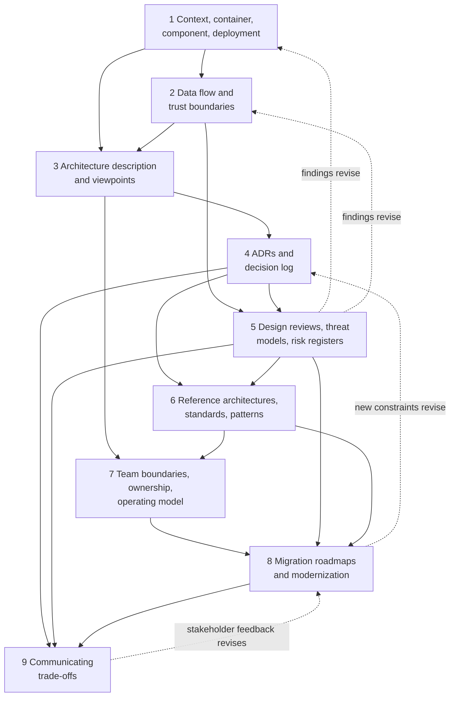
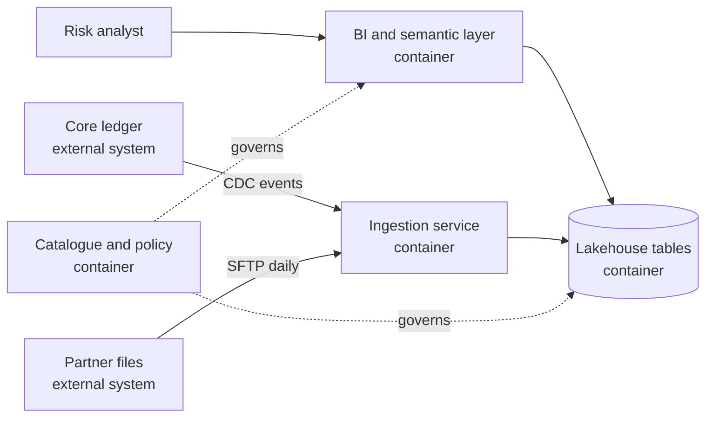
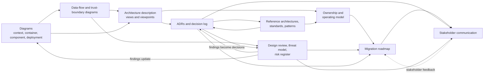

# Roadmap — Module 2D.15: Architecture Documentation, Reviews and Operating Model

This is the learning roadmap for the fifteenth module of Stage 2D, **Data
Architecture**. It tells you **what** to learn, **in what order**, **how** to study
and practise each topic from beginner to advanced level, **how to prove** you have
learned it, and **how to complete** the module's final current-state-to-target-state
architecture review.

Fourteen modules taught you to design data architecture. This module teaches you
to make that design **understood, challenged, owned, changed and communicated**:
to draw it so others can read it, document the reasons behind it, review it for
risk, align teams around it, plan the journey from today's estate to the target,
and explain the trade-offs to people who will fund or run it.

> **Repository note (source-of-truth limits).** The nine topic files,
> `practice-questions.md`, the module `README.md`, `Projects/README.md` and
> `Projects/15-current-state-to-target-state-architecture-review.md` currently
> exist but are **empty**, as are the Stage 2D overview files; the target roadmap
> file existed but was empty. This roadmap therefore cannot be grounded in their
> contents. It is the first written statement of the module's scope, derived from
> the file names, the Stage 2D structure and the earlier module roadmaps. It does
> **not** claim that any topic file already contains the material below. Every
> exercise, template, scenario and target is a **recommendation**, not a
> documented requirement. When the topic files and the project file are written,
> their scope governs and this roadmap should be updated to match.
>
> **Directory name.** The prompt that requested this roadmap referred to
> `STAGE 2D - DATA ARCHITECURE/`. The actual directory is
> `Stage 2D — Data Architecture/`, and the actual name is preserved.
>
> **Methods named as examples.** Where this roadmap mentions a named approach (for
> example the C4 model for diagrams, the STRIDE mnemonic for threats, an
> ISO/IEC/IEEE architecture-description standard, or Team Topologies for operating
> models), it does so **as an illustrative option to investigate**, not because the
> repository adopts it. Use whichever approach the topic files specify.
>
> **Illustrative content.** Every system, number, team and organisation here is an
> **illustrative assumption** (fictional *Northbridge Bank*). Exercises use
> diagrams, tables and written analysis with synthetic information; none requires
> special tooling or deployment.

## Table of contents

- [A. Module overview](#a-module-overview)
- [B. Module learning outcomes](#b-module-learning-outcomes)
- [C. Prerequisites and knowledge dependencies](#c-prerequisites-and-knowledge-dependencies)
- [D. Recommended learning sequence](#d-recommended-learning-sequence)
- [E. Detailed learning roadmap for every topic](#e-detailed-learning-roadmap-for-every-topic)
  - [E.1 Context, container, component and deployment diagrams](#e1-topic-01--context-container-component-and-deployment-diagrams)
  - [E.2 Data flow and trust boundary diagrams](#e2-topic-02--data-flow-and-trust-boundary-diagrams)
  - [E.3 Architecture description and viewpoints](#e3-topic-03--architecture-description-and-viewpoints)
  - [E.4 Architecture decision records and decision log](#e4-topic-04--architecture-decision-records-and-decision-log)
  - [E.5 Design reviews, threat models and risk registers](#e5-topic-05--design-reviews-threat-models-and-risk-registers)
  - [E.6 Reference architectures, standards and reusable patterns](#e6-topic-06--reference-architectures-standards-and-reusable-patterns)
  - [E.7 Team boundaries, ownership and platform operating model](#e7-topic-07--team-boundaries-ownership-and-platform-operating-model)
  - [E.8 Migration roadmaps and architecture modernization](#e8-topic-08--migration-roadmaps-and-architecture-modernization)
  - [E.9 Communicating trade-offs to technical and business stakeholders](#e9-topic-09--communicating-trade-offs-to-technical-and-business-stakeholders)
- [F. Cross-topic integration](#f-cross-topic-integration)
- [G. Practice-question integration](#g-practice-question-integration)
- [H. Module completion checklist](#h-module-completion-checklist)
- [I. Final project guide — Current-state to target-state architecture review](#i-final-project-guide--current-state-to-target-state-architecture-review)

---

## A. Module overview

### A.1 What the terms mean

| Term | Plain meaning | Question it answers |
| --- | --- | --- |
| **Architecture documentation** | Artefacts that describe an architecture: diagrams, descriptions, decisions, standards | What is this system, and why is it this way? |
| **Architecture review** | A structured examination of a design against criteria, risks and requirements | Is this design fit, safe and well-reasoned? |
| **Operating model** | How teams, roles, ownership, processes and governance work together to build and run the architecture | Who does what, and how do we work together? |

### A.2 Why these practices matter in enterprise data architecture

- Data platforms span many teams and systems; without shared artefacts each team
  holds a different mental picture.
- Decisions made years ago must be understood by people who were not there.
- Security, privacy and reliability problems are cheaper to find in a review than
  in production.
- Modernisation is a journey across years; it needs a plan that people can follow
  and adjust.
- Funding and approval depend on explaining trade-offs in business terms.

### A.3 Three different activities

| Activity | Output | Example |
| --- | --- | --- |
| **Documenting** an architecture | Diagrams, descriptions, decision records | A container diagram of the lakehouse |
| **Evaluating** an architecture | Review findings, threat models, risk register | Finding that a trust boundary is unprotected |
| **Governing its evolution** | Standards, ownership, migration roadmap, decision log | Roadmap to retire a legacy warehouse |

Documenting without evaluating produces pictures nobody trusts; evaluating without
governance produces findings nobody acts on.

### A.4 Why diagrams alone are insufficient

A diagram shows structure. It does not tell you the **audience**, **purpose**,
**assumptions**, **decisions** and **alternatives** behind it, the **risks** it
carries, or **who owns** each part. A useful architecture package contains the
diagram plus: scope and legend, the concerns it addresses, the decisions that
shaped it, the risks that remain, ownership, and a way to keep it current.

### A.5 How documentation supports modernisation

```text
Current state (documented, honest) ──gap analysis──▶ Target state (decided, reasoned)
          │                                                  │
          └────── migration roadmap (phases, dependencies, checkpoints) ──────┘
```

You cannot plan a route without knowing where you are and where you are going; the
documents make both visible and the gaps explicit.

### A.6 What you should be able to do by the end

Produce and interpret context, container, component, deployment and data-flow
diagrams; write an architecture description with views for named stakeholders;
record decisions and keep a decision log; run a structured design review with
threat and risk analysis; evaluate reference architectures and standards; map
team ownership and an operating model; plan a feasible migration; and communicate
trade-offs to technical and business audiences, integrated into one defensible
architecture review package.

### A.7 How the module connects to broader work

| Connection | How |
| --- | --- |
| `../01-Data-Architecture-Foundations-and-Principles/` | Governance, decision rights, frameworks and reference models |
| `../02-Requirements-Constraints-and-Architecture-Decisions/` | ADRs, trade-offs, risk and constraint registers |
| `../03-Data-Architecture-Patterns-and-Reference-Architectures/` | Reference architectures and pattern selection |
| `../07-Enterprise-Data-Platform-and-Lakehouse-Architecture/` | Platform product thinking, tenancy, service levels |
| `../08-Cloud-Hybrid-and-Multi-Cloud-Data-Architecture/` | Trust boundaries, networks, IaC, deployment views |
| `../10-Data-Governance-Security-Privacy-and-Compliance/` | Threat models, controls, evidence, accountability |
| `../11-Metadata-Lineage-Quality-and-Master-Data/` | Lineage as input to data-flow diagrams |
| `../12-Reliability-Resilience-and-Disaster-Recovery/` | Failure domains, risk, runbooks, resilience reviews |
| `../13-Performance-Scalability-and-Cost-Architecture/` | Evidence in reviews, cost trade-offs |
| `../14-Data-Access-Serving-Semantic-and-AI-Data-Architecture/` | Consumer-facing views and contracts |
| `../16-Enterprise-Data-Architecture-Case-Studies-and-Capstone/` | Case-study documentation and reviews |

### A.8 Terminology (expanded at first use)

| Term | Meaning |
| --- | --- |
| System context | The system in its environment: users and other systems |
| Container (in diagramming) | A separately runnable/deployable unit (service, database, pipeline) |
| Component | A building block inside a container |
| Deployment view | How containers map to infrastructure and environments |
| Data-flow diagram (DFD) | Diagram of how data move between processes, stores and actors |
| Trust boundary | A line where the level of trust or control changes |
| Architecture description | A complete, organised description of an architecture for its stakeholders |
| View / viewpoint | A representation of the architecture from one perspective / the conventions for creating it |
| Stakeholder concern | An interest a stakeholder has in the architecture |
| ADR (Architecture Decision Record) | A short record of one significant decision and its reasoning |
| Threat model | A structured analysis of how a system could be attacked or misused |
| Risk register | A list of risks with assessment, owner and treatment |
| Reference architecture | A reusable architecture template for a class of problem |
| Operating model | How an organisation arranges people, process and governance to deliver and run |
| Strangler pattern | Incrementally replacing a legacy system by routing functions to new components |

---

## B. Module learning outcomes

After completing the module you will be able to:

1. **Create and interpret** context, container, component and deployment
   diagrams.
2. **Document** data flows and trust boundaries.
3. **Explain** architecture descriptions, views and viewpoints.
4. **Create and maintain** architecture decision records and decision logs.
5. **Conduct** structured design reviews and **identify** relevant threats and
   risks.
6. **Evaluate** reference architectures, standards and reusable patterns.
7. **Define** team boundaries, ownership responsibilities and platform
   operating-model considerations.
8. **Assess** current-state architecture and **plan** migration toward a target
   state.
9. **Communicate** architectural trade-offs to technical and business
   stakeholders.
10. **Integrate** these into a coherent architecture review and modernisation
    package.

Each outcome is demonstrated through the exercises, deliverables and gates in
Sections E, H and I.

---

## C. Prerequisites and knowledge dependencies

### C.1 Prerequisite table

| # | Prerequisite (plain terms) | Why needed | Needed by topics | Essential? | Provided by |
| --- | --- | --- | --- | --- | --- |
| P1 | Components, systems, interfaces, data flows; logical vs physical views | Everything depicted | 1, 2, 3 | Essential | `../03-Data-Architecture-Patterns-and-Reference-Architectures/07-selecting-and-combining-architecture-patterns.md`, `../07-Enterprise-Data-Platform-and-Lakehouse-Architecture/01-platform-capabilities-and-logical-reference-architecture.md` |
| P2 | Zones, planes, tenancy, platform service levels | Container/deployment views and ownership | 1, 7 | Essential | `../07-Enterprise-Data-Platform-and-Lakehouse-Architecture/02-ingestion-storage-processing-and-consumption-zones.md`, `04-compute-storage-and-control-plane-separation.md`, `08-platform-service-levels-and-product-thinking.md` |
| P3 | Requirements, constraints, assumptions, risks | Reviews, decisions and migration all depend on them | 4, 5, 8 | Essential | `../02-Requirements-Constraints-and-Architecture-Decisions/05-constraints-assumptions-dependencies-and-risks.md` |
| P4 | Trade-offs, decision criteria, ADR basics | Decision records and communication | 4, 6, 9 | Essential | `../02-Requirements-Constraints-and-Architecture-Decisions/06-architecture-trade-offs-and-decision-criteria.md`, `07-architecture-decision-records-adrs.md` |
| P5 | Governance, decision rights, frameworks and reference models | Reviews, standards, operating model | 5, 6, 7 | Essential | `../01-Data-Architecture-Foundations-and-Principles/05-data-architecture-lifecycle-and-governance.md`, `06-enterprise-data-architecture-frameworks-and-reference-models.md` |
| P6 | Security basics: identity, access, encryption, network boundaries, privacy | Trust boundaries and threat modeling | 2, 5 | Essential | `../10-Data-Governance-Security-Privacy-and-Compliance/03-identity-access-control-and-least-privilege.md`, `04-encryption-key-management-and-secrets.md`, `08-regulatory-controls-and-evidence-design.md` |
| P7 | Cloud networking, identity and private connectivity; hybrid links | Deployment views and trust boundaries | 1, 2, 5, 8 | Essential | `../08-Cloud-Hybrid-and-Multi-Cloud-Data-Architecture/05-networking-identity-and-private-connectivity.md`, `06-hybrid-connectivity-and-on-premises-integration.md` |
| P8 | Lineage, dependencies, ownership metadata | Accurate current-state data flows and ownership | 2, 7, 8 | Useful | `../11-Metadata-Lineage-Quality-and-Master-Data/03-end-to-end-lineage-and-impact-analysis.md` |
| P9 | Failure domains, risk, runbooks; resilience testing | Risk reviews and migration safety | 5, 8 | Useful | `../12-Reliability-Resilience-and-Disaster-Recovery/02-failure-domains-and-blast-radius.md`, `08-business-continuity-and-resilience-testing.md` |
| P10 | Evidence-based cost/performance reasoning | Trade-off communication | 6, 8, 9 | Useful | `../13-Performance-Scalability-and-Cost-Architecture/08-architecture-optimization-with-measured-evidence.md`, `06-cost-modeling-unit-economics-and-finops.md` |
| P11 | Data products, serving and contracts | Consumer-facing views and ownership | 3, 7, 9 | Useful | `../14-Data-Access-Serving-Semantic-and-AI-Data-Architecture/07-data-products-apis-and-consumer-contracts.md` |
| P12 | Basic project and migration planning (phases, dependencies, critical path) | Migration roadmaps | 8 | Useful additional knowledge, **learned in Topic 8** | Taught at Beginner level in Topic 8 |

### C.2 Dependency map across the nine topics



The numeric order is a sound default. Dotted arrows show feedback: review findings
change diagrams; stakeholder feedback changes migration priorities; migration
constraints reopen decisions.

---

## D. Recommended learning sequence

Effort estimates are **recommendations** (about 6–8 hours per week assumed). The
recommended order **matches the numeric order**, following *draw the system →
draw the data and trust → describe it for stakeholders → record the decisions →
review and risk → reuse and standards → organise the people → plan the change →
explain it*. Earlier artefacts are **reused and improved**: diagrams from Topics 1–2
feed the description (3), decisions (4) and reviews (5); all feed the migration
plan (8) and the stakeholder briefs (9).

| Seq | File | Title | Why here | Prerequisite topics | Main concepts | Practical activity | Expected output | Readiness criteria | Effort (rec.) |
| --- | --- | --- | --- | --- | --- | --- | --- | --- | --- |
| 1 | `01-context-container-component-and-deployment-diagrams.md` | Context, container, component and deployment diagrams | Structure is the base of every later artefact | P1, P2 | Levels of abstraction, audience, consistency | Four-level diagram set | Diagrams with legends | Elements consistent across levels | 6–8 h |
| 2 | `02-data-flow-and-trust-boundary-diagrams.md` | Data flow and trust boundary diagrams | Adds movement and trust to structure | Seq 1, P6, P7 | Flows, stores, actors, boundaries | DFD with boundaries | DFD and review questions | Every flow named, crossings marked | 6–8 h |
| 3 | `03-architecture-description-and-viewpoints.md` | Architecture description and viewpoints | Organises artefacts for stakeholders | Seq 1–2 | Stakeholders, concerns, views | Description outline | Outline mapping concerns to views | Every concern covered by a view | 6–8 h |
| 4 | `04-architecture-decision-records-and-decision-log.md` | Architecture decision records and decision log | Preserves the reasoning behind the picture | Seq 3, P3, P4 | Context, options, consequences, status | ADRs for two decisions | ADRs and log | Alternatives and consequences honest | 6–8 h |
| 5 | `05-design-reviews-threat-models-and-risk-registers.md` | Design reviews, threat models and risk registers | Evaluates the artefacts for safety and soundness | Seq 2, 4, P6, P9 | Criteria, threats, risks, findings | Structured review | Findings, threats, risk register | Findings evidence-based and owned | 7–9 h |
| 6 | `06-reference-architectures-standards-and-reusable-patterns.md` | Reference architectures, standards and reusable patterns | Applies reuse with judgement | Seq 4–5, P5 | Applicability, deviation, exceptions | Pattern comparison | Comparison and ADR | Adaptations justified | 6–8 h |
| 7 | `07-team-boundaries-ownership-and-platform-operating-model.md` | Team boundaries, ownership and platform operating model | Architecture is delivered by teams | Seq 3, 6, P2 | Ownership, interfaces, accountability | Ownership map | Map and gaps list | No unowned component or decision | 6–8 h |
| 8 | `08-migration-roadmaps-and-architecture-modernization.md` | Migration roadmaps and architecture modernization | Moves from current to target feasibly | Seq 5–7, P12 | Gap analysis, phasing, dependencies, checkpoints | Migration roadmap | Roadmap with checkpoints | Phases feasible and testable | 7–9 h |
| 9 | `09-communicating-trade-offs-to-technical-and-business-stakeholders.md` | Communicating trade-offs to technical and business stakeholders | Final translation of everything for decision-makers | Seq 4, 5, 8 | Audience, framing, evidence | Two briefs for one decision | Technical and business briefs | Same facts, different emphasis | 6–8 h |
| — | `practice-questions.md` | Validation | After each topic and fully before the project | Seq 1–9 | — | Gap log | Gap log | — | 3–4 h |
| — | `Projects/15-current-state-to-target-state-architecture-review.md` | Final project | Integrates all nine | All | — | Review package | Package | — | 16–20 h |

**Revisiting earlier topics.**

| When | Revisit |
| --- | --- |
| A review finding shows a missing flow or boundary | Topics 1, 2 |
| A stakeholder cannot find their concern in the description | Topic 3 |
| A decision is challenged for missing alternatives | Topic 4 |
| A migration phase depends on an unowned component | Topic 7 |
| A business audience rejects the case | Topics 9, 4 |
| A standard conflicts with a constraint | Topics 6, 4 |

---

## E. Detailed learning roadmap for every topic

Each topic uses the same twelve parts. Levels are cumulative. Examples use the
**illustrative** scenario of *Northbridge Bank* (Section I.2). Because the source
topic files are empty, specific methods and subtopics named below are
**recommended** learning content, not source-derived claims.

---

### E.1 Topic 01 — Context, container, component and deployment diagrams

Source: [`01-context-container-component-and-deployment-diagrams.md`](01-context-container-component-and-deployment-diagrams.md)

#### 1. Topic overview

Architecture diagrams answer different questions at different **levels of
zoom**. A **context** diagram shows the system and what surrounds it. A
**container** diagram shows the major runnable/deployable parts. A **component**
diagram shows the building blocks inside one container. A **deployment** diagram
shows where those parts run. One diagram cannot serve every audience; a coherent
**set** can, provided the levels agree with one another.

#### 2. Learning objectives

1. Explain the purpose, audience and content of each diagram level.
2. Identify system boundaries, actors, external systems and interfaces.
3. Decompose a system into containers and components with responsibilities.
4. Map containers to infrastructure and environments in a deployment view.
5. Choose the right level of detail for an audience.
6. Check consistency across diagrams and keep them current.

#### 3. Prerequisites

P1, P2. Review `../07-Enterprise-Data-Platform-and-Lakehouse-Architecture/01-platform-capabilities-and-logical-reference-architecture.md` if logical vs physical is unclear.

#### 4. Beginner level — understand the fundamentals

- **Concepts and definitions:**

  | View | Shows | Typical audience | Question answered |
  | --- | --- | --- | --- |
  | Context | The system as a box, its users and neighbouring systems | Everyone, including business | What is this and who uses/depends on it? |
  | Container | Major deployable units and their interactions | Architects, engineers, operations | What is it made of at the top level? |
  | Component | Building blocks inside one container | Developers of that container | How is this part built? |
  | Deployment | Infrastructure nodes, environments, runtime mapping | Operations, security | Where does it run? |

  *(The context/container/component/deployment vocabulary resembles the C4 model;
  use the topic file's terminology.)*
- **Analogy:** a map app: world view (context), city (container), street (component),
  and a satellite view showing where buildings stand (deployment).
- **Elements of any diagram:** title, scope statement, boxes with names and one-line
  responsibilities, labelled arrows (direction, protocol or content), legend, date
  and version.
- **Learn in this order:** purpose and audience → boundary → elements →
  relationships → legend.
- **Questions to answer:** Who is the audience of this diagram? What is inside the
  boundary and what is outside?
- **Small exercise:** draw a context diagram for "a customer exposure reporting
  platform": the system, three users, four external systems.

#### 5. Intermediate level — apply the concepts

- **Drawing a coherent set:** start from the context; decompose each system into
  containers; decompose one important container into components; draw a deployment
  view for one environment. Every element at a lower level belongs to exactly one
  parent at the level above.
- **Labelling relationships:** "reads daily files over SFTP", "publishes events",
  "queries via SQL" — not just arrows.
- **Choosing detail by audience:** executives need the context; engineers need the
  container and component; operations need the deployment.
- **Consistency checks (the "diagram set test"):**

  ```text
  1. Every external system in the context appears as an actor/dependency in the container view.
  2. Every container in the container view appears in the deployment view (or is marked as external).
  3. Every component belongs to one container.
  4. Names, directions and protocols agree across diagrams.
  5. The legend explains every symbol used.
  ```

- **Data-platform specifics:** show ingestion, storage zones, processing, serving,
  catalogue and control services at container level; show cloud accounts/regions,
  networks and environments at deployment level (2D.7, 2D.8).
- **Text-based diagrams:** diagrams-as-code (for example Mermaid) can live with
  documentation and be version-controlled; this roadmap uses them as examples.
- **Practical exercise:** produce context, container, component (one container) and
  deployment diagrams for a lakehouse platform and run the consistency test.
- **Check:** the five consistency rules pass; each diagram has an audience and
  purpose line.

Example (illustrative container-level sketch in Mermaid):



#### 6. Advanced level — design, review and govern architecture

- **Diagram sets for large estates:** hierarchy of diagrams (enterprise context →
  domain contexts → system containers); avoid diagrams so large they are unreadable;
  use consistent ids so elements can be traced across diagrams and to inventories
  (CMDB, catalogue).
- **Multiple deployment views:** environments (dev/test/prod), regions, failure
  domains (2D.12 Topic 2), tenancy boundaries (2D.7 Topic 7).
- **Keeping diagrams alive:** ownership per diagram, change triggers, automation
  (generating from models/IaC where possible, 2D.8 Topic 8), staleness markers,
  review at architecture changes.
- **Abstraction discipline:** do not mix levels in one picture (components next
  to deployment nodes); explicit "elided detail" notes.
- **Showing what matters:** emphasise critical paths, shared dependencies and
  external dependencies; show cardinality or scale where it affects decisions.
- **Notation and accessibility:** consistent shapes and colours, grayscale-safe,
  alt text/description for accessibility, text alternatives.
- **Diagram quality criteria:** purpose stated; audience stated; correct level;
  complete for scope; consistent; legible; current; owned.
- **Evidence and validation:** compare diagrams to reality (inventory, IaC,
  traffic, lineage) — "does this reflect what is actually deployed?" (2D.11
  Topic 3).
- **Document** diagram standards in an ADR or style guide.
- **Advanced exercise:** reverse-engineer a described platform (inventory, IaC
  excerpt, lineage extract) into a diagram set; list three discrepancies between
  the documented diagram and reality and correct them.

#### 7. Industry-style practical exercises

| Level | Scenario | Objective | Inputs / assumptions | Task | Constraints | Expected output | Validation | Demonstrates |
| --- | --- | --- | --- | --- | --- | --- | --- | --- |
| Beginner | Exposure reporting platform | Draw a context diagram | Description | Boxes, actors, systems, labelled arrows, legend | One page | Diagram | Boundary clear; labelled | You grasp the basics |
| Intermediate | Same platform | Four-level set with consistency test | Platform description | Context, container, component, deployment | Five consistency rules | Diagram set | Rules pass | You can produce coherent sets |
| Advanced | Platform with inventory and IaC extract | Reverse-engineer and reconcile | Synthetic inventory, IaC | Diagram set; discrepancy list; ownership and update process | Standards | Set, discrepancy list, style ADR | Discrepancies evidenced | You can govern diagrams |

#### 8. Real-world scenarios and architectural trade-offs

| Scenario | Business / technical context | Problem | Options | Benefits / limits | Risks / dependencies | Organisational implication | How to document | Evidence |
| --- | --- | --- | --- | --- | --- | --- | --- | --- |
| One giant diagram | 60 boxes for everyone | Nobody can read it | (a) Keep; (b) layered set | (a) "complete"; (b) readable | Inconsistency across set | Owners per level | Style guide, ids | Reader test |
| Diagrams out of date | Platform changed | Review misled | (a) Redraw yearly; (b) generate from IaC/inventory | (a) cheap, stale; (b) accurate, effort | Tooling | Ownership of generation | Process ADR | Drift check |

#### 9. Expected deliverables

- Context, container, component and deployment diagrams with legends.
- Diagram purpose/audience statements.
- Consistency-test record.
- Diagram standards (style guide or ADR).

#### 10. Common mistakes and misconceptions

| Mistake | Why problematic | Recognise / correct |
| --- | --- | --- |
| No audience or purpose | Wrong level, wasted effort | State both |
| Mixing abstraction levels | Confusing | One level per diagram |
| Unlabelled arrows | Ambiguous | Label content/protocol |
| Missing external dependencies | Hidden risk | Show them |
| Diagrams never updated | Misleading | Owner and triggers |
| Treating the diagram as the architecture | Misses decisions and risks | Pair with description, ADRs |

#### 11. Mastery criteria

- Choose the correct level for a stated audience.
- Produce a diagram set that passes the consistency rules.
- Detect and correct a diagram that disagrees with its inventory.

#### 12. Completion gate

- [ ] Diagram set, consistency record and style note reviewed by another person.
- [ ] Each diagram states audience, purpose, scope and date.
- [ ] Practice questions attempted and gaps logged (Section G).
- [ ] Readiness: you can now add data movement and trust to the structure
      (Topic 2).

---

### E.2 Topic 02 — Data flow and trust boundary diagrams

Source: [`02-data-flow-and-trust-boundary-diagrams.md`](02-data-flow-and-trust-boundary-diagrams.md)

#### 1. Topic overview

Structure diagrams show what exists; **data-flow diagrams (DFDs)** show how data
**move**: from actors through processes into stores and onward. **Trust
boundaries** mark where trust, control or ownership changes (internet to internal
network, one team's account to another's, cloud to on-premises). Crossings of a
trust boundary are where reviews look hardest.

#### 2. Learning objectives

1. Draw a DFD with processes, data stores, external entities and labelled flows.
2. Identify and place trust boundaries.
3. Identify dependencies and important interfaces.
4. Mark security- or architecture-relevant review points at boundary crossings.
5. Validate a DFD against reality (lineage, logs, configuration).
6. State the questions the diagram lets reviewers answer.

#### 3. Prerequisites

Seq 1; P6, P7, P8.

#### 4. Beginner level — understand the fundamentals

- **DFD elements:**

  | Element | Meaning | Typical notation idea |
  | --- | --- | --- |
  | External entity | A person or system outside the scope that sends/receives data | Rectangle |
  | Process | Something that transforms or routes data | Circle / rounded box |
  | Data store | Where data rest | Open-ended box / cylinder |
  | Data flow | Data moving, with a label for **what** moves | Arrow |
  | Trust boundary | Line where trust/control changes | Dashed line/box |

- **Analogy:** a postal map: houses (entities), sorting offices (processes),
  warehouses (stores), routes (flows), and borders/customs (trust boundaries).
- **Rules of thumb:** every flow has a label and a direction; every process has at
  least one input and one output; data do not move directly between two stores
  without a process.
- **Questions to answer:** Which data cross from untrusted to trusted? Who controls
  each side of the boundary?
- **Small exercise:** draw a DFD of "partner sends a daily file, ingestion
  validates it, data land in the lake, an analyst queries".

#### 5. Intermediate level — apply the concepts

- **Levels of DFD:** a context-level DFD (one process) and a decomposed level
  (major processes); keep consistent names with the container view (Topic 1).
- **Trust boundaries in data platforms (illustrative list):** internet ↔ corporate
  network; on-premises ↔ cloud; one cloud account/project ↔ another; platform ↔
  tenant; production ↔ non-production; application ↔ database; human operator ↔
  system.
- **Annotate each flow with:** data classification (2D.10 Topic 2), protocol,
  authentication, encryption in transit, volume/frequency, owner.
- **Review points at crossings:** authentication and authorisation, validation of
  inputs, encryption, logging, rate limiting, data minimisation, residency.
- **Questions the DFD should answer:** Where do sensitive data enter and leave?
  Which flows cross boundaries without authentication? Where is data stored
  unencrypted? Which stores hold copies of the same data?
- **Sources for accuracy:** lineage (2D.11 Topic 3), network and IAM configuration
  (2D.8 Topic 5), integration inventories (2D.6), interviews.
- **Practical exercise:** produce a DFD with trust boundaries for the exposure
  platform's ingestion path and list ten reviewer questions.
- **Check:** every flow labelled with data, classification and protocol; every
  boundary crossing has a question.

#### 6. Advanced level — design, review and govern architecture

- **Hidden flows:** logs, metrics, backups, support access, debug extracts, test
  data copies, notebooks; these often carry sensitive data across boundaries.
  Include or explicitly exclude them with justification.
- **Indirect trust:** shared control planes (identity, catalogue, CI/CD) that can
  change behaviour on both sides of a boundary; privilege escalation paths.
- **Data classification propagation:** show where classification changes through
  masking or aggregation (2D.10 Topics 2, 5).
- **Streaming and asynchronous flows:** brokers as trust intermediaries; consumer
  groups; replay (2D.9).
- **AI-related flows:** documents to embeddings to retrieval to model APIs; where
  prompts and context cross to third-party services (2D.14 Topics 5–6).
- **DFD completeness and accuracy criteria:** every store, flow and external
  dependency in scope appears; flows verified against an independent source; known
  gaps listed.
- **Linking to threat modeling (Topic 5):** each element and flow is a candidate for
  threat enumeration.
- **Maintenance:** update on every integration change; version with ADRs.
- **Evidence and validation:** reconcile against network flow logs and lineage
  samples; walkthrough with the owning team.
- **Document** the flow inventory and boundary definitions in an ADR or description.
- **Advanced exercise:** produce a DFD set for an AI-enabled analytics platform
  including hidden flows (logs, backups, notebook exports, model API calls),
  classify each flow, mark ten boundary crossings with required controls, and
  note unverifiable flows.

#### 7. Industry-style practical exercises

| Level | Scenario | Objective | Inputs / assumptions | Task | Constraints | Expected output | Validation | Demonstrates |
| --- | --- | --- | --- | --- | --- | --- | --- | --- |
| Beginner | Partner file ingestion | Draw a DFD | Description | Entities, processes, store, flows | Rules of thumb | DFD | Every flow labelled | You can draw DFDs |
| Intermediate | Exposure ingestion path | DFD with boundaries and questions | Synthetic architecture | Annotate flows; ten review questions | Classification labels | Annotated DFD | Each crossing has a question | You can prepare for review |
| Advanced | AI-enabled platform | DFD with hidden flows and controls | Mixed services (synthetic) | Hidden-flow inventory, boundary controls, unverifiable list | Evidence sources | DFD set and gap list | Flows traced to sources | You can produce review-grade DFDs |

#### 8. Real-world scenarios and architectural trade-offs

| Scenario | Business / technical context | Problem | Options | Benefits / limits | Risks / dependencies | Organisational implication | How to document | Evidence |
| --- | --- | --- | --- | --- | --- | --- | --- | --- |
| Backups cross region | DR requires copies | Residency uncertainty | (a) Omit from DFD; (b) include with boundary | (a) simple, incomplete; (b) honest | Residency breach | Cloud team owns | DFD + ADR | Region configuration |
| Analysts export to laptops | Unmanaged copy | Boundary crossing | (a) Ignore; (b) block; (c) governed sandbox | Varies | Data leakage | Policy owner | DFD flow + risk entry | DLP/ logs |

#### 9. Expected deliverables

- Context-level and decomposed DFDs with trust boundaries.
- Flow inventory (flow, data, classification, protocol, owner).
- Boundary-crossing review points and questions.
- Gap list of unverified flows.

#### 10. Common mistakes and misconceptions

| Mistake | Why problematic | Recognise / correct |
| --- | --- | --- |
| Drawing only the happy path | Misses errors, backups, support | Include hidden flows |
| Unlabelled flows | Cannot review | Label data and classification |
| Boundaries drawn around technology, not trust/control | Wrong review focus | Draw where control changes |
| DFD from memory, not evidence | Inaccurate | Verify against sources |
| Treating a DFD as a network diagram | Different purpose | Keep to data movement |

#### 11. Mastery criteria

- Draw a DFD with labelled flows and correctly placed trust boundaries.
- Identify hidden flows and justify inclusion.
- Prepare reviewer questions from boundary crossings.

#### 12. Completion gate

- [ ] DFD, flow inventory and question list reviewed.
- [ ] Every sensitive flow has classification and control noted.
- [ ] Practice questions attempted and gaps logged.
- [ ] Readiness: you can now organise diagrams into an architecture description
      for stakeholders (Topic 3).

---

### E.3 Topic 03 — Architecture description and viewpoints

Source: [`03-architecture-description-and-viewpoints.md`](03-architecture-description-and-viewpoints.md)

#### 1. Topic overview

An **architecture description** is the organised whole: it states **who the
stakeholders are**, **what they care about** (concerns), and provides **views** that
address those concerns, each following a **viewpoint** (the rules for that kind of
view). It turns a pile of diagrams into something a reader can navigate and trust.

#### 2. Learning objectives

1. Define architecture description, stakeholder, concern, view and viewpoint.
2. Identify stakeholders and their concerns.
3. Select views that address those concerns.
4. Define viewpoints (conventions, models, checks).
5. Maintain consistency and traceability among views.
6. Write a navigable architecture description.

#### 3. Prerequisites

Seq 1–2.

#### 4. Beginner level — understand the fundamentals

- **Concepts:** stakeholder (anyone with an interest), concern (what they care
  about: security, cost, performance, compliance, operability), view (a
  representation addressing concerns), viewpoint (the template/rules for a view),
  architecture description (organised set of views, plus rationale).
- **Analogy:** building plans: floor plan, electrical plan, plumbing plan — different
  views for different tradespeople and the owner.
- **Examples of data-architecture views (illustrative):** context, container,
  data-flow, security/trust, deployment, data-model/semantic, operational/run,
  cost, migration views.
- **Learn in this order:** stakeholders → concerns → views → viewpoints → the
  description.
- **Questions to answer:** Which view would a regulator ask for? An operations
  lead? A product owner?
- **Small exercise:** list five stakeholders of a data platform and two concerns
  each.

#### 5. Intermediate level — apply the concepts

- **Stakeholder–concern–view matrix (template):**

  | Stakeholder | Concerns | View(s) addressing them | Evidence/format |
  | --- | --- | --- | --- |
  | Risk director | Accuracy, timeliness, auditability | Context; data-flow; service-level view | Diagram + SLO table |
  | Security lead | Trust boundaries, access, encryption | Data-flow with boundaries; security view | DFD + controls table |
  | Platform operations | Failure domains, deployment, runbooks | Deployment; resilience view | Diagram + runbook links |
  | CFO delegate | Cost, funding | Cost view | Cost model summary |
  | Data engineers | Containers, interfaces, contracts | Container; interface view | Diagrams + contracts |

- **Description outline (template):** purpose and scope; stakeholders and concerns;
  architectural drivers (requirements, constraints, principles); views (each with
  viewpoint, diagrams, rationale); cross-view consistency and traceability;
  decisions (links to ADRs); risks and open issues; glossary; document control.
- **Viewpoint definition (mini-template):** audience, concerns addressed, model
  kinds, notation, construction rules, consistency checks.
- **Consistency across views:** shared identifiers for elements; a correspondence
  table (for example each container ↔ its deployment node ↔ its owner).
- **Practical exercise:** write an architecture description outline for a data
  platform with the matrix and at least five views defined.
- **Check:** every concern maps to a view; every view maps to a concern; the
  correspondence table has no orphan element.

#### 6. Advanced level — design, review and govern architecture

- **Description scaling:** modular descriptions (one per domain/system) with a
  top-level roll-up; avoid duplicating content, link instead; templates and
  conventions enforced by review.
- **Conflicting concerns across views:** performance vs cost vs security views may
  pull in different directions; record resolution in decisions (Topic 4).
- **Architecturally significant requirements:** make them visible (2D.2 Topic 2) and
  show which views address them.
- **Living documentation:** docs-as-code in version control; review through pull
  requests; automated link and consistency checks; "last reviewed" metadata;
  retirement of stale pages.
- **Standards alignment:** if an architecture-description standard or framework is
  adopted (2D.1 Topic 6), map your views to its required content; adopt what is
  useful, not ceremony.
- **Audience-specific publications:** the same model produces a business summary,
  an engineering view and an audit view; avoid divergence.
- **Quality criteria for an architecture description:** complete for declared
  concerns; consistent; traceable to requirements and decisions; understandable by
  intended readers; current; owned.
- **Evidence and validation:** reader walkthroughs per stakeholder group; question
  tests ("find where PII is stored"); comparison with reality.
- **Document** the description structure, viewpoint library and maintenance process
  in an ADR.
- **Advanced exercise:** design a viewpoint library and description template for an
  enterprise with six domains; run a "find the answer" test on a sample
  description with ten stakeholder questions and record failures.

#### 7. Industry-style practical exercises

| Level | Scenario | Objective | Inputs / assumptions | Task | Constraints | Expected output | Validation | Demonstrates |
| --- | --- | --- | --- | --- | --- | --- | --- | --- |
| Beginner | Data platform | Identify stakeholders and concerns | Description | Five stakeholders × two concerns | None | List | Concerns concrete | You understand the idea |
| Intermediate | Exposure platform | Build matrix and outline | Synthetic stakeholders | Matrix; outline; five views defined | Concern coverage | Outline and matrix | No uncovered concern | You can structure a description |
| Advanced | Six-domain enterprise | Viewpoint library and test | Sample description | Library; correspondence table; ten-question test | Maintenance | Library, test results | Failures analysed | You can govern descriptions |

#### 8. Real-world scenarios and architectural trade-offs

| Scenario | Business / technical context | Problem | Options | Benefits / limits | Risks / dependencies | Organisational implication | How to document | Evidence |
| --- | --- | --- | --- | --- | --- | --- | --- | --- |
| Auditor cannot find data location | Audit request | Information scattered | (a) Ad hoc answers; (b) audit viewpoint with data-location view | (a) slow; (b) reusable | Keeping it current | Compliance owns the viewpoint | Description + control doc | Audit walkthrough time |
| Too many documents | Duplicated content | Contradictions | (a) Merge; (b) single model with generated views | (a) simple; (b) consistent | Tooling | Architecture team ownership | Standard ADR | Consistency check |

#### 9. Expected deliverables

- Stakeholder–concern–view matrix.
- Architecture description outline/template.
- Viewpoint definitions and correspondence table.
- Consistency and traceability check record.

#### 10. Common mistakes and misconceptions

| Mistake | Why problematic | Recognise / correct |
| --- | --- | --- |
| Treating the description as one diagram | Concerns unaddressed | Views per concern |
| Stakeholders unnamed | Unclear readership | Matrix |
| Views with no common identifiers | Inconsistency | Correspondence table |
| Writing for the author | Unreadable to others | Reader tests |
| Documentation as a one-off | Decay | Owners, review triggers |
| Ceremony without value | Wasted effort | Keep what answers concerns |

#### 11. Mastery criteria

- Map concerns to views without gaps or orphans.
- Define a viewpoint with audience, notation and checks.
- Test a description with stakeholder questions.

#### 12. Completion gate

- [ ] Matrix, outline and correspondence table reviewed.
- [ ] Reader test run with at least five questions.
- [ ] Practice questions attempted and gaps logged.
- [ ] Readiness: you can now preserve why choices were made (Topic 4).

---

### E.4 Topic 04 — Architecture decision records and decision log

Source: [`04-architecture-decision-records-and-decision-log.md`](04-architecture-decision-records-and-decision-log.md)

#### 1. Topic overview

Diagrams and descriptions show **what** the architecture is. **Architecture
decision records (ADRs)** capture **why**: the context, the options considered,
the choice, and its consequences. A **decision log** indexes ADRs, tracks status
and supersession, and shows how the architecture reasoning evolved. This topic
revisits the ADR practice from 2D.2 Topic 7 at the level of an ongoing
architecture function.

#### 2. Learning objectives

1. Decide which decisions deserve an ADR.
2. Write an ADR with context, drivers, alternatives, outcome, rationale and
   consequences.
3. Link decisions to requirements, constraints, risks and artefacts.
4. Maintain a decision log with status and supersession.
5. Review ADRs for quality.
6. Use decision history for review and onboarding.

#### 3. Prerequisites

Seq 3; P3, P4 (`../02-Requirements-Constraints-and-Architecture-Decisions/07-architecture-decision-records-adrs.md`).

#### 4. Beginner level — understand the fundamentals

- **Concepts:** architecturally significant decision, ADR, context, decision
  drivers, options, outcome, consequences, status (proposed, accepted, superseded,
  deprecated), decision log.
- **When to write an ADR (heuristics):** hard to reverse; affects several teams or
  quality attributes; resolves a real trade-off; likely to be questioned later;
  deviates from a standard.
- **Analogy:** a ship's log: not only where the ship is, but why the course changed.
- **Minimal ADR structure:**

  ```markdown
  # ADR-NNN: <title>
  - Status / Date / Deciders
  - Context (forces, requirements, constraints)
  - Options considered
  - Decision and rationale
  - Consequences (positive, negative, accepted trade-offs)
  - Links (requirements, risks, diagrams, other ADRs)
  ```

- **Questions to answer:** What is the difference between an ADR and meeting minutes?
  Why record rejected options?
- **Small exercise:** convert an informal email decision into a short ADR.

#### 5. Intermediate level — apply the concepts

- **Writing quality:** one decision per ADR; context stands alone; options real (at
  least two plausible, one possibly the status quo); rationale cites criteria;
  consequences honest, including negatives; conditions to revisit.
- **Decision log (template):**

  | ID | Title | Status | Date | Decider | Supersedes / superseded by | Related requirement / risk / diagram | Review date |
  | --- | --- | --- | --- | --- | --- | --- | --- |

- **Traceability:** each ADR links to requirement ids (2D.2), risks (Topic 5),
  diagrams (Topic 1–2), standards (Topic 6) and the migration phase it affects
  (Topic 8).
- **Status lifecycle:** proposed → accepted → (deprecated | superseded); accepted
  ADRs are not rewritten to change meaning; they are superseded by a new ADR that
  references them.
- **ADR review checklist:** problem clear; alternatives genuine; criteria stated;
  decision unambiguous; consequences and risks listed; assumptions and revisit
  triggers; owner; links.
- **Practical exercise:** document one decision with at least two plausible
  alternatives (for example "managed streaming service vs self-operated broker")
  and add it to a decision log with a second ADR that supersedes an earlier one.
- **Check:** a reader unfamiliar with the project can reconstruct the reasoning.

#### 6. Advanced level — design, review and govern architecture

- **Decision hierarchy:** enterprise-level principles and standards, platform-level
  decisions, system-level decisions; consistency and precedence; local decisions
  must not contradict higher-level ones without an exception record.
- **Capturing uncertainty:** assumptions with confidence; decisions made with
  incomplete information flagged as conditional with the evidence that would
  settle them and a date (2D.2 Topic 7).
- **Decision quality practices:** criteria and weights fixed before scoring;
  sensitivity analysis (2D.2 Topic 6); pre-mortem ("assume this failed in a year;
  why?"); recording dissent.
- **Governance:** who may decide what (decision rights, 2D.1 Topic 5); review
  forum cadence; light-touch for reversible decisions; escalation for high-impact
  ones; time-boxed.
- **Decision debt and drift:** decisions never revisited; implementation diverging
  from accepted decisions; detect via periodic review and conformance checks.
- **Tooling and storage:** ADRs in version control next to code/IaC; templates; log
  generated from ADR metadata; search.
- **Using the log:** onboarding reading list; review evidence; impact analysis when
  a constraint changes (which ADRs depended on it?).
- **Anti-patterns:** retrospective justifications; decisions disguised as
  discussions; ADRs as bureaucracy; a log nobody reads.
- **Evidence and validation:** sample audit — pick five production behaviours and
  find the ADR that explains each; pick five ADRs and verify implementation.
- **Document** the ADR standard and log process.
- **Advanced exercise:** audit a synthetic decision log of 20 entries; find
  contradictions, missing supersessions and decisions lacking alternatives;
  propose corrections and a review cadence.

#### 7. Industry-style practical exercises

| Level | Scenario | Objective | Inputs / assumptions | Task | Constraints | Expected output | Validation | Demonstrates |
| --- | --- | --- | --- | --- | --- | --- | --- | --- |
| Beginner | Informal email decision | Write an ADR | Email text | Fill the template | One page | ADR | Fields complete | You know the structure |
| Intermediate | Streaming service choice | ADR with two alternatives; log entry; superseding ADR | Criteria and constraints (assumed) | Decide, record, link, supersede later | Honest consequences | ADRs and log | Reader reconstructs reasoning | You can maintain decisions |
| Advanced | 20-entry log | Audit and repair | Synthetic log | Findings, corrections, cadence | Governance | Audit report | Defects evidenced | You can govern decisions |

#### 8. Real-world scenarios and architectural trade-offs

| Scenario | Business / technical context | Problem | Options | Benefits / limits | Risks / dependencies | Organisational implication | How to document | Evidence |
| --- | --- | --- | --- | --- | --- | --- | --- | --- |
| New hire questions an old design | No one remembers why | Re-litigating | (a) Explain verbally; (b) ADR trail | (a) lost; (b) durable | Missing ADRs | Archivist role | Retroactive ADR labelled as such | Reconstruction evidence |
| Constraint changes (regulation) | Past decisions may be invalid | Unknown impact | (a) Review everything; (b) trace via ADR links | (a) costly; (b) targeted | Link quality | Governance owner | Impact analysis record | Link coverage |

#### 9. Expected deliverables

- ADRs (at least two with alternatives) and a decision log.
- ADR template and review checklist.
- Traceability links to requirements, risks and diagrams.
- Decision-log audit findings.

#### 10. Common mistakes and misconceptions

| Mistake | Why problematic | Recognise / correct |
| --- | --- | --- |
| Recording the outcome only | Reasoning lost | Context, options, consequences |
| Straw-man alternatives | Weak rationale | Genuine options |
| Editing accepted ADRs | History lost | Supersede |
| ADRs for every trivial choice | Noise | Significance test |
| No links | Cannot trace impact | Link systematically |
| Retrospective ADRs presented as contemporary | Misleading | Label as reconstructed |

#### 11. Mastery criteria

- Write an ADR a stranger can follow.
- Maintain a log with correct statuses and supersession.
- Audit a log and find defects.

#### 12. Completion gate

- [ ] ADRs, log and audit reviewed by another person.
- [ ] Each ADR links to at least two other artefacts.
- [ ] Practice questions attempted and gaps logged.
- [ ] Readiness: you can now review a design against criteria and risk (Topic 5).

---

### E.5 Topic 05 — Design reviews, threat models and risk registers

Source: [`05-design-reviews-threat-models-and-risk-registers.md`](05-design-reviews-threat-models-and-risk-registers.md)

> **Legal and security caution.** This topic teaches review and analysis methods.
> It does not certify any design as secure or compliant; specialists and formal
> processes decide that.

#### 1. Topic overview

A **design review** examines an architecture against criteria before it is built or
changed. A **threat model** asks how the system could be attacked or misused. A
**risk register** records what could go wrong, how bad, who owns it and what is
being done. Together they turn opinions into recorded, owned, trackable findings.

#### 2. Learning objectives

1. Plan and run a structured design review with criteria and evidence.
2. Perform a basic threat model using diagrams from Topics 1–2.
3. Identify, assess and prioritise risks.
4. Record findings with severity, owner, action and due date.
5. Track remediation and verify closure.
6. Feed findings back into decisions and diagrams.

#### 3. Prerequisites

Seq 2, 4; P6, P9.

#### 4. Beginner level — understand the fundamentals

- **Concepts:** design review, review criteria, finding, severity, threat, asset,
  attacker/misuse, vulnerability, mitigation, risk, likelihood, impact, risk owner,
  residual risk.
- **Analogy:** a pre-flight check: criteria, checklist, findings, sign-off or
  "do not fly".
- **A simple threat-thinking mnemonic (illustrative):** STRIDE — Spoofing,
  Tampering, Repudiation, Information disclosure, Denial of service, Elevation of
  privilege. Use as prompts; the topic file's method governs.
- **Risk basics:** risk = a possible event with likelihood and impact.

  ```text
  exposure = likelihood × impact         (scales 1–5 each; 1–25)
  e.g. likelihood 3 × impact 5 = 15
  ```

  Scores are for **ranking**, not precision.
- **Questions to answer:** What is the difference between a finding and a risk? Who
  owns a risk?
- **Small exercise:** list five threats to a file-ingestion path from the Topic 2
  DFD using the mnemonic.

#### 5. Intermediate level — apply the concepts

- **Review planning:** scope and objective; reviewers and roles (author, lead
  reviewer, domain experts, scribe); input package (diagrams, description, ADRs,
  requirements); criteria; schedule; outputs.
- **Review criteria (illustrative):** requirements coverage; quality attributes
  (security, reliability, performance, cost); consistency with standards;
  data-flow and trust-boundary soundness; dependency and failure-domain analysis;
  operability; compliance concerns; decision quality.
- **Running a review:** walk through the diagrams, challenge assumptions, record
  findings with evidence and location, classify severity (blocker / major / minor /
  advisory), avoid solutioning in the room.
- **Threat modelling steps:** scope → draw/obtain DFD → identify assets and trust
  boundaries → enumerate threats per element/flow → assess → decide mitigations →
  record residual risk → validate.
- **Threat table (template):**

  | ID | Element/flow | Threat (category) | Scenario | Existing controls | Gap | Likelihood | Impact | Exposure | Mitigation | Owner |
  | --- | --- | --- | --- | --- | --- | --- | --- | --- | --- | --- |

- **Risk register (template):**

  | ID | Risk | Source (finding/threat/ADR) | Likelihood | Impact | Exposure | Treatment (avoid / mitigate / transfer / accept) | Owner | Due | Status | Residual risk |
  | --- | --- | --- | --- | --- | --- | --- | --- | --- | --- | --- |

- **Follow-up:** actions with owners and dates; verification evidence; closure
  criteria; escalation of overdue items.
- **Practical exercise:** review a described architecture (diagrams + ADRs), produce
  at least ten findings, a threat table for three flows and a risk register of
  eight risks.
- **Check:** every finding has evidence; every risk has an owner and treatment.

#### 6. Advanced level — design, review and govern architecture

- **Review proportionality:** lightweight reviews for low-risk, reversible changes;
  full reviews for high-impact ones; define triggers (new data classes, new trust
  boundary, new external dependency).
- **Evidence-based reviews:** ask for tests, load results, restore evidence,
  configuration extracts, lineage rather than assertions (2D.12, 2D.13).
- **Threat modelling at depth:** attack trees (awareness), abuse cases, insider and
  supply-chain threats, data-specific threats (re-identification, over-broad
  access, data poisoning for ML, prompt injection for AI retrieval, 2D.14 Topic 6);
  privacy threats alongside security threats.
- **Risk quantification limits:** ordinal scales hide variance; combine with
  scenario analysis; avoid false precision; aggregate carefully.
- **Risk acceptance governance:** who may accept which level; time-boxed
  acceptance with review date; documented compensating controls.
- **Cross-review learning:** track recurring finding types; update standards and
  templates (Topic 6); feed architecture principles.
- **Review quality:** reviewers' independence; avoiding bike-shedding; recorded
  dissent; follow-through rate; findings escaping to production as a feedback
  metric.
- **Integration:** findings become ADRs (decisions to mitigate), diagram updates and
  migration tasks (Topic 8); risks inform stakeholder communication (Topic 9).
- **Evidence and validation:** closure verified by re-review or test; residual risk
  recorded; periodic risk register review.
- **Document** the review process, criteria and risk method in an ADR/standard.
- **Advanced exercise:** run a threat model and review for an AI retrieval platform
  with three trust boundaries; produce 15 findings, a prioritised risk register,
  accepted-risk records with expiry, and updates to the diagram and an ADR.

#### 7. Industry-style practical exercises

| Level | Scenario | Objective | Inputs / assumptions | Task | Constraints | Expected output | Validation | Demonstrates |
| --- | --- | --- | --- | --- | --- | --- | --- | --- |
| Beginner | File ingestion path | Enumerate threats | DFD from Topic 2 | Five threats with category | None | List | Threats plausible | You can think in threats |
| Intermediate | Exposure platform design | Structured review | Package (synthetic) | Findings, threat table, risk register | Evidence for each finding | Review report | Every item owned and evidenced | You can run a review |
| Advanced | AI retrieval platform | Review and threat model with acceptance governance | Three boundaries (synthetic) | 15 findings; prioritised risks; acceptance records; artefact updates | Time-boxed | Report and updates | Closure criteria defined | You can govern risk |

#### 8. Real-world scenarios and architectural trade-offs

| Scenario | Business / technical context | Problem | Options | Benefits / limits | Risks / dependencies | Organisational implication | How to document | Evidence |
| --- | --- | --- | --- | --- | --- | --- | --- | --- |
| Review near go-live finds a blocker | Deadline pressure | Delay vs risk | (a) Waive; (b) fix; (c) mitigate and accept with expiry | (a) fast, risk; (b) safe, delay; (c) balanced | Residual risk | Executive risk acceptance | Risk record + ADR | Mitigation tests |
| Same finding recurs | Weak standards | Repeated effort | (a) Fix each; (b) update standard/template | (a) cheap now; (b) systemic | Adoption | Architecture board | Standard change ADR | Recurrence rate |

#### 9. Expected deliverables

- Review plan, criteria and findings report.
- Threat-model artefacts (threat table linked to the DFD).
- Risk register with owners, treatments and review dates.
- Follow-up tracker and closure evidence.

#### 10. Common mistakes and misconceptions

| Mistake | Why problematic | Recognise / correct |
| --- | --- | --- |
| Review without criteria | Opinion contest | Pre-agreed criteria |
| Findings without evidence | Disputes | Cite artefacts |
| Risk register without owners | No action | Owner and date |
| Threat model not tied to the diagram | Floating | Per element/flow |
| Treating scores as precise | False confidence | Use for ranking |
| Accepting risk without expiry | Permanent exposure | Time-box |
| Review as a gate only | Late and adversarial | Early, collaborative |

#### 11. Mastery criteria

- Run a review with criteria, evidence and owned findings.
- Produce a threat table tied to a DFD.
- Maintain a risk register that supports decisions.

#### 12. Completion gate

- [ ] Review report, threat table and risk register reviewed by another person.
- [ ] Findings trace to evidence; actions have owners and dates.
- [ ] Practice questions attempted and gaps logged.
- [ ] Readiness: you can now judge reuse of standard solutions with the risks in
      mind (Topic 6).

---

### E.6 Topic 06 — Reference architectures, standards and reusable patterns

Source: [`06-reference-architectures-standards-and-reusable-patterns.md`](06-reference-architectures-standards-and-reusable-patterns.md)

#### 1. Topic overview

Organisations reuse solutions to move faster and stay consistent. A **reference
architecture** is a reusable template for a class of problem. A **standard** is a
required or agreed rule or specification. A **reusable pattern** is a proven
solution structure. The skill is reuse with judgement: knowing when a pattern
fits, how to adapt it, when to deviate, and how to record why.

#### 2. Learning objectives

1. Distinguish reference architecture, standard, pattern, guideline and blueprint.
2. Evaluate whether a reference or pattern applies to a context.
3. Document adaptations, deviations and exceptions.
4. Design a lightweight standards process.
5. Assess the cost and benefit of standardisation.
6. Maintain a pattern catalogue.

#### 3. Prerequisites

Seq 4–5; P5 (`../01-Data-Architecture-Foundations-and-Principles/06-enterprise-data-architecture-frameworks-and-reference-models.md`), `../03-Data-Architecture-Patterns-and-Reference-Architectures/` patterns.

#### 4. Beginner level — understand the fundamentals

- **Distinctions:**

  | Item | What it is | Strength of obligation |
  | --- | --- | --- |
  | Pattern | A proven solution structure with context and consequences | Advisory |
  | Reference architecture | A reusable template/example architecture | Guidance (sometimes endorsed) |
  | Standard | A rule or specification to be followed | Mandatory or "comply or explain" |
  | Guideline | Recommended practice | Advisory |
  | Blueprint | A concrete design for a specific implementation | Specific |

- **Benefits of reuse:** speed, consistency, known behaviour, shared skills, easier
  review. **Costs:** poor fit, rigidity, stale content, over-standardisation.
- **Analogy:** standard shipping container sizes (standard) vs a ship-design
  template (reference architecture).
- **Questions to answer:** When is a standard worth enforcing? When does a pattern
  not apply?
- **Small exercise:** classify ten statements into the five categories.

#### 5. Intermediate level — apply the concepts

- **Applicability assessment (template):**

  | Question | Evidence |
  | --- | --- |
  | Does the problem match the pattern's context? | Requirements comparison |
  | Are the pattern's forces present here? | Constraints and drivers |
  | What does it assume (skills, platforms, scale)? | Assumption list |
  | What are the known consequences? | Pattern documentation |
  | What would adaptation cost? | Estimate |
  | What if we do not use it? | Alternatives |

- **Comparing options:** use criteria fixed first (2D.2 Topic 6); include "no
  reference architecture" as a baseline.
- **Documenting adaptations:** a deviation record listing each difference from the
  reference, the reason, the risk and the owner (links to ADRs).
- **Standards and exceptions:** "comply or explain"; exception record with
  justification, compensating controls and expiry (2D.1 Topic 4).
- **Catalogue entry (template):** name, problem, context, solution sketch, quality
  attributes, consequences, known uses, related patterns, owner, version, review
  date.
- **Practical exercise:** compare two reference patterns for a "governed
  self-service lakehouse" requirement; select one; record adaptations and an
  exception.
- **Check:** every difference from the reference is documented with a reason.

#### 6. Advanced level — design, review and govern architecture

- **Standards governance:** who proposes, reviews, approves and retires standards;
  evidence required for a new standard (problem, options, pilot results); sunset
  and review; measuring conformance and the cost of non-conformance.
- **Avoiding standards that do not fit:** proportionality; tiered standards (must /
  should / may); domain-specific profiles; the cost of waiting for approvals.
- **Evolving reference architectures:** versioning, learning from projects and
  incidents (Topic 5), retiring obsolete patterns, publishing "known uses".
- **Cross-domain reuse:** reusable components (templates, modules, libraries) vs
  reusable designs; ownership and support of shared assets (Topic 7); product
  thinking for internal platforms (2D.7 Topic 8).
- **Conformance and drift:** automated checks (policy as code, 2D.10 Topic 9), review
  gates, periodic audits; reporting exceptions and their age.
- **Anti-patterns:** standards by committee that nobody follows; reference
  architectures treated as mandatory blueprints; patterns chosen for fashion;
  exceptions that become the norm (signal the standard is wrong).
- **Vendor influence:** vendor reference architectures optimise for the vendor's
  products; evaluate neutrality and lock-in (2D.8 Topic 7).
- **Evidence and validation:** pilot before standardising; adoption metrics; defect
  or incident comparison for conforming vs deviating systems.
- **Document** the reuse and standards policy in an ADR.
- **Advanced exercise:** design a tiered standards framework for data platform
  teams (ingestion, storage, security, observability), with an exception process and
  conformance metrics; apply it to three synthetic proposals, one of which is
  granted an exception.

#### 7. Industry-style practical exercises

| Level | Scenario | Objective | Inputs / assumptions | Task | Constraints | Expected output | Validation | Demonstrates |
| --- | --- | --- | --- | --- | --- | --- | --- | --- |
| Beginner | Ten statements | Classify | Given list | Five categories | None | Table | Correct with reasons | You know the distinctions |
| Intermediate | Governed self-service lakehouse | Compare and adapt | Two references (synthetic) | Applicability table; selection; deviation and exception records | Criteria first | Comparison and ADR | Differences documented | You can reuse with judgement |
| Advanced | Platform standards | Tiered framework with exceptions | Three proposals | Framework, conformance metrics, exception decisions | Governance | Framework and rulings | Rulings justified | You can govern standards |

#### 8. Real-world scenarios and architectural trade-offs

| Scenario | Business / technical context | Problem | Options | Benefits / limits | Risks / dependencies | Organisational implication | How to document | Evidence |
| --- | --- | --- | --- | --- | --- | --- | --- | --- |
| Team wants to deviate from the streaming standard | Special latency need | Exception request | (a) Refuse; (b) grant with expiry and compensating controls; (c) update standard | (a) consistent; (b) pragmatic; (c) systemic | Precedent | Standards board | Exception record | Latency evidence |
| Vendor offers its reference architecture | Sales-led | Lock-in risk | (a) Adopt; (b) adapt neutral core; (c) ignore | (a) fast; (b) balanced | Portability | Procurement | ADR + dependency inventory | Exit cost estimate |

#### 9. Expected deliverables

- Pattern/reference/standard classification.
- Applicability assessment and comparison with ADR.
- Deviation and exception records.
- Pattern catalogue entry and standards-governance outline.

#### 10. Common mistakes and misconceptions

| Mistake | Why problematic | Recognise / correct |
| --- | --- | --- |
| Treating a reference architecture as mandatory | Poor fit | Assess applicability |
| Undocumented deviations | Hidden drift | Deviation records |
| Over-standardising | Slows delivery | Tiers, proportionality |
| Permanent exceptions | Standard is wrong or ignored | Expiry and review |
| Selecting patterns because they are popular | Fashion | Context-driven criteria |
| Ignoring maintenance of the catalogue | Stale | Owners, review dates |

#### 11. Mastery criteria

- Assess applicability with evidence and document adaptations.
- Distinguish standards from guidance and handle exceptions.
- Explain the costs of both reuse and non-reuse.

#### 12. Completion gate

- [ ] Comparison, deviation records and ADR reviewed.
- [ ] Every selected pattern has stated limitations.
- [ ] Practice questions attempted and gaps logged.
- [ ] Readiness: you can now align teams and ownership with the architecture
      (Topic 7).

---

### E.7 Topic 07 — Team boundaries, ownership and platform operating model

Source: [`07-team-boundaries-ownership-and-platform-operating-model.md`](07-team-boundaries-ownership-and-platform-operating-model.md)

#### 1. Topic overview

Architecture is built and run by **teams**. Where team boundaries fall, who **owns**
each component and decision, how teams interact, and how a shared platform is
operated all shape what the architecture can be. Poor boundaries produce
hand-offs, unowned components and conflicting changes; good ones let teams
deliver independently.

#### 2. Learning objectives

1. Explain the relationship between team structure and architecture.
2. Define ownership for systems, data, decisions and operations.
3. Map responsibilities and interfaces between teams.
4. Describe platform operating-model options.
5. Identify unclear boundaries, hand-offs and accountability gaps.
6. Propose and justify improvements.

#### 3. Prerequisites

Seq 3, 6; P2, P5, P11.

#### 4. Beginner level — understand the fundamentals

- **Concepts:** team boundary, ownership, accountability (answerable) vs
  responsibility (does the work), interface (between teams), hand-off, dependency,
  platform team, stream-aligned (domain) team, operating model, service
  catalogue, on-call.
- **Conway's observation (idea):** systems tend to mirror the communication
  structure of the organisations that build them; organise teams to get the
  architecture you want.
- **Analogy:** a hospital: departments (teams), referral forms (interfaces), a
  clear owner for each patient (accountability).
- **Learn in this order:** components → who builds → who runs → who decides → how
  they interact.
- **Questions to answer:** Who is called when this pipeline fails at 03:00? Who may
  change the schema?
- **Small exercise:** list five components and name an owner for each, flagging any
  with none.

#### 5. Intermediate level — apply the concepts

- **Ownership dimensions (matrix):**

  | Component / data product | Build | Run | Data owner | Change approval | Security | Cost | Support |
  | --- | --- | --- | --- | --- | --- | --- | --- |

  Use RACI-style codes (Responsible, Accountable, Consulted, Informed) with
  exactly one Accountable per cell.
- **Team interaction modes (illustrative, after Team Topologies):** collaboration
  (work closely for a time), X-as-a-service (consume a stable interface), and
  facilitation (an enabling team helps another team adopt a capability). Choose by
  need and time-box collaboration.
- **Platform operating model options:**

  | Model | Idea | Fits | Risks |
  | --- | --- | --- | --- |
  | Central team does everything | One team builds and runs | Small orgs | Bottleneck |
  | Platform + domain teams | Platform provides paved road; domains build products | Mid–large | Platform may ignore users |
  | Fully federated | Domains run their own stacks | High autonomy | Inconsistency, duplication |
  | Hybrid by capability | Some capabilities central, others federated | Most enterprises | Complexity of boundaries |

- **Interfaces between teams:** contracts, SLAs/SLOs (2D.7 Topic 8), intake processes,
  documentation, support channels, change notification (2D.6 Topic 5).
- **Decision rights:** which decisions are local, which are cross-team, which are
  enterprise (2D.1 Topic 5); architecture board scope.
- **Finding gaps:** components with no owner; two owners; hand-offs with no contract;
  decisions with no decider; shared on-call with no authority.
- **Practical exercise:** build an ownership matrix for the exposure platform
  (ten components) and identify five boundary issues with proposed changes.
- **Check:** every component and decision has exactly one accountable party; each
  cross-team interface has a contract.

#### 6. Advanced level — design, review and govern architecture

- **Cognitive load and team scope:** teams own what they can understand and operate;
  avoid giving one team too many components or domains; split or simplify.
- **Platform as a product:** users, roadmap, service levels, feedback, adoption;
  funding model; avoiding the "central team as gatekeeper" (2D.7 Topics 6, 8).
- **Aligning architecture and organisation:** boundaries in the architecture
  (bounded contexts, data products) should match ownership boundaries (2D.4 Topic 6;
  2D.3 Topic 4); reorganise or re-draw when they conflict.
- **Operating model for reliability and security:** on-call across boundaries,
  incident command (2D.12 Topic 7), security champions, review integration
  (Topic 5).
- **Shared components:** ownership of libraries, templates and shared services; inner-
  source; contribution model; deprecation.
- **Scaling the operating model:** from 3 teams to 30; communities of practice;
  architecture guilds; decision-making that does not funnel through one board.
- **Measuring the model:** lead time for changes, dependency wait times, incident
  hand-off delays, platform adoption, team satisfaction, unowned-asset count
  (targets are assumptions).
- **Change management:** transitions between models are disruptive; stage them;
  keep accountability continuous during the transition (links to Topic 8).
- **Anti-patterns:** shadow ownership, hero teams, ticket-driven interactions for
  routine needs, architecture board as bottleneck, "everyone owns it".
- **Evidence and validation:** trace real incidents and changes through the model;
  interview users; analyse hand-off times.
- **Document** the operating model, ownership matrix and interface contracts in
  an ADR/charter.
- **Advanced exercise:** redesign the operating model for a 20-team data
  organisation experiencing a platform-team bottleneck: define boundaries, interaction
  modes, decision rights, interface contracts, metrics and a staged transition.

#### 7. Industry-style practical exercises

| Level | Scenario | Objective | Inputs / assumptions | Task | Constraints | Expected output | Validation | Demonstrates |
| --- | --- | --- | --- | --- | --- | --- | --- | --- |
| Beginner | Five components | Assign owners | Descriptions | Owner per component; flag gaps | None | List | Gaps visible | You see ownership |
| Intermediate | Exposure platform | Ownership matrix and boundary issues | Ten components (synthetic) | RACI; five issues; proposals | One accountable per cell | Matrix and proposals | No cell with zero or two Accountable | You can map ownership |
| Advanced | 20-team organisation | Operating-model redesign | Bottleneck evidence (synthetic) | Boundaries, modes, rights, contracts, metrics, transition | Continuity | Operating-model document | Transition keeps accountability | You can design an operating model |

#### 8. Real-world scenarios and architectural trade-offs

| Scenario | Business / technical context | Problem | Options | Benefits / limits | Risks / dependencies | Organisational implication | How to document | Evidence |
| --- | --- | --- | --- | --- | --- | --- | --- | --- |
| Platform team backlog of 8 weeks | Domains wait | Bottleneck | (a) Add staff; (b) self-service paved road; (c) delegate to domains | (a) costly; (b) scalable; (c) autonomy | Quality drift | Platform becomes product | Operating-model ADR | Lead-time data |
| Orphaned pipelines after reorganisation | Owners left | No one on call | (a) Ignore; (b) ownership audit and reassignment | (a) risk; (b) fix | Capacity | Governance process | Ownership register | Orphan count |

#### 9. Expected deliverables

- Ownership and responsibility matrix (RACI-style).
- Interface contracts between teams (outline).
- Operating-model description and options comparison.
- Gap list with proposed improvements.
- ADR/charter.

#### 10. Common mistakes and misconceptions

| Mistake | Why problematic | Recognise / correct |
| --- | --- | --- |
| "The platform team owns everything" | Bottleneck, no business accountability | Separate platform and domain ownership |
| Shared ownership without a single accountable party | Nobody acts | One accountable |
| Ignoring Conway-style effects | Architecture fights organisation | Align boundaries |
| Hand-offs without contracts | Rework and blame | Define interfaces |
| Reorganising without architecture change | Cosmetic | Change both |
| No on-call for ownership gaps | Incidents unmanaged | Assign |

#### 11. Mastery criteria

- Produce an ownership matrix with exactly one accountable party per item.
- Choose an operating model with reasons and risks.
- Identify and fix boundary problems.

#### 12. Completion gate

- [ ] Matrix, gap list and operating-model ADR reviewed.
- [ ] Every cross-team interface has a defined contract or a recorded gap.
- [ ] Practice questions attempted and gaps logged.
- [ ] Readiness: you can now plan the change that moves teams and systems to the
      target (Topic 8).

---

### E.8 Topic 08 — Migration roadmaps and architecture modernization

Source: [`08-migration-roadmaps-and-architecture-modernization.md`](08-migration-roadmaps-and-architecture-modernization.md)

#### 1. Topic overview

A target-state design is only half the answer; the other half is **how to get
there** from a running estate without breaking the business. This topic covers
**current-state assessment**, **target-state definition**, **gap analysis**,
**sequencing** of changes, **dependencies**, **risks**, **incremental
modernisation** and **validation checkpoints**.

#### 2. Learning objectives

1. Assess the current state honestly and evidence it.
2. Define target-state architecture and success criteria.
3. Perform gap analysis and prioritise.
4. Sequence migration into phases with dependencies and critical path.
5. Choose migration patterns (strangler, parallel run, big bang) with trade-offs.
6. Define validation checkpoints, rollback and tracking.

#### 3. Prerequisites

Seq 5–7; P3, P8, P9; P12 learned here.

#### 4. Beginner level — understand the fundamentals

- **Concepts:** current state, target state, gap, migration, modernisation,
  phase, milestone, dependency, critical path, cut-over, rollback, parallel run,
  legacy, technical debt.
- **Analogy:** renovating an occupied house room by room while people still live in
  it.
- **Migration styles:**

  | Style | Idea | Strength | Risk |
  | --- | --- | --- | --- |
  | Big bang | Switch everything at once | Short transition | High risk, hard rollback |
  | Phased / incremental | Move parts in stages | Lower risk, learning | Longer coexistence |
  | Strangler | Route functions to new components gradually | Continuous operation | Complexity of coexistence |
  | Parallel run | Run old and new, compare | High confidence | Double cost, reconciliation |

- **Learn in this order:** where are we → where to → what is the gap → in what order
  → how do we know it worked.
- **Questions to answer:** Why must the current state be documented before planning?
  What makes a phase "done"?
- **Small exercise:** list ten pipelines on a legacy platform and group them into
  three candidate waves with reasons.

#### 5. Intermediate level — apply the concepts

- **Current-state assessment:** inventory (systems, pipelines, data products,
  owners), diagrams and flows (Topics 1–2), dependencies (lineage), pain points,
  risks (Topic 5), costs, usage; label observed vs reported vs assumed.
- **Target-state definition:** diagrams, ADRs, standards, operating model; success
  criteria (measurable: freshness, cost, reliability, adoption).
- **Gap analysis (template):**

  | Capability / component | Current | Target | Gap | Effort (range) | Risk | Dependency | Priority |
  | --- | --- | --- | --- | --- | --- | --- | --- |

- **Sequencing:** group by dependency and value; migrate foundations (identity,
  network, catalogue, ingestion) before consumers; pick early low-risk waves to
  learn; avoid migrating a consumer before its sources.
- **Critical-path arithmetic (illustrative):** phases and durations (weeks):
  A (foundations) 8 → B1 (ingestion migration) 10 and B2 (catalogue) 6 in parallel →
  C (consumers) 12 → D (decommission) 4.

  ```text
  critical path = A + max(B1, B2) + C + D = 8 + max(10, 6) + 12 + 4 = 34 weeks
  ```

  Slack in B2 = 10 − 6 = 4 weeks.
- **Wave planning arithmetic.** 120 pipelines migrated at 15 per quarter (assumed
  throughput) takes 120 / 15 = 8 quarters; if parallel run doubles effort for each
  wave, either capacity or duration must change; state the assumption.
- **Validation checkpoints:** per wave—data reconciliation (counts, totals,
  checksums, 2D.6 Topic 7), performance parity (2D.13 Topic 7), access/permission
  parity (2D.10), consumer acceptance, rollback test.
- **Practical exercise:** build a migration roadmap for retiring a legacy warehouse
  into the lakehouse, with phases, dependencies, risks and checkpoints.
- **Check:** every phase has entry and exit criteria; dependencies are explicit;
  rollback exists for each cut-over.

#### 6. Advanced level — design, review and govern architecture

- **Risk-sequenced vs value-sequenced roadmaps:** trade-off; run a risk burn-down
  (do the riskiest assumption tests early).
- **Coexistence architecture:** dual-write vs CDC sync vs replay for the transition
  period; consistency during coexistence (2D.5 Topic 6; 2D.6 Topic 2); metadata and
  lineage across both; cost of running both.
- **Decommissioning:** consumer discovery (usage logs, lineage), notice periods,
  data retention and archival (2D.5 Topic 7; 2D.10 Topic 7), legal holds, access
  revocation, contract termination, proof of deletion.
- **Organisational change:** training, ownership transfers, operating-model changes
  (Topic 7), communication cadence; capacity and fatigue; keeping BAU alive.
- **Funding and benefits:** cost of migration, running both, expected savings;
  payback (2D.13 Topic 8):

  ```text
  payback_period = migration_cost / monthly_net_saving
  e.g. $600,000 / $50,000 per month = 12 months
  ```

  Benefits must be tracked, not assumed.
- **Uncertainty and re-planning:** ranges, contingency, triggers for re-planning,
  decision points (continue / pause / change course); roadmap as a living artefact
  with versioned changes and ADRs.
- **Dependencies on external parties:** vendors, regulators, partners; lead times.
- **Modernisation patterns (awareness):** lift-and-shift, re-platform, re-architect,
  replace, retire; choose per workload by value and effort; don't modernise what
  should be retired.
- **Anti-patterns:** target-state without a path; migrating everything; ignoring
  decommissioning; no success measure; underestimating coexistence cost.
- **Evidence and validation:** pilot waves with measured results; rehearsed
  cut-overs; reconciliation reports; benefit tracking.
- **Document** the migration strategy, wave plan and decision gates in an ADR and
  roadmap.
- **Advanced exercise:** design a three-year roadmap for a 300-pipeline estate with
  coexistence design, critical path, risk burn-down, decommissioning plan,
  benefit tracking and re-planning triggers.

#### 7. Industry-style practical exercises

| Level | Scenario | Objective | Inputs / assumptions | Task | Constraints | Expected output | Validation | Demonstrates |
| --- | --- | --- | --- | --- | --- | --- | --- | --- |
| Beginner | Legacy estate (10 pipelines) | Group into waves | Descriptions | Three waves with reasons | None | Wave table | Reasons use dependencies | You grasp sequencing |
| Intermediate | Legacy warehouse retirement | Roadmap with gap analysis | Synthetic inventory, target state | Gap table, phases, critical path, checkpoints | Rollback required | Roadmap | Critical path computed; checkpoints testable | You can plan a migration |
| Advanced | 300-pipeline estate | Multi-year strategy | Costs and capacity (placeholders) | Coexistence, burn-down, decommissioning, benefits, triggers | Business continuity | Strategy and ADRs | Re-planning triggers measurable | You can govern modernisation |

#### 8. Real-world scenarios and architectural trade-offs

| Scenario | Business / technical context | Problem | Options | Benefits / limits | Risks / dependencies | Organisational implication | How to document | Evidence |
| --- | --- | --- | --- | --- | --- | --- | --- | --- |
| Regulator deadline for a new report | Target needed by Q3 | Full migration impossible | (a) Big bang; (b) migrate the reporting slice first; (c) delay | (a) risky; (b) value-first; (c) breach | Dependencies on sources | Joint teams | Roadmap + ADR | Slice reconciliation |
| Legacy consumers unknown | Decommission blocked | Unknown dependents | (a) Switch off and see; (b) usage analysis, notice, staged brownout | (a) risky; (b) safe | Hidden scripts | Comms owner | Decommission plan | Usage logs |

#### 9. Expected deliverables

- Current-state assessment (inventory, diagrams, evidence labels).
- Target-state summary with success criteria.
- Gap analysis and prioritisation.
- Migration roadmap with phases, dependencies, critical path, risks and
  checkpoints.
- Decommissioning plan and benefit-tracking approach.
- ADR(s).

#### 10. Common mistakes and misconceptions

| Mistake | Why problematic | Recognise / correct |
| --- | --- | --- |
| Target state without a feasible path | Never delivered | Phases and dependencies |
| Current state from memory | Surprises mid-migration | Evidence-based inventory |
| No rollback | Cut-over risk | Rollback per phase |
| Ignoring coexistence cost | Budget overrun | Cost it |
| Forgetting decommissioning | Duplicate running costs | Plan retirement |
| Benefits assumed | Unverified value | Track |
| Roadmap fixed forever | Reality diverges | Re-planning triggers |

#### 11. Mastery criteria

- Produce an evidence-based gap analysis.
- Compute a critical path and justify the sequencing.
- Define checkpoints and rollback for each phase.

#### 12. Completion gate

- [ ] Assessment, gap analysis and roadmap reviewed; critical path reproduced.
- [ ] Every phase has entry/exit criteria and rollback.
- [ ] Practice questions attempted and gaps logged.
- [ ] Readiness: you can now explain the plan and its trade-offs to people who will
      fund, approve and use it (Topic 9).

---

### E.9 Topic 09 — Communicating trade-offs to technical and business stakeholders

Source: [`09-communicating-trade-offs-to-technical-and-business-stakeholders.md`](09-communicating-trade-offs-to-technical-and-business-stakeholders.md)

#### 1. Topic overview

A correct architecture that cannot be explained will not be funded, adopted or
protected. This topic is about **explaining decisions and trade-offs** in the
language, level and framing each audience needs, **without changing the facts**.
Technical audiences want mechanisms, constraints and evidence; business audiences
want outcomes, cost, risk, time and choices.

#### 2. Learning objectives

1. Identify audiences and what each decides.
2. Distinguish technical detail from business implication.
3. Present alternatives, constraints, risks and consequences clearly.
4. Tailor message structure, vocabulary and evidence by audience.
5. Support recommendations with credible evidence.
6. Keep two versions of a message consistent.

#### 3. Prerequisites

Seq 4, 5, 8; P10.

#### 4. Beginner level — understand the fundamentals

- **Concepts:** audience, decision-maker, concern, recommendation, trade-off,
  option, consequence, evidence, framing, jargon, call to action.
- **Analogy:** a doctor explaining a diagnosis to a colleague (mechanism) and to a
  patient (what it means, options, risks).
- **Structure of a recommendation (answer first):** recommendation → why → options
  considered → trade-offs accepted → risks and mitigations → cost and time →
  decision needed and by when.
- **What changes by audience:**

  | Element | Technical audience | Business audience |
  | --- | --- | --- |
  | Lead with | Constraint and mechanism | Outcome and decision needed |
  | Evidence | Measurements, designs | Impact on cost, risk, time, customers |
  | Vocabulary | Precise terms | Plain language, defined terms |
  | Detail | Deep, linked | Selective, appendix |
  | Risks | Failure modes | Business consequence and likelihood |

- **Questions to answer:** What decision do you need? What does this audience care
  about?
- **Small exercise:** rewrite "We chose asynchronous replication to meet latency but
  accept a non-zero RPO" for a non-technical executive.

#### 5. Intermediate level — apply the concepts

- **Translating technical facts into business implications (illustrative):**

  | Technical statement | Business translation |
  | --- | --- |
  | p95 latency 3 s vs 60 s | Analysts see risk alerts within seconds vs a minute; one extra minute allows more transactions to clear before action |
  | RPO 15 min | In a disaster, up to 15 minutes of recent data might need re-entry/reconstruction |
  | 99.5% monthly availability | Up to 3.6 hours of unavailability per month (216 minutes) |
  | Skewed partitions waste 50% of capacity | Roughly twice the infrastructure cost for the same throughput |

  Always preserve the numbers and assumptions.
- **Presenting options:** two or three genuine options with a comparison table of
  cost, time, risk, benefit, reversibility; state the recommendation and what would
  change it.
- **Using evidence:** measurements, tests, comparable cases; label estimates and
  assumptions; avoid false precision (2D.13 Topic 8).
- **Handling uncertainty:** ranges and confidence levels; what is known, estimated,
  unknown; what will be learned and when.
- **Format choices:** one-page brief, slides, decision memo, review meeting, ADR
  summary; appendices for detail.
- **Consistency across versions:** a single fact base (numbers, assumptions);
  differences are in emphasis and language only.
- **Practical exercise:** prepare a technical brief and a business brief for the same
  decision (for example "adopt a managed streaming service").
- **Check:** both briefs contain the same facts and trade-offs; neither hides a cost
  or risk.

#### 6. Advanced level — design, review and govern architecture

- **Stakeholder analysis:** influence, interest, concerns, objections; prepare for the
  hardest question each will ask; pre-wire decisions through one-to-one
  conversations.
- **Communicating risk honestly:** likelihood and impact in plain terms; residual risk
  after mitigation; what you are asking the audience to accept (risk acceptance,
  Topic 5).
- **Dealing with disagreement:** separating facts, values and preferences; surface
  assumptions; propose experiments or pilots to resolve factual disputes; document
  dissent.
- **Cost and benefit framing:** total cost of ownership, payback and sensitivity
  (2D.13 Topic 6; Topic 8 here); avoid cherry-picking.
- **Narrative and visuals:** use the right diagram for the audience (Topics 1–3);
  avoid unexplained jargon and dense slides; show before/after and the decision
  path.
- **Communicating over time:** progress updates against the roadmap (Topic 8);
  explaining changes of course; escalation channels; communicating incidents and
  postmortems (2D.12 Topic 7).
- **Ethics and integrity:** do not overstate certainty; disclose conflicts of
  interest and vendor influence; avoid persuasion by omission.
- **Executive decision support:** the "ask" is explicit (approve, fund, accept risk,
  choose between A and B); a decision deadline; consequences of delay.
- **AI and analytics specifics:** explain model/AI-related trade-offs (accuracy vs
  cost vs risk) without hype; make limitations explicit.
- **Evidence and validation:** rehearse with a sceptical reviewer; test
  comprehension (can the audience restate the trade-off?); record questions asked
  and answers; track decisions made.
- **Document** communication artefacts and decision outcomes in the decision log.
- **Advanced exercise:** prepare a steering-committee pack for a migration with
  funding implications: executive summary, three options, risk acceptance request,
  technical appendix, and a Q&A document anticipating ten hard questions.

#### 7. Industry-style practical exercises

| Level | Scenario | Objective | Inputs / assumptions | Task | Constraints | Expected output | Validation | Demonstrates |
| --- | --- | --- | --- | --- | --- | --- | --- | --- |
| Beginner | One technical sentence | Translate for a business reader | Statement | Rewrite in plain language | Preserve facts | Paragraph | Reviewer restates correctly | You can translate |
| Intermediate | Streaming service decision | Two briefs from one fact base | ADR and cost sketch (synthetic) | Technical brief; business brief | Same facts | Two briefs | Fact-consistency check | You can tailor without distorting |
| Advanced | Migration funding | Steering pack with risk ask and Q&A | Roadmap and risk register | Pack with options, ask, appendix, ten hard questions | Time-boxed | Pack | Questions answered from evidence | You can support a decision |

#### 8. Real-world scenarios and architectural trade-offs

| Scenario | Business / technical context | Problem | Options | Benefits / limits | Risks / dependencies | Organisational implication | How to document | Evidence |
| --- | --- | --- | --- | --- | --- | --- | --- | --- |
| Executive wants "real-time" | Cost implications unknown | Misaligned expectation | (a) Say yes; (b) explain cost of each freshness tier; (c) propose a pilot | (a) overruns; (b) informed; (c) learns | Credibility | Sponsor engagement | Brief + ADR | Cost-latency table |
| Engineers resist a standard | Perceived bureaucracy | Adoption failure | (a) Mandate; (b) explain benefit with evidence, pilot, feedback | (a) compliance; (b) buy-in | Slower start | Standards board | Standard rationale | Pilot results |

#### 9. Expected deliverables

- Audience and concern analysis.
- Technical and business versions of a recommendation.
- Options/trade-off comparison suitable for non-specialists.
- Q&A anticipating hard questions.
- Record of the resulting decision in the decision log.

#### 10. Common mistakes and misconceptions

| Mistake | Why problematic | Recognise / correct |
| --- | --- | --- |
| Leading with technology | Business loses the point | Lead with outcome and ask |
| Hiding trade-offs to win approval | Later distrust | State costs and risks |
| Different facts in different versions | Contradictions | Single fact base |
| Jargon for business audiences | Misunderstanding | Define terms |
| Over-simplifying until inaccurate | Wrong decisions | Preserve numbers, qualify |
| No explicit ask | No decision | State the decision needed |
| Presenting estimates as facts | Credibility loss | Label evidence |

#### 11. Mastery criteria

- Produce two audience versions with identical facts.
- Translate technical metrics into business implications accurately.
- Handle objections with evidence and record the outcome.

#### 12. Completion gate

- [ ] Both briefs and the Q&A reviewed; fact-consistency check passed.
- [ ] A non-specialist can restate the trade-off correctly.
- [ ] Practice questions attempted and gaps logged.
- [ ] Readiness: you can now integrate all nine topics into one review package
      (Section F) and complete the project (Section I).

---

## F. Cross-topic integration

### F.1 The architecture documentation and review workflow

An illustrative workflow (not mandatory for every engagement):

1. **Establish the system context** and create appropriate diagrams (Topic 1).
2. **Document data flows, interfaces and trust boundaries** (Topic 2).
3. **Define an architecture description** with views for stakeholder concerns
   (Topic 3).
4. **Record significant decisions and alternatives** (Topic 4).
5. **Conduct a design review,** identify threats and record risks (Topic 5).
6. **Evaluate reference architectures, standards and reusable patterns** (Topic 6).
7. **Clarify team ownership and operating-model responsibilities** (Topic 7).
8. **Define a feasible migration roadmap** from the current to the target state
   (Topic 8).
9. **Communicate decisions and trade-offs** to technical and business
   stakeholders (Topic 9).

### F.2 How the artefacts support one another



Read the diagram: diagrams and data flows feed the description; the description and
diagrams support decisions and reviews; review findings produce new decisions and
diagram updates; standards and decisions inform each other; the description and
standards inform the operating model; the operating model, risks and decisions shape
the migration roadmap; everything supports communication, and stakeholder feedback
returns to the roadmap.

### F.3 Connections explained

| Connection | What flows | Consistency rule |
| --- | --- | --- |
| Diagrams → reviews | Reviewers read boundaries, flows, dependencies | Review findings cite diagram elements by id |
| Decisions → rationale | ADRs preserve why | Every significant element has an ADR or is marked "inherited" |
| Risks/findings → target-state decisions | Mitigations become design changes | Each accepted mitigation becomes an ADR or task |
| Ownership → implementation | Teams build and run what they own | No component without an accountable owner |
| Standards/patterns → design | Reuse guides design | Deviations recorded |
| Stakeholder feedback → migration priorities | Value, urgency, constraints | Roadmap changes recorded as decisions |
| Documentation over time | Artefacts evolve with architecture | Version, date, owner, review triggers |

### F.4 Integrated exercise (recommended; not a repository requirement)

**Scenario (illustrative).** Northbridge plans to retire a legacy warehouse and
move reporting and a new AI knowledge assistant onto its lakehouse platform.

**Tasks.** Produce **one architecture review package**, not nine documents:

1. Context, container and deployment diagrams (current and target) (Topic 1).
2. DFD with trust boundaries for the ingestion and assistant paths (Topic 2).
3. A short architecture description with stakeholder–concern–view matrix (Topic 3).
4. Three ADRs and a decision-log extract (Topic 4).
5. Review findings, a threat table for three flows and a risk register of ten
   risks (Topic 5).
6. A reference-pattern comparison and one recorded exception (Topic 6).
7. An ownership matrix and operating-model note (Topic 7).
8. A migration roadmap with phases, critical path, checkpoints and rollback
   (Topic 8).
9. A technical brief and a business brief for the main decision (Topic 9).
10. An **evidence register** separating **confirmed facts, requirements,
    assumptions, architecture decisions, alternatives considered, risks and
    constraints, recommendations, unresolved questions and validation
    evidence**.

**Deliverables.** A package of 8–10 pages plus appendices, and the evidence
register.

**Validation criteria.** The diagram set passes the consistency rules; every
threat-model flow appears in the DFD; every accepted risk has an owner, expiry and
link; every ADR links to a requirement and a diagram; the roadmap's critical path is
computed; the two briefs share a fact base; each claim in the packages is
traceable to an item in the evidence register.

**Completion gate.** A reviewer unfamiliar with the project can answer "what are we
building, why, what could go wrong, who owns it, how do we get there and what is
being asked of me" from the package alone.

### F.5 Integration questions (original, supplementary)

1. Which element in the diagrams has no owner, and which ADR explains it?
2. Which trust boundary crossing carries the highest risk, and where is it recorded?
3. If a constraint changed tomorrow, which ADRs, diagrams and phases would you
   revisit?
4. Which part of the target state does the migration roadmap reach last, and why?
5. Where does a standard conflict with a constraint, and how is the exception
   handled?
6. What would a business reader misunderstand from the technical brief?
7. Which statement in the package is an assumption presented as a fact?
8. What evidence would make you stop the migration?

---

## G. Practice-question integration

### G.1 Source status

[`practice-questions.md`](practice-questions.md) is currently **empty**. This
roadmap does not assume any question numbers, headings, groups, categories or
difficulty levels exist, and it does not modify the file. The module `README.md` is
also empty. The method below is a **proposed study method**. If the file is not
organised by topic, match questions to topics by subject using the Section D list;
do not rely on a mapping this roadmap has not verified.

### G.2 When to attempt questions

| When | What | Purpose |
| --- | --- | --- |
| After each topic's beginner level | Vocabulary and simple scenarios | Check fundamentals |
| After each topic's intermediate exercise | Scenario and artefact-critique questions | Check application |
| After each topic's gate | The topic's full set | Gate evidence |
| After Topics 1–3 | Mixed diagram and description questions | Test documentation skills |
| After Topics 4–6 | Mixed decision, review and reuse questions | Test evaluation skills |
| After Topics 7–9 | Mixed ownership, migration and communication questions | Test governance skills |
| Before the project | The complete set | Readiness check |
| After the project | Re-attempt missed questions | Close gaps |

### G.3 Using incorrect answers

1. Mark each answer correct / partly correct / wrong, with a one-sentence reason.
2. Classify the error: *wrong diagram level*, *missing flow or boundary*, *decision
   without alternatives*, *finding without evidence*, *ownership ambiguity*,
   *migration infeasibility*, *audience mismatch*.
3. Return to the topic and repeat the exercise on a different scenario.
4. Keep a **gap log**: question, topic, error type, remedial exercise, re-attempt
   date.
5. Re-attempt after several days; two consecutive failures mean redoing the topic
   exercise.

### G.4 Terminology vs producing and defending artefacts

An answer shows real skill when it **produces** something checkable (a diagram
element list, an ADR, a finding with evidence, an ownership table) and **defends**
it (states the audience, assumptions, alternatives and what evidence would change
the answer). Practise by turning any definition question into "draw it, write it
down, and say who would object and why".

### G.5 Readiness check before the project

- [ ] All nine topic gates signed off.
- [ ] Average at least 85% correct on the full set (*recommended threshold*), with
      no topic below 70%.
- [ ] Integrated exercise (Section F.4) completed.
- [ ] Gap log has no unresolved items older than one week.

### G.6 Gaps in testing production skills, and supplementary exercises

Recall questions seldom test artefact quality. Add these **supplementary
exercises** (recommendations):

1. Given a set of diagrams, find five inconsistencies.
2. Given a DFD, list the trust-boundary crossings and the controls to check.
3. Given a stakeholder list, identify concerns not covered by a description.
4. Given a decision email, produce an ADR and find the missing alternatives.
5. Given an architecture package, run a 30-minute review and file findings.
6. Given two reference patterns, justify a choice and document deviations.
7. Given a team structure, identify three ownership gaps.
8. Given a target state, produce a phased plan and compute the critical path.
9. Given a technical decision, produce a one-page business brief and check fact
   consistency.
10. Defend your package to a sceptical security lead and a sceptical finance lead.

---

## H. Module completion checklist

### H.1 Status definitions

| Status | Meaning |
| --- | --- |
| **Not started** | No work done on the item |
| **In progress** | Topic read and exercises started; gate not yet met |
| **Completed** | Gate met, deliverables reviewed by another person, practice questions answered with gaps closed |
| **Needs revision** | A reviewer found a weakness, or later work exposed a contradiction; redo the specific exercise |

Reading a topic file alone is **not** mastery.

### H.2 Per-topic checklist

| Topic | Status | Beginner done | Intermediate exercise | Advanced exercise | Deliverables | Trade-offs reviewed | Questions attempted | Evidence required |
| --- | --- | --- | --- | --- | --- | --- | --- | --- |
| 1 Diagrams | ☐ | ☐ | ☐ | ☐ | ☐ | ☐ | ☐ | Diagram set, consistency record |
| 2 DFD and trust boundaries | ☐ | ☐ | ☐ | ☐ | ☐ | ☐ | ☐ | DFD, flow inventory, questions |
| 3 Description and viewpoints | ☐ | ☐ | ☐ | ☐ | ☐ | ☐ | ☐ | Matrix, outline, reader test |
| 4 ADRs and log | ☐ | ☐ | ☐ | ☐ | ☐ | ☐ | ☐ | ADRs, log, audit |
| 5 Reviews, threats, risks | ☐ | ☐ | ☐ | ☐ | ☐ | ☐ | ☐ | Report, threat table, risk register |
| 6 Reference architectures, standards | ☐ | ☐ | ☐ | ☐ | ☐ | ☐ | ☐ | Comparison, deviation records |
| 7 Ownership and operating model | ☐ | ☐ | ☐ | ☐ | ☐ | ☐ | ☐ | Matrix, gap list, ADR |
| 8 Migration and modernisation | ☐ | ☐ | ☐ | ☐ | ☐ | ☐ | ☐ | Gap analysis, roadmap, checkpoints |
| 9 Communicating trade-offs | ☐ | ☐ | ☐ | ☐ | ☐ | ☐ | ☐ | Two briefs, Q&A |

### H.3 Module-level checklist

- [ ] The nine topic roadmaps are all **Completed**.
- [ ] Beginner, intermediate and advanced exercises done for each topic.
- [ ] Expected topic deliverables produced and reviewed.
- [ ] Architecture artefacts created and cross-checked for consistency.
- [ ] Decisions and risks documented with owners and links.
- [ ] Relevant practice questions attempted; gap log current.
- [ ] Integrated architecture review exercise (Section F.4) completed with an
      evidence register.
- [ ] Final project (Section I) completed.
- [ ] Project validated against its actual requirements.
- [ ] Remaining knowledge gaps and further learning needs recorded.
- [ ] No topic is in **Needs revision**.

---

## I. Final project guide — Current-state to target-state architecture review

Project file:
[`Projects/15-current-state-to-target-state-architecture-review.md`](Projects/15-current-state-to-target-state-architecture-review.md)
and its index [`Projects/README.md`](Projects/README.md).

> **Source status.** Both project files are currently **empty**. There is no
> existing specification to preserve. This guide therefore proposes a project shape
> consistent with the file name. Everything in it (scenario, steps, deliverables,
> templates, criteria) is a **recommendation**. If the project file is later
> written with different requirements, **its content governs** and this guide
> should be adjusted to it. Nothing here makes any deliverable, tool, method or
> framework mandatory.

### I.1 Project overview

- **Objective (proposed):** produce a defensible architecture review that documents
  a data platform's current state, defines a target state, identifies and
  evaluates the gaps, records decisions and risks, clarifies ownership, plans a
  feasible migration and communicates the case to technical and business
  stakeholders.
- **Problem addressed:** the estate has grown without shared documentation,
  decisions are undocumented, ownership is unclear, and no feasible path to the
  desired state exists.
- **Current- and target-state goals (proposed):** make the current state explicit and
  evidenced; define a target that meets stated requirements; show how to reach it
  with acceptable risk.
- **Stakeholders (proposed):** sponsor, domain owners, platform team, security,
  operations, finance, internal audit.
- **Learning outcomes:** documentation, decision recording, review and risk
  analysis, reuse judgement, operating-model design, migration planning,
  stakeholder communication.
- **Contribution of the nine topics:** 1–2 → structure and flows; 3 → description;
  4 → decisions; 5 → review and risk; 6 → reuse; 7 → ownership; 8 → migration; 9 →
  communication.
- **Evidence of completion:** an integrated package whose parts agree and whose
  claims trace to evidence.

### I.2 Scenario and requirements

**Scenario (proposed assumption; not from the project file).** *Northbridge Bank*
(fictional) runs a legacy on-premises data warehouse feeding regulatory and risk
reporting, a partially adopted cloud lakehouse, and several unmanaged team-built
pipelines. It wants a governed lakehouse-based platform, including a permission-
aware AI assistant for policy knowledge, and to retire the legacy warehouse in
three years.

| Assumption (all illustrative) | Value |
| --- | --- |
| Current state | ~300 pipelines (120 on legacy warehouse ETL, 100 on the lakehouse, 80 team-built); documentation outdated; ownership partly recorded |
| Target-state goals | Governed lakehouse; documented trust boundaries; reliability and cost targets; AI assistant with permission-aware retrieval; single operating model |
| Constraints | In-country data; regulatory reporting must not be interrupted; budget ceiling (placeholder); limited platform team capacity |
| Known risks | Undocumented flows; unowned pipelines; unclear access boundaries; legacy dependencies |
| Stakeholders | Sponsor, risk and finance heads, platform, security, operations, audit |
| Acceptance (proposed) | Evidence-backed current-state; target-state views; ADRs; review with risks; ownership matrix; migration roadmap; two stakeholder briefs |
| Deployment | Documentation and planning only |

**Unspecified details to clarify (as assumptions):** actual inventories, budget,
regulator timing, staffing, vendor contracts. If you use your own scenario, label
observed facts vs reported vs assumed, and use synthetic information.

### I.3 Prerequisites

| Prerequisite | Why it matters | Reusable earlier artefact |
| --- | --- | --- |
| Diagram set (Topic 1) | Current- and target-state views | Context/container/component/deployment |
| DFD with boundaries (Topic 2) | Review and threat model | DFD, flow inventory |
| Description (Topic 3) | Navigable package | Matrix, outline |
| ADRs and log (Topic 4) | Decisions | ADR template, log |
| Review, threats, risks (Topic 5) | Review section | Review report, risk register |
| Pattern comparison (Topic 6) | Target-state choices | Comparison, deviations |
| Ownership matrix (Topic 7) | Operating model | Matrix, gap list |
| Migration roadmap (Topic 8) | Transition | Gap analysis, roadmap |
| Briefs (Topic 9) | Communication | Technical and business briefs |
| Integrated exercise (F.4) | Backbone | Evidence register |

### I.4 Step-by-step project execution plan

A proposed workflow; adapt to the real project file when populated. For each
step: **purpose, tasks, output, check**.

| Step | Purpose | Tasks | Output | Check |
| --- | --- | --- | --- | --- |
| 1 — Understand the project brief | Know scope | Read the document; business problem, goals, stakeholders, constraints; separate facts, assumptions, questions | Requirements summary | Facts/assumptions/questions separated |
| 2 — Document the current-state architecture | Honest baseline | Systems, components, interfaces, dependencies; current data flows and boundaries; limitations and risks; current-state artefacts required by the project | Current-state diagrams, flow inventory, risk notes | Evidence label on every element (observed / reported / assumed) |
| 3 — Create complementary architecture views | Communicate to each audience | Views needed for the current state; diagrams and description; audience and purpose per view; consistency | Current-state description and views | Diagram-set consistency rules pass |
| 4 — Identify architecture gaps and concerns | Find what must change | Compare current state with requirements and target goals; gaps, constraints, dependencies; observed vs assumed; prioritise material concerns | Gap analysis | Each gap has evidence and priority |
| 5 — Define the target-state architecture | Decide the destination | Translate requirements into decisions; target components and flows; evaluate patterns/references; alternatives, trade-offs, assumptions; target-state views | Target-state views | Each element traces to a requirement |
| 6 — Document major architecture decisions | Preserve reasoning | Identify material decisions; context, alternatives, rationale, consequences; assumptions that would reopen them | ADRs and decision-log entries | Real alternatives; revisit triggers |
| 7 — Conduct the architecture and risk review | Challenge the design | Evaluate against criteria; trust-boundary and security concerns; threats and risks; mitigations, owners, unresolved questions, follow-ups | Review report, threat table, risk register | Findings evidenced; risks owned |
| 8 — Evaluate standards and reusable patterns | Reuse with judgement | Relevant references/standards/patterns; applicability to this context; justified adaptations or exceptions | Pattern comparison and deviation records | No pattern adopted "because available" |
| 9 — Define ownership and the operating model | Make it runnable | Teams/roles for components and decisions; boundaries and interfaces; operational responsibilities and dependencies; accountability gaps | Ownership matrix and operating-model note | One accountable party per item |
| 10 — Develop the migration roadmap | Plan the journey | Major transitions; phases, dependencies, constraints, risks; milestones and validation checkpoints; tracking of progress and issues | Migration roadmap | Critical path computed; rollback per cut-over |
| 11 — Prepare stakeholder communication | Gain decisions | Summarise decisions; trade-offs and risks; technical implications for technical stakeholders; business impact for business stakeholders; consistency with evidence | Technical and business briefs | Fact-consistency check passed |
| 12 — Integrate the architecture review package | One coherent package | Combine diagrams, description, ADRs, findings, risks, ownership, roadmap; consistency across artefacts; requirement-to-decision mapping; missing evidence and open questions | Integrated review package and evidence register | No orphan artefact or requirement |
| 13 — Validate and present | Verify and defend | Compare with project requirements; current/target consistency; decisions have rationale and trade-offs; risks and dependencies addressed; limitations and outstanding decisions; present and defend | Validation checklist and presentation | Five reviewer challenges answered with evidence |

### I.5 Project deliverables

**Required by the project file:** to be taken from the file when populated (it is
empty at present, so none can be asserted).

**Recommended deliverables (not required unless the project file says so):**

| # | Deliverable | Contents | Supporting topics | How to validate |
| --- | --- | --- | --- | --- |
| D1 | Requirements and assumptions summary | Facts, assumptions, questions | All | Items labelled |
| D2 | Current-state diagrams | Context, container, deployment (and component where needed) | 1 | Consistency rules; evidence labels |
| D3 | Target-state diagrams | Same levels | 1 | Trace to requirements |
| D4 | Data-flow and trust-boundary diagrams | Current and target | 2 | Crossings annotated |
| D5 | Architecture description and viewpoints | Matrix, views, correspondence | 3 | Concern coverage |
| D6 | Architecture decision records and log | ADRs, log | 4 | Alternatives, links |
| D7 | Design-review findings, threat model, risk register | Report, table, register | 5 | Evidence, owners |
| D8 | Reference-architecture/standards assessment | Comparison, deviations, exceptions | 6 | Documented adaptations |
| D9 | Ownership and responsibility matrix; operating-model note | RACI, interfaces, gaps | 7 | One accountable per item |
| D10 | Migration roadmap | Phases, dependencies, critical path, checkpoints, rollback | 8 | Critical path reproduced |
| D11 | Stakeholder communication brief(s) | Technical and business versions | 9 | Fact-consistency |
| D12 | Consolidated review package and evidence register | One document | All | Reviewer sign-off |

### I.6 Project validation checklist

Map each applicable requirement to evidence:

- [ ] **The current state is documented accurately,** with evidence labels and known
      gaps.
- [ ] **The target state addresses the documented requirements** (traceability).
- [ ] **Architecture views are consistent** across levels and between current and
      target.
- [ ] **Data flows and trust boundaries are represented** and crossings reviewed.
- [ ] **Significant decisions have rationale and recorded alternatives.**
- [ ] **Relevant risks and review findings are documented** with owners, treatments
      and expiry for accepted risks.
- [ ] **Reference architectures or standards are justified** with documented
      adaptations.
- [ ] **Ownership and operating responsibilities are clear** (one accountable party
      per component and decision).
- [ ] **Migration phases and dependencies are realistic:** critical path computed,
      rollback and checkpoints defined, coexistence and decommissioning addressed.
- [ ] **Stakeholder communication accurately represents the architecture;** the
      technical and business briefs share a fact base.
- [ ] **Required deliverables are complete.**
- [ ] **Assumptions, limitations and unresolved decisions are visible.**
- [ ] **Synthetic data only.**

### I.7 Project completion gate

The project is complete only when **all** hold:

- [ ] The project's stated requirements are addressed (or D1–D12, as relevant, if
      none are specified).
- [ ] All required deliverables exist, are version-dated and use consistent
      identifiers.
- [ ] The current-state-to-target-state transition is explained end to end.
- [ ] Relevant concepts from all nine topics are connected in the package.
- [ ] Key decisions and trade-offs are documented.
- [ ] Risks and dependencies are addressed; a feasible migration plan is provided.
- [ ] The recommendations are communicated clearly to both audiences.
- [ ] A reviewer reproduces the critical-path calculation and traces three claims
      to evidence.
- [ ] You have defended the package against at least five reviewer questions (for
      example from Section F.5) using recorded evidence.
- [ ] The project's own acceptance criteria are met.

*(The criteria above are suggested; no official acceptance criteria could be read
from the empty project file.)*

### I.8 Connection to later learning

Suggested connections (not formal repository dependencies):

| Later area | How this project helps |
| --- | --- |
| `../16-Enterprise-Data-Architecture-Case-Studies-and-Capstone/` | A reusable documentation, review and migration approach for case studies and the capstone |
| Enterprise architecture | Views, viewpoints, decision logs and governance practice |
| Data and solution architecture practice | Review packages, ADRs, threat models |
| Platform engineering | Ownership, operating models and paved-road planning |
| Cloud architecture | Deployment views, trust boundaries and migration sequencing |
| Architecture governance | Standards, exceptions, risk acceptance and conformance |

Do not add requirements to those modules beyond what their own files specify.

---

## Where this module leads

Module 2D.16, **Enterprise Data Architecture Case Studies and Capstone**, applies
everything in Stage 2D to complete, realistic scenarios: banking data platforms,
customer 360 and master data, real-time fraud and risk platforms, lakehouse
modernisation, multi-cloud platforms and governed retrieval over enterprise
knowledge, culminating in a capstone that requires requirements, architecture
deliverables, validation and a defended review.
