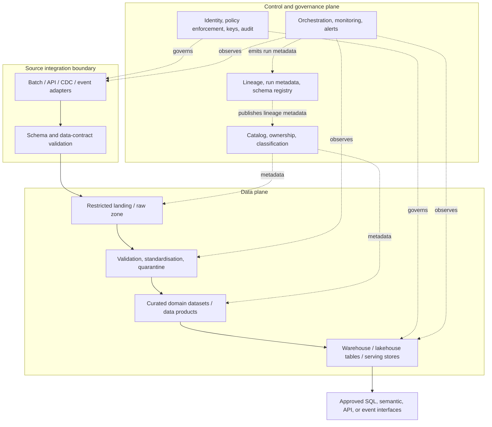
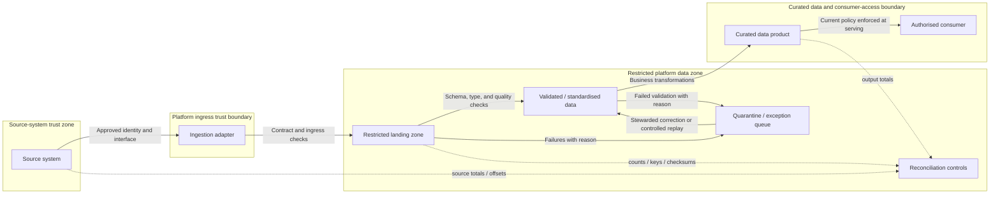
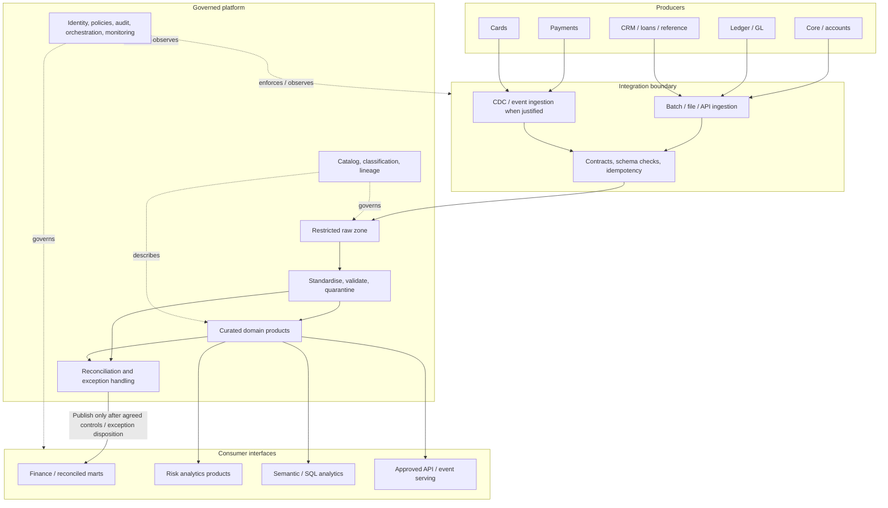

# Case Study 01 — Banking Data Platform

> **Learning purpose:** practise enterprise data-architecture analysis from business context through requirements, logical design, trade-offs, operations, evidence, and architectural defense.
>
> **Scenario status:** The module roadmap says the original case-study topic file was empty and that the actual scenario is unavailable. The fictional **Northbridge Bank** scenario in this document is therefore an **illustrative teaching scenario**, not a source-derived or real bank requirement. All scenario-specific systems, targets, numbers, priorities, decisions, and controls below are illustrative unless explicitly identified as facts from the supplied roadmap.
>
> **Audit-process note:** The accessible `template(20261020-112311).txt` was inspected. Its instructions to inspect the project tree and module roadmap, audit the complete document privately, revise identified defects, and revalidate the final file informed this review. The current accessible project-tree copy is dated `Roadmap_ptree(20261020-184004).md`; the exact un-dated filename `Roadmap_ptree.md` was not separately available for direct file inspection.

## How to use this lesson

Work through the lesson in order. Do not begin by selecting technologies. First understand the business problem, identify what is known and unknown, and classify requirements. Then design flows and components, compare alternatives using explicit criteria, and define how the architecture will be validated in operation.

By the end, you should be able to explain not only **what** architecture you propose, but **why**, under which assumptions it is appropriate, what can fail, what evidence is needed, and what new evidence would cause you to change the design.

### Source-of-truth labels used in this lesson

| Label | Meaning | How to use it |
|---|---|---|
| **Roadmap fact** | Explicitly stated in the supplied module roadmap or project tree | Preserve as source-derived context. |
| **Illustrative assumption** | Invented solely to make the worked example concrete | Do not present as a real bank requirement. Validate or replace it in a real engagement. |
| **Hypothesis** | A plausible explanation or design proposition not yet evidenced | Test it; do not treat it as a fact. |
| **Recommendation** | A proposed engineering or architecture practice | Accept, adapt, or reject based on context and evidence. |
| **Validation evidence** | An artefact, test result, measurement, or accountable confirmation supporting a claim | Record its source, owner, date, scope, and result. |
| **Open question** | Information needed to make a decision responsibly | Assign an owner and a resolution path. |

A requirement marked **assumed** is not confirmed merely because it appears in a matrix. A diagram illustrates a proposed design; it is not proof that a capability exists or has been tested.

## 1. Case-study overview

### 1.1 What is a banking data platform?

A **banking data platform** is a governed set of capabilities that acquires, stores, processes, protects, documents, and serves data from banking and supporting systems to authorised consumers. Consumers may include finance, risk, fraud operations, customer service, product analytics, management, audit, and regulatory-reporting teams.

The platform does not replace the bank's operational systems of record. Its purpose is to make appropriate data available for analytical and cross-domain use while preserving the authority, integrity, security, and operational responsibilities of those systems.

A platform is not simply a large database, a data lake, a warehouse, or a collection of pipelines. It includes the people, ownership boundaries, contracts, metadata, access controls, quality checks, recovery mechanisms, service expectations, and operating processes required to make data trustworthy.

### 1.2 Why a bank might need one

An illustrative bank may hold related information across a core banking system, general ledger, payment processor, card platform, loan origination and servicing applications, customer relationship management (CRM), digital channels, market/reference data providers, and document stores. Each system may use different identifiers, schemas, update patterns, and definitions.

Without a deliberate architecture, teams may build separate extracts and transformations, duplicate sensitive data, disagree on metric definitions, lose the origin of a number, or produce reports that cannot be reconciled to authoritative records. Operational systems can also be burdened by analytical queries, while data scientists may receive incomplete or stale data without understanding its limitations.

A well-designed platform aims to:

- provide governed access to useful data without undermining source-system responsibilities;
- establish repeatable ingestion and transformation patterns;
- make provenance, lineage, quality, and reconciliation visible;
- separate workloads with different freshness, correctness, availability, and latency needs;
- enforce data classification and least-privilege access;
- support recovery, replay, incident response, and auditable change;
- give teams reusable platform capabilities while keeping domain accountability clear.

These are architectural objectives, not evidence that any particular design or control is mandatory for every bank.

### 1.3 Why architecture decisions matter

A decision that improves freshness can add operational complexity. A decision that centralises governance can create a delivery bottleneck. More copies of data can improve workload isolation but increase privacy exposure, reconciliation effort, storage cost, and deletion complexity. A resilient platform can still produce incorrect outputs if its source data or business rules are wrong.

Architecture therefore requires explicit trade-offs. A decision is defensible when it connects a stated need to alternatives, criteria, consequences, risks, and evidence—not when it merely names a fashionable technology.

### 1.4 Learning objectives

This lesson follows Case Study 01 in the supplied module roadmap. You should be able to:

1. Extract functional and non-functional requirements from a scenario.
2. Map sources, data flows, platform zones, stores, serving interfaces, and consumers.
3. Evaluate governance, security, resilience, performance, and cost decisions.
4. Compare architecture alternatives using criteria fixed before choosing.
5. Identify risks, dependencies, open questions, and validation evidence.
6. Document and defend key decisions with architecture decision records (ADRs).
7. Trace each requirement to a component, decision, test, or explicitly recorded gap.
8. Separate source facts, assumptions, hypotheses, recommendations, and verified results.

### 1.5 How this case connects to the module

The roadmap positions banking as the broad platform context for later cases. It connects directly to Customer 360 and master data (identity and attribute authority), real-time fraud and risk (freshness, event processing, state, and latency), and the capstone (integrating architecture deliverables and defending decisions). It also provides context for modernization, multi-cloud, and governed enterprise knowledge, but the later cases must not blindly copy this design.

## 2. Prerequisites and conceptual foundations

The module roadmap calls the earlier modules recommended curriculum background rather than verified formal dependencies. The following are the relevant Stage 2D modules and the lens each contributes.

| Earlier module | Concepts to reuse | Application in this case |
|---|---|---|
| `../01-Data-Architecture-Foundations-and-Principles/` | Architecture roles, domains, principles, quality attributes | Frame business capabilities and ownership; distinguish a business problem from a technology proposal. |
| `../02-Requirements-Constraints-and-Architecture-Decisions/` | Stakeholders, functional/non-functional requirements, assumptions, risks, ADRs | Create the requirements matrix and compare alternatives consistently. |
| `../03-Data-Architecture-Patterns-and-Reference-Architectures/` | Centralised/federated patterns, lake/warehouse/lakehouse, event-driven integration | Generate alternatives rather than assuming a single reference pattern is universally right. |
| `../05-Database-and-Storage-Architecture/` | OLTP/OLAP separation, storage, formats, replication, lifecycle | Keep analytics from destabilising transaction processing; define retention and recovery. |
| `../06-Data-Integration-and-Interoperability/` | Batch, CDC, APIs, contracts, idempotency, deduplication, reconciliation | Ingest safely, handle retries, detect missing or duplicated data, and manage schema change. |
| `../07-Enterprise-Data-Platform-and-Lakehouse-Architecture/` | Platform capabilities, zones, metadata, tenancy, service levels | Design reusable ingestion, processing, storage, governance, and serving capabilities. |
| `../10-Data-Governance-Security-Privacy-and-Compliance/` | Classification, least privilege, encryption, privacy, retention, auditability | Define policy enforcement, access boundaries, and evidence without inventing legal obligations. |
| `../11-Metadata-Lineage-Quality-and-Master-Data/` | Catalog, lineage, quality, ownership, master data | Explain what a field means, where it came from, who owns it, and how its quality is measured. |
| `../12-Reliability-Resilience-and-Disaster-Recovery/` | Failure domains, backups, restore, RPO/RTO, replay, incident response | Set recovery objectives only after stakeholders define business impact; test recovery end to end. |
| `../13-Performance-Scalability-and-Cost-Architecture/` | Capacity, latency, throughput, query performance, unit costs | Estimate load and growth; validate capacity and cost with representative measurements. |
| `../14-Data-Access-Serving-Semantic-and-AI-Data-Architecture/` | Marts, semantic layers, APIs, data products, features, access patterns | Serve each consumer through a suitable, governed interface. |
| `../15-Architecture-Documentation-Reviews-and-Operating-Model/` | Context/container/data-flow views, trust boundaries, ADRs, reviews, ownership | Produce diagrams that explain the design and operating model, not just boxes and arrows. |

**Prerequisite review:** if you cannot explain the difference between a source of record and a derived analytical table, or between an assumption and a confirmed requirement, revisit the relevant earlier module before treating the worked design as a pattern to reuse.

## 3. Terminology for the banking scenario

| Term | Meaning | Why it matters here |
|---|---|---|
| **System of record (SoR)** | System designated as authoritative for a particular business record or transaction. Authority is often attribute- or domain-specific. | The platform should preserve provenance and not silently redefine the authoritative balance or transaction. |
| **Operational source system** | Application that runs a business process and creates or updates operational data. | Extraction must respect its availability, load, consistency, and interface constraints. |
| **Core banking** | Systems supporting core account/product functions; exact scope varies by institution. | May supply account and transaction information, but the exact authority boundaries must be confirmed. |
| **Ledger / general ledger (GL)** | Accounting records and balances used for financial accounting. A transaction ledger and GL are related but not interchangeable concepts. | Analytical outputs may require reconciliation to defined ledger extracts or accounting controls. |
| **Payments / cards / loans** | Domain systems for payment processing, card activity, and lending lifecycle. | Each domain has different event timing, identifiers, and data semantics. |
| **CRM** | Customer relationship management system. | CRM attributes may be useful without being authoritative for every customer or account attribute. |
| **Data domain** | A coherent business area with defined concepts, ownership, and data responsibilities. | Clarifies who can define semantics, approve changes, and resolve quality issues. |
| **Data product** | A managed, documented, owned data asset or service designed for defined consumers and use cases. | Makes ownership, contract, quality, freshness, and support explicit. |
| **Regulatory reporting** | Reporting prepared for an applicable supervisory or legal purpose. | Requirements must be sourced from the actual applicable obligations; this lesson does not assert any particular rule. |
| **Risk analytics** | Analysis used to assess exposures, scenarios, or risk indicators. | Often requires defined as-of times, reproducibility, and explainable transformations. |
| **Data lineage** | Record of where data originated and how it moved or transformed. | Supports impact analysis, investigation, and explanation of reported values. |
| **Reconciliation** | Comparison of records, counts, totals, or balances between defined boundaries to detect discrepancies. | Detects missing, duplicated, late, or transformed data that do not agree with a reference. |
| **Data quality** | Fitness of data for a defined use, assessed through dimensions such as completeness, validity, timeliness, uniqueness, and consistency. | A generic “quality score” is insufficient unless dimensions and rules are specified. |
| **Data classification** | Label describing sensitivity or handling needs of data, according to an organisation's policy. | Drives access, masking, sharing, retention, and monitoring. Labels and rules must be confirmed locally. |
| **Access control** | Enforcement determining which identity can perform which action on which resource under what conditions. | Least privilege requires both technical enforcement and appropriate identity/lifecycle management. |
| **RPO** | Recovery Point Objective: the maximum tolerable data loss measured in time, as defined by the business. | Informs replication, backup, and replay design. It is not automatically equal to backup frequency. |
| **RTO** | Recovery Time Objective: the target maximum time to restore a service to the agreed usable state after disruption. | Includes more than starting infrastructure: data restoration, replay, validation, and consumer readiness may matter. |
| **Freshness** | Age of the data at the point it is made available to a consumer, measured against a defined event or source timestamp. | “Near real time” is not measurable until a threshold and measurement method are agreed. |
| **Idempotency** | A repeated operation with the same logical input does not create additional unintended effects. | Enables safe retry after ambiguous failures. It requires a well-defined idempotency key and scope. |
| **CDC** | Change data capture: acquiring inserts, updates, and possibly deletes from a source change mechanism. | Can reduce latency and source load compared with repeated full extracts, but requires log/connector operations and recovery planning. |
| **Trust boundary** | Boundary across which identity, privilege, data sensitivity, or control assumptions change. | A diagram should show where data crosses zones, organisations, or security contexts. |

## 4. Beginner level — understand the scenario before designing

### 4.1 Illustrative scenario: Northbridge Bank

**All details in this subsection are illustrative assumptions.** They exist to teach the method because the source roadmap says the actual scenario file is unavailable.

Northbridge Bank is a fictional institution whose teams want a shared analytical platform. The imagined source estate includes core banking/account transactions, a general ledger extract, payments, cards, loans, CRM, and external market/reference data. Potential consumers include finance, risk, fraud operations, compliance reporting, customer analytics, data science, and audit.

The current-state problem is hypothesised to include duplicated point-to-point extracts, inconsistent definitions, uncertain freshness, manual reconciliation, and unclear ownership for some derived datasets. These are hypotheses to validate—not established facts about any bank.

The target is not “move everything into one lake.” The target is to provide fit-for-purpose, controlled data access while preserving source authority, defining quality and reconciliation checks, separating workloads where needed, and operating the platform with accountable owners.

### 4.2 Identify stakeholders, producers, consumers, and owners

Start with responsibilities rather than product names.

| Role | Example responsibility in the illustrative scenario | Questions to ask |
|---|---|---|
| Business sponsor | Defines the outcomes and acceptable trade-offs | What decision or business process improves? What happens if it fails? |
| Domain owner | Owns business meaning and quality for a domain | Which system is authoritative for each field? Who approves semantic changes? |
| Source-system owner | Operates a producer system and its interface | What extraction methods are supported? What load or availability constraints exist? |
| Data/platform team | Provides ingestion, storage, processing, catalog, and shared controls | Which capabilities are standardised? What is the support boundary? |
| Data product owner | Defines a consumer-facing data asset and its contract | Who uses it? What freshness, quality, schema, and support are expected? |
| Finance / reporting | Uses data for accounting and reporting workflows | What is the authoritative reconciliation point and as-of cutoff? |
| Risk / fraud | Uses data to assess risk or investigate activity | What latency and event completeness are required? How are late events handled? |
| Security / privacy | Defines and verifies applicable access and handling controls | What classifications, identities, purposes, retention rules, and evidence apply? |
| Operations / SRE | Runs and restores platform services | What are service objectives, alerts, runbooks, dependencies, and recovery tests? |
| Audit / control reviewers | Need explainable evidence and traceability | Can a reported value be traced to inputs, code version, approvals, and run history? |

The regulator is not necessarily a direct platform user. A compliance or reporting function may prepare outputs for submission. Confirm the actual operating model before drawing external actors into the architecture.

### 4.3 Separate facts, assumptions, constraints, hypotheses, and questions

Use an evidence register from the beginning.

| ID | Statement | Classification | Evidence / rationale | Owner to confirm | Status |
|---|---|---|---|---|---|
| ER-SF-01 | The module roadmap describes the bank scenario as illustrative and says the actual case file is unavailable. | Roadmap fact | Supplied module roadmap, Section A source-of-truth note and E.1 | Learner / reviewer | Confirmed from supplied source |
| ER-IA-01 | Northbridge has core, ledger, payments, cards, loans, CRM, and reference-data sources. | Illustrative assumption | Chosen to exercise the roadmap's typical source list | Scenario owner (fictional) | Not real-world evidence |
| ER-H-01 | Separate teams may produce inconsistent copies and definitions. | Hypothesis | Common failure mode to investigate; not established in the source | Business sponsor / domain owners | Unvalidated |
| ER-C-01 | Operational source systems should not be destabilised by analytics extraction. | Recommendation / design constraint to validate | Protects operational workload; source limits and priorities must be confirmed | Source owners | Proposed |
| ER-Q-01 | Which outputs must reconcile to which authoritative ledger or source extract? | Open question | Needed to define correctness controls | Finance / control owner | Unresolved |
| ER-Q-02 | Which data classifications and retention rules apply to each dataset? | Open question | No specific legal or internal policy is supplied | Security / privacy / legal | Unresolved |
| ER-Q-03 | What freshness, availability, RPO, and RTO objectives are required per product? | Open question | Consumer needs and business impact are unknown | Product owners / operations | Unresolved |

**Rule:** do not convert an unanswered question into a numeric requirement merely to complete a table. Mark the gap and name the person or evidence that could resolve it.

### 4.4 Extract requirements

A **functional requirement** describes a capability or behaviour. A **non-functional requirement** describes a quality attribute or measurable service characteristic. A **constraint** limits the solution space, for example an existing interface or a mandated hosting boundary. An **assumption** is a proposition temporarily accepted for analysis. An **open question** is not yet a requirement.

Business goals, policy constraints, and technical preferences should not be conflated. “Use streaming” is usually a proposed solution, not the underlying requirement. “A fraud investigator needs events within a defined time after they occur” is closer to the need; the time bound must be agreed and measured.

#### Requirement-classification exercise

Classify the following illustrative statements before looking at the guidance.

1. “The platform must publish a daily finance dataset with a documented business definition.”
2. “A critical consumer needs data no older than 10 minutes.”
3. “The source database team permits extracts only from a read replica.”
4. “We assume transaction changes can be captured from the source log.”
5. “Who approves a breaking change to the payment event schema?”
6. “Use Vendor X because it is modern.”

**Worked guidance:** (1) functional, with documentation/quality details to specify; (2) non-functional freshness target, illustrative until confirmed; (3) constraint if confirmed by the source owner; (4) assumption to validate; (5) open governance question; (6) not a requirement as written—ask what need the vendor is intended to satisfy and compare options. Do not treat the 10-minute value as a bank standard.

### 4.5 Correctness, freshness, availability, security, and recovery are different

- **Correctness:** Is the value semantically right and reconciled to an appropriate reference? Fresh data can be wrong.
- **Freshness:** How old is the information when a consumer can use it? A pipeline can be correct but too slow.
- **Availability:** Can an authorised consumer use the service when needed? A service can be available while returning stale or incomplete data.
- **Security/privacy:** Is access permitted for this identity, purpose, and data class? A correct dataset can still be exposed improperly.
- **Recovery:** After a failure, how much data may be lost and how quickly must a usable service return? Restoring infrastructure is not necessarily restoring a correct product.

Each quality attribute needs a definition, measurement point, owner, target, and validation approach. If any of those are missing, record the gap.

## 5. Intermediate level — build an architecture analysis

### 5.1 Use a repeatable analysis method

The module roadmap proposes this twelve-step method for every case:

1. Read the full case once.
2. Extract facts.
3. Extract functional and non-functional requirements.
4. List constraints and assumptions, clearly labelled.
5. List open questions.
6. Identify stakeholders and consumers.
7. Map sources → flows → stores → consumers.
8. List decisions already made or still needed.
9. Generate at least two plausible alternatives for each major decision.
10. Compare alternatives using criteria fixed before scoring.
11. Identify risks and validation evidence.
12. Record decisions and evidence in ADRs and an evidence register.

This lesson applies that method to the illustrative Northbridge scenario. In a real assignment, replace the scenario assumptions with the actual source case.

### 5.2 Requirement matrix

The following matrix is a **worked illustrative matrix**, not a statement of real bank requirements. The measures and priorities are proposed examples that require stakeholder confirmation. “Proposed” means not yet confirmed.

| ID | Requirement statement | Type | Source reference | Measure / acceptance evidence | Priority | Status |
|---|---|---|---|---|---|---|
| FR-01 | Ingest approved transaction and account data from named source systems. | Functional | ER-IA-01; scenario assumption | Contract tests; source-to-target counts; successful scheduled runs | High (proposed) | Assumed |
| FR-02 | Publish a finance dataset with defined grain, business definitions, and an agreed as-of cutoff. | Functional | ER-Q-01; illustrative business need | Finance sign-off; reproducible dataset version; reconciliation report | High (proposed) | Proposed; cutoff unresolved |
| FR-03 | Provide a documented risk-analytics dataset with event/source timestamps and lineage. | Functional | Illustrative consumer need | Catalog entry; lineage query; timestamp completeness test | High (proposed) | Assumed |
| FR-04 | Support authorised consumers through controlled SQL/semantic access or approved interfaces. | Functional | Illustrative platform goal | Access tests by role; consumer acceptance test | Medium (proposed) | Assumed |
| NFR-01 | Define a freshness objective separately for each data product. | Non-functional / process | ER-Q-03 | Named owner, timestamp definition, target, and monitoring dashboard per product | High (proposed) | Not quantified / unresolved |
| NFR-02 | Prevent unauthorised access to classified datasets and sensitive fields. | Security | ER-Q-02; governance module dependency | Negative access tests; policy review; access logs | High (proposed) | Policy details unresolved |
| NFR-03 | Detect missing, duplicated, or inconsistent source data before publishing critical outputs. | Data integrity | ER-Q-01; integration module dependency | Reconciliation controls; duplicate/replay tests; exception workflow | High (proposed) | Rule details unresolved |
| NFR-04 | Establish service-specific RPO/RTO with business owners. | Reliability | ER-Q-03; resilience module dependency | Approved objective; timed restore/replay/validation exercise | High (proposed) | Unresolved |
| NFR-05 | Scale ingestion and query workloads without unbounded resource contention. | Performance/capacity | Illustrative platform goal | Representative load test; queue/latency/throughput metrics; cost report | Medium (proposed) | Workload baseline missing |
| NFR-06 | Preserve traceability from published data to source inputs, transformation version, and run. | Auditability/lineage | Illustrative platform goal | Sample value traced end-to-end; immutable or controlled run records as designed | High (proposed) | Control design to validate |
| C-01 | Avoid placing uncontrolled analytical load on operational systems. | Constraint / recommendation pending confirmation | Source-owner interview needed | Load test or source-owner-approved extraction plan | High (proposed) | Proposed |
| C-02 | Apply the organisation's approved classification, retention, and access policies. | Policy constraint | Security/privacy policy required | Control mapping and policy-owner sign-off | High (proposed) | Policy evidence unavailable |
| A-01 | A read replica or change log is available for incremental extraction. | Assumption | Illustrative only | Source capability review and connector proof of concept | Medium (proposed) | Unvalidated |
| Q-01 | Which source is authoritative for each field and reconciliation total? | Open question | Discovery required | Approved source/attribute authority table | High | Open |
| Q-02 | Which products need batch, low-latency, or event-driven access? | Open question | Consumer interviews required | Consumer-to-freshness matrix | High | Open |
| Q-03 | What are approved service objectives and recovery objectives? | Open question | Business impact and operations review | Signed-off service objective register | High | Open |

#### How to improve the matrix

- Replace vague terms such as “fast,” “secure,” or “high quality” with definitions and measurable acceptance conditions.
- Cite the exact source section, interview, policy, or decision record. For an actual case, the source reference should point to its actual text location, not this illustrative lesson.
- Use a status such as confirmed, assumed, proposed, rejected, or open. Do not use “confirmed” without evidence.
- Assign an accountable owner to every high-impact open question.
- Separate target from measurement method. “99.9% availability” is not operational until the service boundary, observation window, exclusions, and measurement source are defined.
- Priorities in the example are not mandatory or source-derived. Reprioritise with stakeholders.

### 5.3 Trace requirements into components and evidence

| Requirement | Candidate component/control | Decision dependency | Validation evidence | Known gap |
|---|---|---|---|---|
| FR-01 ingestion | Source adapters, landing zone, scheduler/CDC connector, contract checks | ADR-02: batch vs CDC/streaming | Source-to-target count, schema compatibility, retry/replay test | Source capabilities unknown |
| FR-02 finance dataset | Curated finance product, semantic definitions, reconciliation service | ADR-01: storage/serving pattern; ADR-02: ingestion | Signed definition, as-of cutoff, reconciliation results | Authoritative reference and cutoff unknown |
| FR-03 risk dataset | Curated risk product, lineage metadata, freshness monitoring | ADR-02: ingestion by product tier | Timestamp completeness, lineage trace, freshness distribution | Required latency unknown |
| FR-04 controlled access | Catalog, identity/access policy, semantic layer/API/SQL endpoint | ADR-03: operating model and self-service boundaries | Role-based positive and negative tests | Actual roles/policies unknown |
| NFR-02 security | Identity provider, policy enforcement, encryption/key management, audit logging | ADR-03 and data-classification decisions | Threat-model review, access test results, key/access audit | Policy requirements unknown |
| NFR-03 integrity | Idempotent ingestion, deduplication, reconciliation and quarantine workflow | ADR-02 | Duplicate replay test, control totals, exception closure | Business reconciliation rules unknown |
| NFR-04 recovery | Backups, replicated metadata/data where justified, replay source, runbooks | Recovery ADR or approved service objectives | Restore/replay drill with timed validation | RPO/RTO not yet approved |
| NFR-05 capacity | Workload isolation, autoscaling or reserved capacity as appropriate, monitoring | ADR-01; capacity plan | Representative load and cost test | Baseline and growth assumptions missing |
| NFR-06 lineage | Catalog, orchestration metadata, versioned code/configuration, run identifiers | ADR-03 operating process | Trace one published measure to input and code/run | Retention and tamper-evidence design unresolved |

**Traceability rule:** every requirement must map to a component/control and a validation method, or be explicitly marked unaddressed. Every major component should also have a reason to exist, an owner, and at least one requirement or operational need it supports. This two-way review catches both missing controls and unnecessary architecture.

### 5.4 Logical platform zones and their responsibilities

Zones are logical responsibilities, not a mandatory number of physical accounts, databases, or vendors.

| Zone / capability | Responsibility | Important controls and design questions |
|---|---|---|
| Source systems | Create and maintain operational records | Authority, extraction windows, source load, schema/version changes, delete semantics |
| Ingestion | Acquire approved data via batch, API, files, CDC, or events | Authentication, contracts, retry, idempotency, backpressure, source offsets/watermarks |
| Raw/landing | Preserve received data or a sufficiently faithful source representation | Restricted access, provenance, immutable/versioned objects where appropriate, retention, encryption |
| Standardised/validated | Normalise types, timestamps, identifiers, schema, and basic quality | Quarantine invalid data; do not silently drop records; retain rejection reasons |
| Curated/domain products | Apply business rules and produce governed domain-level datasets | Owner, semantic definition, quality rules, lineage, versioning, consumer contract |
| Serving | Deliver data using fit-for-purpose query, API, semantic, event, or feature interfaces | Consumer access pattern, freshness, concurrency, caching, access enforcement |
| Metadata/control plane | Catalog, schemas, policy metadata, lineage, orchestration state, observability | Access to metadata itself, change history, ownership, recovery dependencies |
| Security/governance | Enforce identity, permissions, classification, retention, and audit | Least privilege, separation of duties, privileged access, key management, evidence |
| Operations | Monitor, alert, respond, restore, release, and manage capacity/cost | Service ownership, runbooks, SLO measurement, incident reviews, recovery drills |

**Bronze/silver/gold terminology:** these are common labels for raw, refined, and consumer-oriented layers, not universal standards. Define the actual guarantees of each layer. A “gold” label does not by itself prove business correctness or regulatory suitability.

### 5.5 System-context diagram

The diagram is a proposed logical context for the illustrative scenario. External systems and actors are examples; confirm the actual boundaries and interfaces in a real project.

```mermaid
flowchart LR
    subgraph Sources[Operational and external sources]
        CORE[Core banking / accounts]
        LEDGER[Ledger / GL extracts]
        PAY[Payments]
        CARD[Cards]
        LOAN[Loans]
        CRM[CRM]
        REF[Market / reference data]
    end

    PLATFORM[Governed Banking Data Platform]

    subgraph Consumers[Authorised consumers]
        FIN[Finance and reporting]
        RISK[Risk analytics]
        FRAUD[Fraud operations]
        ANALYTICS[Business analytics / data science]
        AUDIT[Audit and control review]
    end

    CORE --> PLATFORM
    LEDGER --> PLATFORM
    PAY --> PLATFORM
    CARD --> PLATFORM
    LOAN --> PLATFORM
    CRM --> PLATFORM
    REF --> PLATFORM
    PLATFORM --> FIN
    PLATFORM --> RISK
    PLATFORM --> FRAUD
    PLATFORM --> ANALYTICS
    PLATFORM --> AUDIT
```

The context view answers: who exchanges data with the platform, and why? It does not yet show internal processing, trust boundaries, protocols, or deployment topology.

### 5.6 Container / logical-component diagram

The diagram separates the **data plane** (data movement and processing) from the **control/governance plane** (metadata, identity, policies, orchestration, and observation). That separation is conceptual; an implementation may combine or distribute these capabilities. The placement of contract validation before landing is illustrative: some designs first preserve an access-restricted raw copy, then apply semantic validation, so invalid inputs remain diagnosable. Metadata and control services themselves require access control, backup, monitoring, and recovery.

### 5.7 End-to-end data flow and trust boundaries

The subgraphs mark conceptual trust zones for this exercise; refine them in a real design to match actual identity, administrative, network, and data-classification boundaries. The dashed reconciliation links are conceptual evidence flows, not a claim that every source supports the same totals or checksum semantics. This generic flow shows collection of control evidence, not a universal publication gate; Section 8.3 illustrates a possible reconciliation gate for the finance product, where the agreed contract requires it.

### 5.8 Source-to-consumer mapping

| Source (illustrative) | Likely data subject | Ingestion options to assess | Potential product / consumer | Critical design questions |
|---|---|---|---|---|
| Core banking | Accounts, transactions, product state | Batch extract, CDC, approved API | Account/transaction product for finance and risk | Source authority, transaction ordering, reversal semantics, source load, cutoffs |
| Ledger / GL | Accounting entries and balances | Controlled period extract, batch, supported change feed | Finance reconciliation/reporting | Accounting grain, posting period, close process, as-of rules |
| Payments | Payment lifecycle and status | Events, CDC, APIs, batch reconciliation | Payment operations, risk, fraud | Event identity, status transitions, late/duplicate events, finality semantics |
| Cards | Authorisations, clearing, settlements | Event/API/CDC/batch depending on source | Card analytics, fraud investigation | Authorisation vs settlement timing; reversals and dispute lifecycle |
| Loans | Applications, facilities, servicing state | Batch, CDC, APIs | Credit/risk and finance analytics | Effective dates, status history, identifiers, sensitive fields |
| CRM | Contact and relationship attributes | API, CDC, approved export | Customer analytics / service | Attribute authority, consent/purpose, stale or conflicting values |
| Market/reference data | Prices, rates, codes, calendars | Provider API or licensed files | Risk and valuation analytics | Licensing, timestamp, effective period, provider corrections |

This is a starting map, not a source authority declaration. Authority can differ by attribute: CRM may own a contact preference while a core system owns an account status. Create an attribute-level authority table before building cross-domain products.

### 5.9 Data contracts, idempotency, reconciliation, and schema evolution

**Data contract.** A contract specifies a producer's published schema and semantics, identifiers, nullability, units, timestamp meanings, update/delete behaviour, compatibility policy, quality expectations, ownership, and change process. A schema alone is insufficient: a field called `amount` is ambiguous without currency, sign convention, and business meaning.

**Idempotent ingestion.** A retry must not create unintended duplicates. Define a stable event/record key and the scope of deduplication. For CDC, consider source log position and transaction identity. For files, use a manifest, batch ID, checksum, and completion marker where supported. For APIs, use the source's pagination and change-token semantics. Exactly-once effects across independent systems are not automatically guaranteed by a messaging or processing engine; many designs obtain practical correctness through at-least-once delivery plus idempotent processing and reconciliation.

**Reconciliation.** Compare at well-defined boundaries. Depending on the source and product, controls may include record counts, key coverage, amount totals, status counts, source offsets, checksums, or domain-specific invariants. A count match alone does not prove the same records were loaded; a monetary total match alone can hide offsetting errors. Use multiple controls appropriate to the data.

**Exception handling.** Do not silently discard invalid or late records. Record rejection reason, source identity, run/batch, and remediation status; restrict access to quarantined data because it may contain sensitive fields. Decide whether the product is blocked, published with an explicit degraded status, or split into complete and incomplete partitions. The choice depends on consumer impact and correctness requirements.

**Schema evolution.** Test producer and consumer compatibility before rollout. Define additive, optional, rename, type-change, and semantic-change policies. A change can be syntactically compatible but semantically breaking. Version contracts and record approvals, deployment order, and rollback/replay procedures.

### 5.10 Metadata, lineage, and quality controls

For each data product, record at minimum: owner, description, business definition, grain, source systems, classification, permitted use, schema/contract version, refresh/freshness meaning, quality rules, lineage, retention, serving interface, support route, and known limitations.

Example quality checks for an illustrative transaction product:

- required transaction identifier is present;
- source event timestamp is parseable and its time zone/meaning is defined;
- currency code belongs to the approved reference set;
- duplicate keys are detected within the specified scope;
- amounts and signs follow the domain contract;
- source-to-target counts and defined totals reconcile for a known window;
- late-arriving changes and reversals are handled by documented rules;
- rejected records have an observable count and remediation owner.

Thresholds must be based on the business definition, source behaviour, and consumer impact. Do not invent a universal “99.9% data quality” threshold. A quality test needs an explicit rule, population, time window, severity, owner, and response when it fails.

## 6. Advanced level — architecture alternatives and trade-offs

### 6.1 Centralised versus federated operating model

This is primarily an ownership and decision-rights choice, not simply a deployment topology.

| Dimension | More centralised | More federated / domain-oriented | When to consider each |
|---|---|---|---|
| Standards and controls | Easier to enforce consistent platform patterns centrally | Domains can adapt contracts and products to local semantics, within guardrails | Centralisation helps where skills/control consistency are scarce; federation helps where domains have mature ownership and different needs. |
| Delivery speed | Shared team can reduce duplicated foundational work but become a queue | Parallel domain delivery can improve throughput but requires strong contracts and enablement | Assess bottlenecks and team capability, not ideology. |
| Business meaning | Central team may lack detailed domain context | Domain owners are closer to definitions and quality responsibility | Federated ownership works only when domain accountability is real. |
| Cost | Can reduce duplicated tooling; central team may be overburdened | Can increase local duplication and support complexity | Measure total platform + domain + governance cost. |
| Risk | Central failure or backlog can have broad blast radius | Inconsistent implementation can create gaps across domains | Use shared guardrails, clear escalation, and bounded blast radius in either model. |
| Dependencies | Strong dependency on central team and central release process | Dependency on domain teams, shared standards, and cross-domain coordination | Choose based on actual operating maturity and service ownership. |

**Recommendation for the illustrative case:** start with a platform team providing shared capabilities and controls, while assigning domain owners responsibility for business definitions and data quality. Allow governed self-service where teams can demonstrate capability and meet guardrails. This hybrid recommendation is conditional, not universally superior.

### 6.2 Lakehouse versus separate lake and warehouse

| Dimension | Lakehouse-style platform | Separate lake plus warehouse/serving systems |
|---|---|---|
| Benefits | Potentially shared governance and storage conventions; supports diverse structured and semi-structured data; may reduce copies | Clear workload specialization; mature warehouse semantics or controls may already exist; independent scaling and change paths |
| Limitations | Capability and performance vary by implementation; governance consistency and multi-workload contention still require engineering | More movement/copies; duplicated governance and metadata; cross-system lineage and reconciliation become important |
| Costs | Table management, compute, catalog, optimization, and operational expertise; costs depend on workload and engine | Storage/compute in multiple systems, transfer, duplicate operations, integration, and reconciliation |
| Risks | Shared platform bottleneck or accidental coupling; unsupported assumptions about transactional semantics | Inconsistent copies, stale marts, duplicated policy enforcement, complex lifecycle/deletion |
| Dependencies | Table format, catalog, engine interoperability, concurrency, skills, vendor capabilities | Existing warehouse estate, integration throughput, data movement, and clear ownership |
| Appropriate when | Mixed data and workload needs can be served reliably by a governed shared architecture | Specialized workloads, existing investments, or isolation requirements justify distinct stores |

Do not choose based on labels alone. Benchmark representative queries and transformations, test concurrent workloads, verify transaction/schema evolution requirements, and estimate total cost including operations and data movement. A hybrid architecture may use a lake/lakehouse for broad ingestion and history with curated warehouse marts for well-defined analytical consumers.

### 6.3 Batch versus streaming versus hybrid ingestion

| Pattern | Benefits | Costs / risks | Appropriate conditions |
|---|---|---|---|
| Batch | Simple operational model for periodic reporting; efficient for bulk loads; easier to reason about fixed cutoffs | Data is stale between runs; large batches can create peaks; reruns/backfills need careful design | Consumer freshness allows scheduled updates and source provides reliable snapshots/extracts. |
| Streaming / CDC | Lower-latency updates; supports event-driven consumers; can avoid repeated full extracts | More moving parts: offsets, partitions, ordering, state, schema changes, late events, replay, backpressure, and continuous operations | A measured consumer need justifies lower latency and source/event infrastructure supports it. |
| Hybrid | Batch for snapshots/backfills and reporting cutoffs; CDC/events for low-latency products | Two paths can diverge; duplicate handling and reconciliation across paths are difficult | Different products have genuinely different freshness needs and there is a defined convergence/reconciliation design. |

A practical rule: choose the simplest mechanism that meets the confirmed requirement. “Real time” should be decomposed into event generation delay, transport, processing, storage, and serving delay. For a hybrid design, define how batch snapshots and change events are aligned, how offsets are checkpointed, how replay works, and how duplicate effects are prevented.

### 6.4 Central implementation versus governed self-service

| Dimension | Central implementation | Governed self-service / paved road |
|---|---|---|
| Benefits | Consistent patterns, concentrated expertise, easier review of sensitive or complex pipelines | More teams can deliver; reusable templates and automated controls reduce central bottlenecks |
| Limitations | Queueing, lower domain responsiveness, limited scalability of central team | Requires platform investment, training, product ownership, and clear boundaries; teams can misuse tools if guardrails are weak |
| Costs | Central engineering capacity and handoff overhead | Upfront tooling/templates, developer experience, support, monitoring, and ongoing governance |
| Risks | Central team becomes a single point of delivery failure | Shadow pipelines, inconsistent semantics, overprivileged access, and unmanaged cost if self-service is uncontrolled |
| Appropriate conditions | High-risk or highly specialized workloads; immature domain teams | Repeatable patterns, capable teams, automated policy controls, observable usage, and accountable domain ownership |

A paved road should include approved templates, contract checks, access provisioning, lineage/metadata registration, CI validation, cost visibility, monitoring, and a documented exception path. “Self-service” does not mean unreviewed access to all data.

### 6.5 Fix decision criteria before scoring

Possible criteria include: correctness/integrity, freshness, recovery, security/control enforceability, source impact, workload isolation, interoperability, delivery lead time, skills, total cost, reversibility, and operational complexity. Define what each criterion means and which requirements are non-negotiable before scoring options.

If using a weighted score, document the scale and weights as a stakeholder-approved decision aid—not as objective truth. A high aggregate score must not hide failure to meet a mandatory constraint. Sensitivity-test the result: would a different plausible weight or a new constraint change the selected option?

## 7. Advanced engineering and operational reasoning

### 7.1 Governance, privacy, and least privilege

**What:** governance defines accountability, permitted use, semantic standards, decision rights, and controls. Security implements protections; privacy and applicable legal/policy requirements shape collection, use, sharing, retention, and deletion.

**How:** classify datasets and fields according to approved policy; use managed identities and role/attribute-based policies as appropriate; separate duties; encrypt data in transit and at rest where required by the security design; manage keys and secrets; mask or tokenise fields where useful; log privileged and sensitive access; review access periodically; and propagate policy to copies, extracts, caches, and derived products.

**Why it matters:** a central platform can increase the reach of sensitive data. A single overly broad role or uncontrolled export can expose more records than a source system did. Access to the catalog, logs, quarantine, backups, and metadata may also reveal sensitive information.

**Failure modes:** granting broad administrator access for convenience; relying on application filters when storage access remains unrestricted; treating masking as anonymisation without a threat assessment; forgetting dev/test environments; and retaining copied data after source deletion or retention expiry.

**Validation:** test both allowed and denied actions using representative identities; verify policy propagation to each serving path; inspect privileged-access records; test revocation; confirm that backup and restore workflows preserve access controls; and review exceptions with an owner and expiry. Applicable legal obligations must be identified from actual authoritative sources by the responsible legal/compliance function. This lesson does not name or invent a specific regulatory mandate.

### 7.2 Integrity, reconciliation, and auditability

Correctness is a property of a defined output and use, not a property granted by choosing a storage engine. A reliable pipeline can reproducibly produce the wrong answer if its mapping, business definition, or source authority is wrong.

A robust control design identifies:

1. **Authority:** which source and business owner define the value.
2. **Grain:** what one row or event represents.
3. **Time semantics:** event time, processing time, effective time, posting time, and as-of cutoff.
4. **Control boundary:** which source batch, offset, or period is compared with which output.
5. **Reconciliation rule:** counts, totals, key coverage, invariants, or domain-specific checks.
6. **Tolerance and response:** which differences are acceptable, who approves them, and what happens when they are exceeded.
7. **Evidence:** input version, transformation version, run ID, control results, exception disposition, and approval where required.

Do not assume every financial dataset should reconcile through a simple row count or sum. A card authorisation stream and a settled accounting ledger can differ legitimately because they represent different lifecycle states. First align definitions and time boundaries, then compare.

Auditability requires reconstructable lineage and controlled history of code/configuration and runs. It does not necessarily require every platform to store every raw record forever; retention and minimisation must be balanced with the actual need and approved policy.

### 7.3 Reliability, resilience, backup, recovery, and disaster recovery

Reliability is not just uptime. A data service can be “up” but fail its freshness or correctness objective. Define product-specific indicators, such as successful publication by an agreed cutoff, freshness distribution, reconciliation completion, query availability, or time to recover a usable product.

A recovery plan should cover data, code, configuration, schemas, catalog/metadata, identity and keys, orchestration state, secrets recovery, network dependencies, and downstream consumer readiness. Determine which dependencies must be restored first. A backup that cannot be decrypted or whose catalog cannot be restored may not produce a usable service.

Test restoration in an isolated or controlled environment. Include replay/backfill and reconciliation. Document who declares recovery, how partial correctness is represented, how consumers are notified, and how to return to normal processing without double-applying data.

#### Illustrative RPO/RTO calculation — not a banking standard

Assume, solely for this worked example:

- An analytical product's business owner provisionally asks for **RPO ≤ 15 minutes**.
- The owner provisionally asks for **RTO ≤ 2 hours** to restore a usable product.
- The design takes a recoverable checkpoint/backup every **10 minutes**.
- Measured restoration takes **45 minutes**, replaying the gap takes **35 minutes**, and reconciliation plus consumer validation takes **20 minutes**.

These values are invented for teaching. They are not source-derived requirements, legal standards, or recommendations for all banking services.

**RPO reasoning:** a 10-minute checkpoint interval may bound loss to roughly the interval only if the checkpoint is complete, durable, and recoverable, and if the actual failure point and checkpoint semantics support that bound. It is not sufficient to infer RPO from interval alone. Replication lag, uncheckpointed events, metadata loss, and source retention can worsen the result. A measured recovery test must establish the actual recoverable point.

**RTO arithmetic:**

`45 minutes restore + 35 minutes replay + 20 minutes reconciliation/validation = 100 minutes`

`100 minutes = 1 hour 40 minutes`, which is below the illustrative 2-hour target by 20 minutes.

The apparent margin is only useful if the timings include all required dependencies and are demonstrated under a representative failure. Parallelizable steps, queue buildup, source unavailability, key restoration, or a larger replay backlog can change the result. If the target applies to service restoration, declaring the system available before data validation is complete would misrepresent recovery.

**Validation checklist:** test a failure at an inconvenient point in the checkpoint cycle; verify the recovered data boundary; replay events/records without duplicates; restore catalog and access policy; run reconciliation; confirm consumers can query the correct product; record actual RPO/RTO; and track remediation for any failed objective.

### 7.4 Capacity, scalability, performance, and cost

Estimate volume and workload before sizing components. Gather source records per second or per day, average and peak record sizes, change rate, retention, backfill size, query concurrency, query patterns, transformation windows, and growth assumptions. Separate raw data volume from replicated, transformed, indexed, and backed-up volume.

A simple illustrative daily-volume estimate:

- 20 million records/day × 1.2 KB/record ≈ 24,000,000 KB/day, or roughly 24 GB/day using decimal units before compression and metadata.
- At an illustrative 2× peak/growth multiplier, plan to test around 48 GB/day of incoming logical data.
- If retained for 365 days with no deletion or compression assumptions, 24 GB/day × 365 ≈ 8.76 TB of logical data before replication, versions, derived products, indexes, backups, and overhead.

These figures are illustrative arithmetic only. Record-size units, compression, change rates, retention, and growth need measurement. Do not size a platform from a single average-volume estimate.

Measure end-to-end freshness, ingestion lag, processing duration, queue depth, query latency percentiles, concurrency, failed/retried work, storage growth, and cost per useful product or workload. Test peak and backfill scenarios, not only steady state. Cost controls include workload isolation, lifecycle tiers, partition/layout design, query governance, idle-resource controls, and cost attribution—but cost optimisation must not silently weaken integrity, security, or recovery.

### 7.5 Ownership, incidents, change control, and operating model

For every production data product, define a business owner, technical owner, supported consumers, contract, service objective (if applicable), quality controls, escalation path, and change policy. A platform team owns shared infrastructure and paved roads; domain teams own their data semantics and quality within agreed boundaries; security/privacy teams own or approve policies in their remit; operations own incident coordination according to the organisation's model.

A useful incident lifecycle is: detect → classify impact → contain → communicate → restore service/data → validate correctness → reconcile/replay if needed → document root cause and contributing factors → track corrective actions. Do not close a data incident merely because the pipeline turned green; confirm the published output is complete and fit for use.

For schema or semantic changes, require impact analysis through lineage, contract compatibility tests, consumer communication, approval where appropriate, deployment sequencing, rollback/replay plans, and post-release monitoring. A syntactically compatible change can still change the business meaning of a metric.

### 7.6 Evidence-based architectural decisions

A decision pack should link:

`business need → requirement → alternatives → criteria → selected option → consequences/risks → implementation control → validation evidence → review trigger`

Evidence examples include source-owner confirmations, contract tests, reconciliation reports, access-control test results, threat-model findings, load-test measurements, cost estimates, restore-drill timings, consumer acceptance, and signed business definitions. State what each piece of evidence proves and what it does not prove.

A design review should challenge: What assumption is most likely to be false? Which requirement is least well evidenced? What is the failure mode if the selected option underperforms? What would change the decision? What is the rollback path? Which team owns the ongoing control?

## 8. Worked illustrative case study — integrated analysis

This section brings the previous concepts together. All Northbridge-specific facts and numerical targets remain illustrative assumptions. The design is a candidate architecture for learning, not a production prescription.

### 8.1 Business problem and stakeholders

**Illustrative problem statement:** Northbridge's finance, risk, and analytics teams need consistent, traceable data from several operational domains. Existing point-to-point extracts are hypothesised to produce duplicated work, unclear data definitions, and slow issue investigation. Some consumers need periodic reconciled outputs; other consumers may need lower-latency event data. The bank wants shared capabilities without granting every team unrestricted access to every dataset.

**Desired outcomes (proposed):**

- named owners and definitions for critical data products;
- controlled ingestion that limits impact on source systems;
- lineage from product output to source and transformation run;
- reconciliations appropriate to each source/product boundary;
- different serving/freshness tiers where consumer needs differ;
- enforceable access and retention controls;
- tested recovery and documented operational ownership.

**Stakeholders:** sponsor; finance/reporting owner; risk and fraud consumers; source-system owners; domain data owners; platform engineering; security/privacy; operations/SRE; audit/control reviewers; and downstream data product owners. Actual role names and decision rights must be confirmed in a real engagement.

### 8.2 Facts, assumptions, constraints, and questions

| ID | Item | Type | Design consequence | How to validate |
|---|---|---|---|---|
| SCN-F-01 | The supplied roadmap says the original scenario is unavailable and its case frame is illustrative. | Roadmap fact | Do not claim Northbridge details are source facts. | Recheck roadmap Section A and E.1. |
| SCN-A-01 | Several operational domains publish data through a mix of batch extracts and change feeds. | Illustrative assumption | Support multiple adapters behind common contracts. | Source capability inventory and proof of concept. |
| SCN-A-02 | Finance prefers reconciled, cutoff-based outputs while some risk consumers may need lower-latency data. | Illustrative assumption | Consider product-specific ingestion/serving tiers. | Consumer interviews and measured use cases. |
| SCN-C-01 | Operational workload and source stability must be protected, subject to source-owner confirmation. | Proposed constraint | Use approved replicas, extracts, rate limits, or source interfaces. | Source-owner approval and load test. |
| SCN-C-02 | Approved organisational policy governs sensitive data. | Proposed constraint | Classification and access policy must be obtained before production. | Policy mapping and accountable sign-off. |
| SCN-Q-01 | Which system/field is authoritative for each key metric and attribute? | Open | Affects semantics and reconciliation. | Source/attribute authority table. |
| SCN-Q-02 | Which consumers need which freshness and availability objectives? | Open | Affects batch/CDC/streaming choices and cost. | Consumer requirement workshops. |
| SCN-Q-03 | What recovery objectives apply to each product and its dependencies? | Open | Affects replication, backups, replay and DR. | Business impact analysis and timed tests. |
| SCN-Q-04 | What are approved retention, deletion, residency, and use constraints? | Open | Affects copies, zones, lifecycle and serving. | Applicable policies and legal/compliance review. |

### 8.3 Candidate logical architecture

The candidate uses a shared platform foundation with domain-owned products, controlled ingestion, a restricted raw landing zone, standardisation and quality checks, curated products, and governed serving interfaces. Finance-oriented products can use cutoff-based batch snapshots and explicit reconciliation; lower-latency products can use CDC/events only when a confirmed requirement and source capability justify the complexity. A batch path remains useful for backfills and independent reconciliation.

**Interpretation:** the diagram is logical. It does not commit to a specific vendor, cloud, number of physical accounts, or exact deployment. The data contract boundary is shown before landing to emphasise validation, but a real system may preserve raw input before full semantic validation so invalid source records remain diagnosable. Security policy must apply at both ingress and storage; do not infer that the diagram's single control box represents one product or one enforcement point.

### 8.4 Proposed product tiers

The purpose of tiers is to reflect different consumer needs, not to create artificial service levels.

| Illustrative tier | Example product | Candidate pattern | Correctness/freshness considerations | Open decisions |
|---|---|---|---|---|
| Reconciled periodic | Finance reporting dataset | Scheduled snapshot/batch with cutoff and reconciliation | Publish only after agreed controls; define late-arriving adjustments and restatement | Cutoff, source of authority, deadline, correction process |
| Lower-latency analytical | Payment activity for risk investigation | CDC/event ingestion with idempotency and replay; curated view | Track event time and processing time; handle duplicates, out-of-order and late events | Required latency, completeness policy, source event capability |
| Broad analytical | Domain marts / semantic metrics | Curated tables and semantic layer | Shared definitions, query isolation, documented refresh | Query patterns, concurrency, access policies |
| Controlled programmatic | Approved API or event product | API/event interface over a defined product | Consumer contract, authentication, rate limits, versioning | Consumer list, availability, operational owner |

No numeric freshness target is assigned here because the source scenario does not provide one. Obtain an explicit target and measurement point for each product before declaring it production-ready.

### 8.5 Three architectural decision records (ADRs)

These ADRs are **illustrative proposals**. A real ADR must name its owner, date, status, source requirements, and actual evidence. The options and consequences are examples to practise decision defense.

#### ADR-01 — Select a storage and analytical serving pattern

- **Status:** Proposed for the illustrative scenario.
- **Context:** The platform must preserve broad source history while serving reconciled finance datasets and general analytics. Workload, concurrency, existing estate, and product-specific query patterns are not yet measured.
- **Decision drivers:** correctness and reproducibility; governance; workload isolation; interoperability; performance; total cost; team skills; reversibility.
- **Options considered:**
  1. A governed lakehouse-style platform for raw, refined, and curated data, with a semantic/serving layer as needed.
  2. Separate data lake/object storage and a warehouse for curated analytical workloads.
  3. Retain or extend an existing warehouse-centric platform, using separate landing storage only where necessary.
- **Proposed choice:** evaluate option 1 as the baseline candidate, while explicitly allowing a separate warehouse/mart for products whose performance, semantic, or control requirements justify it. Do not commit before a workload benchmark and estate review.
- **Benefits:** common ingestion/history model; potential reduction in redundant movement; supports multiple data forms.
- **Consequences and risks:** shared platform can become a bottleneck; catalog/table-format interoperability and operating skills matter; “lakehouse” does not guarantee correct finance semantics or isolation.
- **Validation plan:** representative query/transform benchmark; concurrent workload test; source-to-product reconciliation; schema evolution and restore test; total-cost estimate including operations and data movement.
- **Revisit if:** existing warehouse capabilities already satisfy requirements at lower risk/cost; measured isolation or control needs cannot be met; required interoperability is unsupported; or test evidence contradicts the performance/cost hypothesis.

#### ADR-02 — Choose batch, CDC, and event ingestion by product need

- **Status:** Proposed for the illustrative scenario.
- **Context:** Finance-style outputs may need stable cutoffs and reconciliation; some risk consumers may need fresher data. Source capabilities and latency objectives are unconfirmed.
- **Decision drivers:** freshness; completeness; source impact; ordering and update semantics; replay; operational complexity; cost; recovery.
- **Options considered:**
  1. Batch-only ingestion.
  2. CDC/event ingestion for all suitable sources.
  3. Hybrid ingestion selected per data product, with shared contracts, idempotency, and reconciliation.
- **Proposed choice:** option 3 only if consumer interviews confirm materially different freshness needs. Use batch where it satisfies the requirement; add CDC/events where the measured value justifies operational complexity. Keep a controlled backfill/reconciliation path.
- **Benefits:** fit-for-purpose freshness; avoids forcing every dataset into a continuous-processing model.
- **Consequences and risks:** two paths may diverge; event ordering, schema evolution, checkpoints, duplicates, and late arrivals need explicit handling; dual-path reconciliation adds complexity.
- **Validation plan:** source capability test; end-to-end freshness measurement; duplicate/retry/replay tests; late-event and out-of-order tests; source load review; reconciliation across batch and incremental paths.
- **Revisit if:** batch meets every confirmed need; the source cannot safely expose changes; event operations are not supportable; or the required freshness cannot be achieved with the chosen design.

#### ADR-03 — Establish shared platform guardrails with domain ownership

- **Status:** Proposed for the illustrative scenario.
- **Context:** Shared controls and repeatable patterns are needed, while business definitions and data quality depend on domain expertise. Team maturity and existing decision rights are unknown.
- **Decision drivers:** accountability; consistency; delivery speed; least privilege; supportability; cost; change governance.
- **Options considered:**
  1. Fully centralised pipeline and product delivery.
  2. Fully federated domain implementation with minimal central enforcement.
  3. Shared platform capabilities and enforceable guardrails, with domain-owned semantics and products.
- **Proposed choice:** option 3 as a starting hypothesis. The platform team owns common capabilities and templates; domain owners approve semantics and quality rules; security/policy owners define control requirements; product owners manage consumer contracts and support.
- **Benefits:** shared controls and reduced duplication while retaining domain knowledge and accountability.
- **Consequences and risks:** unclear boundaries can create gaps; guardrails require investment; self-service without automated controls may create shadow pipelines.
- **Validation plan:** responsibility matrix; access-policy tests; review workflow; ownership/catalog completeness; incident tabletop; adoption and defect metrics.
- **Revisit if:** domain teams cannot support ownership duties; central review becomes an unacceptable bottleneck; or controls cannot be reliably enforced across self-service paths.

### 8.6 Risks and mitigations

| Risk ID | Risk | Likely cause | Impact | Proposed mitigation | Validation / owner |
|---|---|---|---|---|---|
| R-01 | Incorrect finance or risk output | Wrong source authority, grain, cutoff, or transformation | Misleading decisions and rework | Attribute authority table, explicit semantics, reconciliation and sign-off | Finance/domain owner; sample trace and reconciliation test |
| R-02 | Source production impact | Unbounded extracts or poorly tuned CDC | Operational degradation | Approved extraction interface, rate limits, replicas where available, load testing | Source owner; measured load and operational approval |
| R-03 | Duplicate or missing records | Retry, replay, offset, or batch-boundary defects | Inflated or incomplete metrics | Idempotency keys, manifests/checkpoints, reconciliation, replay tests | Integration owner; injected failure tests |
| R-04 | Sensitive data overexposed | Broad roles, uncontrolled copies, weak policy propagation | Privacy/security incident | Classification, least privilege, masking where appropriate, audit, negative tests | Security/privacy; access review and test evidence |
| R-05 | Stale product appears healthy | Monitoring tracks job success, not data age | Decisions use outdated data | Freshness indicators at consumer boundary; explicit degraded-state policy | Product owner/SRE; stale-data simulation |
| R-06 | Recovery misses objectives | Restore ignores replay, metadata, keys, or validation | Extended outage or incorrect restored product | Dependency-aware runbook and timed restore/replay/reconciliation drills | Operations; measured exercise results |
| R-07 | Semantic drift across teams | Unowned definitions or incompatible changes | Conflicting metrics and broken consumers | Domain ownership, versioned contracts, semantic layer, impact analysis | Domain/product owners; contract and lineage review |
| R-08 | Platform cost grows unexpectedly | Unmeasured retention, query scans, duplication, idle compute | Budget pressure and throttling | Capacity baselines, lifecycle rules, query monitoring, cost attribution | Platform FinOps owner; monthly workload/cost review |
| R-09 | Vendor or engine lock-in exceeds tolerance | Proprietary interfaces and untested export path | Migration cost and reduced options | Record portability requirements; test export/restore where justified | Architecture owner; proof-of-export and exit-cost analysis |
| R-10 | Unclear incident accountability | Shared components without support boundaries | Delayed response and repeated failure | Named product/platform owners, escalation, runbooks, incident reviews | Operating-model owner; tabletop exercise |

Risk mitigation reduces probability or impact; it does not prove a risk is eliminated. Record residual risk, acceptance owner, and review trigger.

### 8.7 Validation evidence register

| Evidence ID | Claim being tested | Evidence artefact / test | Pass condition | Owner | Status in this lesson |
|---|---|---|---|---|---|
| EV-01 | Source interface can be used safely | Source-owner approval plus representative load test | Approved access path and load within agreed source limits | Source owner | Not executed; required |
| EV-02 | Ingestion is retry-safe | Inject failure and replay same batch/events | No unintended duplicate effects; discrepancies surfaced | Integration owner | Not executed; required |
| EV-03 | Finance product reconciles | Compare defined source controls with output at agreed cutoff | All defined controls pass or exceptions are approved and explained | Finance/domain owner | Rules not yet defined |
| EV-04 | Lineage is usable | Trace a sampled published field/metric to source and transformation run | Source, transformation version, run, and semantic definition identified | Product owner | Not executed; required |
| EV-05 | Access is least-privilege | Positive and negative tests with representative roles | Approved actions succeed; prohibited actions fail and are logged as designed | Security owner | Policy/roles unknown |
| EV-06 | Recovery meets objective | Restore, replay, reconcile, and consumer validation timed end to end | Measured RPO/RTO meet approved product objectives | Operations owner | Objectives unapproved; not executed |
| EV-07 | Platform handles expected peak | Representative workload and backfill test | Agreed latency/throughput/capacity targets met without unacceptable failures | Platform owner | Workload baseline missing |
| EV-08 | Schema change is safe | Compatibility test and consumer impact review | Contract policy met; affected consumers have a controlled migration path | Producer/product owners | Contract policy proposed |
| EV-09 | Cost model is credible | Cost estimate based on workload and measured test data | Assumptions and sensitivity ranges reviewed by accountable owner | Platform/finance owner | Not estimated |

Evidence status must remain “not executed” until a test has actually been run. A planned test is not evidence of a passing result.

### 8.8 Limitations and unresolved questions

The candidate design cannot be considered production-ready until at least the following are resolved:

- actual business scope, users, and decision workflows;
- field-level source authority, definitions, grain, and reconciliation boundaries;
- source interface capabilities, load constraints, CDC semantics, and retention of source logs;
- product-specific freshness, availability, RPO/RTO, and support objectives;
- applicable classification, access, retention, privacy, residency, and audit policies;
- expected volume, peak patterns, growth, concurrency, and cost envelope;
- existing technology estate, licensing, skills, vendor constraints, and network boundaries;
- operational ownership, incident escalation, change approval, and exception handling;
- actual capstone brief, case-study source file, and review rubric (not supplied as populated source documents).

The architecture should be revised when these inputs arrive. This is a normal architecture lifecycle, not a flaw to hide.

## 9. Real-world-style trade-off scenarios

### Scenario A — Reconciled periodic report versus continuous updates

**Illustrative conflict:** finance needs a reproducible cutoff and reconciled totals; a risk analyst wants fresher transaction activity.

- **Option 1:** publish a controlled batch snapshot for the finance product and separately serve an incremental risk product.
- **Option 2:** force both consumers onto one continuously updated dataset.
- **Option 3:** use only batch and accept the freshness limitation.

Option 1 can align service behaviour to consumer need, but requires explicit semantics and reconciliation between paths. Option 2 may reduce duplicated pipelines but can complicate cutoff reproducibility and increase operational burden. Option 3 is simpler if risk's actual need permits it. Decide only after measuring business impact and defining how each product represents late changes, reversals, and “as of” time.

### Scenario B — Many teams, uneven engineering maturity

**Illustrative conflict:** a central team can enforce patterns, but cannot build every pipeline without creating a queue.

A central-only approach is appropriate for high-risk or specialized pipelines and an immature operating model, but can become a bottleneck. Governed self-service can scale repeatable work but needs automated contracts, access controls, metadata registration, cost visibility, and support ownership. A hybrid paved road is a reasonable candidate if teams can meet its requirements; it is not safe merely because a self-service tool exists.

### Scenario C — Recovery target versus cost

A tighter recovery objective may require more frequent durable checkpoints, replicated data/metadata, pre-provisioned capacity, or automated failover. These increase cost and operational complexity. A looser target may be acceptable for a reproducible analytical mart but unacceptable for another service. Set objectives from business impact and test the full recovery path. Do not apply a single RPO/RTO to every product by default.

## 10. Practical exercises with worked answer guidance

The exercises are designed around the roadmap's beginner, intermediate, and advanced outputs. The inputs and numerical assumptions below are illustrative. Complete each exercise before reading the answer guidance if using the lesson for self-study.

### Exercise 1 — Beginner: read and classify the scenario

**Objective:** separate requirements from assumptions, constraints, and open questions.

**Inputs:** Section 4's Northbridge scenario and the requirement-classification exercise.

**Task:** write ten statements. For each, label it as a fact, functional requirement, non-functional requirement, constraint, assumption, hypothesis, recommendation, or open question. Add an owner/evidence source and status.

**Constraints:** do not introduce external regulations or pretend the illustrative scenario is a real bank. Do not use solution choices as requirements unless the choice itself is a verified constraint.

**Expected output:** an evidence register and at least ten classified statements.

**Validation criteria:**

- at least one explicit roadmap fact;
- at least three assumptions or hypotheses clearly marked;
- at least three open questions with owners;
- functional and non-functional needs distinguished;
- no invented number or regulation presented as confirmed.

**Worked answer guidance:** a good answer identifies “publish a reconciled finance dataset” as a functional need, “freshness within a defined limit” as a non-functional need once the limit is agreed, and “source permits extracts only from replica” as a constraint only after source-owner confirmation. “Use Kafka” is a solution preference, not the requirement. “We assume CDC is available” remains an assumption until validated. The source roadmap's note that the actual case is unavailable is a source fact; Northbridge systems are illustrative.

### Exercise 2 — Intermediate: map requirements to architecture

**Objective:** demonstrate traceability from requirement to component, decision, and evidence.

**Inputs:** the matrix in Section 5.2, logical diagrams in Section 5, and ADRs in Section 8.5.

**Task:** choose five requirements. For each, identify the relevant component/control, decision dependency, validation test, owner, and any unresolved gap. Draw or annotate a source-to-consumer flow for one finance or risk product.

**Constraints:** every selected requirement must have an explicit validation method. You may not claim the architecture passes a test that has not been run.

**Expected output:** a requirement traceability table, one data-flow diagram, and at least two open questions.

**Validation criteria:**

- each requirement maps to a component or is marked unaddressed;
- diagrams show producers, processing boundaries, stores, consumers, and relevant trust boundaries;
- the selected flow includes data contracts, quality/reconciliation, lineage, and access controls where relevant;
- source assumptions are labelled;
- test results and planned tests are distinguished.

**Worked answer guidance:** FR-02 maps to the curated finance product, a defined cutoff and reconciliation controls, the storage/ingestion choices in ADR-01/ADR-02, and a finance sign-off plus reconciliation report. The design cannot close the requirement until the authoritative source, grain, cutoff, and accepted discrepancy process are defined. A diagram arrow alone is not evidence that reconciliation works.

### Exercise 3 — Advanced: defend three decisions

**Objective:** defend architecture choices under challenge and state what evidence would change your mind.

**Inputs:** ADR-01 to ADR-03, risk register, and validation register.

**Task:** prepare a one-page defense of three decisions. For each: state the problem, alternatives, criteria, proposed choice, consequences, top risks, validation evidence, and revisit trigger. Then answer these reviewer questions:

1. Why is streaming needed for this consumer rather than batch?
2. Why not put every workload into a single warehouse?
3. Who is accountable when a domain product fails reconciliation?
4. What happens if replay creates duplicate effects?
5. How do you know the restored product is correct, not merely available?
6. What evidence would make you reverse the selected pattern?

**Constraints:** do not rely on vendor marketing; do not treat an illustrative target as a confirmed objective; explain at least one cost and one operational consequence for each choice.

**Expected output:** three ADRs or reviewed updates to the worked ADRs, a risk/evidence mapping, and concise defense notes.

**Validation criteria:**

- criteria are stated before the choice is defended;
- at least two credible alternatives per decision;
- benefits and limitations are both explicit;
- each decision is conditional on scenario forces;
- evidence and revisit triggers are concrete;
- unresolved requirements remain visible.

**Worked answer guidance:** the streaming choice is defensible only if a measured consumer need requires lower latency than batch can provide and the source can safely expose changes. The single-warehouse option may be reasonable if existing capability meets storage, governance, concurrency, and data-form requirements at acceptable cost. Domain product owners should own semantic correctness and quality rules; platform operations should own shared platform service response, with escalation boundaries agreed in advance. Replay safety requires idempotent effects and reconciliation. Correct recovery requires restore, replay, validation, and consumer readiness—not only a running process.

### Exercise 4 — Recovery arithmetic and test design

**Objective:** calculate an illustrative RTO and identify why the arithmetic alone does not prove recovery.

**Inputs:** suppose a proposed exercise measures restore = 38 minutes, replay = 42 minutes, validation = 25 minutes, and consumer cutover = 10 minutes. These are invented test inputs.

**Task:** calculate total recovery time, compare it with a hypothetical 2-hour objective, and list at least four factors that could invalidate the estimate.

**Worked answer:** `38 + 42 + 25 + 10 = 115 minutes`, or 1 hour 55 minutes. That is five minutes below the hypothetical 120-minute objective. This margin is fragile; a slower source, larger replay backlog, missing key/catalog state, failed reconciliation, or cutover delay could cause a miss. The result is meaningful only if measured under a representative failure and the objective's “usable service” definition includes all four steps.

**Validation criteria:** correct arithmetic; objective explicitly labelled hypothetical; at least four realistic dependencies; distinction between planned and measured recovery.

### Exercise 5 — Architecture review: find inconsistencies

**Objective:** practise independent review rather than trusting a diagram at face value.

**Inputs:** diagrams, requirements matrix, ADRs, and validation register in this lesson.

**Task:** identify five questions or possible inconsistencies a reviewer should resolve before implementation.

**Worked answer examples:**

1. The context diagram lists a ledger source, but the source-to-consumer map does not yet establish which ledger/GL extract is authoritative for each finance metric.
2. The component diagram shows policy enforcement, but exact classification, roles, retention, and serving-path controls remain unresolved.
3. Hybrid ingestion is proposed, but batch/CDC alignment, offset handoff, and cross-path reconciliation are not fully specified.
4. The RPO/RTO calculation is illustrative; there is no approved product-specific objective or executed recovery drill.
5. The diagrams show a catalog and lineage service, but retention, recovery, access, and failure behaviour of metadata services require their own design.

Other valid findings include missing volume baselines, unclear ownership for quarantine, unknown consumer contracts, and absence of an actual scenario brief. A good review records the issue, impact, owner, and evidence needed—not just a list of criticisms.

## 11. Common mistakes and how to prevent them

| Mistake | Why it happens | Consequence | Prevention / correction |
|---|---|---|---|
| Designing before understanding the business problem | Technology selection feels concrete and fast | Solves the wrong problem; misses critical consumers or constraints | Use the twelve-step method; conduct stakeholder and source discovery first. |
| Treating illustrative scenario details as source facts | The worked scenario is detailed enough to feel real | Fabricated requirements contaminate downstream design and review | Preserve source-status labels; keep an evidence register. |
| Importing regulations or numeric thresholds without evidence | “Banking” invites assumptions about universal obligations | False compliance claims and inappropriate controls | Obtain applicable authoritative requirements through responsible functions; label examples as illustrative. |
| Treating freshness as correctness | Newer data looks more trustworthy | Wrong decisions from incomplete, duplicated, or semantically incorrect records | Define quality and reconciliation separately from freshness. |
| Treating a successful job as a successful data product | Monitoring focuses on task status | Missing records or stale outputs go undetected | Monitor product-level freshness, completeness, reconciliation, and consumer usability. |
| Assuming exactly-once delivery solves all duplicates | Delivery semantics are confused with end-to-end effects | Duplicate financial events or double-counted metrics | Design idempotency, deduplication scope, checkpointing, and reconciliation. |
| Using counts as the only reconciliation | Counts are easy to compute | Wrong records or offsetting amount errors can pass | Combine controls appropriate to grain and business semantics. |
| Making every flow streaming | “Real time” is assumed to be inherently better | Higher cost, complexity, and operational burden without business value | Select ingestion by confirmed freshness requirement and source capability. |
| Putting everything in one physical store without workload analysis | A unified platform is interpreted as one engine | Contention, poor performance, or costly compromises | Benchmark representative workloads; isolate or specialise where evidence justifies it. |
| Over-centralising all delivery | Governance is confused with central implementation | Delivery queues and weak domain accountability | Separate shared guardrails from ownership of domain semantics. |
| Federating without enforcement | Autonomy is assumed to guarantee ownership | Inconsistent definitions, policy gaps, shadow pipelines | Provide contracts, automated policy checks, catalog requirements, and support boundaries. |
| Drawing architecture boxes without trust boundaries | Diagram focuses on technology components | Identity and data exposure paths remain hidden | Mark zones, privileged boundaries, external dependencies, and data classifications. |
| Declaring RPO/RTO from backup frequency | Backup interval is mistaken for recoverability | Actual loss/recovery exceeds objective | Include restore, replay, metadata, keys, reconciliation, and consumer validation in tests. |
| Ignoring the catalog/control plane during DR | Data storage is considered the whole platform | Restored files cannot be discovered, governed, or served | Include metadata, identity, orchestration, configuration, and keys in recovery design. |
| Making a scorecard after deciding | Criteria are selected to justify a preferred technology | Biased, indefensible decision | Fix criteria first, document constraints, and sensitivity-test the result. |
| Treating a planned test as passing evidence | A complete checklist looks reassuring | Unsupported readiness claims | Record planned / executed / passed / failed status and retain results. |
| Omitting decision ownership | ADRs are written as technical notes only | No one resolves exceptions or accepts residual risk | Name decision owner, accountable approver, review trigger, and operational owner. |
| Ignoring semantic changes in schema evolution | Compatibility is judged only syntactically | Consumers continue running with changed meanings | Version semantic contracts, run impact analysis, and test consumer behaviour. |

## 12. Deliverables and review pack

The roadmap says expected deliverables should be confirmed against the actual case-study source file, which is unavailable. The following are therefore **recommended learning outputs**, aligned with the roadmap's practical activity and completion gate—not asserted mandatory deliverables from a missing brief.

1. **Scenario and evidence register:** facts, assumptions, hypotheses, constraints, and open questions with sources and owners.
2. **Requirements matrix:** IDs, statements, types, source references, measures, priorities, statuses, and owners.
3. **Architecture map:** context, container/logical-component, and end-to-end data-flow diagrams with trust boundaries.
4. **Source-to-consumer mapping:** source authority, ingestion mechanism, product, consumer, freshness, and reconciliation questions.
5. **Three decision analyses:** problem, options, criteria, choice, consequences, risks, validation, and revisit triggers.
6. **Risk register:** cause, impact, mitigation, owner, evidence, and residual-risk status.
7. **Validation evidence register:** requirement/claim, test, pass condition, owner, status, and artefact reference.
8. **Lessons-log entry:** reusable principles, scenario-specific decisions, and checks needed before reuse elsewhere.
9. **Gap log:** practice questions missed, error category, remediation, and re-attempt status.

### Suggested review sequence

- **Review 1 — Scenario integrity:** ensure no assumption is presented as a source fact.
- **Review 2 — Requirement completeness:** check functional, quality, constraint, security, integrity, recovery, performance, and operational needs.
- **Review 3 — Diagram consistency:** trace representative requirements through the diagrams and ensure boundaries and interfaces are clear.
- **Review 4 — Decision quality:** verify at least two alternatives and criteria fixed before choosing.
- **Review 5 — Operational readiness:** challenge monitoring, access, change control, incident response, backup, replay, and recovery.
- **Review 6 — Evidence quality:** distinguish proposed tests from executed results; make unresolved gaps explicit.

## 13. Mastery criteria

Use the following observable criteria to judge whether you have learned the case. They are qualitative mastery criteria aligned with the module roadmap, not a weighted scoring rubric.

| Skill | Demonstration of mastery | Evidence you produce |
|---|---|---|
| Scenario understanding | Explain the business problem, stakeholders, producers, consumers, and constraints without relying on technology names | Concise scenario brief and stakeholder map |
| Requirement analysis | Classify functional and non-functional requirements; separate facts, assumptions, and questions | Traceable requirement/evidence matrix |
| Architecture mapping | Explain source → ingestion → storage/processing → product → consumer paths and trust boundaries | Context, logical-component, and data-flow views |
| Governance and integrity | Explain classification, least privilege, lineage, data quality, idempotency, and reconciliation | Control map and representative test plan |
| Trade-off reasoning | Compare alternatives against predeclared criteria and identify when each could be preferable | ADRs with benefits, costs, risks, and revisit triggers |
| Reliability reasoning | Explain RPO/RTO, include restore/replay/validation, and distinguish calculation from measured evidence | Recovery plan and timed-test specification |
| Operational ownership | Identify product/platform owners, change process, incident response, and escalation | Responsibility and operating-model notes |
| Evidence-based defense | Support claims with evidence, name limitations, and state what would change the decision | Evidence register and mock-defense notes |

A learner has not demonstrated mastery by reading the lesson alone. The roadmap's Case 01 mastery criteria require explaining the scenario and requirements, producing a traceable requirement-to-architecture map, generating alternatives with criteria, and identifying risks and validation evidence.

## 14. Completion gate and checklist

Complete this gate before moving to the next case study. The checkboxes below are learning controls, not a claim that the missing case file or capstone rubric has been satisfied.

- [ ] Requirement matrix reviewed; each requirement has a source/status and a measure or explicit unresolved gap.
- [ ] Context, logical-component/container, and data-flow architecture map reviewed for consistency.
- [ ] Three architectural decisions documented with alternatives, criteria, consequences, risks, and validation evidence.
- [ ] Facts, assumptions, hypotheses, constraints, recommendations, and open questions are separated.
- [ ] Governance, integrity/reconciliation, metadata/lineage, performance/cost, and recovery have been considered.
- [ ] Relevant module practice questions attempted; incorrect answers and gaps logged. The roadmap records that `practice-questions.md` was empty when it was authored; check the current module folder for a populated copy and use its actual question IDs. If no current copy is present there, use relevant subject questions and record their source rather than inventing question IDs.
- [ ] Lessons-log entry written: principles that held, decisions specific to this scenario, and what to verify before reuse.
- [ ] A reviewer or self-review has challenged the three main decisions and recorded changes.
- [ ] No planned test is represented as completed evidence; unresolved source limitations are documented.

### Lessons-log template

| Prompt | Notes to complete after the exercise |
|---|---|
| Principles that held across contexts | Which principles are reusable, and why? |
| Scenario-specific decisions | Which decisions depend on this bank's consumers, sources, policies, or constraints? |
| Evidence still needed | What is assumed, unmeasured, or unapproved? |
| What would change my mind? | Which new fact or test result would cause a different architecture choice? |
| Transfer caution | What must be checked before applying this design to Customer 360, fraud/risk, modernization, multi-cloud, or governed RAG? |

## 15. How this case prepares you for the next cases and capstone

### Case 02 — Customer 360 and master data

This case establishes that data domains need clear ownership, definitions, contracts, and lineage. Customer 360 adds identity resolution, golden-record survivorship, entity-level authority, consent/purpose, reversible merge handling, and customer-specific serving. Do not assume that consolidating source tables automatically creates a trusted customer identity.

### Case 03 — Real-time fraud and risk platform

The banking case introduces product-specific freshness and hybrid ingestion. The fraud/risk case requires deeper analysis of event time, processing time, state, latency budgets, late/out-of-order events, replay, false positives, and failure modes. The existence of a banking platform does not prove every fraud use case needs streaming; the fraud case must justify its own latency and correctness requirements.

### Later cases

- **Lakehouse modernization:** reuse requirements, lineage, ownership, and trade-off discipline, but add current-to-target analysis, coexistence, migration sequencing, rollback, and change management.
- **Multi-cloud platform:** reuse portability and operating-model questions, but explicitly analyse networking, egress, provider-specific services, and operational duplication. Multi-cloud is not inherently superior.
- **Governed RAG and enterprise knowledge:** reuse classification, lineage, permissions, and data-product ownership, then enforce permissions at retrieval and test for leakage. A governed analytical platform alone does not make downstream AI retrieval permission-safe.

### Capstone connection

The roadmap describes Topic 7 as translating the capstone brief into requirements and deliverable plans, and Topic 8 as validating against the actual review rubric and defending the result. The capstone brief and rubric were unavailable in the supplied source roadmap, so this lesson cannot state their specific deliverables, weights, or thresholds. When those documents are populated, they govern.

Use this case's methods in the capstone:

1. read the actual brief and rubric before selecting a design;
2. create a requirement-to-deliverable and requirement-to-evidence map;
3. maintain source facts, assumptions, and open questions separately;
4. produce the deliverables actually requested by the brief;
5. validate each rubric criterion with inspectable evidence;
6. rehearse a defense that explains alternatives, risks, limitations, and the evidence that would change a decision;
7. revise the plan when validation exposes gaps, rather than hiding failed criteria.

## 16. Final self-check questions

Answer these in your own words before declaring the case complete.

1. Why is a banking data platform more than a data lake or warehouse?
2. How do you identify the system of record when different sources own different attributes?
3. Why are freshness, correctness, availability, and recoverability separate concerns?
4. What makes a data contract more than a schema definition?
5. How does idempotency help with retries, and what does it not guarantee?
6. Why can counts alone be insufficient for reconciliation?
7. Under what conditions would batch be preferable to streaming?
8. What are the trade-offs between a centralised and federated operating model?
9. How do data classification and least privilege affect raw zones, quarantine, serving, and backups?
10. Why must restore, replay, reconciliation, and consumer validation be included in recovery testing?
11. What evidence would you demand before claiming that a finance product is production-ready?
12. Which parts of the Northbridge design are illustrative, and which facts came from the supplied roadmap?
13. What evidence could cause you to reverse ADR-01, ADR-02, or ADR-03?
14. How will the lessons transfer to Customer 360 and real-time fraud/risk without copying the design blindly?

A strong answer names the requirement, explains the reasoning, acknowledges trade-offs, identifies an owner, and states how the claim would be validated.

---

## Source notes and limitations

- **Project location:** `Stage 2D — Data Architecture/16-Enterprise-Data-Architecture-Case-Studies-and-Capstone/01-case-study-banking-data-platform.md`, confirmed in the accessible dated project-tree snapshot `Roadmap_ptree(20261020-184004).md`. The exact un-dated file `Roadmap_ptree.md` was not separately available for direct inspection.
- **Primary learning source:** the accessible copy `roadmap-Enterprise-Data-Architecture-Case-Studies-and-Capstone(1).md`, especially Sections B–E.1, C–D for prerequisites and sequence, and Sections H–L for cross-case transfer, practice integration, completion, and capstone guidance.
- **Audit template:** `template(20261020-112311).txt` was available and inspected. Its private-audit, correction, and revalidation conventions were applied.
- **Verification scope:** Markdown was parsed with Pandoc; table shapes, fenced-block balance, identifiers, placeholders, and diagram source were checked. Mermaid diagrams were inspected statically but were not rendered in a Mermaid runtime, so visual rendering has not been independently confirmed. The document contains no executable application code or configuration requiring runtime testing.
- **Source-derived requirements:** the learning objectives, twelve-step analysis method, prerequisite modules, recommended outputs, mastery criteria, and completion gate reflect the supplied roadmap.
- **Not available for verification:** a separate populated original case-study brief/scenario and the current capstone brief/rubric. The roadmap explicitly records that the topic files and capstone project/rubric were empty at the time it was authored. That historical statement is not treated as proof of their current state.
- **Illustrative content:** Northbridge Bank, its source estate, requirements, priorities, proposed architecture, ADRs, risks, recovery objectives, and all example quantities are invented teaching material. They must be replaced or validated against real requirements before use in a real project.
