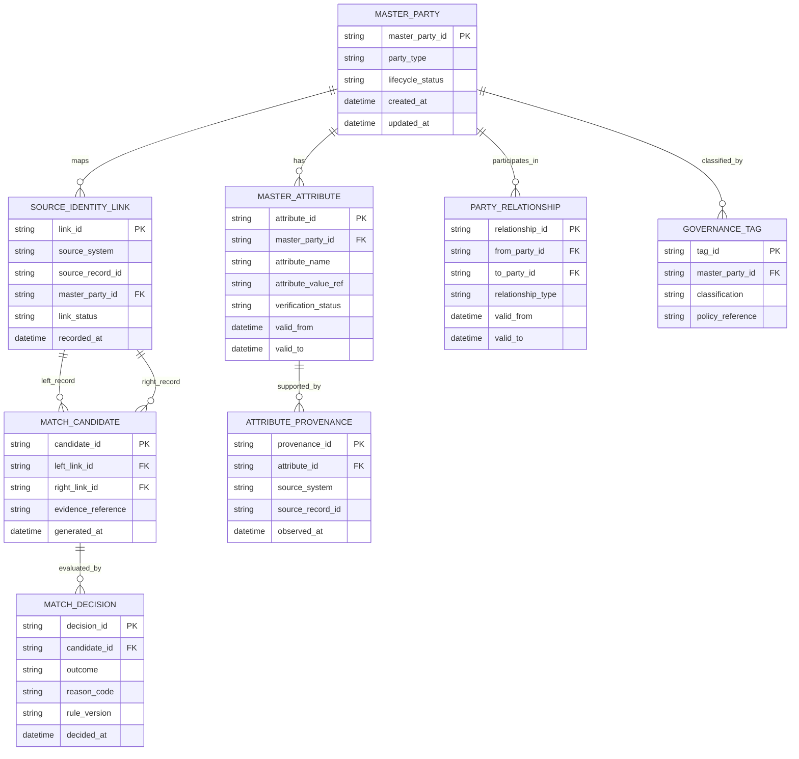
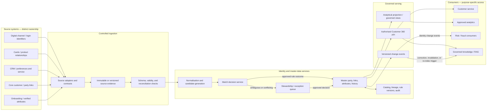

# Case Study 02 — Customer 360 and Master Data

> **Document purpose:** A beginner-to-advanced learning guide for analysing customer identity, master data management (MDM), data ownership, survivorship, consent, quality, and customer-data architecture.
>
> **Source integrity:** The module roadmap frames this topic as an illustrative case study and explicitly warns that the original topic files were empty or unavailable when the roadmap was written. This document therefore does **not** claim that the worked scenario below is the actual source scenario. All organisation names, sample records, requirements, policies, scores, thresholds, and acceptance targets introduced for teaching are illustrative and must be confirmed before use in a real organisation.
>
> **Template workflow:** The supplied `template(20261020-112311).txt` requests structured learning content based on the overall project tree and module roadmap, followed by a private content audit, revision, and delivery. That workflow is followed here. The template does not provide a domain-specific MDM syllabus of its own.

## Learning outcomes

After working through this lesson, you should be able to:

1. Explain what Customer 360 and MDM do—and what they do not do.
2. Inventory customer-related sources, consumers, owners, identifiers, and trust boundaries.
3. Separate source facts, requirements, assumptions, constraints, hypotheses, and open questions.
4. Explain deterministic and probabilistic entity resolution, including false positives and false negatives.
5. Design an explainable matching workflow and an attribute-level survivorship policy.
6. Preserve source provenance, identity-link history, merge/split history, and correction evidence.
7. Evaluate centralised, federated, registry, consolidation, coexistence, and centralised-hub patterns.
8. Incorporate purpose limitation, consent or preference signals, least privilege, data minimisation, and auditability.
9. Trace requirements to components, decisions, risks, and acceptance evidence.
10. Defend architecture choices and identify what evidence would change the recommendation.

## How to use this lesson

Work in order. Do not begin by choosing an MDM product or matching algorithm. First establish the meaning of “customer,” the intended use of the unified view, and the authority of each source. Treat every unknown as a question to resolve—not as permission to invent a business rule.

---

## 1. Foundations: what Customer 360 means

### 1.1 Customer 360

A **Customer 360** is a governed, purpose-specific view that brings together customer-related facts from multiple systems so an authorised consumer can understand the same customer across products, channels, and business processes.

A Customer 360 may combine:
- Identity and identifiers: internal party ID, CRM ID, account relationship ID, verified contact identifier.
- Descriptive attributes: name, address, contact details, preferred language.
- Relationships: customer-to-account, customer-to-household, customer-to-organisation, authorised representative.
- Provenance: source system, source record ID, observed time, effective time, ingestion time, transformation version.
- Quality and confidence: validation status, match status, unresolved conflicts.
- Governance context: data classification, allowed purpose, access policy references, retention metadata where applicable.

A Customer 360 is **not necessarily one physical database**. It can be a master-data hub plus APIs, governed views, events, and analytical projections. Nor does it mean every system is equally authoritative or that all attributes should be copied to every consumer.

**Why it matters:** Customer information is often fragmented. A customer may appear under different identifiers, spelling variants, addresses, or product-specific records. Without explicit identity and ownership rules, a consumer may count one person twice, merge two different people, contact someone at an outdated address, or make a decision using a stale or unauthorised attribute.

**When useful:** service-agent context, customer analytics, product eligibility analysis, deduplication, customer communications, and governed downstream applications—provided each use has an approved purpose and fit-for-use quality.

**Failure modes:** treating a probable match as certainty; presenting stale data without freshness metadata; using one universal record for every purpose; ignoring legal entities or representative relationships; and distributing personal data more broadly than necessary.

### 1.2 MDM and reference data

**Master Data Management (MDM)** is the set of data models, ownership practices, matching rules, governance workflows, and technical capabilities used to maintain consistent representations of important business entities across systems.

MDM is as much an operating model as a technology. It requires people who own definitions and resolve disputes, processes for correction and stewardship, and technical mechanisms to preserve lineage and publish changes.

**Reference data** consists of controlled values used to interpret other data, such as country codes, address-type codes, customer-status categories, or relationship types. Reference data is not the same as master data: “customer A” is a master entity; a controlled “relationship type = joint holder” is a reference value.

### 1.3 Operational sources versus analytical views

| Concept | Purpose | Typical behaviour | Authority |
|---|---|---|---|
| System of record (SoR) | Runs an operational business process and records its transactions | Transactional writes, process-specific validation | Authoritative for defined facts within its scope |
| Customer MDM hub | Resolves identities and manages governed master representations | Match/merge workflows, stewardship, publication | Authoritative for the mastered identity/linkage and governed attributes it owns |
| Analytical customer view | Supports reporting, segmentation, and analysis | Denormalised, historical, read-optimised | Derived view; must retain provenance and freshness |
| Consumer cache/projection | Supports a specific application’s access pattern | May be asynchronous and temporarily stale | Usually not the system of record |
| Reference-data service | Maintains controlled codes and definitions | Versioned lists and validation | Authoritative for the reference set it owns |

The CRM may be authoritative for a sales-contact preference while an onboarding system is authoritative for a verified legal name. The correct design is **attribute-level authority**, not a blanket declaration that one system owns every customer fact.

### 1.4 Core identity terms

- **Entity:** the real-world thing represented in data—for example, a natural person, legal entity, household, or organisation.
- **Source record:** one system’s representation of an entity.
- **Identifier:** a value used to distinguish or reference an entity in a defined scope. An identifier may be global, system-local, reusable, or time-bounded; these properties must be documented.
- **Entity resolution:** the process of deciding which source records refer to the same real-world entity.
- **Match candidate:** a pair or group considered for comparison.
- **Match decision:** a decision such as auto-link, reject, or send for human review.
- **Golden record / mastered record:** a governed representation assembled from selected attributes and links to source records. “Golden” does not mean infallible or universally authoritative.
- **Survivorship:** the policy for selecting or deriving the value that appears in the mastered record.
- **Stewardship:** human governance work such as resolving ambiguous matches, correcting attributes, and handling exceptions.
- **Provenance / lineage:** evidence showing where a value came from and how it was transformed.
- **Merge:** joining records under one mastered identity after an approved identity decision.
- **Split / unmerge:** reversing an incorrect merge and restoring the correct identity separation, including downstream repair.

### 1.5 A unified view is a contract, not merely a screen

A useful Customer 360 product defines:
1. **Entity scope:** person, organisation, household, account holder, prospect, or another business concept.
2. **Permitted purpose:** what a consumer may do with the view.
3. **Data contract:** fields, semantics, identifiers, quality status, freshness, versioning, and error behaviour.
4. **Authority:** which owner controls each attribute or decision.
5. **Quality expectations:** which checks run and what happens when they fail.
6. **Operational expectations:** availability, latency, recovery, support, and incident process—once confirmed by stakeholders.
7. **Governance:** classification, authorisation, minimisation, audit, and retention handling.

A unified view should preserve meaningful differences. For example, “postal address supplied by customer” and “address verified by onboarding” are not interchangeable facts. Keep source and verification status rather than collapsing them into an unqualified `address` field.

---

## 2. Prerequisites and curriculum connections

The module roadmap lists these as recommended curriculum background, not verified formal dependencies. The exact un-dated filename `Roadmap_ptree.md` was not available in the mounted source set; the available project-tree snapshot was `Roadmap_ptree(20261020-184004).md`. The available module roadmap was `roadmap-Enterprise-Data-Architecture-Case-Studies-and-Capstone(1).md`. For this case, the most relevant Stage 2D modules are:

| Prior module | Contribution to Customer 360 | Questions to apply |
|---|---|---|
| 01 — Data Architecture Foundations and Principles | Architecture boundaries, quality attributes, governance, stakeholder framing | What business outcome is the view meant to support? |
| 02 — Requirements, Constraints and Architecture Decisions | Requirement classification, alternatives, ADRs, evidence-based choices | Which statements are confirmed requirements versus assumptions? |
| 03 — Data Architecture Patterns and Reference Architectures | Hub, registry, federation, serving patterns | Which pattern fits the ownership and latency needs? |
| 04 — Conceptual, Logical and Physical Data Modeling | Entity definitions, keys, relationships, history, schema evolution | What is a customer, and how are people and organisations represented? |
| 05 — Database and Storage Architecture | Persistence, history, indexes, lifecycle, replication | Which data belongs in the hub versus derived stores? |
| 06 — Data Integration and Interoperability | Contracts, CDC, idempotency, reconciliation, schema evolution | How do source changes arrive safely and repeatably? |
| 07 — Enterprise Data Platform and Lakehouse Architecture | Platform zones, metadata, tenancy, product interfaces | Where do raw evidence, mastered data, and analytical projections live? |
| 10 — Data Governance, Security, Privacy and Compliance | Classification, purpose, access, retention, control evidence | Who may use which fields for which purpose? |
| 11 — Metadata, Lineage, Quality and Master Data | Entity resolution, stewardship, metadata, quality controls | Can the team explain why two records were linked and where values came from? |
| 14 — Data Access, Serving, Semantic and AI Data Architecture | APIs, marts, semantic contracts, consumer-specific serving | Should a consumer use an API, event, or analytical view? |
| 15 — Architecture Documentation, Reviews and Operating Model | Context/data-flow diagrams, trust boundaries, reviews, operating ownership | Who operates the service and resolves incidents? |

**Prerequisite review method:** For each gap, revisit the relevant earlier module’s lesson or gate exercise. Do not reproduce every prerequisite lesson here; use its concepts as an analysis lens.

### Relationship to the other case studies

- **Case Study 01 — Banking data platform:** establishes the end-to-end platform context, source integration, governance, resilience, and traceability. Customer 360 applies those platform capabilities to identity and attribute authority. It should not blindly copy a platform design if customer-specific needs differ.
- **Case Study 03 — Real-time fraud and risk:** may consume customer identity and relationship signals, but latency-sensitive risk decisions need explicit freshness, state, and failure semantics. An asynchronous Customer 360 projection must not be mistaken for current operational truth.
- **Case Study 06 — Governed RAG and enterprise knowledge:** a retrieval system that uses customer-related documents or profiles must enforce permissions at retrieval and generation time, preserve source access restrictions, and avoid embedding or exposing data to unauthorised users. A Customer 360 match is not an authorisation grant.
- **Capstone:** the case study provides reusable methods—requirements extraction, architecture maps, ADRs, risk registers, and evidence-based validation. The final design must be driven by the actual capstone brief and rubric when available.

The roadmap explicitly says the original case-study scenarios and capstone rubric were unavailable/empty at the time it was written. Accordingly, the scenario and numerical examples below are instructional assumptions, not source facts.

---

## 3. Beginner analysis: understand the problem before designing

### 3.1 Start with the business question

Do not begin with “we need a golden record.” Ask:
- What business process or decision is failing today?
- What does “customer” mean in that process?
- Is the view for servicing, analytics, communications, risk, onboarding, or another purpose?
- Which sources contain overlapping data?
- What is the cost of a false merge compared with a missed match?
- How fresh must each field be?
- Who can correct a disputed identity?
- What must a consumer be prevented from seeing or doing?
- Which facts are confirmed, and which are still hypotheses?

Different use cases have different risk profiles. A false merge that mixes two people’s accounts may be far more harmful than leaving two legitimate records temporarily unlinked. Marketing deduplication, operational servicing, and risk analytics may therefore require different thresholds and review paths.

### 3.2 Facts, assumptions, constraints, hypotheses, and questions

| Label | Meaning | Example |
|---|---|---|
| Fact | Explicitly supported by an available source or verified evidence | “CRM stores a CRM-local customer ID.” This is a fact only after source inventory confirms it. |
| Requirement | A need that an authorised stakeholder has stated and accepted | “Service agents must see the mastered identity and source provenance.” Illustrative until confirmed. |
| Constraint | A non-negotiable boundary imposed by policy, technology, contract, or organisation | “The legacy source cannot publish events.” Must be validated with its owner. |
| Assumption | A temporary premise used to make analysis possible | “The CRM can provide a daily change extract.” |
| Hypothesis | A testable explanation for an observed problem | “Duplicate records are caused partly by inconsistent phone formatting.” |
| Open question | Information needed before a decision can be finalised | “Can the customer identifier be reused after account closure?” |

Do not promote an assumption into a requirement merely because it appears repeatedly in a draft.

### 3.3 Illustrative source inventory

The following table is a **fictional teaching example**. A real inventory must be confirmed with source owners.

| Source | Example data | Candidate authority | Main concerns | Update pattern to investigate |
|---|---|---|---|---|
| Onboarding/KYC application | Submitted name, date of birth, verification state, identity-document reference | Potential authority for verified onboarding attributes, subject to policy | Highly sensitive fields, correction workflow | Events, CDC, or controlled batch |
| Core banking/customer master | Party ID, customer status, account relationships | Potential authority for operational party/account relationships | Stable identifiers, effective dates | CDC or batch |
| CRM | Preferred name, contact channels, service notes | Potential authority for sales/service-managed attributes | Free text, outdated contacts, access restrictions | Events/API/batch |
| Card platform | Cardholder relationship, product-specific ID | Authority for card-domain facts, not automatically for global identity | Tokenisation, restricted fields | CDC/batch |
| Digital channel | Login ID, customer-entered contact data | Authority for channel account and submitted values only | Unverified data, account takeover risk | Events/API |
| Customer service case system | Correction requests and disputes | Authority for case workflow and decision evidence | Sensitive narrative, retention policy | API/events |

A source can be authoritative for one attribute and merely contributory for another. Confirm authority field by field.

### 3.4 Illustrative conflicting records

All records below are fictional and deliberately incomplete. The phone number and email are placeholders and should not be used to contact anyone.

| Source record ID | Source | Name | Date of birth | Email | Phone | Address | Evidence note |
|---|---|---|---|---|---|---|---|
| `ONB-1042` | Onboarding | Asha Mehta | 1988-04-12 | asha.example@invalid.test | `+91-90000-00111` | 12 Lake Road | Name/DOB marked verified in this example |
| `CRM-7781` | CRM | Asha M. | 1988-04-12 | asha.example@invalid.test | `+91 90000 00111` | 12 Lake Rd | Contact values match after normalisation |
| `CORE-5520` | Core | Asha Mehta | 1988-04-12 | not supplied | not supplied | 12 Lake Road | Core party ID `P-9007` |
| `CRM-7782` | CRM | Asha Mehta | 1988-04-12 | asha.alt@invalid.test | `+91-90000-00222` | 48 Park Street | Could be an older/newer address, a second channel, or a separate record; do not infer without evidence |
| `ONB-2099` | Onboarding | Asha Mehta | 1991-09-03 | asha.example@invalid.test | `+91-90000-00111` | 12 Lake Road | Different DOB; possible data error, shared contact, or different person |

What can we conclude?

- `ONB-1042`, `CRM-7781`, and `CORE-5520` have several mutually consistent attributes, so they are strong candidates for review/linking under an approved policy.
- `CRM-7782` shares name and DOB but has different contact details and address. This does **not** prove it is a duplicate or a distinct person.
- `ONB-2099` shares contact data but has a different DOB. A shared phone/email or same name is not sufficient to merge people.
- The example does not establish the bank’s real authority rules. It only demonstrates why source evidence and review are required.

### 3.5 Exercise: classify the statements

Classify each statement as a requirement, constraint, assumption, hypothesis, fact, or open question. Some statements cannot be classified as facts without evidence.

1. “CRM customer IDs are unique only within CRM.”
2. “The unified view should be available to service agents.”
3. “The onboarding system can publish changes within five minutes.”
4. “Different phone formats are causing duplicate records.”
5. “Which team can approve an unmerge?”
6. “The organisation forbids sending identity-document images to the analytical platform.”

**Answer guidance**

1. A source fact only after confirmed by system documentation/tests; until then, an assumption or question.
2. A requirement if confirmed by an authorised stakeholder; otherwise a proposed requirement.
3. An assumption until measured/confirmed by the source owner.
4. A hypothesis requiring profiling and labelled test evidence.
5. An open question.
6. A constraint only if an applicable policy/decision has been verified; do not invent it.

---

## 4. Requirements: translate needs into testable statements

### 4.1 Requirement categories

- **Functional:** capability the solution must provide, such as linking source records or exposing a customer profile.
- **Non-functional / quality attribute:** how well the capability must work, such as latency, freshness, availability, explainability, recoverability, or scale.
- **Data requirement:** definition, semantics, validity, completeness, history, uniqueness, and relationships.
- **Governance/security requirement:** permitted purpose, role, field-level access, audit, minimisation, and retention handling.
- **Constraint:** fixed boundary or dependency.
- **Assumption:** premise awaiting confirmation.

A requirement is only testable when it states a condition and an observable result. “High-quality customer data” is not testable; “records with an invalid date-of-birth format are quarantined and counted in the quality report” is testable.

### 4.2 Illustrative requirements matrix

All IDs and statements below are **proposed teaching requirements**, not source-derived mandates. Replace them with confirmed statements from stakeholders and source documents.

| ID | Requirement statement | Type | Source/reference | Measure / validation | Priority | Status |
|---|---|---|---|---|---|---|
| C360-F01 | Resolve source records into a stable mastered identity while retaining source IDs | Functional | Illustrative workshop note | Test fixtures show stable links and source IDs | High | Assumed |
| C360-F02 | Expose the customer profile through an approved serving interface | Functional | Illustrative service-team request | Contract and authorised integration test | High | Assumed |
| C360-D01 | Every mastered attribute records source/provenance and update time | Data/lineage | Proposed control | Sampled field lineage is complete | High | Proposed |
| C360-D02 | Conflicting authoritative attributes are flagged rather than silently overwritten | Data quality | Proposed control | Conflict fixture produces exception | High | Proposed |
| C360-Q01 | Matching decisions retain reason codes and rule/model version | Quality/auditability | Proposed control | Replay decision from saved evidence | High | Proposed |
| C360-Q02 | Incorrect merges can be reversed with affected projections identified | Functional/reliability | Proposed control | Unmerge test restores correct partition | High | Proposed |
| C360-S01 | Consumer access is checked for role, purpose, and field sensitivity | Security/governance | Policy owner to confirm | Negative access tests and audit events | High | Open |
| C360-S02 | Data is minimised for each consumer rather than copying all fields everywhere | Governance | Proposed principle | Field inventory reviewed per interface | High | Proposed |
| C360-N01 | Freshness objective is defined separately for each consumer/use case | Non-functional | Consumer owners | Timestamp-based integration test after target is agreed | High | Open |
| C360-N02 | Matching performance and exception workload are measured against representative data | Non-functional | Data/platform owners | Benchmark and steward queue report | Medium | Proposed |
| C360-O01 | Each source and mastered data product has a named operational owner | Operating model | Proposed control | Ownership register reviewed | High | Proposed |

**Traceability rule:** Each requirement must map to one or more components, one or more decisions, and validation evidence—or be explicitly marked unaddressed. A requirement with no test is a claim without proof.

---

## 5. Intermediate identity resolution

### 5.1 Candidate generation before matching

Comparing every record with every other record costs \(O(n^2)\) pair comparisons. For large datasets, systems use **blocking** or candidate generation to reduce the search space. For example, records may be grouped by a normalised surname prefix plus birth year, or by a trusted identifier. Blocking improves efficiency but can miss true matches if the blocking keys differ or are missing. A record pair that lands in different blocks may never be scored; therefore, blocking recall must be measured, and multi-pass/overlapping blocks may be needed. The reduced comparison count is not evidence that the candidate set is complete.

Candidate generation is not the match decision. A record excluded from the candidate set has not been proven different; it may simply have failed the blocking strategy.

**Illustrative scale calculation:** exhaustive comparison of \(n\) records evaluates \(n(n-1)/2\) unique pairs. For 1,000,000 records, that is 499,999,500,000 pairs (about \(5.0\times10^{11}\)). If the records are divided into 10,000 non-overlapping blocks of 100 and only within-block pairs are compared, the count is \(10,000\times100\times99/2 = 49,500,000\) (about \(4.95\times10^7\)). The smaller number is **not** a like-for-like accuracy guarantee: cross-block pairs are omitted. Measure blocking recall and consider multi-pass/overlapping blocks before relying on the reduction.

### 5.2 Deterministic matching

Deterministic matching applies explicit rules, such as:
- Exact match on a stable, verified identifier in the same identifier namespace.
- Exact match on a combination of attributes, with required validity checks.
- Exact source-system cross-reference that was created through an approved workflow.

**Benefits:** explainable, predictable, often straightforward to test.

**Limitations:** formatting variation, missing values, changed attributes, identifier reuse, and bad source data can cause missed matches or dangerous false matches.

**Critical caveat:** exact equality does not automatically imply identity. A shared email address, phone number, postal address, or household identifier may legitimately belong to multiple people. A supposedly unique identifier may be reused or incorrectly captured. Verify identifier semantics, scope, issuer, validity period, and assurance.

### 5.3 Probabilistic matching

Probabilistic approaches estimate whether two records refer to the same entity from multiple signals, often using field-level agreement/disagreement weights and training or calibration data. A model may combine name similarity, date-of-birth agreement, address evidence, contact history, and identifier reliability.

A score is not a universal probability unless it has been appropriately calibrated for the target population and decision process. Similarity scores depend on feature design, data quality, population, and the frequency of common values.

**Potential outcomes:**
- **Auto-link:** only when the evidence and risk are within an approved, validated policy.
- **Human review:** ambiguous cases or high-impact decisions.
- **No-link:** evidence is insufficient or contradictory.
- **Defer / request evidence:** important fields are missing or a source needs correction.

Do not set a production threshold by copying a tutorial number.

### 5.4 Precision, recall, false positives, and false negatives

- **True positive (TP):** a true duplicate pair correctly identified as a match.
- **False positive (FP):** two different entities incorrectly linked.
- **False negative (FN):** two records for the same entity not linked.
- **Precision:** \(TP/(TP+FP)\), the fraction of proposed matches that are correct.
- **Recall:** \(TP/(TP+FN)\), the fraction of true duplicate pairs that are found.
- **F1:** harmonic mean of precision and recall, \(2PR/(P+R)\).

Illustrative example adapted from the module roadmap: suppose a labelled evaluation set contains 1,000 true duplicate pairs; a matcher proposes 900 pairs, of which 810 are correct. Then TP = 810, FP = 90, FN = 190.

- Precision = 810 / 900 = **0.90**
- Recall = 810 / 1,000 = **0.81**
- F1 = \(2 × 0.90 × 0.81 / (0.90 + 0.81)\) ≈ **0.853**

This tells us nothing by itself about whether the model is safe to auto-merge. Evaluation data may be biased; the cost of a false merge may greatly exceed that of a missed match; and overall metrics can hide poor performance for subgroups. Evaluate by use case, segment, data completeness, and decision type. Also measure review rates and the quality of reviewed decisions.

### 5.5 Composite evidence and contradiction handling

A match decision should use multiple fields in context. Consider the illustrative records from Section 3.4:

| Evidence | Interpretation | Safe use |
|---|---|---|
| Same verified onboarding ID | Strong if the ID is unique, stable, scoped correctly, and not reused | May support deterministic rule after validation |
| Same name and DOB | Helpful but not conclusive | Candidate generation or weighted evidence |
| Same email | Could be shared, recycled, or mistyped | Supporting evidence, not standalone identity proof |
| Different DOB | Potentially strong contradiction, but source quality and correction history matter | Block auto-merge or send for review under policy |
| Different address | May reflect a move or stale data | Usually not enough alone to reject identity |
| Same source cross-reference | Strong if created through controlled process | Verify provenance and current validity |

A safe design preserves the comparison evidence and the rule/model version. It does not merely store `match_score = 0.93`.

### 5.6 Illustrative matching decision table

The following policy is an example of how to structure decisions, **not a recommended production threshold**.

| Condition | Example action | Why |
|---|---|---|
| Same validated, non-reusable identity key within the documented scope; no contradictory evidence | Consider auto-link under approved rule | Strong identifier evidence, but rule still needs validation |
| High aggregate similarity with no hard contradiction, but no trusted key | Send to review or apply a validated high-confidence policy | Probabilistic evidence may be strong but uncertain |
| Strong name/DOB agreement but conflicting verified identity evidence | Hold for review; do not auto-merge | Contradiction may indicate different people or source error |
| Shared phone/email only | Do not merge on this basis | Contact points are not guaranteed unique |
| Insufficient fields or unknown identifier semantics | Defer and collect evidence | Missing evidence is not evidence of identity |
| Confirmed distinct people | No-link and preserve reason | Prevent false merge |

“Hard contradiction” must be defined with business/data owners. A field should not be treated as a hard contradiction simply because a programmer chose to do so.

### 5.7 Batch versus event-driven matching

| Approach | Advantages | Limitations / failure modes | Appropriate when |
|---|---|---|---|
| Scheduled batch | Simple operational model; efficient for large periodic reconciliation; easy to replay snapshots | Staleness between runs; bursts of work; late corrections; full-run duration | Freshness needs are periodic and source extracts are reliable |
| Event-driven / CDC | Lower propagation delay; change-level processing; supports responsive experiences | Ordering, duplicates, late events, schema changes, replay, back-pressure, and partial failures must be handled | Consumers need fresher updates and sources provide reliable change capture |
| Hybrid | Fast incremental updates plus periodic reconciliation | Two paths can disagree; requires clear precedence and duplicate-safe processing | Low-latency consumers exist but completeness checks remain important |

Any ingestion pattern should be idempotent: replaying the same source event must not create duplicate links or repeat a merge. Use stable event/record identifiers, version or sequence metadata where available, deduplication windows where appropriate, and reconciliation against source counts and keys.

---

## 6. Golden record and survivorship

### 6.1 Why survivorship is attribute-specific

A golden record is usually assembled from attributes that have different sources, quality, and lifecycles. A single “preferred source” for the entire customer record is often wrong.

For each attribute, define:
- Business meaning and data type.
- Owning domain/team and source authority.
- Validation/verification status.
- Source timestamp and effective time.
- Update and correction semantics.
- Conflict resolution rule.
- Whether the field is eligible for each consumer/purpose.
- History and retention handling.
- What happens when sources disagree or the value is absent.

### 6.2 Illustrative attribute authority matrix

This matrix is illustrative only; real authority requires business-owner approval.

| Attribute | Candidate authoritative source | Survivorship concept | Conflict action |
|---|---|---|---|
| Internal mastered party ID | MDM service | Generated once, stable, never derived from source-local IDs | Never overwrite; preserve aliases and history |
| Verified legal name | Onboarding/KYC system, if its verification state is trusted | Prefer latest valid verified value under policy | Steward review if two verified values conflict |
| Preferred display name | CRM or customer preference service | Prefer latest valid customer preference | Keep provenance; allow consumer-specific display rules |
| Date of birth | Approved authoritative source defined by policy | Prefer verified value, not simply newest value | Conflict queue; no silent overwrite |
| Postal address | Depends on address purpose: registered, residential, correspondence | Store address type, source, validity interval, verification status | Preserve multiple valid address types |
| Email/phone | Contact-management source plus verification state | Keep multiple contact points and their verification/validity states | Do not force one value if multiple are valid |
| Marketing preference/consent signal | Designated preference/consent system | Use current authoritative state and required evidence/version | Enforce policy at the point of use; reconcile contradictions |

“Latest wins” is not a complete survivorship policy. A newer unverified value should not automatically replace an older verified value. “Most frequent wins” can amplify duplicated or stale source data. “Source priority wins” can hide legitimate attribute-specific ownership. Rules must preserve provenance and support correction.

### 6.3 Source of truth is scoped

Ask “authoritative for what?” rather than “which system is the source of truth?” A system may own:
- The operational account relationship.
- The verified identity attribute.
- The customer-entered contact value.
- The consent/preference record.
- The workflow status of a correction request.

The MDM service may own the global identity link and mastered party ID without becoming the owner of all operational transactions.

### 6.4 Merge, split, and correction lifecycle

A production-capable identity service needs explicit lifecycle states, for example:

`candidate → reviewed/approved → linked → published → corrected or split`

This is an illustrative state model, not a mandatory universal vocabulary.

A safe merge workflow should:
1. Record source record IDs and the evidence used.
2. Store the decision, decision maker or automated rule, model/rule version, timestamp, and reason code.
3. Apply the identity-link change transactionally where possible.
4. Publish a versioned change event or outbox record.
5. Update downstream projections idempotently.
6. Record acknowledgements, failures, and lag.
7. Support rollback/compensation if publication fails.

A safe split/unmerge workflow should:
1. Record why the earlier link was incorrect and who authorised the correction.
2. Restore the correct entity partition without deleting history.
3. Recompute affected golden records and dependent relationships.
4. Identify every consumer projection, cache, mart, feature, export, or downstream model affected by the former identity.
5. Send corrective events or rebuild projections.
6. Verify that data from the formerly merged entities are no longer mixed.
7. Retain audit evidence consistent with approved policy.

Never assume a database transaction can atomically update every downstream system. Distributed propagation needs retry, idempotency, observability, and reconciliation.

### 6.5 Identity-link history

Keep an identity-link table or equivalent model with fields such as:

| Field | Purpose |
|---|---|
| `source_system` + `source_record_id` | Identifies the source record in its namespace |
| `master_party_id` | Current mastered identity; nullable until a link is approved and assigned |
| `link_status` | Candidate, linked, rejected, superseded, or another defined state |
| `valid_from` / `valid_to` | Business validity of the relationship, if needed |
| `recorded_at` | When the platform recorded the decision |
| `decision_reason` | Explainable reason code |
| `rule_version` / `model_version` | Reproducibility |
| `evidence_reference` | Secure pointer to comparison evidence |
| `supersedes_link_id` | Connects corrections to prior decisions |

Distinguish **valid time** (when a fact applies in the business world) from **transaction/recorded time** (when the platform learned or recorded it). Not every system requires full bitemporal modelling, but the need for historical reconstruction should be assessed explicitly.

---

## 7. Logical customer identity model

An illustrative logical model:



The diagram is conceptual. `attribute_value_ref` represents a logical value or protected value reference; it is not a recommendation to store all values in an opaque string column. A physical design may use typed columns, normalized attribute tables, protected stores, or domain-specific models. Minimise sensitive values in diagrams, logs, and evidence records.

Important modelling choices:
- `source_system + source_record_id` is a namespace-qualified identity; a source ID alone may collide across systems.
- A party can have many source links and many relationships.
- A candidate comparison must identify **both** records being compared. The `MATCH_CANDIDATE` entity represents the pair, and a `MATCH_DECISION` refers to that candidate; a single `link_id` alone would not preserve which two records were evaluated.
- A source link may exist before a master identity is assigned, so `master_party_id` is nullable for candidate/unresolved links and required only for states that represent an active link. Enforce that state-dependent rule in the physical schema or service validation.
- Attributes need provenance and potentially validity/history.
- Relationship types should use controlled reference values.
- Do not conflate a natural person with an account, login, household, or organisation.
- A stable mastered ID should not encode sensitive information or change when attributes change.

---

## 8. End-to-end architecture and data flow



### 8.1 Component responsibilities

- **Adapters/contracts:** validate schema and source semantics; preserve source identifiers and event metadata.
- **Raw or versioned evidence:** preserve what arrived and when, subject to minimisation and approved retention policy. “Immutable” must not become an excuse to retain data indefinitely; design access and deletion/retention handling explicitly.
- **Quality/reconciliation:** detect malformed records, duplicate delivery, missing batches, count mismatches, stale updates, and invalid reference values.
- **Normalisation:** standardise formats without erasing the original evidence. For example, preserve a raw phone string and a normalised comparison form separately when policy allows.
- **Candidate generation/matching:** produce explainable candidate evidence and decisions.
- **Stewardship:** route uncertain or high-impact cases to an authorised decision-maker.
- **Master hub:** manage party IDs, source links, mastered attributes, history, merge/split workflows, and publication state.
- **Metadata/lineage:** track owners, definitions, rule/model versions, source-to-consumer paths, quality results, and changes.
- **Serving:** expose only the fields and relationships required for a consumer’s purpose.
- **Consumers:** remain responsible for respecting the data contract and their own authorisation boundaries. Identity corrections must reach downstream projections, caches, exports, and any RAG index through a defined correction/invalidation/rebuild path; an event being emitted is not proof that every consumer has applied it.

### 8.2 Data contract example

Illustrative logical contract for a profile response:

```json
{
  "master_party_id": "MP-000104",
  "profile_version": 17,
  "party_type": "natural_person",
  "attributes": {
    "display_name": {
      "value": "Asha Mehta",
      "source_system": "ONBOARDING",
      "verification_status": "verified",
      "observed_at": "2026-10-20T10:15:00Z"
    }
  },
  "identity_status": "linked",
  "quality_status": "reviewed",
  "freshness": {
    "source_watermark": "2026-10-20T10:15:00Z"
  }
}
```

This is an illustrative schema fragment, not a real bank contract. Production contracts must define nullability, type formats, allowed values, errors, versioning, field-level access, freshness semantics, and whether a consumer is allowed to receive each attribute. Do not return provenance that itself reveals restricted source details to an unauthorised consumer.

### 8.3 Idempotency and reconciliation

A source event may be delivered more than once. Processing should be idempotent so the same event does not create duplicate source links, repeated merges, or multiple downstream side effects.

Typical controls:
- Stable event ID or source key plus version/sequence.
- Store processed-event state or use an idempotent upsert keyed by the business/source identity.
- Detect out-of-order versions and apply an explicit policy.
- Use an outbox or equivalent reliable publication mechanism for committed master-data changes.
- Track publish/consume lag and retry failures.
- Periodically reconcile source counts, source keys, active links, and downstream projections.

A row count alone does not prove correctness. Reconciliation should include keys, versions, business totals where relevant, and a strategy for late corrections.

---

## 9. Consent, purpose, privacy, and security

### 9.1 Architectural principles

Consent and privacy rules depend on jurisdiction, data category, contractual commitments, organisational policy, and processing purpose. This lesson does not assert any specific legal obligation. Confirm the applicable requirements with authorised legal, privacy, security, compliance, and business owners.

Architecture should make those decisions enforceable:
- **Purpose limitation:** a field collected for servicing is not automatically available for marketing or AI retrieval.
- **Data minimisation:** expose only what the consumer needs; do not replicate every attribute by default.
- **Least privilege:** grant access to the minimum required fields, records, actions, and environment.
- **Separation of duties:** high-impact identity merges, policy changes, and sensitive exports may require different permissions or review.
- **Auditability:** record who or what accessed or changed data, for what approved operation, and under which policy context, while avoiding sensitive payloads in logs.
- **Correction and dispute handling:** propagate approved corrections and identify downstream copies.
- **Retention and deletion:** define how source evidence, master attributes, audit records, backups, caches, and derived projections are handled under approved policy. Do not invent a retention period.
- **Purpose-aware serving:** make access decisions at the point of use, not only when data is copied into a warehouse.

### 9.2 Consent is not the same as access control

Consent/preference state is one possible policy input. It does not replace authentication, authorisation, contractual purpose checks, or other applicable policy requirements. A user who can read a customer profile is not automatically permitted to use it for every purpose.

A robust request path may evaluate:
1. Who is the requester/service identity?
2. Which customer or records are requested?
3. What declared purpose and workflow applies?
4. Which fields are required for that purpose?
5. What applicable policy and preference/consent signals apply?
6. Is the decision allow, deny, or require additional workflow?
7. What audit evidence should be retained?

### 9.3 Illustrative access matrix

This is a design exercise, not a statement of real policy.

| Consumer role | Possible access | Example restriction to evaluate |
|---|---|---|
| Service agent | Limited profile and relevant relationship summary | Mask restricted attributes unless needed for an approved workflow |
| Marketing analyst | Aggregated or minimised contact/preference fields | Exclude records/fields not permitted for the intended campaign purpose |
| Risk analyst | Risk-relevant identity links and quality status | Avoid unrelated free-text service notes and unnecessary direct identifiers |
| Data steward | Source evidence needed to resolve a disputed identity | Privileged, logged access; only assigned cases |
| RAG retrieval service | Documents/attributes authorised for the requesting user and purpose | Enforce document and field permissions during retrieval; do not trust embeddings as an access-control layer |
| Platform operator | Operational metadata and system health | No routine business-data access unless explicitly required and authorised |

### 9.4 RAG connection: identity is not permission

If Customer 360 data are indexed for retrieval-augmented generation (RAG), three distinct questions remain:
- **Identity:** do these source records refer to the same entity?
- **Data quality:** are the values reliable and sufficiently current?
- **Authorisation:** may this requester access this content for this purpose?

A correct golden record does not imply that all fields can be embedded, retrieved, or summarised for every user. Enforce access before or during retrieval, carry source permissions and provenance into indexed content, handle permission changes and deletions in indexes, and test for cross-user leakage. An LLM prompt instruction is not a substitute for a security boundary.

---

## 10. Architecture alternatives and trade-offs

### 10.1 MDM styles

| Pattern | What it does | Benefits | Costs / risks | Use when |
|---|---|---|---|---|
| Registry | Stores cross-reference links and identifiers; source systems remain authoritative for most attributes | Lower duplication; clear source ownership | Consumer must query/assemble source attributes; source availability affects view | Linkage is the main need and source access is reliable |
| Consolidation | Copies source data into a central analytical/mastering store but does not necessarily write back | Useful for analytics and matching; isolates source systems | Staleness, duplicate copies, correction propagation, potential “shadow truth” | Analytical unification is primary and write-back is unnecessary |
| Coexistence | Central mastering plus controlled synchronisation with operational sources | Shared identity and selected attributes can flow both ways | Conflict handling, bidirectional loops, ordering, ownership complexity | Multiple systems must remain operationally capable and share governed updates |
| Centralised operational hub | Hub owns defined master attributes/identities and publishes them to consumers | Consistent governance and stable identity interface | Hub can become bottleneck; high change-management burden; availability critical | Clear enterprise ownership and consumers can adopt the hub contract |
| Federated stewardship with shared standards | Domains retain local ownership but use common identifiers, contracts, policies, and governance | Aligns accountability with domain expertise; scales organisationally | Requires strong coordination, standards, and cross-domain dispute resolution | Ownership is distributed and domains can meet common governance obligations |

“Centralised versus federated” is an operating-model question, while “registry/consolidation/coexistence” describes MDM implementation styles. They are related but not identical axes. An organisation can use a federated operating model with a shared central registry, for example.

### 10.2 Golden record storage and distribution

| Option | Advantages | Limitations | Key validation |
|---|---|---|---|
| Query sources on demand through a registry | Less copied attribute data; source ownership stays clear | Latency and availability depend on multiple sources; consumer joins are complex | Availability and latency tests; source outage behaviour |
| Persist mastered profile in a hub | Predictable serving; central audit and survivorship | Requires refresh, history, access control, and correction propagation | Freshness and replay tests; reconciliation |
| Publish domain-specific projections | Consumer-specific performance and minimisation | Copies can become stale; more contracts and lifecycle management | Projection lag, rebuild, deletion/correction propagation |
| Use events plus API | Events support propagation; API supports current query | Requires event delivery discipline and API operations | Idempotency, ordering, lag alerts, contract compatibility |

### 10.3 Synchronous versus asynchronous updates

**Synchronous** update paths can provide immediate confirmation and strong workflow coordination, but they couple source and hub availability, increase request latency, and can fail across distributed boundaries.

**Asynchronous** updates decouple systems and improve resilience to temporary outages, but introduce eventual consistency, lag, duplicate delivery, and ordering/replay concerns.

Choose based on an explicit consumer freshness contract. If an operational decision requires the latest verified value, an asynchronous projection alone may not satisfy it. If a reporting mart can tolerate a defined lag, event-driven or scheduled propagation may be sufficient. Do not promise a freshness number until it has been agreed and measured.

### 10.4 Human review versus automated matching

Human review improves oversight for ambiguous cases but has a cost: queue backlog, inconsistent decisions, reviewer fatigue, and slower updates. Automated matching improves throughput but can scale a mistake quickly. A mixed policy is common in designs: automate only validated low-risk cases, send uncertain/high-impact cases to review, and periodically sample auto-decisions for quality.

Thresholds should be selected using representative labelled data, cost-of-error analysis, subgroup evaluation, operational capacity, and a rollback strategy. A threshold should be re-evaluated after material source, population, or feature changes.

### 10.5 Decision criteria fixed before comparing options

Use criteria before selecting a preferred architecture. Example criteria (weights are intentionally not supplied because no source scoring model exists):

- Identity error impact and explainability.
- Attribute authority and stewardship fit.
- Consumer freshness and query latency.
- Source-system capabilities and dependency risk.
- Privacy, minimisation, and policy enforcement.
- Merge/split reversibility and historical reconstruction.
- Operational complexity and on-call burden.
- Cost of storage, compute, data movement, and review.
- Migration feasibility and consumer adoption.
- Vendor/platform portability where relevant.

Document evidence gaps and sensitivity: if a recommendation changes when latency or error-cost assumptions change, say so.

---

## 11. Complete worked case study: illustrative “Northbridge Bank”

### 11.1 Scenario statement

**Illustrative only:** Northbridge Bank is a fictional organisation used to practise architecture analysis. Assume its onboarding, core customer, CRM, card, and digital-channel systems contain overlapping customer records. Customer service reports that agents sometimes see conflicting contact details and cannot always tell whether two records represent the same person. Analysts also need a consistent customer view, while privacy and security stakeholders require purpose-aware access and traceable corrections.

This paragraph is a teaching scenario, not a statement about a real bank or an unavailable original lesson file.

### 11.2 Objectives and stakeholders

| Stakeholder | Desired outcome | Decision/ownership to confirm |
|---|---|---|
| Customer service | Understand a customer’s linked products and relevant contact facts | Which fields and relationships are needed for each service workflow? |
| Customer-data/domain owner | Consistent party identity and attribute definitions | Who owns the party model and each attribute? |
| Onboarding owner | Preserve verified identity evidence and correction history | What verification states and source keys are available? |
| CRM owner | Maintain customer-entered preferences and service contact data | Which fields are CRM-authoritative? |
| Data stewards | Resolve ambiguous identities and correct erroneous links | Escalation, approval, workload, and reversal process |
| Privacy/compliance/security | Enforce approved purpose, access, audit, and retention policy | Applicable rules and evidence requirements |
| Data/platform engineering | Reliable ingestion, lineage, serving, replay, and recovery | Operational ownership and agreed service expectations |
| Analytics/risk teams | Consistent, appropriately fresh customer-level data | Which decisions can use an asynchronous projection? |
| AI/knowledge team | Retrieve only permitted customer-related content | How permissions and source provenance are enforced end-to-end |

### 11.3 Facts, assumptions, constraints, hypotheses, and open questions

Because the source roadmap does not provide a populated scenario, the table below records the status of the teaching scenario rather than asserting real-bank facts.

| ID | Statement | Classification | Validation needed |
|---|---|---|---|
| F-01 | The module’s illustrative frame involves customer data spread across systems | Source fact about the roadmap’s frame, not a real bank | Replace with actual case facts if source lesson becomes available |
| A-01 | Northbridge has onboarding, core, CRM, cards, and digital sources | Illustrative assumption | Confirm inventory, interfaces, owners, and identifiers |
| A-02 | A master party ID can be assigned by a hub | Illustrative design assumption | Check legacy compatibility and identifier lifecycle |
| A-03 | Source changes can be consumed incrementally | Illustrative assumption | Verify CDC/event/batch capabilities and delivery semantics |
| H-01 | Inconsistent formatting contributes to duplicate records | Hypothesis | Profile data and review labelled examples |
| Q-01 | What does “customer” mean across person, organisation, household, and account roles? | Open question | Business/domain modelling workshop |
| Q-02 | Which source is authoritative for each attribute and verification state? | Open question | Attribute authority matrix signed by owners |
| Q-03 | Which consumers need real-time versus scheduled freshness? | Open question | Consumer interviews and access-pattern evidence |
| Q-04 | What legal/policy requirements govern purpose, consent, retention, and correction? | Open question | Legal/privacy/compliance confirmation |
| Q-05 | What false-merge risk is acceptable for each use case? | Open question | Business impact assessment and labelled evaluation |

No actual regulatory rule, retention period, matching threshold, volume, latency target, or SLA is assumed.

### 11.4 Proposed logical architecture

For this illustrative scenario, a reasonable starting hypothesis is a **governed identity hub with federated attribute ownership**:
- The hub owns the stable mastered party ID, source-record links, match decisions, and identity history.
- Source domains retain authority for the attributes they own.
- The hub stores selected mastered attributes only when needed for approved serving purposes.
- Downstream projections are purpose-specific, versioned, and traceable.
- Ambiguous/high-impact cases go to stewardship until the business approves a validated automation policy.

This is a recommendation to test, not a universal answer. If sources cannot provide reliable identifiers or change feeds, a registry plus scheduled reconciliation may be more feasible. If operational systems require tightly coordinated write-back, coexistence may be needed—but only with explicit conflict and loop-prevention rules.

### 11.5 End-to-end example using the sample records

1. Ingest `ONB-1042`, `CRM-7781`, and `CORE-5520` with source system, source record ID, source version/time, and available verification metadata.
2. Validate schema and normalise comparison fields while preserving original evidence where permitted.
3. Candidate generation groups the records based on plausible attributes. The source IDs remain distinct.
4. The matching service records agreements: name/DOB alignment, normalised email/phone alignment where present, and the core cross-reference context.
5. Under a **hypothetical** policy that has been validated and approved, these records may be linked to a single master party after the required evidence and contradiction checks. This lesson does not assert that they must be auto-merged.
6. `CRM-7782` and `ONB-2099` remain unresolved until their conflicting evidence is assessed. Do not infer identity from the shared name or contact alone.
7. The master record stores source links, attribute provenance, verification status, and decision evidence. It does not erase the source records.
8. A versioned change is published to authorised consumers. The consumer sees a profile version and freshness marker, not an unsupported promise of immediate consistency.
9. If a later steward decision finds a false merge, the system records the correction, splits the identity, and identifies downstream projections that require repair.

### 11.6 Proposed decision records (ADRs)

These ADRs are illustrative proposals. They are not source-mandated decisions.

#### ADR-C360-001 — Use a governed master party identifier and preserve source IDs

- **Status:** Proposed; validate with domain and source owners.
- **Context:** Source identifiers are likely system-local and cannot safely be treated as a universal customer ID without evidence.
- **Decision:** Create a stable master party ID; preserve source system plus source record ID as a separate namespace-qualified link.
- **Alternatives:** Select one legacy source ID as the universal ID; use only a registry without a persistent mastered identifier.
- **Rationale:** A stable hub ID decouples downstream contracts from source-specific keys and supports history.
- **Consequences:** Requires ID lifecycle management, link history, reconciliation, and consumer migration.
- **Risks:** Duplicate master IDs, accidental ID reuse, or consumer confusion between source and master identifiers.
- **Validation:** Verify uniqueness and stability, simulate source ID collisions, test merge/split and historical lookup.
- **Revisit if:** Existing enterprise party identifiers already satisfy global scope, lifecycle, governance, and integration requirements.

#### ADR-C360-002 — Use attribute-level authority and provenance-aware survivorship

- **Status:** Proposed.
- **Context:** Different systems may be authoritative for different customer facts.
- **Decision:** Maintain an approved attribute authority matrix and record provenance/verification state; do not use a universal “latest wins” rule.
- **Alternatives:** Declare one system authoritative for the entire profile; choose the newest value for every field.
- **Rationale:** Attribute-specific authority preserves business meaning and makes conflicts explainable.
- **Consequences:** Requires business stewardship, versioned policy, and more complex conflict handling.
- **Risks:** Conflicting owners or missing verification metadata can block updates.
- **Validation:** Run test cases with verified/unverified conflicts, stale data, missing values, and correction events.
- **Revisit if:** The business adopts a genuinely central operational master with approved write-back and ownership rules.

#### ADR-C360-003 — Use hybrid propagation with idempotent updates and scheduled reconciliation

- **Status:** Proposed; freshness requirements unconfirmed.
- **Context:** Some consumers may need responsive updates while completeness and replay still matter.
- **Decision:** Prefer incremental change propagation where source capability supports it, backed by scheduled reconciliation and rebuild paths.
- **Alternatives:** Nightly-only batch; synchronous cross-system writes for all changes; event-only without reconciliation.
- **Rationale:** Incremental updates can reduce lag while reconciliation detects missed changes and drift.
- **Consequences:** Requires event deduplication, version/order handling, lag monitoring, replay, and dual-path testing.
- **Risks:** Divergence between event and reconciliation paths; extra operating complexity.
- **Validation:** Duplicate/out-of-order event tests, replay tests, outage recovery, source-to-hub reconciliation, measured freshness.
- **Revisit if:** Consumer requirements permit batch-only processing or sources cannot safely provide incremental changes.

#### ADR-C360-004 — Route ambiguous or contradictory identity cases to stewardship

- **Status:** Proposed.
- **Context:** A false merge can combine information belonging to different people.
- **Decision:** Do not auto-merge on shared contact details alone; define review/defer outcomes and preserve reasons.
- **Alternatives:** Auto-merge at a fixed unvalidated score; reject all non-exact matches.
- **Rationale:** Balances error risk and coverage while evidence and impact are assessed.
- **Consequences:** Steward capacity, queue management, and consistent review guidance are required.
- **Risks:** Backlog, reviewer inconsistency, and delayed customer view updates.
- **Validation:** Labelled test set, reviewer agreement, false-merge audit, queue age and throughput.
- **Revisit if:** Representative evidence supports a calibrated policy and the business explicitly accepts its residual risk.

### 11.7 Risk register

| Risk ID | Risk | Likelihood/impact status | Mitigation | Evidence / owner |
|---|---|---|---|---|
| R-01 | False merge combines two people’s data | Must be assessed; potentially high impact | Conservative decision policy, contradiction handling, steward review, unmerge support | Labelled evaluation and merge audit; data owner |
| R-02 | False negatives leave duplicates | Must be assessed | Improve candidate generation, profile missingness, review missed-match samples | Recall analysis and duplicate sampling; MDM team |
| R-03 | Wrong attribute overwrites verified data | Must be assessed | Attribute-level authority, verification-aware survivorship, conflict queue | Conflict test suite; domain owners |
| R-04 | Consent/purpose restrictions are lost in downstream copies | Must be assessed | Purpose-aware contracts, field minimisation, propagation and deletion controls | Negative access tests; privacy/security |
| R-05 | A merge event is lost or delivered twice | Must be assessed | Idempotency, outbox/retry, reconciliation, lag alerts | Replay and failure-injection tests; platform team |
| R-06 | Incorrect merge is not repaired downstream | Must be assessed | Link history, dependency registry, correction events, rebuild procedures | Unmerge drill and consumer inventory; MDM/platform owners |
| R-07 | Steward queue becomes operational bottleneck | Must be assessed | Queue telemetry, prioritisation, reviewer guidance, measured auto-policy | Queue age and quality reports; stewardship lead |
| R-08 | Customer data are exposed in logs or AI retrieval | Must be assessed | Payload minimisation, access enforcement, secure audit references, retrieval tests | Log inspection and cross-user leakage tests; security/AI owner |
| R-09 | Source schema changes silently break matching | Must be assessed | Contract/schema checks, versioning, change notification, regression tests | Contract tests; source and platform owners |

Likelihood and impact are intentionally not scored because no evidence or scoring method is supplied. A real risk register should include owner, status, residual risk, due date, and escalation path.

### 11.8 Validation plan and acceptance tests

The following are **proposed acceptance tests**, not mandatory thresholds. Quantitative pass criteria must be agreed with owners.

| Test ID | Test | Expected result | Evidence |
|---|---|---|---|
| V-01 | Ingest same source event twice | No duplicate source link or repeated merge side effect | Event IDs, database state, processing logs |
| V-02 | Deliver source updates out of order | Defined version policy prevents older value from silently replacing newer valid value | Test trace and final attribute history |
| V-03 | Two records have same email but conflicting verified DOB | No automatic merge under the illustrative conservative policy; exception/reason is recorded | Match decision and review queue |
| V-04 | Two source records are approved as same entity | One master identity links both source records and preserves provenance | Identity-link query and decision evidence |
| V-05 | Reverse an incorrect merge | Correct source partition is restored; affected projections are listed and repaired | Unmerge test report and downstream acknowledgements |
| V-06 | Consumer requests a restricted field for an unapproved purpose | Request is denied or minimised according to the approved policy | Authorisation test and audit event |
| V-07 | Source count/key reconciliation detects missing source records | Discrepancy is surfaced and handled; no silent “success” | Reconciliation report and exception ticket |
| V-08 | Master attribute changes | Provenance, verification state, version, and update time remain queryable | Attribute history sample |
| V-09 | RAG requester lacks source permission | Restricted content is not retrieved or revealed through answer/context | Adversarial access test |
| V-10 | Matching rule/model version changes | Version is recorded and regression suite compares performance on labelled cases | Evaluation report and release record |

A credible validation pack includes test data lineage, expected outcomes, actual results, defect records, exceptions, approvals, and evidence timestamps—not just a statement that tests passed.

---

## 12. Data quality and operational controls

### 12.1 Quality dimensions for customer data

| Dimension | Example check | Why it matters |
|---|---|---|
| Completeness | Required field present for the intended workflow | Missing identifiers can block matching or serving |
| Validity | Date, email format, controlled code, and type checks | Prevents malformed data from entering rules |
| Uniqueness | Duplicate source IDs or conflicting master links detected | Supports stable identity |
| Consistency | Cross-field and cross-source contradictions flagged | Detects conflicts rather than silently hiding them |
| Accuracy / verification | Field carries verification evidence/status where applicable | A syntactically valid value may still be wrong |
| Timeliness | Source and ingestion timestamps compared to agreed freshness objective | Exposes stale profiles |
| Referential integrity | Every active source link points to a valid master party | Prevents orphaned links |
| Lineage completeness | Mastered values have a source and transformation/decision trace | Supports explanation and correction |

Quality rules should be purpose-aware. A missing preferred name may be acceptable for one analytical use but unacceptable for a specific service workflow. Define severity and action: reject, quarantine, warn, allow with quality status, or send for stewardship.

### 12.2 Operational metrics

Potential metrics to consider (define exact formulas and targets with owners):
- Candidate pairs generated and evaluated.
- Auto-link, human-review, defer, and no-link rates.
- Precision/recall estimates from a representative labelled sample.
- False-merge incidents and unmerge rate.
- Review queue age, volume, and reviewer agreement.
- Source-to-hub lag and hub-to-consumer lag.
- Reconciliation discrepancies and age of unresolved exceptions.
- Profile lookup latency and error rate.
- Number of downstream projections awaiting correction.
- Policy-denial and audit-event counts.
- Cost per processed record or match decision, where useful.

Metrics can mislead. A high auto-link rate is not success if false merges rise. A low exception count can indicate excellent data—or a broken detection rule. Pair throughput with quality and risk indicators.

### 12.3 Incident response and change control

A customer identity incident may involve incorrect links, stale data, exposure, or failed propagation. A useful runbook should state:
1. How to detect and classify the incident.
2. Which owner can pause automated linking or publication.
3. How to identify affected source records, master IDs, and consumers.
4. How to preserve evidence without copying sensitive payloads unnecessarily.
5. How to correct/split records and repair projections.
6. How to validate the fix with reconciliation and targeted tests.
7. Who approves reopening the affected path.
8. How the team performs root-cause analysis and prevents recurrence.

Changes to matching rules, reference data, source schemas, survivorship, or access policies should be versioned and tested against a regression corpus. A change that improves aggregate precision can still harm a subgroup or a specific use case.

---

## 13. Exercises with answer guidance

### Exercise 1 — Beginner: reason about conflicting records

**Objective:** Distinguish candidate evidence from a proven identity.

**Inputs:** Section 3.4’s five illustrative records.

**Constraints:** Do not assume that email, phone, or name is globally unique. Do not invent source authority.

**Tasks:**
1. Identify at least two plausible duplicate groups.
2. Identify contradictory evidence.
3. State which records you would auto-link, review, or defer under a conservative hypothetical policy.
4. List three questions for source owners.

**Expected output:** A table of candidate pairs, evidence, outcome, reason, and unresolved question.

**Answer guidance:** `ONB-1042`, `CRM-7781`, and `CORE-5520` form a plausible candidate group because several attributes align; actual linking still depends on validated identifier semantics and policy. `CRM-7782` remains ambiguous. `ONB-2099` has a conflicting DOB and should not be merged merely because contact details align. Ask which source owns verified DOB, whether the contact point can be shared/reused, and whether source record histories explain the conflict.

**Validation criteria:** Every proposed link has evidence and a reason; every uncertain case remains unresolved rather than being silently forced into a group.

### Exercise 2 — Beginner/intermediate: build an attribute authority matrix

**Objective:** Explain why “one source of truth” is too broad.

**Inputs:** Sources in Section 3.3 and attributes in Section 6.2.

**Tasks:** Assign a candidate authority for legal name, preferred display name, DOB, contact point, account relationship, and marketing preference. For each, define verification metadata and conflict handling.

**Constraints:** Label every authority as proposed until the owner confirms it.

**Expected output:** Attribute, semantic definition, candidate source, owner, survivorship, conflict action, permitted consumer purpose, and open question.

**Answer guidance:** It is reasonable to propose onboarding as authority for verified onboarding attributes, core as authority for operational account relationships, and CRM/preference service as authority for selected service preferences. But no source is universally authoritative. Address should be typed by purpose; contact points can be multiple and time-bound; consent/preference authority and semantics must be confirmed.

**Validation criteria:** No attribute lacks an owner or conflict path; verification status and provenance are retained.

### Exercise 3 — Intermediate: compare match policies

**Objective:** Analyse the impact of false positives and false negatives.

**Inputs:** The illustrative 1,000 true duplicate pairs and 900 proposed pairs, 810 correct.

**Tasks:**
1. Calculate TP, FP, FN, precision, recall, and F1.
2. Explain why F1 alone cannot approve automatic merges.
3. Design a review/defer policy for records with conflicting verified DOB.
4. List evidence needed before production thresholds are set.

**Answer guidance:** TP = 810, FP = 90, FN = 190; precision = 0.90; recall = 0.81; F1 ≈ 0.853. These values describe only the stated evaluation set. Threshold selection requires representative labelled data, cost-of-error analysis, subgroup checks, reviewer capacity, calibration, and an unmerge plan.

**Validation criteria:** Arithmetic is correct; model metrics are distinguished from business risk; no illustrative score is treated as a universal threshold.

### Exercise 4 — Intermediate: design merge and unmerge propagation

**Objective:** Preserve identity history and correct downstream copies.

**Scenario:** An approved merge is published to an analytical mart and a customer-service cache. Later, a steward determines that two people were incorrectly merged.

**Tasks:** Draw the correction flow and list the evidence required to prove repair.

**Expected output:** State transition, identity-link history update, corrective event, downstream dependency inventory, idempotent consumers, reconciliation, and closure criteria.

**Answer guidance:** Do not delete the old decision. Mark the prior link as superseded/invalid according to the model; create the corrected identity partition; retain the decision chain; publish a versioned correction; retry failed consumers; rebuild affected views; verify both people’s attributes and relationships are separated. Record consumer acknowledgements and unresolved lag.

**Validation criteria:** Every downstream copy has an owner and repair path; repeated correction events are safe; historical “what was known when” remains explainable.

### Exercise 5 — Advanced: defend an architecture alternative

**Objective:** Make a criteria-based recommendation.

**Scenario:** Some consumers require a fresh profile while a large analytical workload can run on a scheduled projection. Source systems differ in their ability to emit reliable changes. Steward capacity is limited.

**Tasks:** Compare (A) registry/on-demand lookup, (B) central hub with asynchronous projections, and (C) synchronous coexistence. Fix criteria before comparing. State which evidence would change your recommendation.

**Expected output:** Option table, recommended direction, rejected alternatives, assumptions, risks, ADR, and validation plan.

**Answer guidance:** A hub with asynchronous projections and reconciliation may be a reasonable starting hypothesis if sources support reliable incremental changes and consumer freshness needs justify the complexity. Registry/on-demand lookup may be better where attribute copies should be minimised and source latency/availability are acceptable. Synchronous coexistence may fit coordinated operational updates but increases coupling and conflict risk. The right answer changes with measured latency, source capabilities, write-back needs, governance, operational maturity, and cost.

**Validation criteria:** No universal “best” pattern is asserted; alternatives are compared against stated criteria; assumptions and evidence gaps are explicit.

### Exercise 6 — Advanced: review a Customer 360-to-RAG design

**Objective:** Separate identity resolution from access control.

**Scenario:** A team embeds all Customer 360 profiles into one vector index and assumes that the correct master party ID is enough to prevent cross-user disclosure.

**Tasks:** Identify at least five design flaws and propose controls.

**Answer guidance:**
1. Master party ID does not authorise access.
2. A shared index needs permission-aware filtering or isolation with a verified security design.
3. Source permissions and purpose restrictions must be carried into indexed content.
4. Permission revocation and correction/deletion must propagate to vectors and caches.
5. Embeddings and retrieved chunks can leak sensitive information; minimise what is indexed.
6. Retrieval-time checks and post-retrieval controls must be tested, not assumed.
7. Audit should capture policy decisions without logging unnecessary sensitive payloads.
8. Evaluate cross-user leakage, prompt-injection exposure, stale permissions, and identity split propagation.

**Validation criteria:** The proposed design enforces access outside the LLM’s own instructions and includes negative tests for unauthorised retrieval.

---

## 14. Common mistakes and how to correct them

| Mistake | Why it happens | Consequence | Prevention / correction |
|---|---|---|---|
| Treating fuzzy similarity as identity certainty | A score looks objective | False merge mixes different people | Calibrate, validate, preserve evidence, use review/defer outcomes |
| Treating shared phone/email as unique identity | Contact fields are easy to compare | Household/shared/recycled contacts cause false matches | Use as contextual evidence, not sole identity proof |
| Using one source as authority for the whole profile | Simpler architecture story | Incorrect attributes overwrite valid facts | Attribute-level ownership and survivorship |
| “Latest wins” for every field | Easy implementation | New unverified or erroneous data overrides trusted facts | Include verification, validity, source authority, and correction status |
| Overwriting source truth from the MDM hub without agreement | Hub is mistaken for universal master | Conflicting writes and unclear accountability | Define write-back scope and ownership; use governed coexistence only when needed |
| Deleting merged records | Merge is treated as a destructive cleanup | No reliable unmerge or historical explanation | Preserve source links and versioned decision history |
| No downstream impact map | Hub treated as the only store | Incorrect identity remains in marts, caches, exports, or embeddings | Maintain lineage/dependency inventory and correction workflow |
| Ignoring schema evolution | Matching assumes stable field semantics | Silent degradation in candidate generation and scores | Contract tests, versioned rules, source change controls |
| Using aggregate precision only | Single metric is easy to report | Risky subgroups or workflows remain hidden | Segment metrics, error-cost analysis, sample review |
| Sending all exceptions to humans without capacity planning | Human review feels safe | Queue backlog and inconsistent decisions | Measure volume/age, define triage, improve evidence and review guidance |
| Treating consent as a single boolean | Policy model oversimplified | Purpose, scope, history, or channel distinctions lost | Confirm policy semantics; model purpose and evidence as required |
| Assuming RAG permission follows identity | Master ID is mistaken for an access token | Cross-user disclosure | Enforce permission-aware retrieval and test negative cases |
| Logging full records to debug matching | More data seems helpful | Sensitive data exposure and retention sprawl | Log reason codes and protected evidence references; restrict access |
| Assuming event delivery means consistency | Events appear real-time | Missed/out-of-order events leave consumers stale | Idempotency, lag monitoring, reconciliation, replay, rebuild |
| Designing before confirming “customer” semantics | Familiar term seems obvious | People, households, accounts, and organisations are conflated | Domain model and relationship workshop before physical design |

---

## 15. Mastery criteria and completion gate

The module roadmap’s Case Study 02 learning objectives are to identify overlapping sources; explain entity resolution, golden records, and survivorship; evaluate MDM styles; identify ownership, quality, and consent implications; evaluate synchronisation and serving; and document decisions and validation.

### Measurable mastery criteria

You are ready to move on when you can:

1. Explain the scenario and clearly separate source facts from assumptions and open questions.
2. Produce a source inventory and an attribute authority matrix with owners and conflict paths.
3. Explain deterministic versus probabilistic matching, blocking, false positives, false negatives, precision, recall, and why a score is not certainty.
4. Walk through at least one candidate match and one rejected/deferred match using evidence and reason codes.
5. Define survivorship for multiple attributes without relying on a universal “latest wins” rule.
6. Describe merge, split, correction, replay, and downstream repair with an auditable history.
7. Compare at least two MDM/operating-model alternatives using criteria fixed before choosing.
8. Trace requirements to components, ADRs, risks, and measurable validation evidence.
9. Explain why identity resolution, data quality, consent/purpose, and authorisation are separate controls.
10. Defend the architecture and state what new evidence would cause you to revise it.

### Completion checklist

- [ ] Requirement matrix reviewed; assumed requirements are clearly marked.
- [ ] Source inventory and attribute authority matrix completed or open questions assigned.
- [ ] Facts, assumptions, constraints, hypotheses, and open questions are separated.
- [ ] Customer identity model and source-to-consumer data flow are reviewed.
- [ ] Matching policy addresses false positives, false negatives, ambiguity, and contradiction.
- [ ] Survivorship is defined per attribute with provenance and verification status.
- [ ] Merge/split history and downstream correction path are documented.
- [ ] Governance, purpose, access, minimisation, and retention questions have named owners.
- [ ] At least three ADRs compare alternatives and document consequences.
- [ ] Risk register and validation plan are reviewed.
- [ ] Relevant practice questions attempted; unresolved gaps logged.
- [ ] Lessons-log entry recorded.
- [ ] Readiness confirmed for the governed-RAG case, with permission enforcement separate from identity resolution.

### Lessons-log template

| Prompt | Notes |
|---|---|
| Principles that held | Which methods remain useful across different customer-data contexts? |
| Scenario-specific decisions | Which source authority, matching, serving, or operating choices depended on assumptions? |
| What to verify before reuse | What changes in entity definition, data quality, consent, latency, or organisation would invalidate the design? |
| Evidence that changed my mind | Which measurements, owner decisions, tests, or incident findings changed the recommendation? |
| Remaining gaps | Which requirements or policies are still unresolved? |

---

## 16. From this case to the capstone

Customer 360 teaches a reusable architecture discipline: define the business entity, preserve source ownership, make identity decisions explainable, propagate corrections safely, and enforce access at each serving boundary.

In the final capstone:
- Read the actual brief before treating any recommendation here as a requirement.
- Extract requirements and constraints into a traceable matrix.
- Map source systems, boundaries, data flows, stores, and consumers.
- Compare alternatives using criteria fixed before selecting a design.
- Record decisions, consequences, risks, assumptions, and evidence.
- Validate the result against the actual rubric when available.
- Defend not only what you chose, but also what you rejected and what evidence would change your mind.

The module roadmap states that the capstone brief and review rubric were unavailable in the source repository version it describes. Therefore, this lesson does not invent their scoring weights or mandatory deliverables. Update the capstone plan when those source documents are available.

## 17. Final review questions

1. Why is Customer 360 not necessarily one physical database?
2. Why can an exact match on email still be unsafe?
3. What is the difference between a source record, source identifier, master party ID, and golden record?
4. Why should survivorship be defined per attribute?
5. How do precision and recall differ, and why can neither alone decide whether auto-merge is acceptable?
6. What is the difference between valid time and recorded time?
7. What must happen after an incorrect merge is reversed?
8. Why are consent/preferences not equivalent to access control?
9. Why can a correct master identity still lead to an unsafe RAG design?
10. Which evidence would you require before approving a production matching threshold?

**Suggested self-check:** Answer each question without notes, then point to the relevant requirement, model, ADR, risk, or test in your own analysis. If you cannot identify evidence, record the gap rather than guessing.

---

## Source and assumption register

| Item | Status |
|---|---|
| Overall project tree | Available snapshot `Roadmap_ptree(20261020-184004).md`; the exact un-dated filename `Roadmap_ptree.md` was not separately available. It establishes the Stage 2D and Module 16 location. |
| Module roadmap | Available file `roadmap-Enterprise-Data-Architecture-Case-Studies-and-Capstone(1).md`; Section E.2 defines the case-study learning focus. The un-suffixed filename requested in the audit prompt was not separately available. |
| Template | `template(20261020-112311).txt` was available under `/mnt/data/source_audit/` and inspected; it requires structured roadmap-based learning content, private audit/report, revision, and delivery |
| Related prerequisite lessons | The project tree identifies relevant modules, but their individual lesson files were not present in the mounted source set; cross-module checks therefore use the available module roadmap and adjacent case-study files rather than claiming direct lesson-by-lesson verification. |
| Original Customer 360 case scenario | Roadmap says the topic files were empty/unavailable when written; actual scenario facts are not claimed here |
| Numerical matching example | The 1,000/900/810 example and resulting metrics are explicitly illustrative and consistent with the roadmap’s teaching example |
| Northbridge Bank | Fictional illustrative scenario, not an assertion about a real bank |
| Requirements, policies, ADRs, access matrix, acceptance tests | Proposed teaching artefacts; not source-mandated requirements |
| Legal/regulatory requirements, retention periods, matching thresholds, SLAs, volumes | Not asserted; must be confirmed with authorised stakeholders and applicable source documents |

