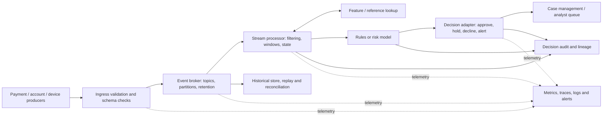
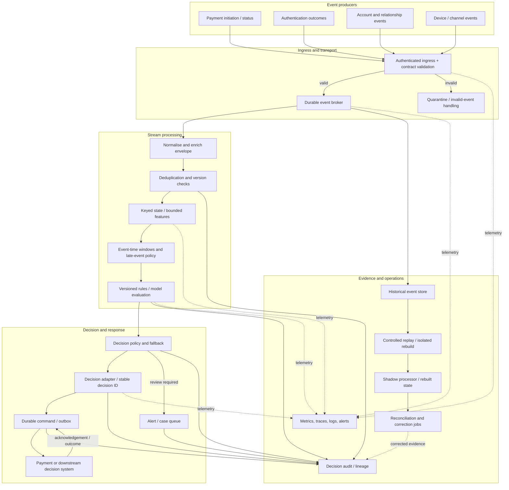

# Case Study 03 — Real-Time Fraud and Risk Platform

> **Purpose:** Learn to analyse a latency-sensitive event-processing architecture from beginner to advanced, including event contracts, stream processing, state, correctness, latency budgets, risk-decision trade-offs, resilience, auditability, and architecture decisions.
>
> **Source integrity:** The module roadmap frames this as a case-study focus, not a verified detailed scenario from an existing lesson file. It says to use source-specific latency targets, accuracy levels, and regulatory obligations where they exist, and to use numbers only for method practice when they do not. The worked scenario below is therefore explicitly illustrative. All names, event examples, targets, capacities, rates, and test values are teaching assumptions—not claims about a real institution or production system.
>
> **Audit workflow:** The supplied `template(20261020-112311).txt` asks for roadmap-based learning content, private verification, revision, and delivery. This lesson follows that workflow. The roadmap lists Case Study 03 prerequisites as P9, P13, P10, P12 and Case Study 01; confirm the exact prerequisite descriptions against the current project tree when applying this to your repository.

## Learning outcomes

By the end of this lesson, you should be able to:

1. Translate “real time” into a measurable end-to-end decision-latency objective and stage budget.
2. Map event producers, broker, validation, stream processing, state/features, decisioning, downstream actions, audit, and replay.
3. Distinguish event time, ingestion time, processing time, and decision time.
4. Explain partition keys, ordering scope, late events, watermarks, state recovery, replay, deduplication, and delivery semantics.
5. Calculate illustrative latency and capacity scenarios with explicit assumptions.
6. Analyse false-positive/false-negative costs without treating a toy score as a validated fraud model.
7. Design observable failure handling for duplicates, gaps, late data, broker/processor/dependency failures, and downstream outages.
8. Compare alternative architectures and record decisions, consequences, risks, and validation evidence.
9. Explain how this case differs from batch-oriented analytics and contributes to the enterprise architecture capstone.

---

## 1. Foundations: what a real-time fraud and risk platform does

### 1.1 The business problem

A fraud and risk platform consumes events that may indicate suspicious activity—such as a payment initiation, account change, device event, authentication result, or transfer request—and produces a decision or signal quickly enough to influence a business process.

Possible outcomes include:
- approve or continue;
- decline or block;
- hold for additional verification;
- raise an alert for a human investigator;
- add evidence to a case;
- emit a risk signal for a downstream system.

These are not interchangeable outcomes. A synchronous payment authorisation decision has a different latency and failure contract from an alert delivered to an analyst queue. Start by identifying the exact action, its decision owner, and the point at which the result must be available.

**Why it matters:** A system can compute a risk score quickly but still fail the business need if the decision arrives after the payment has been approved. Conversely, a low-latency score is not useful if the input is stale, events are missing, state is incorrect, or the decision cannot be explained afterward.

**What it is not:** “Real time” does not mean zero latency, perfect event completeness, or immediate global consistency. It describes a requirement that must be measured at a specified boundary.

### 1.2 Define “real time” as a business contract

A useful latency objective states:
- **Start boundary:** when is the event considered to have entered the measured path? Source creation, broker acknowledgement, or platform ingestion?
- **End boundary:** when is the result produced, accepted by a decision service, acknowledged by a downstream system, or visible to an operator?
- **Population:** which event types and traffic conditions are included?
- **Statistic:** average, p95, p99, maximum, or an SLO window?
- **Clock basis:** how are timestamps synchronised and correlated?
- **Failure semantics:** what happens when the decision cannot be produced by the deadline?
- **Quality constraints:** what correctness, completeness, and audit evidence must hold alongside latency?

A statement such as “risk checks must be real-time” is not testable. An illustrative requirement might say: “For the defined payment path, measure from broker acknowledgement to decision-service acknowledgement and report p50, p95, and p99 by event type.” A specific numerical limit should be agreed by the business and engineering owners; this lesson does not assert a real production limit.

### 1.3 Latency vocabulary

| Term | Meaning | Example |
|---|---|---|
| Source/event time | Time the producer says the business event occurred | Payment initiated at 12:00:00.000 |
| Ingestion time | Time the platform accepted the event | Broker accepted it at 12:00:00.035 |
| Processing time | Time a processor handled a record or operator | Stream task evaluated it at 12:00:00.060 |
| Decision time | Time the risk decision was created | Decision emitted at 12:00:00.115 |
| End-to-end decision latency | Elapsed time between agreed start and end boundaries | Ingestion-to-decision acknowledgement |
| Event age | Current/processing time minus event time, subject to clock quality | Event is already old when received |
| Queueing delay | Time spent waiting for capacity or downstream readiness | Consumer lag grows during a burst |
| Tail latency | Slow end of the latency distribution, often p95/p99 | Most events are quick but a small fraction are very slow |

Do not subtract timestamps from unsynchronised clocks and treat the result as precise. For latency measurement, prefer monotonic duration measurement within a process where appropriate, or trace/correlation instrumentation with known clock-error bounds across services.

### 1.4 Batch versus streaming

| Dimension | Batch processing | Stream processing |
|---|---|---|
| Input | Bounded file/table/snapshot or a scheduled increment | Unbounded sequence of events |
| Typical trigger | Schedule, partition arrival, manual run | Arrival of events, timers, windows, or state transitions |
| Strength | Efficient large scans, reproducibility, reconciliation | Low-latency incremental response |
| Main risks | Data freshness delay, large reruns, late batch arrival | Ordering, state, backpressure, duplicates, late events, continuous operations |
| Best fit | Historical reporting, model training datasets, periodic reconciliation | Time-sensitive detection, alerting, online feature updates |
| Shared needs | Contracts, lineage, access control, quality, replay/recovery, monitoring | Same |

A mature design often uses both: streaming for rapid action and batch/historical processing for reconciliation, investigation, model evaluation, and backfills. The batch path must not silently overwrite live state with older data; the system needs a precedence/version policy.

### 1.5 Correctness has several dimensions

- **Record correctness:** individual event fields are valid and semantically accurate.
- **Completeness:** expected events are not silently missing.
- **Ordering:** events are processed in an order appropriate to the business logic.
- **State correctness:** aggregates/features reflect the intended set of events and time range.
- **Decision correctness:** the rules/model and available evidence support the action.
- **Delivery correctness:** a decision or alert reaches the intended downstream system without unsafe duplication or loss.
- **Auditability:** the organisation can reconstruct what evidence and rule/model version produced a decision.

A low-latency pipeline can still be wrong in any of these ways. A delivery guarantee in one component does not prove the entire business workflow is exactly once.

---

## 2. Position in Stage 2D and prerequisites

The module roadmap identifies Case Study 03 prerequisites as **P9, P13, P10, P12; Case Study 01**. The precise P-number mapping should be checked against the current roadmap edition; do not infer exact module titles from a P-number alone if the source version differs.

The relevant Stage 2D concepts to revisit are:

| Relevant topic area | How it contributes | Readiness question |
|---|---|---|
| Data integration and interoperability | Source contracts, CDC/events, retries, idempotency, schema evolution | Can I explain how an event reaches the platform and how failures are retried? |
| Streaming and real-time architecture | Broker, topics, partitions, event time, windows, watermarks, state, delivery semantics | Can I explain ordering scope and how late events affect results? |
| Reliability, resilience, and disaster recovery | Failure domains, redundancy, recovery objectives, runbooks, degraded modes | What happens when a dependency or processor is unavailable? |
| Query performance and data locality | State lookup, partitioning, locality, queueing, tail latency, capacity | Which stage dominates p99 latency and why? |
| Governance, security, privacy, and compliance | Data classification, purpose, access, retention, audit evidence | Which fields are required for a decision and who may access them? |
| Metadata, lineage, and quality | Event provenance, quality checks, schema ownership, completeness | Can the team trace an alert to its source events and transformations? |
| Data access, serving, semantic, and AI architecture | Decision APIs, alert/case interfaces, feature serving, downstream consumers | What is the contract at the point where a decision is used? |
| Architecture documentation and operating model | Context diagrams, ADRs, ownership, risk register, runbooks | Who owns each stage, and how is the design reviewed? |
| Case Study 01 — Banking data platform | Platform integration, governance, operational boundaries | Which shared platform capabilities can be reused, and which real-time constraints differ? |

**Learning sequence:** understand the business action → inventory events and consumers → define latency and correctness requirements → design event flow and state → model failures → compare alternatives → write ADRs → define validation evidence.

---

## 3. Beginner level: map the event flow

### 3.1 Illustrative event flow

The diagram is an architectural learning model, not a verified source scenario.



### 3.2 Component responsibilities

1. **Producers:** publish business facts or observations. They should provide stable event IDs, event type, source identity, event time, schema/version, and relevant correlation identifiers where feasible.
2. **Ingress validation:** validates envelope, schema, required fields, authentication, and basic quality. Invalid events should be rejected or quarantined with a reason, not silently discarded.
3. **Broker:** buffers events, distributes them to consumers, and provides retention/replay capabilities according to configured policy. Partitioning affects ordering, parallelism, and load distribution.
4. **Stream processor:** performs filtering, event-time operations, aggregations, joins, and state updates. It must handle restart, replay, late events, and state restoration.
5. **Feature/reference lookup:** retrieves current or recent context such as account history, device relationship, known-risk indicators, or customer context. The lookup must have explicit freshness and timeout semantics.
6. **Rules/model:** evaluates evidence. The scoring model is a separately governed component; infrastructure should record model/rule version and relevant evidence references.
7. **Decision adapter:** translates the risk result into an action supported by the downstream business workflow. A score by itself is not an approved action.
8. **Case management:** supports human investigation, evidence review, outcome feedback, and operational prioritisation.
9. **Audit/lineage:** records decision ID, event IDs or secure references, feature/state versions where possible, rule/model version, timestamps, reason codes, and outcome.
10. **Historical path:** supports investigation, reconciliation, replay, training/evaluation datasets, and controlled backfills.
11. **Observability:** measures latency at each boundary, queue lag, event rates, errors, state health, dependency failures, and business outcomes.

### 3.3 Illustrative event contract

```json
{
  "event_id": "evt-demo-00017",
  "event_type": "payment.initiated",
  "schema_version": 2,
  "source": "payment-gateway-demo",
  "event_time": "2026-10-20T12:00:00.000Z",
  "ingested_at": "2026-10-20T12:00:00.035Z",
  "entity_key": "account-demo-91",
  "correlation_id": "corr-demo-009",
  "amount_minor_units": 12500,
  "currency": "XXX",
  "payload_reference": "secure://event-payload/demo-00017"
}
```

All values are fictional. `XXX` is a placeholder currency code for the example and is not intended to be a valid payment instruction. The `secure://` value is illustrative, not a real URI scheme. In a production contract, `event_time` is producer-supplied with documented provenance and clock-quality expectations; `ingested_at` should normally be stamped by the platform at its defined ingestion boundary rather than trusted from an unverified producer payload. Production schemas must define actual types, units, permitted values, authentication, privacy classification, nullability, compatibility policy, and error handling. Avoid putting unnecessary personal or payment-sensitive data into event keys, logs, or general telemetry.

A schema version alone does not make a schema compatible. A new field can break a consumer if it changes meaning, nullability, units, or required-field assumptions. Use contract tests and a compatibility policy agreed by producers and consumers.

### 3.4 Facts, assumptions, and questions

| Type | Example in this case | Treatment |
|---|---|---|
| Source frame | The case-study roadmap describes transaction/event risk decisions that must be made in near real time | Use as the teaching focus |
| Illustrative assumption | A payment event is evaluated before a decision service acknowledges the result | Label and test |
| Requirement to confirm | The decision must be returned within a specified percentile and deadline | Obtain from business/process owner |
| Constraint to confirm | A legacy producer can only publish scheduled files | Validate with source owner |
| Hypothesis | Tail latency is caused by a remote feature lookup | Confirm with traces and experiments |
| Open question | If scoring is unavailable, should the business fail open, fail closed, or use a fallback? | Explicit business/risk decision |

Do not treat a suggested latency budget in this lesson as a committed service-level objective.

---

## 4. Intermediate streaming architecture

### 4.1 Event time, ingestion time, and processing time

- **Event time** is the timestamp associated with when the business event occurred, according to the producer.
- **Ingestion time** is when the platform receives or records the event.
- **Processing time** is when a processing operator handles it.
- **Decision time** is when a risk outcome is produced.
- **Acknowledgement time** is when the receiving decision system confirms acceptance, if the contract requires an acknowledgement.

These times answer different questions. Event time is often appropriate for behavioural windows such as “number of attempts in the preceding interval.” Processing time is useful for operational responsiveness and timers. Ingestion time helps diagnose transport delays.

**Example:** An event with event time `12:00:00` arrives at `12:00:08` because the producer retried after a network outage. If the processor uses only processing time, it may count this event in the wrong window. If it waits indefinitely for all earlier event times, it may violate the decision deadline. The architecture must choose how much lateness to tolerate and what to do with events that arrive too late.

### 4.2 Out-of-order and late events

Events can arrive out of order because of:
- independent producer clocks or clock skew;
- retries and intermittent network paths;
- multiple broker partitions;
- producer-side batching;
- consumer rebalancing or recovery;
- different processing durations;
- delayed enrichment or source replication.

An event is **out of order** when it arrives in an order different from the relevant business order. It is **late** relative to a window or watermark policy when it arrives after the processor considers that window complete enough to emit or finalise a result.

Handling strategies:
1. Process immediately and accept provisional/incomplete aggregates.
2. Buffer briefly to allow reordering, increasing latency.
3. Use event-time windows and a watermark/allowed-lateness policy.
4. Emit corrections or retractions when late events change previous results.
5. Send events beyond a lateness bound to a side output for reconciliation or investigation.

No strategy makes all events arrive on time. Watermarks are estimates of event-time progress, not proof that an earlier event can never arrive.

### 4.3 Partitions, keys, and ordering scope

A broker partition provides an ordering scope for records appended to that partition, subject to the broker’s actual guarantees. It does not provide a global total order across all partitions.

A partition key should align with the entity whose sequence/state matters. For example:
- account key for account-level velocity;
- card token for card-specific sequence;
- customer or device key for an appropriate customer/device feature;
- transaction ID for deduplication identity (often a key in a separate idempotency store rather than the stream’s main ordering key).

Trade-offs:
- Too few partitions can constrain parallelism and create hotspots.
- Too many partitions increase metadata, assignment, recovery, and operational overhead.
- A high-volume account/device key can become a hot partition.
- Choosing customer as key does not guarantee all events for an account arrive in true business order if upstream producers assign inconsistent timestamps or publish through independent paths.
- Changing a keying strategy can change ordering scope and state placement; migration needs a plan.

Partitioning should be based on measured event rates, state locality, consumer parallelism, key skew, and the order that business logic actually requires.

### 4.4 Stateful processing

State stores information across events: counts in a time window, last-seen timestamps, recent transaction amounts, velocity features, deduplication keys, or risk context.

State introduces questions:
- What is the key and state granularity?
- What is the time horizon?
- What is the expiration/retention policy?
- What happens on restart or task reassignment?
- How is state checkpointed or reconstructed?
- How do late events update state?
- Can replay rebuild the same state?
- What happens when reference data or model versions change?

State should be bounded where possible. An unbounded set of every event ID ever seen may grow indefinitely; a time-bounded deduplication store limits memory but may not prevent duplicates outside that horizon. Retention must match the business replay and duplicate-delivery window.

### 4.5 Deduplication and idempotency

**Deduplication** detects repeated event identities. **Idempotency** means applying the same operation more than once has the same effective result as applying it once.

A practical design may:
- require a stable producer event ID;
- maintain a deduplication key such as `(producer, event_id)`;
- store processed IDs for a defined horizon;
- use version/sequence numbers to prevent stale updates;
- make downstream writes upserts or state transitions keyed by decision ID;
- use an outbox or transactional publication mechanism for state changes plus outgoing events;
- make retries safe and record attempt/outcome metadata.

A deduplication window is not universal exactly-once protection. If a duplicate arrives after the key expires, it may be processed again. If two legitimate events reuse the same ID, one may be dropped incorrectly. Event identity semantics must be a contract with producers.

### 4.6 Delivery semantics: local guarantees versus business outcome

| Term | What it can mean | What it does not prove by itself |
|---|---|---|
| At-most-once | A record is not retried after a certain point; duplicates may be avoided at the cost of possible loss | That no business event is lost |
| At-least-once | A record is retried until acknowledged under stated conditions; duplicates are possible | That downstream actions happen only once |
| Exactly-once processing (framework/boundary-specific) | A defined transactional boundary prevents duplicate effects under supported conditions | That every external API, payment action, alert, and database update participates in the same transaction |

The end-to-end business workflow may include a broker, processor state, decision service, payment system, case-management system, and audit store. They rarely share one atomic transaction. Use idempotent business commands, stable decision IDs, transactional outbox/inbox patterns where appropriate, reconciliation, and explicit compensation for partial completion.

### 4.7 Watermarks and late-event policy

A **watermark** estimates that events with event times earlier than a particular point are unlikely to arrive. It is a progress signal used by stream processors to decide when to emit or finalise event-time window results. It is not a guarantee of absolute completeness.

Illustrative timeline:

| Processing arrival order | Event time | Arrival/processing time | Consequence |
|---|---|---|---|
| E1 | 10:00:01 | 10:00:02 | Normal event |
| E2 | 10:00:04 | 10:00:05 | Normal event |
| E3 | 10:00:02 | 10:00:09 | Late/out-of-order event |
| Watermark advances to 10:00:03 | — | 10:00:10 | A window ending before this point may already have emitted |
| E4 | 10:00:01 | 10:00:15 | Very late under this example’s policy |

If the allowed lateness is illustrative 5 seconds, E3 may still update state if the processor’s window and watermark semantics permit it, while E4 may be routed to a late-event path. Exact behaviour depends on the stream engine and configuration; do not assume one universal interpretation of “allowed lateness.”

For an immediate fraud decision, a late event may not be able to change an already completed authorisation. It can still update investigation evidence, trigger a follow-up alert, or improve future features. Record whether the decision was provisional and what evidence was available at decision time.

### 4.8 Backpressure and consumer lag

**Backpressure** occurs when downstream processing cannot keep up with upstream production. **Consumer lag** measures how far a consumer is behind the broker’s available records, according to the system’s lag definition.

Symptoms:
- rising end-to-end latency and queue depth;
- growing age of oldest unprocessed event;
- uneven lag across partitions;
- increased retries, timeouts, memory pressure, or state-store latency;
- recovery that takes longer than the rate at which new lag accumulates.

Responses include fixing slow dependencies, increasing parallelism where safe, reducing unnecessary work, batching I/O where it helps, controlling admission, isolating slow consumers, and scaling state/storage capacity. Simply adding workers may not help if a hot key, remote dependency, or partition limit is the bottleneck.

### 4.9 Replay and state recovery

Replay means reprocessing retained events to rebuild state, investigate a failure, or test a changed rule. A replay design must answer:
- Which offset/time range is replayed?
- Is the target a production state store, a shadow environment, or an analytical sink?
- How are side effects prevented from executing twice?
- Which event/schema/rule/model versions are used?
- How are late and corrected events treated?
- How is the replay reconciled with the live stream?
- Who authorises replay and reviews its impact?

Do not replay historical events into a live payment action path without a deliberate side-effect policy. A common approach is to replay into a shadow state or analytical sink, compare results, and separately approve any operational correction.

---

## 5. Latency budget: worked calculations

### 5.1 Example budget

This table is **illustrative only**. The total is a sum of component budget allocations for one conceptual path; actual percentile values do not always add neatly because stage timings can be correlated and percentiles of sums are not generally the sum of stage percentiles.

| Stage | Illustrative budget (ms) | Measurement boundary |
|---|---:|---|
| Ingress validation and broker acknowledgement | 35 | Producer send to broker acknowledgement |
| Broker queueing and consumer dispatch | 45 | Broker accepted record to processor begins |
| Stream transformation and state update | 70 | Operator start to state result |
| Feature/reference lookup | 90 | Request to usable response |
| Rule/model evaluation | 55 | Evaluation start to score/result |
| Decision adapter and downstream acknowledgement | 80 | Result emitted to receiving service acknowledgement |
| **Allocated subtotal** | **375 ms** | Sum of stage allocations |
| **Illustrative reserve/headroom** | **125 ms** | Budget reserved for variance and unmodelled overhead |
| **Illustrative end-to-end target** | **500 ms** | Example objective only; not a production commitment |

The arithmetic is \(35 + 45 + 70 + 90 + 55 + 80 = 375\) ms; adding 125 ms reserve gives 500 ms. The reserve is not “free capacity”: it is a latency margin that must be validated by end-to-end measurements.

### 5.2 Percentiles and tail latency

- **p50**: half of measured requests complete at or below this latency.
- **p95**: 95% complete at or below this latency.
- **p99**: 99% complete at or below this latency.
- **Maximum**: the slowest observed sample in the measurement window; highly sensitive to sample size and outliers.

Do not claim an end-to-end p95 by adding each stage’s p95. The sum is a planning approximation, not a mathematical identity. To validate the actual SLO, measure end-to-end latency for correlated traces under representative traffic, and also instrument stage distributions to diagnose the bottleneck.

Averages can hide a small set of very slow events. Tail latency is especially important when downstream systems have deadlines or timeouts. Use consistent units and measurement boundaries, and separate successful decisions from timed-out or failed requests so the metric cannot improve merely because slow requests disappear from the sample.

### 5.3 Throughput and capacity

Use a deliberately simple illustrative capacity calculation:

- Average input rate: 2,000 events/second.
- Illustrative burst rate: 6,000 events/second.
- Measured sustainable per-worker rate under the target workload: 1,000 events/second.
- Desired planning headroom: 30% above the expected burst rate.

These values are invented for arithmetic practice, not production estimates.

Capacity required for burst plus headroom:

\[
6{,}000 \times (1 + 0.30) = 7{,}800\ \text{events/second}
\]

If one worker truly sustains 1,000 events/second for the same workload, the simple arithmetic gives:

\[
\lceil 7{,}800 / 1{,}000 \rceil = 8\ \text{workers}
\]

This is only a first approximation. It assumes near-linear scaling and no bottleneck in partitions, state storage, network, feature lookup, broker, or downstream decisioning. The actual plan must include failure capacity, uneven partition/key distribution, checkpoint/recovery overhead, payload size, concurrency limits, and the performance effect of increased parallelism.

### 5.4 Backlog recovery arithmetic

Suppose an illustrative incident creates a backlog of 120,000 events. New traffic continues at 2,000 events/second, while the system can process 3,000 events/second total after recovery. Net drain rate is:

\[
3{,}000 - 2{,}000 = 1{,}000\ \text{events/second}
\]

Estimated drain time under these simplified steady-state assumptions:

\[
120{,}000 / 1{,}000 = 120\ \text{seconds}
\]

If post-recovery processing capacity only equals incoming traffic, backlog will not drain. This calculation excludes partition skew, retries, variable event sizes, state rebuild, and downstream throttling; use observed drain rate to validate recovery plans.

### 5.5 What to measure before setting targets

Collect:
- end-to-end latency by event type and outcome;
- p50/p95/p99 and timeout rate;
- ingress-to-broker, broker-to-processor, state lookup, decision, and acknowledgement durations;
- event rate, burst shape, payload size, and key skew;
- broker lag and age of oldest event;
- state-store latency, cache hit rate, checkpoint/recovery duration;
- dependency timeout/retry rates;
- duplicate, late, rejected, and quarantined event rates;
- error rate and decision availability;
- throughput under normal, burst, degraded dependency, and recovery load;
- resource and cost curves under representative workload.

Targets should be agreed by the process owner, risk owner, platform owner, and downstream system owner. A percentile is incomplete unless its population, window, and failure treatment are specified.

---

## 6. Fraud and risk trade-offs

### 6.1 False positives and false negatives

- **False positive:** legitimate activity is flagged or blocked as suspicious.
- **False negative:** fraudulent or risky activity is not detected by the decision process.

The costs are asymmetric and context-dependent. A false positive may inconvenience a customer, increase manual review, or cause lost business. A false negative may allow loss or harm. The business must state how these costs are assessed; this document does not invent monetary values or actual fraud rates.

Useful evaluation dimensions:
- precision and recall on a labelled evaluation set;
- false-positive and false-negative rates;
- review rate and investigator workload;
- performance by event type and relevant population segment;
- calibration and drift where a probabilistic score is used;
- time-to-detection and time-to-action;
- downstream customer impact and operational reversals.

**Illustrative base-rate calculation (not a model result).** Assume 1,000,000 transactions/day, an illustrative fraud prevalence of 0.1%, recall of 80%, and a false-positive rate of 0.5% among legitimate transactions. These invented values imply:

| Quantity | Calculation | Illustrative result |
|---|---|---:|
| Fraudulent transactions | 1,000,000 × 0.1% | 1,000 |
| True positives (fraud caught) | 1,000 × 80% | 800 |
| False negatives (fraud missed) | 1,000 − 800 | 200 |
| Legitimate transactions | 1,000,000 − 1,000 | 999,000 |
| False positives (legitimate flagged) | 999,000 × 0.5% | 4,995 |
| True negatives (legitimate not flagged) | 999,000 − 4,995 | 994,005 |
| Precision among flagged transactions | 800 ÷ (800 + 4,995) | ≈ 13.8% |
| Recall among fraudulent transactions | 800 ÷ 1,000 | 80% |
| Total flagged transactions | 800 + 4,995 | 5,795/day |

The arithmetic shows why base rate and absolute review volume matter: under these assumptions, most flagged transactions are legitimate even though the illustrative recall is 80%. This does **not** establish that any real detector has these rates. In practice, confirm label definitions, evaluation-window and population, threshold, delayed/biased labels, and confidence/uncertainty; measure operational review capacity and customer impact before choosing an action threshold.

A high overall accuracy number can be misleading when fraud is rare. The model or rule set must be evaluated against the actual use case and operating threshold, and it must not be presented as validated based on a toy example.

### 6.2 Detection quality versus decision speed

More context may improve decision quality but increase latency:
- remote customer or device lookup;
- long event-time windows;
- cross-entity joins;
- external intelligence calls;
- complex models or multiple sequential rules.

Ways to manage the trade-off:
- precompute appropriate features;
- use bounded local state for hot-path decisions;
- parallelise independent lookups where safe;
- define timeout and fallback semantics for each dependency;
- distinguish synchronous action from asynchronous follow-up investigation;
- record which features were unavailable at decision time.

Do not remove a feature from the decision path solely because it is slow without evaluating its effect on decision quality and risk. Conversely, do not let an unbounded lookup delay a time-critical decision indefinitely.

### 6.3 Freshness versus completeness

Waiting for more events can improve window completeness but delays decisions. Acting immediately can reduce latency but use incomplete state. A design may make an initial decision using available state and later enrich the investigation record when late evidence arrives. Whether the initial decision can be revised depends on the business process and should be explicitly documented.

### 6.4 State retention versus resource cost

Longer state retention supports longer behaviour windows and duplicate detection, but increases memory/disk use, checkpoint time, recovery duration, and cost. Short retention reduces cost but may miss long-range patterns or permit old duplicates to reappear.

Set retention from the use case:
- feature/window horizon;
- expected event lateness;
- deduplication horizon;
- replay/recovery horizon;
- privacy/retention policy;
- operational capacity and recovery objective.

The maximum of these requirements may not be one single state TTL; different state types may need different lifecycles.

### 6.5 Automated decision versus human review

Automation provides fast, repeatable action but can make mistakes at scale. Human review can handle ambiguous evidence but adds delay and operational workload. A design can separate:
- low-risk/low-ambiguity cases suitable for an approved automated path;
- cases requiring additional authentication or verification;
- alerts that can be reviewed asynchronously;
- cases requiring urgent human escalation.

The thresholds and action policy require evidence and business approval. A model score is not itself a policy.

### 6.6 Availability versus fail-safe behaviour

If scoring is unavailable, the system needs a deliberate fallback. “Fail open” (allow without the normal check) and “fail closed” (block/hold without the normal check) both have costs. Alternatives may include a bounded fallback rule set, step-up verification, a short hold, or a downstream manual queue—if supported by the business process.

There is no universal answer. Document:
- decision deadline;
- maximum acceptable outage/degraded duration;
- fallback evidence and its freshness;
- actions permitted during degraded mode;
- customer/operational impact;
- audit marking of fallback decisions;
- recovery and reconciliation process.

### 6.7 Explainability and evidence preservation

For each material decision, capture enough information to explain it later:
- stable decision ID and correlated event IDs;
- decision time and relevant event/ingestion times;
- rule/model version;
- feature values or protected references to the exact values used;
- state/window version or cutoff information when feasible;
- reason codes and outcome;
- dependency failures or fallbacks;
- policy/configuration version;
- downstream acknowledgement or failure.

Do not indiscriminately copy full sensitive payloads into logs. Store protected evidence references, apply access controls, minimise data, and define retention under the applicable policy.

---

## 7. Failure modes and resilience

### 7.1 Failure-mode analysis

| Failure | Detection signals | Expected behaviour | Recovery | Possible business impact | Validation test |
|---|---|---|---|---|---|
| Duplicate event | Repeated event ID, duplicate counter, repeated decision ID | Deduplicate or apply idempotent state transition | Retry safely; reconcile processed IDs | Double-counted feature or repeated alert/action | Publish the same event repeatedly; verify one effective business effect |
| Missing event / source gap | Sequence gap where available, count mismatch, heartbeat/producer metrics | Raise completeness alarm; avoid claiming complete state | Replay from source/broker or reconcile from authoritative store | Missed pattern or incomplete risk evidence | Remove a known event from test input and verify detection |
| Late event | Event age, watermark/late-side-output counter | Apply late-event policy; update/correct eligible state or route for follow-up | Reconcile late stream; issue correction if supported | Decision made without relevant evidence | Inject late events around the configured lateness boundary |
| Out-of-order event | Sequence/timestamp regression, state anomalies | Apply version/ordering policy; do not blindly overwrite newer state | Replay affected key/window or rebuild state | Incorrect velocity/sequence features | Send records out of order and assert deterministic expected state |
| Broker unavailable | Producer failures, broker health, publish latency | Apply bounded retries/backpressure; preserve source event if contract allows | Restore broker, retry/replay, reconcile source-to-broker gap | Decision delay or event loss if source is not durable | Disable broker path and test producer buffering/failure semantics |
| Processor crash/restart | Restart count, checkpoint age, task failures, lag increase | Restore state/checkpoint; resume at a defined offset | Recover, replay safely, compare state | Increased latency; duplicate effects if sinks not idempotent | Kill processor mid-stream and compare final state/output |
| State corruption or checkpoint incompatibility | Restore errors, checksum/consistency checks, divergence from baseline | Stop unsafe decisions or enter approved degraded mode | Restore last valid checkpoint and replay; reconcile | Incorrect risk features across many events | Corrupt a test checkpoint or simulate restore incompatibility |
| Feature/reference timeout | Timeout rate, dependency latency, cache staleness | Apply the approved fallback/hold/retry policy | Recover dependency; refresh feature; reconcile decisions if needed | Delayed decisions or lower-quality scoring | Inject timeout and stale responses; assert fallback and audit fields |
| Downstream decision system unavailable | Failed acknowledgements, retry backlog, decision outbox age | Persist pending decision; retry idempotently; avoid untracked loss | Drain outbox and reconcile accepted decisions | Decision not applied or applied twice | Stop downstream, recover, verify exactly one effective action |
| Schema incompatibility | Deserialization errors, contract-test failure, quarantine rate | Reject/quarantine with reason; preserve event reference | Roll back producer or deploy compatible consumer | Lost/late decisions, rising lag | Publish incompatible schema and verify controlled failure |
| Hot partition / burst | Per-partition lag skew, CPU/network saturation, queue age | Apply backpressure and scaling/isolation policy | Rebalance keys/partitions if safe; scale bottleneck | Tail latency exceeds deadline | Replay skewed keys and burst traffic |
| Audit sink unavailable | Audit backlog, write errors, missing decision trace | Follow an approved durable-buffer or fail-safe policy | Retry and reconcile decision IDs against audit records | Inability to explain decisions | Disable audit sink and verify no silent audit loss |

A failure table is not complete unless it identifies an owner, alert threshold, operational runbook, and test evidence in the real implementation. Those values are not supplied by the roadmap and must be agreed.

### 7.2 Recovery principles

- **Durable ingress:** if a decision cannot be made immediately, the system must know whether the event is safely retained and how it will be retried.
- **Bounded retries:** unlimited immediate retries can amplify an outage. Use controlled retry/backoff and a dead-letter/quarantine path with ownership.
- **Idempotent effects:** retries must not create duplicate business actions.
- **Replayable evidence:** retain sufficient event identity and version information to reconstruct the processing path.
- **State recovery:** checkpoint and replay strategies should be tested, not merely configured.
- **Degraded-mode policy:** risk/business owners decide whether to hold, decline, step-up, use a fallback, or defer.
- **Reconciliation:** compare source records, broker offsets, processed event IDs, decision IDs, downstream acknowledgements, and audit records.
- **Blameless incident learning:** identify the systemic cause, evidence, corrective action, and validation—not only the component that failed.

### 7.3 Availability and recovery objectives

Do not invent RTO/RPO or service-level objectives. Obtain them from the business process, risk owner, and platform operating model. Clarify:
- how long the decision path may be unavailable;
- how much accepted event data can be lost, if any;
- whether decisions can be delayed or must be synchronous;
- which state can be rebuilt and how long it takes;
- how stale state is detected;
- who can approve degraded mode and resume normal operation.

A broker replication setting, checkpoint interval, or framework guarantee does not automatically establish a business recovery objective.

---

## 8. Complete worked case study: illustrative Northbridge Bank

### 8.1 Scenario

**Illustrative only:** Northbridge Bank is a fictional organisation. Assume it wants to assess payment events before or during an authorisation workflow and create investigation alerts for suspicious patterns. Payment, account, authentication, and device events may arrive from distinct systems. Some downstream actions are time-sensitive; some investigations can happen asynchronously. The real business latency, volume, fraud prevalence, model quality, policy obligations, and outage behaviour are not specified by the source roadmap.

### 8.2 Stakeholders and objectives

| Stakeholder | Concern | Evidence needed |
|---|---|---|
| Payment/product owner | Decision must fit the payment workflow | Start/end boundary, deadlines, permitted actions |
| Fraud/risk owner | Balance missed fraud against legitimate-customer friction | Labelled evaluation, error-cost analysis, outcome feedback |
| Fraud investigators | Explainable alerts and workable queue | Reason codes, evidence links, queue age and prioritisation |
| Data/platform engineering | Sustained throughput, tail latency, state and recovery | Load tests, traces, recovery tests |
| Source-system owners | Event quality, IDs, timestamps, schema changes | Contracts, producer metrics, event-gap reconciliation |
| Security/privacy/compliance stakeholders | Access, data minimisation, audit and applicable policy | Approved requirements and control evidence |
| Operations/on-call | Detection and recovery under failure | Dashboards, runbooks, ownership and drills |
| Customer 360/data owners | Correct customer/account context | Identity link quality, freshness, provenance |
| Capstone reviewer | Traceable architecture reasoning | Requirements map, diagrams, ADRs, risks, validation |

### 8.3 Illustrative requirements and status

All quantitative and policy requirements below are proposals to validate, not actual mandates.

| ID | Statement | Type | Status | Validation approach |
|---|---|---|---|---|
| RT-F01 | Evaluate defined payment events and return a supported decision outcome | Functional | Proposed | Contract tests for each outcome |
| RT-F02 | Persist a decision ID and link it to source events and rule/model version | Auditability | Proposed | Reconstruct sampled decisions |
| RT-F03 | Route eligible suspicious cases to an investigation queue | Functional | Proposed | End-to-end alert delivery and acknowledgement test |
| RT-D01 | Validate schema, required identifiers, event time, and units | Data quality | Proposed | Invalid/missing-field fixtures |
| RT-D02 | Define duplicate and out-of-order event behaviour | Correctness | Open until owner agrees | Replay and ordering tests |
| RT-N01 | Define end-to-end latency boundaries and percentile objective | Non-functional | Open | Stakeholder agreement and trace-based measurement |
| RT-N02 | Define burst rate and recovery headroom | Capacity | Open | Production-like load and burst test |
| RT-N03 | Define behaviour when scoring or feature lookup is unavailable | Resilience | Open | Approved failure policy and chaos/fault-injection test |
| RT-G01 | Record enough evidence to explain each material decision | Governance/audit | Proposed | Audit reconstruction exercise |
| RT-S01 | Restrict access to event payloads and decision evidence | Security | Must be confirmed against policy | Negative access tests and audit review |
| RT-O01 | Assign owners for producers, stream processing, decision adapter, and case queue | Operating model | Proposed | Ownership register and on-call test |

### 8.4 Proposed architecture



This architecture intentionally separates:
- the event-processing path from the downstream action;
- fast decisioning from human investigation;
- live processing from historical replay/reconciliation;
- the decision result from the evidence needed to explain it.

The diagram is logical, not a deployment specification. It does not imply a particular broker, stream engine, cloud, model, or regulatory control.

### 8.5 Event key and state design

Proposed state inventory (illustrative; confirm use cases and retention requirements):

| State | Key | Purpose | Retention decision | Risks |
|---|---|---|---|---|
| Event deduplication | Producer + event ID | Avoid repeated processing of the same event | Must cover agreed duplicate/replay horizon | Expired IDs may be processed again |
| Account velocity | Account key | Count/aggregate activity over defined time windows | Based on feature horizon and replay needs | Hot keys, stale events, account ownership changes |
| Device activity | Device key/token | Track activity by device identifier | Based on feature horizon and privacy policy | Shared devices, identifier resets, skew |
| Recent transaction summary | Approved entity key | Provide fast recent-history features | Defined per feature and use case | State growth, version inconsistency |
| Decision/outbox state | Decision ID | Track pending/acknowledged downstream action | Based on retry, audit, and reconciliation needs | Duplicate external action if idempotency is weak |
| Audit evidence index | Decision ID / event reference | Find supporting evidence | Approved retention and access policy | Sensitive payload leakage if over-collected |

Do not store a single undifferentiated “risk state” without field definitions, time horizon, source lineage, and version semantics. A feature should be reproducible enough for the decision’s purpose, but minimisation and policy may limit what can be retained.

### 8.6 Illustrative decision lifecycle

1. The payment producer emits an event with a stable event ID and schema version.
2. Ingress authenticates the producer, validates the contract, and records ingestion metadata.
3. The broker accepts the event and makes it available to the relevant consumer.
4. The processor deduplicates and applies a defined ordering/version policy.
5. Keyed state and bounded windows provide features, with freshness and late-event handling.
6. The versioned rule/model produces a result plus reason codes and evidence references.
7. The decision policy chooses an approved action: continue, hold, decline, request verification, or alert—depending on actual business rules.
8. The decision adapter sends an idempotent command or persists a pending action; acknowledgement is recorded.
9. The audit path links the decision to event IDs, feature/state version, model/rule version, timestamps, and outcome.
10. Late evidence, corrections, or downstream failures are reconciled according to explicit policies.

The exact outcome set and fail-open/fail-closed policy must be approved by the actual business owner.

### 8.7 Illustrative latency and capacity analysis

Using the example in Section 5:
- Stage allocations sum to 375 ms.
- An additional 125 ms planning reserve yields an illustrative 500 ms end-to-end budget.
- At an illustrative burst of 6,000 events/second and 30% headroom, the planning load is 7,800 events/second.
- If a measured worker sustains 1,000 events/second on the target workload, the simple linear estimate is 8 workers.
- With a backlog of 120,000 events, continuing arrivals of 2,000 events/second and total processing of 3,000 events/second, net drain is 1,000 events/second, giving a simplified 120-second drain estimate.

These are internally consistent arithmetic examples, not commitments. Validate with trace-based end-to-end tests, representative event distributions, partition-skew tests, failure-capacity tests, state-recovery tests, and measured cost curves. Stage p95 values must not be summed and reported as a guaranteed end-to-end p95.

### 8.8 Alternatives and decision records

#### ADR-RT-001 — Separate fast decision path from asynchronous investigation

- **Status:** Proposed for evaluation.
- **Context:** Payment action and investigator review have different latency and interaction requirements.
- **Decision:** Keep the synchronous decision boundary narrow; publish investigation alerts and richer enrichment asynchronously where the business process allows.
- **Alternatives:** Make every decision wait for the full case-enrichment path; process all activity only in batch.
- **Rationale:** Avoid coupling an immediate action to slower human-workflow and enrichment dependencies.
- **Consequences:** Requires durable alert publication, idempotency, and reconciliation between decision and case systems.
- **Risks:** Investigators may see delayed context; asynchronous alert failures need detection.
- **Validation:** Measure decision latency separately from alert latency; test downstream outage and alert recovery.
- **Revisit if:** Business requirements require a synchronous, complete investigation result before action.

#### ADR-RT-002 — Use entity-keyed state with explicit event-time and lateness policies

- **Status:** Proposed.
- **Context:** Behavioural features depend on the sequence and time range of events.
- **Decision:** Choose keys according to feature semantics; define event-time windows, watermark/lateness behaviour, and a separate late-event path.
- **Alternatives:** Use processing time for all windows; rely exclusively on source ordering; query historical storage for every event.
- **Rationale:** Makes temporal semantics explicit while bounding hot-path work.
- **Consequences:** Requires clock-quality monitoring, state retention, late-event metrics, and correction handling.
- **Risks:** Late data may arrive after the real-time action; skew may overload a partition.
- **Validation:** Inject out-of-order events, skewed keys, and late events at each policy boundary.
- **Revisit if:** The use case does not depend on event-time behaviour or the source provides stronger validated ordering semantics.

#### ADR-RT-003 — Use idempotent decision commands plus reconciliation

- **Status:** Proposed.
- **Context:** A broker/processor transaction does not encompass every downstream action.
- **Decision:** Assign stable decision IDs; make downstream effects idempotent where possible; track acknowledgements and reconcile incomplete outcomes.
- **Alternatives:** Depend solely on a claimed “exactly once” stream-processing mode; use unbounded retries without deduplication.
- **Rationale:** Addresses partial failure across independent systems.
- **Consequences:** Requires an idempotency contract and a durable record of pending/accepted decisions.
- **Risks:** Incorrect idempotency keys can collapse distinct actions; reconciliation adds operational work.
- **Validation:** Duplicate delivery, timeout-after-acceptance, processor restart, and downstream outage tests.
- **Revisit if:** All relevant side effects are proven to participate in one atomic transaction—which must be demonstrated, not assumed.

#### ADR-RT-004 — Define degraded-mode policy with risk/business owners

- **Status:** Open pending owner decision.
- **Context:** Feature or scoring dependencies can fail during a time-critical event.
- **Decision:** Do not hard-code universal fail-open or fail-closed behaviour. Define approved fallback actions by workflow and failure type.
- **Alternatives:** Always allow; always block; retry until success.
- **Rationale:** Failure behaviour changes business risk and customer impact.
- **Consequences:** Requires explicit policy, audit marking, and operational runbooks.
- **Risks:** A fallback can be abused or can create unacceptable friction.
- **Validation:** Fault-injection tests and a business-approved review of each degraded path.
- **Revisit if:** Business process, risk appetite, or dependency contract changes.

### 8.9 Risk register

Likelihood and impact ratings are intentionally not assigned without evidence or an agreed scoring method.

| Risk | Potential consequence | Mitigation | Validation evidence / owner |
|---|---|---|---|
| Event loss or source gap | Risk feature omits relevant activity | Durable source/outbox where feasible, sequence/count reconciliation, replay | Gap-injection test; source and platform owners |
| False-positive rate becomes operationally unsustainable | Legitimate activity delayed; review backlog | Threshold governance, workload monitoring, feedback loop | Labelled evaluation and queue metrics; risk owner |
| False negatives due to stale/incomplete state | Suspicious activity missed | Freshness controls, late-event analysis, state validation | Replay and outcome analysis; fraud owner |
| Tail latency exceeds deadline | Decision arrives too late | Stage traces, capacity headroom, dependency timeout policy | Load/burst test; platform owner |
| Hot partition | Uneven lag and delayed decisions for a subset | Key-skew measurement, partition strategy review, safe repartition plan | Skew test; streaming owner |
| Duplicate external action | Repeated hold/alert/decline | Stable decision IDs, idempotent sinks, reconciliation | Duplicate/timeout-after-acceptance test; decision-service owner |
| Replay triggers real side effects | Historical actions executed again | Replay isolation, side-effect guard, explicit replay authorisation | Replay drill; operations owner |
| State restore is incorrect or too slow | Bad features or prolonged outage | Checkpoint tests, versioned state, recovery benchmark | Restart/restore drill; stream-processing owner |
| Audit evidence is incomplete | Decision cannot be explained | Decision-to-event lineage and evidence completeness checks | Sample reconstruction; governance owner |
| Sensitive data exposed in logs | Unauthorised disclosure | Payload minimisation, masking, access controls, log review | Negative access/log scan; security owner |
| Model/rule change degrades outcomes | Error rates or workload shift | Versioning, offline evaluation, shadow/canary comparison, rollback | Regression report; model/risk owner |
| Dependency outage creates unsafe fallback | Excessive approvals or blocks | Approved degraded-mode policy, fallback monitoring | Fault-injection and business sign-off |

### 8.10 Monitoring and operational dashboard

Monitor both technical health and business outcomes.

| Signal | Why it matters | Example response |
|---|---|---|
| End-to-end p50/p95/p99 by event type | Shows user-visible latency and tail behaviour | Identify dominant stage and compare to agreed objective |
| Stage duration histograms | Diagnoses ingress, broker, state, lookup, scoring, or sink bottlenecks | Trace slow requests and dependency spans |
| Broker lag and age of oldest event | Shows processing delay, not merely volume | Investigate capacity, hot partitions, or downstream stalls |
| Input/output rate and burst factor | Reveals load and whether the processor is keeping up | Scale the actual bottleneck or apply safe admission control |
| Per-partition lag/skew | Finds hot keys and uneven work | Review key choice and partition distribution |
| Duplicate, late, invalid, quarantined event rates | Shows contract and temporal-quality problems | Notify source owner; inspect producer/retry behaviour |
| State-store latency, checkpoint age, restore duration | Predicts degraded processing and recovery | Tune or repair state path; validate recovery objectives |
| Feature lookup latency/timeouts/staleness | Exposes dependency-driven risk-quality degradation | Use approved fallback and restore dependency |
| Decision success/timeout/acknowledgement rate | Measures whether the business action completed | Reconcile pending decisions and alert on unacknowledged outcomes |
| Alert volume, queue age, reviewer workload | Connects technical output to operations | Rebalance queue/prioritisation; review thresholds with risk owner |
| Audit completeness | Ensures decisions can be reconstructed | Quarantine incomplete evidence and investigate missing links |
| Cost per event and resource utilisation | Connects architecture choices to operating cost | Compare load/cost curves and remove unnecessary hot-path work |

Alerts should have owners and runbooks. Alert thresholds and SLOs must come from agreed objectives and measured baselines, not from this illustrative table.

---

## 9. Exercises with solutions and validation criteria

### Exercise 1 — Beginner: turn “real time” into a measurable requirement

**Scenario:** A stakeholder says, “The fraud platform must be real-time.”

**Tasks**
1. Identify at least four missing details.
2. Write a measurable requirement template without inventing a target.
3. Define the start and end boundaries.
4. Name the measurements needed to validate it.

**Answer guidance**
- Missing details include event types, start/end boundary, percentile, deadline, workload conditions, failure treatment, and action acknowledgement.
- A suitable template: “For event type(s) `[defined set]`, measure from `[start boundary]` to `[end boundary]`; under `[defined workload]`, report `[percentiles]` and timeout/error rates against `[approved objective]`.”
- Instrument correlated traces and stage durations; validate under baseline, burst, and dependency-degraded conditions.

**Validation criteria:** The requirement is measurable, names the population and boundaries, and leaves the numerical objective open until approved.

### Exercise 2 — Beginner/intermediate: calculate the latency budget

Use the illustrative stages: 35, 45, 70, 90, 55, and 80 ms.

**Tasks**
1. Calculate the allocated subtotal.
2. Add a 125 ms reserve.
3. Explain why this does not prove the end-to-end p95.
4. Name two ways to find the bottleneck.

**Solution**
- Subtotal = \(35+45+70+90+55+80=375\) ms.
- Subtotal plus reserve = \(375+125=500\) ms.
- Stage percentiles can be correlated, and the percentile of a sum is not generally the sum of the component percentiles.
- Use end-to-end correlated traces and stage histograms; compare distributions under representative and burst workloads.

**Validation criteria:** Arithmetic is correct and the learner distinguishes budget allocation from measured SLO evidence.

### Exercise 3 — Intermediate: reason about out-of-order events

**Input:** Events arrive in this order: `A(event_time=10:00:01)`, `B(event_time=10:00:04)`, `C(event_time=10:00:02)`. The watermark later advances to `10:00:03`.

**Tasks**
1. Identify which event is late/out of order.
2. Explain what the watermark means and does not mean.
3. Propose a policy for an event arriving after the allowed-lateness period.
4. Explain why the original authorisation decision may not be reversible.

**Answer guidance**
- C is out of order relative to arrival sequence and may be late relative to the window/watermark state.
- The watermark estimates event-time progress; it is not proof that no earlier event can arrive.
- Depending on the processor, a late event may update a window, emit a correction, or go to a late-event side path. State the policy explicitly.
- The payment action may already have been executed; late evidence may support a follow-up alert, investigation, or future feature update rather than rewriting history.

**Validation criteria:** The learner does not equate watermark with absolute completeness and distinguishes analytical correction from a completed business side effect.

### Exercise 4 — Intermediate: duplicate delivery and idempotency

**Scenario:** A decision service accepts a hold command, but the acknowledgement is lost. The stream processor retries the command.

**Tasks**
1. Explain why exactly-once stream processing may not solve this.
2. Propose a stable idempotency key.
3. Define reconciliation evidence.
4. Design a test.

**Answer guidance**
- The processor cannot infer whether an external service committed the command before the acknowledgement failed. The sink may not participate in the processor’s transaction.
- Use a stable decision ID (and a documented scope) so repeated command delivery returns or preserves the same effective outcome.
- Track decision ID, command status, downstream acknowledgement, retry history, and audit record.
- Simulate “accepted then connection dropped”; retry and verify only one effective business action exists.

**Validation criteria:** The answer addresses the ambiguous commit point and proves effective single action, not merely single message delivery.

### Exercise 5 — Advanced: size a simplified worker pool

**Illustrative assumptions:** Burst = 6,000 events/second; desired headroom = 30%; one worker sustains 1,000 events/second on the target workload.

**Tasks**
1. Calculate the planning rate.
2. Calculate the simple worker estimate.
3. Explain at least four reasons the result may be insufficient.
4. Define the load tests required.

**Solution**
- Planning rate = \(6,000 \times 1.30 = 7,800\) events/second.
- Simple estimate = \(\lceil 7,800/1,000 \rceil = 8\) workers.
- The estimate ignores non-linear scaling, partition limits, key skew, state-store contention, dependency capacity, checkpoint overhead, failover reserve, and workload variability.
- Test representative payloads and key distributions at normal/burst rates; include hot-key skew, dependency degradation, processor restart, and backlog drain; measure end-to-end tails and resource/cost curves.

**Validation criteria:** Units are correct, ceiling is applied, assumptions are explicit, and the learner does not present eight as a production recommendation.

### Exercise 6 — Advanced: select a failure policy

**Scenario:** Feature lookup times out. The payment decision deadline is near.

**Tasks**
1. Compare fail-open, fail-closed, fallback-rule, step-up verification, and hold/defer options.
2. Identify who must approve the policy.
3. List audit fields and validation tests.
4. State what cannot be decided from the provided scenario.

**Answer guidance**
- Compare business/risk impact, customer friction, availability, freshness, and operational feasibility.
- Payment/product owner and risk owner should decide with security/compliance/operations stakeholders as applicable.
- Record dependency status, fallback path, feature freshness, rule/model version, decision reason, and outcome.
- The actual risk appetite, legal obligations, decision deadline, permitted actions, and customer impact are unspecified; do not invent them.

**Validation criteria:** No universal fail-open/fail-closed choice is asserted; governance and evidence are explicit.

### Exercise 7 — Advanced: design a replay drill

**Scenario:** A processor loses state after a deployment and must rebuild from retained events.

**Tasks**
1. Define replay start/end and target.
2. Prevent historical events from re-executing live actions.
3. Explain how state equivalence will be assessed.
4. List success and rollback conditions.

**Answer guidance**
- Use a defined offset/time range and a shadow/rebuild target where possible.
- Disable or redirect side effects; use replay mode metadata and explicit authorisation.
- Compare key aggregates/features, event counts, decision evidence, and known test cases against a baseline; account for versioned rules and late-event semantics.
- Success criteria include state reconciliation and acceptable lag; rollback if state diverges, data gaps remain unexplained, or a replay affects production side effects.

**Validation criteria:** Replay is bounded, reproducible, observable, and safe against duplicate business actions.

---

## 10. Common mistakes and how to correct them

| Mistake | Why it fails | Correction |
|---|---|---|
| “Real-time means low average latency” | Average hides tail delays and timeouts | Define boundaries, percentiles, population, and failure treatment |
| Adding stage p95 values and calling the sum end-to-end p95 | Percentiles of correlated stages do not add that way | Use a budget for planning; measure end-to-end distributions |
| Treating event time as trustworthy by default | Clock skew and producer semantics may be unknown | Validate timestamp provenance and monitor event age/skew |
| Assuming watermark means no earlier event can arrive | Late events remain possible | Define allowed lateness and late-event handling |
| Assuming partition order is global order | Ordering is scoped to partition/key | Define required order and key strategy |
| Treating broker delivery as exactly-once business execution | External side effects may be outside the transaction | Use idempotency, acknowledgements, outbox/inbox and reconciliation |
| Deduplicating forever without a lifecycle | State grows without bound and creates cost/privacy issues | Define deduplication horizon and replay policy |
| Retaining too little state | Long-range patterns or old duplicates are missed | Derive retention from feature, lateness, replay, and policy needs |
| Scaling workers without checking partition/key skew | Hot partitions remain bottlenecks | Measure per-partition lag and key distribution |
| Replaying historical events into production actions | Old actions may execute again | Use replay isolation and side-effect guards |
| Treating a toy score as a validated fraud model | No labelled evaluation or cost analysis | Validate with representative data, governance, monitoring, and rollback |
| Choosing fail-open or fail-closed without business approval | Technical convenience changes business risk | Record the decision with risk owner and tested fallback |
| Optimising only the decision path and ignoring audit | Decisions become impossible to explain | Include evidence completeness in the acceptance criteria |
| Assuming an alert delivered equals an investigation completed | Queue delivery and human outcome are separate | Track acknowledgement, queue age, outcome, and feedback |
| Copying a platform design without checking context | Reuse can import unnecessary coupling or cost | Compare alternatives against current requirements and constraints |

---

## 11. Mastery criteria and completion checklist

### 11.1 Mastery criteria

You are ready to advance when you can:

1. Restate the business action and distinguish confirmed facts, requirements, assumptions, hypotheses, and open questions.
2. Draw the complete event path and identify data/control boundaries and owners.
3. Define measurable latency boundaries and construct a stage budget with correct units.
4. Explain why stage percentile sums are planning approximations rather than end-to-end guarantees.
5. Explain event time, processing time, ingestion time, ordering scope, watermark limitations, and late-event handling.
6. Design event keys, deduplication, idempotency, state retention, and replay boundaries.
7. Explain why exactly-once processing does not automatically mean exactly-once business action.
8. Analyse false positives/false negatives and propose a validation approach without inventing model performance.
9. Identify detection signals, expected behaviour, recovery, business impact, and tests for major failures.
10. Compare alternatives, record decisions and rejected options, and identify what evidence could change the recommendation.
11. Connect technical telemetry to business outcomes and audit evidence.
12. Defend the design under questions about latency, correctness, failure, cost, and operational ownership.

### 11.2 Completion checklist

- [ ] Business action and consumers are defined.
- [ ] Facts, assumptions, constraints, hypotheses, and open questions are separated.
- [ ] Event-source inventory and contract fields are documented.
- [ ] End-to-end event-flow diagram is reviewed.
- [ ] Latency boundaries, percentile, population, and failure treatment are defined or listed as open.
- [ ] Stage budget arithmetic is checked and labelled illustrative where appropriate.
- [ ] Capacity assumptions and limitations are explicit.
- [ ] Event time, ordering, watermarks, late events, and correction paths are documented.
- [ ] Partition key, ordering scope, state horizon, deduplication, and idempotency decisions are documented.
- [ ] Replay cannot accidentally trigger duplicate live side effects.
- [ ] Failure-mode table has detection, expected behaviour, recovery, impact, and validation test.
- [ ] Decision audit and event lineage can reconstruct sampled outcomes.
- [ ] Degraded-mode policy has a named business/risk owner.
- [ ] At least three ADRs compare alternatives and record consequences.
- [ ] Monitoring includes both technical health and business outcomes.
- [ ] Exercises attempted; gaps and lessons logged.
- [ ] Case Study 01 platform reuse and Customer 360 context dependencies are considered.
- [ ] Capstone links and evidence map are ready for the actual brief/rubric.

### 11.3 Lessons-log template

| Prompt | Notes |
|---|---|
| Key architectural principle | What remains true across real-time use cases? |
| Scenario-dependent decision | Which choices depend on this particular decision path or risk appetite? |
| Evidence required | What must be measured or approved before production? |
| Rejected alternative | Why was it rejected, and under what conditions might it be preferable? |
| Failure learning | Which failure test most changed the design? |
| Open gap | Which requirement, owner decision, or policy is unresolved? |

---

## 12. How this case connects to other case studies and the capstone

### 12.1 Case Study 01 — Banking data platform

The banking platform case focuses on the end-to-end data platform, integration, governance, resilience, and operating model. The real-time fraud case applies those shared capabilities to a path where event ordering, tail latency, bounded state, and decision deadlines are central. Reuse platform services only after checking their latency, availability, and failure semantics against the real-time path.

### 12.2 Case Study 02 — Customer 360 and master data

Customer/account context can improve risk decisions, but the real-time consumer must understand:
- identity-link quality and provenance;
- freshness and update delay;
- whether the Customer 360 projection is suitable for an immediate decision;
- behaviour when the profile service is unavailable;
- how corrections, splits, or stale relationships propagate.

A unified customer view is not automatically current operational truth. If the risk path uses an asynchronous projection, expose its freshness and define a fallback.

### 12.3 Case Study 06 — Governed RAG and enterprise knowledge

Both real-time risk and governed RAG need provenance, permissions, auditability, and explicit failure behaviour, but their hot paths differ. Fraud/risk often needs bounded-latency decisions over events and state; RAG often needs permission-aware retrieval over indexed content. Neither should treat a correct identifier or a model output as a substitute for access control and evidence.

### 12.4 Batch-oriented architecture versus real-time architecture

Batch designs commonly optimise throughput over a bounded dataset, reproducibility, and large-scale reconciliation. Real-time designs additionally need:
- explicit event and decision time semantics;
- tail latency and deadline behaviour;
- incremental state and recovery;
- late/out-of-order event handling;
- backpressure and continuous operations;
- safe retries and idempotent external actions;
- degraded-mode policy and real-time audit evidence.

Batch remains important for historical reconciliation, model evaluation, and controlled rebuilds. The architecture should make batch and stream outputs consistent through documented semantics, versions, and reconciliation—not assume they are identical by default.

### 12.5 Capstone contribution

For the final capstone, reuse the method, not the unverified scenario:
1. Extract actual requirements and label assumptions.
2. Map source events, boundaries, processors, state, serving, and consumers.
3. Establish latency/correctness requirements and their measurement plan.
4. Compare architecture alternatives using criteria fixed before choosing.
5. Document ADRs, risks, operating ownership, and recovery.
6. Map every requirement to architecture elements and validation evidence.
7. Use the actual capstone brief and rubric when available; do not invent scoring weights or mandatory criteria.

The module roadmap says the detailed case-study source files were empty/unavailable when the roadmap was created and explicitly warns against inventing targets, accuracy, or regulatory obligations. Therefore, this document does not claim to reproduce a verified original scenario or a real production design.

---

## 13. Final knowledge check

1. What is the difference between event time and processing time?
2. Why is a watermark not proof of completeness?
3. What ordering guarantee does a partition provide, and what does it not provide?
4. Why does exactly-once stream processing not guarantee one external business action?
5. Why is an end-to-end p95 not generally the sum of stage p95 values?
6. What is the net backlog drain rate if processing capacity is 3,000 events/second and incoming traffic is 2,000 events/second?
7. What must be guarded when replaying historical events?
8. How can longer state retention affect correctness, recovery, cost, and privacy?
9. Why can a low false-positive rate still be operationally unacceptable?
10. Who should approve fail-open/fail-closed or fallback behaviour?

**Answer key**
1. Event time represents the producer’s event timestamp; processing time is when the processor handles the event.
2. It estimates progress; delayed or skewed events can still arrive.
3. Ordering is scoped to a partition; it is not a global order across partitions.
4. External systems may not share the processor transaction; retries and ambiguous acknowledgements can duplicate effects.
5. Stage distributions may be correlated; percentile of a sum is not generally the sum of percentiles.
6. \(3,000-2,000=1,000\) events/second, assuming sustained rates and no other bottleneck.
7. Side effects, idempotency, replay isolation, version semantics, and reconciliation.
8. More history may support features and deduplication but costs more resources and increases recovery time and data-lifecycle obligations.
9. Even a small false-positive share can overwhelm a review team at high volume or harm a critical customer workflow; measure absolute volume and impact.
10. The authorised business/process and risk owners, with relevant security/compliance and operations stakeholders.

---

## Source and assumption register

| Item | Status |
|---|---|
| Overall project tree | The mounted source was `Roadmap_ptree(20261020-184004).md`, a dated snapshot of the requested project tree; the exact un-suffixed `Roadmap_ptree.md` was not present in the mounted files. It identifies Stage 2D and Module 16’s case-study sequence. |
| Module roadmap | The mounted source was `roadmap-Enterprise-Data-Architecture-Case-Studies-and-Capstone(1).md`; the exact un-suffixed filename was not present. Case Study 03 is in Section E.3, with comparison/integration/completion guidance in Sections H–L. |
| Case-study learning focus | Roadmap: extract latency, throughput, correctness and availability requirements; map event pipeline/state/serving; evaluate delivery semantics, ordering, late events and replay; analyse false-positive/false-negative trade-offs and failure modes; document decisions and validation |
| Prerequisites | Roadmap lists P9, P13, P10, P12; Case Study 01. Confirm P-number descriptions against the current source edition |
| Detailed original scenario | Not verified in the roadmap; this lesson uses an explicitly illustrative Northbridge Bank scenario |
| Latency budget | All stage values, reserve, and 500 ms example are illustrative arithmetic only |
| Capacity examples | All rates, worker throughput, headroom, backlog, and drain time are illustrative |
| Model/fraud outcomes | No real fraud rate, model accuracy, business loss, or threshold is claimed |
| Legal/regulatory/retention requirements | Not asserted; must be confirmed with authorised stakeholders and applicable source documents |
| ADRs, requirements, risks, and tests | Proposed learning artefacts, not source-mandated production requirements |
| Prerequisite lesson inspection | The project-tree snapshot lists the Stage 2D prerequisite modules, but their individual lesson files were not mounted in the available source set; this case was checked against the module roadmap and adjacent case-study documents, not a direct review of those lesson files. |
| Validation boundary | Markdown, arithmetic, JSON shape, and diagram structure were statically checked; no stream engine, application code, load test, fault-injection test, or Mermaid renderer was available, so no runtime or production-performance validation is claimed. |
