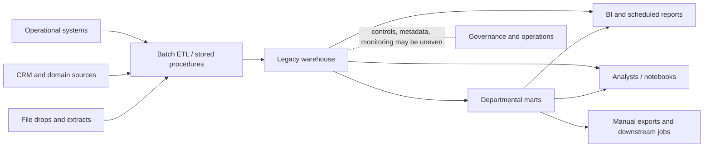
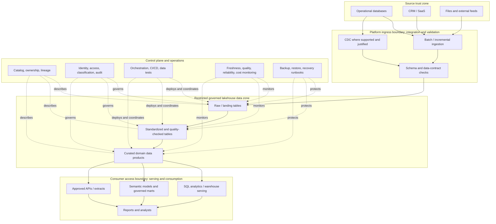
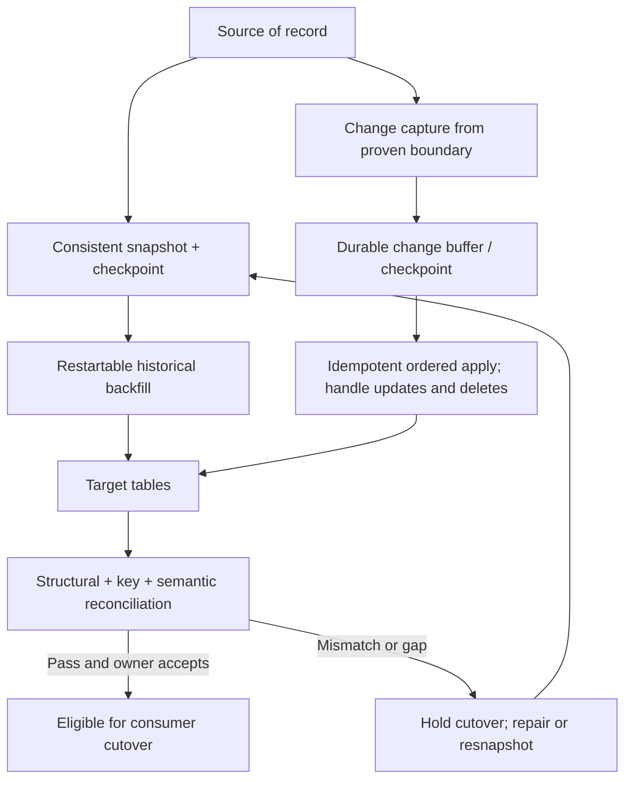

# Case Study 04 — Enterprise Lakehouse Modernization

> **Learning level:** Beginner → Intermediate → Advanced  
> **Stage:** 2D — Data Architecture  
> **Module:** 16 — Enterprise Data Architecture Case Studies and Capstone  
> **Estimated study effort:** 8–10 hours (roadmap recommendation, not a deadline)  
> **Deliverable:** Evidence-based current-state assessment, target-state comparison, migration outline, coexistence and validation design, decision records, and lessons-log entry  
> **Deployment requirement:** None. This is an architecture analysis and documentation exercise.

## Source integrity and scenario status

The module roadmap describes Case Study 04 as the analysis of replacing or evolving a legacy analytics estate—such as a warehouse, ETL estate, and data marts—toward a lakehouse while business operations continue. Its required emphasis is **current-state evidence, target-state architecture, gap analysis, migration sequencing, coexistence, validation, rollback, governance, reliability, performance, cost, operating-model change, and decision records**.

The roadmap explicitly states that the original case-study files do not contain a verified detailed scenario. Therefore, this lesson uses the clearly labelled **illustrative Northbridge Group** scenario below to teach the method. Northbridge Group, its systems, numbers, constraints, stakeholders, and all calculations are fictional assumptions for learning; they are not source facts or claims about a real organisation. The roadmap's own recommended sequencing calculation and payback example are preserved as teaching examples but are not treated as actual project commitments. Replace the illustrative frame with the real case facts if the source scenario becomes available.

This document follows the module roadmap's Case Study 04 outcomes and its broader guidance: label facts and assumptions, establish evaluation criteria before scoring, show a feasible transition path rather than only a target diagram, preserve rollback options, and connect the case to Case Study 01 (banking data platform), Case Study 05 (multi-cloud platform), and the final capstone. The roadmap's recommended prerequisites are P5, P7, P15, and Case Study 01.

---

## 1. Learning objectives and completion evidence

By the end, you should be able to:

1. Explain the differences among a legacy data estate, a warehouse, a data lake, a lakehouse, and a hybrid platform without assuming one is universally superior.
2. Build an evidence-based inventory of sources, pipelines, stores, interfaces, consumers, owners, controls, costs, and operational pain points.
3. Separate observed facts, stakeholder-reported claims, hypotheses, assumptions, constraints, risks, and unanswered questions.
4. Draw consistent current-state and target-state views, including key data flows and trust boundaries.
5. Perform a capability-oriented gap analysis and compare architectural alternatives using criteria fixed before scoring.
6. Select a migration approach per workload and sequence waves according to dependency, risk, reversibility, value, and readiness.
7. Design historical backfill, incremental synchronization, CDC where appropriate, reconciliation, consumer acceptance, cutover, rollback, and decommissioning.
8. Demonstrate why a successful data copy is not proof of semantic or operational equivalence.
9. Address governance, security, lineage, data quality, resilience, performance, capacity, dual-running cost, ownership, and support readiness.
10. Defend architecture decisions with evidence, alternatives, consequences, risks, and revisit triggers.

### Required evidence package

The roadmap recommends, rather than verifies as a mandatory source-file requirement, the following outputs for this case:

- Current-state assessment and inventory
- Current-state and target-state architecture views
- Capability gap analysis
- Migration outline with dependencies and critical path
- Coexistence, validation, rollback, and decommissioning design
- Decision records and a risk register
- Lessons-log entry

**Completion gate for this lesson:** every important claim is labelled as evidence, assumption, or open question; the current state, target state, migration plan, and validation strategy agree with one another; every migration phase has entry and exit criteria; and rollback is described as an executable operating procedure, not merely a diagram arrow.

---

## 2. Foundations: modernization is a change problem

### 2.1 Legacy data estate

A **legacy data estate** is the collection of existing data stores, ingestion jobs, transformations, reports, interfaces, security controls, operational procedures, and dependencies that have accumulated over time. “Legacy” does not automatically mean obsolete or defective. A mature warehouse can be reliable, well understood, and fit for a workload; an older platform may also contain undocumented dependencies and costly constraints.

**Why it matters:** the estate's value is not limited to the database. It includes business semantics, report logic, operational knowledge, access controls, reconciliation rules, and consumers that may not be documented.

**How to assess it:** inventory actual components and interfaces; inspect job schedules and logs; interview owners and consumers; review query and access telemetry; compare documentation with observed behaviour; and record evidence quality.

**Failure mode:** treating the platform as a box to replace. That overlooks embedded business rules, downstream extracts, spreadsheet workflows, and controls that exist only in jobs or user practices.

### 2.2 Warehouse, lake, lakehouse, and hybrid architecture

| Pattern | Core idea | Often useful for | Important limitations |
|---|---|---|---|
| Data warehouse | Curated, structured analytical storage with controlled models and query workloads | Governed reporting, stable business definitions, SQL analytics | Can be expensive or rigid for some raw/semi-structured and varied processing needs; limitations depend on implementation |
| Data lake | Economical storage for data in varied formats, often retaining raw or lightly processed data | Broad ingestion, exploration, replay, data science, historical retention | Without governance and data management, it can become a “data swamp”; table semantics and concurrent updates may need extra design |
| Lakehouse | Combines data-lake storage flexibility with table-management and analytical capabilities such as schema enforcement/evolution, transactional updates, and SQL-oriented access | Mixed data engineering and analytics, shared data layers, open-format strategies where supported | Capabilities vary by engine, table format, catalog, and service; does not remove the need for modelling, governance, performance tuning, or workload-specific serving |
| Hybrid estate | Multiple patterns retained behind governed interfaces | Gradual migration, workload-specific optimisation, legacy dependencies, different latency or control needs | Duplicated data, fragmented operations, policy inconsistency, and higher dual-running cost are possible |

A lakehouse is not automatically the right answer. Choose based on documented requirements, existing investment, workload profiles, portability, operational maturity, security, data semantics, and total cost. A warehouse may remain the best serving engine for some reports; a lakehouse may become the governed foundation for other data products; a hybrid state may be a deliberate transition or a long-lived design.

### 2.3 Migration, modernization, replacement, and retirement

- **Migration** moves workloads or data from one environment to another. The target may preserve most semantics and design.
- **Modernization** changes capabilities or operating practices—such as table management, automated quality checks, lineage, self-service, deployment, or support—not just location.
- **Replacement** substitutes a system or capability with another implementation.
- **Retirement** removes a component after its consumers, records, controls, and contractual dependencies have been resolved.

These can coexist in a program. A workload can be migrated with minimal change, then modernized later; another may be redesigned before cutover. Avoid combining every change into one wave unless the business case and risk analysis justify it.

### 2.4 Current state versus target state

The **current state** is the evidence-backed description of how work actually happens now. It is not a list of intended designs from old documentation.

The **target state** describes the intended capabilities, components, responsibilities, interfaces, controls, and operating model after transition. It is a hypothesis until validated against requirements and constraints.

A useful third view is the **transition state**: which old and new components coexist at each phase, which system is authoritative for each data product, how changes flow, who responds to failures, and how to reverse a cutover. Modernization fails when the target is plausible but the transition is not.

### 2.5 Technical debt, operational risk, and migration complexity

Technical debt includes brittle transformations, duplicated business logic, unsupported dependencies, manual deployment, unclear ownership, and missing tests. It is not only old software. Operational risk includes failure to meet reporting windows, inconsistent figures, uncontrolled access, lost history, or inability to recover.

Migration complexity rises with:
- Number and coupling of upstream sources and downstream consumers
- Hidden business semantics and undocumented transformations
- Historical volume and retention requirements
- Source change rate and CDC availability
- Strictness of consistency and freshness needs
- Number of security and governance controls to reproduce
- Recovery and rollback constraints
- Teams, contracts, environments, and support boundaries

**Rule:** count dependencies and prove semantics before estimating effort. Dataset count alone is a weak complexity metric.

### 2.6 Platform capabilities and quality attributes

Evaluate the platform as a set of capabilities, not a product list.

| Capability | Questions to answer | Example evidence |
|---|---|---|
| Ingestion and integration | Can it ingest batch, incremental, and event data with traceable failures? | Run history, lag, retry logs, source contracts |
| Storage and table management | Can it preserve history and support concurrent readers/writers safely? | Format, table properties, retention, recovery tests |
| Transformation | Are transformations testable, versioned, reproducible, and owned? | Code repository, dependency graph, test results |
| Serving | Can each consumer obtain the required freshness, semantics, and performance? | Query profiles, report comparisons, API contracts |
| Governance and security | Are classification, access, retention, consent, and audit controls enforced? | Access matrix, policy tests, audit events |
| Metadata and lineage | Can teams find data and trace source-to-consumer dependencies? | Catalog records, lineage coverage, owner metadata |
| Reliability and recovery | Can failures be detected and restored within approved objectives? | SLOs, incident history, recovery exercises |
| Performance and cost | Are capacity and costs measured per workload and unit of value? | Utilisation, queueing, query latency, unit-cost trends |
| Developer experience and operations | Can teams deploy, observe, troubleshoot, and transfer ownership safely? | CI/CD, runbooks, on-call ownership, change records |

Quality attributes must be measurable or explicitly marked as unresolved. Examples include freshness, correctness, availability, recovery time, recovery point, query latency, throughput, auditability, portability, and unit cost. Do not invent targets and present them as business commitments.

---

## 3. Prerequisites and roadmap alignment

The module roadmap names these as recommended prerequisites for Case Study 04:

| Prerequisite | What to review | How it is used here |
|---|---|---|
| P5 — Database and storage architecture | Storage patterns, formats, table formats, replication, lifecycle | Compare storage and table-management capabilities; preserve history |
| P7 — Enterprise data platform and lakehouse architecture | Platform zones, layers, planes, metadata, tenancy, service levels | Design logical target layers and operational boundaries |
| P15 — Architecture documentation, reviews, and operating model | Views, ADRs, migration roadmaps, team ownership, communication | Produce evidence-based views, migration phases, decisions, and handover |
| Case Study 01 — Banking data platform | Broad platform context, requirements, governance, resilience | Reuse the method and relevant artefacts without copying a bank-specific design blindly |

Other modules support the work: P2 for requirements and ADRs; P4 for modelling and history; P6 for integration, CDC, contracts, idempotency, and reconciliation; P8 for cloud/hybrid constraints; P10 for governance and security; P11 for metadata, lineage, quality, and master data; P12 for reliability and disaster recovery; P13 for capacity, performance, and cost; P14 for serving and data products.

These are curriculum connections, not proof that a particular technology is mandatory. The roadmap is vendor-neutral and does not require a deployment. The project tree lists this case as `04-case-study-enterprise-lakehouse-modernization.md` alongside cases 01–03, 05–06, the capstone topics 07–08, practice questions, README, and the module roadmap.

---

## 4. Beginner: current-state assessment

### 4.1 Begin with consumers and business outcomes

Start with the question: **what must continue to work while the platform changes?**

List every known consumer, not just the official dashboards:
- Scheduled reports and finance reconciliations
- Regulatory or audit extracts, where applicable to the actual scenario
- Analyst SQL, notebooks, and ad hoc queries
- Data products and APIs
- Downstream warehouses or marts
- Machine-learning feature pipelines, if in scope
- Manual spreadsheet exports and vendor transfers
- Operations and quality-control processes

For each consumer, record owner, source datasets, refresh expectation, business calendar, access policy, semantic definitions, criticality, and acceptance test. If a consumer is unknown, that is a discovery risk—not permission to switch it off.

### 4.2 Inventory the pipeline end to end

For each data product or pipeline, capture:

1. Source system and source owner
2. Ingestion mode: full batch, incremental batch, log-based CDC, API, file, or event stream
3. Schedule, source change rate, and late-arrival behaviour
4. Landing location and retained raw history
5. Transformations and business rules
6. Intermediate and final stores
7. Serving interface and consumer list
8. Schema and semantic contract
9. Classification, permissions, retention, and lineage
10. Operational owner, support route, SLO/SLA if confirmed, and recovery procedure
11. Failure history, run duration, volume, cost, and known workarounds
12. Evidence source and confidence

Do not assume a scheduled job is the complete dependency. Inspect dynamic SQL, stored procedures, file drops, external scripts, BI extracts, credentials, and downstream jobs.

### 4.3 Distinguish pain points from root causes

| Observed symptom | Possible root causes to investigate | Evidence needed |
|---|---|---|
| Reports arrive late | Source extracts delayed; serial jobs; skew; expensive joins; capacity contention; late data | Run timeline, query plan, queue metrics, source readiness |
| Changes take weeks | Shared release windows; manual tests; undocumented dependencies; tightly coupled models | Change lead time, deployment process, dependency graph |
| Numbers disagree across reports | Different filters, time zones, slowly changing dimension handling, duplicate joins, stale snapshots | Metric definitions, lineage, reconciliation samples |
| Access requests are slow | Missing owner metadata; manual approvals; unclear classification; policy fragmentation | Request tickets, owner records, access logs |
| Platform cost is rising | Data duplication, uncontrolled scans, always-on compute, inefficient layout, retention growth | Cost allocation, scan volume, utilisation, lifecycle inventory |
| Incidents take long to resolve | No runbooks, poor lineage, ambiguous ownership, weak alerting | Incident review, on-call records, escalation map |

A symptom is not yet a root cause. Record hypotheses, assign an owner to validate each, and avoid designing a new platform around an unverified diagnosis.

### 4.4 Worked current-state inventory — illustrative

The following is a fictional training inventory. It is not a claim about the user's repository or a real enterprise.

| ID | Asset / capability | Current role (illustrative) | Dependency / consumer | Observed evidence to collect | Risk hypothesis |
|---|---|---|---|---|---|
| S1 | Operational order database | Source of order and transaction records | ETL jobs, finance marts | Source schema, extract windows, owner | Source load contention |
| S2 | CRM database | Customer and account attributes | Customer reports, segmentation | Change history, consent fields, extracts | Inconsistent customer keys |
| I1 | Nightly ETL scheduler | Orchestrates batch loads | Warehouse and marts | Job graph, failures, runtime percentiles | Serial critical path |
| T1 | Stored procedures and SQL jobs | Business transformations | Warehouse facts/dimensions | Code, definitions, tests, change history | Logic duplicated across marts |
| D1 | Legacy warehouse | Curated reporting store | BI, finance, analysts | Table inventory, storage, query telemetry | Scaling and change bottlenecks |
| D2 | Departmental marts | Consumer-specific subsets | Finance, operations, analysts | Owners, refresh schedules, access logs | Conflicting definitions and hidden copies |
| C1 | BI dashboards | Reporting interface | Business users | Usage, extracts, metric definitions | Uncatalogued downstream reliance |
| C2 | Spreadsheet / file exports | Manual reconciliation and exchange | Finance or external process | File paths, owners, transfer logs | Undocumented dependency |
| G1 | Access and retention controls | Restricts access and manages lifecycle | All data paths | Grants, audit logs, retention jobs | Control gaps during migration |
| O1 | Operations process | Monitoring, incident response, recovery | All critical workloads | Runbooks, escalation and incident records | Unclear ownership |

**How to use the inventory:** mark each field `observed`, `reported`, `assumed`, or `unknown`; attach evidence references; set a confidence rating; and assign a follow-up owner. The table becomes a discovery backlog, not a substitute for investigation.

### 4.5 Illustrative current-state architecture



This diagram intentionally leaves uncertainty visible. It is a hypothesis to validate. During discovery, add source ownership, network and trust boundaries, identity paths, lineage, data classification, schedules, failure routes, and actual consumer edges. A diagram that omits these details is useful for orientation but insufficient for migration approval.

### 4.6 Facts, assumptions, constraints, risks, and open questions

These categories are different:

- **Fact / observed:** supported by a direct artefact, measurement, or verified observation.
- **Reported:** stated by a stakeholder but not independently verified.
- **Assumption:** temporarily accepted for analysis; must be tested or approved.
- **Constraint:** a boundary the design must respect, such as a confirmed contract, supported platform, or required operating window.
- **Risk:** an uncertain event or condition that could affect objectives.
- **Open question:** information required for a decision but not yet known.

Do not relabel an assumption as a constraint. Do not claim a deadline, dataset volume, legal obligation, cloud provider, budget, or mandatory target architecture unless the real source establishes it.

**Evidence register template**

| ID | Statement | Category | Evidence / source | Confidence | Owner | Action / decision impact |
|---|---|---|---|---|---|---|
| E-01 | Nightly jobs delay report readiness | Reported | Stakeholder interview; run logs pending | Medium | ETL owner | Compare scheduled and actual completion |
| E-02 | Some reports read marts directly | Assumption | To inspect BI metadata and query logs | Low | BI owner | Discover direct consumers before cutover |
| E-03 | Source can provide log-based CDC | Open question | Vendor/configuration review needed | Unknown | Source owner | Determines synchronization strategy |

### 4.7 Discovery questions

**Business and consumers**
- Which outcomes are mandatory, and how is success measured?
- Which reports or extracts are business-critical?
- What freshness and availability are actually required by each consumer?
- Which consumers have no named owner or acceptance test?

**Data and semantics**
- Which definitions are authoritative?
- How are corrections, deletes, late-arriving records, and historical changes represented?
- Which data must be retained, replayed, archived, or deleted?
- What is the required grain and history behaviour for each model?

**Technology and operations**
- What are actual data volumes, growth, concurrency, job durations, and failure rates?
- Which interfaces can support incremental synchronization?
- How are credentials, encryption, audit, retention, and lineage enforced?
- Who owns deployment, incidents, recovery, and access approvals?

**Transition**
- Can old and new systems run concurrently?
- What is the cost and operational burden of coexistence?
- How will a consumer be proven ready?
- What exact condition permits rollback or forward recovery?
- What must be true before each legacy component can be retired?

---

## 5. Intermediate: target-state architecture

### 5.1 Translate requirements into capabilities

Before choosing a product or table format, translate business outcomes into capabilities and measurable tests. For example:

| Need (illustrative) | Capability | Candidate measure / test |
|---|---|---|
| Repeatable reporting | Versioned transformations and governed serving models | Reconcile key measures over a defined representative period |
| Retain raw source history | Durable landing and replay policy | Verify expected history, schema, and retention |
| Faster delivery of new data products | Modular pipelines, contracts, automated tests | Measure lead time and deployment failure rate |
| Controlled access | Central identity, policy enforcement, audit | Positive and negative access tests by role |
| Diagnose data defects | Catalog, lineage, quality metrics | Trace a field from source to report |
| Safe migration | Repeatable backfill, CDC or incremental sync, reconciliation | Demonstrate catch-up, cutover, and rollback on a representative slice |
| Reliable service | Monitoring, alerting, runbooks, recovery design | Failure-injection and recovery exercise |
| Cost visibility | Workload allocation and lifecycle policy | Estimate and later measure cost by workload or data product |

Do not set numeric thresholds without business or operational agreement. Where no threshold is known, write `Not yet defined — assign an owner and decision date`.

### 5.2 Logical target-state layers

A vendor-neutral target may include:

1. **Source and integration layer:** databases, SaaS, files, events, APIs, CDC or batch ingestion.
2. **Landing / raw zone:** immutable or versioned source records where appropriate, with provenance, ingestion metadata, and controlled retention.
3. **Standardized / validated zone:** schema checks, type normalization, deduplication, quality rules, and conformed identifiers.
4. **Curated / product zone:** governed models with explicit grain, history, business definitions, ownership, and consumer contracts.
5. **Serving layer:** SQL warehouse/lakehouse endpoints, semantic models, APIs, extracts, or other consumer-specific interfaces.
6. **Control plane:** catalog, orchestration, lineage, policy, identity, audit, data contracts, quality results, deployment and configuration.
7. **Operations:** observability, cost management, incident response, backup/restore, recovery tests, service ownership, and change management.

Bronze/silver/gold naming is one possible implementation convention, not a universal architecture requirement. Define each zone by its contract and responsibilities rather than its colour.

### 5.3 Illustrative target-state architecture



This is a logical view, not a claim that every capability must be a separate product. Some capabilities can share infrastructure; separation of responsibilities still matters. Draw trust boundaries and identity paths in the detailed security view.

### 5.4 Storage and table-format choice

Evaluate the capabilities required by the workload rather than selecting a format by popularity. Relevant dimensions include:

- Transactional guarantees and concurrent read/write behaviour
- Schema enforcement and schema evolution
- Updates, deletes, merge semantics, and history requirements
- Time travel or version recovery, if required and supported
- Partitioning and file/layout management
- Catalog and engine compatibility
- Portability and open-format requirements
- Compaction, vacuum/cleanup, retention, and recovery operations
- Performance under expected query and ingestion patterns
- Cost, supportability, skills, and failure recovery

**Trade-off:** an open table format may improve interoperability, but real portability depends on the engines, catalogs, features, security semantics, and operational practices in use. “Open format” alone does not prove drop-in portability. A managed service may simplify operations but increase provider-specific coupling. Neither option is automatically better.

**Failure mode:** choosing a table format without testing concurrent writes, schema changes, compaction, rollback, retention, and cross-engine behaviour with representative workloads.

### 5.5 Ingestion, CDC, and data contracts

Use batch ingestion when its freshness is sufficient and the source can provide stable extracts. Use incremental ingestion when a reliable change marker or watermark exists. Use CDC when source capabilities, log access, delete handling, ordering, and operational ownership support it.

CDC is not a magic consistency guarantee. Establish:
- Source log retention and outage behaviour
- Snapshot-to-stream handoff correctness
- Primary key and update/delete semantics
- Ordering scope and transaction boundaries
- Duplicate and replay handling
- Schema change compatibility
- Lag monitoring and restart behaviour
- Reconciliation between source and target

A **data contract** states the interface expectations: schema, keys, meaning, nullability, event or update semantics, freshness, quality expectations, ownership, compatibility rules, and change process. A schema registry can enforce some compatibility rules, but it does not establish business-semantic compatibility by itself.

### 5.6 Transformations and semantic compatibility

A table can be technically valid while being semantically wrong. Preserve and test:
- Grain and primary-key meaning
- Time zones, business dates, and calendar boundaries
- Currency, unit, rounding, and sign conventions
- Null, unknown, and default values
- Duplicate handling and late corrections
- Slowly changing dimensions and historical attribution
- Deduplication, filtering, joins, and exclusion rules
- Metric definitions, status mappings, and report filters

**Migration rule:** make semantic contracts explicit before comparing outputs. Otherwise, reconciliation may incorrectly label intended differences as defects—or accept wrong results because the tests compare only row counts.

### 5.7 Governance, metadata, lineage, and quality

Governance must remain effective across old and new systems. Define a control-parity matrix for:
- Classification and approved use
- Identity, role mapping, least privilege, and separation of duties
- Encryption and secret handling
- Audit trail and evidence retention
- Retention, legal hold where applicable, and deletion
- Data ownership and stewardship
- Quality rules and exception handling
- Catalog metadata, lineage, and business definitions
- Incident escalation and access review

During coexistence, lineage should show both old and new paths and identify which is authoritative. Avoid dual writes that bypass one side's controls. Retention and deletion procedures must account for replicas, snapshots, exports, and temporary backfill files.

### 5.8 Serving interfaces and consumer contracts

Choose the interface for each consumer:
- SQL/warehouse endpoint for analytical queries
- Semantic model for consistent business metrics
- Governed data product tables for reusable domain datasets
- API or extract where the consumer needs a contractually managed interface
- Existing mart retained temporarily where migration cost or risk is not yet justified

For each consumer, specify schema, semantics, freshness, availability, performance expectations, access controls, versioning, deprecation notice, support owner, and acceptance tests. Do not force all consumers onto one interface if their requirements differ.

### 5.9 Security boundaries and monitoring

The target design should identify:
- Source trust boundaries and ingress identities
- Raw versus curated access policies
- Privileged operations and separation of duties
- Service identities, secret rotation, and network paths
- Sensitive-data classification and masking where needed
- Audit and lineage coverage
- Alerts for freshness, volume anomalies, quality failures, pipeline failures, CDC lag, access-policy failures, and cost anomalies

An alert without an owner and runbook is not operational control. Every high-severity alert needs a responder, expected diagnostic context, a safe degraded mode, and a recovery or escalation path.

---

## 6. Alternative architectures and criteria-first evaluation

### 6.1 Define criteria before scoring

First agree what matters and how evidence will be assessed. Illustrative criteria for a modernization program:

1. Business continuity and migration risk
2. Functional and semantic fit
3. Data integrity and history preservation
4. Governance and security control parity
5. Performance and freshness
6. Reliability and recoverability
7. Operational complexity and team readiness
8. Cost, including dual-running and exit costs
9. Portability and dependency risk
10. Delivery feasibility and reversibility

Weights and scores below are **illustrative only**. In a real review, the accountable stakeholders must agree the criteria, weights, evidence standard, and any disqualifying constraints before scoring. A high aggregate score must not override a mandatory security or integrity constraint.

### 6.2 Options to compare

| Option | Description | Strengths | Risks / limits | Most plausible when |
|---|---|---|---|---|
| A. Keep and optimise the warehouse | Improve modelling, workloads, orchestration, quality, governance, and operations in place | Lowest transition disruption; preserves known semantics | May not resolve structural constraints; continued legacy dependencies | Current platform can meet future requirements at acceptable cost |
| B. Re-platform with minimal redesign | Move existing workloads and data to a supported target while preserving behaviour | Faster path to supportability; scope easier to bound | Carries forward brittle design and duplicated logic | Main driver is platform lifecycle or infrastructure constraint |
| C. Phased lakehouse modernization | Establish target foundations, migrate by workload, and run both systems during waves | Limits blast radius; allows learning and staged value | Longer coexistence, duplicated operations, complex synchronization | Business cannot tolerate a single high-risk cutover |
| D. Big-bang replacement | Move all critical workloads in one coordinated cutover | Short overlap period; avoids long coexistence | Highest cutover and rollback risk; many simultaneous dependencies | Estate is small, well understood, and a tested outage/cutover window is acceptable |
| E. Hybrid / selective replacement | Modernize some workloads, retain warehouse/marts for others | Fits differing workload needs; can avoid unnecessary migration | Multiple platforms and governance paths persist | Workload needs differ and boundaries can be governed clearly |

### 6.3 Illustrative scoring example

Use a 1–5 scale (5 is strongest). This table is a teaching demonstration, not a recommendation for any real estate.

| Criterion | Weight (illustrative) | A: optimise | B: re-platform | C: phased lakehouse | D: big bang | E: hybrid |
|---|---:|---:|---:|---:|---:|---:|
| Continuity / low transition risk | 20% | 5 | 3 | 4 | 1 | 4 |
| Functional / semantic fit | 15% | 4 | 3 | 4 | 4 | 4 |
| Governance and security parity | 15% | 4 | 3 | 4 | 3 | 4 |
| Performance / scalability fit | 10% | 3 | 3 | 4 | 4 | 4 |
| Operational simplicity | 10% | 4 | 3 | 2 | 3 | 2 |
| Cost over transition and steady state | 15% | 4 | 3 | 2 | 3 | 2 |
| Reversibility / learning | 10% | 5 | 3 | 4 | 1 | 4 |
| Delivery feasibility | 5% | 5 | 4 | 3 | 2 | 3 |
| **Weighted score / 5** | **100%** | **4.25** | **3.05** | **3.45** | **2.60** | **3.45** |

Calculation: weighted score = sum of `(weight × score)`, where weights sum to 1.00. For Option A, `0.20×5 + 0.15×4 + 0.15×4 + 0.10×3 + 0.10×4 + 0.15×4 + 0.10×5 + 0.05×5 = 4.25`. The same calculation gives Option D `2.60` and Option E `3.45`; the values in the score row use the displayed weights and ratings.

**Interpretation:** this illustrative set of weights favours optimising the existing estate. Options C and E tie at `3.45` under these assumptions, which is a reminder that an aggregate score does not select a design by itself. That does not mean Option A is universally correct. The case may have a verified platform lifecycle, functional gap, or cost constraint that changes the decision. Evidence must support each score; if a score is unknown, mark it unknown and collect evidence instead of pretending precision.

### 6.4 Decision method

1. Identify non-negotiable constraints and eliminate infeasible options.
2. Agree criteria and weights with business, data, security, platform, and operations stakeholders.
3. Define the evidence needed to score each criterion.
4. Score alternatives and record uncertainty ranges.
5. Run sensitivity analysis: do reasonable weight changes reverse the ranking?
6. Identify risks that cannot be averaged away, such as failed reconciliation or missing access controls.
7. Record the selected option, rejected alternatives, rationale, consequences, owner, and revisit trigger in an ADR.

---

## 7. Migration strategy: choose per workload, not by slogan

### 7.1 Big-bang migration

**What it is:** a coordinated cutover of all in-scope workloads at one time.

**Advantages:** short coexistence period; fewer weeks of dual operation; simpler final topology.

**Trade-offs and failure modes:** a large blast radius; many dependencies change simultaneously; rollback may be slow if data has diverged; hidden consumers may be missed; defects can be hard to isolate.

**Use when:** the estate is small and well understood, dependencies are bounded, validation is strong, a suitable cutover window exists, and recovery is proven. It is not appropriate merely because a deadline is aggressive.

### 7.2 Phased migration / migration waves

**What it is:** move a bounded group of pipelines, data products, or consumers at a time.

**Advantages:** limits blast radius; generates evidence; supports learning and re-planning; enables selective rollback.

**Trade-offs:** longer coexistence; repeated testing; duplicated support and compute; temporary inconsistencies unless authority and synchronization are explicit.

**Use when:** dependencies can be grouped into bounded waves and the organisation can support a transition period. Wave boundaries should be based on dependencies and consumer outcomes, not just teams or table counts.

### 7.3 Parallel run

**What it is:** run the old and new paths together long enough to compare outputs, operations, and consumer behaviour.

Parallel run is a validation mode, not a complete migration strategy. Define what is compared, for how long, how representative periods are selected, how differences are triaged, and which path serves consumers during the test. Distinguish **business write authority** (normally the upstream system of record) from **analytical serving authority** (the old or new warehouse/lakehouse used by a consumer). A target can receive replicated changes without becoming the source of truth. Avoid duplicate external side effects; for example, a test path should not send duplicate notifications or post financial transactions.

### 7.4 Strangler-style transition

**What it is:** replace a bounded capability gradually while the old system continues to serve remaining consumers. A routing or interface layer can direct migrated consumers to the new implementation.

**Advantages:** enables incremental replacement and controlled boundaries.

**Trade-offs:** routing complexity, split ownership, duplicated semantics, and the risk that the “temporary” coexistence persists indefinitely.

**Use when:** capabilities can be isolated behind stable interfaces and each slice can be independently validated. It is less suitable when consumers are tightly coupled to shared physical tables or undocumented stored procedures without a safe seam.

### 7.5 Re-platform, re-architect, replace, or retire per workload

A single enterprise may use several strategies:
- Re-platform a stable workload to remove a supportability risk.
- Re-architect a high-value, brittle pipeline with strong tests.
- Replace a mart when its consumers and semantics are well understood.
- Retire a duplicate extract only after owner confirmation and usage analysis.
- Retain a warehouse serving endpoint when its performance and controls remain appropriate.

This workload-level approach can reduce unnecessary change. Record why each workload follows its selected path.

---

## 8. Step-by-step migration plan

The sequence below is a reference workflow. Actual duration and ordering depend on evidence, constraints, and dependency discovery. The roadmap's illustrative critical-path example is reproduced later; do not treat it as a schedule commitment.

### Phase 0 — Mobilise and establish controls

**Tasks**
- Define business outcomes, scope, exclusions, accountable owners, and decision rights.
- Create the evidence register, requirements matrix, risk register, ADR log, and issue log.
- Agree evaluation criteria and validation principles.
- Set change control, security review, and incident escalation expectations.

**Entry:** sponsor and scope are identified.  
**Exit:** goals, owners, unknowns, and governance for decisions are recorded.  
**Rollback:** not applicable to data cutover; stop design approval if critical requirements or ownership are unresolved.

### Phase 1 — Discover and baseline the current estate

**Tasks**
- Inventory sources, jobs, tables, marts, reports, exports, service identities, controls, and consumers.
- Collect runtime, freshness, quality, incident, query, and cost evidence.
- Map dependencies and identify critical path candidates.
- Reconcile documentation with observed behaviour.
- Mark unknown consumers and semantics as risks.

**Entry:** access to evidence sources and subject-matter experts.  
**Exit:** critical dependencies, data semantics, and control owners are understood well enough to plan a pilot; remaining unknowns have explicit treatment.  
**Stop condition:** no safe pilot scope can be identified or the data owner cannot explain authoritative semantics.

### Phase 2 — Define and validate the target foundation

**Tasks**
- Choose logical zones, table management, catalog, orchestration, access controls, lineage, data quality, observability, and serving patterns.
- Define data contracts, environment separation, deployment controls, recovery approach, and operating ownership.
- Test representative workloads, including schema change, concurrent access, late data, and failure recovery.
- Build a cost model for steady state and coexistence.

**Entry:** requirements and baseline available.  
**Exit:** target foundation meets agreed technical and control tests; gaps are accepted, mitigated, or block the migration.  
**Rollback:** no consumer cutover yet; discard or redesign the foundation if tests fail.

### Phase 3 — Select a pilot and design the synchronization path

**Tasks**
- Select a bounded workload with meaningful coverage but limited blast radius.
- Confirm source snapshot and incremental-change semantics.
- Define full backfill, CDC/incremental sync, idempotency, replay, reconciliation, and error quarantine.
- Establish old/new authority rules and consumer acceptance tests.
- Test rollback and forward-recovery procedures.

**Entry:** target foundation and source capabilities are understood.  
**Exit:** pilot plan has entry/exit criteria, data validation, named owners, rollback triggers, and a cost estimate.  
**Stop condition:** source change capture cannot be made complete or reconciliation cannot be defined.

### Phase 4 — Historical backfill and incremental synchronization

**Tasks**
1. Establish a consistent snapshot or documented extraction boundary.
2. Record source high-water mark / log position / snapshot identifier where supported.
3. Load historical data into the target in restartable chunks.
4. Validate completeness and semantics at chunk and whole-dataset levels.
5. Start incremental capture at a point that avoids a gap or overlap, using a proven handoff method.
6. Make writes idempotent; record checkpoints and failed records.
7. Monitor lag and ensure the target can catch up while new changes continue.
8. Reconcile source and target repeatedly, including updates and deletes.

**Entry:** backfill and CDC/incremental design reviewed.  
**Exit:** target is caught up within the agreed tolerance, data differences are explained, and operational alerts work.  
**Failure handling:** pause promotion, retain checkpoints, fix the cause, replay safely, and re-run reconciliation. Never “fix” unexplained differences by deleting them from the comparison.

### Phase 5 — Parallel validation

Compare:
- Row counts and key coverage
- Aggregates and control totals
- Key-level record differences
- Null and duplicate distributions
- Business-rule outputs and derived metrics
- Historical snapshots and as-of behaviour
- Query performance and report freshness
- Access permissions, masking, and audit trails
- Failure/recovery behaviour and operational ownership

Use representative peak periods, month-end or other relevant business cycles if the actual workload requires them. The duration is an evidence-based decision, not an invented universal number.

**Entry:** target data is caught up and technical checks pass.  
**Exit:** all critical differences are resolved or explicitly accepted by the accountable owner; consumer acceptance is recorded.  
**Rollback:** no consumer serving-authority change has occurred yet, so keep the old serving path approved for consumers and correct the target.

### Phase 6 — Consumer cutover

**Tasks**
- Publish a consumer-specific cutover checklist and notice.
- Freeze or control relevant schema/logic changes during the cutover window.
- Confirm target freshness, permissions, semantic parity, and support coverage.
- Change the consumer endpoint, routing, or configuration.
- Verify actual consumer results and operational telemetry.
- Maintain the old path in a controlled rollback-ready state.

**Entry:** consumer acceptance, data reconciliation, security checks, and recovery rehearsal complete. Confirm separately that the upstream system of record remains the business-write authority unless an approved design explicitly changes that role.  
**Exit:** the consumer is routed to the target serving path, outcomes are correct, and monitoring shows stable behaviour over the agreed observation period. Record the serving-authority change without implying that the upstream source of record has changed.  
**Rollback triggers:** unexplained material data mismatch, access-control failure, sustained breach of an agreed quality/performance objective, inability to recover, or an unowned critical incident. Thresholds must be agreed for the real case.

### Phase 7 — Stabilise, transfer ownership, and migrate the next wave

**Tasks**
- Run operational handover and on-call drills.
- Review incidents, alerts, cost, quality, query performance, and user feedback.
- Update runbooks, lineage, catalog, service ownership, and support contracts.
- Capture lessons and revise the next wave plan.

**Entry:** first consumer cutover succeeded.  
**Exit:** new owners can operate and recover the service without relying on undocumented project-team knowledge.  
**Rollback/forward recovery:** decide per incident; a rollback is not automatic if it would lose accepted writes or reintroduce a more severe risk.

### Phase 8 — Decommission the legacy component

**Tasks**
- Prove no active consumers remain using usage telemetry, dependency scanning, owner attestations, and a time-bounded deprecation process.
- Obtain sign-off from data owners, business consumers, security, records/retention, operations, and contract owners where applicable.
- Preserve required archives, lineage, audit evidence, and reproducibility.
- Resolve legal holds and retention obligations where applicable to the actual organisation.
- Revoke access, stop schedules, delete or archive data according to approved policy, cancel dependencies, and update inventory.
- Monitor for missed consumers and maintain a defined recovery path if feasible.

**Entry:** all required consumers are cut over and accepted; no unexplained critical differences remain.  
**Exit:** decommission approval is documented, data/control obligations are met, and the component is actually shut down.  
**Hard rule:** do not decommission simply because the target is live. Decommission only after evidence of acceptance, dependency closure, retention disposition, and operational ownership.

---

## 9. Advanced migration engineering

### 9.1 Historical backfill and incremental synchronization

A common safe pattern is **snapshot plus changes**, but the details depend on the source system:

1. Establish a consistent snapshot boundary and capture the source log position, change sequence, or equivalent checkpoint using the source's documented mechanism.
2. Record the snapshot identifier, checkpoint, extraction time, and the vendor-specific inclusive/exclusive boundary semantics.
3. Load the snapshot into the target using restartable chunks.
4. Capture and durably retain changes from the proven boundary while the backfill runs; apply them in the source-defined order. Handle updates and deletes explicitly, including tombstones or equivalent delete records where the source uses them.
5. Make replay idempotent and monitor source-log retention, lag, rejected records, retries, and checkpoints.
6. Reconcile the snapshot and change stream, including the boundary interval, until the target is caught up and differences are explained.
7. If the source log expires or the handoff boundary cannot be proved gap-free, stop promotion and establish a new consistent snapshot/recovery boundary; do not guess the missing range.

The snapshot-to-change handoff is source-specific. Starting a stream “around the same time” as a snapshot is not proof of completeness: depending on the source, an overlap may create duplicates or a gap may omit changes. Preserve the source of truth and the last proven checkpoint until reconciliation passes.

If the source cannot provide a reliable CDC stream, consider repeated incremental snapshots, timestamp-based extraction, or a controlled freeze window. Each alternative has limitations: timestamps can miss updates if precision, clock, or tie-breaking assumptions are wrong; full reloads can be expensive; a freeze window may be operationally unacceptable. Define and test the fallback before migration approval.

**Illustrative transition flow (logical, not vendor-specific):**



The diagram assumes the source supports a recoverable boundary. A source without that capability needs a separately designed and tested fallback; the loop must not be interpreted as permission to repeat a snapshot indefinitely without controlling changes.

### 9.2 Idempotency, deduplication, and replay

A retry can deliver the same change more than once. **Idempotent application** means replaying the same logical change does not create additional incorrect effects. Use stable source keys, change identifiers or sequence positions where available, deterministic merge rules, and durable checkpoints.

For replay, define:
- Which time or offset range is replayed
- Whether deletes are represented
- How ordering and late changes are resolved
- How duplicate records are detected
- How downstream consumers avoid duplicate side effects
- How replay results are reconciled
- How the replay is audited and approved

Exactly-once processing claims are often bounded by the system boundary. A pipeline may provide exactly-once state updates internally while external sinks, APIs, or side effects still require idempotency and reconciliation.

### 9.3 Reconciliation: more than row counts

Reconciliation is the controlled comparison of source and target state, semantics, and behaviour.

| Layer | Example check | What it catches | What it cannot prove alone |
|---|---|---|---|
| Structural | Schema, types, nullability, keys | Missing or incompatible columns | Correct business meaning |
| Completeness | Counts by date, partition, key range | Missing chunks or partitions | Correct values or duplicates that cancel out |
| Aggregate | Totals, sums, min/max, distribution | Large numeric differences | Row-level correctness or offsetting errors |
| Key-level | Missing/extra keys, duplicate keys | Record-level omissions and duplication | Correct field-level transformation |
| Field-level | Canonicalised record comparison | Wrong mapping, truncation, conversion | Correctness of the reference business rule |
| Semantic | Metrics, status mapping, time windows, historical attribution | Business-meaning drift | Every downstream workflow |
| Operational | Freshness, latency, recovery, access behaviour | Service or control regressions | Long-term reliability from a short test |
| Consumer acceptance | Reports, APIs, workflows, owner sign-off | Real usage regressions | Unknown consumers not included in the test |

Use deterministic canonicalisation rules for comparisons: timezone conversion, decimal scale, string normalisation, null semantics, and sort/key ordering. Store counts and differences with run ID, source snapshot/checkpoint, code version, rule version, and timestamp so the evidence is reproducible.

**Why copying data is not proof of correctness:** a copy can be complete but semantically wrong; it can omit late updates, mishandle deletes, use the wrong timezone, change decimal precision, flatten history, duplicate records, apply different filters, or expose data to the wrong users. Migration correctness requires data, semantics, consumer behaviour, governance, performance, and operations to be validated.

### 9.4 Schema and semantic compatibility

Classify changes:
- **Backward-compatible schema change:** consumers can continue to work under agreed compatibility rules (for example, adding a nullable field may be compatible in some systems).
- **Breaking schema change:** existing consumers can fail, such as renaming or changing a field's type.
- **Semantic change:** field shape stays the same but meaning changes, such as a date shifting from UTC event date to local business date.

Schema compatibility tools cannot determine all semantic changes. Maintain versioned contracts and test consumer assumptions. During migration, map legacy schema to target schema explicitly; do not silently coerce incompatible values.

### 9.5 Historical preservation and temporal behaviour

Check:
- Whether old facts remain queryable with original meaning
- Whether dimensions are current-state or historically versioned
- Whether corrected records overwrite history or create new versions
- Whether deletion and retention rules apply to raw, curated, and backup copies
- Whether reports use event time, processing time, business date, or ingestion date
- Whether snapshots and time-travel features have retention limits
- Whether replaying old data changes current aggregates or produces duplicate results

History is a behaviour contract. A new platform that only contains today's current rows may fail historical reporting even when current row counts match.

### 9.6 Performance and capacity testing

Test representative:
- Data volumes and growth assumptions
- Ingestion throughput and CDC lag
- Transformation duration and skew
- Query concurrency, p95/p99 latency where meaningful, and resource contention
- Compaction or maintenance overhead
- Backfill running alongside normal ingestion
- Failure recovery and catch-up capacity
- Report refresh windows and peak periods

Capacity must include transition load. A backfill can compete with production ingestion and reporting; a dual-run can double query work; repeated reconciliation can create substantial scans. Define workload isolation, quotas, scheduling, and stop conditions.

Illustrative arithmetic: if a representative backfill contains 24 TB and the measured effective transfer-and-write rate is 2 TB/hour, the ideal transfer time is `24 TB ÷ 2 TB/hour = 12 hours`. This is not an elapsed-time estimate until source extraction, throttling, transformation, retries, validation, and contention are included. If the measured rate drops by 25%, the effective rate becomes 1.5 TB/hour and ideal transfer time becomes `24 ÷ 1.5 = 16 hours`. These values are fictional; measure on representative data before planning.

### 9.7 Failure handling and recovery

| Failure | Detection | Immediate response | Recovery / proof |
|---|---|---|---|
| Source snapshot incomplete | Counts, manifest, source control totals | Stop promotion; retain prior checkpoint | Repeat missing ranges; reconcile complete snapshot |
| CDC gap or excessive lag | Watermark/offset gap, lag alert | Keep the old serving path approved for consumers; pause cutover | Resume from durable checkpoint; prove no gap with reconciliation |
| Transformation defect | Quality rule failure, semantic diff | Quarantine affected output; block release | Correct code, version it, replay affected range, compare outputs |
| Duplicate replay | Duplicate-key or change-ID metrics | Stop affected apply path if unsafe | Make application idempotent, reprocess, reconcile |
| Access-control mismatch | Automated positive/negative permission tests | Block cutover or revoke unsafe access | Correct policy and re-run access matrix |
| Target performance regression | Query latency, queue depth, freshness | Route consumer back if safe; reduce noncritical load | Tune, retest under representative concurrency |
| Target outage | Health checks and service alerts | Follow approved degraded mode; protect source of truth | Restore service, reconcile any accepted writes, resume |
| Rollback creates divergent writes | Authority and write audit | Freeze writes or route through a controlled boundary | Reconcile writes and establish one authoritative sequence before reopening |

A runbook must specify who makes the call, how to preserve evidence, and what happens to writes created after cutover. “Switch back” is not safe if the old system cannot represent new writes or if two systems have independently accepted changes.

### 9.8 Operational readiness and ownership transfer

Before handover, verify:
- Named service owner, data product owner, source owner, and on-call route
- SLOs or service expectations approved by accountable owners
- Alerts, dashboards, and runbooks are usable
- Access requests and emergency access are tested
- Deployment and rollback are repeatable
- Backup/restore and recovery procedures are exercised where applicable
- Incident, escalation, and vendor-support boundaries are clear
- Catalog, lineage, contracts, and data quality ownership are current
- Cost budgets and anomaly escalation are assigned
- Support team has completed a handover and can resolve a simulated incident

Project-team expertise is not a substitute for operational ownership. A system is not ready because the migration engineer can operate it manually.

### 9.9 Dual-running cost and benefit tracking

The total transition cost may include:
- Old platform compute/storage/licensing and support
- New platform compute/storage/licensing
- Duplicate ingestion, transformation, and serving
- Reconciliation scans and backfill
- Network transfer and egress
- Engineering, testing, security, governance, and training
- Temporary parallel operations and incident load
- Contract exit, archive, or decommission work

The roadmap gives an illustrative payback formula:

`payback period = migration cost ÷ monthly net saving`

Illustrative example: `$600,000 ÷ $50,000 per month = 12 months`. These are placeholders, not a budget or forecast. The numerator should include one-time costs actually in scope; the denominator should be **net** monthly savings after the target's incremental operating costs, not gross savings from the old system alone. If monthly net saving is zero or negative, this simple payback measure is undefined or never achieved; reassess the business case rather than inventing a positive result.

Track expected versus actual benefits by workload and period. If dual-running costs exceed a threshold agreed for the real program, trigger a review of wave sequencing, temporary scope, or business value. Do not reduce validation simply to shorten the overlap.

### 9.10 Consumer cutover, rollback, and forward recovery

For each consumer, define:
- Cutover owner and authorised approver
- Old and new endpoint/configuration
- Data authority before and after cutover
- Final reconciliation point and checkpoint
- Acceptance tests and evidence location
- Observation period and rollback triggers
- Write handling and reconciliation if target accepts new changes
- Rollback deadline or condition after which forward recovery is safer
- Communications and escalation plan

**Rollback** returns a consumer to the previous serving path. **Forward recovery** fixes the target while preserving the new serving state. Before either action, distinguish upstream business writes (which usually remain in the system of record) from writes or corrections accepted directly by the migrated analytical platform. If the target has accepted changes the old path cannot represent, routing back alone is unsafe: freeze the affected path if needed, reconcile those changes, and choose a documented rollback or forward-recovery procedure. The decision depends on the actual write model and must be rehearsed before cutover.

### 9.11 Decommissioning criteria

A legacy component may be decommissioned only when all applicable conditions hold:

1. Consumer inventory is complete enough for the risk level; usage telemetry and owner attestations agree.
2. All in-scope consumers have cut over and accepted the target.
3. Data reconciliation and semantic acceptance are signed off.
4. Security, audit, lineage, retention, deletion, and archive obligations have approved disposition.
5. No critical downstream dependency or schedule remains.
6. Operational ownership of the target is accepted.
7. The recovery window and any rollback constraints are understood.
8. Contracts, licenses, credentials, network paths, and secrets can be safely closed.
9. Legacy shutdown is observed and no hidden-consumer incident occurs during the agreed monitoring window.
10. The decommission record is approved and inventory/catalogs are updated.

The exact monitoring window and approvals must be determined from the real scenario. They are not universal values.

---

## 10. Complete worked case study — illustrative Northbridge Group

### 10.1 Business context and objectives

**Illustrative scenario only.** Northbridge Group is a fictional enterprise with a legacy analytics warehouse, scheduled ETL, several departmental marts, and reports used by finance and operations. The organisation is considering a lakehouse-based target to improve changeability, data reuse, governance, and the ability to support varied analytical workloads. The business must continue operating during transition.

The scenario intentionally does **not** assert a real deadline, budget, data volume, contractual obligation, cloud provider, or regulatory regime.

**Illustrative stakeholder set**

| Stakeholder | Concern / decision responsibility |
|---|---|
| Business sponsor | Business outcome, scope, accepted risk |
| Finance/report owners | Metric definitions, reconciliation, report acceptance |
| Domain/source owners | Source access, change semantics, source impact |
| Data engineering | Pipelines, contracts, replay, transformation correctness |
| Platform engineering | Storage, orchestration, access, environments, observability |
| Security and governance | Policy parity, audit, retention, classification |
| Operations / SRE | SLOs, runbooks, incident response, recovery |
| Architecture review | Alternatives, quality attributes, ADRs, design consistency |
| Procurement/vendor owners, if applicable | Support, contract exit, portability, cost |

### 10.2 Confirmed facts, assumptions, constraints, and gaps

Because the source scenario is unavailable, the only **confirmed source fact** is the roadmap's learning frame: a legacy warehouse/ETL/mart estate is to be analysed for a safe current-to-target transition while the business keeps running. Everything specific to Northbridge is illustrative.

| ID | Item | Classification | Treatment |
|---|---|---|---|
| F-01 | Case focuses on current state, target state, gap analysis, migration, coexistence, rollback | Source-derived roadmap fact | Must be covered |
| A-01 | Legacy warehouse and ETL estate serve multiple reporting consumers | Illustrative scenario assumption | Validate with inventory |
| A-02 | Some marts contain duplicated business logic | Illustrative hypothesis | Compare transformation definitions |
| A-03 | Source systems can provide a snapshot and a reliable incremental path | Open question / assumption | Verify per source before selecting CDC |
| A-04 | A phased migration can be supported operationally | Illustrative assumption | Confirm team capacity and coexistence tolerance |
| C-01 | Business continuity must be maintained during the transition | Scenario framing from roadmap | Treat as a design objective; quantify service needs with owners |
| C-02 | No mandatory cloud provider or target vendor is specified | Source limitation | Keep design vendor-neutral |
| G-01 | Exact data volumes, deadlines, budget, and compliance obligations are not provided | Source gap | Do not invent; collect before final design approval |
| G-02 | Actual source systems, contracts, data owners, and consumer inventory are unavailable | Source gap | Discovery phase must establish them |

### 10.3 Current-state findings (illustrative hypotheses)

| Finding hypothesis | Business impact if true | Evidence required | Priority |
|---|---|---|---|
| Several marts independently implement the same metric | Reports may disagree and fixes must be repeated | Compare SQL definitions and outputs | High |
| Job dependencies are undocumented | Cutover may miss downstream workloads | Scheduler graph, query logs, interviews | High |
| Source extracts arrive at variable times | Report freshness is unpredictable | Source readiness and job history | High |
| Catalog and lineage coverage are incomplete | Defects and access reviews take longer | Catalog audit and lineage sampling | Medium/High |
| Support ownership is split between project and operations | Slow incident response after cutover | On-call and escalation records | High |

These are not findings until evidence supports them. If evidence disproves a hypothesis, remove it and update the design.

### 10.4 Target-state proposal

**Illustrative recommendation:** use a phased, workload-based transition to a governed lakehouse foundation, retaining existing warehouse or serving capabilities where requirements and economics justify them. Do not migrate every workload merely to achieve a single-platform diagram.

Core design:
- Controlled batch/incremental ingestion; CDC only where source capabilities and correctness can be proven.
- Raw/landing history with provenance and lifecycle controls.
- Standardized tables with schema, quality, and deduplication rules.
- Curated data products with explicit grain, history, definitions, ownership, and consumer contracts.
- Catalog, lineage, data quality, access policy, audit, orchestration, deployment, monitoring, and cost management as platform capabilities.
- Consumer-specific serving through SQL/semantic models/APIs/extracts.
- Old/new authority and coexistence rules per workload.
- Recovery procedures and operational ownership before production cutover.

**Rationale:** the approach limits blast radius and makes evidence available before each next wave. Its costs are longer coexistence, dual-running operations, and more complex synchronisation. The choice should be reconsidered if discovery shows the estate is small enough for a safe big bang or if a phased transition cannot be supported.

### 10.5 Alternative decision record

**ADR-04-01 — Select a transition strategy**

- **Status:** Proposed for the illustrative case; not an approved real decision.
- **Context:** legacy warehouse and marts serve active consumers; detailed dependencies and exact non-functional requirements are not yet verified.
- **Decision criteria:** continuity, semantic correctness, reversibility, governance parity, delivery feasibility, operational capacity, and total transition cost.
- **Options:** optimise in place; re-platform; phased lakehouse; big-bang replacement; hybrid/selective migration.
- **Proposed direction:** phased migration by dependency-bounded workload, with selective retention of serving components until consumers accept replacements.
- **Why:** supports progressive validation and limits simultaneous change.
- **Consequences:** requires dual-running cost, clear authority boundaries, repeated reconciliation, and an explicit sunset plan.
- **Risks:** hidden consumers; source change gaps; cost overruns; target underperformance; unclear ownership.
- **Evidence required before approval:** current-state inventory, representative workload tests, source change-capture proof, agreed acceptance criteria, cost model, rollback rehearsal.
- **Revisit triggers:** discovery shows no meaningful consumer boundary; coexistence is operationally unsafe; target fails semantic or performance tests; or the cost model invalidates the business case.
- **Approvers:** sponsor, data owner, platform/operations, security/governance, and affected consumer owners (roles illustrative).

### 10.6 Migration waves and dependencies

The following illustrative waves should be rebuilt from the actual dependency graph.

| Wave | Candidate scope | Why this order | Dependencies | Exit evidence |
|---|---|---|---|---|
| 0 — Foundation | Identity, environments, catalog, orchestration, policy, monitoring, recovery tests | Required before governed data migration | Architecture and security decisions | Access tests, runbooks, lineage, deployment and restore evidence |
| 1 — Low-risk analytical slice | One bounded dataset and its limited consumers | Proves ingestion, modelling, reconciliation, and support | Source access, consumer owner, target foundation | Reconciled data, accepted report, tested rollback |
| 2 — Shared curated data products | Data used by multiple marts; remove duplicated logic only after semantic agreement | Enables reuse while managing higher blast radius | Wave 1 lessons; metric definitions; source change path | Metric parity, consumer sign-off, lineage and access parity |
| 3 — Critical or complex consumers | Remaining high-dependency reports, large backfills, complex historical logic | Defer until patterns and operations are proven | Earlier wave evidence; capacity; business calendar | Full acceptance, recovery proof, ownership transfer |
| 4 — Decommission | Retire old schedules, marts, access, and infrastructure in approved units | Only after all consumers and controls are resolved | Consumer cutover, retention disposition, approvals | Shutdown record and no unresolved dependencies |

**Dependency sequencing:** do not start a consumer wave until its source ingestion, transformations, data contract, access policy, monitoring, and support ownership are ready. Parallel work is possible when dependencies are genuinely independent.

### 10.7 Critical-path example from the roadmap

The module roadmap includes an illustrative sequence:

- Foundations: 8 weeks
- Ingestion: 10 weeks after foundations
- Catalog: 6 weeks after foundations, in parallel with ingestion
- Consumers: 12 weeks after ingestion and catalog are ready
- Decommission: 4 weeks after consumer transition

Critical path:

`8 + max(10, 6) + 12 + 4 = 34 weeks`

Catalogue branch slack relative to ingestion is `10 − 6 = 4 weeks`, assuming both start together after the foundation and no additional dependencies exist.

These are roadmap example values only—not a Northbridge estimate, deadline, or commitment. Real durations must come from work breakdown, team capacity, dependencies, procurement, change windows, testing, and observed throughput. The calculation is valid only under its stated dependency assumptions.

### 10.8 Reconciliation and acceptance plan

| Gate | Test | Owner (illustrative) | Pass condition |
|---|---|---|---|
| G1 — Structural | Schema, keys, nullability, types | Data engineering + source owner | Approved mapping and no unexplained breaking differences |
| G2 — Completeness | Counts by date/partition/key range; source control totals | Source owner + data engineering | All differences reconciled to a known cause or accepted by accountable owner |
| G3 — Field correctness | Canonicalised row/field comparisons on representative samples and high-risk fields | Data engineering | No unexplained material differences |
| G4 — Business semantics | Key metrics, business-date rules, history, filters, rounding | Report/data owner | Results match agreed definitions and acceptance tolerances |
| G5 — Governance | Positive and negative role tests, masking, audit, retention path | Security/governance | No access-policy regression; evidence retained |
| G6 — Performance | Query and refresh tests under representative concurrency | Platform + consumer owner | Meets agreed target or an explicitly accepted exception |
| G7 — Operations | Alerting, runbook, replay, restore/recovery, support handover | Operations | Named team can detect, diagnose, and recover |
| G8 — Consumer acceptance | User workflow and report review | Consumer owner | Signed acceptance with known exceptions |
| G9 — Decommission readiness | Consumer scan, owner attestations, retention and access disposition | Sponsor + owners | All retirement criteria met and approved |

### 10.9 Coexistence and rollback design

For each migrated data product, the transition register records:

- `business_system_of_record`: system authoritative for business writes and corrections
- `serving_authority`: old or new analytical platform currently approved to serve consumers
- `change_capture_method`: batch/incremental/CDC/other
- `checkpoint`: source snapshot or change position, with boundary semantics
- `last_reconciled_at`: timestamp and evidence reference
- `consumer_route`: old/new endpoint per consumer
- `write_policy`: single writer or explicitly governed dual-write, including how partial failures are reconciled
- `rollback_trigger`: measurable condition agreed before cutover
- `rollback_procedure`: routing, freeze, reconciliation, and write handling
- `rollback_limit`: condition after which forward recovery is safer
- `decision_owner`: named accountable role

Default principle: maintain one authoritative business writer per logical dataset unless a carefully engineered multi-writer design is explicitly required and proven. For analytical platforms, the source system of record often remains the business-write authority while the old or new platform is the serving authority. Do not conflate these roles. Avoid casual dual-writing to two serving platforms: partial success creates divergence and makes rollback harder.

### 10.10 Illustrative risk register

| ID | Risk | Likelihood / impact (initial qualitative estimate) | Early warning | Mitigation | Owner |
|---|---|---|---|---|---|
| R1 | Hidden consumers remain on legacy marts | Medium / High | Unidentified queries or file extracts | Usage analysis, interviews, deprecation notices, brownout where safe | Consumer migration lead |
| R2 | CDC or incremental path omits updates/deletes | Medium / High | Reconciliation mismatch, watermark gaps | Prove snapshot/stream handoff; monitor checkpoints; replay tests | Integration lead |
| R3 | Business semantics change unintentionally | Medium / High | Metric drift, report disputes | Contract metric definitions; semantic regression suite; owner sign-off | Data product owner |
| R4 | Dual-running cost exceeds forecast | Medium / Medium–High | Spend and duplicated workload trend upward | Cost allocation, wave exit criteria, benefit review | Program/platform owner |
| R5 | Access controls differ between old and new | Low–Medium / High | Negative access test fails | Control-parity matrix, automated permission tests, block cutover | Security owner |
| R6 | Target performance is insufficient | Medium / High | Refresh windows or query latency degrade | Representative benchmarks, workload isolation, tune or retain serving engine | Platform owner |
| R7 | New team cannot operate the target | Medium / High | Runbook gaps, failed handover drill | Operational readiness gate and rehearsal | Operations lead |
| R8 | Legacy retired before obligations are resolved | Low–Medium / High | Unknown archive, retention, or contract status | Formal decommission checklist and approvals | Data owner / governance |

Likelihood ratings are preliminary illustrative estimates, not measured probabilities. Update them with evidence and use the organisation's actual risk method if one exists.

### 10.11 Operating-model transition

| Capability | Before (illustrative) | Required target responsibility | Handover evidence |
|---|---|---|---|
| Pipeline operation | ETL specialists own jobs | Named product/pipeline owner and on-call route | Runbook, dashboard, incident drill |
| Data quality | Manual report checks | Data owner approves rules; engineering automates checks | Rule catalogue, thresholds, alert path |
| Access | Legacy grants and manual tickets | Policy owner, role mapping, periodic review | Access matrix and positive/negative tests |
| Metadata and lineage | Partial documentation | Catalog owner and pipeline teams maintain lineage | Coverage report and sample trace |
| Releases | Ad hoc changes | Versioned code/config, reviewed deployments, rollback | Reproducible release and rollback test |
| Cost | Shared platform bill | Workload/data-product attribution and review | Baseline, unit metrics, anomaly owner |
| Recovery | Key individuals know recovery steps | Operations owns tested procedures | Recovery exercise and action closure |

### 10.12 Decommission decision

The old warehouse or mart should not be retired merely because target data exists. Require:
- Consumer inventory and owner attestation
- Cutover and acceptance evidence for every required consumer
- Reconciliation and semantic acceptance
- Governance and retention disposition
- Runbook and ownership transfer
- Dependency, schedule, credential, and access removal plan
- Approved archive and audit retention
- Decommission authorisation and post-shutdown observation

If any critical item is unresolved, defer retirement or explicitly accept the risk through the organisation's decision process. Never hide a known gap to meet an illustrative schedule.

---

## 11. Practical exercises with answer guidance

### Exercise 1 — Beginner: inventory and evidence classification

**Prompt:** A team says, “The warehouse is slow, expensive, and difficult to change.” Build an initial assessment plan with at least eight evidence requests. Classify each claim as observed, reported, assumed, or unknown.

**Suggested answer guidance:**
- Treat “slow,” “expensive,” and “difficult to change” as reported until evidence exists.
- Request job runtimes and percentiles, query profiles, queue/concurrency metrics, cost by workload, change lead time, incident history, dependency graphs, consumer list, source readiness, and transformation ownership.
- Identify root-cause hypotheses separately (e.g., serial ETL, skew, duplicated logic, capacity limits).
- Assign an owner and decision impact to every open question.

**Validation criteria:** at least eight distinct evidence items; no reported claim silently becomes fact; every high-risk unknown has an owner.

### Exercise 2 — Beginner: draw the current state

**Prompt:** Draw sources → ingestion → transformations → stores → consumers. Add at least three governance/operations controls and identify two unknown dependencies.

**Answer guidance:** show source systems, files/APIs if present, schedulers, transformations, warehouse, marts, BI, extracts, and analyst access. Add identity/access, lineage/catalog, quality, monitoring, and recovery. Mark unknown edges with dashed lines and a discovery action.

**Validation criteria:** every known consumer has a path; trust/control concerns are visible; uncertainty is labelled.

### Exercise 3 — Intermediate: target-state gap analysis

**Prompt:** Using the illustrative inventory in Section 4.4, build a gap table for ingestion, modelling, governance, serving, operations, and cost. Prioritise three gaps.

**Suggested answer:**

| Capability | Current evidence needed | Target capability | Gap | Priority rationale |
|---|---|---|---|---|
| Consumer discovery | BI logs, extract jobs, owner interviews | Consumer registry and ownership | Unknown dependency graph | High; blocks safe cutover |
| Data semantics | Compare duplicated SQL and metric definitions | Governed curated models and tests | Definitions may diverge | High; affects correctness |
| Incremental sync | Source log/change capabilities | Proven CDC or incremental process | Capability unverified | High; determines coexistence feasibility |
| Governance | Grants, audit, retention jobs | Policy parity across both paths | Controls may not transfer | High; cutover blocker |
| Observability | Run history and incident data | Freshness, quality, lag, cost alerts | Detection gaps | Medium/High |
| Cost model | Workload and platform spend | Transition and steady-state cost model | Dual-run cost unknown | High before business-case approval |

**Validation criteria:** gaps trace to evidence; priority considers dependency and impact; no target component is chosen solely because it is fashionable.

### Exercise 4 — Intermediate: migration sequencing

**Prompt:** Ten pipelines include three source feeds, four shared transformations, two marts, and one report. Some dependencies are unknown. Propose three waves and list what must be discovered before the final sequence is approved.

**Answer guidance:** first map actual dependency edges; establish the target foundation; choose a bounded pilot with a small consumer set; migrate shared transformations only after metric semantics are approved; migrate marts/report consumers after reconciliation; defer high-risk workloads until patterns are proven. Unknown dependencies remain blockers or explicit risks, not assumptions hidden in the plan.

**Validation criteria:** dependencies explain the order; each wave has entry/exit criteria; rollback exists; cutover is consumer-specific.

### Exercise 5 — Intermediate: reconciliation design

**Prompt:** Source and target row counts match, but the finance report differs by 2.4%. What checks do you perform before accepting or rejecting the migration?

**Answer guidance:**
1. Verify the same source snapshot/time boundary and same filters.
2. Compare keys, duplicate rates, missing/extra records, and null distributions.
3. Compare high-impact fields and transformation outputs.
4. Inspect decimal scale, rounding, currency/unit conversion, timezone and business-date rules.
5. Check late-arriving updates, deletes, and historical attribution.
6. Compare metric definition versions and report logic.
7. Identify offsetting errors that can make totals or counts match.
8. Record differences, owners, materiality and acceptance decision.

**Validation criteria:** row counts are treated as one check, not proof; the 2.4% is not waved away without a business owner decision.

### Exercise 6 — Advanced: CDC gap and rollback

**Prompt:** During parallel run, CDC lag grows and one change-log retention window is exceeded. The target has not yet become the approved serving path. Design a safe response.

**Answer guidance:** block cutover and keep the old serving path approved for consumers; stop or isolate the incomplete target apply path, identify the last proven checkpoint, establish whether a new consistent snapshot/full reload is required, replay only with a proven gap-free boundary, reconcile counts and record-level changes, investigate capacity/source causes, and resume only after lag and correctness tests pass. Preserve evidence. Do not guess the missing offset range.

**Validation criteria:** no unsafe cutover; recovery boundary is explicit; replay is idempotent; reconciliation proves completeness; root cause and prevention are assigned.

### Exercise 7 — Advanced: choose an architecture

**Prompt:** Compare optimise-in-place, re-platform, phased lakehouse, big bang, and hybrid options. Define criteria before scoring, mark evidence gaps, and run sensitivity analysis.

**Answer guidance:** use criteria from Section 6.1; define mandatory constraints first; score only where evidence exists; test whether reasonable changes in weights change the ranking; document risks that cannot be averaged; record revisit triggers.

**Validation criteria:** criteria precede scores; uncertainty is visible; no universal claim that a lakehouse wins; decision record explains rejected alternatives.

### Exercise 8 — Advanced: decommissioning challenge

**Prompt:** All dashboards have moved, but an old scheduled extract and a finance spreadsheet still reference a legacy mart. Should the mart be shut down?

**Answer:** No—not yet. Find the extract owner and spreadsheet workflow, identify its downstream use, define a replacement or approved retirement, reconcile results, obtain consumer acceptance, resolve retention/audit obligations, remove the dependency, and only then approve shutdown. “All dashboards moved” is insufficient because dashboards are not the only consumers.

**Validation criteria:** hidden consumers are treated as a real dependency; shutdown includes owner approval and evidence.

### Exercise 9 — Architecture defense

Answer these aloud in two minutes each:
1. Why is the chosen transition strategy safer than the strongest alternative?
2. Which evidence would make you change the decision?
3. What exactly happens if reconciliation fails after target cutover?
4. How do you know a report is semantically equivalent?
5. How much does coexistence cost, and who reviews it?
6. Who owns the service after the project team leaves?
7. What is the last safe point for rollback?
8. What must be true before the legacy system is decommissioned?

**Scoring guidance:** an effective answer links requirements, evidence, alternatives, trade-offs, risks, and validation; labels assumptions; names decision owners; and admits unresolved limits.

---

## 12. Common mistakes and how to correct them

| Mistake | Why it fails | Correction |
|---|---|---|
| Designing target state before inventorying consumers | Hidden dependencies and semantic surprises | Build consumer/dependency inventory and evidence register first |
| Treating “lakehouse” as the objective | Technology choice precedes requirements | Define outcomes, quality attributes, and evaluation criteria first |
| Assuming data copy equals migration success | Copy can be complete but semantically wrong or operationally unsafe | Validate completeness, field values, semantics, access, performance, and recovery |
| Using row counts as the only reconciliation | Offset errors, duplicate/missing swaps, and wrong mappings can hide | Combine structural, key-level, aggregate, semantic, and consumer tests |
| Ignoring updates and deletes | Snapshot may become stale or inconsistent | Prove snapshot/change handoff and delete semantics |
| Starting CDC without proving the boundary | Changes can be omitted or duplicated | Test source snapshot and log position; reconcile and replay |
| Migrating all workloads together without evidence | Large blast radius and difficult diagnosis | Use bounded waves unless big-bang conditions are demonstrably met |
| Running old and new without an authority model | Conflicting writes and divergent state | Define one authoritative writer and per-consumer routing |
| Ignoring dual-running cost | Budget and operations burden grow while benefits are delayed | Model transition cost and review actuals per wave |
| Leaving rollback as “switch back” | New writes or changed schemas may not exist in old system | Define trigger, authority, write reconciliation, owner, and rollback limit |
| Treating schema compatibility as semantic compatibility | Same field shape can mean something different | Version business definitions and test semantic outputs |
| Ignoring security/control parity | New platform may widen access or lose auditability | Test access, masking, audit, retention, and lineage before cutover |
| Decommissioning after data is loaded | Hidden consumers, archives, controls, and contracts remain | Use explicit consumer, acceptance, retention, ownership, and approval gates |
| Transferring ownership by document handover alone | Operators may not be able to recover the service | Rehearse incident response and recovery with the receiving team |
| Inventing dates, volumes, targets, or budget | False precision drives unsafe commitments | Mark unknowns and collect evidence; use labelled examples only |
| Failing to revisit assumptions | Early guesses become permanent architecture | Add owners, dates, decision impact, and revisit triggers |

---

## 13. Mastery criteria

You have demonstrated mastery when you can produce and defend the following evidence—not merely explain terms.

### Beginner mastery
- Build a current-state inventory covering sources, ingestion, transformations, stores, serving, consumers, owners, controls, and operations.
- Draw a current-state diagram that identifies known paths and unknown dependencies.
- Classify facts, reported claims, assumptions, constraints, risks, and open questions correctly.
- Explain why modernization is a transition problem and why the target is not assumed to be superior by default.

### Intermediate mastery
- Produce a capability gap analysis linked to evidence and business outcomes.
- Draw consistent current and target views.
- Compare at least three feasible alternatives using criteria fixed before scoring.
- Define a migration sequence with dependencies, wave boundaries, entry/exit criteria, and consumer acceptance.
- Describe snapshot/backfill plus incremental sync, reconciliation, schema/semantic compatibility, and rollback.
- Show a cost model that includes dual-running and transition workloads.

### Advanced mastery
- Defend a migration strategy against credible alternatives.
- Design reconciliation at structural, completeness, field, semantic, governance, performance, and consumer levels.
- Explain recovery from CDC gaps, replay duplicates, failed cutover, and divergent writes.
- Demonstrate operational readiness, ownership transfer, decommissioning criteria, and a tested rollback/forward-recovery decision.
- Identify which assumptions would change the design and define measurable triggers to revisit the ADRs.

### Recommended completion checklist

- [ ] Current-state inventory includes evidence and confidence labels.
- [ ] Current-state architecture reflects actual dependencies or marks unknowns.
- [ ] Business outcomes and quality attributes are explicit; unknown targets are not invented.
- [ ] Target-state architecture traces components to requirements.
- [ ] Table-format, ingestion, serving, and operating choices include alternatives and trade-offs.
- [ ] Gap analysis is prioritised and linked to risk and dependencies.
- [ ] Migration waves and critical path are explained.
- [ ] Backfill, incremental sync, CDC, idempotency, replay, and reconciliation are covered where applicable.
- [ ] Consumer acceptance and semantic compatibility are testable.
- [ ] Coexistence authority and rollback/forward-recovery rules are explicit.
- [ ] Governance, security, metadata, lineage, reliability, performance, and cost are addressed.
- [ ] Operational ownership transfer is demonstrated.
- [ ] Decommissioning criteria include consumers, retention, access, contracts, and approvals.
- [ ] ADRs and risk register include owners, evidence, consequences, and revisit triggers.
- [ ] Practical exercises attempted; gaps recorded and corrected.
- [ ] Lessons-log entry written.
- [ ] No item remains in “Needs revision.”

The roadmap's recommended readiness evidence for this case is a **current/target comparison and migration outline**, with a feasible path and rollback present. Reading alone is not mastery; review the artefacts and record the evidence.

---

## 14. Connection to Case Study 05 and the final capstone

### 14.1 How this case informs multi-cloud architecture

Case Study 05 follows Case Study 04 in the module roadmap because modernization decisions often create questions about provider dependencies, portability, networking, egress, and operations. The lesson is not “modernize to multi-cloud.” Instead, the migration work reveals which capabilities are portable and which depend on a provider, engine, catalog, identity system, network, or operational model.

Before reusing the target design in a multi-cloud case, compare:
- Table format and engine compatibility
- Catalog and metadata portability
- Identity and policy equivalence
- Data movement, egress, and replication costs
- Network connectivity and latency
- Recovery and incident ownership across environments
- Skills, tooling, and duplicated operational burden
- Contractual and exit constraints actually supported by the scenario

Use the same criteria-first method. A single well-operated environment can be better than multi-cloud when portability or resilience benefits do not justify the added complexity.

### 14.2 How this case informs the capstone

The roadmap describes the capstone as an integrated architecture exercise and explicitly links Case Study 04 to current-to-target transition analysis. Transfer the **method**, not the fictional Northbridge design:

1. Read the actual capstone brief and rubric when available; do not infer mandatory deliverables from an empty or unavailable source file.
2. Extract requirements, constraints, stakeholders, and open questions.
3. Create a source-backed current-state view if the capstone has an existing estate; otherwise state that the scenario is greenfield.
4. Establish target-state alternatives and criteria before scoring.
5. Trace each important decision to requirements, risks, and evidence.
6. If migration is in scope, include coexistence, validation, rollback, operational handover, and decommissioning.
7. Map every actual rubric criterion to evidence; do not invent scoring weights or thresholds.
8. Defend the design and record reviewer feedback and corrective actions.

### 14.3 Lessons-log template

| Field | Entry |
|---|---|
| Case / date | Case Study 04 / date studied |
| Principle learned | What general lesson holds beyond this scenario? |
| Scenario-specific decision | What decision depended on this case's forces? |
| Evidence used | Which facts or tests supported the decision? |
| Assumptions | What remained unverified? |
| Transfer to Case Study 05 | Which portability/operations questions now need checking? |
| Transfer to capstone | Which method or artefact can be reused? |
| Do not reuse blindly | What design choice depends on this scenario? |
| Follow-up action | Exercise, review, or missing evidence to obtain |

---

## 15. Architecture decision record template

Use one ADR per material decision, not one enormous document for the whole program.

```text
ADR ID / Title:
Status: Proposed | Accepted | Rejected | Superseded
Date / Owner / Approvers:

Context:
Requirements and quality attributes:
Confirmed facts and evidence:
Assumptions and open questions:
Constraints:

Decision:
Alternatives considered:
Criteria and scoring method (set before scoring):
Evidence for each criterion:
Trade-offs and consequences:
Security / governance implications:
Reliability / performance / cost implications:
Migration and rollback implications:
Risks and mitigations:
Validation evidence required:
Operational owner:

Revisit triggers:
Review date:
Related requirements / diagrams / risks:
```

## 16. Migration-wave template

```text
Wave ID / Name:
Business outcome:
In-scope sources, datasets, pipelines, consumers:
Out of scope:
Dependencies and critical path:
Business system of record (business-write authority):
Serving authority before cutover:
Serving authority after cutover:
Backfill method:
Incremental / CDC method and proven boundary:
Schema and semantic contract:
Reconciliation plan:
Security and governance tests:
Performance and capacity tests:
Operational readiness checks:
Entry criteria:
Cutover steps and approver:
Acceptance criteria:
Rollback triggers and procedure:
Forward-recovery conditions:
Cost during coexistence:
Exit criteria:
Decommission dependencies:
Owners and evidence links:
Open questions / revisit triggers:
```

## 17. Final review questions

Before presenting this case for review, verify:

- Can every important current-state statement be traced to evidence or clearly labelled as an assumption?
- Are the target components tied to explicit requirements?
- Are criteria established before alternative scoring?
- Does the migration sequence respect actual dependencies?
- Is the snapshot-to-incremental handoff gap-free by design and evidence?
- Can reconciliation detect semantic differences, not just missing rows?
- Is there one clear authority for each logical dataset at each phase?
- Does rollback account for writes and changes accepted after cutover?
- Are security, lineage, retention, and audit controls preserved through coexistence?
- Are dual-running costs and operating capacity included?
- Can the receiving team operate, diagnose, and recover the service?
- Is decommissioning gated on consumer acceptance and control disposition?
- Are all illustrative values visibly labelled?
- Does the lessons log explain which decisions are reusable and which are scenario-specific?

If any answer is no, record a corrective action and do not describe the architecture as migration-ready.

---

## Source alignment and limitations

This lesson is grounded in the module roadmap's Case Study 04 framing and recommended prerequisites:
- Case Study 04: current-state evidence, target-state definition, gap analysis, migration sequencing, coexistence, validation, rollback, governance, reliability, performance, cost, operating-model change, and decision records.
- Recommended prerequisites: P5 (storage), P7 (enterprise data platform/lakehouse), P15 (architecture documentation, migration roadmaps, and operating model), and Case Study 01.
- Recommended outputs: current-state assessment, target-state views, gap analysis, migration outline with critical path, coexistence and validation design, decommissioning plan, ADRs, and lessons-log entry.
- The roadmap's critical-path arithmetic (`8 + max(10, 6) + 12 + 4 = 34 weeks`) and payback example (`$600,000 ÷ $50,000/month = 12 months`) are illustrative examples only.

**Unresolved source limitation:** the mounted project tree is the dated snapshot `Roadmap_ptree(20261020-184004).md`; the exact un-suffixed `Roadmap_ptree.md` was not available. The module roadmap was available as `roadmap-Enterprise-Data-Architecture-Case-Studies-and-Capstone(1).md`. That roadmap states that the original detailed case-study source file and related capstone files were empty at the time it was authored. The individual prerequisite lessons (P5, P7, P15) were not present in the mounted files for direct review. No real enterprise scenario, deadline, dataset size, budget, provider, contract, or regulatory obligation can therefore be asserted here. The illustrative scenario must be replaced or adjusted when verified source facts become available.
