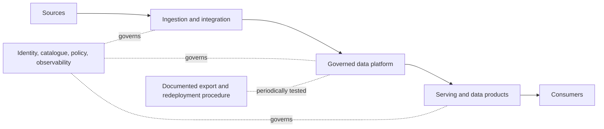
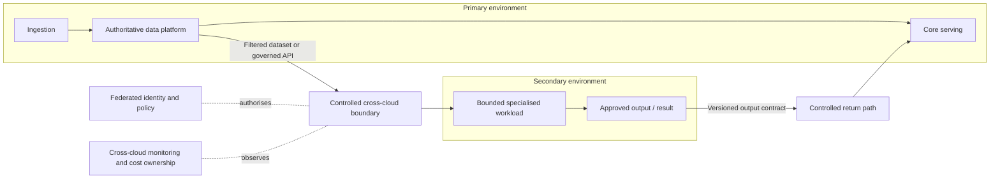
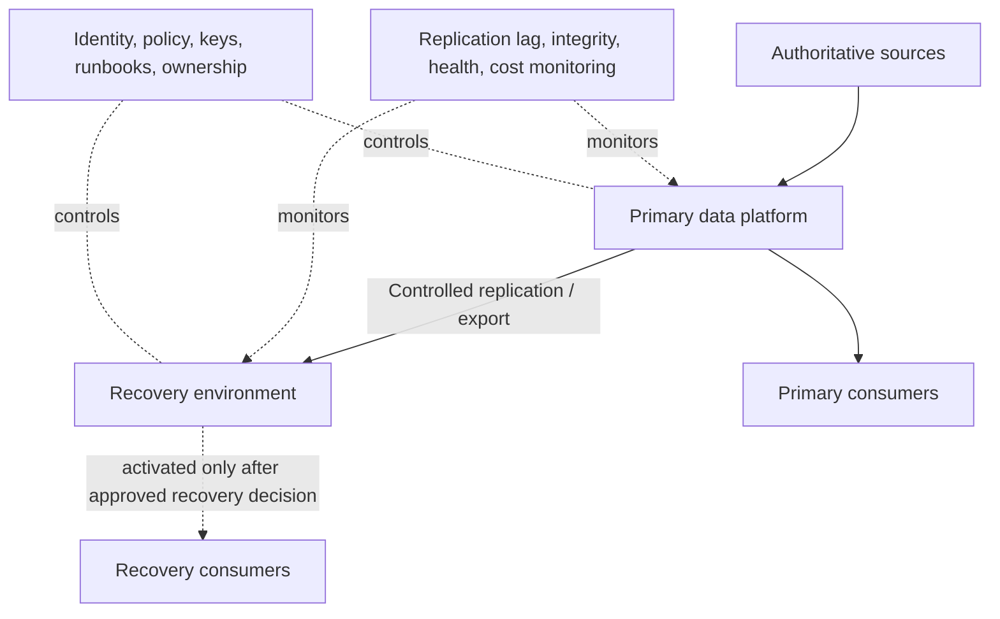
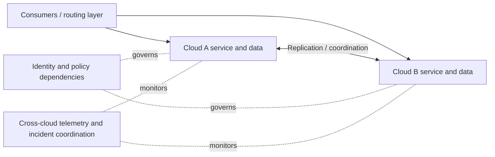
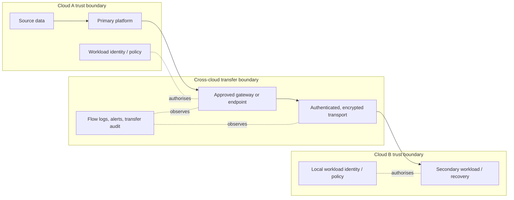
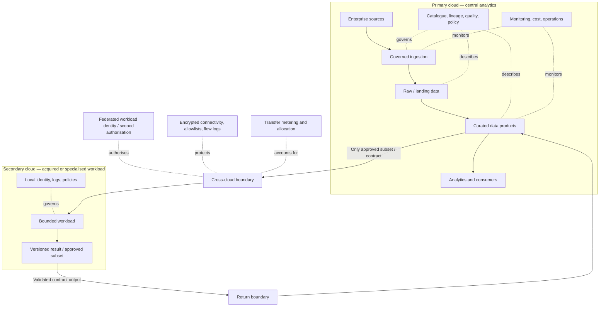

# Case Study 05 — Multi-Cloud Data Platform

> **Stage:** 2D — Data Architecture  
> **Module:** 16 — Enterprise Data Architecture Case Studies and Capstone  
> **Level:** Beginner → Intermediate → Advanced  
> **Recommended study effort:** 8–10 hours (roadmap recommendation, not a deadline)  
> **Core activity:** Criteria-based architecture option comparison  
> **Completion evidence:** Drivers analysis, cross-cloud component and flow diagram, portability assessment, cost/sensitivity analysis, decision record, practice questions, and lessons-log entry

## 0. Source integrity and scenario status

The module roadmap explicitly warns: **do not assume multi-cloud is automatically superior to a single-cloud design**. Case Study 05 asks the learner to determine what requirement truly forces more than one cloud, map components and cross-environment data flows, assess portability, egress, networking, identity, data movement, operational ownership, and cost, then compare alternatives and document a decision. It builds on Case Study 04 (enterprise lakehouse modernization), and the roadmap lists P8, P7, P13, and P12 as prerequisites.

The roadmap does not establish that a real organisation has a multi-cloud mandate, a specific provider combination, a regulatory requirement, a contract, a price, or a verified deployment scenario. This lesson therefore uses a clearly labelled **illustrative organisation, Meridian Analytics Group**, solely to teach the analysis method. All organisation details, workload sizes, rates, scores, targets, and calculations explicitly marked illustrative are invented for the exercise. They are not provider quotes, current cloud prices, legal advice, or claims about a real organisation.

The roadmap's own placeholder arithmetic—100 TB/month at an assumed $0.09/GB, giving $9,000/month—is retained as a teaching example. It is not a current provider price. No current provider-specific claims are needed for this vendor-neutral lesson; where a real project requires provider-specific service capabilities, pricing, quotas, network guarantees, or contractual terms, verify them against current authoritative provider documentation and commercial quotes, then record source and date.

---

## 1. Learning objectives and completion gate

By the end of this case, you should be able to:

1. Distinguish cloud, hybrid-cloud, multi-cloud, and single-cloud-with-exit-plan architectures.
2. Separate business requirements from vendor preferences and unverified assumptions.
3. Map workloads, data domains, consumers, cloud service boundaries, network paths, trust boundaries, and operational ownership.
4. Explain portability at the data, table-format, code, service, identity, and operations layers.
5. Analyse data gravity, replication, federation, latency, cross-cloud transfer, egress, duplicated storage/compute, and data consistency.
6. Compare a single cloud, a primary cloud with a limited secondary dependency, active-active multi-cloud, active-passive disaster recovery, and portable versus provider-native layers.
7. Define criteria before scoring alternatives and test how sensitive the decision is to weights and assumptions.
8. Quantify illustrative transfer and operating costs without presenting assumptions as actual prices.
9. Design cross-cloud identity, least-privilege access, network segmentation, governance, monitoring, incident ownership, and recovery testing.
10. Write an ADR that explains why the simplest architecture meeting the requirements is preferred, including evidence that would change the decision.

### Recommended deliverables

The roadmap says expected deliverables are to be confirmed from the actual case source; it recommends:
- Drivers and requirements analysis
- Component and cross-cloud data-flow diagram
- Criteria-based option comparison
- Portability assessment
- Cost and sensitivity analysis
- Architecture decision record (ADR)
- Lessons-log entry

### Completion gate

- [ ] Drivers are classified as requirements, constraints, preferences, assumptions, or open questions.
- [ ] Single-cloud with a tested exit plan is evaluated fairly.
- [ ] Every cross-cloud flow has a stated purpose, direction, volume/frequency estimate or an explicit unknown, owner, and security boundary.
- [ ] Portability is evaluated layer by layer rather than as a yes/no property.
- [ ] Cost includes data transfer, duplicate storage and processing, network, support, staffing, testing, and failure recovery where relevant.
- [ ] Resilience claims map to recovery objectives and tested failover behaviour.
- [ ] The decision record has criteria fixed before scoring, trade-offs, assumptions, and revisit triggers.
- [ ] Practice questions are attempted, gaps are logged, and a lessons-log entry is written.

Reading alone is not mastery. The evidence must support the conclusion that the chosen architecture is the simplest one that meets the actual requirements.

---

## 2. Foundations

### 2.1 Cloud, hybrid-cloud, and multi-cloud

- **Cloud architecture:** workloads use services provided through a cloud environment. A single-cloud architecture may still span multiple regions, accounts/projects/subscriptions, zones, or service boundaries.
- **Hybrid cloud:** an architecture connects cloud services to on-premises or private infrastructure. Hybrid describes a boundary between cloud and non-cloud environments; it is not synonymous with multi-cloud.
- **Multi-cloud:** an architecture uses services from more than one cloud provider. It may distribute different workloads between providers, or it may distribute one workload across providers.
- **Single-cloud with an exit plan:** the platform uses one provider today but keeps a documented and tested route to move data and workloads if business conditions change. This can offer meaningful optionality without the continuous operating burden of running two clouds.

A platform can be both hybrid and multi-cloud. It can also be multi-cloud without being resilient: if both environments depend on the same identity provider, network route, source system, operator group, or control plane, a shared failure can defeat the intended resilience.

**Why it matters:** architecture labels do not prove a business benefit. Determine the requirement first, then choose the deployment shape.

### 2.2 Why organisations consider multiple clouds

Possible drivers include:
- An acquisition brings a workload on a different provider.
- A workload depends on a capability available only in a chosen environment.
- A verified business-continuity requirement calls for an independently operable recovery environment.
- Data, network, procurement, or contractual constraints require separate environments.
- Workloads have different latency, locality, or operational needs.
- A deliberate exit strategy requires a tested migration path.

These are candidate drivers, not universal reasons. Each must be evidenced. For example, a preference to “avoid lock-in” does not by itself justify the cost of duplicating every data pipeline and operating system. A second provider may create new dependencies, such as cross-cloud identity, network, replication, and support processes.

### 2.3 Why single-cloud alternatives matter

A single-cloud architecture may provide:
- Fewer network boundaries and fewer replicated datasets
- Simpler identity and access policy administration
- Less duplicated platform engineering and on-call burden
- Lower cross-provider data-transfer and integration complexity
- Better proximity between data and compute
- A smaller test matrix and clearer operational ownership

It may also introduce provider concentration, service-specific dependencies, and a less independent recovery path if all components share the same failure domain. Those risks should be compared with the real risks of a second provider—not assumed away.

**When single-cloud is often appropriate:** no verified requirement forces a second provider; required services and controls are available; regional/account-level resilience meets recovery objectives; and the organisation can maintain a credible exit plan.

### 2.4 Workload placement versus distributed multi-cloud

Two materially different patterns are often called “multi-cloud”:

1. **Workload-level placement:** Workload A runs in Provider A; Workload B runs in Provider B. Data may be exchanged at explicit interfaces, but each workload has a primary execution environment.
2. **Same-workload distributed across providers:** a single logical workload spans providers—for example, replicated datasets and services that must coordinate across clouds.

The second pattern usually adds harder consistency, latency, failover, network, and operations problems. It should not be selected merely because “multi-cloud” sounds more resilient. A workload-placement design can satisfy acquisition or team-boundary needs without creating a synchronous distributed system.

### 2.5 Data-platform capabilities and cloud service boundaries

A data platform includes more than storage and compute. Map each capability and its owner:
- Ingestion and integration
- Object/file and table storage
- Batch and stream processing
- Catalogue, metadata, lineage, and quality
- Serving interfaces, analytics, and data products
- Identity, key management, access policies, and audit
- Orchestration, deployment, configuration, and secrets
- Monitoring, incident response, backup, recovery, and cost management

For each capability, record whether it is:
- Provider-native managed service
- Portable software operated by the organisation
- Shared service across environments
- External dependency
- Manual process
- Not yet implemented

**Failure mode:** a diagram may show two clouds while the critical control plane remains a single shared service. That is not necessarily wrong, but it means the actual failure domains and recovery plan differ from the diagram's visual impression.

### 2.6 Portability, interoperability, and lock-in

- **Portability** is the ability to move a component or workload to another environment with a known, acceptable level of effort, cost, and behaviour.
- **Interoperability** is the ability of components in different environments to exchange data or invoke interfaces correctly.
- **Lock-in** is the cost, risk, or difficulty of changing provider, service, data representation, or operating model.
- **Exit plan** is a documented, owned, costed, and periodically tested procedure for leaving a provider or service.

These are related but different. Two systems may interoperate through a proprietary API while the workload is not portable. A dataset may be stored in an open format but still depend on a provider-specific catalogue, access policy, transaction semantics, or processing engine. A portable container image does not make its data, identity, network, or operational dependencies portable.

**Rule:** assess portability per layer and test the complete exit path for a representative workload.

### 2.7 Data gravity and locality

**Data gravity** is the tendency for compute, applications, and consumers to be drawn toward large or heavily used datasets because moving the data is costly or slow. It is a practical placement consideration, not a law that always dictates one answer.

Questions:
- How much data moves, how often, and in which direction?
- Is movement full-copy, incremental, event-based, query-time, or one-time?
- Does the consumer need all records or only a filtered subset?
- Can compute be placed near the data?
- Can data be cached or materialised without violating freshness, security, or retention rules?
- What happens when the network is slow or unavailable?
- Does moving data create a second authoritative copy or merely a temporary working set?

A frequent large transfer can outweigh a seemingly attractive service price. Conversely, a small metadata exchange or infrequent subset transfer may be negligible. Quantify actual patterns before choosing.

### 2.8 Network connectivity and trust boundaries

Cross-cloud connectivity can use public endpoints with strong authentication and encryption, private connectivity options where available, site-to-site tunnels, or controlled gateways. The correct choice depends on threat model, performance, availability, cost, provider capabilities, and operating ownership. Do not assume that a “private” path removes the need for identity, encryption, authorization, or monitoring.

Design for:
- Explicit ingress and egress paths
- Network segmentation and route control
- Service identities and least-privilege permissions
- Encryption in transit and at rest
- Private name resolution and endpoint dependencies where relevant
- DNS, certificates, routing, firewall, and tunnel failure handling
- Network throughput, latency, packet loss, and capacity tests
- Logging and alerting on denied or anomalous flows
- Ownership of connectivity and escalation across providers

**Failure mode:** the data path works in a happy-path test but fails when a certificate expires, a route changes, a source range changes, or one operations team cannot access the other provider's diagnostics.

### 2.9 Identity, governance, and operational ownership

Identity federation can reduce credential sprawl, but it introduces dependencies on federation configuration, token exchange, trust policy, identity-provider availability, and mapping of roles between environments. Prefer short-lived credentials and workload identities where supported; do not hard-code long-lived secrets in jobs or images.

Governance must stay consistent across environments:
- Data classification and permitted use
- Dataset ownership and stewardship
- Access approval and least privilege
- Encryption and key custody
- Audit and lineage
- Retention, deletion, legal hold where applicable
- Data quality and incident handling
- Cost allocation and exception approval

Operational ownership must also be explicit. A cross-cloud incident may involve platform, network, identity, data engineering, security, vendor support, and a business owner. If the responsibility matrix is unclear, an incident can stall while teams debate whose system failed.

---

## 3. Prerequisites and roadmap alignment

The module roadmap names **P8, P7, P13, P12, and Case Study 04** as prerequisites.

| Prerequisite | Relevant concepts | How they apply |
|---|---|---|
| P8 — Cloud architecture | Cloud boundaries, networking, identity, shared responsibility, service selection | Evaluate provider boundaries, connectivity, and managed-service dependencies |
| P7 — Enterprise data platform and lakehouse architecture | Platform capabilities, zones, metadata, tenancy, platform operations | Map data-plane and control-plane components across environments |
| P13 — Performance, scalability, and cost architecture | Capacity, locality, latency, transfer cost, workload sizing | Quantify cross-cloud movement and duplicated compute/storage |
| P12 — Reliability, resilience, and disaster recovery | Failure domains, recovery objectives, restore/failover tests | Test whether multi-cloud actually improves recoverability |
| Case Study 04 — Enterprise lakehouse modernization | Transition, portability, coexistence, exit, operating model | Reuse migration analysis while recognising that multi-cloud is a placement/operations decision, not simply another migration wave |

Other useful connections from the module roadmap include P2 (requirements and ADRs), P5 (storage), P6 (integration), P10 (governance), P11 (metadata and lineage), and P15 (architecture documentation, reviews, team boundaries, and operating model). These are curriculum links, not a requirement to use a particular product.

The project tree places this case at:

`Stage 2D — Data Architecture/16-Enterprise-Data-Architecture-Case-Studies-and-Capstone/05-case-study-multi-cloud-data-platform.md`

The roadmap's completion expectation is to distinguish requirements from preferences, compare options using fixed criteria and quantified costs, and argue for the simplest architecture that meets the requirements.

---

## 4. Beginner: requirements and driver analysis

### 4.1 Start with the requirement, not the provider

Ask the sponsor: **what outcome cannot be achieved with a well-designed single-cloud or hybrid architecture?**

For every claimed driver, record:
- Exact statement and source
- Category: requirement, constraint, preference, assumption, hypothesis, or open question
- Affected workload/data domain
- Measurable success condition
- Accountable owner
- Consequence if unmet
- Evidence required to validate it

Examples:

| Statement | Initial classification | Evidence / follow-up |
|---|---|---|
| “We must support the acquired company's existing environment during transition.” | Potential constraint; confirm scope and duration | Acquisition plan, owner interview, contract if applicable |
| “We should use two clouds to avoid lock-in.” | Preference or strategic objective until quantified | Define acceptable exit time/cost and test a single-cloud exit plan |
| “Recovery must work if Provider A is unavailable.” | Requirement only after approved recovery scope/objectives | Business impact analysis, failure-domain analysis, recovery tests |
| “Provider B has the best AI service.” | Vendor preference/hypothesis | Verify functional fit, availability, security, total cost, and alternatives |
| “Data must stay in a particular jurisdiction.” | Constraint only when confirmed by applicable source/authority | Approved legal/compliance interpretation and data inventory |
| “Moving data is cheap.” | Assumption | Transfer volume, rate, request charges, egress, compute and labour estimate |

A provider preference may be reasonable, but it must not be disguised as a business requirement.

### 4.2 Identify workloads, data domains, and consumers

For each workload, capture:
- Business capability and accountable owner
- Data domains and classification
- Source of truth and downstream consumers
- Read/write pattern and consistency needs
- Freshness, latency, throughput, and availability expectations
- Recovery point objective (RPO) and recovery time objective (RTO), if approved
- Data volume, growth, transfer frequency, and retention
- Identity and access requirements
- Network dependencies
- Provider-specific service dependencies
- Operational owner, support model, skills, and on-call route
- Current cost and confidence in that cost estimate

Do not infer exact values from vague words like “real-time,” “high availability,” “large volume,” or “low cost.” Ask for measurable acceptance criteria.

### 4.3 Business drivers versus technical preferences

| Driver type | Example | Design implication |
|---|---|---|
| Verified business continuity need | A defined recovery objective requires an independent recovery path | Compare independent regions/accounts and a second provider; prove failover |
| Acquisition / inherited estate | Existing workload must continue while integration proceeds | Consider workload-level placement or phased migration rather than immediate consolidation |
| Unique capability | A workload requires a capability not otherwise feasible | Evaluate a bounded dependency on the second provider, including data movement |
| Exit optionality | Organisation wants a credible migration route | Test open formats, export paths, and workload redeployment; multi-cloud may not be necessary |
| Preference for vendor diversity | Stakeholders prefer two suppliers | Quantify the risk reduced and cost/complexity introduced |
| Unverified “residency” claim | Team believes data must be in a particular place | Confirm actual requirements; do not design around hearsay |
| Skills or operating capacity | Team cannot support two operational stacks | May weigh against multi-cloud unless a managed operating model resolves it |

### 4.4 Requirements register — illustrative

All rows below are example requirements for the fictional Meridian Analytics Group scenario.

| ID | Illustrative requirement | Measure / acceptance method | Owner | Status |
|---|---|---|---|---|
| R1 | Keep the core analytical data product available during planned changes | Approved availability/freshness targets and change test | Product owner | Placeholder; must be agreed |
| R2 | Avoid uncontrolled copies of sensitive datasets | Data-flow inventory, classification and access tests | Security/data owner | Illustrative requirement |
| R3 | Support a bounded workload from an acquired business | Workload owner confirms integration boundary and transition path | Business/platform owner | Assumption to validate |
| R4 | Make exit from a critical managed service feasible | Demonstrate export, redeployment, semantic tests, and time/cost estimate | Architecture owner | Strategic objective; threshold TBD |
| R5 | Keep monthly cross-environment transfer cost visible | Cost allocation by workload and transfer path | FinOps/platform | Illustrative operating requirement |
| R6 | Recover a critical data product within an approved RTO/RPO | Failover/restore exercise with measured results | Service owner | Targets not yet supplied |
| R7 | Provide least-privilege access and auditable data movement | Role matrix, denied-access tests, and audit evidence | Security owner | Illustrative control requirement |
| R8 | Keep incident responsibility clear across environments | Named primary owner, escalation path, and joint exercise | Operations lead | Illustrative operating requirement |

No numeric RTO, RPO, availability, budget, or data-residency target is supplied by the source roadmap. Real values must be approved by accountable stakeholders.

### 4.5 Constraint, assumption, risk, and question register

| Type | Meaning | Example in this case |
|---|---|---|
| Fact | Verified evidence supports the statement | A measured transfer job moved 12 TB in a documented test |
| Reported | A stakeholder claims something that has not yet been independently verified | “The acquired workload must stay where it is for now” |
| Assumption | Temporarily accepted for analysis | “The target provider can export all required table data” |
| Constraint | Confirmed boundary the design must respect | A verified contract clause or approved data-handling requirement |
| Risk | Uncertainty that could harm objectives | Cross-cloud identity outage blocks access to both data environments |
| Open question | Missing information needed for a decision | Is a full replica necessary, or would a filtered subset meet the consumer need? |

Never invent a vendor contract, mandatory cloud provider, price, service guarantee, residency obligation, or compliance requirement. If a fact cannot be verified, leave it open and identify the decision it blocks.

---

## 5. Intermediate: architecture design across environments

### 5.1 Workload placement and service boundaries

Place each workload where it best meets requirements after considering data locality, capabilities, latency, security, operations, and cost. A useful unit of placement is a **bounded workload/data product**, not an entire enterprise by default.

For each workload, define:
- Primary execution environment
- Data authority and replication direction
- Interfaces and contracts
- Network and identity boundary
- Provider-native dependencies
- Observability and cost owner
- Failure behaviour if the other cloud is unavailable
- Recovery method and tested limits
- Exit or migration path

Avoid synchronous cross-cloud calls in a critical data path unless latency and failure behaviour have been tested and accepted. Where feasible, keep compute close to data and use explicit, asynchronous interfaces for cross-environment exchange.

### 5.2 Option 1 — Single-cloud with a tested exit plan



**Benefits:** simpler network and identity topology, fewer replicated copies, less duplicated tooling and staffing.

**Limitations:** provider-specific services may increase exit effort; provider concentration remains unless the failure model addresses it.

**Use when:** requirements can be met within one cloud and portability can be maintained through contracts, data formats, automation, and tested exports.

### 5.3 Option 2 — Primary cloud with a limited secondary-cloud dependency



**Benefits:** the second provider is used only where a verified capability or inherited workload warrants it.

**Trade-offs:** data movement, identity federation, cross-cloud monitoring, and a specialised operational dependency still exist.

**Use when:** a bounded workload needs a second environment, and the data subset/return path can be governed and costed.

### 5.4 Option 3 — Active-passive multi-cloud recovery



**Benefits:** can provide an alternative recovery location if the failure domains are sufficiently independent and recovery is tested.

**Trade-offs:** replicated data and infrastructure cost; lag; risk of stale or incomplete recovery state; separate access and operational paths; failover/failback complexity.

**Important:** a recovery environment is not automatically active-passive merely because data is copied. Define who declares disaster, how promotion occurs, how writes are fenced, how RPO is measured, how consumers are redirected, and how failback is reconciled.

### 5.5 Option 4 — Active-active multi-cloud for the same workload



Active-active can improve availability or locality only if the workload and its dependencies are designed for it. It may require conflict resolution, multi-writer consistency, global routing, distributed coordination, duplicate side-effect prevention, and cross-cloud failure testing.

**Use only when:** the business requirement genuinely needs simultaneous serving across independent environments and the team can demonstrate correct behaviour under partition, lag, partial failure, and failover. It is not a default architecture for a warehouse or lakehouse.

### 5.6 Data-plane and control-plane boundaries

A **data plane** processes or serves business data. A **control plane** configures, governs, observes, and coordinates platform capabilities. They may share provider services, but the architecture should show their dependency relationships.

In multi-cloud, control-plane concentration can undermine resilience:
- A single identity provider can block both environments.
- One central catalogue may become unavailable or lack authoritative metadata for a recovery environment.
- A central network gateway can be a shared failure point.
- A shared deployment pipeline may be unable to promote a fix during a provider incident.
- Central observability may lose telemetry from a disconnected environment.

These are not arguments against central services. They are reasons to document degraded operation, recovery, and the control-plane dependencies that must remain available.

### 5.7 Cross-cloud data movement patterns

| Pattern | How it works | Good fit | Risks and trade-offs |
|---|---|---|---|
| Full replication | Copies most or all of a dataset to another environment | Recovery, local analytics, sustained high-volume access | High storage/transfer cost, replication lag, delete/retention parity |
| Incremental replication / CDC | Sends inserts, updates, deletes, or changed records | Frequent change with manageable lag | Ordering, source-log retention, schema changes, gap recovery |
| Filtered/subset copy | Transfers only approved columns, rows, or time ranges | Specialised workload or limited consumer | Filter correctness, missing context, re-identification risk |
| Federation / remote query | Consumer queries data where it resides | Small or selective queries; avoid bulk copies | Network latency, availability coupling, repeated query cost, pushdown limitations |
| Event/API exchange | Sends defined events or contract-based results | Decoupled integration and small logical messages | Contract versioning, delivery semantics, replay, consumer availability |
| One-time export/import | Transfers a bounded migration dataset | Initial migration or exit | Cutover boundary, completeness, and repeatability must be proven |
| Cache/materialised subset | Maintains local derived data for repeated access | Repeated reads where staleness is acceptable | Refresh lag, invalidation, duplicated data, access policy propagation |

Choose the pattern per dataset and consumer. A single architecture can combine patterns, but each flow needs an owner, freshness contract, data authority, access policy, and failure behaviour.

### 5.8 Network and trust-boundary design

Illustrative trust-boundary model:



For each flow, document source, destination, protocol/interface, identity, authentication, authorization, encryption, classification, allowed direction, expected volume, network owner, and logging. Use current provider documentation to validate actual connectivity features and limitations in a real design.

### 5.9 Identity federation and least privilege

A robust design answers:
- What identity does each workload use?
- How does that identity obtain authority in the other environment?
- What prevents a compromised workload from accessing unrelated datasets?
- How are roles and permissions mapped between providers?
- How are credentials rotated and revoked?
- What is the degraded mode if federation or token issuance is unavailable?
- How are cross-cloud access decisions audited?

Prefer workload identities and short-lived credentials where supported. Restrict access to specific datasets, actions, and network paths. Avoid assuming that matching role names in two providers implies matching permissions. Test both allowed and denied actions.

### 5.10 Metadata, lineage, and governance across clouds

A catalogue may be central, federated, or distributed. The key requirement is not a particular topology; it is that users can discover authoritative data, understand its provenance and quality, identify the owner, and see permitted use.

Define:
- Stable dataset and data-product identifiers
- Authoritative catalogue location and metadata synchronisation rules
- Lineage across ingestion, replication, transformation, and serving
- Classification and permitted-use labels
- Owner and steward fields
- Schema/contract versions
- Retention and deletion propagation
- Access policy and audit evidence
- Recovery-state freshness and quality status

A replicated dataset without lineage and classification can become an unmanaged copy. A deletion request or retention action must cover all relevant copies, caches, snapshots, and exports according to the applicable policy.

### 5.11 Monitoring, incident ownership, and operating handoffs

Monitor both local services and cross-cloud relationships:
- Transfer volume, duration, throughput, and failure rate
- Replication lag and checkpoint age
- Missing partitions, duplicate records, schema/contract failures
- Cross-cloud request latency and error rates
- Identity federation and authorization failures
- Network health and route/certificate expiry where applicable
- Freshness, data quality, and consumer outcomes
- Storage, compute, transfer, and support costs
- Recovery environment drift and restore/failover test results

Every alert needs a responder, runbook, severity, and escalation path. A shared incident process should state who leads when the fault crosses provider boundaries and who can make a failover or data-promotion decision.

### 5.12 Infrastructure automation and configuration consistency

Infrastructure as code and automated deployment can reduce configuration drift, but they do not make two providers identical. Keep reusable abstractions narrow and explicit. Provider-specific modules should expose differences rather than hiding them behind a lowest-common-denominator interface that removes essential controls.

Version and test:
- Network routes, firewall rules, and endpoints
- Workload identities and policy mappings
- Storage lifecycle and encryption configuration
- Data contracts and schema changes
- Pipeline deployments and secret references
- Monitoring alerts, dashboards, and runbooks
- Recovery and failover configuration

Drift detection should compare intended and observed configuration. Test deployment and recovery independently in each environment.

---

## 6. Portability assessment: evaluate by layer

Portability is not all-or-nothing. Use this matrix for each important workload.

| Layer | Portability question | Typical coupling risk | Evidence to collect |
|---|---|---|---|
| Data representation | Can data be exported in a documented, complete format? | Proprietary export, missing metadata, hidden encodings | Full export/import test and checksum/reconciliation |
| Table format and catalogue | Are table semantics, transactions, schema evolution, and catalog metadata portable? | Format-specific features, catalog APIs, permissions | Cross-engine read/write and recovery test |
| Transformation code | Can code run elsewhere with the same semantics? | Provider-specific SQL, UDFs, functions, runtime assumptions | Automated test suite on alternative runtime |
| Orchestration | Can dependencies, retries, schedules, and state be recreated? | Managed workflow semantics and secret bindings | Rebuild and replay exercise |
| Serving interfaces | Can consumers use a stable contract or be migrated? | Proprietary query/API semantics, client drivers | Contract tests and consumer inventory |
| Identity and security | Can access policy be mapped correctly? | Provider-specific IAM and key services | Role mapping, negative tests, audit comparison |
| Network | Can endpoints and connectivity be recreated? | Proprietary network dependencies, IP/route assumptions | Network build and failover test |
| Observability | Can telemetry and alert meaning be retained? | Provider-specific metrics, log formats, alert integrations | Incident simulation and evidence export |
| Operations | Can another team run, recover, and support it? | Undocumented procedures, specialist skills, vendor escalation | Handover drill and recovery rehearsal |
| Cost and commercial terms | Can the exit cost and liabilities be estimated? | Egress, contract terms, minimum commitments, labour | Dated cost model and commercial review |

### 6.1 Portability maturity levels

- **Level 0 — Unknown:** no inventory or tested path.
- **Level 1 — Documented:** dependencies and export options are documented.
- **Level 2 — Partially tested:** data or code can move, but end-to-end behaviour has gaps.
- **Level 3 — Workload tested:** representative workload is redeployed, reconciled, and operated in an alternative environment.
- **Level 4 — Operationally rehearsed:** exit timing, data integrity, security, performance, cost, and support transfer have been exercised with owners.

These levels are a proposed assessment rubric, not a standard or roadmap-mandated scoring scheme. Use them consistently and record evidence.

### 6.2 Open standards and provider-native services

Portable formats, APIs, containers, and infrastructure automation can reduce some dependencies. Provider-native managed services can reduce operational burden and offer capabilities that are costly to reproduce. The decision is a trade-off, not a moral preference for “open” or “native.”

Ask:
- Does the native feature create measurable value?
- What happens if it becomes unavailable or too costly?
- Is the underlying data exportable with semantics intact?
- Can an alternative implementation meet the quality attributes?
- What is the cost of maintaining portability?
- Which layers need to be portable, and which coupling is consciously accepted?

Avoid building an abstraction for every service merely to claim portability. Abstraction has a maintenance cost and can prevent use of valuable native features. Conversely, avoid unmanaged coupling in critical workloads whose exit risk is material.

### 6.3 Exit-plan design

A credible exit plan includes:
1. Trigger and decision authority
2. Target environment and prerequisites
3. Export scope, format, metadata, and history
4. Data transfer path and measured throughput
5. Rebuild of identity, network, keys, policies, and orchestration
6. Application/pipeline redeployment
7. Semantic, completeness, performance, security, and operational tests
8. Consumer cutover and rollback
9. Cost and timeline estimate with uncertainty
10. Contract, retention, deletion, and access closure
11. Evidence archive and post-exit verification

A written plan without a test is a hypothesis. A successful data export without a successful workload and operations test is only partial portability.

---

## 7. Architecture alternatives and criteria-first comparison

### 7.1 Define criteria before scoring

The roadmap names these criteria: requirement fit, security/residency, resilience, operational complexity, skills, cost including transfer, portability, and time to value. The following expanded list can be used if relevant:
1. Business and functional requirement fit
2. Security and governance fit
3. Resilience and recoverability
4. Data integrity and consistency
5. Latency, performance, and locality
6. Transfer and storage cost
7. Operational complexity and skills
8. Portability and exit feasibility
9. Delivery time and reversibility
10. Provider/service dependency concentration

Before scoring:
- Separate hard constraints from preferences.
- Identify criteria that can disqualify an option.
- Agree weight and evidence standard with accountable stakeholders.
- Mark unknown evidence as unknown, not a convenient score.
- Run sensitivity analysis and document uncertainty.

### 7.2 Option comparison

| Option | Strengths | Main costs / risks | Best fit when |
|---|---|---|---|
| A. Single-cloud with tested exit plan | Simplest operational model; limited cross-cloud movement; focused skills | Provider concentration and service coupling remain; exit requires preparation | One cloud meets requirements and exit optionality is sufficient |
| B. Primary cloud + limited secondary dependency | Keeps most data/compute together; uses second cloud only for a bounded need | Data-transfer, identity, network, and support dependency | A verified capability or inherited workload justifies a limited second environment |
| C. Multi-cloud by workload | Separates workloads by fit, ownership, acquisition, or locality | Multiple stacks, policies, billing, and skills; some data exchange needed | Workloads have clear boundaries and can operate largely independently |
| D. Active-passive multi-cloud recovery | Alternative recovery environment may reduce dependence on a single provider failure domain | Replication cost/lag, drift, failover/failback complexity, untested recovery risk | Approved recovery objectives justify the second environment and failover is tested |
| E. Active-active same-workload multi-cloud | Potentially serves across locations/providers and can tolerate some local failures | Hard consistency, coordination, latency, duplicate side effects, operational complexity | Simultaneous distributed serving is a verified business need and the workload supports it |
| F. Hybrid on-premises + cloud | Can support existing infrastructure, locality, or transition constraints | Connectivity, legacy operations, data movement, shared-responsibility complexity | On-premises dependencies are real and cannot yet be retired or moved |

Do not equate option C with option E. Distributing different workloads across providers is not the same engineering problem as making one workload active-active across providers.

### 7.3 Illustrative weighted scoring

The following scores and weights are fictional teaching values. They are not a recommendation for any real organisation.

Scale: 1 = poor fit; 3 = mixed/acceptable; 5 = strong fit. Weights sum to 100%.

| Criterion | Weight | A: Single + exit | B: Primary + limited secondary | C: Workload-level multi-cloud | D: Active-passive DR | E: Active-active | F: Hybrid on-prem + cloud |
|---|---:|---:|---:|---:|---:|---:|---:|
| Requirement fit | 20% | 4 | 4 | 4 | 3 | 3 | 3 |
| Security/governance | 15% | 4 | 3 | 3 | 3 | 2 | 3 |
| Resilience/recovery | 15% | 3 | 3 | 3 | 4 | 4 | 3 |
| Data locality/latency | 10% | 5 | 4 | 4 | 3 | 3 | 3 |
| Operational simplicity | 15% | 5 | 3 | 2 | 2 | 1 | 2 |
| Total cost (incl. transfer) | 15% | 5 | 3 | 2 | 2 | 1 | 2 |
| Portability/exit | 5% | 3 | 3 | 3 | 3 | 3 | 3 |
| Delivery feasibility | 5% | 5 | 4 | 3 | 2 | 1 | 3 |
| **Weighted score / 5** | **100%** | **4.25** | **3.35** | **3.00** | **2.80** | **2.30** | **2.70** |

For Option A:

`0.20×4 + 0.15×4 + 0.15×3 + 0.10×5 + 0.15×5 + 0.15×5 + 0.05×3 + 0.05×5 = 4.25`

The same calculation method gives B = 3.35, C = 3.00, D = 2.80, E = 2.30, and F = 2.70. For example, C is `0.20×4 + 0.15×3 + 0.15×3 + 0.10×4 + 0.15×2 + 0.15×2 + 0.05×3 + 0.05×3 = 3.00`. The scores for F are also fictional teaching values; a hybrid design's fit depends on what must remain on-premises and why.

This example favours single-cloud plus an exit plan because the illustrative scenario does not yet establish a requirement for a second cloud. If discovery proves that an acquired workload must remain separate or that approved recovery objectives cannot be met by a single-cloud design, the criteria or feasibility constraints may change the ranking.

A weighted score is a discussion aid, not a substitute for engineering judgement. A mandatory security failure or an unachievable RTO cannot be averaged away by a low cost score.

### 7.4 Sensitivity analysis

Change one or more assumptions and see whether the ranking changes:
- What if transfer volume is 5× higher?
- What if a verified recovery objective requires an independently operable recovery environment?
- What if the second cloud's required capability can be replaced by a bounded API?
- What if the team lacks on-call skills for both environments?
- What if portability maintenance costs more than the expected avoided exit cost?
- What if source data cannot be replicated within the acceptable freshness window?

If a small weight change reverses the result, the decision is fragile; identify the evidence that would resolve it. If a hard requirement disqualifies an option, do not keep it in the weighted comparison as if it remained viable.

---

## 8. Advanced cost and capacity analysis

### 8.1 Total cost categories

A multi-cloud model should include more than storage and compute.

| Category | Examples | Common omission |
|---|---|---|
| Storage | Primary data, replicas, snapshots, backups, caches | Replicated history and retention overhead |
| Compute | Ingestion, transformation, query, compaction, reconciliation, failover capacity | Duplicate processing and idle recovery capacity |
| Network/data transfer | Egress, ingress where charged, inter-region movement, private connectivity, gateways, request/API charges | Frequent small transfers, retries, and reverse-direction traffic |
| Data operations | Replication service, catalog synchronisation, schema conversion, validation | Engineering and support time |
| Security/governance | Identity federation, key handling, audit, policy testing | Control parity across copies |
| Operations | Monitoring, incident response, on-call, vendor support, training | Two toolchains and cross-team escalation |
| Migration and exit | Export/import, backfill, testing, consumer cutover, contract exit | One-time work and rollback readiness |
| Commercial | Licensing, minimum commitments, support plans, termination obligations | Unverified contract assumptions |

Use a workload-level cost model where possible. Cost allocation should include a transfer's purpose and owner; otherwise, cross-cloud movement can become a shared bill that no team is incentivised to reduce.

### 8.2 Illustrative transfer-cost arithmetic

The module roadmap supplies this placeholder example:

- Assumed transfer volume: 100 TB/month
- Assumed price: $0.09/GB
- Decimal conversion: 1 TB = 1,000 GB

Calculation:

`100 TB/month × 1,000 GB/TB = 100,000 GB/month`

`100,000 GB/month × $0.09/GB = $9,000/month`

`$9,000/month × 12 = $108,000/year`

**All prices are placeholders, not current provider pricing.** The example excludes request charges, private connectivity, retries, duplicated storage/compute, engineering, support, taxes, contractual commitments, and any differences between transfer directions or service classes. In a real project, use provider-specific pricing documents and a dated quote.

### 8.3 Sensitivity to volume and unit rate

Using the same illustrative assumptions, monthly transfer cost is:

`Monthly cost = volume (TB) × 1,000 GB/TB × assumed rate ($/GB)`

| Monthly transfer volume | $0.045/GB (illustrative) | $0.09/GB (illustrative) | $0.18/GB (illustrative) |
|---:|---:|---:|---:|
| 25 TB | $1,125 | $2,250 | $4,500 |
| 100 TB | $4,500 | $9,000 | $18,000 |
| 250 TB | $11,250 | $22,500 | $45,000 |

This table demonstrates linear sensitivity under a simple unit-rate model. It does not claim that actual cloud transfer pricing is linear or that these rates are offered by any provider.

### 8.4 Data-transfer capacity and time

Illustrative example: transferring 100 TB over a link that sustains an effective 2 Gbit/s.

Using decimal units:
- 100 TB = 100 × 10^12 bytes
- 1 byte = 8 bits
- Data size = 800 × 10^12 bits
- At 2 × 10^9 bits/second, ideal transfer time = 400,000 seconds

`400,000 seconds ÷ 3,600 ≈ 111.1 hours ≈ 4.63 days`

This is an idealised lower-bound calculation. Real transfer time is longer because of protocol overhead, throttling, retries, contention, encryption, object/request overhead, source extraction, validation, and the fact that nominal link speed may not be sustained. At 50% effective utilisation, the estimate doubles to about 9.26 days.

Use measured throughput and an agreed safety margin for planning. A one-time backfill and ongoing incremental replication are different workloads and should be modelled separately.

### 8.5 Replication lag and freshness

For a replicated dataset, measure:
- Source commit/change time
- Change capture time
- Transfer start and completion
- Target apply completion
- Consumer-visible availability

A simple lag measure is:

`replication lag = target apply time − source commit time`

The exact timestamp semantics must be consistent; clocks and event ordering can otherwise distort the metric. Track percentiles and worst-case lag, not only averages. If a consumer requires a freshness threshold, test it under peak load, source outages, network degradation, and replay.

### 8.6 Data gravity and break-even thinking

A simplified comparison can be useful:

- **Move data to compute:** transfer and store a copy, then run compute near it.
- **Move compute to data:** query or process data in its current environment.
- **Move a subset:** filter/project data to the minimum needed by the workload.
- **Cache/materialise:** pay storage and refresh costs to reduce repeated transfer/query cost.

Compare:
- One-time transfer cost
- Ongoing transfer and query cost
- Storage duplication
- Freshness and consistency
- Network failure coupling
- Security and retention complexity
- Engineering and operations effort

A cache may reduce cost but introduce stale results and deletion propagation work. Federation may avoid full replication but incur repeated query latency and charges. A filtered copy reduces volume but requires validated filters and a clear authority model.

### 8.7 Portability economics

The roadmap suggests the following model:

`Expected portability value = P(exit) × avoided exit cost − portability maintenance cost`

This is a simplified decision aid. `P(exit)` is an uncertain probability over a chosen time horizon; avoided exit cost is not necessarily the full migration cost; maintenance cost includes ongoing testing, abstractions, dual compatibility, and operational practice. Estimate ranges, avoid false precision, and compare with a simpler documented exit plan.

Portability is most valuable when the cost of being unable to exit is material and the portable path is actually tested. Maintaining theoretical portability that is never exercised can be expensive and still fail under pressure.

---

## 9. Security, governance, and resilience

### 9.1 Shared responsibility and service boundaries

Cloud providers and customers divide responsibility differently depending on service and configuration. Do not assume that a managed service transfers responsibility for data classification, identity permissions, secure configuration, retention, incident response, or recovery validation.

For each component, document:
- Provider-managed responsibilities
- Organisation-managed responsibilities
- Shared configuration responsibilities
- Evidence and review cadence
- Escalation path and support dependencies

Validate this against current service documentation and contracts for a real provider choice.

### 9.2 Security control-parity matrix

| Control | Cloud A | Cloud B | Evidence |
|---|---|---|---|
| Identity and workload authentication | Define mechanism and owner | Define mechanism and owner | Positive/negative access tests |
| Least privilege | Dataset/action-scoped policies | Equivalent business intent, provider-specific implementation | Role mapping and denied-access evidence |
| Encryption in transit | Required paths and configuration | Required paths and configuration | Configuration review and transport tests |
| Encryption at rest / key custody | Key ownership and rotation | Key ownership and rotation | Key-policy review and recovery test |
| Audit logging | Events, retention, access | Events, retention, access | Sample end-to-end trace |
| Classification and permitted use | Labels and policy enforcement | Labels and policy enforcement | Data-flow control matrix |
| Retention/deletion | Lifecycle and copies | Lifecycle and copies | Deletion propagation test |
| Secrets and certificates | Rotation, expiry alerting | Rotation, expiry alerting | Rotation rehearsal |
| Network segmentation | Approved routes and ingress | Approved routes and ingress | Flow test and log review |
| Incident response | Owner and escalation | Owner and escalation | Joint tabletop exercise |

“Equivalent” means the same intended control outcome, not identical implementation. Provider-specific controls need not look the same, but the organisation must prove that the policy objective is met.

### 9.3 Resilience and failure-domain analysis

Multi-cloud does not automatically reduce correlated failure. Map dependencies that can fail together:
- Source systems and source networks
- Identity provider and federation services
- DNS, certificates, routing, gateways
- Shared catalogue, metadata, and orchestration
- Shared deployment pipeline and secrets
- Data replication channel and checkpoints
- Human operators and escalation paths
- Vendor support and commercial control plane

A second cloud helps only if it is sufficiently independent for the failure being addressed and can be operated in the required state. A replicated dataset that is stale, inaccessible, or semantically inconsistent may not support recovery.

### 9.4 Recovery objectives and tests

Define and approve:
- **RTO:** maximum acceptable time to restore the service.
- **RPO:** maximum acceptable data loss measured in time or an agreed equivalent.
- Data authority during failure
- Failure declaration authority
- Promotion/fencing rules to prevent split-brain writes
- Consumer redirection
- Recovery environment capacity
- Access and key availability
- Validation and reconciliation
- Failback plan and conditions

A recovery test should record actual elapsed time, achieved recovery point, data differences, manual interventions, and unresolved issues. If a design claims recovery within an objective but has not been tested, label it as an unverified design assumption.

### 9.5 Active-passive recovery sequence

1. Detect the incident and classify the affected failure domain.
2. Decide whether the approved recovery trigger is met.
3. Verify recovery data age, completeness, and access controls.
4. Fence or stop the old writer to prevent divergent writes.
5. Promote the recovery environment using a documented procedure.
6. Redirect consumers and validate data/semantic correctness.
7. Record actual RTO/RPO and any accepted data loss.
8. Communicate service status and ownership.
9. When the primary returns, reconcile changes and determine a safe failback sequence.
10. Update runbooks and corrective actions after the exercise or incident.

If the primary and recovery environments cannot coordinate during a network partition, the design must specify which side is allowed to accept writes. “Both remain available” is not a safe consistency strategy for every workload.

### 9.6 Incident ownership model

| Incident class | Lead owner (must be assigned) | Supporting roles | Required evidence |
|---|---|---|---|
| Cross-cloud transfer failure | Integration/network service owner | Both cloud teams, source owner | Transfer IDs, lag, network and endpoint logs |
| Federation/access failure | Identity/security owner | Platform and application teams | Token/role mapping, denied-access logs |
| Replication correctness gap | Data product owner | Data engineering, source owner | Checkpoints, source/target reconciliation |
| Cost anomaly | FinOps/platform owner | Workload owner, provider support | Transfer, compute, storage and request trends |
| Recovery activation | Named incident commander / service owner | Security, data, network, business owner | Trigger, authority, RTO/RPO evidence |
| Provider service incident | Service owner coordinates | Provider support and internal incident team | Provider incident reference and local impact timeline |

Avoid the failure mode where every team owns “its part” but no one owns the end-to-end service outcome.

---

## 10. Complete worked case study — illustrative Meridian Analytics Group

### 10.1 Scenario and business context

**Illustrative only.** Meridian Analytics Group is a fictional enterprise considering how to support an analytical platform and a newly acquired business unit. The acquired unit currently operates a bounded workload in a second cloud environment. The central architecture question is whether the enterprise should keep two environments, migrate the acquired workload, use the second environment only for a specialised capability, or adopt a broader multi-cloud pattern.

The scenario intentionally supplies no real provider names, contracts, mandatory cloud policy, residency obligation, budget, or target recovery guarantee. Those would need evidence in a real case.

### 10.2 Stakeholders

| Stakeholder | Decision responsibility |
|---|---|
| Business sponsor | Business outcome, accepted risk, scope |
| Data product owner | Semantics, freshness, consumer acceptance |
| Source/data owners | Source availability, permitted use, data authority |
| Cloud/platform teams | Landing zones, services, automation, operations |
| Network team | Connectivity, routing, segmentation, capacity |
| Identity/security team | Federation, access policies, keys, audit |
| Governance/stewardship | Classification, lineage, retention, quality |
| FinOps/finance | Cost model, allocation, benefits and sensitivity |
| Operations/SRE | Monitoring, incident response, recovery and on-call |
| Architecture review | Alternatives, ADR, risk and quality attributes |
| Acquired-unit team | Existing workload, dependencies, transition constraints |

### 10.3 Facts, assumptions, constraints, and gaps

| ID | Statement | Classification | Treatment |
|---|---|---|---|
| F-01 | Case Study 05 must evaluate multi-cloud against alternatives and not assume superiority | Source-derived roadmap fact | Governs the analysis |
| F-02 | Case 05 builds on Case 04 and lists P8, P7, P13, P12 as prerequisites | Source-derived roadmap fact | Use migration, cloud, platform, cost, and resilience methods |
| A-01 | An acquired business has a workload in a second cloud | Illustrative scenario assumption | Validate actual ownership and dependency boundary |
| A-02 | Only a subset of the acquired data is needed by the central analytics platform | Illustrative hypothesis | Confirm with consumer and data-owner analysis |
| A-03 | The workload can exchange data through a governed contract | Open question | Prototype interface and security path |
| A-04 | Most central analytics can run in one primary environment | Illustrative hypothesis | Benchmark requirements and compare options |
| C-01 | Business continuity must be maintained during any transition | Illustrative design objective | Define measurable service requirements with owners |
| G-01 | No provider, price, contract, residency rule, budget, or RTO/RPO is supplied | Source limitation | Do not invent; keep options provider-neutral |
| G-02 | Actual transfer volume and frequency are unknown | Open question | Measure source and consumer traffic |
| G-03 | Identity and network dependencies are not yet mapped | Open question | Complete trust-boundary and ownership review |

### 10.4 Candidate architecture options

**Option A — Single primary cloud with tested exit plan.** Migrate or consolidate the acquired workload where justified, retain portable data exports and automated redeployment tests, and avoid permanent cross-cloud transfer.

**Option B — Primary cloud with a bounded secondary dependency.** Keep the central platform in one cloud; retain the acquired workload or a specialised capability in the second; transfer only approved data subsets or contract-based outputs.

**Option C — Workload-level multi-cloud.** Keep separate workloads in each environment based on ownership, locality, and fit; define governed exchange boundaries and consistent operating responsibilities.

**Option D — Active-passive multi-cloud recovery.** Replicate required data and infrastructure to a second environment for an approved recovery objective. Requires tested failover, fencing, and failback.

**Option E — Active-active same-workload multi-cloud.** Serve one logical workload across both environments. Consider only if simultaneous distributed operation is required and the consistency/latency model is proven.

### 10.5 Criteria and illustrative decision

Given only the illustrative facts, Option B is a plausible **conditional hypothesis** if the acquired workload must remain in the second environment during transition and a bounded data exchange is sufficient. It limits cross-cloud transfer to a governed subset. It is **not** a final recommendation: if the acquired workload can be migrated safely at acceptable cost, Option A may be simpler; if approved recovery objectives require an independent recovery environment, Option D may become necessary.

The weighted example in Section 7.3 is a generic teaching comparison, not a scoring result for Meridian. Its fictional scores rank Option A highest (4.25), ahead of Option B (3.35). Do not carry those scores into the Meridian decision without evidence. If the acquired workload can remain only in the second environment, treat that as a confirmed constraint only after validation; then re-score feasible options or disqualify options that violate it. For a real decision, agree criteria and weights with stakeholders, collect evidence, and score the actual options.

### 10.6 Logical architecture proposal



**Design notes:**
- Cloud A is the illustrative authority for central curated analytics data.
- Cloud B operates a bounded workload; it does not receive a full copy by default.
- Only approved data fields/records move across the boundary.
- The return contract includes schema version, source/checkpoint metadata, quality status, and idempotency/replay behaviour as appropriate.
- Identity, network, cost, monitoring, and incident responsibilities span both environments.
- If the secondary workload is unavailable, the central platform's degraded behaviour must be defined; it should not fail unpredictably due to an unbounded synchronous dependency.

### 10.7 Data movement contract

For every flow, document:

| Field | Illustrative decision |
|---|---|
| Purpose | Support a defined central analytical use case |
| Source of truth | Explicitly named owner/system per dataset |
| Data scope | Minimum necessary subset; exact fields TBD |
| Direction | Central platform → secondary workload; approved results → central platform |
| Method | Contract-based batch/incremental transfer; select after source capability assessment |
| Frequency/freshness | TBD from business requirement |
| Security | Workload identity, scoped authorization, encryption, audit |
| Consistency | Contract defines checkpoint/version, duplicate handling, late updates |
| Failure | Retry with idempotency; alert on lag; hold or degrade consumer safely |
| Validation | Schema/contract tests, completeness checks, semantic assertions |
| Ownership | Named source, destination, integration, security, and operations owners |
| Cost allocation | Transfer and processing attributed to the consuming workload |

### 10.8 Illustrative cost model

Suppose discovery measures 100 TB/month of cross-cloud movement. Use the roadmap's placeholder price of $0.09/GB solely to show arithmetic:

- `100 TB/month × 1,000 GB/TB = 100,000 GB/month`
- `100,000 GB/month × $0.09/GB = $9,000/month`
- `Annualised simple transfer charge = $9,000 × 12 = $108,000/year`

This is not the full cost. Add duplicated storage, compute in both environments, network services, requests, monitoring, identity/governance, operations, validation, and transfer retries. The rate must be replaced by a dated provider-specific estimate for any real decision.

**Sensitivity:** at 250 TB/month and the same illustrative rate, transfer alone is `$22,500/month`; at 25 TB/month it is `$2,250/month`. If a filtered subset reduces transfer by 80%, volume falls from 100 TB to 20 TB and the same simple model falls from $9,000 to $1,800/month. This assumes the filter is correct and that other costs remain unchanged; actual savings may differ.

### 10.9 Security and governance model

- Central governance defines classification, permitted use, ownership, and retention policy.
- Each environment enforces access using its local mechanisms with a documented mapping to the common policy intent.
- Cross-cloud transfer is denied by default and allowed only for approved data products, identities, destinations, and purposes.
- Data copies carry classification, lineage, source, timestamp/checkpoint, contract version, and owner metadata.
- Audit logs are retained and reviewable across the flow.
- Deletion and retention changes have a documented propagation path for all relevant copies and derived outputs.
- Federation failure has a safe degraded mode; workloads do not fall back to broad static credentials.

### 10.10 Resilience and operational plan

If the second environment is a workload dependency rather than a recovery site:
- Define whether central analytics continues with stale data, partial results, or no results during secondary failure.
- Monitor transfer lag and identify when results become unsafe.
- Make retry and replay idempotent.
- Assign a single incident lead and supporting owners.
- Test network, identity, schema, and secondary-service failures.

If the second environment is also intended for disaster recovery, create a separate recovery design: approved RTO/RPO, independent dependencies, data freshness checks, write fencing, promotion, consumer routing, failback, and measured recovery exercise. Do not assume the bounded workload topology automatically provides disaster recovery.

### 10.11 Decision record

**ADR-05-01 — Should the central data platform span multiple clouds?**

- **Status:** Proposed for the illustrative scenario; not an approved real decision.
- **Context:** a fictional acquired workload exists in a second environment, but provider-specific requirements and exact volumes are unknown.
- **Question:** should central analytics move to or replicate across multiple providers?
- **Options:** A single cloud plus tested exit; B primary plus limited secondary dependency; C workload-level multi-cloud; D active-passive recovery; E active-active same-workload.
- **Criteria:** requirement fit, security/governance, recovery, data consistency, locality, total cost including transfer, operational complexity, portability, delivery feasibility.
- **Provisional direction:** Option B, subject to evidence, if the acquired workload must remain in the second environment and only a bounded data exchange is required.
- **Rationale:** avoids distributing all data and compute unnecessarily while preserving the inherited workload boundary.
- **Consequences:** cross-cloud identity, network, data contract, transfer metering, and joint incident ownership remain necessary.
- **Risks:** transfer cost, lag, hidden dependencies, policy mismatch, operational skill gaps.
- **Evidence required:** actual workload inventory; data-flow volume/frequency; provider capability/price checks; source/target contract test; security review; operational exercise; comparison with migration to one cloud.
- **Decision owner:** business sponsor and accountable platform/data owners, with security, operations, and finance input.
- **Revisit triggers:** verified migration is simpler/cheaper; transfer volume exceeds approved threshold; workload can run locally in primary cloud; a recovery objective requires independent recovery; security or operational controls cannot be made consistent.

### 10.12 Validation plan

| Test | Purpose | Pass evidence |
|---|---|---|
| Data contract | Prevent incompatible schema/meaning changes | Versioned contract tests pass; rejected changes are visible |
| Transfer integrity | Detect missing, duplicate, or corrupted data | Source/target checks and reconciliation report |
| Freshness and lag | Validate consumer timing | Measured lag meets owner-approved target under representative load |
| Identity and policy | Prove least privilege | Allowed and denied access tests, audit evidence |
| Network resilience | Validate dependency behaviour | Simulated network degradation/outage and safe degraded mode |
| Replay/idempotency | Prevent duplicate or lost effects | Replay test with stable results and checkpoint evidence |
| Cost attribution | Make transfer cost visible | Transfer/compute/storage costs mapped to owner and workload |
| Recovery (if in scope) | Prove RTO/RPO and failback | Timed exercise with data-integrity and access evidence |
| Operational handoff | Prove the team can operate the integration | Incident drill, runbook use, named escalation route |
| Exit/portability | Test provider/service dependency risk | Representative export/redeployment and semantic comparison |

---

## 11. Practical exercises with answer guidance

### Exercise 1 — Beginner: classify the driver

**Prompt:** A senior manager says, “We must use two clouds because it prevents lock-in and gives better resilience.” Classify the claims and list evidence required.

**Answer guidance:**
- “Must use two clouds” is an asserted requirement, not yet a verified one.
- “Prevents lock-in” is too broad; define the specific service/data/workload exit risk and acceptable exit cost/time.
- “Gives better resilience” is a hypothesis; define failure scenarios, RTO/RPO, independence, and failover tests.
- Compare single-cloud regional/account-level resilience plus a tested exit plan against the multi-cloud alternatives.
- Identify shared dependencies such as identity, network, source systems, and operator teams.

**Validation criteria:** the answer distinguishes requirements from preferences and names evidence that could change the architecture.

### Exercise 2 — Beginner: map data flows

**Prompt:** Draw two cloud boundaries, a primary data platform, a secondary workload, an identity boundary, and at least two data flows. Label data authority, direction, security, monitoring, and owners.

**Answer guidance:** use the diagram in Section 10.6 as a starting point. Avoid an unlabeled “sync” arrow. Include transfer purpose, contract, source of truth, access control, lag monitoring, cost attribution, and failure behaviour.

**Validation criteria:** every cross-cloud arrow has an owner, purpose, and control boundary.

### Exercise 3 — Intermediate: compare options

**Prompt:** Compare single-cloud with exit plan, primary plus limited secondary dependency, workload-level multi-cloud, and active-passive DR. Define criteria first and identify disqualifying constraints.

**Answer guidance:** use the roadmap criteria: requirement fit, security/residency, resilience, operational complexity, skills, transfer-inclusive cost, portability, and time to value. Separate hard constraints from weighted preferences. Mark missing evidence as unknown and run sensitivity analysis.

**Validation criteria:** the single-cloud option receives a fair analysis; active-active is not conflated with workload placement; scores have evidence or explicit assumptions.

### Exercise 4 — Intermediate: portability audit

**Prompt:** A team says its platform is portable because the data is stored in an open format and pipeline code is in a repository. What else must be tested?

**Answer guidance:** test table/catalogue semantics, schema evolution, transaction behaviour, SQL/UDF compatibility, orchestration, identity, keys, networking, secrets, serving contracts, metadata/lineage, monitoring, performance, operations, cost, export/import, and recovery. Redeploy and operate a representative workload elsewhere.

**Validation criteria:** portability is assessed by layer; the answer explains why open data format and version-controlled code are necessary but insufficient.

### Exercise 5 — Intermediate: transfer-cost calculation

**Prompt:** Using a placeholder rate of $0.09/GB and decimal units, estimate monthly transfer cost for 60 TB/month and annualised cost. State omissions.

**Solution:**
- `60 TB × 1,000 GB/TB = 60,000 GB`
- `60,000 GB × $0.09/GB = $5,400/month`
- `$5,400 × 12 = $64,800/year`

The rate is illustrative, not current provider pricing. Exclusions include storage, compute, requests, private connectivity, retries, support, labour, taxes, contract terms, and reverse-direction traffic.

**Validation criteria:** units are explicit, arithmetic is correct, and the answer labels the rate as a placeholder.

### Exercise 6 — Advanced: calculate transfer time

**Prompt:** Estimate the ideal transfer time for 40 TB over an effective 1 Gbit/s link. Use decimal units and state why the actual duration is longer.

**Solution:**
- `40 TB = 40 × 10^12 bytes = 320 × 10^12 bits`
- `320 × 10^12 bits ÷ 1 × 10^9 bits/s = 320,000 seconds`
- `320,000 ÷ 3,600 ≈ 88.9 hours ≈ 3.70 days`

Actual time can be longer due to overhead, retries, throttling, source read speed, contention, encryption, validation, and imperfect sustained throughput.

**Validation criteria:** bit/byte conversion is correct and the answer distinguishes ideal lower-bound from a plan.

### Exercise 7 — Advanced: recovery design

**Prompt:** A team claims a second cloud provides disaster recovery. It has a daily data export but has never tested failover. Identify the gaps and propose a validation plan.

**Answer guidance:** daily export does not establish an RPO or RTO without measurement; compute, identity, keys, network, configuration, consumer routes, capacity, runbooks, and write authority may be missing. Define failure scenarios, approved RTO/RPO, data age/completeness checks, fencing, promotion, consumer routing, reconciliation, failback, and a timed exercise. Measure achieved recovery, not just whether the service started.

**Validation criteria:** the response identifies shared failure dependencies and requires an end-to-end exercise.

### Exercise 8 — Advanced: make the decision reversible

**Prompt:** Write an ADR choosing either single-cloud with an exit plan or multi-cloud. Include at least three alternatives, criteria, costs, assumptions, risks, and revisit triggers.

**Answer guidance:** use the template in Section 12. An acceptable decision may be either single-cloud or multi-cloud if it follows the evidence. The strongest response states what new evidence would change the recommendation.

**Validation criteria:** criteria precede scoring; single-cloud is evaluated fairly; costs include transfer and operations; triggers are measurable or clearly owned.

### Exercise 9 — Architecture defense

Answer in two minutes each:
1. What requirement truly forces a second cloud?
2. Why is a single-cloud exit plan insufficient or sufficient?
3. Which data moves, how often, and why?
4. What is the shared failure domain in the design?
5. How are identity and policy enforced across providers?
6. What happens when the transfer path is unavailable?
7. What are the measured RTO/RPO, if recovery is claimed?
8. How much does portability cost to maintain?
9. Which service dependency is hardest to exit?
10. What evidence would make you simplify the architecture?

**Scoring guidance:** strong answers link requirements, evidence, alternatives, trade-offs, and validation; do not present assumptions as facts; identify owners and revisit triggers.

---

## 12. Common mistakes and corrections

| Mistake | Why it fails | Correction |
|---|---|---|
| Treating multi-cloud as a default | Adds cost and complexity without proven benefit | Compare single-cloud and hybrid alternatives first |
| Equating provider diversity with resilience | Shared identity, source, network, or operations can still fail | Map failure domains and test recovery |
| Ignoring egress and data gravity | Transfer and duplicated processing can dominate cost | Measure volume/frequency and model total cost |
| Treating portability as all-or-nothing | Different layers have different coupling | Assess data, format, code, services, identity, network, and operations separately |
| Assuming open format means portable platform | Catalogue, transactions, policy, and semantics may still be coupled | Run cross-environment export/redeploy/validation tests |
| Using active-active when workload-level separation would work | Adds distributed consistency and operational complexity | Choose the narrowest topology that meets requirements |
| Replicating all data “just in case” | Creates uncontrolled copies, cost, retention, and access risk | Transfer minimum necessary data with explicit ownership |
| Assuming private connectivity is automatically secure | Identity, authorization, configuration, and audit still matter | Use layered controls and verify allowed/denied flows |
| Duplicating IAM roles by name | Same names do not guarantee same permission semantics | Map policy intent and test effective permissions |
| Ignoring replication lag and delete propagation | Copies become stale or violate lifecycle policy | Define lag SLO, replay, deletion, and reconciliation |
| Making a recovery claim without a test | The environment may be incomplete or inaccessible | Exercise end-to-end failover/failback and measure RTO/RPO |
| Hiding provider-specific features behind a weak abstraction | Loses useful capability and adds maintenance burden | Abstract only where portability has value; document accepted coupling |
| Overbuilding portability | Maintenance costs may exceed likely benefit | Estimate exit risk and test the critical path |
| Ignoring cross-cloud incident ownership | Incidents stall between teams | Assign an end-to-end lead and joint runbooks |
| Using stale or invented provider prices | Decisions are based on false precision | Use dated authoritative pricing and a commercial estimate |
| Copying Case Study 04's migration plan unchanged | Migration and cross-cloud placement are different questions | Re-evaluate placement, transfer, network, identity, and operations |
| Leaving exit plan as a document only | It may fail under time pressure | Test representative export, redeploy, validation, and cutover |

---

## 13. Mastery criteria and completion checklist

### Beginner mastery

You can:
- Explain cloud, hybrid, multi-cloud, and single-cloud-with-exit-plan.
- Identify drivers and classify them correctly.
- Map workloads, data domains, consumers, owners, and data flows.
- Explain egress, data gravity, portability, interoperability, and lock-in.
- Identify missing information without inventing a requirement.

### Intermediate mastery

You can:
- Draw architecture diagrams with trust boundaries, data flows, and control-plane dependencies.
- Compare single-cloud, limited-secondary, workload-level multi-cloud, and recovery options.
- Evaluate portability by layer.
- Define data movement, identity, security, governance, monitoring, and incident ownership.
- Calculate illustrative transfer cost and time with correct units and explicit assumptions.
- Score alternatives using criteria set before scoring and perform sensitivity analysis.

### Advanced mastery

You can:
- Defend or reject multi-cloud with evidence rather than ideology.
- Explain the consistency, lag, failover, and failback model.
- Identify shared failure domains and test recovery objectives.
- Quantify total cost including transfer, duplicated processing, operations, and portability maintenance.
- Produce an ADR with alternatives, risks, accepted coupling, and revisit triggers.
- Explain what evidence would cause the architecture to change.

### Recommended completion checklist

- [ ] Drivers analysis distinguishes requirements, preferences, assumptions, constraints, and unknowns.
- [ ] Workload/data-domain/consumer inventory is complete enough to support the decision.
- [ ] Data-flow and trust-boundary diagrams are reviewed.
- [ ] Single-cloud with an exit plan is evaluated fairly.
- [ ] Workload-level multi-cloud and active-active are distinguished.
- [ ] Portability matrix covers data, format, code, services, identity, network, operations, and cost.
- [ ] Cost model includes egress/transfer, storage, compute, requests, duplicated operations, and exit costs.
- [ ] Illustrative rates and calculations are labelled; actual prices are sourced and dated when needed.
- [ ] Security and governance parity is tested across environments.
- [ ] Resilience claims map to approved RTO/RPO and failure tests.
- [ ] Cross-cloud incident lead, owners, runbooks, and escalation are defined.
- [ ] ADR includes criteria first, alternatives, consequences, and revisit triggers.
- [ ] Beginner, intermediate, and advanced exercises attempted; gaps logged.
- [ ] Lessons-log entry written.
- [ ] A reviewer can reproduce the cost arithmetic and challenge the option ranking.
- [ ] No material unresolved issue is hidden by a weighted score.

The roadmap's readiness principle is to argue for the simplest architecture that meets the requirements. A well-supported conclusion that multi-cloud is unnecessary is a successful outcome.

---

## 14. Connection to Case Study 04 and the final capstone

### 14.1 Transfer from lakehouse modernization

Case Study 04 teaches evidence-based current/target analysis, phased transition, coexistence, rollback, cost, and operating-model change. Reuse its methods—not its design decisions.

Before carrying a lakehouse target into a multi-cloud architecture, ask:
- Which data must cross the provider boundary, and which can remain near compute?
- Which table/catalogue semantics are portable?
- Does replication preserve history, deletes, quality, and lineage?
- Are identity, network, and recovery paths independent enough for the stated objectives?
- What does coexistence cost if old and new platforms span different providers?
- Can each environment be operated by the receiving team?
- Is a second provider a requirement or simply an assumed target?

A lakehouse can run in one cloud, multiple clouds, or a hybrid estate. Its logical architecture does not by itself determine placement.

### 14.2 Transfer to the final capstone

The module roadmap describes the capstone source and rubric as empty at the time the roadmap was authored, so no official capstone deliverable or score can be asserted from them. When the actual brief and rubric are available:

1. Extract actual requirements, constraints, stakeholders, and open questions.
2. Treat multi-cloud as optional unless the brief establishes a requirement.
3. Compare single-cloud, hybrid, and multi-cloud options using criteria agreed before scoring.
4. Map cross-environment flows, trust boundaries, identity, data authority, and operations.
5. Include cost and sensitivity analysis where the architecture decision depends on it.
6. If resilience is a driver, map failure domains and prove recovery behaviour.
7. Trace ADRs to requirements, evidence, and accepted risks.
8. Map each actual rubric criterion to evidence; do not invent weights or passing thresholds.
9. Record which lessons transfer from Case Study 04 and which depend on that scenario.

### 14.3 Lessons-log template

| Field | Entry |
|---|---|
| Case / date | Case Study 05 / date studied |
| Principle learned | General lesson that applies beyond the example |
| Driver classification | Requirement, preference, constraint, assumption, or unknown |
| Decision made | Single, hybrid, limited secondary, workload multi-cloud, DR, or active-active |
| Evidence | Requirements, measurements, tests, cost model |
| Accepted coupling | Which provider-specific dependencies remain and why |
| Portability gaps | Layers not yet tested |
| Transfer to Case Study 04 | Migration, coexistence, cost, and exit lessons |
| Transfer to capstone | Method or artefact to reuse |
| Do not reuse blindly | Scenario-specific placement decision |
| Follow-up action | Test, research, review, or missing evidence |

---

## 15. Architecture decision record template

```text
ADR ID / Title:
Status: Proposed | Accepted | Rejected | Superseded
Date / Owner / Approvers:

Context:
Business outcome and requirements:
Requirements vs preferences:
Confirmed facts and evidence:
Assumptions and open questions:
Constraints and disqualifying conditions:

Options considered:
  A. Single-cloud with tested exit plan
  B. Primary cloud with limited secondary dependency
  C. Workload-level multi-cloud
  D. Active-passive multi-cloud recovery
  E. Active-active same-workload multi-cloud
  F. Hybrid on-premises + cloud

Criteria and weights (agreed before scoring):
Evidence for each score:
Cost model and sensitivity:
Portability by layer:
Data movement and trust boundaries:
Security/governance implications:
Resilience and recovery implications:
Operational ownership and skills:
Decision and rationale:
Rejected alternatives and reasons:
Consequences and accepted coupling:
Risks and mitigations:
Validation tests and evidence:
Revisit triggers:
Review date:
Related requirements, diagrams, and risks:
```

## 16. Cross-cloud flow register template

```text
Flow ID / Name:
Business purpose:
Source environment / dataset / owner:
Destination environment / dataset / owner:
Data authority and direction:
Data classification / permitted use:
Volume and frequency (measured or unknown):
Transfer pattern: full | incremental/CDC | subset | federation | event/API | cache
Schema/contract version:
Freshness and consistency requirement:
Identity and authorization:
Network path and trust boundary:
Encryption and audit:
Retry, checkpoint, deduplication, replay:
Failure/degraded behaviour:
Monitoring and alert owner:
Cost allocation:
Retention/deletion propagation:
Validation and reconciliation:
Operational escalation:
Exit/portability plan:
Open questions / decision impact:
```

## 17. Final review questions

Before the architecture is approved, answer:
- What business requirement truly forces multiple clouds?
- What would a single-cloud design plus a tested exit plan cost and achieve?
- Which workloads need a second provider, and which do not?
- Which data crosses boundaries, how much, how often, and for what purpose?
- What is the authoritative copy and how are changes reconciled?
- Are provider-specific prices and capabilities sourced and dated?
- Does the network design include identity, authorization, encryption, segmentation, monitoring, and failure handling?
- Can the platform continue safely if the secondary environment or transfer path is unavailable?
- Does the claimed recovery design meet an approved RTO/RPO in a measured test?
- Can the data, code, catalogue, policies, and operations actually move—or only the raw files?
- Who owns end-to-end incidents?
- What cost and operational burden does portability add?
- Which assumptions would change the decision?
- Is multi-cloud still the simplest architecture that meets the verified requirements?

If these questions cannot be answered, keep the decision provisional and record the evidence needed before implementation.

---

## Source alignment and limitations

This lesson follows Case Study 05 in the available module roadmap, `roadmap-Enterprise-Data-Architecture-Case-Studies-and-Capstone(1).md`. The exact un-suffixed `roadmap-Enterprise-Data-Architecture-Case-Studies-and-Capstone.md` filename was not present in the mounted source set. The available dated project-tree snapshot was `Roadmap_ptree(20261020-184004).md`; the exact un-suffixed `Roadmap_ptree.md` was not separately present. The snapshot and available module roadmap were used for source alignment.

- **Overview:** multi-cloud or cloud-plus-on-premises architecture; the design must justify the complexity and cost.
- **Learning objectives:** drivers/requirements, component and flow mapping, portability/lock-in/networking/identity/data-movement costs, comparison with single-cloud and hybrid options, operational/security/reliability/cost trade-offs, decision documentation.
- **Prerequisites:** P8, P7, P13, P12, and Case Study 04.
- **Intermediate focus:** components and flows, single-cloud exit option, workload-level and distributed multi-cloud, hybrid, criteria fixed first, transfer arithmetic, per-layer portability.
- **Advanced focus:** operational complexity, resilience evidence, data gravity, governance, exit-plan economics, operating model, measured transfer/failover evidence.
- **Recommended deliverables:** drivers analysis, component/cross-cloud flow diagram, option comparison, portability assessment, cost/sensitivity analysis, ADR, lessons-log entry.
- **Completion gate:** compare options with fixed criteria, quantify costs, evaluate single-cloud fairly, attempt practice questions, and write the lessons-log entry.

The roadmap's 100 TB/month × assumed $0.09/GB = $9,000/month calculation is explicitly a placeholder. No current provider price, provider-specific guarantee, organisation mandate, legal obligation, or actual deployment fact is asserted. The illustrative Meridian Analytics Group scenario must be replaced or adjusted when verified source facts become available. Provider-specific service features, prices, quotas, network guarantees, and contractual terms were not independently researched because this is a vendor-neutral lesson and the source does not mandate a provider; verify those items against current authoritative documentation and dated quotes before a real design decision. The prerequisite lesson files were not available in the mounted source set for direct inspection, so prerequisite alignment is based on the module roadmap rather than a claim of lesson-by-lesson verification.
