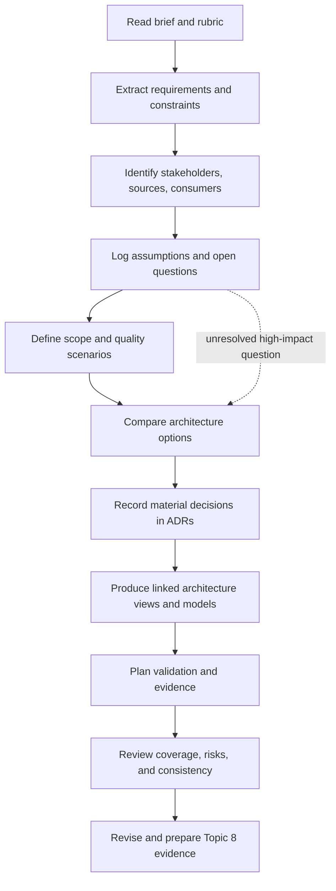
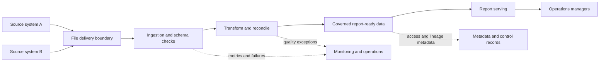

# Capstone Requirements and Architecture Deliverables
## A practical method for turning an enterprise data architecture brief into a traceable plan

**Target file:** `07-capstone-requirements-and-architecture-deliverables.md`  
**Programme location:** Stage 2D — Data Architecture → 16-Enterprise-Data-Architecture-Case-Studies-and-Capstone  
**Learning focus:** Topic 7 — requirements analysis and deliverable planning  
**Status of the real capstone specification:** **Not verified.** The project tree lists the expected brief path, but the exact brief was not returned by a Library search and was not present in the mounted source set during this audit. The module roadmap records that the brief and Topic 7/8 files were empty when that roadmap was written; this is historical evidence, not proof of their current repository state. Consequently, this lesson does not claim that any proposed scenario, deliverable, acceptance threshold, domain, or rubric weight is mandatory. Recheck the actual project file before using this plan for submission.

> **Source-of-truth rule:** If the actual capstone brief or rubric becomes available and differs from this lesson, the actual brief and rubric govern. This file teaches a method; it does not replace the brief.

---

## Contents

1. [Purpose and source boundaries](#1-purpose-and-source-boundaries)
2. [Capstone and requirements foundations](#2-capstone-and-requirements-foundations)
3. [How Stage 2D prepares you](#3-how-stage-2d-prepares-you)
4. [Beginner workflow: analyse the brief](#4-beginner-workflow-analyse-the-brief)
5. [Intermediate workflow: registers and traceability](#5-intermediate-workflow-registers-and-traceability)
6. [Planning architecture deliverables](#6-planning-architecture-deliverables)
7. [Advanced planning, dependencies, and decisions](#7-advanced-planning-dependencies-and-decisions)
8. [Worked illustrative capstone example](#8-worked-illustrative-capstone-example)
9. [Practical exercises and answer guidance](#9-practical-exercises-and-answer-guidance)
10. [Readiness checklist and bridge to Topic 8](#10-readiness-checklist-and-bridge-to-topic-8)
11. [Reusable templates](#11-reusable-templates)
12. [Glossary](#12-glossary)

---

## 1. Purpose and source boundaries

### 1.1 What this lesson is for

An enterprise data architecture capstone is an opportunity to integrate requirements analysis, data architecture, platform design, governance, operations, trade-off analysis, documentation, validation, and communication into one coherent body of work. The goal is not to assemble the largest possible technology stack. The goal is to respond to a defined problem with a defensible architecture whose decisions and evidence can be reviewed.

This lesson teaches you to:

- extract and classify statements from a brief without changing their meaning;
- separate mandatory requirements from assumptions, recommendations, and unanswered questions;
- define scope and boundaries;
- identify stakeholders, consumers, data owners, and decision authorities;
- translate requirements into architecture responses and artefacts;
- plan dependencies, review points, and validation evidence;
- detect missing requirements and unjustified architecture components;
- prepare a reviewable plan that can later be evaluated and defended.

### 1.2 What is known and what is not

The module roadmap describes Topic 7 as a method for reading the capstone brief, extracting requirements, and planning artefacts. It identifies learning outcomes around scope, requirements, assumptions, deliverable mapping, dependencies, validation, and execution planning. It also says the actual project brief and Topic 7/8 files were empty when the roadmap was written.

A Library search for the exact title and path of `Projects/16-enterprise-data-architecture-capstone.md` did not return the brief, and the file itself was not present in the mounted source set. The project-tree snapshot confirms the expected path, but not the file contents. Therefore, this is **not** a claim that the current repository copy is empty; it is a limitation of the source access available for this task. Before committing to a real submission, open the exact brief and associated rubric in the working repository.

**Source provenance note:** the mounted project-tree snapshot inspected was `Roadmap_ptree(20261020-184004).md`. The un-suffixed Library copy `roadmap-Enterprise-Data-Architecture-Case-Studies-and-Capstone.md` and mounted copy `roadmap-Enterprise-Data-Architecture-Case-Studies-and-Capstone(1).md` were both inspected, including Topic 7 and the final capstone execution/deliverable guidance. The audit template was `source_audit/template(20261020-112311).txt`. The project tree lists `16-Enterprise-Data-Architecture-Case-Studies-and-Capstone/Projects/16-enterprise-data-architecture-capstone.md`, but a Library search for that exact title/path did not return the brief, and the brief file itself was not present in the mounted source set. The six generated case-study files and the generated Topic 8 companion lesson were available; the latter is learning guidance, **not** an official rubric. The module roadmap records that the brief and rubric were empty when that roadmap was authored. That is historical source evidence, not proof of their current repository state. Accordingly, this lesson makes no claim about the current contents of the unavailable brief and does not invent mandatory deliverables or official scoring criteria.

Use these labels throughout your work:

| Label | Meaning | Evidence standard | How to handle it |
|---|---|---|---|
| **Confirmed requirement** | Explicit obligation in the controlling brief or rubric | Exact quote or precise source location | Preserve the meaning and trace it |
| **Confirmed constraint** | Explicit boundary on acceptable solutions | Exact source location | Respect it in option evaluation |
| **Confirmed fact** | Information explicitly supplied by the source | Source location | Do not embellish it |
| **Inferred requirement** | A need implied by a confirmed outcome but not stated as an explicit obligation | Reasoned explanation | Flag for confirmation; do not silently promote it to mandatory |
| **Assumption** | A proposition temporarily accepted to proceed | Owner, rationale, impact, confirmation path | Label it and test its consequences |
| **Recommendation** | A useful proposed practice or artefact | Benefit and cost/rationale | Optional unless adopted or required |
| **Open question** | Missing, ambiguous, or contradictory information | Question, impact, owner, needed-by point | Resolve or document the design basis |
| **Validated outcome** | A claim supported by completed checks or evidence | Test, calculation, review, or observation | State the evidence and its limits |

A sentence does not become mandatory merely because it appears in a learning guide, example, diagram, or recommended checklist.

### 1.3 Why the brief comes before technology

Architecture is a response to requirements, constraints, context, and risk. Starting with a preferred database, cloud provider, streaming platform, lakehouse, or AI service can create solution bias: the design begins optimising for a technology before the problem is understood.

The correct order is:

1. Understand the business outcome and scope.
2. Extract requirements and constraints.
3. Identify stakeholders, data, interfaces, and dependencies.
4. Establish measurable quality attributes where evidence permits.
5. Compare feasible architecture options against agreed criteria.
6. Record decisions, consequences, and validation evidence.
7. Select technologies only where they serve the requirements.

**Common error:** treating a product name as a requirement. “Use a streaming platform” is a solution constraint if the brief explicitly mandates it; otherwise, it may be only one candidate response to a freshness or latency need.

---

## 2. Capstone and requirements foundations

### 2.1 Business objective, architecture scope, and outcomes

A **business objective** states the outcome the organisation wants. An **architecture scope statement** defines the systems, domains, capabilities, data flows, consumers, environments, and lifecycle stages included in the design. A **deliverable** is an artefact or result the project expects you to produce. These are related but not interchangeable.

Example (illustrative only):

- Business objective: reduce the time required to produce a trusted operational report.
- Scope: source ingestion, transformation, governed storage, semantic definition, and reporting access.
- Deliverable candidate: a data-flow diagram that explains how the report is produced.
- Validation evidence: the diagram covers every in-scope source-to-consumer path and agrees with the interface inventory.

A scope statement should explicitly record:

- **In scope:** confirmed work and boundaries.
- **Out of scope:** explicitly excluded areas.
- **Not stated / unresolved:** areas the brief does not address.
- **External dependencies:** systems, teams, decisions, and services outside the design boundary.
- **Interfaces:** where responsibilities and contracts cross the boundary.

Do not confuse “not stated” with “out of scope.” Silence is an information gap, not an exclusion.

### 2.2 Functional and non-functional requirements

A **functional requirement (FR)** describes a capability or behaviour: what the solution must do. A **non-functional requirement (NFR)** describes a quality attribute, constraint, or operating property: how well or under what conditions the solution must work.

| Type | Example (illustrative) | What makes it testable |
|---|---|---|
| Functional | The platform shall ingest daily transaction extracts. | Input, schedule, expected output, and failure handling are defined |
| Functional | A consumer shall retrieve a governed customer profile. | Consumer, contract, authorization, and expected response are defined |
| Performance | A specified query shall complete within a stated time under a stated load. | Workload, percentile, load, measurement point, and target are specified |
| Freshness | A dataset shall be available within a stated interval after source change. | Start/end events, percentile or maximum, and exclusions are defined |
| Reliability | A service shall recover within an agreed period after a defined failure. | Failure scenario, recovery objective, and validation method are specified |
| Security | Access shall be limited to authorised identities and approved purposes. | Identity source, policy, enforcement point, and negative tests are specified |
| Data quality | A critical field shall meet a defined validity or completeness rule. | Population, rule, tolerance, measurement window, and owner are defined |
| Cost | A workload shall remain within an agreed budget or unit-cost range. | Included cost components, workload denominator, and measurement period are defined |

Do not invent numerical targets. If the brief says “low latency” but supplies no target, record an open question or propose a labelled provisional range for discussion. A measurable requirement typically states:

- **Subject:** system, dataset, interface, or capability;
- **condition:** workload, volume, time window, failure, or context;
- **measure:** latency, freshness, completeness, availability, recovery time, cost, etc.;
- **threshold or expected behaviour:** supplied by the source or explicitly proposed;
- **verification:** test, calculation, inspection, simulation, or review;
- **owner:** role that can confirm the requirement.

### 2.3 Constraints, assumptions, dependencies, risks, and questions

These concepts are often confused:

- **Constraint:** a limit the design must obey, such as a mandated integration boundary or available environment.
- **Assumption:** a proposition treated as true temporarily because the evidence is incomplete.
- **Dependency:** something that must be available or decided before an activity or outcome can proceed.
- **Risk:** an uncertain event or condition that could affect objectives, with likelihood and impact assessed where possible.
- **Open question:** information needed to remove ambiguity or choose between materially different designs.
- **Issue:** a condition already occurring and requiring action.

An assumption is not a fact merely because it is written down. A dependency is not necessarily a risk, although a dependency can create risk. A question should have an owner and a decision date if it affects sequencing.

### 2.4 Stakeholders, consumers, and ownership

Stakeholders may include business sponsors, data producers, data owners, stewards, architects, engineers, security and privacy reviewers, platform operators, analysts, application teams, auditors, and users of data products. A stakeholder is not automatically the decision-maker for every requirement.

For each relevant stakeholder or role, record:

- interest or outcome;
- data or service consumed or owned;
- decision authority;
- responsibilities and hand-offs;
- required consultation or approval;
- evidence they can supply or validate.

Use role names rather than inventing individual identities. Distinguish the **data owner** (accountable for data meaning, access, and appropriate use under the organisation’s model) from the **platform operator** (responsible for operating the technical service). The actual accountability model must be confirmed for the scenario.

### 2.5 Quality attributes and acceptance criteria

A quality-attribute scenario makes a vague concern concrete. A useful structure is:

**Stimulus → context → response → measurable response measure.**

Illustrative example:

> During the agreed peak reporting window, a defined report request arrives at the serving layer. Under the agreed concurrent workload and dataset size, the 95th-percentile response time remains within the target specified by the business owner. The performance test records workload parameters, result correctness, and timing.

The target is deliberately not supplied here because no real capstone target was available.

Acceptance criteria should be observable and repeatable. “The design is scalable” is not an acceptance criterion. “The capacity model documents expected growth, identifies the bottleneck under the stated workload, and provides a validation method” is reviewable, although a quantitative performance target would still be needed if the brief requires one.

### 2.6 Traceability and evidence

Traceability connects the original need to the architecture response and proof:

**Source statement → requirement → decision or design response → deliverable → validation method → evidence → review status.**

Traceability is useful for answering:

- Where did this requirement come from?
- Which design element addresses it?
- What evidence shows the requirement is satisfied?
- What changes if the requirement changes?
- Why is this component in the architecture?
- Which requirements remain uncovered?

Traceability is not a paperwork exercise. It is a mechanism for controlling scope, making decisions explainable, and finding gaps before review.

---

## 3. How Stage 2D prepares you

The master project tree places this topic in **Stage 2D — Data Architecture**, within module **16 — Enterprise Data Architecture Case Studies and Capstone**. The module roadmap positions the six case studies before Topic 7 and Topic 8. It also identifies Topic 7 as the bridge from case-study learning to a plan for the actual capstone.

The connections below are **recommended learning integration**, not a claim that every module must appear in every capstone. Include a domain only when the actual brief, a confirmed requirement, or a justified design decision makes it relevant.

| Stage 2D area | How it can contribute | Evidence to reuse or adapt | Guardrail |
|---|---|---|---|
| Architecture principles and design | Establish evaluation criteria and explain boundaries | Principle list, option criteria | Do not treat a principle as a requirement unless adopted |
| Conceptual, logical, and physical data modelling | Clarify entities, relationships, grain, identifiers, and constraints | Model views, data dictionary | Model only the domains in scope |
| Database and storage architecture | Match storage patterns to access, consistency, retention, and lifecycle needs | Storage comparison, logical layout | Avoid selecting storage by familiarity alone |
| Data integration and interoperability | Define source-to-target paths, interfaces, contracts, CDC/batch/event patterns, and failure handling | Interface inventory, flow diagrams | Do not assume streaming is necessary |
| Enterprise platform and lakehouse | Describe ingestion, processing, metadata, serving, isolation, and platform responsibilities | Logical platform view | Do not draw layers without assigning responsibilities |
| Cloud, hybrid, and multi-cloud | Evaluate deployment, identity, connectivity, portability, and provider trade-offs | Environment view, option matrix | Multi-cloud is not inherently superior |
| Streaming and real-time architecture | Translate latency, event-time, replay, and state requirements into patterns | Event flow, latency budget, failure modes | Use only if the business need supports it |
| Governance, security, privacy, and compliance | Clarify classification, identity, access, retention, consent, and evidence | Access matrix, control map | Do not invent legal or regulatory obligations |
| Metadata, lineage, quality, and master data | Define ownership, discoverability, lineage, quality rules, identifiers, and entity resolution | Metadata/lineage view, quality register | Distinguish source facts from proposed controls |
| Reliability, resilience, and disaster recovery | Define failure domains, recovery objectives, backups, replay, and operational response | Recovery plan, runbooks, test evidence | Do not claim an RTO/RPO unless specified or labelled proposed |
| Performance, scalability, and cost | Model workload, capacity, latency, growth, and unit economics | Capacity/cost model, performance test plan | Identify assumptions and measured versus estimated values |
| Data access, serving, semantic, and AI architecture | Match consumers to interfaces, semantic contracts, features, embeddings, or retrieval where needed | Consumer map, serving design | AI or RAG is not mandatory because a case study covers it |
| Architecture documentation and operating model | Make views, ADRs, risks, ownership, migration, and communications reviewable | Diagrams, ADRs, risk register, operating model | Keep diagrams consistent and purpose-specific |

### 3.1 Reusing the six case studies intelligently

The roadmap’s six case-study frames are banking platform, Customer 360/master data, real-time fraud/risk, lakehouse modernization, multi-cloud, and governed RAG/enterprise knowledge. Use them as sources of questions and trade-off patterns, not as architectures to copy.

| Case-study frame | Potential lesson to investigate | What must be revalidated before reuse |
|---|---|---|
| Banking data platform | Cross-domain integration, governance, resilience | Actual domain, risk tolerance, source constraints, and controls |
| Customer 360/master data | Identity resolution, golden records, ownership | Matching quality, survivorship rules, consent, and data authority |
| Real-time fraud/risk | Latency budgets, state, event ordering, false positives | Whether real-time decisions are needed and what stale data means |
| Lakehouse modernization | Current-to-target transition, coexistence, rollback | Migration constraints, legacy dependencies, and acceptable disruption |
| Multi-cloud platform | Portability, networking, egress, operational complexity | Business reason for multiple clouds and actual portability needs |
| Governed RAG/enterprise knowledge | Permission-aware retrieval, citations, source freshness | Whether AI retrieval is in scope and what access guarantees are required |

A lesson transfers only when the underlying forces match. For example, low-latency streaming patterns from a fraud scenario do not prove that a reporting platform needs streaming. Record both the reusable principle and the reason the original implementation may not fit.

---

## 4. Beginner workflow: analyse the brief

### 4.1 Three-pass reading method

**Pass 1 — Understand the whole brief.** Read it from beginning to end without designing a solution. Identify the business problem, intended outcomes, actors, systems, scope, and submission expectations.

**Pass 2 — Extract obligation language.** Mark terms such as *must*, *shall*, *required*, *include*, *submit*, and *demonstrate*. Also mark softer terms such as *should*, *may*, *consider*, and *recommended*. Do not classify based on one word alone; read the sentence and any definitions in the brief.

**Pass 3 — Capture every boundary and uncertainty.** Record names, numbers, dates, technologies, data sources, interfaces, constraints, exclusions, dependencies, acceptance conditions, and statements that are ambiguous or contradictory.

Then compare the extracted list against the original brief. Every extracted item should have a source location, and every apparent obligation in the source should have been considered.

### 4.2 Classify each statement

Ask these questions in order:

1. Does the brief explicitly require an outcome or artefact? If yes, record a confirmed requirement.
2. Does it constrain how the outcome may be achieved? Record a constraint.
3. Does it provide a fact or baseline? Record a confirmed fact with source.
4. Does it suggest a solution without requiring it? Record it as a recommendation or candidate option.
5. Does the design depend on information that is absent? Record an assumption and/or open question.
6. Does a need appear implied but unstated? Record an inferred requirement and seek confirmation.
7. Does the statement conflict with another statement? Record a conflict; do not silently choose one.

### 4.3 Illustrative brief for practice only

The following mini-brief is invented to demonstrate the method. It is **not the real capstone scenario**.

> “An organisation wants a trusted daily operational report assembled from two existing source systems. The report is used by operations managers. Source data is currently delivered as files. The proposed design must document how data is ingested and transformed. The design should consider data quality and access control. The current source systems will remain in place during the initial delivery. The report should be available by the start of the business day. The brief does not define report latency, source volume, retention, recovery objectives, technology, or cost limits.”

A careful extraction could be:

**Identifier scope:** IDs in this mini-brief use the `EX1-` prefix. Section 8 is a separate synthetic worked example and uses `I-` IDs. These are independent example registers; do not merge them. A real capstone should use one stable project-wide ID scheme.

| ID | Extracted statement | Classification | Reason / next action |
|---|---|---|---|
| EX1-REQ-01 | Produce a trusted daily operational report from two source systems | Confirmed functional outcome | Clarify what “trusted” means and who accepts it |
| EX1-REQ-02 | Report is used by operations managers | Confirmed stakeholder/consumer fact | Identify decision use and access needs |
| EX1-REQ-03 | Source data is delivered as files | Confirmed interface fact | Confirm format, schedule, size, schema, and delivery guarantees |
| EX1-REQ-04 | Document ingestion and transformation | Confirmed deliverable requirement | Exact required detail and format remain unspecified |
| EX1-REC-01 | Consider data quality and access control | Recommendation / requested consideration | Include an assessment; do not infer a specific control framework |
| EX1-CON-01 | Source systems remain in place during initial delivery | Confirmed constraint | Design around coexistence; clarify duration and permitted source changes |
| EX1-REQ-05 | Report should be available by the start of the business day | Requirement with ambiguous acceptance condition | Ask for timezone, business-day definition, and freshness target |
| EX1-Q-01 | What does “trusted” mean? | Open question | Propose quality rules and obtain owner approval |
| EX1-Q-02 | What are the source volumes and growth rates? | Open question | Needed for capacity and cost estimates |
| EX1-Q-03 | What are retention and recovery expectations? | Open question | Needed before asserting lifecycle/recovery design |
| EX1-Q-04 | Are any technologies mandated? | Open question | Do not select a stack before clarification |

Notice that the example does not convert “should consider” into a mandatory security architecture, and it does not invent a numerical freshness target. The appropriate response to missing information is a question, a labelled assumption, or an explicitly provisional recommendation.

### 4.4 Stakeholder and outcome discovery

For each stakeholder, ask:

- What decision or task does the data enable?
- What is the consequence of incorrect, late, missing, or inaccessible data?
- What data do they own, produce, or consume?
- Who can approve the meaning and quality of the data?
- Who approves access and retention?
- Who operates the pipeline and responds to failure?
- What evidence would convince them that the outcome is acceptable?

Record the answer and source. If you infer an answer, label it as an inference.

### 4.5 Define scope boundaries before diagrams

Write a short scope statement before choosing components. It should identify the business capability, source and consumer boundaries, data lifecycle, interfaces, environments, and major exclusions. Include a “not stated” list so that missing information is not mistaken for an agreed exclusion.

**Common errors**

- reading only headings or the last page;
- treating every recommendation as a must;
- ignoring appendices, tables, rubric, or linked project files;
- turning an ambiguous adjective into a fabricated metric;
- assuming the architecture includes every Stage 2D domain;
- designing components before defining the problem;
- leaving questions without an owner or decision point.

---

## 5. Intermediate workflow: registers and traceability

### 5.1 Requirement register

A requirement register is the controlled list of requirements. It should preserve the source meaning and make each item uniquely referable.

Recommended fields (adapt to the real brief; no field below is a mandatory rubric requirement by itself):

| Field | Purpose |
|---|---|
| Requirement ID | Stable unique identifier, e.g. `FR-001`, `NFR-001` |
| Statement | One clear, atomic requirement |
| Type | Functional, quality attribute, data, interface, security, operational, constraint, or other local taxonomy |
| Source | File, section, paragraph, or stakeholder statement |
| Rationale | Why it matters / business outcome |
| Priority | Use the brief’s categories if defined; otherwise record “not defined” or propose a labelled local scheme |
| Owner | Person or role that can clarify or accept it |
| Acceptance condition | Observable condition, source-defined or clearly provisional |
| Validation method | Test, calculation, inspection, simulation, review, or demonstration |
| Status | Draft, confirmed, needs clarification, accepted, implemented, validated, deferred, rejected—adapt to project conventions |
| Links | Related ADRs, artefacts, risks, dependencies, evidence |

Keep one requirement per row. Split compound requirements when their clauses could pass or fail independently. Preserve a parent ID if decomposition is needed.

### 5.2 Stakeholder map

| Stakeholder / role | Desired outcome | Data / service relationship | Decision or approval | Evidence contribution |
|---|---|---|---|---|
| Business sponsor | Business outcome | Consumes reports or capabilities | Scope and outcome acceptance | Business context and acceptance feedback |
| Data owner | Correct, appropriately used data | Owns meaning/access decisions for a domain | Data definition and permitted use | Definitions, quality expectations |
| Source-system owner | Safe source integration | Produces data or interface | Source contract and change coordination | Schema, schedule, limits |
| Platform operator | Operable and supportable service | Operates platform/pipelines | Operational procedures within authority | Monitoring, recovery, capacity evidence |
| Security/privacy reviewer | Risks and controls addressed | Reviews sensitive data and access paths | Approval under actual governance | Threat/control review |
| Consumer representative | Useful and understandable outputs | Uses data products/interfaces | Consumer acceptance as agreed | Use cases, correctness checks |

This is a starter map, not a claim that every role exists in the real project. Combine roles where appropriate and identify genuine approval authority rather than assuming it.

### 5.3 Assumption register

| ID | Assumption | Why needed | Impact if false | Validation / owner | Status |
|---|---|---|---|---|---|
| ASM-001 | Illustrative: source files arrive once per day | Needed to sketch a batch workflow | A higher cadence could change ingestion design | Confirm with source owner | Unconfirmed |

Rules:
- Make assumptions explicit and atomic.
- State the consequences if the assumption is false.
- Assign a person or role to confirm it.
- Do not hide a material decision inside a diagram.
- Replace assumptions with confirmed facts when evidence arrives; retain history where it explains a decision.

### 5.4 Constraint and dependency registers

**Constraint register**

| ID | Constraint | Source | Effect on options | Owner / clarification | Status |
|---|---|---|---|---|---|
| CON-001 | Source system must remain in place during initial delivery (illustrative) | Illustrative brief, sentence 6 | Requires coexistence and limits source replacement | Source owner | Confirmed in example |

**Dependency register**

| ID | Dependency | Needed by | Consequence if late/unavailable | Owner | Mitigation / fallback |
|---|---|---|---|---|---|
| DEP-001 | Source schema and sample files | Interface design and quality rules | Rework in mapping and tests | Source owner | Use labelled synthetic schema only for early modelling |

A dependency should be actionable. “Security” is too broad; “approved identity group mapping for the consumer roles” is more useful.

### 5.5 Risk register

Use a consistent risk statement:

**Because of [cause], [uncertain event] may occur, leading to [impact].**

| ID | Risk statement | Likelihood | Impact | Response | Owner | Trigger / evidence |
|---|---|---|---|---|---|---|
| RSK-001 | Because source volume is unknown, capacity estimates may be materially wrong, leading to redesign | To be assessed | To be assessed | Obtain volume profile; mark estimates provisional | Data/platform lead | Source profile received |

Do not assign numerical likelihood or impact scales unless the project defines or agrees them. “To be assessed” is better than false precision.

### 5.6 Open-question log

| ID | Question | Why it matters | Decision needed by | Owner | Interim handling |
|---|---|---|---|---|---|
| Q-001 | What does “available by business day start” mean, including timezone and percentile? | Defines freshness and test conditions | Before selecting ingestion/processing cadence | Business owner | No final freshness claim until answered |

A good question is specific enough to answer. Bundle related questions only when the same owner can answer them together.

### 5.7 Quality-attribute scenario register

| ID | Attribute | Stimulus / context | Expected response | Measure / target | Validation |
|---|---|---|---|---|---|
| QA-001 | Freshness | New source file arrives during the agreed operating window | Data is processed and report is available | Target pending business confirmation | Timed end-to-end test using defined event timestamps |
| QA-002 | Recoverability | A processing stage fails after partial work | Pipeline resumes without missing or double-counting records beyond defined semantics | Recovery and reconciliation targets pending | Failure-injection or documented tabletop test |

The scenarios above are illustrative. Targets remain unresolved until supplied or approved. Do not state that a quality attribute is met merely because the architecture diagram contains a component associated with it.

### 5.8 Requirement-to-architecture traceability

The core matrix is:

| Req ID | Requirement / source | Design response or ADR | Deliverable | Validation method | Evidence reference | Status |
|---|---|---|---|---|---|---|
| EX1-REQ-04 | Document ingestion and transformation; illustrative brief sentence 5 | Define source interface, transformation responsibilities, and error handling | EX1-D-03 Data-flow and integration view | Review against source-to-report paths and failure cases | EX1-EV-003, once produced | Planned |

A robust traceability chain may contain more than one design response or deliverable. Keep links specific; “architecture document” alone is not enough.

### 5.9 Requirement-to-validation mapping

| Req ID | Acceptance condition | Validation activity | Pass/fail evidence | Owner | Result |
|---|---|---|---|---|---|
| I-FR-001 | Report reconciles to approved source totals for the agreed population and period (illustrative proposed criterion) | Reconciliation test with defined tolerance and exception handling | Test output, input snapshot, run ID, exceptions | Data owner / test lead | Not run |

Use this distinction:
- **Planned:** validation activity is defined.
- **Executed:** the activity ran.
- **Passed:** results met the agreed condition.
- **Not verifiable:** evidence or test conditions are unavailable, with reason recorded.

### 5.10 Detect orphaned requirements and unjustified components

Two complementary checks are essential:

1. **Forward coverage:** every confirmed requirement maps to a design response, one or more deliverables, and a validation method or an explicit reason why validation is not currently possible.
2. **Reverse justification:** every significant architecture component, data store, interface, control, or operational process maps to a requirement, constraint, risk treatment, or documented architecture rationale.

An orphan requirement has no response. An orphan component has no justification. A component can be justified by a cross-cutting risk or operational need even when it is not directly named in the brief, but that rationale must be explicit and proportionate.

---

## 6. Planning architecture deliverables

### 6.1 How to decide which artefacts to produce

Start with the exact deliverables named by the brief and rubric. Add supporting artefacts only when they are needed to explain a requirement, evaluate a decision, validate a claim, or make the design reviewable. Mark every added artefact **Recommended** until it is required by the source or explicitly adopted in the project plan.

The inventory below is a menu of common architecture artefacts, not a mandatory checklist.

| Artefact | Purpose and typical content | Typical linked needs | Dependencies | Validation method | Status unless source says otherwise |
|---|---|---|---|---|---|
| Requirements summary and register | Captures outcomes, requirements, source, owner, acceptance, status | Scope, behaviour, quality attributes | Brief and stakeholder discovery | Source coverage and traceability review | Recommended |
| Scope and context view | Shows system boundary, actors, external systems, responsibilities | Boundary and interface understanding | Stakeholder/source inventory | Every in/out boundary and external dependency is identified | Recommended |
| Logical architecture view | Shows capabilities, components, responsibilities, and major relationships without binding every detail to deployment | Architecture structure | Requirements and option analysis | Every component has responsibility and justification | Recommended |
| Physical/deployment view | Shows environments, placement, connectivity, trust zones, and runtime dependencies | Deployment or infrastructure requirements | Logical view, platform constraints | Consistency with network, identity, and operating assumptions | Conditional |
| Data-flow diagram | Shows sources, transformations, stores, consumers, direction, and trust boundaries | Data movement, integration, security, lineage | Source/interface inventory | Flow inventory reconciles to all in-scope paths | Recommended when flows matter |
| Data model / data dictionary | Defines entities, grain, keys, relationships, semantics, quality rules | Data correctness and contracts | Domain and consumer requirements | Model review, key/grain checks, sample mapping | Conditional |
| Interface / data contract | Defines schema, meaning, cadence, compatibility, error handling, ownership | Integration and consumer contracts | Source and consumer discovery | Contract review and compatibility tests | Conditional |
| Integration/platform design | Explains batch, CDC, events, APIs, storage, processing, orchestration, and failure handling as relevant | Data movement and processing | Flow and quality requirements | End-to-end flow and failure-path review | Conditional |
| Governance/security model | Defines classification, ownership, identity, authorization, retention, audit, and control points | Confirmed governance/security requirements or identified risks | Data classification and access needs | Threat/control review and negative tests where applicable | Conditional |
| Metadata/lineage/quality design | Defines catalog, ownership, lineage, quality checks, and issue handling | Discoverability, traceability, trust | Data products and pipeline design | Lineage walk-through and quality-rule tests | Conditional |
| Reliability/recovery plan | Defines failure scenarios, backup/replay, recovery roles, and objectives | Availability and recoverability needs | Dependency and failure analysis | Recovery exercise or documented tabletop | Conditional |
| Performance/capacity/cost analysis | States workload assumptions, sizing, growth, bottlenecks, unit cost, sensitivity | Performance or cost requirements | Workload profile and platform choices | Reproducible calculations and test plan | Conditional |
| Architecture decision record (ADR) | Records context, decision, alternatives, consequences, risks, and revisit triggers | Material design choices | Requirements and option analysis | Peer review and traceability check | Recommended for material decisions |
| Risk/trade-off register | Makes uncertainty, consequences, mitigation, and ownership visible | Design risk and conflict | Requirements and architecture options | Risk statements and responses reviewed | Recommended |
| Migration/implementation plan | Sequences changes, coexistence, dependencies, rollback, and milestones | Transition or implementation requirement | Current/target state and dependency analysis | Critical path, rollback, and feasibility review | Conditional |
| Operating model / runbook outline | Defines ownership, support, monitoring, escalation, and recurring operations | Operational readiness | Service boundaries and failure analysis | Role and scenario walk-through | Conditional |
| Validation/evidence register | Maps claims and requirements to tests, calculations, reviews, and results | Proof of design claims | Acceptance conditions | Evidence is traceable, reproducible, and labelled honestly | Recommended |
| Review/defense materials | Explains problem, design, decisions, evidence, limitations, and open questions | Review or defense requirement | Stable architecture and evidence | Mock review and corrective-action tracking | Conditional |

### 6.2 Deliverable inventory with status and completion definition

For each artefact, record:

- ID and title;
- source requirement or rationale;
- mandatory/recommended/conditional classification;
- purpose and intended audience;
- required content;
- linked requirements and ADRs;
- dependencies and owner;
- validation method and evidence location;
- status and remaining gaps.

Use status values that suit the project. A simple suggested lifecycle is `Not started → Draft → In review → Revised → Validated`; add `Blocked` or `Not applicable` when useful. A status label is not evidence by itself.

### 6.3 Diagram quality and consistency

A diagram should answer a specific question for a defined audience. A context diagram is not a deployment diagram; a data-flow diagram is not a logical component view. Avoid using one diagram to express every concern.

Review diagrams for:

- consistent names and component boundaries;
- explicit external systems and interfaces;
- direction and meaning of data flows;
- trust boundaries and identity/control points where relevant;
- alignment with data models, ADRs, risks, and text;
- assumptions and omitted details clearly stated;
- no component that lacks a purpose or traceability.

Use Mermaid when useful, but diagrams should clarify architecture rather than decorate a document.

### 6.4 Example: requirement-to-deliverable inventory

For the `EX1-` illustrative daily-report brief in Section 4.3:

| Deliverable ID | Candidate artefact | Why it is useful | Source classification | Validation |
|---|---|---|---|---|
| EX1-D-01 | Requirements register and scope statement | Preserves the brief and unresolved boundaries | Recommended supporting artefact | Source statements reconciled; open questions visible |
| EX1-D-02 | Context diagram | Shows two source systems, report capability, and operations consumers | Recommended | Actors and boundaries agree with the illustrative brief |
| EX1-D-03 | Data-flow and integration view | Explains the requested ingestion and transformation design | Supports confirmed EX1-REQ-04 | Source-to-report path and failure paths reviewed |
| EX1-D-04 | Data dictionary / report data model | Helps define “trusted” and reconcile fields | Conditional on detail needed to meet outcome | Owner-approved definitions and key/grain review |
| EX1-D-05 | Quality and reconciliation plan | Converts “trusted” into measurable checks | Recommended pending owner definition | Rules trace to agreed definitions; test evidence recorded |
| EX1-D-06 | Access-control considerations | Addresses the request to consider access control | Recommended consideration, not a specific mandated framework | Roles, data sensitivity, and access assumptions reviewed |
| EX1-D-07 | ADR for ingestion pattern | Explains why the chosen batch/API/CDC/event approach fits | Recommended if a material choice is made | Alternatives and trade-offs are documented |
| EX1-D-08 | Performance/capacity estimate | Sizes the solution once volume and freshness needs are known | Conditional; currently blocked by missing inputs | Assumptions and calculations are reproducible |

The table intentionally uses different classifications. One artefact may support a confirmed requirement without being explicitly named as a required file. Do not represent it as a mandated deliverable unless the source does so.
---

## 7. Advanced planning, dependencies, and decisions

### 7.1 Plan the work in dependency order

A useful default sequence is shown below. It must be adapted to the actual brief; it is not an official schedule.



Why this order works:
- requirements and constraints constrain the option space;
- source and consumer inventories ground the data flows;
- high-impact questions are surfaced before they trigger major rework;
- decisions precede detailed views that depend on them;
- validation is designed alongside the architecture rather than added at the end.

Some activities can run in parallel. For example, a stakeholder map and source inventory can be developed together. A time-boxed discovery task can unblock an uncertain choice. Do not make the schedule look more certain than the available information allows.

### 7.2 Identify the critical path

The **critical path** is the chain of dependent activities that determines the earliest possible completion. Estimate effort and duration separately: ten hours of work may take several calendar days if it waits for an owner’s answer.

For each task, record:
- output;
- prerequisites;
- estimated effort or range;
- external wait time;
- owner;
- review point;
- exit condition;
- risk if delayed.

If the brief or rubric is unavailable, the critical path is provisional. The first gating action is obtaining and confirming the controlling source documents.

### 7.3 Resolve conflicting requirements

When two requirements appear to conflict:

1. Quote both requirements and identify their sources.
2. Determine whether the conflict is real, or whether terms/contexts differ.
3. Identify the authority that can clarify or accept the trade-off.
4. Establish decision criteria before comparing options.
5. Generate plausible alternatives, including a scope or requirement change.
6. Compare consequences, risks, costs, reversibility, and evidence.
7. Record the decision and residual risk in an ADR or decision log.
8. Update affected requirements, diagrams, tests, risks, and plan.

Do not silently optimise one quality attribute at the expense of another. If the requirements cannot both be met, document the conflict and seek an authorised resolution. Do not invent which stakeholder has authority.

### 7.4 Architecture decision records (ADRs)

An ADR preserves why a material decision was made, not merely what was chosen.

Recommended structure:

- **ID and title**
- **Status:** proposed, accepted, superseded, or local equivalent
- **Context:** requirements, constraints, evidence, and problem
- **Decision drivers:** criteria used to evaluate options
- **Options considered:** credible alternatives
- **Decision:** selected approach and scope of applicability
- **Consequences:** benefits, costs, limitations, and new obligations
- **Risks and mitigations**
- **Linked requirement IDs and artefacts**
- **Validation plan / revisit trigger**
- **Approver or decision authority**, if known

Avoid fake alternatives written only to make the chosen option appear inevitable. A good ADR shows a real decision and the trade-off accepted. If new evidence changes the situation, supersede the decision and record why rather than silently rewriting history.

### 7.5 Evidence register

An evidence register makes claims auditable.

| Evidence ID | Claim / requirement | Evidence type | Source or location | Date/version | Limitations | Reviewer/status |
|---|---|---|---|---|---|---|
| EV-001 | Example: source-to-report reconciliation is correct | Test result | Test output, input snapshot, run ID | To be recorded | Only covers stated population and period | Not yet produced |

Classify claims accurately:
- **Fact:** supplied or directly observed;
- **Assumption:** temporarily accepted;
- **Estimate:** calculated from stated assumptions;
- **Hypothesis:** plausible but untested;
- **Recommendation:** proposed action;
- **Validated outcome:** supported by a completed check.

A diagram is evidence that a design was documented; it is not, by itself, evidence that the design meets runtime performance or security targets.

### 7.6 Change impact analysis and scope control

When a requirement changes, assess its impact across:
- linked requirements and acceptance conditions;
- architecture decisions and alternatives;
- logical/physical views, data models, and interfaces;
- governance, risk, and operational controls;
- tests, evidence, and completion status;
- dependencies, schedule, effort, and cost;
- stakeholder approvals and communications.

Use a change record containing the request, reason, source/authority, affected IDs, options, decision, approval, and update status. Keep a **parking lot** for useful ideas outside current scope. Revisit parked items only when there is a reason; do not quietly add them to the commitment.

### 7.7 Cross-case-study lesson transfer

Use a lessons-and-transfer table:

| Lesson | Origin frame | Conditions that made it useful | Capstone match | Difference / risk | Decision |
|---|---|---|---|---|---|
| Budget latency end-to-end rather than per component | Fraud/risk frame | A real-time decision has a defined response deadline | Unknown until brief is read | Daily reporting may not need streaming | Investigate only if freshness/latency requires it |

This prevents “pattern cargo culting”: adopting a familiar pattern because it appeared in a prior case rather than because it fits the current requirements.

---

## 8. Worked illustrative capstone example

**Important:** Everything in this section is synthetic and illustrative. It is not the real capstone brief and does not establish mandatory deliverables, technology choices, or official acceptance criteria.

### 8.1 Illustrative scenario

A fictional organisation wants a trusted daily operational report assembled from two existing source systems. Operations managers consume the report. The sources deliver files. The initial design must leave source systems in place and explain ingestion and transformation. Data quality and access control should be considered. The brief does not specify source volume, exact freshness target, retention, recovery objectives, budget, technology, or formal rubric.

### 8.2 Brief extraction and scope

**Proposed objective:** make a daily operational report available to operations managers using data from the two existing source systems.

**Candidate in-scope boundary (illustrative):**
- receipt of source files;
- schema and data-quality checks;
- transformation and reconciliation;
- governed storage of report-ready data;
- report-serving interface;
- monitoring and operational ownership needed to explain the flow.

**Out of scope only if explicitly agreed:** replacing source systems, redesigning upstream business processes, building unrelated real-time analytics, or introducing an AI/RAG capability. Until confirmed, these are proposed exclusions, not facts from the real project.

**Not stated / unresolved:** report meaning and correctness rules; file format and delivery window; source volume/growth; business-day timezone; freshness target; access roles; retention; recovery needs; budget; target deployment environment; rubric and submission format.

### 8.3 Illustrative requirement register

| ID | Statement | Type | Source / status | Acceptance condition | Validation |
|---|---|---|---|---|---|
| I-FR-001 | Produce a daily operational report from two source systems | Functional outcome | Synthetic brief; confirmed within example | Report covers agreed source population and reporting period | Owner-approved reconciliation and consumer review |
| I-FR-002 | Document ingestion and transformation | Deliverable / functional explanation | Synthetic brief; confirmed within example | View explains sources, transformations, outputs, and failure paths | Architecture review |
| I-CON-001 | Keep source systems in place for initial delivery | Constraint | Synthetic brief; confirmed within example | Design does not require source replacement | Boundary and dependency review |
| I-NFR-001 | Make report available by start of business day | Freshness / availability requirement, ambiguous | Synthetic brief; target unresolved | Exact time, timezone, and measurement condition to be approved | Timed end-to-end validation after target is agreed |
| I-REC-001 | Consider data quality and access control | Recommended consideration | Synthetic brief | Relevant rules and access assumptions are discussed and decisions documented | Review of quality and access notes |
| I-Q-001 | Define “trusted” in measurable terms | Open question | Missing definition | Business/data owner approves definitions and rules | Signed-off rule catalogue or review record |
| I-Q-002 | Confirm source volumes and growth | Open question | Missing data | Source profile obtained | Source owner evidence |
| I-Q-003 | Confirm retention and recovery needs | Open question | Missing data | Requirements clarified or explicitly left unresolved | Owner decision record |

`I-` indicates illustrative IDs. In a real project, choose a stable naming convention and avoid reusing IDs after deletion; mark obsolete records instead.

### 8.4 Illustrative assumptions and risk log

| ID | Entry | Impact if wrong | Next action |
|---|---|---|---|
| I-ASM-001 | Daily file delivery is adequate for the intended report | More frequent updates may require a different integration pattern | Confirm source cadence and business freshness |
| I-ASM-002 | Source data can be reconciled using agreed keys or totals | Missing keys may require data-quality remediation or a different matching method | Inspect sample schema and consult data owner |
| I-RSK-001 | Unknown source volume could invalidate capacity estimates | Performance, cost, or delivery window may be missed | Obtain volume/growth profile before sizing |
| I-RSK-002 | “Trusted” remains undefined | Teams may disagree about correctness and acceptance | Define quality dimensions and owners |
| I-Q-004 | Who can access the report and underlying detail? | Overly broad or overly restrictive access | Obtain consumer-role and sensitivity requirements |

No likelihood score, cost, RTO, or latency number is invented here.

### 8.5 Illustrative architecture boundary



This is a logical flow, not a deployment diagram. It does not prescribe products, network topology, cloud, or storage technology. The metadata and monitoring paths are recommended design considerations; confirm the needed depth against the actual brief.

### 8.6 Illustrative deliverable inventory

| ID | Artefact | Status | Links | Dependencies | Validation |
|---|---|---|---|---|---|
| I-D-01 | Requirements, scope, assumptions, and questions | Recommended | I-FR-001..002, I-CON-001, I-NFR-001 | Brief extraction | Source statements and unresolved points reconciled |
| I-D-02 | Context diagram | Recommended | I-FR-001 | Stakeholder/system inventory | Actors and boundary reviewed |
| I-D-03 | Data-flow and integration view | Recommended | I-FR-002 | Source formats and flow inventory | Every in-scope source-to-report path and error path shown |
| I-D-04 | Data dictionary and quality/reconciliation rules | Conditional / recommended | I-FR-001, I-Q-001 | Source samples, business definitions | Data owner review and sample checks |
| I-D-05 | Access-control considerations | Recommended | I-REC-001, I-Q-004 | Roles and data sensitivity | Role/use-case review; test plan where applicable |
| I-D-06 | ADR for ingestion pattern | Recommended if a material choice is made | I-FR-001, I-NFR-001 | Cadence, volumes, constraints | Alternatives and consequences reviewed |
| I-D-07 | Capacity/cost analysis | Conditional | I-Q-002 and confirmed budget/performance needs | Volume profile, platform options | Reproducible assumptions and calculations |
| I-D-08 | Validation/evidence register | Recommended | All applicable requirements | Acceptance conditions | Each claim has evidence or a gap entry |

### 8.7 Requirement-to-deliverable traceability

| Requirement | Design response | Deliverable | Evidence planned | Coverage |
|---|---|---|---|---|
| I-FR-001 | Source-to-report flow plus agreed data semantics and reconciliation | I-D-02, I-D-03, I-D-04 | Owner review and reconciliation test | Planned; acceptance details partly unresolved |
| I-FR-002 | Explain ingestion, transformations, outputs, and failure handling | I-D-03 | Flow and failure-path review | Planned |
| I-CON-001 | Retain source systems; define integration boundary | I-D-01, I-D-02, I-D-03 | Scope and boundary review | Planned |
| I-NFR-001 | Design for an agreed reporting window after clarification | I-D-01, I-D-03, I-D-07 if sizing is required | Timed end-to-end test against approved target | Blocked pending definition |
| I-REC-001 | Record relevant quality and access-control considerations | I-D-04, I-D-05 | Review record | Recommended; detailed requirements to be confirmed |

The mapping exposes an important gap: the freshness requirement cannot be validated until the business-day definition and target are agreed. The correct status is **Blocked / needs clarification**, not “passed.”

### 8.8 Dependency plan and review checkpoints

| Checkpoint | Work | Exit condition | Main risk if skipped |
|---|---|---|---|
| C1 — Source confirmation | Read actual brief/rubric; confirm source facts and scope | Requirements extracted with source locations | Entire plan may be aimed at the wrong problem |
| C2 — Discovery | Stakeholder, interface, volume, and quality discovery | Material questions have owners and due points | Late design rework |
| C3 — Requirements baseline | Confirm requirement statements and acceptance conditions | No unexplained ambiguous “must” statement | Unverifiable architecture |
| C4 — Option review | Compare plausible integration/storage/serving options | Criteria and trade-offs documented | Technology-first design |
| C5 — Architecture review | Review diagrams, models, ADRs, and risk responses | Cross-artefact consistency checked | Contradictory documents |
| C6 — Validation planning | Define tests, calculations, review evidence | Each applicable requirement has validation or explicit gap | Claims cannot be substantiated |
| C7 — Topic 8 preparation | Map actual rubric criteria to evidence | Evidence gaps and corrective actions are visible | Defense focuses on narrative rather than proof |

These are recommended checkpoints, not official project gates.

### 8.9 Example decision record

**I-ADR-001 — Select the initial ingestion pattern**

- **Status:** Proposed, pending source and freshness clarification.
- **Context:** The illustrative sources deliver files; source systems remain in place. Exact cadence, volume, freshness, and recovery expectations are unknown.
- **Drivers:** source compatibility, delivery window, data correctness, operational complexity, recovery/replay needs, cost, and team capability.
- **Options to compare:** scheduled batch file ingestion; managed file-triggered ingestion; an alternative interface only if source capability and business need support it.
- **Decision:** No final selection yet. A scheduled batch baseline is a candidate, not an approved decision.
- **Consequences:** Batch may be simpler when daily files and a broad reporting window are sufficient; it may fail if the required freshness window is narrower than the schedule permits.
- **Required evidence:** source cadence and volume, agreed report availability target, failure/replay behaviour, and option comparison.
- **Revisit trigger:** new source interface information or a changed freshness requirement.

This is more defensible than selecting a streaming stack before the latency requirement is known.

### 8.10 Evidence and validation plan

| Evidence ID | Claim to validate | Method | Required inputs | Status |
|---|---|---|---|---|
| I-EV-001 | All in-scope sources and consumers are represented | Cross-check brief, interface inventory, and context/flow views | Actual source list and consumer list | Planned |
| I-EV-002 | Report values meet agreed correctness rules | Reconciliation and data-quality tests | Approved rules, representative input, expected results | Blocked pending definition |
| I-EV-003 | Report is available within the agreed window | End-to-end timing under defined workload | Approved business-day definition and target | Blocked pending target |
| I-EV-004 | Access assumptions match intended roles | Role/use-case review and applicable negative tests | Approved consumer roles and sensitivity classification | Blocked pending discovery |
| I-EV-005 | Capacity estimate is reproducible | Recalculate from documented workload assumptions | Volume, growth, concurrency, retention, platform pricing if relevant | Not started |

A plan for evidence is not evidence that the design has passed. Record actual test conditions, version, result, limitations, and reviewer.

---

## 9. Practical exercises and answer guidance

All exercises can use the synthetic mini-brief in Section 4.3 or a real brief once it is available. Do not use personal, confidential, or production-sensitive data in learning examples.

### 9.1 Beginner exercise — classify statements

**Task:** Classify each statement as a confirmed requirement, constraint, fact, recommendation, assumption, inference, or open question:

1. “The solution must document the source-to-target data flow.”
2. “The organisation currently sends files every morning.”
3. “The architecture should consider encryption.”
4. “The report should be fast.”
5. “We will assume the source files are smaller than 1 GB.”
6. “The report is for regional operations managers.”
7. “No retention period is stated.”

**Answer guidance:**
1. Confirmed deliverable requirement if this wording appears in the real brief.
2. Confirmed fact if stated by the source; otherwise assumption.
3. Recommendation or requirement depending on the source’s obligation language and definitions.
4. Requirement with ambiguous acceptance condition; ask for a measurable target and workload.
5. Assumption; record rationale, impact, owner, and confirmation path.
6. Confirmed stakeholder/consumer fact if sourced.
7. Open question / missing information, not an out-of-scope decision.

**Validation criteria:** every classification has a reason and source; no number is silently invented; ambiguity is captured.

### 9.2 Beginner exercise — improve a vague requirement

**Task:** Rewrite “The platform should be reliable.”

**Answer guidance:** Do not invent an availability percentage. Ask what service is in scope, which failures matter, what recovery/availability behaviour is expected, the measurement window, and who accepts it. A provisional quality-attribute scenario can be drafted with target fields marked “pending confirmation.”

**Validation criteria:** the proposed wording identifies stimulus/context, response, measure, owner, and unresolved target.

### 9.3 Intermediate exercise — map requirements to artefacts

**Task:** Given three requirements—daily report production, source-system coexistence, and an access-control consideration—create a mapping from requirement to design response, artefact, validation method, and evidence.

**Answer guidance:** A report flow and data definition may support report production; context and flow views can show coexistence; an access note or access matrix may document role assumptions. Mark the access artefact as recommended unless the brief explicitly mandates it. Each row must have a validation method, even if execution is pending.

**Validation criteria:** no requirement is orphaned; every added artefact has a requirement or rationale; mandatory and recommended classifications are separate.

### 9.4 Intermediate exercise — detect orphans

**Task:** Review the proposed architecture:
- event broker;
- batch file loader;
- data warehouse;
- vector database;
- report API;
- audit log.

Assume the only confirmed needs are daily file ingestion and operational reporting. Which components need further justification?

**Answer guidance:** The batch loader and report-serving path may be directly related to the stated need. The warehouse may be justified by query/reporting needs but still needs a reason. The event broker and vector database are not justified by the two stated requirements alone; they should be removed, deferred, or linked to a newly confirmed requirement. An audit log may be justified by an identified security/operational risk or a confirmed control need, but do not claim it is mandatory without source evidence.

**Validation criteria:** the learner distinguishes “not currently justified” from “never useful” and proposes a traceable decision.

### 9.5 Advanced exercise — resolve a conflict

**Task:** A hypothetical brief later adds “report must be ready within two minutes of every source change,” while also stating “sources deliver one file at the end of each business day.” Explain the conflict and next steps.

**Answer guidance:** Determine whether the two-minute clock starts at the source change or file arrival. If source changes are invisible until the daily file arrives, a downstream architecture cannot meet the source-change target without changing the source interface or business process. Record both statements, ask the requirement owner to clarify, evaluate alternatives, document the dependency and impact, and obtain an authorised decision. Do not pretend a faster downstream platform solves an upstream availability constraint.

**Validation criteria:** the response identifies the measurement boundary, the upstream dependency, feasible options, approval authority, and affected artefacts.

### 9.6 Advanced exercise — analyse a scope change

**Task:** After the initial design review, the sponsor asks for real-time fraud detection in addition to daily reporting. Produce a change-impact checklist.

**Answer guidance:** Reopen scope and requirements; clarify the business use case and latency/error costs; identify new event sources and interfaces; evaluate event ordering, state, replay, serving, and operational response; revisit architecture options, ADRs, capacity/cost, security, quality, reliability, staffing, schedule, validation, and review evidence. Assess whether this is an approved scope change or a future-phase idea. Reuse the fraud case’s reasoning only after checking the scenario’s forces.

**Validation criteria:** impacts include upstream sources, downstream consumers, cross-cutting requirements, schedule, ownership, and validation; no silent scope expansion.

### 9.7 Advanced exercise — design a traceability audit

**Task:** Given a requirement register, diagram set, ADR log, and test plan, design a two-way audit.

**Answer guidance:**
- Forward: for each confirmed requirement, find the response, artefact, validation method, evidence, and status.
- Reverse: for each material component/control, find a requirement, constraint, risk treatment, or documented rationale.
- Cross-check that IDs, names, metrics, assumptions, and decisions agree.
- Mark unresolved rows as gaps with owners and actions; do not label them passed.
- Re-run the audit after changes.

**Validation criteria:** the audit finds both uncovered requirements and unjustified components, and records evidence rather than relying on memory.

---

## 10. Readiness checklist and bridge to Topic 8

### 10.1 Source-dependent checklist

Use this checklist only after opening the actual capstone brief and rubric.

- [ ] The exact current capstone brief has been read in full, including appendices and links.
- [ ] The exact current rubric or evaluation instructions have been read, if provided.
- [ ] Every explicit requirement has a stable ID and source location.
- [ ] The brief’s terminology, priority labels, deliverable names, and acceptance conditions are preserved.
- [ ] Mandatory deliverables are distinguished from recommendations.
- [ ] Scope, exclusions, constraints, assumptions, dependencies, and open questions are documented.
- [ ] Ambiguities and contradictions have an owner or a clearly recorded unresolved status.
- [ ] No scoring weights, pass thresholds, or official criteria have been invented.
- [ ] The deliverable inventory reflects the actual source rather than a generic checklist.

If the brief/rubric is unavailable, mark these checks **Not verifiable** rather than complete.

### 10.2 Recommended planning checks

These are recommended readiness checks, not official rubric criteria.

- [ ] Each requirement maps to a design response, deliverable, and validation method, or has a documented gap.
- [ ] Each material architecture component maps to a requirement, constraint, risk treatment, or rationale.
- [ ] Stakeholder, source, consumer, and interface inventories are coherent.
- [ ] Quality-attribute scenarios are measurable or explicitly marked as awaiting target confirmation.
- [ ] The dependency plan identifies gating decisions and external wait states.
- [ ] Material decisions have ADRs with credible alternatives and consequences.
- [ ] Risk and assumption owners are identified.
- [ ] Evidence is planned with clear distinctions between planned, executed, passed, and not verifiable.
- [ ] Cross-case-study lessons are transferred with explicit fit/mismatch reasoning.
- [ ] The plan is feasible against available time and resources, with assumptions stated.
- [ ] The package has a review point before final validation.
- [ ] A reviewer can follow the traceability chain without relying on undocumented verbal context.

### 10.3 When is the plan ready to move into architecture development?

The plan is ready when the controlling brief and rubric have been reviewed, the explicit requirements and constraints are captured, scope is bounded, material ambiguities are either resolved or visibly managed, proposed artefacts are classified correctly, dependencies are sequenced, and validation is planned. Readiness does **not** mean every uncertainty is gone. It means the remaining uncertainty is visible, owned, and does not silently invalidate the next design step.

If a high-impact requirement or boundary remains unresolved, continue with bounded discovery or a provisional option comparison. Mark the decision as provisional and state what evidence would change it.

### 10.4 Bridge to Topic 8 — validation, defense, and review

Topic 7 creates the plan; Topic 8 evaluates the completed architecture and its evidence. When the actual rubric becomes available:

1. Copy each criterion verbatim into a rubric-to-evidence matrix.
2. Restate the criterion in plain language without changing its meaning.
3. Link it to specific artefacts, sections, tests, calculations, or review records.
4. Record gaps, corrective actions, owners, and status.
5. Check consistency across diagrams, requirements, ADRs, models, risks, and evidence.
6. Prepare to explain major decisions, alternatives, trade-offs, limitations, and unresolved risks.
7. Run a mock defense and record actions.
8. Do not invent weights or thresholds; use only the actual rubric.

A document can be present but unvalidated; validated but difficult to defend; or defensible but incomplete against the brief. Keep these states distinct.

---

## 11. Reusable templates

Copy and adapt the following tables into your working capstone plan. Fields may be added or removed to fit the real project, but preserve the information needed for traceability.

### 11.1 Requirement register template

| Requirement ID | Statement | Type | Source/location | Rationale | Priority/source category | Owner | Acceptance condition | Validation method | Status |
|---|---|---|---|---|---|---|---|---|---|
| REQ-001 |  |  |  |  |  |  |  |  |  |

### 11.2 Scope statement template

```text
Project / capstone:
Controlling brief version and date:
Business outcome:
In scope:
Out of scope (explicitly agreed):
Not stated / unresolved:
Source systems and owners:
Consumers and use cases:
Interfaces and external dependencies:
Constraints:
Assumptions:
Key risks:
Acceptance authority:
Open questions:
Revision history:
```

### 11.3 Assumption and question log template

| ID | Type (assumption/question) | Statement | Source or rationale | Impact if wrong / unanswered | Owner | Needed by | Interim handling | Status |
|---|---|---|---|---|---|---|---|---|
| ASM-001 / Q-001 |  |  |  |  |  |  |  |  |

### 11.4 Deliverable inventory template

| Deliverable ID | Artefact/title | Source requirement or rationale | Mandatory / recommended / conditional | Purpose and audience | Required content | Dependencies | Owner | Validation | Status / evidence |
|---|---|---|---|---|---|---|---|---|---|
| D-001 |  |  |  |  |  |  |  |  |  |

### 11.5 Traceability matrix template

| Requirement ID | Requirement source | Architecture response / ADR | Deliverable ID and section | Validation method | Evidence ID | Gap / action | Status |
|---|---|---|---|---|---|---|---|
| REQ-001 |  |  |  |  |  |  |  |

### 11.6 ADR template

```text
ADR ID and title:
Status:
Date / version:
Context:
Linked requirement IDs:
Constraints and evidence:
Decision drivers / evaluation criteria:
Options considered:
Decision:
Benefits:
Costs and consequences:
Risks and mitigations:
Assumptions and open questions:
Validation plan:
Revisit triggers:
Decision authority / reviewers:
Related artefacts:
```

### 11.7 Risk register template

| Risk ID | Cause → uncertain event → impact | Likelihood (basis) | Impact (basis) | Response / mitigation | Owner | Trigger | Residual risk / status |
|---|---|---|---|---|---|---|---|
| RSK-001 |  |  |  |  |  |  |  |

### 11.8 Evidence register template

| Evidence ID | Claim / requirement | Evidence type | Location / source | Version/date | Test conditions or assumptions | Result | Limitations | Reviewer/status |
|---|---|---|---|---|---|---|---|---|
| EV-001 |  |  |  |  |  |  |  |  |

### 11.9 Change-impact template

```text
Change ID:
Request and source:
Reason / expected benefit:
Authority and approval status:
Affected requirements:
Affected scope boundaries:
Affected architecture decisions / ADRs:
Affected diagrams, models, interfaces, and deliverables:
Affected risks, controls, and operating model:
Affected validation and evidence:
Dependencies and schedule impact:
Options and trade-offs:
Decision:
Actions, owners, and due points:
Verification that all affected artefacts were updated:
```

### 11.10 Review findings and corrective actions

| Finding ID | Requirement / criterion | Finding and evidence | Severity (use agreed scale) | Corrective action | Owner | Due | Verification evidence | Status |
|---|---|---|---|---|---|---|---|---|
| FIND-001 |  |  |  |  |  |  |  |  |

Do not invent severity levels if the project has a defined scheme. If none exists, propose a simple scheme for reviewer agreement and label it as a local convention.

---

## 12. Glossary

| Term | Working definition |
|---|---|
| Acceptance criterion | Observable condition used to decide whether a requirement or deliverable meets expectations |
| ADR | Architecture Decision Record; durable explanation of a material architecture decision |
| Assumption | Proposition temporarily accepted without sufficient confirmation |
| Constraint | Boundary that limits acceptable options |
| Dependency | External input, decision, service, or task required for progress or success |
| Deliverable | Artefact or outcome expected from the work |
| Evidence | Inspectable source, test, calculation, review, or observation supporting a claim |
| Functional requirement | Required behaviour or capability |
| Inferred requirement | A need reasoned from other statements but not explicitly mandated |
| NFR / quality attribute | Requirement concerning a property such as performance, reliability, security, usability, or cost |
| Open question | Missing or ambiguous information that could affect scope or design |
| Requirement traceability | Links among source statements, requirements, design responses, deliverables, validation, and evidence |
| Risk | Uncertain event or condition that could affect objectives |
| Scope boundary | Explicit definition of what is included, excluded, or still unspecified |
| Validation | Evidence-based check that an artefact or solution meets a defined requirement or condition |

---

## Final operating principle

Treat the brief as the contract for the capstone, the roadmap as the learning method, and this lesson as a planning aid. Preserve source wording, make uncertainty visible, justify each significant architecture choice, and ensure that every requirement has a response and every material component has a reason. Where the actual brief or rubric cannot be inspected, state the limitation and keep all proposed deliverables and acceptance checks clearly labelled as recommendations.
