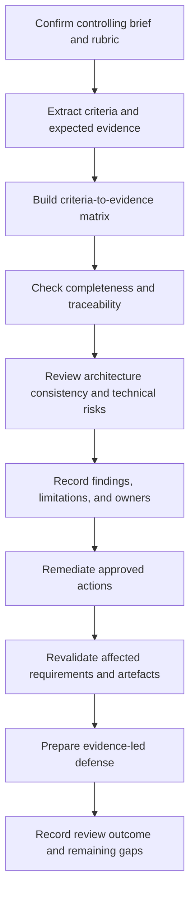
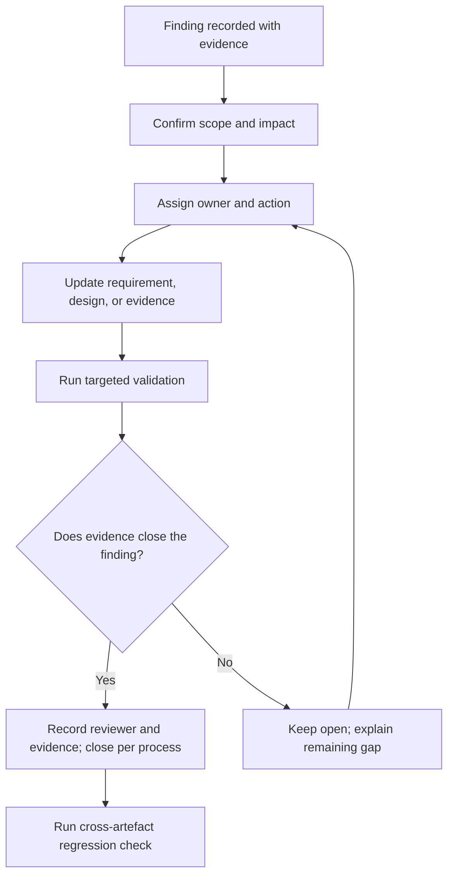

# Capstone Validation, Defense and Review Rubric
## Evidence-based evaluation of an enterprise data architecture

**Target file:** `08-capstone-validation-defense-and-review-rubric.md`  
**Programme location:** Stage 2D — Data Architecture → 16-Enterprise-Data-Architecture-Case-Studies-and-Capstone  
**Learning focus:** Topic 8 — capstone validation, defense, and review  
**Source status:** The module roadmap states that the actual capstone brief and review rubric were empty when that roadmap was written. The exact current project brief was not available for direct inspection in the accessible Library results during preparation. Accordingly, this file provides a method and a clearly labelled illustrative review framework; it does not claim to reproduce an official rubric.

> **Source-of-truth rule:** Use the actual capstone brief, rubric, and approved clarifications when available. Do not present this lesson’s illustrative criteria, statuses, severity labels, or review recommendation as official requirements.

---

## Contents

1. [Purpose and source boundaries](#1-purpose-and-source-boundaries)
2. [Foundations of architecture validation](#2-foundations-of-architecture-validation)
3. [How Topic 7 feeds Topic 8](#3-how-topic-7-feeds-topic-8)
4. [Beginner workflow: interpret the actual rubric](#4-beginner-workflow-interpret-the-actual-rubric)
5. [Intermediate architecture review framework](#5-intermediate-architecture-review-framework)
6. [Findings, remediation, and revalidation](#6-findings-remediation-and-revalidation)
7. [Advanced architecture defense](#7-advanced-architecture-defense)
8. [Worked illustrative validation and defense](#8-worked-illustrative-validation-and-defense)
9. [Practical exercises and answer guidance](#9-practical-exercises-and-answer-guidance)
10. [Mastery criteria and completion checklist](#10-mastery-criteria-and-completion-checklist)
11. [Reusable review templates](#11-reusable-review-templates)
12. [Glossary](#12-glossary)

---

## 1. Purpose and source boundaries

### 1.1 What Topic 8 does

Topic 7 turns the brief into a plan: requirements, scope, deliverables, dependencies, assumptions, validation methods, and unresolved questions. Topic 8 asks whether the resulting architecture package actually addresses those requirements, whether its claims are supported by evidence, whether its artefacts agree with each other, and whether the author can explain and defend the decisions.

A reviewable capstone should make it possible for a reviewer to answer:

- What business problem and requirements is this architecture addressing?
- Which parts of the submission are required by the actual brief?
- Where is each requirement addressed?
- What evidence supports each claim of compliance?
- Are the diagrams, models, ADRs, controls, and operating plans internally consistent?
- What risks, limitations, assumptions, and gaps remain?
- Why was the selected architecture preferred over credible alternatives?
- What new evidence or changed requirement would cause a design decision to be revisited?

The goal is not to prove that an architecture is perfect. It is to determine what is supported, what remains uncertain, what must be corrected, and what can responsibly be accepted for the stated purpose.

### 1.2 Source review and limitations

The module roadmap `roadmap-Enterprise-Data-Architecture-Case-Studies-and-Capstone.md` defines Topic 8 as **Capstone validation, defense and review rubric**. Its learning objectives include reading a rubric, distinguishing completed from validated artefacts, auditing completeness and consistency, recording findings and corrective actions, defending decisions, and responding constructively to review challenges. The roadmap explicitly says that the actual rubric is unavailable and that it invents no scoring weights, mandatory criteria, or passing thresholds.

The roadmap states that `Projects/16-enterprise-data-architecture-capstone.md`, `Projects/README.md`, and the Topic 7/8 files existed but were empty when the roadmap was written. The dated project-tree snapshot also lists `Projects/16-enterprise-data-architecture-capstone.md` at the expected location. However, that actual brief was not present among the mounted local files inspected for this audit. The generated Topic 7 file is available; the official rubric and current brief could not be verified directly. This does **not** prove that a current repository copy remains empty; it means the controlling documents' current contents could not be verified here.

The exact filename `Roadmap_ptree.md` was not found among the mounted files. The available `Roadmap_ptree(20261020-184004).md` dated snapshot was inspected for Stage 2D context. The module roadmap, `template(20261020-112311).txt` in the available source-audit materials, and the generated Topic 7 file were also inspected. The template’s relevant workflow is to generate comprehensive learning content, privately audit the entire artifact, revise against the audit, and then deliver the revised file.

**Consequences for this lesson:**

- No official criterion, weight, pass mark, threshold, or reviewer decision is asserted.
- The evaluation dimensions and example findings below are **recommended and illustrative**, not an official scoring scheme.
- The fictional worked example is not the actual capstone scenario.
- When the actual brief and rubric are accessible, their wording and precedence must replace the illustrative framework where they differ.

### 1.3 Three layers of review

Keep three layers separate:

1. **Official assessment:** criteria and decisions defined by the real brief, rubric, or authorised reviewer.
2. **Supporting architecture-quality review:** additional checks recommended to find design weaknesses that the official rubric may not spell out.
3. **Author self-check:** preliminary checks used before formal review.

Passing a self-check is not an official pass. Passing a self-created quality review does not establish production readiness. Production readiness requires the appropriate scope, operational context, assurance, testing, approvals, and evidence for the real deployment environment.

---

## 2. Foundations of architecture validation

### 2.1 Verification, validation, and defense

These terms overlap in everyday speech but answer different questions.

| Activity | Core question | Typical method | Example |
|---|---|---|---|
| **Verification** | Was the artefact or design produced correctly against its specified rules and requirements? | Inspection, consistency check, calculation review, schema validation, test | Verify that every source-to-target flow in the interface inventory appears in the data-flow diagram |
| **Validation** | Does the architecture or artefact meet the intended stakeholder need under stated conditions? | Scenario walkthrough, representative test, reconciliation, performance model/test, stakeholder review | Validate that the proposed reporting design can meet the agreed reporting window under the specified workload |
| **Architecture review** | Is the design coherent, justified, feasible, and adequately controlled for its intended purpose? | Structured peer review, trade-off analysis, risk review, traceability audit | Challenge whether the selected ingestion pattern fits freshness, recovery, and operational constraints |
| **Defense** | Can the author explain and justify the design and respond honestly to challenges? | Presentation, Q&A, alternative analysis, evidence walkthrough | Explain why batch was selected over event streaming and what evidence would change the decision |

Verification may establish that a diagram follows an agreed notation; it does not establish that the architecture meets the business need. Validation may use tests or analysis, but it does not automatically prove every possible production condition. Defense evaluates reasoning and evidence; confidence or presentation skill is not a substitute for correctness.

### 2.2 Requirements compliance versus architecture quality

**Requirements compliance** asks whether explicit obligations have been addressed. **Architecture quality** asks whether the solution is coherent and suitable across relevant concerns, including risks and trade-offs.

A design can be compliant yet fragile if the brief omits a critical failure mode. Conversely, a technically elegant design may fail the assessment because it omits a required deliverable. Review both dimensions, but label them separately.

Recommended supporting quality checks may include:

- requirement coverage and traceability;
- coherent system boundaries and responsibilities;
- data semantics, contracts, and lineage;
- appropriate governance and access controls;
- failure handling, recovery, and operations;
- performance and capacity assumptions;
- cost and complexity trade-offs;
- justified decisions and alternatives;
- implementability and migration feasibility;
- honest limitations and evidence quality.

These are not automatically mandatory rubric criteria. Apply them where relevant to the actual scope and record why they matter.

### 2.3 Evidence-based review

A claim is only as strong as the evidence that supports it and the conditions under which that evidence was produced.

Examples:

- “The data flow is documented” can be supported by a diagram and a completeness inspection.
- “The data flow is secure” requires more than a diagram; it may need identity and trust-boundary analysis, control mapping, threat review, and tests appropriate to the claim.
- “The service meets the latency target” requires a defined workload, measurement point, target, and test or defensible model.
- “Recovery is proven” requires recovery evidence under a defined scenario, not only a backup design.
- “The cost is acceptable” requires a defined cost boundary, workload assumptions, pricing basis or estimates, and an agreed acceptance context.

Evidence should be:
- **traceable** to a requirement or claim;
- **specific** enough to reproduce or inspect;
- **versioned** so it matches the reviewed architecture;
- **bounded** by explicit test conditions and limitations;
- **honestly labelled** as fact, estimate, assumption, hypothesis, planned test, or validated result.

### 2.4 Traceability in the review

The review chain is:

**Rubric criterion / requirement → expected evidence → deliverable and section → assessment → finding or conclusion → remediation → revalidation.**

The chain should work in both directions.

- **Forward traceability:** each applicable criterion and requirement has identifiable evidence or an explicit gap.
- **Reverse traceability:** each major architecture element and significant claim has a requirement, constraint, risk treatment, or documented rationale.

An orphan requirement has no design response or evidence. An orphan component has no clear justification. Both deserve investigation, though not every supporting component needs its own independent requirement ID if it is justified by an ADR, cross-cutting control, or operating need.

### 2.5 Why diagrams alone are insufficient

A diagram can show intended structure, but often omits:
- actual data definitions, keys, grain, and quality rules;
- authentication, authorization, trust boundaries, and failure behaviour;
- workload, volume, concurrency, freshness, and recovery conditions;
- costs, ownership, runbooks, and change dependencies;
- evidence that a proposed behaviour has been tested or validated.

A polished diagram can conceal contradictions. For example, the logical view may show one source of truth while the data model describes two independently updated golden records. A recovery plan may promise a recovery objective that the architecture cannot meet because backups or replay data are unavailable. A performance note may quote a target measured at a different boundary than the requirement.

Review diagrams as part of a consistent evidence set, not as proof by themselves.

### 2.6 Risks, limitations, and unresolved issues

A credible review identifies what remains unknown. It does not turn every uncertainty into a failure, nor does it hide an uncertainty to make the package look complete.

Distinguish:

- **Finding:** an observed gap or defect supported by evidence.
- **Risk:** an uncertain event or condition that could cause impact.
- **Limitation:** a known boundary on what the design or evidence covers.
- **Assumption:** a proposition temporarily accepted.
- **Open question:** information needed to make or confirm a decision.
- **Accepted residual risk:** a risk consciously accepted by an authorised role, where such authority exists.

If the authority to accept a risk is unknown, record it as unresolved; do not invent approval.

---

## 3. How Topic 7 feeds Topic 8

### 3.1 Convert the plan into review inputs

Topic 7 should provide the baseline for Topic 8:

| Topic 7 planning output | How Topic 8 uses it |
|---|---|
| Actual brief and source locations | Establishes the controlling scope and obligations |
| Requirements register | Tests requirement coverage and status |
| Scope/boundary statement | Checks that diagrams and claims remain within agreed scope |
| Stakeholder map | Identifies who can clarify needs and accept outcomes |
| Assumption and open-question logs | Checks whether uncertainty is visible and managed |
| Constraint and dependency registers | Tests feasibility and identifies blocked decisions |
| Deliverable inventory | Checks completeness against the actual brief |
| Requirement-to-deliverable matrix | Locates evidence for each requirement |
| Acceptance conditions and validation plan | Determines what evidence would count as adequate |
| ADRs and risk register | Supports trade-off review and defense |
| Work plan and review checkpoints | Organises remediation and revalidation |

If Topic 7 is incomplete, Topic 8 may still identify problems, but the review is likely to spend time reconstructing the requirements rather than evaluating the architecture. Do not fill those gaps silently; record them as review findings or preconditions.

### 3.2 Review workflow



This workflow is a recommended method. Formal review gates and approval states must follow the real project’s process if defined.

### 3.3 Connections to earlier Stage 2D modules

The module roadmap treats the earlier curriculum as a foundation and the cross-module map as a suggested connection, not a formal requirement that every domain must appear in every capstone. Review only the areas relevant to the real brief, scope, risks, and design choices.

| Earlier topic area | Review focus | Evidence examples |
|---|---|---|
| Principles, requirements, and architecture patterns | Do patterns respond to stated forces? | Requirements register, option matrix, ADRs |
| Data modelling | Are entities, grain, keys, relationships, and semantics coherent? | Conceptual/logical models, data dictionary |
| Storage architecture | Does storage fit access, consistency, lifecycle, and retention needs? | Storage decision, layout, lifecycle assumptions |
| Integration and interoperability | Are contracts, data movement, idempotency, reconciliation, and failure paths addressed? | Interface inventory, DFD, contract, test plan |
| Platform and lakehouse | Are component responsibilities, boundaries, metadata, and isolation clear? | Logical platform view, deployment view |
| Cloud/hybrid/multi-cloud | Are identity, connectivity, portability, and egress assumptions explicit? | Environment view, network/identity notes, cost model |
| Streaming and real-time architecture | Are latency, ordering, replay, state, and backpressure requirements supported where relevant? | Event flow, latency budget, failure analysis |
| Governance/security/privacy | Are ownership, classification, access, retention, and controls justified? | Access matrix, control map, threat review |
| Metadata, lineage, quality, master data | Are definitions, lineage, critical data elements, matching, and quality ownership clear? | Lineage view, quality rules, MDM decisions |
| Reliability and disaster recovery | Do failure modes, backups, replay, RPO/RTO, and runbooks agree? | Recovery design, test results, incident procedures |
| Performance, scalability, and cost | Are workload assumptions and trade-offs reproducible? | Capacity model, performance test, cost estimate |
| Serving, semantic, and AI data architecture | Do consumer access patterns, contracts, freshness, and AI-specific controls fit the need? | Serving design, semantic definitions, retrieval evaluation |
| Documentation and operating model | Are views, ADRs, risk decisions, and ownership reviewable and consistent? | Diagram set, decision log, risk register, runbook |

### 3.4 Reuse lessons from the six case studies responsibly

The module roadmap identifies six case-study frames: banking data platform, Customer 360/master data, real-time fraud/risk, lakehouse modernization, multi-cloud, and governed RAG/enterprise knowledge. The roadmap's note that the case-study files were empty describes their state when that roadmap was authored. Current generated copies of the six case studies are available in the mounted working set, but they do not establish the contents of the missing official capstone brief or rubric.

Use them as prompts for review questions, not as evidence that a specific pattern is correct:

- **Banking platform frame:** examine integration, governance, and resilience where relevant.
- **Customer 360 frame:** examine identity resolution, data authority, survivorship, and ownership.
- **Fraud/risk frame:** examine end-to-end latency, event semantics, state, replay, and decision consequences.
- **Lakehouse modernization frame:** examine coexistence, migration waves, reconciliation, rollback, and parallel-run costs.
- **Multi-cloud frame:** examine the business reason for multiple providers, portability assumptions, egress, and duplicated operations.
- **Governed RAG frame:** examine permission-aware retrieval, source freshness, citations, revocation, and evaluation if AI retrieval is in scope.

For every transferred lesson, record the forces that made it useful in the original scenario and the matching/mismatching forces in the capstone. A case-study pattern is not proof of suitability.

---

## 4. Beginner workflow: interpret the actual rubric

### 4.1 Locate and read the controlling documents

Before scoring or reviewing, locate the actual:
- capstone brief and all referenced appendices;
- review rubric or evaluation instructions;
- approved clarifications or change records;
- Topic 7 requirement/deliverable plan;
- architecture submission and linked evidence;
- any stated review process or required format.

Check versions and dates. If the rubric and brief conflict, do not choose silently: record the conflict and seek clarification from the authorised source. If a file is missing or empty, state that fact and use no substitute as if it were official.

### 4.2 Extract each criterion faithfully

For each rubric statement, record:
- criterion ID (use the source ID if it has one; otherwise assign a local reference such as `RC-01` without implying it is official);
- exact criterion wording;
- section/page/source location;
- criterion intent in plain language;
- whether it is an explicit requirement, weighted criterion, gate, guidance statement, or ambiguous instruction—**only as defined by the source**;
- expected evidence, if stated;
- applicable deliverables;
- reviewer notes and unresolved interpretation questions.

Do not change “demonstrate recovery approach” into “prove production recovery within 30 minutes” unless the source states that. Do not treat a weighting as a pass threshold. A weighted criterion and a mandatory gate can coexist, but the actual rubric must establish that relationship.

### 4.3 Translate wording into observable checks

A rubric statement may be broad. Restate its intent without altering its force, then identify the evidence that would support it.

**Illustrative criterion (not official):** “Architecture decisions are justified.”

A useful observable interpretation might ask:
- Are material decisions identifiable?
- Are the relevant requirements and constraints linked?
- Are credible alternatives considered?
- Are decision drivers and trade-offs stated?
- Are consequences, risks, and revisit triggers documented?
- Does the architecture package consistently implement the decision?

The observable checks are a review aid. They do not create extra official subcriteria or weights.

### 4.4 Distinguish mandatory conditions and weighted criteria

Read the rubric’s definitions carefully:
- A **mandatory condition/gate** may need to be satisfied regardless of a numeric score, if the rubric says so.
- A **weighted criterion** contributes according to the stated weighting, if one exists.
- A **descriptive level** explains performance expectations but may not define a separate gate.
- A **recommendation** may inform quality review without being part of the official scoring.

If the source does not specify a scoring method, do not invent one and call it official. You may use a separate non-scoring gap register to manage work.

### 4.5 Identify ambiguity and overlap

Two criteria may overlap, use undefined terms, or appear contradictory. For example, “comprehensive architecture” and “complete architecture views” may refer to related but different evidence. Ask:
- What is the scope of each criterion?
- Is the same evidence intended to satisfy both?
- Does the rubric define the terms?
- Is a criterion conditional on a domain being in scope?
- Who can clarify the interpretation?

Record the exact wording, proposed interpretation, impact, question owner, and answer when received. Avoid double-counting one weakness or one strength unless the official scoring instructions explicitly call for it.

### 4.6 Build the criteria-to-evidence matrix

| Criterion ID | Exact criterion / source | Plain-language intent | Expected evidence from source | Deliverable/section | Assessment status | Rationale / gap |
|---|---|---|---|---|---|---|
| RC-01 | [copy from actual rubric] | [neutral restatement] | [as specified] | [exact link] | [only permitted status] | [evidence-based note] |

Use official status values if the rubric defines them. If not, the following labels can be used in a **separate local tracking column**, not as official scores:

- **Not yet evidenced:** evidence has not been supplied or inspected.
- **Evidence located:** artefact exists but has not yet been judged sufficient.
- **Gap identified:** evidence was reviewed and does not currently support the claim.
- **Pending clarification:** criterion or requirement is ambiguous.
- **Reviewed with no identified gap:** review found no gap within the stated scope; this is not a guarantee of universal correctness.

Only use `pass`, `partial`, `fail`, or `not applicable` if the real rubric permits those statuses or the reviewer has explicitly agreed to them.

### 4.7 Worked miniature example

The following criteria are invented for teaching and are **not official**.

| Illustrative criterion | Evidence to inspect | Example observation | Responsible conclusion |
|---|---|---|---|
| IC-01: Data flows are documented | DFD, source/interface inventory | DFD omits one listed source-to-target path | Gap identified; diagram and inventory need reconciliation |
| IC-02: Key decisions are justified | ADRs, requirements, option analysis | ADR states the choice but contains no credible alternative | Rationale is incomplete; request options and consequences |
| IC-03: Recovery is addressed | Failure analysis, recovery plan, test evidence | Backup strategy is described but no restore validation exists | Design intent documented; recovery outcome not yet demonstrated |
| IC-04: Performance claims are supported | Workload assumptions, target, test/model | A “fast” claim has no workload or measurement point | Claim is unsupported; define conditions and evidence |

This example does not assign scores. It demonstrates the difference between locating an artefact and determining whether it supports a claim.

### 4.8 Beginner completion check

Before moving into deep technical review, confirm that:
- the controlling brief and rubric versions are known or their unavailability is recorded;
- every actual criterion has been extracted faithfully;
- expected evidence is identified or marked unspecified;
- each criterion maps to a deliverable, evidence reference, or explicit gap;
- official scoring rules are kept separate from local review notes;
- all ambiguous criteria have questions or documented provisional interpretations;
- no unverified claim is described as passed.

---

## 5. Intermediate architecture review framework

The checks below are a **recommended supporting review framework**. They supplement the actual rubric; they do not replace it. Apply each area when relevant to the project’s scope, requirements, and risks. For each check, record the review question, evidence expected, common failure patterns, and finding or conclusion.

### 5.1 Requirements coverage and traceability

**Review questions**
- Does each confirmed requirement have a design response?
- Does each applicable rubric criterion map to specific evidence?
- Are acceptance conditions measurable or explicitly unresolved?
- Are assumptions and inferred requirements distinguished from confirmed obligations?
- Are there orphan requirements or unjustified components?
- Are requirements marked complete based on evidence rather than document presence?

**Evidence to inspect:** brief with source locations, requirement register, traceability matrix, ADR links, deliverable inventory, validation plan.

**Common failures:** requirements paraphrased into different meanings; a broad link to “architecture document” instead of a specific section; acceptance conditions invented; status marked complete before validation; untracked scope changes.

**How to record:** cite the requirement ID and source; state the missing link; name the affected deliverable and evidence needed; assign an owner and recheck condition.

### 5.2 Architecture views, boundaries, and consistency

**Review questions**
- Does each view have a clear purpose and audience?
- Do context, logical, physical/deployment, and data-flow views agree where they overlap?
- Are external systems, ownership boundaries, interfaces, and trust boundaries clear?
- Do component responsibilities match the text and ADRs?
- Are assumptions, omitted details, and unresolved boundaries visible?

**Evidence:** diagram set, interface inventory, scope statement, component descriptions, ADRs.

**Common failures:** inconsistent names; a data store appears in one diagram but not another; arrows have unclear meaning; logical and deployment views are conflated; a component has no responsibility; a trust boundary is missing where it materially affects the design.

**Record:** identify both conflicting artefacts and the exact elements; specify which source is authoritative or request a decision; check all affected views after correction.

### 5.3 Data models, semantics, quality, and lineage

**Review questions**
- Are entities, grain, keys, relationships, and definitions consistent with use cases?
- Are important data transformations and ownership points documented?
- Are quality rules linked to business definitions and responsible owners?
- Is lineage sufficient to trace critical outputs to source inputs?
- Are duplicate, late, missing, invalid, or conflicting records handled explicitly where relevant?

**Evidence:** data models, dictionary, data contracts, transformation notes, lineage diagrams, quality rule catalogue, reconciliation tests.

**Common failures:** undefined business terms; inconsistent grain; ungoverned keys; quality checks with no action owner; lineage stops at a platform layer; “trusted data” asserted without rules or reconciliation.

**Record:** identify the affected field/entity/path; state the expected definition or evidence needed; note whether the gap is a requirement miss, design weakness, or open question.

### 5.4 Integration, contracts, and failure handling

**Review questions**
- Are source and consumer interfaces, schemas, cadence, and ownership known?
- Are batch, CDC, event, API, or file patterns justified by requirements?
- Are compatibility, idempotency, deduplication, retries, ordering, reconciliation, and replay addressed where relevant?
- What happens when data is late, malformed, duplicated, or unavailable?
- Do failure paths preserve correctness and make errors observable?

**Evidence:** interface contracts, data-flow diagrams, error handling design, retry/replay strategy, contract tests, reconciliation evidence.

**Common failures:** “exactly once” claimed without defining boundaries and semantics; retries can duplicate effects; dead-letter handling is missing; no reconciliation path; schema changes have no compatibility policy.

**Record:** link the issue to interface/flow IDs and expected behaviour; request a test, contract clarification, or design revision.

### 5.5 Security, governance, privacy, and access

**Review questions**
- Are data sensitivity, ownership, identity, authorization, and permitted use addressed where relevant?
- Are access checks placed at the correct boundaries?
- Are retention, deletion, auditability, secrets, and encryption decisions justified by the requirements and threat context?
- Are control responsibilities and exception paths clear?
- Are regulatory claims supported by actual applicable requirements rather than assumption?

**Evidence:** classification, access matrix, trust-boundary diagram, threat/control mapping, identity design, retention/lifecycle policy, relevant tests and review records.

**Common failures:** “encrypted” used as a complete security argument; service identity bypasses user authorization; data copies escape access controls; deletion does not propagate; a policy exists but no enforcement point is identified; unsupported regulatory statements.

**Record:** identify the data class, flow, threat/control, and evidence gap. Escalate material security or privacy concerns through the actual governance process; do not invent a risk acceptance authority.

### 5.6 Metadata, lineage, and operational data quality

**Review questions**
- Are data products and critical datasets discoverable and owned?
- Are technical and business metadata definitions aligned?
- Is lineage sufficient for impact analysis and audit needs?
- Are quality incidents observable, triaged, and assigned?
- Are metadata interfaces and standards appropriate for the scope?

**Evidence:** catalogue/metadata model, lineage view, ownership map, quality monitoring, issue workflow, standards mapping where required.

**Common failures:** catalogue entry without owner; lineage claimed but transformations are missing; quality dashboards have no thresholds or actions; metadata definitions drift across systems.

**Record:** specify the affected dataset, lineage segment, or quality rule and the operational consequence; link to owner and remediation evidence.

### 5.7 Reliability, recovery, and operational readiness

**Review questions**
- Are failure domains and critical dependencies identified?
- Are availability, recovery, and data-loss objectives sourced or clearly provisional?
- Do backup, restore, replay, reconciliation, and failover plans agree with the architecture?
- Are runbooks, monitoring, escalation, ownership, and degraded modes defined where required?
- Is recovery evidence available for claims that recovery has been validated?

**Evidence:** dependency map, failure-mode analysis, RPO/RTO definitions if applicable, backup/restore plan, recovery test or tabletop record, monitoring and runbook outline.

**Common failures:** RTO/RPO invented; backup success mistaken for restore success; cross-region dependency overlooked; replay duplicates records; failover loses required state; no operational owner.

**Record:** distinguish design documentation from demonstrated recovery. Identify the scenario, expected behaviour, evidence gap, owner, and retest criteria.

### 5.8 Performance, capacity, scalability, and cost

**Review questions**
- Are workload, data volume, growth, concurrency, freshness, and query assumptions explicit?
- Do capacity and cost models use consistent inputs?
- Are bottlenecks and scaling limits identified?
- Are measured results distinguished from estimates?
- Are cost trade-offs tied to the business outcome and operating model?

**Evidence:** workload profile, capacity calculation, performance test plan/results, cost assumptions, unit economics, sensitivity analysis, caching/materialization choices.

**Common failures:** benchmark lacks workload context; p95 compared with a mean target; cost estimate excludes egress or duplicate environments; “scales horizontally” without bottleneck analysis; one set of volume assumptions in the architecture and another in the cost model.

**Record:** reproduce the calculation where possible; record inputs, units, time period, source, uncertainty, and impact of variation. Do not infer a pass threshold when none is defined.

### 5.9 Architecture decisions and rejected alternatives

**Review questions**
- Are material decisions recorded?
- Are alternatives credible and compared using stated criteria?
- Are consequences, risks, and operational implications described?
- Are decisions linked to requirements and the affected architecture views?
- Are assumptions and revisit triggers explicit?

**Evidence:** ADRs, option matrix, requirements register, risk register, design views, decision log.

**Common failures:** ADR records only the chosen technology; alternatives are straw men; cost or risk is omitted; rationale contradicts the diagram; a provisional decision is represented as approved.

**Record:** distinguish a missing ADR from a poor decision. The remediation may be to improve rationale, compare options, seek authority, or revisit the design.

### 5.10 Migration and implementation feasibility

**Review questions**
- Is a migration plan needed by the actual brief?
- Are dependencies, coexistence, data reconciliation, rollback, and cutover risks addressed where relevant?
- Are skills, environments, access, and operational ownership realistic?
- Are phases and milestones linked to testable exit conditions?
- Are implementation assumptions stated?

**Evidence:** current/target views, migration waves, dependency plan, reconciliation approach, rollback plan, milestone criteria, operational transition plan.

**Common failures:** target architecture described without a feasible transition; parallel-run costs omitted; rollback assumes a one-way schema change is reversible; no exit criterion; migration sequencing ignores upstream dependency.

**Record:** if migration is not required, do not manufacture a full plan. Record why it is out of scope if the boundary needs to be explicit.

### 5.11 Evidence and claims consistency

**Review questions**
- Does every material claim have evidence appropriate to its strength?
- Does evidence match the reviewed version of the design?
- Are test conditions, assumptions, units, sample size, and limitations recorded?
- Do claims distinguish planned, executed, passed, and not verifiable?
- Are contradictory figures and unsupported benefits identified?

**Evidence:** evidence register, test reports, calculations, version references, review minutes, reproducible inputs.

**Common failures:** planned test described as passed; model estimate described as measured fact; evidence from an old architecture version; diagram cited as proof of runtime performance; no limitations disclosed.

**Record:** quote the claim, cite the evidence, state the mismatch, and specify the evidence or wording change needed.

### 5.12 Cross-artefact consistency audit

At minimum, cross-check:
- requirement IDs and statements across the register, ADRs, and evidence matrix;
- component names and responsibilities across diagrams and narrative;
- data entities, keys, grain, and terms across models and contracts;
- latency/freshness targets across requirements, design, tests, and cost model;
- availability/recovery objectives across failure analysis, backup, and runbooks;
- access assumptions across flows, identity model, and governance controls;
- migration dates/dependencies across architecture and implementation plan;
- open questions and assumptions across the risk register and defense notes.

A consistency audit should produce an explicit record of what was compared, not just a statement that “all documents look consistent.”

---

## 6. Findings, remediation, and revalidation

### 6.1 Write findings that can be acted on

A useful finding contains:
1. **ID:** stable reference.
2. **Type:** official rubric gap, requirement gap, technical risk, inconsistency, unsupported claim, or improvement suggestion.
3. **Criterion/requirement link:** exact source where applicable.
4. **Observation:** what was found, not a vague judgment.
5. **Evidence:** location, version, calculation, or test result.
6. **Impact:** why it matters.
7. **Requested action:** correction, evidence, clarification, or accepted rationale.
8. **Owner and due point:** role/person and date if agreed.
9. **Revalidation method:** how the reviewer will check the correction.
10. **Status:** use official statuses where defined; otherwise a clearly local tracking state.

Weak finding: “Security is poor.”

Actionable finding (illustrative): “The access matrix defines analyst roles, but the data-flow view shows a shared service identity reading restricted datasets without showing how the requesting analyst’s entitlement is enforced. The current package therefore does not demonstrate user-level authorization for this path. Update the identity/flow design and provide an authorization test or clarify that the path is outside scope.”

### 6.2 Severity without inventing an official scale

Use the actual severity scheme if the project defines one. If it does not, do not introduce a local severity label as though it were official.

A reviewer may use a **recommended internal triage** based on:
- impact on explicit requirement compliance;
- security, privacy, correctness, or recoverability consequence;
- scope of affected components and consumers;
- likelihood and detectability;
- whether the gap blocks meaningful validation;
- whether the issue is reversible or can be safely bounded.

A local triage label can help prioritise work, but it is not a pass/fail score and does not override the actual rubric. State who agreed the scale and what the labels mean if you use one.

### 6.3 Remediation and revalidation lifecycle



Correcting one artefact can create inconsistencies elsewhere. After a change, retest the affected requirement and run a proportionate regression review across linked diagrams, ADRs, tests, risks, and evidence.

### 6.4 Change control and finding closure

Before closing a finding, confirm:
- the action is complete in the reviewed version;
- the evidence is linked and inspectable;
- the original requirement or criterion is addressed;
- affected artefacts are updated consistently;
- the retest or review was actually performed;
- remaining limitations are recorded;
- closure authority follows the real review process.

Do not close a finding merely because a document was edited. A finding may be resolved by a clarified requirement, a justified scope change, an accepted risk by an authorised role, or new evidence—but the rationale and approval must be recorded.

### 6.5 Review outcome language

When the actual process does not define formal outcomes, use careful descriptive language rather than invented verdicts. Examples:

- “Evidence located; sufficiency not yet assessed.”
- “No gap identified within the stated scope and evidence inspected.”
- “Validation blocked pending an approved target.”
- “Finding remains open; the revised diagram does not address the authorization path.”
- “The design rationale is documented; runtime behaviour has not been tested.”
- “This review does not establish production readiness.”

If the official rubric defines outcomes, use those terms exactly and map any local notes to them without changing their meaning.

---

## 7. Advanced architecture defense

### 7.1 What a defense is for

An architecture defense is a structured explanation of how the proposed design addresses the problem, what alternatives were considered, why trade-offs were accepted, how claims were validated, and what remains uncertain. It is not a sales pitch and not an attempt to defend every decision at all costs.

A strong defense:
- starts from requirements and stakeholders;
- explains the architecture at the right level for the audience;
- shows evidence for material claims;
- explains credible alternatives and rejected options;
- makes risks, limitations, and assumptions visible;
- answers challenges directly;
- changes position when evidence warrants it;
- records follow-up actions.

### 7.2 Recommended defense sequence

Adapt the sequence to the actual review format:

1. **Problem and scope:** business outcome, users, system boundary, exclusions.
2. **Requirements:** critical functional and quality requirements, constraints, unresolved items.
3. **Architecture overview:** components, responsibilities, data paths, and trust boundaries.
4. **Key decisions:** requirements, alternatives, decision drivers, consequences, and ADRs.
5. **Cross-cutting concerns:** only relevant governance, quality, reliability, performance, cost, and operational design.
6. **Validation:** tests, calculations, reviews, evidence, and the limits of each.
7. **Risks and limitations:** what is unresolved, what has been accepted, and by whom if known.
8. **What would change the design:** triggers, assumptions, and evidence that would alter a decision.
9. **Questions and actions:** answer with evidence, capture gaps, and assign follow-up.

### 7.3 Answer difficult questions with evidence

A useful answer structure is:

**Direct answer → requirement/decision basis → evidence → trade-off or limitation → next action if unresolved.**

Example:

**Reviewer:** “How do you know the recovery approach meets the requirement?”

**Evidence-led answer:** “The requirement is `REQ-REC-01`, which specifies the approved recovery objective. The architecture describes backup and replay responsibilities in section X, and the restore exercise in evidence `EV-REC-02` records the tested scenario and measured recovery time. That evidence covers the tested failure and dataset size; it does not cover a regional-loss scenario, which remains an open validation item. We have not claimed that broader scenario is proven.”

This answer is strong because it states the requirement, identifies evidence, and limits the claim to what was tested.

### 7.4 Challenging reviewer questions

The questions below are practice prompts, not official rubric criteria.

| Reviewer challenge | What the reviewer is testing | Strong answer structure |
|---|---|---|
| “Which requirement makes this component necessary?” | Traceability and scope control | Cite requirement/constraint/risk/ADR; if none, propose removing or justifying the component |
| “Why this pattern instead of the simpler alternative?” | Trade-off reasoning | State decision drivers, compare credible options, explain accepted cost/risks |
| “What happens if this dependency is unavailable?” | Failure handling and blast radius | Walk through failure path, degraded mode, recovery, monitoring, and evidence |
| “How do you know the data is correct?” | Semantics and validation | Define correctness rules, source of truth, reconciliation, exceptions, and test evidence |
| “What prevents an unauthorized consumer from seeing restricted data?” | Security model | Identify identity source, policy enforcement point, trust boundaries, negative tests, and gaps |
| “Is the stated latency measured or estimated?” | Evidence integrity | State workload, boundary, percentile, environment, evidence type, and limitations |
| “What is the cost if volume doubles?” | Sensitivity and cost model | Show assumptions, dominant cost drivers, scenario calculation, and limits |
| “Why did you reject the alternative?” | Decision quality | Cite criteria, evidence, consequence, and revisit trigger |
| “What is the biggest unresolved risk?” | Judgment and transparency | State risk, impact, owner, mitigation, trigger, and decision needed |
| “What would make you change the architecture?” | Adaptability | Identify explicit trigger, affected ADRs, and validation required |
| “Are you claiming production readiness?” | Scope and assurance discipline | State exactly what was reviewed/tested; distinguish design review from operational release assurance |
| “What if the rubric asks for something your design does not include?” | Assessment compliance | Check the actual criterion; either add the required artefact, clarify applicability, or record the gap—do not argue from preference |

### 7.5 Handling an unresolved issue

Use a five-part response:
1. **Acknowledge:** name the issue without minimising it.
2. **Bound:** state which claims or components it affects.
3. **Mitigate:** describe the interim safeguard or design constraint, if appropriate.
4. **Evidence:** state what information or test would resolve it.
5. **Ownership:** identify who must decide or provide the evidence and when.

Do not invent an interim safeguard that has not been evaluated. If the risk is material and no safe mitigation is known, say so and recommend escalation under the real governance process.

### 7.6 Handling disagreement

When a reviewer challenges a decision:
- clarify whether the challenge concerns a fact, requirement, interpretation, priority, or alternative;
- locate the source and evidence;
- acknowledge valid corrections;
- compare alternatives against the same criteria;
- record accepted, deferred, or declined feedback with reasons;
- update ADRs and artefacts when the decision changes.

A defense is not a contest to preserve the original design. The purpose is to make the best-supported decision and maintain a trustworthy record.

---

## 8. Worked illustrative validation and defense

**Scenario status:** The following example is invented for teaching. It is not the real capstone brief or rubric. All criterion IDs, observations, statuses, finding IDs, and the final recommendation are illustrative. No official score or pass threshold is used.

### 8.1 Illustrative architecture context

A fictional organisation needs a daily operational report built from two existing source systems. The report is consumed by operations managers. Data arrives as files. The initial design leaves source systems in place and documents ingestion and transformation. Data quality and access control should be considered. The example does not define the actual capstone scenario, an official rubric, or official acceptance criteria.

The submitted illustrative package contains:
- a requirements/scope register;
- a context diagram and data-flow diagram;
- a logical data model and data dictionary;
- an ingestion-pattern ADR;
- a quality/reconciliation plan;
- an access-control note;
- a capacity estimate;
- an evidence register.

### 8.2 Illustrative criteria-to-evidence matrix

The criteria below are self-created review prompts. They are not official rubric items.

| ID | Illustrative review criterion | Evidence expected | Initial observation | Initial assessment note |
|---|---|---|---|---|
| IC-01 | Requirements are traceable to design and validation | Requirement register, matrix, evidence links | One requirement has no validation method | Gap identified |
| IC-02 | Data flows cover all in-scope paths | Source inventory, DFD, interface table | One source path is missing from DFD | Gap identified |
| IC-03 | Material decisions compare credible alternatives | ADRs and option analysis | ADR gives rationale but compares no alternative | Rationale incomplete |
| IC-04 | Data correctness is defined and testable | Data dictionary, quality rules, reconciliation plan | “Trusted” is undefined; rule owner unknown | Pending clarification |
| IC-05 | Access assumptions are explicit and enforceable | Role matrix, identity/control view, test plan | Shared service identity is shown without caller entitlement enforcement | Security design gap |
| IC-06 | Capacity claims use traceable assumptions | Volume profile, calculations, cost inputs | Volume is assumed but not sourced | Estimate provisional; not validated |
| IC-07 | Recovery claims are bounded by evidence | Failure analysis, recovery plan, test record | Backup is documented; restore test absent | Design documented; outcome unproven |

No score is assigned. The table distinguishes a missing artefact link, an incomplete rationale, an unresolved business definition, and an unproven operational claim.

### 8.3 Traceability assessment

| Requirement ID | Illustrative requirement | Design response | Deliverable | Validation evidence | Initial result |
|---|---|---|---|---|---|
| I-FR-01 | Produce a daily operational report from both sources | Ingest, transform, reconcile, serve | DFD, model, quality plan | Reconciliation test and consumer review | Partial evidence; one source path missing |
| I-FR-02 | Document ingestion and transformation | Show source, validation, transformation, outputs, failure paths | DFD and integration note | Flow inventory cross-check | Gap: source B flow absent |
| I-CON-01 | Keep source systems in place initially | Integrate through existing file interface | Context view, DFD, ADR | Boundary review | Evidence located; confirm interface assumption |
| I-NFR-01 | Report available by business-day start | Proposed scheduled processing | ADR and capacity estimate | Timed end-to-end test against approved target | Blocked: target/timezone not defined |
| I-REC-01 | Consider data quality and access control | Quality and access notes | Quality plan, access note | Owner review and applicable tests | Considerations documented; enforceability gap remains |

The matrix shows that a design response is not automatically proof of compliance. The freshness requirement cannot be validated until the business-day definition and target are clarified. The access note does not demonstrate authorization enforcement on its own.

### 8.4 Architecture consistency checks

| Check ID | Comparison | Initial observation | Required action |
|---|---|---|---|
| CONS-01 | Source inventory vs DFD | Source B listed but not drawn | Add flow or correct source inventory after confirmation |
| CONS-02 | Requirement register vs evidence plan | I-FR-01 has no complete reconciliation evidence | Define rule, population, expected result, and test owner |
| CONS-03 | ADR vs capacity model | ADR assumes daily batch; capacity estimate assumes hourly arrivals | Align assumptions or explain separate scenarios |
| CONS-04 | Access note vs logical flow | Shared service identity shown, but user authorization is unspecified | Define identity propagation/enforcement or document approved alternative |
| CONS-05 | Recovery note vs claims | “Recoverable” claim appears without restore test | Bound claim to design intent; plan a restore validation |
| CONS-06 | Scope vs optional components | An event broker appears without a requirement or rationale | Remove, defer, or link to a justified need |

These are illustrative findings. In a real review, cite the exact diagram version, section, and evidence reference.

### 8.5 Illustrative finding register

For this example only, a local triage label is used: **High**, **Medium**, or **Low**. These labels are not official and do not map to scores or pass/fail thresholds.

| Finding ID | Triage | Finding and evidence | Impact | Action / owner | Revalidation |
|---|---|---|---|---|---|
| I-FND-01 | High | DFD omits source B despite its presence in the source inventory | Flow completeness cannot be reviewed | Update DFD and interface inventory; architecture author | Reconcile all listed sources and consumers |
| I-FND-02 | High | Shared service identity has no documented caller-entitlement enforcement | Access control is not demonstrated for the path | Define identity and authorization boundary; security reviewer/author | Review flow and execute applicable positive/negative tests |
| I-FND-03 | Medium | “Trusted” report has no approved quality definition | Acceptance cannot be determined | Data owner defines rules and tolerances | Review rule catalogue and reconciliation test |
| I-FND-04 | Medium | ADR lacks credible alternatives and assumes a different cadence than capacity model | Decision rationale and estimates are inconsistent | Compare options and align workload assumptions; architect | Re-read ADR against requirements and cost/capacity inputs |
| I-FND-05 | Medium | Recovery is described but no restore test evidence exists | Runtime recovery claim is unproven | Plan and record a scoped restore test; operations owner | Inspect test conditions, result, and limitations |
| I-FND-06 | Low | Event broker has no linked requirement or rationale | Unnecessary complexity/cost possible | Remove, defer, or justify; architect | Reverse traceability check |

### 8.6 Remediation plan and ownership

| Action ID | Finding | Action | Dependency | Owner role | Exit condition |
|---|---|---|---|---|---|
| I-ACT-01 | I-FND-01 | Add the missing source path and reconcile diagram/inventory | Confirm source B interface | Architecture author | Every source path in inventory appears in the DFD or is explicitly excluded |
| I-ACT-02 | I-FND-02 | Document caller identity, policy enforcement point, and negative test cases | Confirm consumer roles and access policy | Security reviewer + author | Authorization path is explicit and test evidence is recorded or gap remains |
| I-ACT-03 | I-FND-03 | Define report correctness rules with data owner | Business definitions and sample data | Data owner | Rules and reconciliation expectations approved |
| I-ACT-04 | I-FND-04 | Compare scheduled batch with plausible alternatives and align workload inputs | Cadence, volume, freshness target | Architect/platform lead | ADR and model use consistent assumptions |
| I-ACT-05 | I-FND-05 | Execute a scoped restore exercise or narrow the claim | Recovery scenario and test environment | Operations owner | Test result and limitations recorded |
| I-ACT-06 | I-FND-06 | Remove event broker or document the requirement/rationale | Scope confirmation | Architect | Component has justified traceability or is removed |

An action is not closed merely because its owner says it is done. The exit condition defines the evidence that will be checked.

### 8.7 Revalidation after correction

Assume the author completes some, but not all, actions. The following is an illustrative second review.

| Finding | Change reported | Revalidation evidence | Result |
|---|---|---|---|
| I-FND-01 | Source B added to DFD | Revised diagram v1.1 cross-checked against interface inventory | Closed in this example |
| I-FND-02 | Role matrix added, but no enforcement point or negative test shown | Revised access note and flow | Remains open; role descriptions alone do not demonstrate enforcement |
| I-FND-03 | Data owner approves completeness and reconciliation rules | Approved rule catalogue and sample reconciliation output | Definition gap reduced; test coverage still limited to sample population |
| I-FND-04 | ADR now compares scheduled batch and file-triggered ingestion; capacity inputs aligned | Revised ADR and model | Rationale gap closed in this example; production performance not proven |
| I-FND-05 | Restore test planned but not executed | Test plan only | Remains unvalidated |
| I-FND-06 | Event broker removed | Revised logical view and component inventory | Closed in this example |

This demonstrates a critical distinction: **planned** is not **executed**, and **executed** is not **passed**. A revised document may resolve a documentation gap without proving runtime behaviour. In this illustrative table, “closed” means only that the specific example finding's stated exit condition was met within the described review scope; it is not an official rubric pass, approval decision, or production-readiness claim. A real finding may be closed only under the actual review process and by the appropriate authority.

### 8.8 Mock defense: challenging questions and sample answers

The following exchange is illustrative.

**Reviewer:** “Why did you select scheduled batch processing?”

**Strong sample answer:** “The current example brief says the sources deliver files and the report is daily, so scheduled batch is a candidate that fits the stated interface. The ADR compares it with file-triggered ingestion. The choice remains provisional until the business owner defines the exact report-availability window and the source owner confirms arrival variability. If the required window cannot be met reliably, I would revisit the pattern and the upstream dependency rather than assume a faster processing service solves late source delivery.”

**Reviewer:** “You say the report is trusted. What proves that?”

**Strong sample answer:** “The term ‘trusted’ was initially ambiguous. We now have an approved set of completeness and reconciliation rules, and a sample reconciliation output. That demonstrates the rules can be applied to the tested sample; it does not prove every historical or future batch is correct. The next evidence is a representative test set and operational monitoring for exceptions, with the data owner responsible for rule approval.”

**Reviewer:** “How do you know unauthorized users cannot access the report?”

**Strong sample answer:** “The current package identifies the intended roles, but it does not yet demonstrate the enforcement path for the shared service identity. I therefore cannot claim the control is validated. The open finding requires the identity flow, policy enforcement point, and positive/negative test evidence. Until that is resolved, access assurance remains a limitation and must be handled under the project’s actual security review process.”

**Reviewer:** “Why should we believe your capacity estimate?”

**Strong sample answer:** “It is an estimate based on the stated assumptions, not a benchmark. The revised model and ADR now use the same arrival cadence and volume assumptions. The source volume remains unconfirmed, so the estimate has sensitivity limits. I would not use it as a production commitment until the source profile and the agreed workload are available.”

**Reviewer:** “Is the architecture production-ready?”

**Strong sample answer:** “This review only assesses the architecture package and the evidence listed here. The source flow and some design inconsistencies have been corrected, but authorization enforcement and restore behaviour remain unvalidated. I would not describe the package as production-ready based on this evidence. The remaining actions and the actual release/assurance process must be completed before making that claim.”

### 8.9 Illustrative acceptance recommendation

**Illustrative recommendation only:** the example package is more reviewable after correcting the missing flow, removing the unjustified broker, and improving the ADR. However, the access-enforcement gap remains open, recovery has not been demonstrated, and the freshness target is unresolved. A reviewer should record those limitations and avoid an unconditional acceptance claim.

This is not an official pass/fail decision, does not imply a score, and does not establish production readiness. The actual rubric, project scope, and authorised reviewer determine the formal outcome.

### 8.10 Remaining limitations and change triggers

| Limitation | Why it matters | Evidence or decision needed | What could change |
|---|---|---|---|
| Business-day availability target unresolved | Cannot validate freshness | Approved time, timezone, measurement boundary | Processing cadence and sizing |
| Authorization enforcement unproven | Access claim unsupported | Identity flow and negative test evidence | Access architecture and controls |
| Restore behaviour untested | Recovery outcome unproven | Restore exercise under a defined scenario | Backup/replay design and operational plan |
| Source volume provisional | Capacity/cost uncertain | Source profile and growth assumptions | Storage, compute, schedule, cost |
| Sample reconciliation limited | General correctness not established | Representative dataset and exception handling | Quality rules, transformations, monitoring |

A limitation is not concealed by a well-written defense. It is made explicit and connected to a decision, action, or boundary.

---

## 9. Practical exercises and answer guidance

Exercises may use the illustrative example above or the real capstone once its controlling files are available. Do not treat any exercise criterion as an official rubric item.

### 9.1 Beginner exercise — evidence mapping

**Task:** An illustrative rubric says, “The architecture demonstrates end-to-end lineage.” The package includes a logical diagram and a data dictionary but no transformation lineage.

Create a matrix row with criterion, intent, evidence expected, observed gap, and next action.

**Answer guidance:** The criterion is self-created for the exercise. The diagram and dictionary may describe structure and semantics but do not necessarily show the path from source records through transformations to outputs. Record the lineage gap, identify the relevant source-to-output paths, and request a lineage view or other inspectable evidence. Do not mark the criterion passed solely because a diagram exists.

**Validation criteria:** exact criterion wording is preserved; evidence is specific; the gap is stated without exaggeration; action is testable.

### 9.2 Beginner exercise — planned versus validated

**Task:** A document says “recovery validated,” but the only attached item is a restore test plan. What is the correct review response?

**Answer guidance:** The claim exceeds the evidence. A plan demonstrates intent, not execution. Correct the status/wording or execute the test and attach conditions, results, limitations, and reviewer record. Do not infer success.

**Validation criteria:** distinguishes design, planned test, executed test, and passed result.

### 9.3 Intermediate exercise — conflicting architecture views

**Task:** The logical view shows one authoritative customer record. The data model and integration note show two independently updated customer records, with no survivorship rule. Write a finding.

**Answer guidance:** Cite the exact artefacts and versions. State that the package contains an unresolved source-of-truth inconsistency that affects customer identity/consistency. Request clarification of authority and update strategy, or correct the views if one is stale. Revalidate the model, flow, ADR, and any relevant quality rules after the correction.

**Validation criteria:** identifies evidence and impact, not just “diagrams inconsistent”; action and revalidation scope are explicit.

### 9.4 Intermediate exercise — unsupported security claim

**Task:** The design says “all data is secure because it is encrypted.” List at least five questions a reviewer should ask.

**Answer guidance:** Ask about identity and authorization, key management and access, data in transit and at rest boundaries, classification, least privilege, logging/audit, data copies and exports, retention/deletion, secrets, trust boundaries, and failure behaviour. Choose checks relevant to the actual scope; do not assume every control is mandatory without the source or risk basis.

**Validation criteria:** explains why encryption alone does not establish end-to-end security; links checks to data flows and evidence.

### 9.5 Advanced exercise — challenge an ADR

**Task:** An ADR selects an event broker because “real time is modern.” The brief only states that a report is needed once each morning. What should the reviewer do?

**Answer guidance:** Ask for the requirement that needs real-time processing. Compare options against freshness, volume, source capabilities, operational complexity, cost, and failure/replay needs. If no requirement or risk treatment justifies the broker, remove or defer it. If a hidden need exists, confirm and document it. Record the decision and recheck diagrams, cost model, and operations.

**Validation criteria:** avoids technology preference as rationale; uses requirements and common criteria; performs reverse traceability.

### 9.6 Advanced exercise — rubric ambiguity

**Task:** The actual rubric uses “complete architecture” without defining the term. One reviewer interprets it as logical views only; another expects deployment and operational views. How should the learner proceed?

**Answer guidance:** Quote the criterion, inspect surrounding rubric text and the brief’s deliverable list, record both interpretations and their impact, and seek clarification from the authorised source. Until clarified, map the existing evidence and mark the ambiguity. A supplementary architecture-quality checklist can be used, but must not be represented as official criteria.

**Validation criteria:** preserves source wording, avoids silent interpretation, identifies authority, and separates official from supplementary checks.

### 9.7 Advanced exercise — mock defense under uncertainty

**Task:** A reviewer asks, “Can you guarantee the stated cost and recovery objectives?” The cost model is based on estimated volumes and the recovery plan has not been tested. Write a defensible answer.

**Answer guidance:** State that no guarantee is supported by the current evidence. Identify the cost assumptions and sensitivity analysis needed; identify the recovery scenario and test evidence still required. Explain current mitigations only if they are documented and evaluated. Assign actions and avoid production-readiness claims.

**Validation criteria:** honest limits, exact evidence status, impact, next step, and owner.

### 9.8 Advanced exercise — revalidation plan

**Task:** A security finding is corrected by changing the identity flow. Which artefacts and evidence should be rechecked?

**Answer guidance:** Recheck the identity/control view, data-flow/trust-boundary diagrams, access matrix, ADR, threat/control mapping, test plan/results, risk register, operating procedures, and traceability/evidence matrix as relevant. Execute appropriate positive and negative authorization tests if required by the agreed validation plan. Confirm the test used the corrected version and record limitations.

**Validation criteria:** includes both direct artefacts and cross-artefact regression checks; does not close the finding based on text change alone.

---

## 10. Mastery criteria and completion checklist

### 10.1 Measurable mastery criteria

The learner demonstrates mastery when they can, using the actual brief and rubric where available:

1. **Extract criteria faithfully:** provide each actual criterion with exact wording and source location, without inventing missing criteria.
2. **Map evidence:** link each applicable criterion to specific artefacts and evidence, or record a gap/ambiguity.
3. **Distinguish states:** accurately separate artefact present, evidence located, test planned, test executed, result passed, and claim not verifiable.
4. **Trace requirements:** show forward coverage from requirement to design and validation, and reverse justification for material components.
5. **Find inconsistencies:** identify at least one real cross-artefact mismatch in a practice package, or explain the systematic checks used when none is found.
6. **Write actionable findings:** each finding identifies evidence, impact, action, owner, and revalidation method.
7. **Revalidate changes:** demonstrate that closing a finding includes inspection or test evidence and a cross-artefact consistency check.
8. **Defend decisions:** explain material choices, alternatives, trade-offs, risks, limitations, and revisit triggers with evidence.
9. **State limits honestly:** never claim production readiness, compliance, or validation beyond the scope of the evidence.
10. **Respect the source of truth:** use official scoring and statuses only where the real rubric defines them.

These are recommended learning mastery criteria, not official capstone scoring thresholds.

### 10.2 Source-dependent completion checklist

Complete these checks only after accessing the actual brief and rubric. If unavailable, mark the relevant item **Not verifiable** rather than complete.

- [ ] Exact current capstone brief read in full, including appendices and referenced files.
- [ ] Exact current review rubric and evaluation instructions read, if provided.
- [ ] Versions/dates and any authorised clarifications recorded.
- [ ] Every official criterion copied accurately with source location.
- [ ] Official weights, gates, status labels, and thresholds reproduced only where stated.
- [ ] Mandatory conditions distinguished from weighted criteria and recommendations.
- [ ] Every applicable criterion mapped to the expected evidence and a specific location.
- [ ] Ambiguous or conflicting rubric language logged and clarified where possible.
- [ ] No official criteria, scores, weights, or pass marks invented.
- [ ] Actual required deliverables checked against the Topic 7 inventory.

### 10.3 Recommended architecture-quality checklist

This checklist supplements the official rubric. It does not create an official pass result.

- [ ] Requirement coverage and reverse justification have been reviewed.
- [ ] Architecture views, data models, flows, contracts, and narrative are consistent.
- [ ] Integration and failure-handling assumptions are explicit.
- [ ] Relevant governance, security, privacy, quality, metadata, and lineage concerns are addressed.
- [ ] Reliability and recovery claims match available evidence.
- [ ] Performance/capacity/cost assumptions are reproducible and consistently used.
- [ ] Material ADRs contain alternatives, consequences, risks, and revisit triggers.
- [ ] Migration and implementation feasibility are addressed if relevant to the actual brief.
- [ ] Findings and corrective actions have owners and revalidation methods.
- [ ] Evidence references match the reviewed versions of the artefacts.
- [ ] Remaining limitations, risks, assumptions, and open questions are visible.
- [ ] A mock defense has been conducted and feedback actions recorded.
- [ ] No claim exceeds the evidence; no self-created checklist is represented as an official rubric.

### 10.4 How Topic 7 and Topic 8 complete the capstone workflow

Topic 7 provides the **plan**: requirements, scope, assumptions, deliverable inventory, dependencies, acceptance conditions, and planned validation. Topic 8 provides the **review and proof process**: criterion-to-evidence mapping, consistency checks, technical findings, remediation, revalidation, and defense.

Together, they support a traceable capstone package:
- the brief defines the task;
- Topic 7 structures the work;
- the architecture responds to requirements;
- validation produces evidence;
- review findings drive corrections;
- defense explains decisions and limitations;
- the actual rubric and authorised review process determine the formal outcome.

A capstone is not ready merely because all files exist. It is reviewable when the evidence chain is inspectable, gaps are explicit, and claims are appropriately bounded. Whether it is formally accepted depends on the actual rubric and reviewer authority.

---

## 11. Reusable review templates

Adapt these templates to the actual brief and review process. Use official field names and status values where defined.

### 11.1 Rubric-to-evidence matrix

| Criterion ID | Exact criterion text | Source location | Intent (neutral restatement) | Expected evidence | Deliverable / section | Official status/score | Evidence rationale / gap | Action ID |
|---|---|---|---|---|---|---|---|---|
| RC-001 |  |  |  |  |  |  |  |  |

### 11.2 Requirement coverage matrix

| Requirement ID | Exact statement/source | Architecture response | Deliverable/section | Validation method | Evidence ID | Result/status | Gap or limitation |
|---|---|---|---|---|---|---|---|
| REQ-001 |  |  |  |  |  |  |  |

### 11.3 Architecture consistency audit

| Check ID | Artefacts compared | Expected consistency | Observation and evidence | Impact | Action | Revalidation |
|---|---|---|---|---|---|---|
| CONS-001 |  |  |  |  |  |  |

### 11.4 Findings register

| Finding ID | Type / official criterion | Evidence and location | Observation | Impact | Action required | Owner | Due point | Revalidation method | Status |
|---|---|---|---|---|---|---|---|---|---|
| FIND-001 |  |  |  |  |  |  |  |  |  |

### 11.5 Remediation and revalidation record

```text
Finding ID:
Original evidence and reviewed version:
Agreed action:
Action owner:
Affected requirements:
Affected artefacts and ADRs:
Related risks/dependencies:
Correction made:
Corrected artefact version:
Validation method:
Validation conditions:
Result:
Evidence reference:
Limitations / residual risk:
Cross-artefact regression checks:
Reviewer / closure authority:
Status according to the actual process:
```

### 11.6 Evidence register

| Evidence ID | Claim or criterion | Evidence type | Location/version | Conditions/assumptions | Result | Limitations | Reviewer/status |
|---|---|---|---|---|---|---|---|
| EV-001 |  |  |  |  |  |  |  |

### 11.7 ADR defense notes

```text
ADR ID/title:
Linked requirements and constraints:
Decision being defended:
Decision drivers:
Options considered:
Evidence supporting the selected option:
Trade-offs accepted:
Consequences and operational implications:
Risks and mitigations:
Assumptions and unresolved questions:
Revisit triggers:
Reviewer challenge:
Evidence-led response:
Decision/action after review:
```

### 11.8 Mock defense question log

| Question ID | Reviewer question | Topic / requirement | Answer summary | Evidence cited | Unresolved point | Follow-up action / owner |
|---|---|---|---|---|---|---|
| DEF-001 |  |  |  |  |  |  |

### 11.9 Review summary template

```text
Review scope and purpose:
Controlling brief/rubric version:
Artefacts and versions inspected:
Review method:
Official criteria assessed:
Criteria not assessable and why:
Findings by source-defined category:
Supplementary quality observations:
Critical limitations and open questions:
Actions and owners:
Revalidation required:
Evidence not inspected or unavailable:
Formal outcome (only if issued by authorised reviewer):
Explicit exclusions from this review:
```

---

## 12. Glossary

| Term | Working definition |
|---|---|
| Acceptance criterion | Observable condition used to decide whether a requirement or deliverable meets expectations |
| Architecture defense | Evidence-led explanation and justification of the architecture under reviewer challenge |
| Architecture review | Structured assessment of design coherence, traceability, risks, trade-offs, and evidence |
| Criterion-to-evidence matrix | Mapping from review criteria to expected and observed evidence |
| Evidence | Inspectable source, test, calculation, observation, or review record supporting a claim |
| Finding | Evidence-backed observation of a gap, defect, inconsistency, or unsupported claim |
| Limitation | Known boundary on the design, evidence, or review scope |
| Revalidation | Rechecking an affected requirement or claim after correction or change |
| Rubric | The actual assessment framework defining criteria and, where specified, scoring or status rules |
| Traceability | Links among source requirements, architecture responses, artefacts, validation, and evidence |
| Validation | Evidence-based determination that a design or artefact meets its intended need under stated conditions |
| Verification | Checking that an artefact or result conforms to specified requirements or rules |

---

## Final operating principle

Review the architecture that was required, not the architecture you personally would have built. Preserve the actual rubric’s language, distinguish official criteria from supplementary quality checks, and let evidence determine what can be claimed. When the evidence is incomplete, state what is known, what is not known, why it matters, and what would resolve the gap. A defensible architecture is not one without limitations; it is one whose decisions, evidence, risks, and limits can be inspected and challenged honestly.
