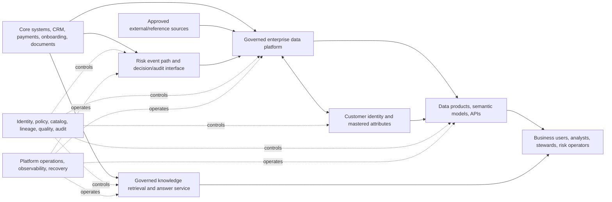
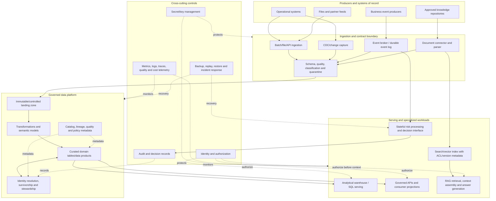

# Project 16 — Enterprise Data Architecture Capstone

> **Programme:** Applied AI Engineering Roadmap → Stage 2D — Data Architecture → Module 16 — Enterprise Data Architecture Case Studies and Capstone  
> **Target repository path:** `Stage 2D — Data Architecture/16-Enterprise-Data-Architecture-Case-Studies-and-Capstone/Projects/16-enterprise-data-architecture-capstone.md`  
> **Project type:** Integrated architecture design, analysis, validation, and defense; no deployment required  
> **Level:** Beginner → Intermediate → Advanced  
> **Recommended effort:** 24–32 focused hours, consistent with the module roadmap; adjust to experience and scope  
> **Status:** A complete proposed capstone specification. It is not an official brief or official rubric because the supplied roadmap says the controlling project brief and rubric were unavailable/empty when the roadmap was authored.

---

## 0. Source boundaries, how to use this project, and completion standard

### 0.1 Source-of-truth rule

This project is built from the supplied Module 16 roadmap and the eight companion learning documents:

1. `01-case-study-banking-data-platform.md`
2. `02-case-study-customer-360-and-master-data.md`
3. `03-case-study-real-time-fraud-and-risk-platform.md`
4. `04-case-study-enterprise-lakehouse-modernization.md`
5. `05-case-study-multi-cloud-data-platform.md`
6. `06-case-study-governed-rag-and-enterprise-knowledge.md`
7. `07-capstone-requirements-and-architecture-deliverables.md`
8. `08-capstone-validation-defense-and-review-rubric.md`

The supplied roadmap states that the original capstone project brief and official review rubric were empty when it was authored. The actual current repository versions of `Projects/16-enterprise-data-architecture-capstone.md`, `Projects/README.md`, `README.md`, and `practice-questions.md` were not included in the mounted source files for this task. This document therefore proposes a complete project brief and recommended self-review criteria; it does **not** claim to reproduce official repository requirements.

If the repository's controlling brief, an authorised clarification, or an official rubric is available later and conflicts with this project, that controlling source takes precedence. Update this project only when explicitly authorised to do so.

### 0.2 Evidence labels

Use these labels in every deliverable, diagram note, register, and defense:

| Label | Meaning | Required handling |
|---|---|---|
| **SOURCE-DERIVED** | Supported by a supplied case-study lesson or roadmap | Preserve meaning; cite the source filename/section in the evidence register |
| **CONFIRMED FACT** | Explicitly provided by the actual business brief or an accountable owner | Record source, owner, date, scope, and confidence |
| **ILLUSTRATIVE ASSUMPTION** | Invented here to make the exercise concrete | Never present as a real requirement; record impact and validation path |
| **PROPOSED REQUIREMENT** | Candidate requirement awaiting business/technical approval | Give it an owner, measurable acceptance method, and approval status |
| **HYPOTHESIS** | Plausible but unproven explanation or design proposition | Test it or keep it visibly unresolved |
| **RECOMMENDATION** | Suggested architecture practice | Compare against context, cost, and alternatives |
| **OPEN QUESTION** | Missing or ambiguous information that could affect design | Assign an owner and due point; show consequences if unresolved |
| **VALIDATED** | Supported by a completed test, calculation, review, or accountable confirmation | Link the evidence and state its scope/limitations |
| **NOT VALIDATED** | Planned or described, but evidence has not been produced | Do not claim compliance or production readiness |

A diagram proves that a view was documented, not that the architecture is implemented. A test plan proves intent, not successful execution. A design-only capstone cannot claim operational readiness merely because it includes an operations section.

### 0.3 What this project is about

Design an integrated enterprise data architecture for a fictional organisation. The architecture must support governed analytical data, a reliable customer identity view, a latency-sensitive risk-event path, gradual modernization of a legacy analytics estate, a justified cloud deployment strategy, and a permission-aware enterprise knowledge assistant where the AI use case is in scope.

The purpose is not to deploy every capability or to force all six case studies into one physical platform. The purpose is to decide which capabilities belong in the integrated target, which should remain separate, which should be optional, and why. The capstone must expose interactions between domains—shared identity, governance, metadata, security, resilience, operating ownership, and cost—without pretending that different workloads have identical latency, consistency, retention, or availability needs.

### 0.4 Expected outcomes

By completing the capstone, you should be able to:

- Translate a brief into a traceable set of business outcomes, functional requirements, quality attributes, constraints, assumptions, dependencies, risks, and open questions.
- Establish a current-state evidence baseline and distinguish observed behaviour from documentation claims.
- Produce consistent context, container/logical-component, deployment, data-flow, and trust-boundary views.
- Design logical data domains, data products, contracts, lineage, quality controls, and serving interfaces.
- Explain identity resolution, attribute-level authority, survivorship, merge/split history, consent/purpose, and customer-view freshness.
- Design event ingestion and stateful risk processing with explicit latency boundaries, event-time semantics, idempotency, late-event handling, replay, and failure behaviour.
- Compare warehouse, lake, lakehouse, and hybrid options and define migration waves, coexistence, reconciliation, rollback, and decommission gates.
- Evaluate single-cloud, limited-secondary, active-passive, and active-active multi-cloud patterns without assuming multi-cloud is inherently better.
- Design RAG ingestion and retrieval that applies authoritative authorization before protected content enters model context, including revocation, deletion, provenance, grounding, and evaluation.
- Record decisions, trade-offs, risks, ownership, operational readiness, and validation evidence.
- Audit the completed package, remediate findings, and defend the design to technical and business reviewers.

### 0.5 Definition of done

The capstone is complete for **architecture-design purposes** when all of the following are true:

1. The scope, source-of-truth boundaries, assumptions, and unresolved questions are explicit.
2. Every accepted requirement maps to an architecture response and an acceptance/evidence method.
3. Every material component has a stated responsibility, owner, inputs, outputs, trust boundary, and failure behaviour.
4. The current, target, and transition views agree with the data-flow and interface registers.
5. Alternative architectures were compared against criteria established before scoring.
6. Each major decision has alternatives, rationale, consequences, risks, evidence needs, and revisit triggers.
7. Security, privacy, governance, data quality, lineage, resilience, capacity, cost, and operations are addressed at the right level for each workload.
8. Migration steps have entry/exit gates, reconciliation, consumer acceptance, rollback, and retirement conditions.
9. The validation matrix distinguishes planned tests from executed and passed tests.
10. Review findings are logged, fixed or explicitly accepted by an authorised owner, and rechecked.
11. A defense package can answer likely challenges without inventing evidence.
12. The final status says **design complete / evidence status stated**, not “production-ready,” unless a real deployment and its required approvals/tests were actually assessed.

---

## 1. Project scenario and architecture framing

### 1.1 Fictional scenario: Northbridge Financial Group

**Scenario status: ILLUSTRATIVE ASSUMPTION.** Northbridge Financial Group is a fictional financial-services organisation used only for this exercise. It has a legacy analytics estate and multiple business domains. The organisation wants to improve trust in reporting, customer identity, risk-event timeliness, and employee access to governed knowledge while maintaining existing business services during modernization.

No claim is made about a real bank, regulation, vendor, cloud price, workload, or production target. All numbers and acceptance thresholds in this project are placeholders for practising the method. They must be replaced by confirmed requirements in a real engagement.

### 1.2 Illustrative business outcomes

| ID | Candidate outcome | Business value | Evidence needed before commitment |
|---|---|---|---|
| BO-01 | Improve trust and traceability of enterprise reporting | Faster investigation and more defensible numbers | Report reconciliation, lineage coverage, accountable finance/risk sign-off |
| BO-02 | Provide a governed customer identity view | Reduce duplicate identities and conflicting customer attributes | Match-quality analysis, steward review, merge/split tests, owner approval |
| BO-03 | Support a risk-event path with measurable latency and correctness | Enable timely risk decisions or alerts | Agreed start/end boundary, representative load test, decision audit, failure tests |
| BO-04 | Modernize the analytics estate without unsafe big-bang cutover | Reduce change risk while preserving business continuity | Wave plan, parallel-run reconciliation, consumer acceptance, tested rollback |
| BO-05 | Select an appropriate cloud strategy based on evidenced drivers | Balance resilience, cost, locality, portability, and operating burden | Requirements, cost model, recovery exercise, portability evidence |
| BO-06 | Offer a governed enterprise knowledge assistant if approved | Improve access to approved internal knowledge | Authorization tests, grounding/citation evaluation, revocation/deletion evidence |
| BO-07 | Establish clear ownership and sustainable operations | Make support, change, and incident response accountable | RACI, service contracts, runbooks, on-call and escalation design |

### 1.3 Scope decision: integrated design, not forced integration

The default exercise scope includes a governed analytical platform, customer identity capability, modernization transition, security/governance/metadata, operations, and architecture review. The real-time risk path and RAG assistant are included as **distinct workload patterns** to show how the enterprise platform supports different consumers. They are not required to share one runtime or one storage engine.

The multi-cloud case is a decision to be evaluated, not a preselected outcome. A single-cloud design with a tested exit strategy must be assessed fairly. If no confirmed requirement forces a second provider, the recommended default is to avoid distributed multi-cloud complexity until evidence justifies it.

### 1.4 In scope

- Business context, stakeholders, system and data-domain inventory.
- Functional and non-functional requirements with measurable acceptance methods.
- Current-state, target-state, and transition-state architecture.
- Logical data zones, integration patterns, contracts, data products, semantic/serving layers.
- Customer identity, attribute authority, survivorship, stewardship, consent/purpose and history.
- Event ingestion, state, latency, replay, idempotency, and risk-path failure semantics.
- Modernization options, gap analysis, migration sequencing, coexistence and rollback.
- Cloud placement and portability analysis, including costs and operational dependencies.
- Governed RAG data lifecycle and permission-aware retrieval if the use case is approved.
- Security, privacy, governance, lineage, quality, reliability, performance, cost, operating model.
- ADRs, risks, assumptions, open questions, validation plan, audit report, and defense.

### 1.5 Out of scope unless a real brief requires otherwise

- Building a real financial transaction system or making live fraud decisions.
- Accessing production customer or payment data.
- Deploying cloud infrastructure, databases, brokers, vector stores, or models.
- Claiming legal/regulatory compliance without applicable requirements and qualified review.
- Training or certifying a fraud model.
- Replacing the system of record or changing transaction-authority boundaries.
- Enforcing a particular cloud provider, product, framework, or programming language.
- Claiming production readiness based solely on design artefacts.

### 1.6 Stakeholders and decision rights

| Stakeholder | Primary concern | Accountable contribution |
|---|---|---|
| Executive sponsor / business owner | Business outcome, funding, acceptable risk | Approves outcomes, scope, major risk acceptance |
| Enterprise/data architect | Coherent target architecture and trade-offs | Owns architecture package and ADRs |
| Domain data owners | Meaning, authority, permitted use | Approve domain definitions and attribute authority |
| Finance/reporting owner | Reconciliation, semantic stability, reporting deadlines | Approves report acceptance and migration evidence |
| Risk/fraud owner | Decision boundary, latency, false-positive/negative consequences | Approves risk workflow and fallback policy |
| Customer-data steward | Matching, merge/split, correction | Owns stewardship policy and exception workflow |
| Security/IAM | Identity, authorization, secrets, trust boundaries | Reviews access design and security evidence |
| Privacy/legal/compliance | Purpose, retention, deletion, obligations | Confirms applicable policy and review requirements |
| Platform/SRE | Availability, recovery, observability, capacity, support | Reviews service objectives, runbooks, recovery evidence |
| Data engineering | Ingestion, transformation, contracts, replay | Owns pipeline design and data quality operations |
| AI/RAG owner | Retrieval, grounding, evaluation, model boundary | Owns AI-specific tests and failure handling |
| Architecture review panel | Coherence, evidence, alternatives, risks | Challenges design and records review outcome |

The table is a recommended starting point, not a claim about the fictional organisation’s actual governance. Assign named roles and authority only after confirmation.

---

## 2. Execution plan: initiation to closure

Work through the steps in order. Later steps may cause earlier artefacts to be revised; record those changes rather than silently overwriting the reasoning.

| Step | Phase | Main activity | Primary output | Exit gate |
|---|---|---|---|---|
| 01 | Initiate | Confirm brief, sponsor, purpose, boundaries, and source authority | Project charter, source register | Scope and decision authority understood |
| 02 | Discover | Map stakeholders, systems, domains, consumers, and owners | Stakeholder map, inventory | Major actors and interfaces accounted for |
| 03 | Classify | Separate facts, requirements, assumptions, constraints, risks, questions | Registers | No invented assumption presented as fact |
| 04 | Define requirements | Write measurable functional and quality requirements | Requirement and quality-attribute registers | Acceptance methods and owners defined |
| 05 | Baseline current state | Gather evidence and map actual flows | Current-state views and evidence log | Evidence gaps visible and prioritized |
| 06 | Model data and contracts | Define domains, identifiers, schemas, semantics, lineage and quality | Logical data model, contract catalogue | Critical data flows and semantics traceable |
| 07 | Generate options | Create credible alternatives before choosing | Option set and evaluation criteria | No premature technology commitment |
| 08 | Design target | Integrate platform, customer, risk, migration, cloud, RAG and controls | Target architecture views | Workload-specific needs and boundaries visible |
| 09 | Record decisions | Document alternatives, rationale, consequences and triggers | ADRs and decision log | Major choices defensible |
| 10 | Threat/risk review | Challenge security, privacy, correctness, resilience and operations | Threat model, risk register, controls | High risks have treatment/owner/status |
| 11 | Plan transition | Sequence migration, dual run, reconcile, cut over, roll back, retire | Migration roadmap and runbooks | Every wave has entry/exit and rollback gates |
| 12 | Plan operations | Define ownership, SLOs, telemetry, incident and recovery operations | Operating model, runbook index | Service responsibilities and failure handling clear |
| 13 | Validate design | Map requirements to checks; perform calculations and consistency tests | Validation matrix, test plan | Claims are separated from planned evidence |
| 14 | Audit package | Check completeness, contradictions, unsupported claims and gaps | Audit findings and remediation log | No unresolved critical design inconsistency |
| 15 | Remediate | Fix defects, rerun checks, record accepted residuals | Revised package and closure evidence | Each finding has disposition and recheck |
| 16 | Defend | Present architecture, trade-offs, evidence and open risks | Defense deck/brief and Q&A log | Reviewer questions answered with evidence or honest gaps |
| 17 | Close | Summarize accepted design, limits, next steps and lessons | Final architecture report and lessons log | Versioned handover package complete |

### Step 01 — Initiate and establish authority

**Objective:** Make sure the work responds to the controlling brief rather than assumptions in a learning example.

Actions:
1. Locate the actual project brief, any official rubric, approved clarifications, and current repository tree.
2. Record filenames, versions/commit IDs if available, dates, owners, and precedence.
3. If the controlling brief is unavailable, state that explicitly and use this project only as a proposed exercise.
4. Identify sponsor, architecture decision authority, domain owners, security/privacy reviewers, and intended reviewers.
5. Agree the business problem, intended decision, study effort, deliverable format, and whether the exercise is design-only.
6. Create a change log and unique IDs for requirements, decisions, risks, findings, interfaces, tests, and deliverables.
7. Set a review cadence and define who can accept residual risk.

**Deliverables:** `D-01 Project Charter and Source Register`, `D-02 Stakeholder and Decision-Rights Map`.

**Exit criteria:** Source precedence is clear; scope and authority are stated; no claim is made that a proposed scenario is official.

### Step 02 — Discover stakeholders, systems, and business capabilities

Actions:
1. Interview each stakeholder group about outcomes, current pain, decisions, and failure impact.
2. Inventory source systems, stores, files, APIs, event producers, identity providers, consumers, reports, AI applications, and external dependencies.
3. Record owner, purpose, classification, data domain, authoritative fields, interfaces, frequency, volumes or explicit unknowns, freshness, retention, and operational contact.
4. Identify systems of record and clarify which facts each owns; do not assume one application owns all attributes.
5. Map business capabilities to data products and consumers.
6. Identify undocumented spreadsheets, manual extracts, shadow pipelines, and downstream dependencies.
7. Separate observed facts from stakeholder-reported claims and old documentation.

**Deliverables:** `D-03 System/Data/Consumer Inventory`, `D-04 Business Capability and Data-Domain Map`.

**Exit criteria:** Every critical source and consumer has an owner or an explicit ownership gap.

### Step 03 — Classify statements and build registers

Create and maintain:
- Fact/evidence register.
- Assumption register.
- Constraint register.
- Dependency register.
- Open-question log.
- Risk register.
- Hypothesis register.
- Decision log.

For every assumption, record rationale, affected design, impact if false, owner, confirmation path, and due point. For every open question, record the decision it blocks and the safe default while unresolved.

**Exit criteria:** A reviewer can distinguish what is known from what is proposed.

### Step 04 — Define requirements and quality attributes

Translate business outcomes into testable statements. Use stable IDs such as `FR-001`, `NFR-001`, `SEC-001`, `GOV-001`, `OPS-001`, and `MIG-001`.

Requirement categories:
- Business and functional.
- Data correctness, completeness, timeliness, freshness, reconciliation, and semantic consistency.
- Security, identity, authorization, privacy, purpose limitation, retention and audit.
- Availability, recovery, resilience, and failure behaviour.
- Performance, capacity, throughput, concurrency, and tail latency.
- Cost and cost observability.
- Operability, ownership, support, and change.
- Portability, interoperability, and exit.
- Migration, coexistence, rollback, and decommission.
- AI retrieval, grounding, permission revocation, deletion, and evaluation where in scope.

A quality-attribute scenario should specify **stimulus, operating condition, response, measurement, acceptance owner, and evidence method**. Avoid vague requirements such as “fast,” “secure,” “scalable,” or “highly available.”

**Illustrative candidate requirement (not a real target):** “For the agreed risk event types under a defined load profile, measure ingestion-to-decision acknowledgement latency and report p50/p95/p99; the risk owner must approve the numerical limit before performance acceptance.” This is intentionally measurable without inventing a committed latency number.

**Exit criteria:** Every in-scope requirement has an owner, status, architecture response, and verification/validation method.

### Step 05 — Establish the current-state baseline

Actions:
1. Inspect configuration, code, schedules, logs, access telemetry, incident history, contracts, data dictionaries, and actual outputs where available.
2. Interview operators and consumers; record statements as reported until corroborated.
3. Map batch, CDC, API, file, and event flows, including retries, dead-letter handling, replay, and manual steps.
4. Record storage zones, transformation layers, semantic models, reports, caches, feature stores, vector indexes, and downstream copies.
5. Identify trust boundaries, identities, service accounts, secret handling, network paths, and privileged operations.
6. Record current quality checks, reconciliation controls, lineage coverage, retention/deletion behaviour, and incident response.
7. Capture performance/cost baseline only from traceable telemetry or label it unknown.
8. Compare documented architecture to observed behaviour and log discrepancies.

**Deliverables:** Current-state context/container/flow views, inventory, evidence register, known-gaps list.

**Exit criteria:** Current state describes actual behaviour to the evidence level available; unknowns remain visible.

### Step 06 — Define domain models, data products, and contracts

Design the logical model before selecting physical technology.

Core data concepts to consider:
- Customer/person/legal entity, source record, identifier, identity link, relationship, attribute value and provenance.
- Business event, event ID, event time, ingestion time, schema version, deduplication key, decision ID and audit record.
- Raw/landing record, validated record, curated entity, analytical fact/dimension, semantic metric, data product and serving contract.
- Document, source URI/ID, version, owner, classification, ACL/entitlement reference, chunk, embedding/index version, citation, and deletion state.
- Metadata, lineage, quality result, retention class, policy reference, and ownership.

For each contract specify:
- Producer and consumer; purpose and allowed use.
- Schema and semantic definitions, key/identity rules, nullable/required fields, units, time zones, and versioning.
- Event or delivery semantics, ordering scope, idempotency, retries, replay, and compatibility.
- Quality rules, freshness expectation, reconciliation, and error handling.
- Classification, authorization, retention, deletion, lineage and audit requirements.
- Service objectives, owner, support contact, deprecation and change-notification process.

**Exit criteria:** Critical data flows have a contract or an explicitly recorded contract gap.

### Step 07 — Generate and compare architecture options

Do not begin with a preferred vendor. Produce credible alternatives for material decisions, for example:
- Centralised platform vs federated domain data products with shared governance.
- Warehouse-first vs lakehouse-first vs deliberate hybrid.
- Batch vs CDC vs event streaming vs hybrid ingestion.
- Central MDM hub vs registry/coexistence/federated identity pattern.
- Separate risk-serving path vs forcing risk processing through analytics layers.
- Single cloud with exit plan vs limited secondary dependency vs active-passive vs active-active multi-cloud.
- Keyword, vector, or hybrid retrieval with explicit authorization controls for RAG.
- Full migration vs workload-by-workload migration vs retain selected legacy components.

Before scoring, agree criteria with the relevant owners. Possible criteria include requirement fit, correctness, latency/freshness, security/privacy, recovery, portability, operability, skills, cost, migration risk, and reversibility. Record criterion definitions, scale anchors, weights if used, evidence, uncertainty, and sensitivity analysis. Scores aid discussion; they do not replace judgment.

**Exit criteria:** At least two credible alternatives are evaluated for each major contested decision, including the “simplest solution that meets the requirement.”

### Step 08 — Design the integrated target architecture

Create logical views for:
1. Business context and external actors.
2. Container/logical components and responsibilities.
3. Data domains and data-product boundaries.
4. Ingestion and transformation paths.
5. Customer identity and master-data lifecycle.
6. Risk event path and latency boundaries.
7. Analytical serving and semantic interfaces.
8. RAG document lifecycle and permission enforcement.
9. Trust boundaries, identity, secrets, and network paths.
10. Deployment/failure domains where relevant.
11. Current → transition → target states.

Ensure the architecture keeps workload-specific semantics explicit. For example, a customer analytics view can be eventually consistent while an operational identity decision may require a different contract; a risk decision may need a bounded synchronous path; a RAG answer must not see unauthorized content; and a reporting cutover needs reconciled semantic equivalence.

**Exit criteria:** Every important component has an owner, purpose, input/output, trust boundary, failure behaviour, and traceable requirement.

### Step 09 — Record decisions as ADRs

Create ADRs for material decisions, such as:
- `ADR-001` Logical platform pattern and domain ownership.
- `ADR-002` Ingestion strategy by workload.
- `ADR-003` Customer identity and attribute-authority model.
- `ADR-004` Risk event processing and failure policy.
- `ADR-005` Modernization, coexistence, and cutover strategy.
- `ADR-006` Cloud deployment/portability strategy.
- `ADR-007` Governed RAG retrieval and authorization.
- `ADR-008` Governance, metadata, lineage, and data-quality controls.
- `ADR-009` Resilience, recovery, and operational ownership.

These IDs are a suggested set; merge or split decisions where appropriate. Each ADR must include context, status, decision drivers, alternatives, criteria, evidence, decision, consequences, risks, validation plan, owner, date/version, and revisit triggers.

### Step 10 — Threat-model and risk review

Review:
- Data exfiltration, excessive privileges, credential leakage, trust-boundary confusion, and insecure service-to-service calls.
- Sensitive-data copies in landing zones, logs, test environments, feature stores, caches, exports, and vector indexes.
- Incorrect identity merges, stale or unauthorized attributes, weak provenance, and deletion propagation failures.
- Event loss, duplicates, reordering, late arrivals, replay corruption, state drift, and downstream timeout.
- Migration semantic drift, dual-write divergence, missed dependencies, failed rollback, and premature legacy retirement.
- Cross-cloud network/identity failures, hidden egress, shared failure domains, and unclear incident ownership.
- RAG ACL drift, revoked access, prompt injection, poisoned documents, stale indexes, cache leakage, unsupported answers, and citation mismatch.
- Cost runaway, capacity exhaustion, unowned alerts, untested recovery, and change without compatibility checks.

For each risk, record cause, event, impact, likelihood/uncertainty, severity, preventive/detective/recovery controls, owner, due date, residual risk, and acceptance authority. A control is not “effective” merely because it appears in a diagram.

### Step 11 — Plan migration and coexistence

For every workload/wave define:
- Business objective and consumers affected.
- Source/target components and dependency order.
- Data inventory, historical backfill, incremental capture, and change-data handling.
- Semantic/model compatibility and consumer migration plan.
- Reconciliation rules, tolerance owner, sample/full comparison, and exception workflow.
- Dual-run period and cost/operational capacity.
- Entry criteria, exit criteria, freeze windows, cutover authority, rollback trigger, rollback steps, and time limit.
- Data writes/ownership during transition and how divergence is resolved.
- Retention, deletion, archival, and decommission obligations.
- Support handover and evidence required before retirement.

A successful copy is not proof of semantic equivalence. Validate aggregates, row-level samples, business definitions, access policies, lineage, performance, and consumer outcomes.

### Step 12 — Design operations and support

For each service define:
- Service owner, data owner, technical owner, on-call role, and escalation path.
- Service objectives and error-budget approach if adopted.
- Metrics, logs, traces, freshness/lag, quality, reconciliation, cost, capacity, and security telemetry.
- Alerts, severity levels, incident runbooks, communications, and post-incident review.
- Backup/restore, replay, recovery point objective (RPO), recovery time objective (RTO), and exercise schedule—targets must be approved.
- Schema evolution, release, access review, key/secret rotation, retention/deletion, and change management.
- Data-product support contract and consumer notification.
- Runbook for source outage, late batch, malformed schema, poison event, duplicate event, stale customer master, access-policy outage, and failed RAG deletion.
- Cost ownership, budget thresholds, and capacity review cadence.

### Step 13 — Build the validation plan

Define test scenarios before claiming success:
- Functional and contract tests.
- Schema compatibility and producer/consumer contract tests.
- Data quality, completeness, freshness, lineage, reconciliation and semantic tests.
- Entity resolution precision/recall review, false merge prevention, merge/split and correction tests.
- Risk path latency distribution, load/burst, late event, duplicate, replay, state recovery, dependency outage, and audit reconstruction.
- Migration parallel-run comparisons, consumer acceptance, rollback rehearsal and retirement checks.
- Cloud portability, identity federation, transfer-cost sensitivity and recovery tests if multi-cloud is chosen.
- RAG authorization-before-context tests, permission revocation, deletion, cache invalidation, grounding/citation, prompt injection, stale-source and unsupported-answer tests.
- Security/privacy review, access review, failure injection, backup restore, incident tabletop, and operational handover.
- Diagram/register/ADR consistency checks.

For every test record ID, requirement, setup, input, procedure, expected result, evidence location, owner, status, date, limitations, and defects. Distinguish `PLANNED`, `READY`, `EXECUTED-PASS`, `EXECUTED-FAIL`, `BLOCKED`, and `NOT-APPLICABLE` with rationale.

### Step 14 — Audit the architecture package

Run the document and architecture checks in Section 15. Look for missing artefacts, orphan requirements, unjustified components, inconsistent names, contradictory flows, undefined abbreviations, unowned risks, unapproved numeric targets, untested controls, and claims beyond evidence.

### Step 15 — Remediate and revalidate

Every finding must have:
- Unique ID and severity.
- Location and concise description.
- Why it matters and affected requirement/risk.
- Corrective action and accountable owner.
- Due date/status.
- Evidence of correction.
- Independent recheck result.
- Residual issue or formal acceptance, if not fully fixed.

Do not erase a finding simply because the document was edited. Preserve the audit trail and close it only when rechecked.

### Step 16 — Prepare and conduct the defense

Prepare:
1. One-page executive architecture summary.
2. Business context and scope.
3. Current-state evidence and principal pain points.
4. Target architecture views and critical flows.
5. Two or three high-impact decisions with alternatives and trade-offs.
6. Risk, security, governance, resilience, and migration story.
7. Validation evidence and limitations.
8. Open risks and what would change the design.
9. Decision requests and next steps.

During Q&A, distinguish what is evidenced, assumed, recommended, or unknown. If evidence is missing, state the gap and explain how to close it rather than improvise a result.

### Step 17 — Close and hand over

Publish a versioned package containing the architecture report, diagrams, registers, ADRs, migration plan, operations model, validation matrix, audit report, remediation log, defense brief, and lessons log. Record approval status and limitations. For a design-only exercise, the handover outcome is **reviewable architecture proposal**, not a claim that the system is implemented or production-ready.

---

## 3. Proposed requirement register (illustrative starter set)

> All requirements in this section are **PROPOSED REQUIREMENTS / ILLUSTRATIVE ASSUMPTIONS**, not official or real Northbridge commitments. Confirm, modify, or remove them when a real brief is available.

| ID | Requirement statement | Type | Primary architecture response | Acceptance/evidence method | Owner |
|---|---|---|---|---|---|
| FR-001 | Support approved analytical consumers with governed data products | Functional | Curated data products and serving contracts | Consumer scenario and contract tests | Domain/data product owners |
| FR-002 | Preserve source provenance and transformation lineage for critical outputs | Functional/Governance | Metadata, lineage capture and queryable lineage | Trace selected outputs to source and transformations | Data governance |
| FR-003 | Reconcile critical reports to agreed authoritative sources | Functional/Quality | Reconciliation controls and semantic definitions | Reconciliation report and accountable sign-off | Reporting owner |
| FR-004 | Provide a customer view with explicit identity links and attribute authority | Functional | MDM/identity service or governed registry pattern | Stewardship scenarios and authority tests | Customer data owner |
| FR-005 | Support review, correction, merge and split of customer identities | Functional/Quality | Steward workflow and identity history | False-match, correction, merge/split tests | Customer steward |
| FR-006 | Provide a risk event path with agreed latency boundary and failure policy | Functional/Performance | Dedicated event path and decision/audit interfaces | Load, latency and failure tests | Risk owner |
| FR-007 | Support duplicate detection, replay and state recovery for risk events | Reliability | Idempotent processing, deduplication, replay and state checkpointing | Duplicate/replay/recovery tests | Streaming/platform owner |
| FR-008 | Modernize in controlled waves while current reporting remains supported | Migration | Coexistence, parallel run and gated cutover | Consumer acceptance and rollback rehearsal | Programme owner |
| FR-009 | Compare cloud patterns against verified business drivers | Architecture | Criteria-first cloud option analysis | ADR with sensitivity analysis | Enterprise architect |
| FR-010 | If RAG is approved, prevent unauthorized source content entering model context | Security/AI | Authorization-aware retrieval before context assembly | Adversarial ACL test suite | IAM/security and AI owner |
| FR-011 | Propagate source updates, revocations and deletion to derived RAG artifacts | Governance/AI | Versioned index lifecycle, invalidation and deletion workflow | Revocation/deletion propagation tests | Knowledge owner |
| NFR-001 | Define and approve quality-attribute targets for each workload | Quality | Workload-specific SLO/SLI register | Owner approval and measurable test plan | Service owners |
| NFR-002 | Define approved recovery objectives for critical services | Reliability | Backup, restore, replay and recovery design | Restore/recovery exercise evidence | SRE/service owner |
| SEC-001 | Enforce least privilege and separate duties for data access and administration | Security | Identity federation, RBAC/ABAC as appropriate, audited admin paths | Access review and negative tests | Security/IAM |
| GOV-001 | Apply classification, purpose, retention and permitted-use metadata | Governance | Policy/metadata integration and controlled serving | Policy review and sampled control tests | Data governance/privacy |
| OPS-001 | Provide actionable observability and named operational ownership | Operations | Metrics/logs/traces, alerting and runbooks | Incident tabletop and runbook walkthrough | SRE/platform |
| COST-001 | Compare full lifecycle cost and sensitivity, not only storage/compute | Cost | Cost model with transfer, duplication, staffing and failure costs | Reproducible spreadsheet/model review | FinOps/platform |
| MIG-001 | Define entry/exit, reconciliation, rollback and decommission gates per wave | Migration | Wave plan and cutover runbooks | Tabletop or rehearsal evidence | Migration lead |
| AI-001 | Evaluate retrieval relevance, grounding, citation correctness and refusal behaviour | AI quality | Offline evaluation and online feedback plan | Curated evaluation set and results | AI owner |

### 3.1 Quality-attribute scenario template

| Field | Example prompt to complete |
|---|---|
| ID / requirement | Which requirement is being tested? |
| Stimulus | What event, load, failure, or policy change occurs? |
| Environment | Normal load, peak, degraded dependency, migration, or recovery? |
| Response | What must the system do? |
| Measurement | Which latency, correctness, freshness, availability, or leakage measure applies? |
| Acceptance rule | What threshold or qualitative decision is approved, and by whom? |
| Evidence | Test output, telemetry, reconciliation, approval, or review record |
| Limitations | Which conditions were not tested? |

Do not copy the illustrative targets from a lesson and call them approved requirements.

---

## 4. Integrated target architecture

### 4.1 Logical design principles

1. **Requirements before products.** Choose components only after defining the need and alternatives.
2. **Domain ownership with shared guardrails.** Domain teams own semantics and quality; platform/governance capabilities provide reusable controls and metadata.
3. **Authoritative source boundaries.** Analytical projections do not silently become systems of record.
4. **Separate workload contracts.** Batch analytics, customer identity, risk decisioning, and RAG retrieval have different consistency, latency, and failure semantics.
5. **Security travels with data.** Classification, purpose, lineage, identity and access policy must survive copies and transformations.
6. **No “exactly once” shorthand for business correctness.** State the scope of each delivery guarantee and use idempotency, reconciliation, and audit.
7. **Migration is a first-class architecture state.** Coexistence and rollback are designed, not added after target-state approval.
8. **Multi-cloud must earn its complexity.** A second provider requires a verified driver and a complete operating/cost model.
9. **Authorization precedes context assembly.** Similarity ranking is not access control.
10. **Evidence defines status.** Planned controls and diagrams are not tested outcomes.

### 4.2 System context diagram



**Interpretation:** This is a proposed logical view, not a deployment diagram. It intentionally shows distinct risk and RAG paths and shared governance/operations capabilities. The actual integration points, protocols, owners, and trust boundaries must be detailed in the component and data-flow views.

### 4.3 Logical container/component view



**Important caveats:**
- The view is logical. Do not interpret every box as a separate product or service.
- `Vector` must not be the authority for current authorization. It may hold retrieval metadata, but the authorization decision must use authoritative current policy/entitlements at the required point in the request.
- A broker’s delivery guarantee is local to its defined scope. End-to-end outcomes still need idempotency, audit, reconciliation, and failure handling.
- MDM may be a hub, registry, coexistence, or federated pattern. The diagram does not decide that without evaluation.
- A warehouse, lakehouse, or hybrid serving arrangement remains a criteria-based choice.

### 4.4 End-to-end flow catalogue

| Flow ID | Producer → consumer | Pattern | Critical contract concerns | Failure/exception handling |
|---|---|---|---|---|
| FL-01 | Operational systems → landing/validated data | Batch/API/CDC by source | Schema version, watermarks, source authority, idempotency | Quarantine, retry, reconciliation, replay |
| FL-02 | Landing → curated data products | Batch/incremental transforms | Business semantics, quality, lineage, late changes | Failed-run isolation, backfill, quality gate |
| FL-03 | Customer sources → identity service | Batch and/or event-driven | Identifier scope, match evidence, attribute authority, consent | Steward review, reject, merge/split, history |
| FL-04 | Event producer → risk processor | Event stream | Event ID, event time, key, ordering scope, schema, deadline | Deduplication, bounded wait/fallback, dead letter, replay |
| FL-05 | Curated products → analytical serving | SQL/API/materialized projection | Metric definitions, freshness, versioning, authorization | Stale indicator, controlled fail, rebuild |
| FL-06 | Approved repositories → RAG index | Connector/parse/chunk/embed/index | Source ID/version, ACL, owner, retention, deletion | Quarantine, retry, reindex, delete confirmation |
| FL-07 | User request → RAG answer | Query/retrieve/authorize/context/generate | Current requester identity, purpose, citation, model boundary | Fail closed when authorization cannot be established |
| FL-08 | Platform telemetry → operations | Metrics/logs/traces/events | Correlation IDs, redaction, retention, access | Alert, incident workflow, protected audit |
| FL-09 | Legacy estate ↔ target during migration | Dual-run/CDC/batch compare | Ownership of writes, consistency, reconciliation | Freeze, repair, rollback, re-run |
| FL-10 | Cloud environment A ↔ B if justified | Controlled cross-environment flow | Data minimization, encryption, identity, volume, cost, owner | Queue/retry, reconciliation, route isolation |

### 4.5 Trust-boundary checklist

For each boundary, show source and destination identities, data classification, authentication, authorization, encryption in transit/at rest, network path, secret handling, audit evidence, and failure behaviour.

| Boundary | Questions to answer |
|---|---|
| Source system → ingestion | Which identity can read which objects? How are source credentials rotated? Can malformed data be quarantined without bypass? |
| Landing → curated | Who can read raw sensitive data? Can transformations leak fields into logs or derived datasets? |
| Domain → shared platform | Who owns schema/semantics? How are policy and quality requirements enforced? |
| Platform → consumer | Is access row-, column-, attribute-, or purpose-scoped where needed? Is the projection stale? |
| Event producer → risk path | Can an unauthenticated or malformed producer submit events? How are replay and duplicate attempts handled? |
| Knowledge source → RAG index | Are source ACLs captured with version and provenance? How are revocation/deletion events delivered? |
| User → RAG retrieval | Is requester identity verified? Is current authorization checked before content enters context? |
| Cloud A → cloud B | Why must data cross? What crosses, how often, under which identity, and at what cost? |
| Operations → production controls | Are administrative roles separated, audited, time-bounded where feasible, and reviewed? |

---

## 5. Data architecture and domain design

### 5.1 Domain/data-product map

| Domain | Authoritative source(s) | Proposed data product | Key consumers | Primary owner | Important semantics |
|---|---|---|---|---|---|
| Customer identity | To be confirmed per attribute/source | `customer-identity-view` | Service, analytics, risk, approved applications | Customer data owner | Mastered identity is not universal authority for all attributes |
| Account/product | Core product/account systems | `account-product-view` | Finance, risk, analytics | Domain owner | Effective dates, status, balances, relationships |
| Payments/events | Payment/event source | `payment-event-history` | Risk, investigation, analytics | Payments/risk owner | Event ID, event time, reversals, ordering scope |
| Finance/reporting | General ledger and approved sources | `finance-reconciled-mart` | Finance, management, audit | Finance owner | Metric definitions, period close, reconciliation |
| Risk decisions | Risk processor/rules/model versions | `risk-decision-audit` | Risk operations, investigations, approved analytics | Risk owner | Evidence, decision time, rule/model version, action |
| Enterprise knowledge | Approved document repositories | `governed-knowledge-index` | Authorized employees | Knowledge owner | Source version, ACL, freshness, citation, deletion state |
| Platform metadata | Catalog/lineage/quality/control systems | `data-product-catalog` | Owners, engineers, governance, auditors | Data governance/platform | Owner, classification, lineage, quality status, contracts |

### 5.2 Customer identity and master-data lifecycle

The architecture must distinguish:
- A real-world entity from a source record.
- A source-local identifier from a globally governed identifier.
- A candidate match from an accepted identity link.
- A mastered representation from the authoritative source for every individual attribute.
- A probable match from a certain match.
- A merge from a reversible and auditable merge.
- Identity resolution from authorization to access or use data.

Recommended workflow:
1. Generate candidates using safe blocking/candidate-generation rules.
2. Apply deterministic rules only where identifiers and evidence are sufficiently authoritative.
3. Use probabilistic scoring only with measured precision/recall and review thresholds.
4. Route ambiguous or high-impact matches to stewardship.
5. Apply attribute-level survivorship based on explicit source authority, recency, verification, and purpose.
6. Preserve source-record links, evidence, versions, and effective/observed times.
7. Support correction, merge, split/unmerge, and downstream repair.
8. Record consent/preference and permitted-purpose context separately from identity matching.
9. Publish versioned customer data products with freshness, match confidence/status, and provenance.
10. Monitor false merges, duplicate identities, steward backlog, stale attributes, and downstream repair completion.

**Acceptance evidence:** curated match test set; false-positive/false-negative analysis; attribute-authority approval; merge/split recovery test; provenance inspection; consent/purpose access tests; downstream correction evidence.

### 5.3 Data-quality control framework

Define quality rules by product and field rather than applying a generic “quality score” to everything.

| Dimension | Example control | Failure action |
|---|---|---|
| Validity | Domain/range/format constraints | Quarantine or mark invalid; do not silently coerce |
| Completeness | Required field and expected source population checks | Alert owner; block publication if critical |
| Uniqueness | Business key uniqueness or duplicate tolerance | Deduplicate only with explicit rules; preserve rejected records |
| Consistency | Cross-source and cross-table invariants | Reconcile, investigate, record discrepancy |
| Timeliness/freshness | Source-to-serving age and late-arrival monitoring | Show stale status, alert, or restrict consumer use |
| Accuracy/plausibility | Comparison to authoritative evidence or reviewed sample | Steward review; avoid asserting truth from plausibility alone |
| Referential integrity | Valid parent/relationship references | Quarantine or route to repair |
| Lineage/provenance | Source and transformation version captured | Block critical publication if traceability is required |
| Policy compliance | Classification, purpose and access tags present | Fail closed or quarantine until policy is resolved |
| Reconciliation | Counts, totals, checksums and business-level invariants | Stop cutover or publication at approved tolerance |

### 5.4 Data contract example (illustrative YAML)

```yaml
contract_id: customer-identity-view-v1
status: proposed
owner: customer-data-owner
producer: customer-identity-capability
consumers:
  - approved-customer-service
  - governed-analytics
purpose:
  - approved-service-context
  - approved-analytics
schema_version: 1
key:
  - enterprise_customer_id
fields:
  enterprise_customer_id:
    type: string
    required: true
    classification: restricted
  identity_status:
    type: enum
    values: [verified, provisional, review_required, separated]
    required: true
  match_confidence:
    type: number
    required: true
    meaning: "calibrated score or defined confidence band; not identity proof"
  attribute_provenance:
    type: array
    required: true
  effective_at:
    type: timestamp
    required: true
  observed_at:
    type: timestamp
    required: true
freshness:
  target: "to be approved by consumer and owner"
quality:
  - "enterprise_customer_id is unique within published view"
  - "all mastered attributes have source provenance"
  - "merge/split changes are versioned and auditable"
security:
  authorization: "approved consumer purpose and least privilege"
  retention: "per approved policy; not specified in this illustrative contract"
change_policy:
  compatibility: "versioned; breaking changes require consumer notice and approval"
```

This is a conceptual contract example, not a vendor schema or approved policy. Numeric thresholds, allowed values, data classification, retention, and purpose must be confirmed.

### 5.5 Metadata, lineage, and catalogue

At minimum, capture:
- Data product ID/name, domain, owner, steward, support channel, status, and version.
- Producer/consumer, contract version, schema, key, semantic definitions, and change history.
- Classification, purpose, retention, access policy reference, and deletion requirements.
- Source datasets/events/documents and transformation/job/model versions.
- Quality rules, execution results, freshness, reconciliation and known limitations.
- Lineage from source to published data product and from product to reports/features/AI indexes.
- Incident history, known issues, certification status and last review date.

Lineage must be actionable: identify impact before schema change, explain a report value, find derived copies for correction/deletion, and support incident diagnosis.

---

## 6. Workload-specific architecture patterns

### 6.1 Analytical platform and serving

Design a layered flow that may include controlled landing, validation/quarantine, standardized/curated domain data, semantic models, and serving products. Avoid assuming every data product must physically pass through every zone. Define each zone's purpose, quality bar, access rules, lifecycle, and owner.

Decisions to record:
- Warehouse, lakehouse, or hybrid and why.
- Table format/catalog/transaction semantics where relevant.
- Batch, CDC, API, event, or hybrid ingestion by source.
- Schema evolution and compatibility policy.
- Partitioning, clustering, workload isolation, and query-serving pattern based on workload evidence.
- Semantic model ownership and metric definitions.
- Data retention, archival, deletion and restore.
- Reconciliation to authoritative sources and publication gate.

### 6.2 Real-time fraud/risk event path

Keep the risk path's business contract distinct from historical analytics. Define:
- Event producer and authenticated identity.
- Event schema/version, unique event ID, partition/key and ordering scope.
- Event time, ingestion time, processing time and decision time.
- Latency start/end boundaries, percentiles, clock basis and measured population.
- Duplicate detection/idempotency and the scope of any delivery guarantees.
- State window, retention, checkpoint/recovery, late-event/watermark policy.
- Backpressure, consumer lag, poison events, dead-letter policy and replay.
- Decision owner, rule/model version, evidence and audit record.
- Dependency timeout and explicit fallback: fail-open, fail-closed, hold, manual review, or another approved policy. Do not invent the policy; the risk/business owner must decide.
- Historical reconciliation and protection against old backfills overwriting newer live state.

**Risk-specific validation:** load and burst tests; p50/p95/p99 latency; duplicate/replay/late-event tests; state recovery; downstream timeout; missing feature/dependency; audit reconstruction; false-positive/false-negative impact review. A toy score is not a validated fraud model.

### 6.3 Lakehouse modernization and transition

Evaluate legacy inventory, current pain and root causes before selecting the target. Compare at least:
- Retain and improve selected warehouse workloads.
- Lakehouse-first modernization.
- Hybrid: lakehouse for selected data products with warehouse/legacy serving retained where fit.
- Workload-by-workload migration with a deliberate transition state.

For each workload classify as retain, rehost, replatform, refactor, replace, or retire—with rationale and evidence. Do not infer that the word “legacy” means unfit.

Migration sequence:
1. Discover consumers and dependencies.
2. Define semantic equivalence and acceptance.
3. Establish target contracts and governance.
4. Build landing/ingestion and historical backfill.
5. Run incremental synchronization or CDC where appropriate.
6. Reconcile counts, business totals, sample records, metrics, lineage and access.
7. Run old and new paths in parallel for an approved window.
8. Obtain consumer acceptance and operational readiness.
9. Freeze or control writes, perform final delta sync, and execute cutover.
10. Monitor post-cutover with explicit rollback triggers.
11. Roll back when triggers are met and rollback remains safe.
12. Decommission only after dependencies, retention, audit, recovery, access, and ownership are resolved.

### 6.4 Cloud and portability decision

Evaluate:
- Single-cloud with tested exit plan.
- Primary cloud with a limited secondary-cloud dependency.
- Active-passive multi-cloud disaster recovery.
- Active-active multi-cloud for the same workload.
- Workload-level placement across providers.

Assess portability layer by layer:
- Data format and exportability.
- Table format/catalog semantics.
- Transformation language and runtime.
- Orchestration and eventing.
- Identity/federation and authorization policy.
- Network topology and private connectivity.
- Encryption/key ownership and secret management.
- Observability, incident management, backup and recovery.
- Service quotas, managed-service behaviour, support and skills.
- Deployment automation, policy-as-code, tests and runbooks.

Cost model should include transfer/egress, replicated storage, duplicate compute, networking, identity and security tooling, staffing/on-call, test environments, failover drills, support contracts, migration and recovery. Use current verified quotes/pricing sources for real decisions; do not reuse illustrative rates as current prices.

**Decision rule:** Multi-cloud is justified only when a confirmed requirement and measured benefits outweigh its added cost, duplicated operations, cross-cloud identity/networking, consistency, and incident complexity.

### 6.5 Governed RAG and enterprise knowledge

The knowledge lifecycle should be explicit:
1. Approve source and use purpose.
2. Connect using least-privilege service identity.
3. Parse and extract content safely.
4. Preserve source ID, owner, version, timestamps, classification and access policy.
5. Chunk with stable chunk/source references and safe boundaries.
6. Embed and index with model/version metadata; treat embeddings/indexes as derived data with lifecycle obligations.
7. Validate index coverage, ACL metadata, freshness and deletion behavior.
8. Authenticate the requester and establish current entitlements.
9. Retrieve candidates, then enforce authoritative authorization before any protected content is assembled into model context. Prefer filtering at retrieval and re-check before context assembly where needed.
10. Apply relevance ranking/reranking only after authorization constraints are respected.
11. Build minimal context and preserve source attribution.
12. Generate grounded output, with citation verification and an abstention path when evidence is insufficient.
13. Record a privacy-aware audit trail without logging protected content unnecessarily.
14. Propagate source changes, permission revocation, retention expiry and deletion to chunks, embeddings, vector/keyword indexes, caches, backups and downstream copies as policy requires.
15. Measure relevance, groundedness, citation correctness, unauthorized retrieval, revocation delay, deletion completion, freshness, latency and cost.

**Critical safety condition:** If current authorization cannot be established, do not expose the candidate content to the model. Similarity scores, index metadata alone, prompt instructions, or a citation after generation are not substitutes for access control.

---

## 7. Architecture option evaluation

### 7.1 Evaluation method

1. State the decision and the business outcome it affects.
2. Agree criteria and criterion definitions before scoring.
3. Identify hard constraints that eliminate options.
4. Include at least two credible options, including a simpler baseline.
5. Record evidence quality and uncertainty for every score.
6. Use weights only if the decision owners agree they reflect priorities.
7. Run sensitivity analysis: vary uncertain assumptions/weights and see whether the recommendation changes.
8. Record rejected options and why they were rejected.
9. State what evidence would cause the decision to be reopened.

### 7.2 Example: platform shape (illustrative, no scores asserted)

| Option | Strengths to test | Risks/limitations to test | Evidence needed |
|---|---|---|---|
| A. Improve existing warehouse | Lower migration disruption; existing SQL/report compatibility | May not meet varied data/ML/streaming needs; technical constraints may persist | Current workload profile, gaps, cost and change history |
| B. Lakehouse-first | Shared data foundation and flexible processing options | Requires table/catalog/quality/semantic governance; migration and concurrency complexity | Workload tests, format/catalog capability, operating skills |
| C. Hybrid transition | Preserves fit-for-purpose serving while modernizing selected domains | Duplication, inconsistent policy, dual-running cost, unclear ownership | Data-flow inventory, reconciliation, dual-run cost, retirement gates |
| D. Replace everything in one cutover | Simpler end-state diagram | High blast radius, difficult rollback, semantic and consumer risk | Exceptional evidence of low dependency/low risk; generally challenge carefully |

### 7.3 Example: cloud shape (illustrative)

| Option | Candidate fit | Main challenge |
|---|---|---|
| Single cloud with exit plan | No confirmed requirement forces a second provider; simplicity and proximity matter | Provider concentration and exit plan must be credible and tested |
| Primary plus limited secondary dependency | A specific capability or acquired workload needs a second environment | Cross-cloud network, identity, support and data transfer |
| Active-passive multi-cloud | Independent recovery is a confirmed requirement and recovery can be tested | Replication lag, failover orchestration, consistency and duplicated operations |
| Active-active multi-cloud | Very strong justified availability/placement requirement | Highest complexity in consistency, conflict handling, testing and operations |

### 7.4 Cost and capacity model

Build a reproducible model with explicit assumptions and ranges:

`Total lifecycle cost = storage + compute + data transfer + network + licences/services + security/governance + staffing/on-call + migration + testing/recovery + support + residual legacy + decommissioning`

Include:
- Average and peak data volume.
- Ingestion and query throughput.
- Storage retention and replication factor.
- Compute profile and concurrency.
- Cross-environment transfer volumes/frequency.
- Dual-running duration.
- Reprocessing/backfill and recovery workload.
- Support/on-call and skill acquisition.
- Cost uncertainty and sensitivity ranges.

Never present a model's output as an actual quote or savings claim without current, source-backed prices and validated usage assumptions.

---

## 8. Security, privacy, governance, and threat model

### 8.1 Control objectives

- Authenticate users and service identities; authorize every access at the appropriate boundary.
- Apply least privilege and separation of duties.
- Protect secrets, keys, tokens and sensitive logs.
- Classify data and constrain permitted purpose, retention and downstream use.
- Preserve provenance, lineage, auditability and approved correction/deletion.
- Prevent unauthorized content from entering RAG context.
- Ensure policy failures fail safely for the relevant data and action.
- Provide auditable administration, access review, and incident response.
- Validate controls with negative tests, not only configuration review.

### 8.2 Threat register starter set

| ID | Threat/event | Potential impact | Candidate controls | Evidence to request |
|---|---|---|---|---|
| T-01 | Over-privileged ingestion identity | Broad data exposure or tampering | Narrow scopes, separate identities, credential rotation | Access policy review and negative test |
| T-02 | Sensitive fields copied into logs/test outputs | Unintended disclosure | Redaction, synthetic data, log access control, retention | Log sampling and access review |
| T-03 | Incorrect customer merge | Wrong customer context, reporting or action | Thresholds, stewardship, provenance, split/unmerge | Reviewed match set and reversal test |
| T-04 | Duplicate/late event changes risk state | Incorrect decision or audit | Event IDs, idempotency, ordering policy, replay tests | Duplicate/late/replay test results |
| T-05 | Legacy and target metrics diverge | Incorrect reporting after cutover | Semantic mapping, reconciliation, consumer sign-off | Parallel-run report |
| T-06 | Cross-cloud identity/network dependency fails | Data path or recovery unavailable | Independent failure analysis, monitoring, tested failover | Recovery exercise and dependency map |
| T-07 | RAG ACL changes but index/cache stays stale | Unauthorized disclosure | Revocation propagation, authoritative authorization, cache invalidation | Revocation test with measured delay |
| T-08 | Malicious document prompt injection | Unsafe or misleading model output | Content isolation, instruction/data separation, tool restrictions, evaluation | Adversarial test results |
| T-09 | Source deletion misses derived embeddings/indexes | Retained sensitive content | Dependency graph, deletion workflow, verification and audit | End-to-end deletion evidence |
| T-10 | Backup/replay path untested | Prolonged outage or corrupted recovery | Scheduled restore/replay drills, integrity checks | Recorded recovery exercise |
| T-11 | Schema change breaks consumers | Pipeline outage or silent semantic drift | Versioned contracts, compatibility checks, staged rollout | Contract test and change record |
| T-12 | Cost spike or unbounded backfill | Budget overrun or capacity exhaustion | Quotas, budget alerts, rate limits, workload isolation | Load/cost model and alert test |

Risk severity must be assigned using the agreed risk method and accountable owner. This table is a starter set, not a completed formal risk assessment.

### 8.3 Privacy and data lifecycle

For every data copy—including raw zones, derived tables, caches, features, logs, extracts, backups, and AI indexes—define:
- Purpose and permitted consumers.
- Classification and access control.
- Retention and deletion trigger.
- Source-of-truth and correction process.
- Lineage and downstream impact discovery.
- Backup/restore treatment for deleted or corrected data.
- Audit evidence and exception process.
- Policy owner and review date.

A deletion request cannot be considered complete merely because the primary source record is deleted. Identify all relevant derived copies and document the policy-specific treatment of backups and immutable audit records.

---

## 9. Migration roadmap and cutover design

### 9.1 Illustrative migration waves

The wave sequence is a proposal for analysis; actual sequencing depends on dependency and readiness evidence.

| Wave | Objective | Typical scope | Entry gate | Exit gate |
|---|---|---|---|---|
| W0 — Discovery and guardrails | Reduce unknowns before changing systems | Inventory, contracts, owners, security, baseline telemetry | Sponsor and scope agreed | Critical dependencies and acceptance rules documented |
| W1 — Foundation | Establish reusable ingestion/governance/observability patterns | Non-critical representative data product | Platform controls and support path reviewed | Contract, quality, lineage and access tests pass |
| W2 — Low-risk product migration | Validate migration factory | Selected low-dependency report/data product | Consumer and rollback plan approved | Reconciliation and consumer acceptance signed |
| W3 — High-value domain migration | Move prioritized curated products | Finance/customer/other approved domains | W2 lessons closed; controls proven | Approved semantic, quality and operational gates pass |
| W4 — Specialized workloads | Migrate/introduce risk and/or RAG paths where approved | Dedicated event and knowledge flows | Domain-specific safety tests ready | Workload-specific validation and ownership accepted |
| W5 — Legacy retirement | Remove superseded components | Legacy jobs, marts, interfaces, access | All consumers moved and retention obligations resolved | No unresolved dependency; archive/rollback constraints approved |

### 9.2 Per-wave checklist

- [ ] Scope, consumers and owners confirmed.
- [ ] Data inventory and source/target mapping complete.
- [ ] Target contract and semantic mapping approved.
- [ ] Access, classification, retention and deletion controls reviewed.
- [ ] Historical backfill plan and incremental change capture tested.
- [ ] Reconciliation rules, tolerance and escalation owner agreed.
- [ ] Parallel-run period and operational capacity approved.
- [ ] Cutover entry criteria met.
- [ ] Cutover steps, authority and communication plan reviewed.
- [ ] Rollback trigger and execution steps rehearsed or tabletop-tested.
- [ ] Post-cutover monitoring and support handover ready.
- [ ] Decommission gate includes lineage, audit, backup, retention and dependencies.
- [ ] Decision log, lessons log and consumer acceptance updated.

### 9.3 Rollback runbook template

1. **Trigger:** State the measurable condition and who can declare rollback.
2. **Containment:** Stop or limit further divergence safely; preserve logs/evidence.
3. **Authority:** Confirm which system is authoritative for writes during rollback.
4. **Data reconciliation:** Identify deltas written since cutover and how they will be applied or repaired.
5. **Routing:** Restore traffic/consumer configuration to the prior path.
6. **Validation:** Check critical reports, contracts, freshness, permissions and business invariants.
7. **Communication:** Notify consumers, support, sponsor and risk owners.
8. **Monitoring:** Watch for recurrence and secondary failures.
9. **Closure:** Record timeline, data impact, root cause, residual risk and corrective actions.
10. **Re-entry:** Define evidence required before another cutover attempt.

Rollback is not always “switch DNS back.” If the target accepted writes or changed semantics, reversal may require reconciliation and explicit ownership rules.

---

## 10. Operating model and service ownership

### 10.1 Recommended responsibility split

| Capability | Accountable owner | Responsible teams | Consulted |
|---|---|---|---|
| Domain semantics and definitions | Domain data owner | Domain analysts/engineers | Consumers, governance |
| Platform runtime and shared services | Platform owner | Platform engineering/SRE | Domain teams, security |
| Data product quality and contract | Product/domain owner | Data engineering | Consumers, governance |
| Customer identity policy | Customer data owner | MDM engineers/stewards | Privacy, risk, service |
| Risk decision policy | Risk business owner | Risk engineering/operations | Security, platform |
| Cloud strategy and portability | Architecture authority | Platform/cloud engineering | FinOps, security, business |
| RAG source approval and purpose | Knowledge/data owner | AI/data platform team | IAM, privacy, security |
| Access policy and identity | Security/IAM owner | IAM/security engineering | Data/AI owners |
| Recovery objectives and exercises | Service owner | SRE/platform/domain teams | Business continuity |
| Migration/cutover | Programme/change authority | Migration lead and service teams | Consumers, risk, operations |
| Audit finding closure | Designated finding owner | Relevant engineering/architecture | Reviewer/assurance |

This is a recommended operating model. Actual RACI assignments and risk-acceptance authority must be agreed.

### 10.2 Operational indicators

Choose indicators that reveal user impact and system correctness—not just infrastructure health.

- Data freshness and late-arrival age by product/source.
- Completeness, schema failures, quarantined records, reconciliation differences.
- Pipeline success, duration, retry rate, backlog and replay volume.
- Customer match/review rates, merge/split incidents, steward backlog, attribute staleness.
- Risk event lag, end-to-end decision latency percentiles, duplicate rate, late-event rate, fallback counts and audit completeness.
- Serving latency, error rate, cache freshness, consumer adoption and contract violations.
- RAG unauthorized retrieval/context violations, revocation delay, deletion completion, citation correctness, unsupported answer rate, freshness and cost.
- Recovery test success, restore/replay duration, unresolved incidents and runbook freshness.
- Cost by domain/product/environment and cost per agreed unit of work.
- Change failure rate, rollback rate and downstream consumer impact.

Do not set numerical SLOs without business/technical owners and representative evidence. The SLO register should state the measurement boundary and exclusions.

### 10.3 Incident playbook index

At minimum create runbook stubs for:
- Source unavailable or late.
- Invalid schema or contract-breaking change.
- Data-quality/reconciliation failure.
- Pipeline backlog or repeated retries.
- Duplicate, out-of-order or poison risk event.
- Risk dependency timeout and fallback.
- Customer identity false merge or incorrect attribute.
- Serving product stale or unavailable.
- Authorization/IAM outage.
- RAG ACL revocation delay, deletion failure, malicious document or unsupported answer.
- Cross-cloud link/provider outage if used.
- Backup restore/replay failure.
- Cost or capacity threshold exceeded.
- Migration cutover/rollback event.

Each runbook needs trigger, severity, owner, immediate containment, diagnosis, safe recovery, communication, validation, evidence preservation, and post-incident follow-up.

---

## 11. Validation strategy and evidence matrix

### 11.1 Validation categories

| Category | What it answers | Example evidence |
|---|---|---|
| Document verification | Are artefacts complete, correctly referenced and internally consistent? | Link/ID checks, diagram review, register consistency |
| Requirement verification | Is each explicit requirement addressed by a design response? | Traceability matrix and design inspection |
| Data validation | Are semantics, quality, lineage and reconciliation adequate? | Data-quality tests, reconciliation output, lineage trace |
| Performance/capacity validation | Does the design meet approved workload conditions? | Load test, latency distribution, capacity model |
| Security/privacy validation | Are access and lifecycle controls effective under tested scenarios? | Negative tests, access review, threat-model review |
| Resilience validation | Can the system recover within approved objectives? | Restore, replay, failover and incident exercise |
| Migration validation | Are data and consumers equivalent enough for cutover? | Parallel-run comparison, consumer acceptance, rollback rehearsal |
| RAG/AI validation | Is retrieval authorized, relevant, grounded, fresh and auditable? | ACL, revocation, deletion, grounding and citation test results |
| Operational validation | Can accountable teams monitor, support and change the service? | Runbook walkthrough, alert test, ownership acceptance |
| Architecture defense | Can decisions be explained and challenged with evidence? | Defense notes, Q&A log, reviewer findings |

### 11.2 Requirement-to-evidence traceability template

| Requirement ID | Architecture element | ADR/control | Validation ID | Evidence location | Status | Gap/owner |
|---|---|---|---|---|---|---|
| FR-001 | Curated data products/serving | ADR-001/008 | VAL-DATA-01 | To be populated | PLANNED | Product owner |
| FR-003 | Reconciliation and semantic model | ADR-005/008 | VAL-MIG-02 | To be populated | PLANNED | Reporting owner |
| FR-004 | Customer identity service | ADR-003 | VAL-MDM-01 | To be populated | PLANNED | Customer owner |
| FR-006 | Risk event path | ADR-004 | VAL-RISK-01 | To be populated | PLANNED | Risk owner |
| FR-008 | Wave/cutover/rollback design | ADR-005 | VAL-MIG-01 | To be populated | PLANNED | Migration lead |
| FR-009 | Cloud option analysis | ADR-006 | VAL-CLOUD-01 | To be populated | PLANNED | Architecture owner |
| FR-010 | RAG authorization-before-context | ADR-007 | VAL-RAG-01 | To be populated | PLANNED | IAM/AI owner |
| FR-011 | Derived index deletion/revocation | ADR-007/008 | VAL-RAG-02 | To be populated | PLANNED | Knowledge owner |
| SEC-001 | IAM/least privilege | ADR-008/009 | VAL-SEC-01 | To be populated | PLANNED | Security owner |
| OPS-001 | Telemetry/runbooks/ownership | ADR-009 | VAL-OPS-01 | To be populated | PLANNED | SRE owner |

Replace every placeholder with the actual requirement and evidence IDs. The `PLANNED` status is not a pass.

### 11.3 Minimum scenario-based test catalogue

| Test ID | Scenario | Expected outcome to define | Evidence |
|---|---|---|---|
| VAL-DATA-01 | Critical report traced to source | Lineage shows source, transformations and versions | Trace output |
| VAL-DATA-02 | Required field or schema violation | Quarantine/block/alert follows contract | Test record and alert |
| VAL-DATA-03 | Source-to-curated reconciliation mismatch | Publication/cutover is held or exception explicitly approved | Reconciliation report |
| VAL-MDM-01 | Ambiguous customer match | No silent auto-merge; review path follows policy | Match-decision log |
| VAL-MDM-02 | Incorrect merge must be reversed | Split/unmerge and downstream repair are auditable | Reversal evidence |
| VAL-RISK-01 | Duplicate event replayed | Business action is not duplicated beyond approved semantics | Event/decision audit |
| VAL-RISK-02 | Late/out-of-order event arrives | Documented lateness/state policy is applied | State and lag evidence |
| VAL-RISK-03 | Risk dependency unavailable | Approved fallback occurs within defined boundary | Failure-injection trace |
| VAL-MIG-01 | Target fails after cutover | Rollback trigger, routing, data reconciliation and validation work | Rehearsal record |
| VAL-MIG-02 | Old/new reporting outputs differ | Difference is categorized and accepted or blocks cutover | Comparison report |
| VAL-CLOUD-01 | Cloud dependency/route fails (if applicable) | Documented degraded/recovery behaviour is measured | Exercise result |
| VAL-RAG-01 | User asks for document outside their entitlement | Protected content never enters model context or response | Negative test and trace |
| VAL-RAG-02 | Access revoked after indexing | Access is denied within approved revocation policy | Timestamped revocation test |
| VAL-RAG-03 | Source document deleted | Derived chunks/index/cache follow deletion policy | Deletion trace |
| VAL-RAG-04 | Prompt injection inside retrieved content | Content is treated as untrusted data; policy and tool boundaries hold | Adversarial evaluation |
| VAL-RAG-05 | No supported answer in approved sources | Assistant abstains or states evidence insufficiency | Grounding test |
| VAL-SEC-01 | Unauthorized role attempts privileged operation | Access is denied and event is audited | Access test/audit record |
| VAL-OPS-01 | Critical alert fires | Correct owner receives actionable alert and follows runbook | Alert/incident tabletop |
| VAL-REC-01 | Restore/replay is initiated | Integrity and recovery objective are measured | Restore/replay report |
| VAL-DOC-01 | Requirement/diagram/ADR inconsistency introduced | Audit detects or reviewer records the defect | Audit result |

---

## 12. Architecture decision record templates and starter decisions

### 12.1 ADR template

```markdown
# ADR-NNN — <decision title>

- Status: Proposed | Accepted | Superseded | Rejected
- Date/version:
- Decision owner:
- Consulted stakeholders:
- Related requirements:
- Related risks/findings:

## Context
What business need, constraints, evidence and unknowns drive the decision?

## Decision drivers and criteria
List criteria and why they matter. State hard constraints separately.

## Alternatives considered
For each option, record fit, benefits, costs, risks, operational burden and evidence.

## Decision
State the selected option and the conditions under which it applies.

## Consequences
Positive, negative, residual risks, migration implications and dependencies.

## Validation plan and evidence
What tests, measurements, approvals or review would support the decision?

## Revisit triggers
What changed evidence, requirement, cost, incident or capability would cause review?

## Approval and history
Who accepted the decision, when, and what changed in later versions?
```

### 12.2 Starter ADR index

| ADR | Decision question | Required alternatives | Revisit trigger |
|---|---|---|---|
| ADR-001 | Which logical platform/ownership pattern fits the domains? | Centralized, federated, hybrid | Domain ownership or workload evidence changes |
| ADR-002 | Which ingestion pattern fits each source/workload? | Batch, CDC, API, stream, hybrid | Freshness/correctness/operational need changes |
| ADR-003 | How are customer identities and attributes governed? | Hub, registry, coexistence/federated | Match quality, authority, or steward capacity fails |
| ADR-004 | How is the risk event path made correct and timely? | Stream/stateful path, synchronous service, batch alerting where fit | Latency or business failure policy changes |
| ADR-005 | How is modernization sequenced? | Retain/improve, lakehouse-first, hybrid waves, big-bang | Migration evidence or consumer constraints change |
| ADR-006 | What cloud shape is justified? | Single cloud, limited secondary, active-passive, active-active | Verified requirement or cost/recovery evidence changes |
| ADR-007 | How is enterprise knowledge retrieved safely? | Keyword, vector, hybrid; index/cache design | Access/freshness/evaluation requirements change |
| ADR-008 | Which shared governance/metadata controls are required? | Centralized control plane, federated metadata with shared policies | Control effectiveness or ownership model changes |
| ADR-009 | How are recovery and operations owned? | Central platform SRE, domain-operated with platform guardrails, hybrid | Service criticality/support capacity changes |

These are decision prompts, not predetermined answers.

---

## 13. Risk, assumption, dependency, and issue registers

### 13.1 Assumption register template

| ID | Assumption | Why needed | Design affected | Impact if false | Owner | Validation method/date | Status |
|---|---|---|---|---|---|---|---|
| AS-001 | Northbridge scenario is fictional and illustrative | Enable a concrete exercise | Entire package | No real-world commitment may be inferred | Author | Source review | Confirmed as exercise assumption |
| AS-002 | Analytical modernization can be done in waves | Planning hypothesis | Migration | Could require different transition design | Programme owner | Dependency and outage review | Open |
| AS-003 | Risk path has a distinct decision contract | Illustrative workload framing | Risk architecture | Could be alert-only rather than synchronous | Risk owner | Business workflow review | Open |
| AS-004 | RAG assistant may be in scope | Illustrative workload framing | Knowledge architecture | Remove or narrow AI components if not approved | Sponsor/security | Scope approval | Open |
| AS-005 | Cloud strategy is not predetermined | Preserve fair comparison | Cloud ADR | External mandate may constrain options | Architecture owner | Contract/requirement review | Open |

### 13.2 Open-question log template

| ID | Question | Why it matters | Decision blocked | Owner | Due point | Safe interim treatment |
|---|---|---|---|---|---|---|
| OQ-001 | What are the actual source systems and owners? | Determines contracts, flows and authority | Current-state baseline | Domain owners | Before target approval | Mark inventory as illustrative |
| OQ-002 | Which business metrics and reporting deadlines are mandatory? | Determines semantics and freshness | Serving and migration | Reporting owner | Before acceptance criteria | No numeric claim |
| OQ-003 | What latency boundary and fallback policy applies to risk? | Determines event architecture | Risk ADR | Risk owner | Before performance test design | Do not choose fail-open/closed |
| OQ-004 | Which attributes are authoritative in each customer domain? | Prevents false survivorship | MDM design | Customer owner | Before match policy approval | No production auto-merge |
| OQ-005 | Is there a verified reason to use multiple clouds? | Avoids unnecessary complexity | Cloud ADR | Sponsor/architecture | Before platform selection | Prefer comparison, not commitment |
| OQ-006 | Which knowledge sources and ACL systems are approved? | Determines safe RAG boundary | RAG design | Knowledge/IAM owner | Before indexing design | No sensitive content indexed |
| OQ-007 | What are approved retention/deletion rules for derived data? | Controls copies, indexes and backups | Governance design | Privacy/data owner | Before lifecycle approval | Keep retention unresolved and block claim |
| OQ-008 | What recovery objectives and test windows are required? | Drives resilience cost/design | Operations design | Service owner | Before acceptance | No RTO/RPO claim |

### 13.3 Risk register template

| ID | Risk | Cause/event/consequence | Likelihood/severity method | Control/treatment | Owner | Residual risk | Status |
|---|---|---|---|---|---|---|---|
| R-001 | Customer false merge | Weak evidence causes wrong identity linkage | Use approved risk matrix | Thresholds, steward queue, reversible history | Customer owner | To assess | Open |
| R-002 | Reporting semantic drift | Legacy and target logic differ | Use approved risk matrix | Metric mapping, parallel run, sign-off | Reporting owner | To assess | Open |
| R-003 | Risk event duplicate or late processing | Event semantics/state policy incomplete | Use approved risk matrix | Idempotency, replay tests, audit | Risk owner | To assess | Open |
| R-004 | RAG unauthorized context | Stale/missing ACL or bad ordering of checks | Use approved risk matrix | Authoritative authorization before context; negative tests | IAM/AI owner | To assess | Open |
| R-005 | Multi-cloud complexity without benefit | Provider count selected as goal | Use approved risk matrix | Criteria-first ADR and sensitivity analysis | Architecture owner | To assess | Open |
| R-006 | Rollback is unsafe after target writes | Write authority/delta repair undefined | Use approved risk matrix | Rehearsed rollback and data reconciliation | Migration lead | To assess | Open |

### 13.4 Dependency register

Track upstream sources, identity and policy services, network routes, shared catalogs, event brokers, orchestration, encryption/key services, observability, external providers, business approvers, consumer migration windows, and operating skills. For each dependency record owner, criticality, failure mode, interface, version, recovery option, and evidence.

---

## 14. Recommended deliverables and folder structure

The repository request is to write the capstone project Markdown file only. The following is a **proposed output package for the learner's project**, not an instruction to create or modify these paths in the user's repository during this task.

```text
16-enterprise-data-architecture-capstone/
├── Projects/
│   ├── 16-enterprise-data-architecture-capstone.md   # this project brief
│   └── README.md                                     # existing index; do not alter for this task
├── 01-case-study-banking-data-platform.md             # source lesson; read-only
├── 02-case-study-customer-360-and-master-data.md      # source lesson; read-only
├── 03-case-study-real-time-fraud-and-risk-platform.md # source lesson; read-only
├── 04-case-study-enterprise-lakehouse-modernization.md # source lesson; read-only
├── 05-case-study-multi-cloud-data-platform.md         # source lesson; read-only
├── 06-case-study-governed-rag-and-enterprise-knowledge.md # source lesson; read-only
├── 07-capstone-requirements-and-architecture-deliverables.md # source lesson; read-only
├── 08-capstone-validation-defense-and-review-rubric.md # source lesson; read-only
├── practice-questions.md                              # source lesson; read-only
├── README.md                                          # source index; read-only
└── roadmap-Enterprise-Data-Architecture-Case-Studies-and-Capstone.md # source roadmap; read-only
```

### 14.1 Suggested learner deliverables

| ID | Deliverable | Minimum contents |
|---|---|---|
| D-01 | Project charter and source register | Purpose, scope, authority, versions, source limitations |
| D-02 | Stakeholder and decision-rights map | Owners, consumers, approval and risk acceptance |
| D-03 | System/data/consumer inventory | Sources, stores, interfaces, ownership, classification |
| D-04 | Business capability and domain map | Capabilities, domains, data products, consumers |
| D-05 | Requirements and quality-attribute register | IDs, owner, acceptance, status, traceability |
| D-06 | Assumption/constraint/dependency/question registers | Status, impact, owner and resolution path |
| D-07 | Current-state architecture package | Context/container/flow views and evidence gaps |
| D-08 | Logical data model and contract catalogue | Entity, event, product, metadata and lifecycle contracts |
| D-09 | Target-state architecture package | Logical views, trust boundaries, data flows and ownership |
| D-10 | Architecture option evaluation | Criteria, alternatives, evidence, sensitivity and recommendation |
| D-11 | ADR set and decision log | Major decisions, consequences and revisit triggers |
| D-12 | Threat model and risk register | Threats, controls, owners, residual risk and evidence |
| D-13 | Migration roadmap and cutover/rollback plan | Waves, dependencies, reconciliation and decommission gates |
| D-14 | Operating model and runbook index | Ownership, telemetry, SLO approach, incident/recovery paths |
| D-15 | Validation matrix and test plan | Requirements, scenarios, expected results, evidence/status |
| D-16 | Audit report, remediation log and defense package | Findings, rechecks, limitations, Q&A and lessons |

D-01 through D-16 are proposed for this exercise, not official assessment criteria.

---

## 15. Final quality audit checklist

Perform the audit after the first complete draft and again after remediation. Use evidence references and record findings; do not mark a check as passed merely because a section exists.

### 15.1 Scope and source integrity
- [ ] Actual brief/rubric precedence is stated.
- [ ] Source-derived concepts are not confused with fictional scenario assumptions.
- [ ] Every invented number, name, target, price, and policy is labelled illustrative or proposed.
- [ ] Scope, exclusions, dependencies, stakeholders and decision rights are explicit.
- [ ] No unsupported compliance, savings, availability or production-readiness claim is made.

### 15.2 Requirements and traceability
- [ ] Functional and non-functional requirements are separately identified.
- [ ] Quality attributes define stimulus, condition, response and measurement.
- [ ] Every in-scope requirement has owner, status, architecture response and validation method.
- [ ] Every material component is justified by a requirement or explicitly labelled as optional.
- [ ] No orphan requirement, component, control, test or ADR remains without disposition.

### 15.3 Architecture consistency
- [ ] Context, component, deployment (if needed), data-flow and trust-boundary views agree.
- [ ] Component names, interface IDs, data-product names and ownership are consistent.
- [ ] Current, transition and target states are distinct.
- [ ] Workload-specific consistency, latency, freshness and failure semantics are not conflated.
- [ ] Systems of record and attribute authority are explicit.
- [ ] All important external dependencies and failure domains are represented.

### 15.4 Data and integration
- [ ] Contracts define schemas, keys, semantics, versioning, quality, lineage and failure handling.
- [ ] Batch/CDC/API/stream choices are justified per source/workload.
- [ ] Idempotency, duplicates, ordering, late data, replay and reconciliation are addressed where relevant.
- [ ] Quality rules have owners and failure actions.
- [ ] Data copies, retention, deletion, and downstream impact are covered.

### 15.5 Customer identity
- [ ] Entity scope and identifier scope are explicit.
- [ ] Attribute authority is field-specific rather than universally assigned.
- [ ] Matching confidence is not presented as proof.
- [ ] False positives and false negatives are considered.
- [ ] Stewardship, merge/split, correction, provenance and downstream repair are covered.
- [ ] Consent/purpose and authorization are distinct from identity matching.

### 15.6 Risk/event architecture
- [ ] Latency start/end boundaries and percentiles are defined.
- [ ] Event time, ingestion time, processing time and decision time are distinguished.
- [ ] State, partition key, ordering scope, deduplication and replay are covered.
- [ ] Dependency outage and fallback policy has an accountable owner.
- [ ] Risk decisions are auditable and linked to rule/model version.
- [ ] Toy values are not represented as validated model performance.

### 15.7 Modernization and migration
- [ ] Current-state inventory has evidence status.
- [ ] Alternatives include retain/improve and hybrid where credible.
- [ ] Transition state and dependencies are explicit.
- [ ] Backfill/incremental sync, reconciliation, semantic equivalence and consumer acceptance are planned.
- [ ] Each wave has entry/exit gates and rollback trigger/procedure.
- [ ] Legacy retirement includes consumers, retention, audit, recovery and access.

### 15.8 Cloud and cost
- [ ] Single-cloud with exit plan is evaluated.
- [ ] Multi-cloud is not assumed to be superior.
- [ ] Cross-cloud flows have purpose, direction, volume/frequency, owner, security and cost—or explicit unknowns.
- [ ] Portability is assessed by layer.
- [ ] Cost includes transfer, duplicated storage/compute, staffing, testing, support and recovery.
- [ ] Provider pricing/capability claims are sourced and dated if a real decision is made.

### 15.9 RAG and AI governance
- [ ] Approved sources, ownership, classification, ACL and version metadata are preserved.
- [ ] Authorization occurs before protected content enters model context.
- [ ] Similarity ranking is not treated as authorization.
- [ ] Revocation, deletion, freshness, cache invalidation and derived-data lifecycle are addressed.
- [ ] Prompt injection, unsupported answers, grounding, citation correctness and audit privacy are tested.
- [ ] Failure to establish authorization fails safely.

### 15.10 Security, reliability, operations and validation
- [ ] Trust boundaries, identities, secrets, least privilege and admin audit are explicit.
- [ ] Risks have owners, treatment, residual status and acceptance authority.
- [ ] Recovery objectives are approved and recovery exercises planned.
- [ ] Metrics cover business outcomes, freshness, quality, latency, errors, lag, cost and control effectiveness.
- [ ] Runbooks, escalation, incident communication and support ownership are specified.
- [ ] Planned tests are not misreported as passed tests.
- [ ] Audit findings are closed or formally accepted and rechecked.
- [ ] Defense notes state limits and evidence gaps honestly.

---

## 16. Validation, defense, and review method

### 16.1 Three distinct review layers

1. **Official assessment:** only the actual brief/rubric and authorised clarifications define mandatory criteria and weights.
2. **Architecture-quality review:** recommended peer review of coherence, risk, evidence, trade-offs and operability.
3. **Author self-check:** preliminary checklist to find omissions before formal review.

Passing the self-check is not an official pass. A design-quality review is not a production-readiness certification.

### 16.2 Recommended review questions

- What business problem does this architecture solve, and how is that outcome measured?
- Which requirements are confirmed and which are proposed?
- What is the strongest evidence for the current-state assessment?
- Why is the chosen platform pattern better than the simplest credible alternative?
- Which data attributes are authoritative, and who resolves conflict?
- How do you prove a risk event was not lost or applied twice at the business boundary?
- What happens when event processing is late or the decision dependency is unavailable?
- How will old and new reports be reconciled before cutover?
- What makes rollback safe after the target has received writes?
- What exact requirement justifies multiple clouds? What is the full cost of operating them?
- How do you ensure an unauthorized document never enters RAG context?
- How do revocation and deletion propagate to indexes, caches and derived data?
- Which controls are tested, which are only designed, and what evidence is missing?
- What changed assumptions would cause you to revisit the architecture?
- What risks remain and who has authority to accept them?

### 16.3 Review finding severity (recommended, not official)

| Severity | Meaning | Expected handling |
|---|---|---|
| Critical | A fundamental safety, authorization, correctness or feasibility flaw invalidates the design for its intended use | Stop acceptance; remediate and re-review |
| High | A material requirement, risk, migration, ownership or validation gap could cause significant failure | Remediate before acceptance or obtain explicit authorised disposition |
| Medium | A meaningful weakness or missing detail reduces confidence or operability | Fix in the agreed plan; record residual risk |
| Low | Editorial, clarity, or limited-impact completeness issue | Correct and recheck |
| Observation | Improvement or question without a confirmed defect | Record owner/decision; no implied failure |

Use the real review process if it defines a different severity model. Do not invent scoring weights or a pass threshold.

### 16.4 Defense outcome template

```markdown
# Capstone Defense Record

- Version:
- Date:
- Presenter:
- Reviewers:
- Source brief/rubric version:
- Scope of review:

## Summary
- Business outcome:
- Selected architecture:
- Most consequential trade-offs:
- Evidence reviewed:
- Limitations and open risks:

## Questions and responses
| ID | Reviewer challenge | Response | Evidence cited | Follow-up owner/date |
|---|---|---|---|---|

## Findings
| ID | Severity | Finding | Action/owner | Status | Recheck evidence |
|---|---|---|---|---|---|

## Outcome
- Official decision (if applicable):
- Architecture-quality review outcome:
- Conditions/limitations:
- Residual risks and acceptance authority:
- Next review trigger:
```

---

## 17. Practice and mastery exercises

Use the companion `practice-questions.md` as a source lesson when available; it was not included in the mounted source files for this task, so the exercises below are original capstone exercises rather than a reproduction of that file.

### Exercise 1 — Requirements and evidence
Take five statements from a real or fictional brief. Label each as fact, requirement, constraint, assumption, hypothesis, recommendation, or open question. Explain what evidence would confirm it and what decision it affects.

**Mastery evidence:** classification table with no silent assumptions.

### Exercise 2 — Current-state discovery
Create an inventory for at least three source systems, two consumers, and one external dependency. For each, document ownership, data, interface, classification, freshness, and evidence quality.

**Mastery evidence:** inventory plus context and flow diagrams.

### Exercise 3 — Architecture alternatives
Compare warehouse-first, lakehouse-first and hybrid options using criteria fixed before scoring. Vary at least one uncertain assumption and explain whether the recommendation changes.

**Mastery evidence:** criteria table, rationale, sensitivity note and ADR draft.

### Exercise 4 — Customer identity
Create a synthetic record set with duplicate candidates, contradictory attributes, and one intentionally ambiguous match. Define deterministic/probabilistic handling, stewardship, survivorship, and merge/split recovery.

**Mastery evidence:** test set, decision table, attribute authority matrix and reversal scenario.

### Exercise 5 — Risk event path
Draw a risk event path with event ID, event time, partition key, state, deduplication, decision audit, and replay. Define a latency boundary without choosing an unapproved threshold. Challenge duplicate, late, poison, and dependency-timeout cases.

**Mastery evidence:** flow, latency budget template, failure matrix and tests.

### Exercise 6 — Modernization
Select one illustrative report/data product. Define historical backfill, incremental synchronization, reconciliation, parallel run, cutover, rollback and retirement. Explain how semantic equivalence will be checked.

**Mastery evidence:** migration wave and runbook.

### Exercise 7 — Cloud strategy
Build a full lifecycle cost model for single-cloud with exit plan versus a multi-cloud option. Use explicit assumptions and sensitivity analysis. Identify the requirement that would justify the second provider—or conclude none has been evidenced.

**Mastery evidence:** reproducible model and ADR.

### Exercise 8 — Governed RAG
Define a synthetic source with restricted and public content. Test authorized and unauthorized users, ACL revocation after indexing, source deletion, stale cache, malicious prompt content, missing evidence, and citation correctness.

**Mastery evidence:** test matrix and trace proving unauthorized content never enters context.

### Exercise 9 — Audit and defense
Have a peer introduce five defects across requirements, diagrams, ADRs, migration, and RAG controls. Run the audit, record findings, fix them, and rerun the checks. Defend the result in a short mock review.

**Mastery evidence:** initial findings, corrective actions, recheck results, defense record and lessons log.

### Exercise 10 — Transfer learning
For each of the six case studies, write:
1. One principle that transfers to other domains.
2. One decision that is scenario-specific.
3. One assumption that must be revalidated before reuse.

**Mastery evidence:** six-row lessons log. Do not copy a design merely because it succeeded in another case.

---

## 18. Glossary

| Term | Meaning in this project |
|---|---|
| ADR | Architecture Decision Record documenting context, alternatives, decision and consequences |
| Attribute authority | Source/owner that governs a specific field or decision |
| CDC | Change Data Capture; propagation of source changes |
| Coexistence | Period when old and target systems operate together under explicit ownership and reconciliation rules |
| Data contract | Agreement on schema, meaning, quality, access, freshness, versioning and failure behaviour |
| Data product | Governed, owned, reusable data capability with defined consumers and service expectations |
| Entity resolution | Process of determining whether records represent the same real-world entity |
| Evidence register | Catalogue of claims and the sources/tests/reviews supporting them |
| Freshness | Age of data relative to its agreed reference time and consumer need |
| Idempotency | Repeating an operation does not create unintended duplicate business effects |
| Lineage | Traceability of data origin and transformations across systems |
| MDM | Master Data Management; governance and technology for consistent representations of important entities |
| RAG | Retrieval-Augmented Generation; retrieve approved evidence to inform model output |
| RPO | Recovery Point Objective; acceptable data-loss window, if defined and approved |
| RTO | Recovery Time Objective; acceptable restoration duration, if defined and approved |
| SLI/SLO | Service Level Indicator / Objective; measured service behaviour and approved objective |
| Source of record | System authoritative for defined facts/transactions within a stated scope |
| Survivorship | Rules selecting or deriving attribute values in a mastered record |
| Trust boundary | Boundary where identity, control, data classification or trust assumptions change |
| Validation | Evidence that a design meets the intended need under stated conditions |
| Verification | Checking that an artefact/design satisfies specified rules or requirements |

---

## 19. Lessons log template

After the project and defense, record:

| Question | Reflection |
|---|---|
| Which architecture principles transferred across all six cases? | |
| Which choices were specific to the fictional scenario? | |
| Which assumptions had the largest impact? | |
| Which option looked attractive until operating cost or failure modes were considered? | |
| What evidence most changed the recommendation? | |
| Which requirements lacked an owner or measurable acceptance rule at first? | |
| Which diagram/register/ADR inconsistency was found during audit? | |
| What would be done differently in a real discovery engagement? | |
| What remains unvalidated and why? | |
| Which earlier Stage 2D module should be revisited? | |

---

## 20. Final submission checklist

- [ ] Actual brief/rubric checked where available; source limitations documented otherwise.
- [ ] Scope, objectives, assumptions and exclusions approved or labelled proposed.
- [ ] Stakeholders, owners and decision rights mapped.
- [ ] Requirements, quality attributes, dependencies, risks and questions registered.
- [ ] Current-state evidence and architecture views produced.
- [ ] Data domains, logical models, contracts, quality and lineage defined.
- [ ] Customer identity and attribute authority decisions documented.
- [ ] Risk event path, latency boundary, failure policy and audit path documented.
- [ ] Modernization alternatives, waves, coexistence, reconciliation and rollback documented.
- [ ] Cloud strategy compared fairly, including single-cloud with exit plan.
- [ ] RAG access, lifecycle, revocation, deletion, grounding and evaluation covered if in scope.
- [ ] Security, privacy, governance, resilience, cost and operations reviewed.
- [ ] ADRs include alternatives, consequences, evidence and revisit triggers.
- [ ] Requirement-to-architecture-to-validation traceability is complete.
- [ ] Test plan clearly distinguishes planned from executed evidence.
- [ ] Audit findings were remediated or explicitly dispositioned and rechecked.
- [ ] Defense record and lessons log completed.
- [ ] Final status and limitations are stated honestly.

## Final project status rule

A completed document package demonstrates architecture reasoning and review discipline. It does not prove a real platform was deployed, a control is effective, a target was met, a regulation was satisfied, or production readiness was achieved. Those claims require real requirements, accountable approvals, representative tests, operational evidence, and the relevant assurance process.
