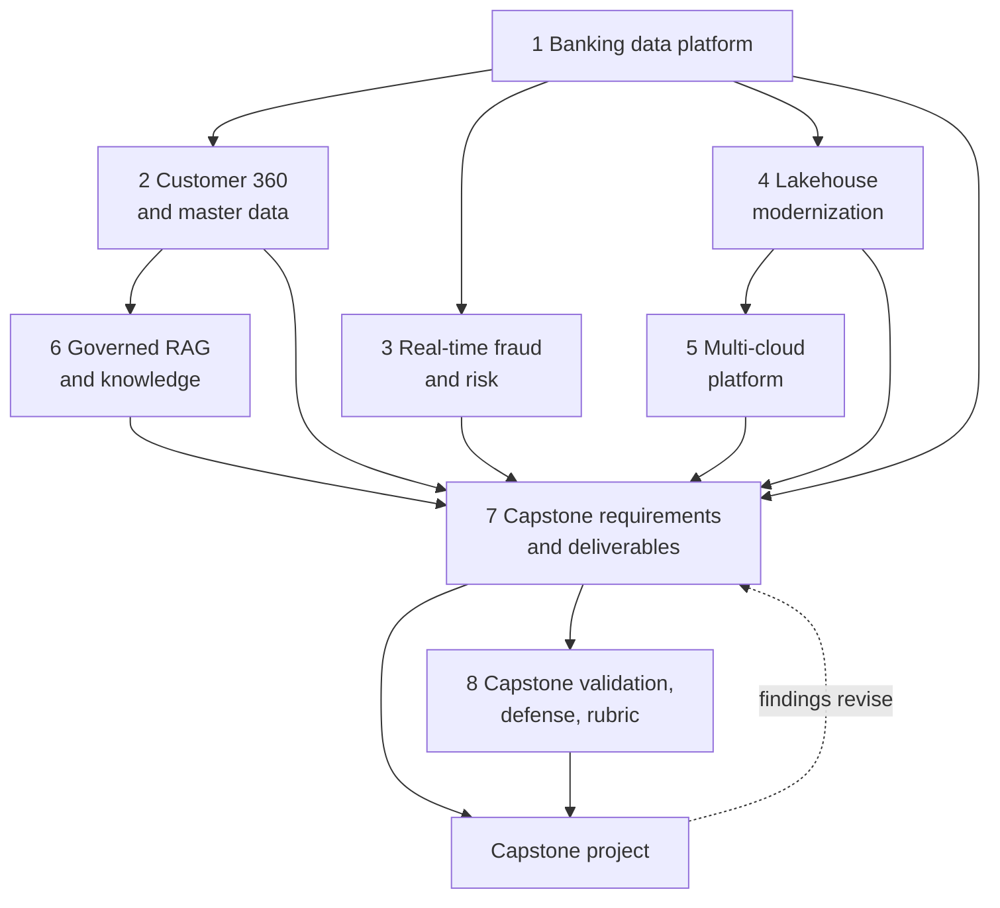

# Roadmap — Module 2D.16: Enterprise Data Architecture Case Studies and Capstone

This is the learning roadmap for the sixteenth and final module of Stage 2D,
**Data Architecture**. It tells you **what** to study in each case study, **in what
order**, **how** to analyse and practise each from beginner to advanced level,
**how to prove** you have learned it, and **how to complete, validate and defend**
the module's enterprise data architecture capstone.

Fifteen modules taught the parts: principles, requirements, patterns, models,
storage, integration, platforms, cloud, streaming, governance, metadata,
resilience, performance, serving and documentation. This module asks you to use
them **together**, on realistic scenarios, and then on a capstone of your own where
you must produce deliverables and defend the reasoning.

> **Repository note (source-of-truth limits).** The eight topic files,
> `practice-questions.md`, `README.md`, `Projects/README.md` and
> `Projects/16-enterprise-data-architecture-capstone.md` currently exist but are
> **empty**, as are the Stage 2D overview files; the target roadmap file existed
> but was empty. This has four important consequences:
>
> 1. **The case studies' actual scenarios are not available.** The scenario
>    frames below are *typical* frames inferred from the file names and are
>    labelled **illustrative**. They are **not** summaries of the source files.
> 2. **The capstone brief and the review rubric are not available.** The roadmap
>    gives a *method* for reading them and **template** grids to fill from the
>    real documents. It states **no scoring weights, thresholds or mandatory
>    criteria**; any such item in this file is a recommendation clearly marked as
>    such.
> 3. The cross-case-study comparison (Section H) cannot be filled from the
>    sources; it provides the comparison **dimensions** and an
>    **illustrative expectation** column, with a column to complete from the real
>    files ("not specified in the source" until then).
> 4. When the topic files, the project file and the rubric are written, **their
>    content governs** and this roadmap must be updated.
>
> **Directory name.** The prompt that requested this roadmap referred to
> `STAGE 2D - DATA ARCHITECURE/`. The actual directory is
> `Stage 2D — Data Architecture/`, and the actual name is preserved.
>
> **Illustrative content.** Every number, system and organisation here is an
> **illustrative assumption** (fictional *Northbridge Bank* where a name is
> needed). No regulation, price, latency target or accuracy figure is asserted as
> real. The module is vendor-neutral and requires no deployment; exercises are
> analysis and documentation.

## Table of contents

- [A. Module overview](#a-module-overview)
- [B. Module learning outcomes](#b-module-learning-outcomes)
- [C. Prerequisites and knowledge dependencies](#c-prerequisites-and-knowledge-dependencies)
- [D. Recommended learning sequence](#d-recommended-learning-sequence)
- [E. Case studies 1–6: detailed learning roadmaps](#e-case-studies-16-detailed-learning-roadmaps)
  - [E.1 Banking data platform](#e1-case-study-01--banking-data-platform)
  - [E.2 Customer 360 and master data](#e2-case-study-02--customer-360-and-master-data)
  - [E.3 Real-time fraud and risk platform](#e3-case-study-03--real-time-fraud-and-risk-platform)
  - [E.4 Enterprise lakehouse modernization](#e4-case-study-04--enterprise-lakehouse-modernization)
  - [E.5 Multi-cloud data platform](#e5-case-study-05--multi-cloud-data-platform)
  - [E.6 Governed RAG and enterprise knowledge](#e6-case-study-06--governed-rag-and-enterprise-knowledge)
- [F. Topic 7: capstone requirements and architecture deliverables](#f-topic-07--capstone-requirements-and-architecture-deliverables)
- [G. Topic 8: capstone validation, defense and review rubric](#g-topic-08--capstone-validation-defense-and-review-rubric)
- [H. Cross-case-study comparison](#h-cross-case-study-comparison)
- [I. Cross-module integration](#i-cross-module-integration)
- [J. Practice-question integration](#j-practice-question-integration)
- [K. Module completion checklist](#k-module-completion-checklist)
- [L. Final capstone guide — Enterprise data architecture capstone](#l-final-capstone-guide--enterprise-data-architecture-capstone)

---

## A. Module overview

### A.1 What case studies are, and why they come after the concepts

A **case study** is a realistic scenario with a business problem, constraints and
a described (or to-be-designed) architecture. Concepts taught one at a time hide
the hard part of architecture: **requirements conflict, information is
incomplete, and every good option costs something**. Case studies make you
practise that judgement.

### A.2 How case studies build judgement

| Skill | How a case study trains it |
| --- | --- |
| Reading a scenario | Separating facts, requirements and assumptions |
| Finding the real constraint | Distinguishing symptoms from drivers |
| Comparing options | Using criteria fixed beforehand |
| Seeing interactions | Governance vs speed, latency vs correctness, cost vs resilience |
| Defending decisions | Explaining alternatives and limits to a sceptical reviewer |
| Transferring lessons | Reusing principles without copying designs blindly |

### A.3 How the six case studies differ in focus (illustrative frames)

| # | Case study | Primary focus (illustrative) | Typical emphasis |
| --- | --- | --- | --- |
| 1 | Banking data platform | An end-to-end platform for a regulated institution | Integration of domains, governance, resilience |
| 2 | Customer 360 and master data | A unified customer view across systems | Identity, entity resolution, ownership, consent |
| 3 | Real-time fraud and risk | Low-latency detection on event streams | Latency budgets, state, false positives, failure modes |
| 4 | Enterprise lakehouse modernization | Replacing a legacy estate | Current/target state, migration, coexistence |
| 5 | Multi-cloud data platform | Operating across providers | Portability, networking, cost, operations |
| 6 | Governed RAG and enterprise knowledge | AI over enterprise content with access control | Embedding pipelines, permission-aware retrieval |

The frames are **inferred from file names**; the actual scenarios may differ.

### A.4 How the capstone integrates the learning

Topics 7–8 turn the case-study skills into a deliverable: **Topic 7** teaches you
to read the capstone brief, extract requirements and plan the deliverables;
**Topic 8** teaches you to validate the result against the review rubric and
defend it. The capstone itself (`Projects/16-…`) asks you to apply the whole
curriculum to one integrated problem.

### A.5 Why requirements, trade-offs, governance, operations and validation matter

An enterprise architecture is judged not by how modern its components are but by
whether it **meets stated needs, with known costs and risks, under real
constraints, and can be shown to do so**. Requirements anchor it; trade-offs
justify it; governance and operations keep it safe and running; validation turns
claims into evidence.

### A.6 What you should be able to do by the end

Analyse an enterprise scenario into requirements; evaluate and compare
architectures for banking platforms, customer 360, real-time risk, modernization,
multi-cloud and governed AI knowledge; plan a capstone from its brief; produce
the deliverables; validate them against the rubric; and defend the design,
including alternatives, risks and limits.

### A.7 Terminology (expanded at first use)

| Term | Meaning |
| --- | --- |
| Case study | A realistic scenario analysed to build judgement |
| Capstone | A culminating project integrating prior learning |
| Rubric | The criteria by which a deliverable is evaluated |
| Traceability | Linking requirements to decisions to evidence |
| Architecture defense | Presenting and justifying an architecture to reviewers |
| Quality attribute | A property such as performance, security or reliability |
| Evidence register | A table separating facts, assumptions, hypotheses and validated results |

---

## B. Module learning outcomes

After completing the module you will be able to:

1. **Analyse** an enterprise business scenario and **extract** architecture
   requirements.
2. **Evaluate** the banking data-platform case study.
3. **Analyse** customer 360 and master-data architecture decisions.
4. **Evaluate** real-time fraud and risk platform requirements.
5. **Analyse** enterprise lakehouse modernization.
6. **Compare** multi-cloud data-platform options and trade-offs.
7. **Evaluate** governed RAG and enterprise knowledge architecture.
8. **Translate** capstone requirements into a structured architecture plan.
9. **Produce** the required architecture deliverables.
10. **Validate** a design against explicit requirements and the evaluation
    criteria.
11. **Defend** architecture decisions, explaining alternatives, risks and
    limitations.
12. **Integrate** concepts from previous modules into one coherent enterprise
    architecture.

Each outcome is demonstrated through the exercises, deliverables and gates in
Sections E–G, K and L.

---

## C. Prerequisites and knowledge dependencies

The earlier modules are a **recommended curriculum background**, not a verified
formal dependency; the empty source files define none. Treat "essential" as
"needed for the exercises as designed here".

### C.1 Prerequisite table

| # | Prerequisite (plain terms) | Why needed | Needed by | Essential? | Provided by |
| --- | --- | --- | --- | --- | --- |
| P1 | Architecture role, principles, quality attributes, governance | Framing and evaluation in every case | All | Essential | `../01-Data-Architecture-Foundations-and-Principles/` |
| P2 | Requirements, constraints, risks, trade-offs, ADRs | Core method for all cases and capstone | All | Essential | `../02-Requirements-Constraints-and-Architecture-Decisions/` |
| P3 | Patterns and reference architectures | Option generation | 1–6, capstone | Essential | `../03-Data-Architecture-Patterns-and-Reference-Architectures/` |
| P4 | Data modeling, history, schema evolution | Customer 360, banking, lakehouse | 1, 2, 4 | Essential | `../04-Conceptual-Logical-and-Physical-Data-Modeling/` |
| P5 | Storage, formats, table formats, replication, lifecycle | Platform and migration cases | 1, 4, 5 | Essential | `../05-Database-and-Storage-Architecture/` |
| P6 | Integration, CDC, contracts, idempotency, reconciliation | All data movement | 1–6 | Essential | `../06-Data-Integration-and-Interoperability/` |
| P7 | Platform zones, layers, planes, tenancy, service levels | Platform cases | 1, 4, 5 | Essential | `../07-Enterprise-Data-Platform-and-Lakehouse-Architecture/` |
| P8 | Cloud, hybrid, multi-cloud, networking, IaC | Cloud-related cases | 4, 5 | Essential for 4–5; useful elsewhere | `../08-Cloud-Hybrid-and-Multi-Cloud-Data-Architecture/` |
| P9 | Streaming, event time, state, replay, failure modes | Fraud and risk case | 3 (and 1, 2 where streaming) | Essential for 3 | `../09-Streaming-and-Real-Time-Data-Architecture/` |
| P10 | Governance, security, privacy, compliance, retention | Regulated scenarios; RAG permissions | 1, 2, 3, 6 | Essential | `../10-Data-Governance-Security-Privacy-and-Compliance/` |
| P11 | Metadata, lineage, quality, master data, entity resolution | Customer 360; governance | 1, 2, 4, 6 | Essential for 2 | `../11-Metadata-Lineage-Quality-and-Master-Data/` |
| P12 | Reliability, DR, resilience testing | Operational dimension | 1, 3, 5 | Essential | `../12-Reliability-Resilience-and-Disaster-Recovery/` |
| P13 | Performance, capacity, cost, evidence-based optimisation | Quantified trade-offs | All | Essential | `../13-Performance-Scalability-and-Cost-Architecture/` |
| P14 | Serving, semantic layers, features, vectors, RAG, data products | Customer 360, fraud, RAG | 2, 3, 6 | Essential for 6 | `../14-Data-Access-Serving-Semantic-and-AI-Data-Architecture/` |
| P15 | Documentation, reviews, operating model, migration, communication | Capstone deliverables and defense | 4, 7, 8, capstone | Essential | `../15-Architecture-Documentation-Reviews-and-Operating-Model/` |

### C.2 Dependency map



The case studies can be studied in the numeric order; the dependency arrows show
that case 1 provides general platform context for 2–4, 4 informs 5, and 2 informs
6. The case-study order is not a hard dependency for 3.

---

## D. Recommended learning sequence

Effort estimates are **recommendations** (about 6–8 hours per week assumed). The
recommended order **matches the numeric order**. Each case study is a *lens*: read
it for **what the scenario demands**, not for an architecture to copy.

| Seq | File | Title | Why here | Prerequisites | Main concepts | Practical activity | Expected output | Readiness criteria | Effort (rec.) |
| --- | --- | --- | --- | --- | --- | --- | --- | --- | --- |
| 1 | `01-case-study-banking-data-platform.md` | Case study: banking data platform | Broadest platform context; establishes the analysis method | P1–P3, P5–P7, P10, P12 | Requirements extraction, platform architecture, governance | Scenario analysis and requirement matrix | Matrix, architecture map, 3 decisions explained | Facts/assumptions separated | 8–10 h |
| 2 | `02-case-study-customer-360-and-master-data.md` | Case study: customer 360 and master data | Applies identity and entity resolution to a platform | Seq 1, P4, P11 | Golden record, matching, ownership, consent | Customer 360 analysis | Decision analysis and risk list | Match and survivorship choices justified | 8–10 h |
| 3 | `03-case-study-real-time-fraud-and-risk-platform.md` | Case study: real-time fraud and risk platform | Latency-bound design; contrasts with batch-oriented cases | Seq 1, P9, P13 | Latency budgets, state, false positives, failure modes | Real-time analysis | Budget, flow, failure table | Trade-offs quantified | 8–10 h |
| 4 | `04-case-study-enterprise-lakehouse-modernization.md` | Case study: enterprise lakehouse modernization | Introduces current→target transitions | Seq 1, P5, P7, P15 | Gap analysis, migration, coexistence | Transition analysis | Current/target comparison and migration outline | Path feasible, rollback present | 8–10 h |
| 5 | `05-case-study-multi-cloud-data-platform.md` | Case study: multi-cloud data platform | Operating across providers; builds on modernization | Seq 4, P8 | Portability, egress, networking, operations | Option comparison | Criteria-based comparison | No assumption that multi-cloud is superior | 8–10 h |
| 6 | `06-case-study-governed-rag-and-enterprise-knowledge.md` | Case study: governed RAG and enterprise knowledge | AI use of enterprise data under governance | Seq 2, P10, P14 | Embedding pipelines, permission-aware retrieval | RAG architecture review | Flow diagram and test plan | Permissions enforced at retrieval | 8–10 h |
| 7 | `07-capstone-requirements-and-architecture-deliverables.md` | Capstone requirements and architecture deliverables | Turns the brief into an execution plan | Seq 1–6 | Scope, requirements, deliverable mapping | Requirement-to-deliverable mapping | Capstone plan | Plan covers all required deliverables | 6–8 h |
| 8 | `08-capstone-validation-defense-and-review-rubric.md` | Capstone validation, defense and review rubric | Defines how work is judged and defended | Seq 7 | Rubric-to-evidence, audit, defense | Completeness audit and mock defense | Evidence matrix, defense notes | Every criterion has evidence | 6–8 h |
| — | `practice-questions.md` | Validation | After each topic and fully before the capstone | Seq 1–8 | — | Gap log | Gap log | — | 3–4 h |
| — | `Projects/16-enterprise-data-architecture-capstone.md` | Capstone | Integrates everything | All | — | Capstone package | Package and defense | — | 24–32 h |

**How lessons carry across cases.** After each case, record in a **lessons log**:
(1) principles that held, (2) decisions that were scenario-specific, (3) what you
would check before reusing it elsewhere. Case 3's latency discipline does not make
a streaming architecture right for case 4; case 5's portability analysis does not
prove multi-cloud is right anywhere.

**Revisiting earlier work.**

| When | Revisit |
| --- | --- |
| A case study exposes a gap in a prior module | The relevant module's gate exercise |
| Capstone requirements conflict | Case studies with similar tension (Section H) |
| Rubric shows missing evidence | Topic 7 plan and the related case study |

---

## E. Case studies 1–6: detailed learning roadmaps

Each case study uses the same twelve parts. Because the source files are empty,
the **scenario frames below are illustrative**, written to practise a *method*:
before analysing a case, read the real file and replace any frame element that
conflicts with it. Quantities are illustrative.

**A common analysis method for every case (use at Beginner and Intermediate
levels).**

```text
1. Read the whole case once. 2. Extract facts. 3. Extract requirements (functional, non-functional).
4. List constraints and assumptions (label each). 5. List open questions.
6. Identify stakeholders and consumers. 7. Map data sources → flows → stores → consumers.
8. List the key decisions already made or needed. 9. Generate ≥2 alternatives for each.
10. Compare on criteria fixed first. 11. Identify risks and validation. 12. Record in an ADR/evidence register.
```

---

### E.1 Case study 01 — Banking data platform

Source: [`01-case-study-banking-data-platform.md`](01-case-study-banking-data-platform.md)

#### 1. Case-study overview

An end-to-end analysis of a data platform for a bank (illustrative frame): many
source systems (core ledger, cards, payments, CRM), consumers (regulatory
reporting, risk, finance, channels, analytics, AI), and strong constraints
(governance, security, resilience). It matters because it exercises **every**
earlier module in one place and sets the analysis habits used in the other cases.
It connects to case 2 (customer data), 3 (real-time risk), 4 (modernization) and
the capstone.

#### 2. Learning objectives

1. Extract functional and non-functional requirements from a banking scenario.
2. Map sources, flows, zones, stores, serving and consumers.
3. Evaluate governance, security, resilience, performance and cost decisions.
4. Compare architecture alternatives with fixed criteria.
5. Identify risks, dependencies and validation evidence.
6. Document key decisions with rationale.

#### 3. Prerequisites

P1–P3, P5–P7, P10, P12, P13. Review `../07-Enterprise-Data-Platform-and-Lakehouse-Architecture/01-platform-capabilities-and-logical-reference-architecture.md` if capability thinking is weak.

#### 4. Beginner level — understand the scenario

- **Business context (frame):** a bank must consolidate data from operational
  systems to support regulatory reporting, risk management and analytics, under
  tight control.
- **Stakeholders and consumers:** regulators (via compliance), risk, finance,
  retail/business lines, fraud, operations, security, audit, data science.
- **Typical data sources:** core banking ledger, payments, cards, loans, CRM,
  market/reference data, documents. *(Use the source's list when available.)*
- **Terminology to be confident with:** system of record, regulatory reporting,
  lineage, reconciliation, data domain, data product, RPO/RTO, classification.
- **Explicit requirements and constraints:** extract from the real file; do not
  import outside regulations.
- **Questions to answer before proposing anything:** Who consumes what, how fresh,
  how correct? What must never be lost or exposed? What are the recovery
  expectations? Who owns each domain?
- **Small exercise:** list ten requirements from the scenario and tag each as
  functional / non-functional / constraint / assumption.

#### 5. Intermediate level — analyse the architecture

- **Requirements extraction:** build a matrix: ID, statement, type, source (quote
  location), measure, priority, status (confirmed / assumed).
- **Components, flows, interfaces, dependencies:** draw context, container and
  data-flow views (2D.15 Topics 1–2); identify trust boundaries and external
  dependencies.
- **Evaluating the architecture's decisions:** for each decision in the source
  (for example platform pattern, storage approach, integration mechanisms,
  governance model), restate the **problem, options, choice and consequences**;
  where the source gives no alternatives, generate two plausible ones.
- **Cross-cutting checks (use the earlier modules as lenses):**

  | Lens | Question |
  | --- | --- |
  | Governance (2D.10) | Classification, access, retention, evidence? |
  | Integrity (2D.6) | Idempotency, reconciliation, contracts? |
  | Resilience (2D.12) | Failure domains, RPO/RTO, tests? |
  | Performance/cost (2D.13) | Capacity, headroom, cost drivers? |
  | Metadata (2D.11) | Lineage, quality, ownership? |
  | Serving (2D.14) | Consumers' access patterns met? |

- **Risks and trade-offs:** governance vs agility, resilience vs cost, freshness vs
  complexity.
- **Practical analysis exercise:** produce the requirement matrix, an architecture
  map and a three-decision analysis.
- **Check:** every requirement traces to a component or decision, or is flagged as
  unaddressed; assumptions are labelled.

#### 6. Advanced level — evaluate and defend design decisions

- **Interacting requirements:** regulatory deadlines (batch, exactness) vs
  intraday risk (freshness) vs privacy (minimisation); resolve with tiers (data
  products with different service levels, 2D.7 Topic 8).
- **Alternatives and criteria:** centralised vs federated platform operating model
  (2D.15 Topic 7); one lakehouse vs warehouse+lake; criteria fixed before
  scoring (2D.2 Topic 6).
- **Operational and organisational implications:** ownership of domains and
  products, platform team scope, incident process, change control.
- **Dependencies and limits:** source systems' capabilities, vendor constraints,
  skills; what the architecture assumes about them.
- **Evidence to justify decisions:** capacity estimates, recovery calculations,
  control-to-requirement mapping, reconciliation design.
- **Quality-attribute arithmetic examples (illustrative):**

  ```text
  recovery tier: RPO ≤ 15 min and RTO ≤ 2 h for tier-1 services; check that
  backup interval ≤ RPO and (restore + replay + validation) ≤ RTO.
  ```

- **Advanced exercise:** write a one-page defence of the platform's top three
  decisions, each with alternatives, criteria, risks and the evidence that would
  change your mind.
- **Why appropriate here, not universally:** state which scenario facts make each
  decision sensible, and what would invalidate it.

#### 7. Industry-style practical exercises

| Level | Scenario | Objective | Inputs / assumptions | Task | Constraints | Expected output | Validation | Demonstrates |
| --- | --- | --- | --- | --- | --- | --- | --- | --- |
| Beginner | Case 1 text | Tag requirements | Source | Ten requirements typed and labelled | None | Table | Reviewer agrees on types | You can read a scenario |
| Intermediate | Case 1 | Analyse architecture | Source | Matrix; context/container/DFD; decision analysis | Evidence-based | Analysis pack | Traceability both ways | You can analyse |
| Advanced | Case 1 | Defend top three decisions | Alternatives you generate | ADRs; risk register; evidence register | Fixed criteria | Defence note | Challenge Q&A survives | You can defend |

#### 8. Real-world scenarios and architectural trade-offs

| Scenario (illustrative) | Context | Problem | Alternatives | Benefits / limits | Constraints / risks | Governance / operations | Evidence to validate |
| --- | --- | --- | --- | --- | --- | --- | --- |
| Regulatory report must reconcile to ledger | Deadline-driven | Late or inconsistent data | (a) Nightly batch reconciled; (b) streaming with continuous reconciliation | (a) simple; (b) fresher, complex | Source windows | Evidence retention | Reconciliation results |
| Many teams, uneven skills | Platform adoption | Inconsistent pipelines | (a) Central build; (b) paved-road templates | (a) bottleneck; (b) scalable | Template maintenance | Platform product ownership | Adoption and defect rates |

*(Frames are illustrative; replace with source scenarios.)*

#### 9. Expected deliverables

Per the source file (to be confirmed). Recommended: scenario summary; requirements
matrix; context/container/data-flow diagrams; decision records; risk assessment;
trade-off analysis; lessons-log entry.

#### 10. Common mistakes and misconceptions

| Mistake | Why problematic | Recognise / correct |
| --- | --- | --- |
| Designing before understanding the problem | Solves the wrong thing | Run the 12-step method first |
| Importing regulations not in the source | Invented requirements | Label as illustrative or omit |
| Ignoring non-functional requirements | Platform fails operationally | Extract them explicitly |
| Treating assumptions as facts | Hidden risk | Evidence labels |
| Diagram without rationale | Not defensible | Pair with ADRs |

#### 11. Mastery criteria

- Explain the scenario and requirements without notes.
- Produce a traceable requirement-to-architecture map.
- Generate alternatives and justify choices with criteria.
- Identify risks and the evidence needed to validate.

#### 12. Completion gate

- [ ] Requirement matrix, architecture map and decision analysis reviewed.
- [ ] Facts, assumptions and open questions are separated.
- [ ] Relevant practice questions attempted and gaps logged (Section J).
- [ ] Lessons-log entry written.
- [ ] Readiness: you can now examine how the platform represents customers
      (case 2) and how it behaves in real time (case 3).

---

### E.2 Case study 02 — Customer 360 and master data

Source: [`02-case-study-customer-360-and-master-data.md`](02-case-study-customer-360-and-master-data.md)

#### 1. Case-study overview

A "customer 360" gives one consistent view of a customer across products and
channels. That depends on **identity** (are these records the same person?),
**master data** (which values are authoritative?), **ownership**, **quality**, and
**consent**. It matters because an inconsistent customer view causes wrong risk,
service and marketing decisions. It connects to case 1 (platform), case 6 (AI over
customer-related knowledge) and the capstone.

#### 2. Learning objectives

1. Identify customer-related sources and how they overlap.
2. Explain entity resolution, golden records and survivorship in the scenario.
3. Evaluate master-data style options.
4. Identify ownership, quality and consent implications.
5. Evaluate synchronisation and serving of the customer view.
6. Document decisions and validation.

#### 3. Prerequisites

P4, P6, P10, P11; case 1.

#### 4. Beginner level — understand the scenario

- **Business context (frame):** customer data live in several systems with
  different identifiers and formats; the business wants a single, trustworthy view.
- **Stakeholders / consumers:** marketing, service, risk, compliance, product
  owners, data science.
- **Sources (to confirm):** core, cards, CRM, onboarding, channels.
- **Terminology:** customer, party, identifier, match, duplicate, golden record,
  survivorship, steward, consent, purpose.
- **Questions to answer first:** What is a "customer" in this bank (person,
  household, legal entity)? Which system is authoritative for which attribute?
  What must the view be used for (and not used for)?
- **Small exercise:** for two sample customer records from different systems,
  list conflicting attributes and say which source you would trust and why.

#### 5. Intermediate level — analyse the architecture

- **Requirements:** match accuracy tolerance, freshness of the view, latency of
  lookup, history, privacy/consent.
- **Architecture elements:** sources → ingestion → standardisation → matching →
  golden record → publication to consumers (APIs, marts, events) with lineage.
- **Master-data style comparison:** registry / consolidation / coexistence /
  centralised (2D.11 Topic 6); document which the scenario implies and the
  alternative.
- **Matching evaluation (illustrative numbers):** 1,000 true duplicate pairs; the
  matcher proposes 900, of which 810 are correct:

  ```text
  precision = 810/900 = 0.90   recall = 810/1,000 = 0.81   F1 ≈ 0.853
  ```

  Decide thresholds from the relative harm of false merges vs missed matches.
- **Ownership and stewardship:** who owns the customer entity, who resolves
  disputed merges, how corrections flow back to sources.
- **Consent and purpose:** the golden record concentrates personal data; carry
  consent/purpose attributes and enforce them (2D.10 Topic 6).
- **Practical analysis exercise:** produce a source–attribute authority table, a
  matching/survivorship outline and a risk list.
- **Check:** every attribute has an authoritative source and rule or is flagged
  as unresolved.

#### 6. Advanced level — evaluate and defend design decisions

- **Merge safety:** reversible merges, provenance, unmerge cascades to downstream;
  the harm of a wrong merge (mixing two people's data) vs the cost of duplicates.
- **Real-time vs batch customer view:** operational use may need current values;
  analytics may accept daily; design event propagation and reconciliation.
- **Scale and cost:** blocking to reduce comparisons (2D.11 Topic 7):
  all-pairs for 1,000,000 records ≈ 5.0×10¹¹ vs ≈ 4.95×10⁷ with 10,000 blocks of
  100 records.
- **Governance and privacy:** minimisation, access by attribute, deletion
  propagation, residency; fail-closed access to sensitive attributes.
- **Operating model:** stewardship capacity, SLAs for resolving review queues
  (for example 12,000 reviews × 2 min = 400 hours).
- **Alternatives and criteria:** central MDM hub vs federated per-domain masters
  with a linking registry; criteria fixed first.
- **Advanced exercise:** write a decision record for the master-data style and
  merge policy, including the evidence you would collect to confirm precision/
  recall and the rollback path for a bad merge.

#### 7. Industry-style practical exercises

| Level | Scenario | Objective | Inputs / assumptions | Task | Constraints | Expected output | Validation | Demonstrates |
| --- | --- | --- | --- | --- | --- | --- | --- | --- |
| Beginner | Two synthetic records | Resolve conflicts | Records | Choose values with reasons | None | Table | Reasons stated | You see survivorship |
| Intermediate | Case 2 | Authority table and matching outline | Source | Attribute authority; match approach; risks | Consent attributes | Analysis | Every attribute decided or flagged | You can analyse |
| Advanced | Case 2 | Decision record and evidence plan | Synthetic labelled pairs | ADR; metrics; unmerge path | Governance | ADR and plan | Metrics reproducible | You can defend |

#### 8. Real-world scenarios and architectural trade-offs

| Scenario (illustrative) | Context | Problem | Alternatives | Benefits / limits | Constraints / risks | Governance / operations | Evidence |
| --- | --- | --- | --- | --- | --- | --- | --- |
| Same customer, different addresses | Two systems disagree | Which wins? | (a) Latest wins; (b) verified source wins; (c) steward review | (a) simple; (b) accurate; (c) slow | Stale overwrites | Steward queue | Sample audit |
| Customer withdraws consent | Marketing view must update | Propagation | (a) Nightly sync; (b) event propagation; (c) query-time check | (a) window of use; (b) fast; (c) strongest | Copies elsewhere | Consent owner | Withdrawal test |

#### 9. Expected deliverables

Per the source (to be confirmed). Recommended: scenario summary; source–attribute
authority table; matching/survivorship design; consent propagation design; risk
assessment; decision record; lessons-log entry.

#### 10. Common mistakes and misconceptions

| Mistake | Why problematic | Recognise / correct |
| --- | --- | --- |
| Assuming the golden record is always right | Wrong for some uses | State purpose and provenance |
| Merging without a recovery path | Irreparable errors | Reversible links |
| Ignoring consent in the hub | Privacy breach | Carry and enforce |
| One survivorship rule for all attributes | Wrong outcomes | Per attribute |
| Copying case 1's platform pattern without checking fit | Mismatch | Evaluate context |

#### 11. Mastery criteria

- Explain matching, survivorship and golden record in the scenario.
- Compute precision/recall from labelled pairs and set thresholds with reasons.
- Justify a master-data style against alternatives.

#### 12. Completion gate

- [ ] Authority table, matching design and ADR reviewed.
- [ ] Unmerge/recovery and consent handling documented.
- [ ] Practice questions attempted and gaps logged.
- [ ] Lessons-log entry written.
- [ ] Readiness: you can now reason about identity-dependent AI knowledge (case 6)
      and real-time decisions that use customer context (case 3).

---

### E.3 Case study 03 — Real-time fraud and risk platform

Source: [`03-case-study-real-time-fraud-and-risk-platform.md`](03-case-study-real-time-fraud-and-risk-platform.md)

> Do not invent latency targets, accuracy levels or regulatory obligations; use
> the source's. The numbers below are for method practice only.

#### 1. Case-study overview

A fraud and risk platform detects suspicious activity on event streams fast enough
to act. It matters because **latency, correctness and operability pull against
each other** and a wrong design either misses fraud or blocks legitimate
customers. It connects to case 1 (platform), case 2 (customer context) and the
capstone's real-time elements.

#### 2. Learning objectives

1. Extract latency, throughput, correctness and availability requirements.
2. Map event sources, brokers, processing, state, serving and actions.
3. Evaluate delivery semantics, ordering, late events and replay.
4. Analyse false-positive/false-negative trade-offs.
5. Analyse failure modes and recovery.
6. Document decisions and validation.

#### 3. Prerequisites

P9, P13, P10, P12; case 1.

#### 4. Beginner level — understand the scenario

- **Business context (frame):** transactions or events must be assessed for risk in
  near real time to approve, hold or alert.
- **Stakeholders / consumers:** fraud analysts, operations, risk, customers (indirectly),
  compliance, engineering.
- **Terminology:** event, stream, latency budget, p95/p99, feature, model/rule,
  false positive, false negative, replay, backpressure, case management.
- **Requirements to extract:** decision latency, event volume, availability, data
  needed (customer, device, history), explainability, audit.
- **Questions first:** What decision must be made, by when? What happens if the
  system is slow or down? What is the cost of a missed fraud vs a blocked
  customer?
- **Small exercise:** convert "must be real-time" in the scenario into a measurable
  objective and a stage budget.

#### 5. Intermediate level — analyse the architecture

- **Pipeline map:** producers → broker (topics, keys, partitions) → stream
  processing (rules/model, state) → enrichment/features → decision/alert → case
  system; plus a historical path for training and investigation.
- **Latency budget (illustrative, end-to-end p95 ≤ 500 ms):**

  | Stage | Budget |
  | --- | --- |
  | Ingest and publish | 50 ms |
  | Broker | 30 ms |
  | Feature lookup | 80 ms |
  | Scoring | 150 ms |
  | Decision and response | 90 ms |
  | **Sum / headroom** | 400 ms / 100 ms |

  Sums of percentiles are a planning figure, not a measured end-to-end p95.
- **Event time, ordering, state:** per-card ordering via key; late events policy;
  state size and checkpointing (2D.9 Topics 2–4).
- **Training–serving consistency:** same feature definitions offline and online
  (2D.14 Topic 4).
- **Base-rate effect (illustrative).** 1,000,000 transactions/day; fraud rate
  0.1% → 1,000 fraudulent; detector catches 80% → 800; false-positive rate 0.5% of
  999,000 legitimate → 4,995 flagged legitimate:

  ```text
  precision = 800 / (800 + 4,995) ≈ 0.138
  ```

  Even a good detector yields mostly false alerts when the event is rare; analyst
  capacity and customer friction become design inputs.
- **Failure modes:** lag, poison events, state loss, model service outage, duplicate
  alerts, feature staleness (2D.9 Topic 7); degraded modes (fail open vs closed per
  risk).
- **Practical analysis exercise:** produce a latency budget, a failure-mode table
  and a precision/recall impact analysis.
- **Check:** each budget stage has a measurement point; each failure has detection
  and a degraded behaviour.

#### 6. Advanced level — evaluate and defend design decisions

- **Correctness vs latency:** waiting for late events improves accuracy but delays
  decisions; define per-use-case allowed lateness.
- **Delivery semantics:** exactly-once processing is boundary-limited; actions with
  external side effects need idempotency keys (2D.9 Topic 4).
- **Replay and backfill:** retraining and rule changes require reprocessing history;
  retention vs privacy (2D.9 Topic 5; 2D.10 Topic 7).
- **Scaling and hotspots:** per-card or per-merchant skew; partition design
  (2D.13 Topic 4); capacity under peak and N−1.
- **Operating model:** 24×7 on-call, model governance, alert triage capacity;
  analyst workload = alerts/day ÷ alerts handled per analyst per day.
- **Governance:** explainability and audit of decisions, data minimisation in
  events, access to features (2D.10).
- **Alternatives:** rules vs ML vs hybrid; streaming vs micro-batch; central vs
  edge scoring; criteria fixed first.
- **Evidence:** load and failure tests; shadow-mode comparison; measured latency
  percentiles; labelled outcome data.
- **Advanced exercise:** defend the choice between streaming and micro-batch for
  the use case with the budget arithmetic, the base-rate analysis, failure
  behaviour and the evidence that would change your decision.

#### 7. Industry-style practical exercises

| Level | Scenario | Objective | Inputs / assumptions | Task | Constraints | Expected output | Validation | Demonstrates |
| --- | --- | --- | --- | --- | --- | --- | --- | --- |
| Beginner | Case 3 text | Make requirements measurable | Source | Objective + stage budget | None | Table | Percentile and scope stated | You avoid labels |
| Intermediate | Case 3 | Analyse pipeline, failures, alert quality | Source and synthetic rates | Map; failure table; precision calc | Evidence-based | Analysis | Arithmetic reproducible | You can analyse |
| Advanced | Case 3 | Streaming vs micro-batch defence | Alternatives | ADR; tests; degraded modes | Fixed criteria | Defence note | Challenge Q&A survives | You can defend |

#### 8. Real-world scenarios and architectural trade-offs

| Scenario (illustrative) | Context | Problem | Alternatives | Benefits / limits | Constraints / risks | Governance / operations | Evidence |
| --- | --- | --- | --- | --- | --- | --- | --- |
| Model service outage | Scoring unavailable | Block or allow? | (a) Fail open; (b) fail closed; (c) rule-based fallback | (a) fraud passes; (b) customers blocked; (c) balanced | Fallback quality | Risk acceptance owner | Fallback test |
| Alert flood after a rule change | Volume spike | Analysts overwhelmed | (a) Add analysts; (b) tune thresholds; (c) prioritise by score | (a) cost; (b) risk; (c) triage | False negatives | Change control | Alert precision before/after |

#### 9. Expected deliverables

Per the source (to be confirmed). Recommended: requirements with measurable
objectives; pipeline and data-flow diagrams; latency budget; failure-mode table;
alert-quality analysis; decision record; lessons-log entry.

#### 10. Common mistakes and misconceptions

| Mistake | Why problematic | Recognise / correct |
| --- | --- | --- |
| "Real-time" with no number | Unbuildable | Measurable objective |
| Ignoring base rates | Alert floods | Compute precision |
| Treating exactly-once as end-to-end correctness | Duplicate actions | Idempotent actions |
| No degraded mode | Hard outage | Define fail behaviour |
| Training–serving skew ignored | Production accuracy drops | Parity tests |
| Reusing case 1's batch pattern unchecked | Misses latency | Test fit |

#### 11. Mastery criteria

- Build and defend a latency budget.
- Compute and interpret alert precision from base rates.
- Describe failure modes with detection and degraded behaviour.

#### 12. Completion gate

- [ ] Budget, failure table, precision analysis and ADR reviewed.
- [ ] No invented targets; assumptions labelled.
- [ ] Practice questions attempted and gaps logged.
- [ ] Lessons-log entry written.
- [ ] Readiness: you can now handle transitions (case 4) and operations across
      environments (case 5) with real-time paths in mind.

---

### E.4 Case study 04 — Enterprise lakehouse modernization

Source: [`04-case-study-enterprise-lakehouse-modernization.md`](04-case-study-enterprise-lakehouse-modernization.md)

#### 1. Case-study overview

Replacing or evolving a legacy analytics estate (warehouse, ETL, marts) with a
lakehouse platform while the business keeps running. It matters because most real
architecture work is **change**, not greenfield design: the path, coexistence
and decommissioning decide success. It connects to cases 1 and 5 and to the
capstone (current→target).

#### 2. Learning objectives

1. Document the current state and its limitations with evidence.
2. Define target-state architecture and success criteria.
3. Perform gap analysis and sequence migration.
4. Evaluate coexistence, validation and rollback.
5. Evaluate governance, reliability, performance and cost effects.
6. Document decisions.

#### 3. Prerequisites

P5, P7, P15; case 1.

#### 4. Beginner level — understand the scenario

- **Business context (frame):** a legacy warehouse and ETL estate is costly, slow
  to change and hard to govern; the organisation wants a lakehouse-based platform.
- **Stakeholders / consumers:** report consumers, finance, platform team, domain
  teams, security, audit, vendors.
- **Terminology:** legacy, current state, target state, gap, wave, cut-over,
  coexistence, parallel run, decommission.
- **Questions first:** What does the legacy system do today that must not stop? Who
  depends on it? What does "modernised" mean in measurable terms?
- **Small exercise:** list ten legacy pipelines and group them into three
  candidate migration waves with reasons.

#### 5. Intermediate level — analyse the architecture

- **Current-state view:** inventory, diagrams, flows, owners, costs, incidents;
  evidence labels (observed / reported / assumed).
- **Target-state view:** layers/zones, table format, catalogue, governance, serving;
  success measures (freshness, cost, reliability, adoption).
- **Gap analysis:** capability, current, target, gap, effort range, risk,
  dependency, priority.
- **Sequencing and critical path (illustrative weeks):** foundations 8 → ingestion
  10 ∥ catalogue 6 → consumers 12 → decommission 4:

  ```text
  critical path = 8 + max(10, 6) + 12 + 4 = 34 weeks  (slack on catalogue = 4 weeks)
  ```

- **Coexistence design:** how data stay consistent during overlap (CDC sync, dual
  load, reconciliation); cost of running both.
- **Validation per wave:** reconciliation (counts, totals), performance parity,
  access parity, consumer acceptance, rollback test.
- **Practical analysis exercise:** produce a current-vs-target comparison, a gap
  analysis and a migration outline.
- **Check:** each phase has entry/exit criteria and rollback.

#### 6. Advanced level — evaluate and defend design decisions

- **Migration style:** big bang vs phased vs strangler vs parallel run; risk,
  duration, cost; choose per workload.
- **Parallel-run economics:** doubled run cost for the overlap; payback:

  ```text
  payback_period = migration_cost / monthly_net_saving  (e.g. $600,000 / $50,000 = 12 months)
  ```

  (placeholders; benefits must be tracked).
- **Governance in transition:** control parity, evidence continuity, lineage across
  old and new, deletion/retention of legacy data (2D.10).
- **Operating-model change:** new roles, platform product, training, ownership
  transfers (2D.15 Topic 7).
- **Decommissioning:** consumer discovery, notice, archival, legal holds, access
  revocation, contract exit.
- **Alternatives:** lift-and-shift, re-platform, re-architect, replace, retire per
  workload; criteria fixed first.
- **Evidence:** pilot wave results; reconciliation reports; cost actuals.
- **Advanced exercise:** defend a three-wave plan for the scenario with
  coexistence design, critical path, rollback, benefit tracking and re-planning
  triggers.

#### 7. Industry-style practical exercises

| Level | Scenario | Objective | Inputs / assumptions | Task | Constraints | Expected output | Validation | Demonstrates |
| --- | --- | --- | --- | --- | --- | --- | --- | --- |
| Beginner | Ten pipelines | Group into waves | List | Waves with reasons | None | Table | Reasons use dependencies | You grasp sequencing |
| Intermediate | Case 4 | Gap analysis and outline | Source | Gap table; phases; critical path | Rollback | Roadmap outline | Critical path reproduced | You can plan |
| Advanced | Case 4 | Defend the migration style | Alternatives | ADR; payback; triggers | Governance | Defence note | Challenge Q&A survives | You can defend |

#### 8. Real-world scenarios and architectural trade-offs

| Scenario (illustrative) | Context | Problem | Alternatives | Benefits / limits | Constraints / risks | Governance / operations | Evidence |
| --- | --- | --- | --- | --- | --- | --- | --- |
| Unknown consumers of legacy marts | Decommission blocked | Hidden dependants | (a) Switch off; (b) usage analysis + brownout | (a) risky; (b) safe | Hidden scripts | Communication owner | Usage logs |
| Report deadline during migration | Regulatory date | Cannot pause | (a) Migrate reporting slice first; (b) delay migration | (a) value-first; (b) calm | Source dependencies | Joint teams | Slice reconciliation |

#### 9. Expected deliverables

Per the source (to be confirmed). Recommended: current-state assessment; target-
state views; gap analysis; migration outline with critical path; coexistence and
validation design; decommissioning plan; decision records; lessons-log entry.

#### 10. Common mistakes and misconceptions

| Mistake | Why problematic | Recognise / correct |
| --- | --- | --- |
| Target state without a path | Never delivered | Phases, dependencies |
| Current state from memory | Surprises | Evidence-based inventory |
| No rollback | Cut-over risk | Rollback per phase |
| Ignoring coexistence cost | Overrun | Cost it |
| Assuming a lakehouse always beats the legacy warehouse | Unsupported | Compare against requirements |
| Forgetting decommissioning | Double running cost | Plan retirement |

#### 11. Mastery criteria

- Produce an evidence-based gap analysis.
- Compute a critical path and justify sequencing.
- Define validation and rollback per phase.

#### 12. Completion gate

- [ ] Current/target comparison, gap analysis and outline reviewed.
- [ ] Critical path reproduced by a reviewer.
- [ ] Practice questions attempted and gaps logged.
- [ ] Lessons-log entry written.
- [ ] Readiness: you can now analyse operating across providers (case 5).

---

### E.5 Case study 05 — Multi-cloud data platform

Source: [`05-case-study-multi-cloud-data-platform.md`](05-case-study-multi-cloud-data-platform.md)

> Do not assume multi-cloud is automatically superior to a single-cloud design.
> No provider-specific facts are asserted here.

#### 1. Case-study overview

A data platform that spans more than one cloud (or cloud plus on-premises) for
reasons such as acquisitions, regulation, resilience policy or specific
capabilities. It matters because multi-cloud multiplies complexity and cost; the
architecture must justify it and manage it. It connects to case 4 (transition),
case 1 (platform) and the capstone's cloud choices.

#### 2. Learning objectives

1. Extract the reasons and requirements behind a multi-cloud design.
2. Map components and cross-environment data flows.
3. Evaluate portability, lock-in, networking, identity and data-movement costs.
4. Compare multi-cloud, single-cloud-with-exit-plan and hybrid options.
5. Evaluate operational, security, reliability and cost trade-offs.
6. Document decisions.

#### 3. Prerequisites

P8, P7, P13, P12; case 4.

#### 4. Beginner level — understand the scenario

- **Business context (frame):** the organisation runs workloads on more than one
  provider; the question is how the data platform should span them.
- **Stakeholders:** platform, security, finance, regulators (via compliance),
  business units, vendors.
- **Terminology:** portability, lock-in, egress, data gravity, landing zone,
  private connectivity, federation, exit plan.
- **Questions first:** What requirement truly forces more than one cloud? Which
  data must move between clouds, how much, how often? Who operates what?
- **Small exercise:** list the stated drivers for multi-cloud and mark which are
  requirements, which preferences.

#### 5. Intermediate level — analyse the architecture

- **Components and flows:** per-cloud storage/compute/catalogue, cross-cloud links,
  identity federation, replication or federation of data, central governance.
- **Option set:** (a) single cloud with open data layer and tested exit plan;
  (b) multi-cloud by workload; (c) distributed multi-cloud for the same workload;
  (d) hybrid with on-premises.
- **Criteria (fix first):** requirement fit, security/residency, resilience,
  operational complexity, skills, cost (including transfer), portability,
  time to value.
- **Data-movement arithmetic (placeholders).** 100 TB/month transferred at an
  assumed $0.09/GB:

  ```text
  100 TB = 100,000 GB;  cost = 100,000 × 0.09 = $9,000/month  (placeholder price)
  ```

  plus transfer time and the cost of running both sides.
- **Per-layer portability:** data, table format, code, services, identity, operations
  (2D.8 Topic 7); decide where coupling is accepted.
- **Practical analysis exercise:** compare the four options against fixed criteria
  with evidence from the source.
- **Check:** every criterion is justified from the scenario; unknown values are
  flagged.

#### 6. Advanced level — evaluate and defend design decisions

- **Operational complexity:** two sets of tooling, security models, billing,
  support, skills; incident handling across providers; policy parity.
- **Resilience claims:** multi-cloud for resilience needs defined recovery
  objectives and tested failover, otherwise it is complexity without benefit
  (2D.12).
- **Data gravity and placement:** compute near data; cross-cloud queries; caching
  and replication costs (2D.13).
- **Governance and residency:** consistent classification, access, key custody,
  audit across providers (2D.10).
- **Exit and concentration risk:** exit plan as documented, tested procedure;
  expected value of portability = P(exit) × avoided cost − maintenance cost
  (2D.8 Topic 7).
- **Operating model:** who owns cross-cloud networking, identity federation, cost
  allocation (2D.15 Topic 7).
- **Evidence:** cost model with sensitivity; failover test; transfer measurements.
- **Advanced exercise:** write the decision record for or against multi-cloud in
  the scenario, with the single-cloud-plus-exit-plan alternative evaluated
  seriously, cost sensitivity and the conditions that would change the decision.

#### 7. Industry-style practical exercises

| Level | Scenario | Objective | Inputs / assumptions | Task | Constraints | Expected output | Validation | Demonstrates |
| --- | --- | --- | --- | --- | --- | --- | --- | --- |
| Beginner | Case 5 drivers | Classify drivers | Source | Requirement vs preference | None | Table | Reasons given | You read critically |
| Intermediate | Case 5 | Option comparison | Source and placeholder prices | Criteria, evidence, scores | Criteria first | Comparison | Sensitivity shown | You can compare |
| Advanced | Case 5 | Decision record | Alternatives | ADR; cost sensitivity; triggers | Governance | ADR | Single-cloud option evaluated fairly | You can defend |

#### 8. Real-world scenarios and architectural trade-offs

| Scenario (illustrative) | Context | Problem | Alternatives | Benefits / limits | Constraints / risks | Governance / operations | Evidence |
| --- | --- | --- | --- | --- | --- | --- | --- |
| Acquired company on another cloud | Different provider | Integrate or migrate | (a) Federate; (b) migrate gradually; (c) keep separate | (a) fast; (b) simplifies; (c) low effort | Duplicate governance | Joint operations | Cost and risk comparison |
| ML service only on provider B | Data on provider A | Move data or use service remotely | (a) Move; (b) remote access; (c) copy subset | Egress and latency vs simplicity | Data volume | Residency | Transfer test |

#### 9. Expected deliverables

Per the source (to be confirmed). Recommended: drivers analysis; component and
cross-cloud flow diagram; option comparison matrix; portability assessment; cost
and sensitivity analysis; decision record; lessons-log entry.

#### 10. Common mistakes and misconceptions

| Mistake | Why problematic | Recognise / correct |
| --- | --- | --- |
| Assuming multi-cloud is better | Unsupported | Evaluate single-cloud with exit plan |
| Ignoring egress and data gravity | Cost surprise | Quantify |
| Treating portability as all-or-nothing | Wrong decisions | Per layer |
| Multi-cloud "for resilience" without tests | Complexity only | Recovery objectives, drills |
| Forgetting governance parity | Gaps between clouds | Central policy |
| Copying case 4's migration plan unchanged | Different problem | Re-evaluate |

#### 11. Mastery criteria

- Distinguish requirements from preferences in the drivers.
- Compare options with fixed criteria and quantified costs.
- Argue for the simplest architecture that meets the requirements.

#### 12. Completion gate

- [ ] Drivers analysis, comparison and ADR reviewed.
- [ ] Cost sensitivity shown; prices labelled placeholders.
- [ ] Practice questions attempted and gaps logged.
- [ ] Lessons-log entry written.
- [ ] Readiness: you can now examine AI knowledge architecture on top of a
      governed platform (case 6).

---

### E.6 Case study 06 — Governed RAG and enterprise knowledge

Source: [`06-case-study-governed-rag-and-enterprise-knowledge.md`](06-case-study-governed-rag-and-enterprise-knowledge.md)

> No model, vector store, embedding strategy or evaluation metric is assumed
> unless the source specifies it; named ideas are examples only.

#### 1. Case-study overview

An AI assistant answers employees' questions from enterprise documents and data.
**Governed** means it must respect who may see what, keep content current, and be
auditable. It matters because retrieval systems can reveal data to the wrong
person. It connects to case 2 (identity/consent), case 1 (governance) and the
capstone's AI components if present.

#### 2. Learning objectives

1. Map sources, preparation, embedding/indexing, retrieval and generation.
2. Identify where permissions must be enforced.
3. Evaluate freshness, deletion and revocation handling.
4. Define validation for relevance, grounding and access.
5. Analyse operational, cost and risk considerations.
6. Document decisions.

#### 3. Prerequisites

P10, P14, P11; case 2.

#### 4. Beginner level — understand the scenario

- **Business context (frame):** staff need answers from policies, contracts and
  reports; content has different access rights.
- **Stakeholders / consumers:** staff, compliance, security, content owners,
  platform, legal.
- **Terminology:** document, chunk, embedding, index, retrieval, context, grounding,
  citation, entitlement, ACL.
- **Questions first:** Which content may be used for AI at all? Who may see what?
  How quickly must changes in content or access be reflected?
- **Small exercise:** for four users and six passages, decide which each may
  retrieve.

#### 5. Intermediate level — analyse the architecture

- **Pipeline:** sources → ingest/extract/clean → chunk → embed → index with
  metadata (classification, ACL, version) → retrieval (filtered) → generation with
  citations (2D.14 Topics 5–6).
- **Permission enforcement points:** pre-filter at retrieval (preferred), context
  check, output check as last line; user identity propagated.
- **Post-filter arithmetic (illustrative).** If a user can see 10% of the corpus
  and you retrieve top-10 then filter, expect ≈ 10 × 0.10 = 1 permitted result;
  obtaining 10 would need ≈ 100 candidates.
- **Freshness and deletion:** change detection, re-embedding, chunk deletion,
  revocation SLA.
- **Validation:** relevance (recall@k on labelled pairs), permission tests, deletion
  tests, citation checks.
- **Practical analysis exercise:** produce a flow diagram with enforcement points
  and a test list.
- **Check:** every path from question to answer passes a permission check.

#### 6. Advanced level — evaluate and defend design decisions

- **Granularity and derived content:** document- vs section-level permissions;
  summaries inherit the most restrictive classification.
- **Revocation and consistency:** event-driven ACL sync vs query-time entitlement
  checks; fail-closed behaviour when the permission service is unavailable.
- **Untrusted content:** instructions embedded in documents; limit tool actions;
  retrieved text cannot change authorisation.
- **Caching:** retrieval or answer caches keyed by entitlement scope; avoid
  cross-user leakage.
- **Cost and operations:** embedding compute (chunks × tokens), re-embedding on
  model change, index size; monitoring recall, staleness, denial rates.
- **Governance:** purpose limits, residency, retention and deletion propagation,
  audit logs with care for sensitivity.
- **Alternatives:** per-tenant indexes vs shared index with filters; hybrid vs
  vector-only; central vs domain-owned knowledge bases.
- **Evidence:** adversarial permission tests, red-team probes, regression suite.
- **Advanced exercise:** defend the permission model and revocation SLA, listing
  failure modes, the tests that would catch each, and what you would not claim
  without evidence.

#### 7. Industry-style practical exercises

| Level | Scenario | Objective | Inputs / assumptions | Task | Constraints | Expected output | Validation | Demonstrates |
| --- | --- | --- | --- | --- | --- | --- | --- | --- |
| Beginner | Four users, six passages | Apply entitlements | Table | Mark allowed passages | None | Table | Matches rules | You grasp permissions |
| Intermediate | Case 6 | Flow with enforcement points | Source | Diagram; ACL propagation; tests | Pre-filter | Analysis | Every path checked | You can analyse |
| Advanced | Case 6 | Defend model and SLA | Alternatives | ADR; failure modes; tests | Governance | Defence note | Leakage tests defined | You can defend |

#### 8. Real-world scenarios and architectural trade-offs

| Scenario (illustrative) | Context | Problem | Alternatives | Benefits / limits | Constraints / risks | Governance / operations | Evidence |
| --- | --- | --- | --- | --- | --- | --- | --- |
| Employee changes department | Access should change | Revocation delay | (a) Nightly sync; (b) event-driven; (c) query-time check | (a) window; (b) fast; (c) strongest | Directory events | Revocation SLA owner | Timing test |
| Permission service outage | Cannot verify | Fail open or closed | (a) Open; (b) closed; (c) cached | (a) unsafe; (b) safe; (c) bounded | Sensitive content | Risk acceptance | Failure test |

#### 9. Expected deliverables

Per the source (to be confirmed). Recommended: knowledge-data flow diagram;
permission model; validation plan; operational considerations; decision record;
lessons-log entry.

#### 10. Common mistakes and misconceptions

| Mistake | Why problematic | Recognise / correct |
| --- | --- | --- |
| Filtering only the final answer | Leakage via context/logs | Filter at retrieval |
| Service-account retrieval for all users | Privilege escalation | Propagate identity |
| ACLs never synced | Revoked users keep access | Sync with SLA |
| Treating embedding + vector store as the whole architecture | Misses pipeline, governance | Design all stages |
| Reusing case 2's merge rules for documents | Different problem | Re-evaluate |

#### 11. Mastery criteria

- Place permission checks correctly and justify pre-filtering.
- Define tests for relevance, permissions, revocation and deletion.
- State what would make the design unsafe.

#### 12. Completion gate

- [ ] Flow, permission model and test plan reviewed by a security-minded reviewer.
- [ ] Fail-closed behaviour and caching rules documented.
- [ ] Practice questions attempted and gaps logged.
- [ ] Lessons-log entry written.
- [ ] Readiness: you have completed the case studies and can plan the capstone
      (Topic 7).

---

## F. Topic 07 — Capstone requirements and architecture deliverables

Source: [`07-capstone-requirements-and-architecture-deliverables.md`](07-capstone-requirements-and-architecture-deliverables.md)

This topic is **not** a business case. It teaches you to read a capstone brief,
extract what is required, and plan the artefacts. Because the file and the brief
are empty, everything below is a method to apply to the real documents.

### F.1 Topic overview

A capstone fails more often from **misread scope** than from weak technology
choices. A clear scope, explicit requirements and a deliverable checklist let you
spend effort where it is assessed, avoid gold-plating, and make completion
verifiable.

### F.2 Learning objectives

1. Extract business problem, scope, constraints and success criteria from a brief.
2. Separate requirements, assumptions, recommendations and optional items.
3. Map requirements to architecture decisions and deliverables.
4. Identify dependencies between artefacts and unresolved questions.
5. Define validation criteria for each deliverable.
6. Produce a traceable execution plan.

### F.3 Prerequisites

Case studies 1–6 (at least their gates); P2 and P15 especially
(`../15-Architecture-Documentation-Reviews-and-Operating-Model/04-architecture-decision-records-and-decision-log.md`).

### F.4 Beginner level — understand the capstone brief

- **Read in three passes:** (1) whole document without notes; (2) highlight every
  "must", "shall", "required", "deliver"; (3) list every number, name and
  constraint.
- **Classify each statement:**

  | Class | Meaning | Handling |
  | --- | --- | --- |
  | Requirement (must) | Mandatory outcome | Traceable deliverable |
  | Constraint | Limit on solutions | Respect in decisions |
  | Assumption (given) | Taken as true by the brief | Record |
  | Assumption (yours) | You introduce it | Label and confirm if possible |
  | Recommendation / optional | "should", "may", "consider" | Do if value > cost; label |
  | Open question | Ambiguity | Record; choose and flag |

- **Scope boundaries:** write in-scope, out-of-scope, and "not stated".
- **Expected deliverables:** list exactly what the brief and the rubric ask for.
- **Questions to answer:** What problem is being solved? For whom? What is *not*
  asked?
- **Small exercise:** take a one-page synthetic brief and classify every sentence.

### F.5 Intermediate level — map requirements to architecture artefacts

- **Requirement → decision → artefact → evidence (template):**

  | Req ID | Requirement (quote location) | Type | Architecture decision(s) | Deliverable(s) | Validation evidence | Status |
  | --- | --- | --- | --- | --- | --- | --- |

- **Artefact selection by need:** context/container/deployment (structure),
  DFD/trust boundaries (data and security), ADRs (reasoning), risk register,
  operating model, migration plan (if change), cost/capacity analysis (if
  quantified), serving/AI designs (if applicable). Include only what the brief
  requires or what is needed to justify a decision.
- **Dependencies between artefacts:** e.g., DFD before threat model; requirements
  before decisions; decisions before migration plan.
- **Unresolved questions:** log with owner, impact and default assumption.
- **Validation criteria:** per deliverable, what "complete and correct" means,
  taken from the rubric (Topic 8).

### F.6 Advanced level — build an integrated capstone plan

- **Prioritisation:** order deliverables by (a) requirement criticality, (b)
  dependency, (c) risk, (d) effort; build a critical path for the capstone itself.
- **Conflicts or gaps in requirements:** detect contradictions (for example strict
  latency with strict governance), propose resolution, record the decision and who
  would approve it.
- **Connecting case-study lessons:** for each major decision area, name the case
  study that informs it and the *difference* that prevents blind reuse (Section H).
- **Traceable plan:** a work breakdown with owners (yourself or roles), durations
  (ranges), dependencies, review points; time-boxed spikes for uncertain areas.
- **Scope control:** a "parking lot" for good ideas not required; explicit
  exclusions to defend later.
- **Effort estimation (illustrative):** 14 deliverables × average 5 hours = 70
  hours; add review/rework 25% → 87.5 hours; compare with available time and cut
  or simplify accordingly. State assumptions.
- **Risk to the plan:** missing information, rework, over-scoping; mitigation.

### F.7 Practical exercises

| Exercise | Inputs | Tasks | Expected output | Validation |
| --- | --- | --- | --- | --- |
| Requirement-extraction | The capstone brief (or a synthetic one) | Three-pass read; classify every statement; list scope and questions | Requirements summary | Another reader finds no missed "must" |
| Requirement-to-deliverable mapping | Summary from above | Fill the mapping table; identify artefact dependencies | Mapping table and dependency map | Every requirement has a deliverable and evidence; no deliverable without a requirement or rationale |
| Integrated capstone planning | Mapping table | Prioritise; build work plan with critical path; log conflicts and questions; define validation | Capstone plan | Plan covers all required items; effort within available time |

### F.8 Real-world scenarios and trade-offs

| Scenario | Problem | Alternatives | Handling |
| --- | --- | --- | --- |
| Brief omits a latency target | Cannot size design | (a) Assume; (b) design for a range; (c) ask | Record as assumption with range; flag |
| Two requirements conflict | Cannot satisfy both | (a) Pick one silently; (b) document trade-off and decision | Document and justify |
| Time shorter than scope | Over-scoped plan | (a) Do everything shallowly; (b) prioritise required items deeply | Prioritise, state exclusions |

### F.9 Expected deliverables

Per the source (to be confirmed). Recommended: requirements summary and scope
statement; requirement-to-deliverable matrix; dependency map; validation plan;
capstone work plan; open-questions log.

### F.10 Common mistakes and misconceptions

| Mistake | Why problematic | Recognise / correct |
| --- | --- | --- |
| Starting design before understanding the brief | Wrong scope | Do the three-pass read |
| Missing required deliverables | Incomplete submission | Use the mapping table |
| Treating recommendations as mandatory (or the reverse) | Wasted effort or gaps | Classify each statement |
| Artefacts that map to no requirement | Noise | Justify or drop |
| Defining completion without validation criteria | Cannot prove done | Criteria from the rubric |
| Ignoring unresolved questions | Hidden risk | Log and flag |

### F.11 Mastery criteria

- Produce a requirements summary that a reviewer cannot fault for missed
  requirements.
- Produce a mapping with no orphan requirement or deliverable.
- Produce a plan with dependencies, priorities and validation criteria.

### F.12 Completion gate

- [ ] Requirements, scope, deliverables, dependencies and validation criteria are
      documented sufficiently to begin the capstone.
- [ ] Every required deliverable (from the real brief) is in the plan.
- [ ] Open questions and assumptions are logged.
- [ ] Practice questions attempted and gaps logged.
- [ ] Readiness: you can now study how the work will be judged (Topic 8).

---

## G. Topic 08 — Capstone validation, defense and review rubric

Source: [`08-capstone-validation-defense-and-review-rubric.md`](08-capstone-validation-defense-and-review-rubric.md)

This topic concerns **evaluating and defending** the finished architecture. The
real rubric is not available; this section teaches a method. **The actual rubric
takes precedence. This roadmap invents no scoring weights, mandatory criteria or
passing thresholds.**

### G.1 Topic overview

A deliverable is **complete** when it exists; it is **validated** when evidence
shows it meets the requirement; it is **defended** when you can explain and justify
it under challenge. A rubric makes the evaluation criteria explicit; your job is
to understand their *intent*, not only their wording.

### G.2 Learning objectives

1. Read a rubric and identify criteria, levels and expected evidence.
2. Distinguish completed from validated artefacts.
3. Audit deliverables for completeness, consistency and unsupported claims.
4. Record findings and corrective actions.
5. Present the architecture and justify decisions and alternatives.
6. Respond constructively to reviewer challenges and recognise when to revise.

### G.3 Prerequisites

Topic 7 (the plan); the case studies; P15
(`../15-Architecture-Documentation-Reviews-and-Operating-Model/05-design-reviews-threat-models-and-risk-registers.md`,
`09-communicating-trade-offs-to-technical-and-business-stakeholders.md`).

### G.4 Beginner level — understand the evaluation criteria

- **Read the rubric in order:** purpose; criteria list; description of each level;
  evidence expected; weights or thresholds (**only if the real rubric states
  them**).
- **Create a plain-language restatement** of each criterion: what question the
  reviewer is really asking.
- **Completed vs validated:**

  | State | Meaning | Evidence |
  | --- | --- | --- |
  | Missing | Not produced | None |
  | Present | Produced | The artefact |
  | Consistent | Agrees with other artefacts | Cross-check record |
  | Traceable | Linked to a requirement | Mapping table |
  | Validated | Shown to meet the requirement | Test, calculation, review record |
  | Defended | Reasoning tested under challenge | Defense notes |

- **Questions to answer:** Which rubric criterion does each deliverable address?
  What would convince a reviewer?
- **Small exercise:** restate three rubric criteria (real or synthetic) as questions.

### G.5 Intermediate level — validate the architecture

- **Rubric-to-evidence matrix (template):**

  | Rubric criterion (verbatim) | Intent (your restatement) | Evidence (artefact, section) | Gap | Corrective action | Status |
  | --- | --- | --- | --- | --- | --- |

- **Consistency checks:** names, numbers, assumptions and decisions agree across
  diagrams, ADRs, risk register, plan; the five diagram-set rules (2D.15 Topic 1);
  every ADR links to a requirement.
- **Finding omissions and contradictions:** compare requirement list with
  deliverables; compare numbers across documents; look for claims without
  evidence ("improves performance" without measurement).
- **Evidence labels:** fact / assumption / estimate / hypothesis / recommendation
  / validated outcome (2D.13 Topic 8).
- **Findings and corrective-action register:**

  | ID | Finding | Evidence | Severity | Action | Owner | Due | Verified |
  | --- | --- | --- | --- | --- | --- | --- | --- |

- **Preparing review evidence:** index to artefacts; calculations reproducible;
  test results or paper simulations; decision log.

### G.6 Advanced level — defend the architecture

- **Presentation structure:** problem and requirements → options considered →
  chosen architecture → key decisions and why → risks and mitigations → how it was
  validated → limitations and open questions → what would change the design.
- **Defending decisions:** state the criteria, the alternatives and why each was
  rejected, the trade-off accepted, and the evidence; avoid defensiveness; separate
  facts from judgement.
- **Handling challenges:** classify the challenge (clarification, missing evidence,
  alternative proposal, different priority, factual error); respond with evidence;
  concede honestly where wrong; record new actions.
- **Evaluating feedback:** not all feedback is equal; map it to requirements and
  rubric criteria; decide accept / defer / decline with reasons.
- **Reconsidering a decision:** triggers—new evidence, discovered constraint,
  requirement change, failed validation; follow the ADR supersession process.
- **Explaining to different stakeholders:** technical vs business versions with the
  same facts (2D.15 Topic 9).
- **Honest limits:** unresolved assumptions, untested scenarios, risks accepted.
- **Mock defense protocol:** 15-minute presentation, 20 minutes Q&A with a
  sceptical reviewer; scribe records questions; afterwards update the
  corrective-action register.

### G.7 Practical exercises

| Exercise | Inputs | Tasks | Expected output | Validation / success criteria |
| --- | --- | --- | --- | --- |
| Deliverable completeness audit | Capstone package and Topic 7 mapping | Check each required deliverable exists, is dated, is consistent | Audit record | No missing item; inconsistencies listed |
| Rubric-based architecture review | Package and rubric | Fill the rubric-to-evidence matrix; score nothing the rubric does not define; record gaps | Matrix and findings register | Every criterion has evidence or a gap; findings evidenced |
| Mock architecture defense | Package and a reviewer | Present; field challenges; classify them; update actions | Defense notes and updated register | Challenges answered with evidence; revisions recorded |

### G.8 Real-world scenarios and trade-offs

| Scenario | Problem | Alternatives | Handling |
| --- | --- | --- | --- |
| Reviewers give conflicting feedback | Cannot satisfy both | (a) Pick one; (b) tie each to a requirement and resolve | Trace to requirements; document |
| Evidence incomplete for a claim | Cannot validate | (a) Assert; (b) label as hypothesis; (c) gather evidence | Label or gather; never assert |
| Two quality attributes cannot both be satisfied | Constraint conflict | (a) Favour one silently; (b) explicit trade-off with approval | Document the trade-off and owner |

### G.9 Expected deliverables

Per the source (to be confirmed). Recommended: rubric-to-evidence matrix;
architecture review checklist; findings and corrective-action register; decision
defense notes; presentation outline.

### G.10 Common mistakes and misconceptions

| Mistake | Why problematic | Recognise / correct |
| --- | --- | --- |
| Treating the rubric as a checklist without intent | Box-ticking, shallow work | Restate each criterion |
| Claiming benefits without evidence | Fails validation | Evidence labels |
| Hiding assumptions or limitations | Loss of trust | State them |
| Not explaining rejected alternatives | Weak defense | Include them |
| Treating all feedback equally | Scope creep or neglect | Map to requirements |
| Inventing a scoring scheme | Misleads | Use only the real rubric |

### G.11 Mastery criteria

- Map every rubric criterion to specific evidence or a recorded gap.
- Run an audit that finds real inconsistencies.
- Defend major decisions with alternatives, trade-offs and evidence under challenge.

### G.12 Completion gate

- [ ] Capstone deliverables are complete, traceable to requirements, internally
      consistent and ready for review.
- [ ] Rubric-to-evidence matrix has no unexplained gap.
- [ ] Mock defense completed; actions recorded and addressed.
- [ ] Practice questions attempted and gaps logged.
- [ ] Readiness: you can now execute and defend the capstone (Section L).

---

## H. Cross-case-study comparison

### H.1 How to use this matrix

The six source files are empty, so the cells cannot be filled from them. The
**"Illustrative expectation"** column states what the frame suggests you should
look for; the **"From the source"** column must be completed from the real case
study. Until then, treat each cell as **"not specified in the source"**.

### H.2 Comparison matrix (dimensions × cases)

| Dimension | 1 Banking platform | 2 Customer 360 | 3 Real-time fraud/risk | 4 Lakehouse modernization | 5 Multi-cloud | 6 Governed RAG |
| --- | --- | --- | --- | --- | --- | --- |
| Business problem | *Illustrative:* consolidate regulated data for reporting and analytics. **From source:** ☐ | *Illustrative:* unified customer view. ☐ | *Illustrative:* act on risk signals quickly. ☐ | *Illustrative:* retire a legacy estate. ☐ | *Illustrative:* span providers. ☐ | *Illustrative:* AI answers from enterprise content. ☐ |
| Main architecture objectives | Integration, governance, resilience ☐ | Identity, consistency ☐ | Latency, correctness ☐ | Safe transition ☐ | Justified portability/operations ☐ | Safe, relevant retrieval ☐ |
| Data sources and consumers | Many operational sources; reporting/risk/analytics ☐ | Customer-bearing systems; service/marketing/risk ☐ | Event streams; analysts/case systems ☐ | Legacy stores; report consumers ☐ | Multi-environment sources ☐ | Documents; staff ☐ |
| Core architectural patterns | Platform zones/layers, products ☐ | MDM, entity resolution ☐ | Stream processing, features ☐ | Strangler/phased migration ☐ | Federation, replication, IaC ☐ | Embedding pipeline, filtered retrieval ☐ |
| Important constraints | Regulation, uptime ☐ | Consent, ownership ☐ | Tight latency ☐ | Business continuity ☐ | Residency, skills ☐ | Entitlements ☐ |
| Governance and security | Classification, access, evidence ☐ | Purpose, deletion ☐ | Explainability, audit ☐ | Control parity ☐ | Policy parity ☐ | Permission-aware ☐ |
| Reliability and operations | RPO/RTO, runbooks ☐ | Sync, steward SLAs ☐ | Failover, degraded modes ☐ | Rollback, coexistence ☐ | Cross-cloud incidents ☐ | Index freshness ☐ |
| Scalability and performance | Capacity, query cost ☐ | Matching scale ☐ | Throughput, tail latency ☐ | Parity, load ☐ | Transfer, data gravity ☐ | Index size, latency ☐ |
| Cost and complexity trade-offs | Tiered service levels ☐ | Steward capacity ☐ | Always-on capacity ☐ | Parallel run cost ☐ | Egress, duplicated ops ☐ | Embedding/re-embedding ☐ |
| Key design decisions | ☐ | ☐ | ☐ | ☐ | ☐ | ☐ |
| Validation approach | ☐ | ☐ | ☐ | ☐ | ☐ | ☐ |
| Reusable lessons | ☐ | ☐ | ☐ | ☐ | ☐ | ☐ |
| Limits of reuse | ☐ | ☐ | ☐ | ☐ | ☐ | ☐ |

☐ = complete from the real source file; write **"not specified in the source"**
where it is silent.

### H.3 Recurring principles vs scenario-specific decisions

| Recurring (verify per case) | Scenario-specific (justify per case) |
| --- | --- |
| Start from requirements, label assumptions | Which platform operating model fits |
| Explicit trade-offs and alternatives | Latency budget values |
| Governance and access designed in | Master-data style and thresholds |
| Measure, validate, reconcile | Migration style and wave order |
| Failure modes and degraded behaviour | Whether multi-cloud is justified |
| Ownership and operating model | Permission model granularity |

### H.4 Why one pattern does not fit every case

A pattern is a solution to a **set of forces**. Streaming that suits case 3's
latency is cost and complexity without benefit where daily freshness is enough;
a golden-record hub that suits case 2 is the wrong tool for document knowledge in
case 6; a phased migration from case 4 does not answer case 5's question of
whether to span providers. **Check the forces before reusing the answer.**

### H.5 Transferring lessons responsibly (procedure)

1. Name the lesson and the forces that produced it in the source case.
2. List the forces in the new case; mark matches and mismatches.
3. Reuse only where the key forces match; adapt where partial; reject where not.
4. Record the transfer decision in an ADR with the mismatches listed.

### H.6 Practical exercise — comparing two cases

**Task.** Choose two cases (for example 3 and 4). Fill the matrix columns from the
real sources. Identify three principles that recur and three decisions that are
scenario-specific. Pick one decision from case A and explain whether it could be
reused in case B, using the transfer procedure.

**Expected output.** Two filled matrix columns, a six-item recurring/specific list,
a transfer ADR.

**Validation.** Every cell cites the source or says "not specified"; the transfer
argument names matching and mismatching forces.

---

## I. Cross-module integration

Earlier modules are a **recommended curriculum background**; the repository
defines no formal dependencies for this module (the source files are empty). The
map below is a **suggested connection**, not a verified requirement.

### I.1 Which earlier concepts matter to which case

| Earlier module | Case 1 | Case 2 | Case 3 | Case 4 | Case 5 | Case 6 | Capstone |
| --- | --- | --- | --- | --- | --- | --- | --- |
| 2D.1 Foundations | ● | ● | ● | ● | ● | ● | ● |
| 2D.2 Requirements, decisions | ● | ● | ● | ● | ● | ● | ● |
| 2D.3 Patterns | ● | ○ | ○ | ● | ● | ○ | ● |
| 2D.4 Modeling | ● | ● | ○ | ● | ○ | ○ | ○ |
| 2D.5 Storage | ● | ○ | ○ | ● | ● | ○ | ○ |
| 2D.6 Integration | ● | ● | ● | ● | ● | ○ | ● |
| 2D.7 Platform | ● | ○ | ○ | ● | ● | ○ | ● |
| 2D.8 Cloud | ○ | ○ | ○ | ● | ● | ○ | ○ |
| 2D.9 Streaming | ○ | ○ | ● | ○ | ○ | ○ | ○ |
| 2D.10 Governance | ● | ● | ● | ● | ● | ● | ● |
| 2D.11 Metadata, MDM | ● | ● | ○ | ● | ○ | ● | ○ |
| 2D.12 Resilience | ● | ○ | ● | ● | ● | ○ | ● |
| 2D.13 Performance, cost | ● | ○ | ● | ● | ● | ○ | ● |
| 2D.14 Serving, AI | ○ | ● | ● | ○ | ○ | ● | ○ |
| 2D.15 Documentation, reviews | ● | ○ | ○ | ● | ○ | ○ | ● |

● = likely central; ○ = useful. Adjust after reading the real case files.

### I.2 Artefacts you can reuse

| From | Reuse in |
| --- | --- |
| Requirements register (2D.2) | All cases, capstone |
| ADR template and decision log (2D.2, 2D.15) | All cases, capstone |
| Diagram set, DFD with trust boundaries (2D.15) | Cases 1, 4, 5, capstone |
| Classification, access matrix, lifecycle matrix (2D.10) | Cases 1, 2, 6, capstone |
| Metadata inventory, lineage, CDE rules (2D.11) | Cases 1, 2, 4, capstone |
| Failure-mode and recovery matrices (2D.12) | Cases 1, 3, 5, capstone |
| Capacity/cost models and test plans (2D.13) | Cases 1, 3, 4, 5, capstone |
| Serving, feature and retrieval designs (2D.14) | Cases 2, 3, 6, capstone |
| Migration roadmap (2D.15) | Cases 4, 5, capstone |

### I.3 Resolving conflicts between requirements

1. State the conflict precisely (which two requirements, which quantities).
2. Check whether one is a preference or an assumption rather than a requirement.
3. Look for tiering (different service levels per data class or consumer).
4. Compare options on criteria fixed beforehand; quantify where possible.
5. Decide, record the trade-off accepted and who approved it.
6. Add a revisit trigger.

### I.4 Keeping architecture, governance, operations and cost consistent

| Pair | Consistency check |
| --- | --- |
| Architecture ↔ governance | Every data flow has classification and a control |
| Architecture ↔ operations | Every component has an owner and an on-call route |
| Architecture ↔ cost | Capacity inputs equal cost model inputs |
| Governance ↔ cost | Control costs (encryption, audit volume) included |
| Resilience ↔ cost | Redundancy tier matches recovery objective |

---

## J. Practice-question integration

### J.1 Source status

[`practice-questions.md`](practice-questions.md) is currently **empty**. This
roadmap does not assume any question numbers, headings, groups, categories or
difficulty levels exist, and it does not modify the file. The method below is a
**proposed study method**. If the file is not organised by case study, match
questions by subject; do not rely on a mapping this roadmap has not verified.

### J.2 When to attempt questions

| When | What | Purpose |
| --- | --- | --- |
| After each case study's beginner level | Scenario-reading questions | Check comprehension |
| After each case study's gate | The case's questions | Gate evidence |
| After Cases 1–3 | Mixed platform, identity and real-time questions | Test the core |
| After Cases 4–6 | Mixed transition, multi-cloud and AI questions | Test integration |
| After Topic 7 | Requirements and deliverable-planning questions | Check capstone readiness |
| After Topic 8 | Validation and defense questions | Check review readiness |
| Before the capstone | The complete set | Readiness check |
| After the capstone | Re-attempt missed questions | Close gaps |

### J.3 Using incorrect answers

1. Mark each answer correct / partly correct / wrong, with a one-sentence reason.
2. Classify the error: *requirement missed*, *assumption treated as fact*, *wrong
   pattern for the forces*, *quality attribute ignored*, *evidence missing*,
   *defense weak*.
3. Return to the relevant case study and repeat its exercise.
4. Keep a **gap log**: question, case, error type, remedial exercise, re-attempt
   date.
5. Re-attempt after several days; two consecutive failures mean redoing the case
   exercise.

### J.4 Terminology vs analysis

An answer shows analysis when it: restates the scenario's requirements, labels
assumptions, generates alternatives, applies criteria, states trade-offs and
risks, and says what evidence would validate it. Practise by turning each
terminology question into a mini-scenario.

### J.5 Preparing for capstone validation and defense

Use scenario-style questions as rehearsal: answer aloud in two minutes, then in
writing with evidence references; have a reviewer challenge the answer; record the
challenge in the corrective-action register.

### J.6 Readiness check before the capstone

- [ ] All six case-study gates and Topics 7–8 gates signed off.
- [ ] Average at least 85% correct on the full set (*recommended threshold*, not a
      repository requirement), with no case below 70%.
- [ ] Case comparison exercise (Section H.6) completed.
- [ ] Gap log has no unresolved items older than one week.

### J.7 Gaps and supplementary exercises

Recall questions rarely test enterprise judgement. Add these **supplementary
exercises** (recommendations):

1. Give a 2-page scenario; extract and classify all requirements in 30 minutes.
2. Give an architecture and a rubric; build the rubric-to-evidence matrix.
3. Give two requirements that conflict; produce a resolution record.
4. Give a case-3 pattern and a case-6 problem; write a transfer ADR.
5. Give an architecture diagram set; find five inconsistencies.
6. Run a 20-minute mock defense with a sceptical reviewer.

---

## K. Module completion checklist

### K.1 Status definitions

| Status | Meaning |
| --- | --- |
| **Not started** | No work done on the item |
| **In progress** | Item read and exercises started; gate not yet met |
| **Completed** | Gate met, deliverables reviewed by another person, practice questions answered with gaps closed |
| **Needs revision** | A reviewer found a weakness, or later work exposed a contradiction; redo the specific exercise |

Reading a file alone is **not** mastery.

### K.2 Per-topic checklist

| Topic | Status | Beginner done | Intermediate exercise | Advanced exercise | Deliverables | Trade-offs reviewed | Questions attempted | Lessons-log entry |
| --- | --- | --- | --- | --- | --- | --- | --- | --- |
| 1 Banking platform | ☐ | ☐ | ☐ | ☐ | ☐ | ☐ | ☐ | ☐ |
| 2 Customer 360 | ☐ | ☐ | ☐ | ☐ | ☐ | ☐ | ☐ | ☐ |
| 3 Fraud and risk | ☐ | ☐ | ☐ | ☐ | ☐ | ☐ | ☐ | ☐ |
| 4 Lakehouse modernization | ☐ | ☐ | ☐ | ☐ | ☐ | ☐ | ☐ | ☐ |
| 5 Multi-cloud | ☐ | ☐ | ☐ | ☐ | ☐ | ☐ | ☐ | ☐ |
| 6 Governed RAG | ☐ | ☐ | ☐ | ☐ | ☐ | ☐ | ☐ | ☐ |
| 7 Capstone requirements | ☐ | ☐ | ☐ | ☐ | ☐ | ☐ | ☐ | n/a |
| 8 Capstone validation/defense | ☐ | ☐ | ☐ | ☐ | ☐ | ☐ | ☐ | n/a |

### K.3 Module-level checklist

- [ ] All six case-study learning roadmaps are **Completed**.
- [ ] Beginner, intermediate and advanced exercises done where applicable.
- [ ] The six cases compared (Section H.6 completed).
- [ ] Reusable lessons and scenario-specific decisions identified in the lessons
      log.
- [ ] Capstone requirements and deliverable plan (Topic 7) completed.
- [ ] The actual capstone rubric (Topic 8) understood and mapped to evidence.
- [ ] Relevant practice questions attempted; gap log current.
- [ ] Capstone (Section L) completed.
- [ ] Deliverables validated against the project requirements.
- [ ] Major architecture decisions can be defended (mock defense done).
- [ ] Remaining knowledge gaps and improvement areas recorded.
- [ ] No topic is in **Needs revision**.

---

## L. Final capstone guide — Enterprise data architecture capstone

Project file:
[`Projects/16-enterprise-data-architecture-capstone.md`](Projects/16-enterprise-data-architecture-capstone.md)
and its index [`Projects/README.md`](Projects/README.md).

> **Source status.** Both project files and the topic-7/8 files are currently
> **empty**. There is no existing capstone specification or rubric to preserve.
> This guide therefore proposes a capstone shape consistent with the file name.
> Everything in it (scenario, steps, deliverables, templates, criteria) is a
> **recommendation**. If the project file is later written with different
> requirements, **its content governs** and this guide must be adjusted. This
> guide invents **no scoring weights, passing thresholds or official acceptance
> criteria**, and makes no domain (governance, streaming, AI, migration, cloud)
> mandatory.

### L.1 Project overview

- **Objective (proposed):** design, document, validate and defend an enterprise
  data architecture for one integrated scenario, using the whole Stage 2D
  curriculum with explicit requirements, decisions, risks and evidence.
- **Problem (proposed):** a realistic organisation needs a coherent data
  architecture, not a collection of components.
- **Scope (proposed):** whichever domains the real brief requires; others are
  explicitly out of scope.
- **Learning outcomes:** requirement analysis, integrated design, trade-off
  evaluation, documentation, validation and defense.
- **How the capstone integrates the case studies:** it draws on lessons from cases
  1–6 where their forces match, and records where they do not.
- **Purpose of Topics 7 and 8:** Topic 7 turns the brief into a plan; Topic 8
  turns the finished work into validated, defensible evidence.
- **Evidence of success:** traceable deliverables, rubric-to-evidence matrix,
  recorded defense.

### L.2 Project scenario and requirements

**Scenario (proposed assumption; not from the project file).** *Northbridge Bank*
(fictional) wants an enterprise data architecture for its **customer and risk
analytics estate**: a governed lakehouse platform replacing a legacy warehouse,
a customer master view, a real-time risk path for card events, and an optional
permission-aware knowledge assistant.

| Assumption (all illustrative) | Value |
| --- | --- |
| Business objectives | Reliable regulatory reporting; consistent customer view; timely risk signals; safe use of AI over internal knowledge |
| Domains in scope (proposed) | Platform, integration, governance, reliability, serving; **optional**: streaming risk path, master data, AI knowledge, migration |
| Constraints | In-country data; no stored long-lived keys; regulatory reporting continuous; limited platform team |
| Quality targets (placeholders) | Reporting by 07:00 on 99.5% of business days; intraday risk freshness ≤ 60 s p95; RPO ≤ 15 min and RTO ≤ 2 h for tier 1 |
| Required artefacts (proposed) | Requirements and scope; architecture views; data-flow and trust boundaries; ADRs; risk and trade-off assessment; governance and operating model; validation evidence; defense materials |
| Deployment | Design only |

**Unspecified details to clarify (as assumptions):** actual scenario, domains,
quality targets, available data, timeline, review panel. Use synthetic data only.

### L.3 Prerequisites

| Prerequisite | Why it matters | Reusable earlier artefact |
| --- | --- | --- |
| Six case studies (gates) | Patterns and judgement | Lessons log, comparison (H.6) |
| Topic 7 plan | Execution structure | Mapping table, work plan |
| Topic 8 method | Validation and defense | Rubric-to-evidence matrix template |
| Documentation skills (2D.15) | Deliverables | Diagram set, ADR log, risk register |
| Cross-module artefacts (Section I.2) | Components | Requirements, access matrix, DR plan, cost model |

### L.4 Step-by-step capstone execution plan

A proposed workflow; adapt to the real brief and rubric. For each step: **purpose,
tasks, output, check**.

| Step | Purpose | Tasks | Output | Check |
| --- | --- | --- | --- | --- |
| 1 — Understand the capstone brief | Know scope | Read fully (three passes); problem, outcomes, constraints, scope; confirmed requirements vs assumptions | Requirements summary | All "must" statements captured |
| 2 — Analyse the relevant case studies | Borrow judgement, not designs | Review the six cases; extract principles, decisions, lessons; which apply and why; which patterns must not be reused unchecked | Lessons-and-transfer table | Forces matched/mismatched documented |
| 3 — Define architecture requirements | Make needs explicit | Translate scenario into requirements; stakeholders, consumers, sources, dependencies; non-functional requirements where specified | Requirements matrix and dependency map | Requirements measurable or flagged |
| 4 — Establish scope and principles | Draw boundaries | In/out of scope; constraints; principles or evaluation criteria; resolve or record ambiguities | Scope statement, criteria | Exclusions explicit; criteria set before comparing |
| 5 — Develop the high-level architecture | Shape the solution | Major components and responsibilities; data flows and interfaces; patterns chosen by requirements; required high-level deliverables | High-level architecture | Each component traces to a requirement |
| 6 — Develop detailed architecture views | Make it reviewable | Required diagrams, views and documents; purpose and audience for each; consistency; assumptions and dependencies | View set and description | Consistency rules pass |
| 7 — Evaluate cross-cutting requirements | Cover what matters | **Only those required by the project:** governance/security; quality/metadata/lineage; reliability/DR; performance/scalability/cost; serving/analytics/AI; operational ownership | Cross-cutting assessments | Every included domain justified; excluded ones noted |
| 8 — Record major architecture decisions | Preserve reasoning | Material decisions; plausible alternatives; rationale, consequences, risks, assumptions; required records | ADRs and decision log | Real alternatives; revisit triggers |
| 9 — Review risks and trade-offs | Challenge the design | Risks and constraints; trade-offs among applicable attributes; mitigations or follow-ups; separate confirmed findings from hypotheses | Risk register and trade-off assessment | Findings evidenced; owners assigned |
| 10 — Define implementation or migration considerations | Show a path (if required) | Decide whether a roadmap/migration/phases are required; dependencies and sequencing; milestones and checkpoints | Roadmap (only if required) | Not invented if not required |
| 11 — Assemble the required deliverables | Produce the package | Map every required deliverable to requirements; complete diagrams and documents; consistent terminology and assumptions; missing information and questions | Draft package and open-questions log | No required deliverable missing |
| 12 — Validate against the capstone rubric | Prove it | Read the real rubric (Topic 8); map each applicable criterion to evidence; completeness and consistency checks; record gaps and corrective actions; **no invented weights or thresholds** | Rubric-to-evidence matrix, findings register | Every criterion has evidence or an explained gap |
| 13 — Prepare the architecture defense | Be ready | Explain the architecture; key decisions and alternatives; connect to requirements; risks, limitations, assumptions; anticipate questions | Defense notes and presentation | Answers use documented evidence |
| 14 — Present and defend | Demonstrate | Present; show how requirements are met; defend significant trade-offs; acknowledge limits; record feedback and follow-ups | Defense record and action list | Challenges answered with evidence; revisions logged |

### L.5 Capstone deliverables

**Required by the capstone project and Topic 7:** to be taken from the real files
when populated (empty at present, so none can be asserted).

**Recommended supporting artefacts (clearly not required unless the project file
says so):**

| # | Artefact | Contents | Supporting topics | How to validate |
| --- | --- | --- | --- | --- |
| D1 | Requirements and scope documentation | Requirements matrix, scope, assumptions, questions | 7 | Traceability |
| D2 | Architecture diagrams and views | Context, container, deployment; description | 2D.15 | Consistency rules |
| D3 | Data-flow and integration diagrams | DFD, trust boundaries, contracts | 2D.15, 2D.6 | Flow inventory |
| D4 | Architecture decision records and log | ADRs | All | Alternatives, links |
| D5 | Risk and trade-off assessment | Register, matrix | All | Evidence, owners |
| D6 | Governance and operational considerations | Ownership, controls, runbooks | 2D.10, 2D.12, 2D.15 | Owner per item |
| D7 | Cross-cutting design notes (only those required) | Reliability, performance, cost, serving, AI, streaming | 2D.9, 2D.12–14 | Quantified |
| D8 | Migration or implementation roadmap (only if required) | Phases, dependencies, checkpoints | 2D.15, Case 4 | Critical path |
| D9 | Validation checklist and rubric-to-evidence matrix | Evidence per criterion | 8 | No gaps |
| D10 | Defense materials | Presentation, Q&A notes, action register | 8 | Mock defense |
| D11 | Evidence register | Facts, assumptions, estimates, hypotheses, recommendations, validated outcomes | All | Labels consistent |

### L.6 Capstone validation checklist

Map each applicable requirement and rubric criterion to evidence:

- [ ] **Requirements are explicit and traceable** (D1).
- [ ] **Architecture decisions address the documented needs** (ADR links).
- [ ] **Deliverables are complete and internally consistent** (audit record).
- [ ] **Assumptions and constraints are visible** (evidence register).
- [ ] **Relevant governance and operational concerns are addressed** (D6).
- [ ] **Trade-offs and alternatives are documented** (ADRs).
- [ ] **Risks and limitations are acknowledged** (D5).
- [ ] **Validation methods are appropriate** (calculations, tests, reviews).
- [ ] **The architecture can be explained and defended** (D10).
- [ ] **Every applicable rubric criterion has corresponding evidence** (D9).
- [ ] **No invented scoring or thresholds;** the real rubric governs.
- [ ] **Synthetic data only; no unsupported regulatory claims.**

### L.7 Capstone completion gate

The capstone is complete only when **all** hold (these are suggested conditions;
the real project and rubric govern):

- [ ] The project's stated requirements are addressed.
- [ ] All required deliverables exist, are version-dated and use consistent
      identifiers.
- [ ] Relevant lessons from the six case studies are integrated, and non-reusable
      patterns are identified.
- [ ] Major decisions are justified with alternatives, risks and assumptions.
- [ ] The deliverables are validated against the real rubric with a
      rubric-to-evidence matrix.
- [ ] You have completed a mock defense and addressed its actions.
- [ ] Unresolved issues and limitations are recorded honestly.
- [ ] A reviewer who did not do the work agrees the evidence supports the
      conclusions.
- [ ] No step requires paid infrastructure or real personal data.

*(No official scoring thresholds could be read from the empty project and rubric
files; none are asserted here.)*

### L.8 Connection to future professional work

Suggested professional applications (not formal repository requirements):

| Area | How the capstone helps |
| --- | --- |
| Enterprise data architecture | A portfolio-quality integrated design and defense |
| Solution architecture | Requirement-to-design traceability |
| Architecture governance | Decision records, risk registers, review practice |
| Platform and cloud architecture | Operating models, multi-environment trade-offs |
| Data engineering leadership | Planning, sequencing and communicating change |
| Architecture review and modernization | Gap analysis, migration planning, rubric-driven review |
| Technical leadership and stakeholder communication | Explaining trade-offs to technical and business audiences |

---

## Where this module leads

This is the final module of **Stage 2D — Data Architecture**. With the capstone
validated and defended, you hold a worked, reviewable body of architecture
evidence: requirements, decisions, views, risks, operating models and plans. The
repository's next stage (see the master roadmap in `../../Roadmap_ptree.md`)
builds on this foundation; its scope is defined there, not in this file.
