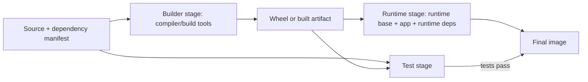
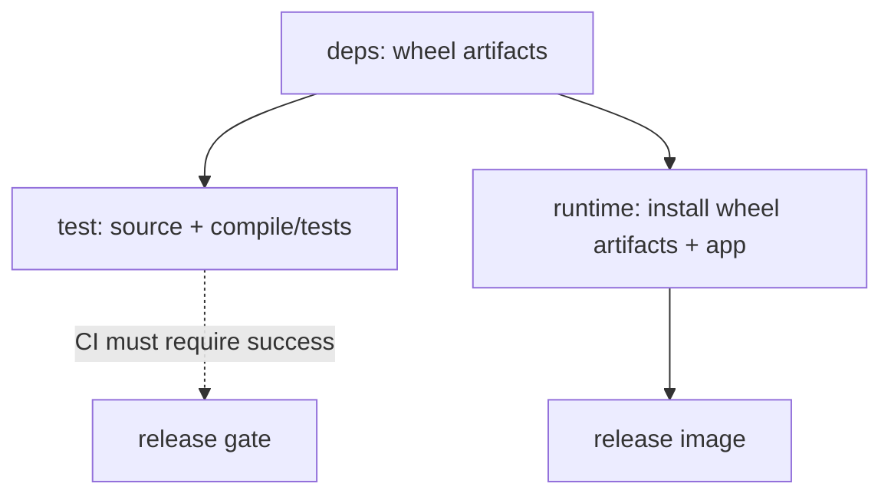
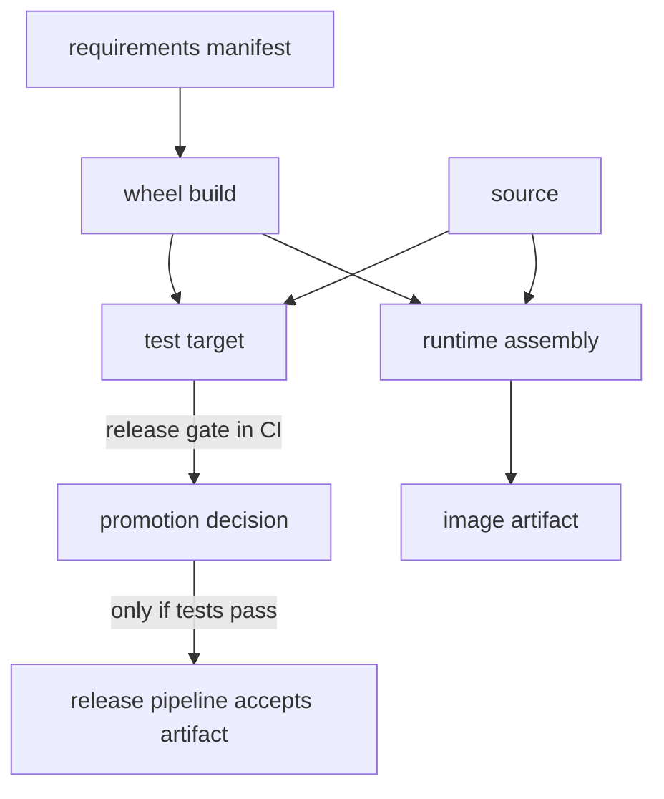

# Multi-Stage Builds and Layer Optimization

Multi-stage builds separate the environment needed to compile, test, or assemble an application from the environment needed to run it. This lesson develops that idea into a measurable engineering practice: understand image internals, retain only required runtime artifacts, preserve useful build-cache behavior, handle build credentials safely, and detect size regressions without pretending that a small image is automatically secure.

- **Stage:** 2E — Production DevOps & Platform Engineering
- **Module:** 01-Container-Image-Engineering-and-Registry-Hygiene (M01)
- **Target file:** `01-multi-stage-builds-and-layer-optimization.md`
- **Estimated time:** 10–14 hours, including labs and review
- **Prerequisites:** Linux shell, Git, Python basics, basic Docker build/run operations, file permissions, environment variables, and basic HTTP
- **Core tools:** Docker Engine/CLI, BuildKit / `docker buildx`
- **Awareness/optional tools:** `dive`, Hadolint, Buildah, Podman, Kaniko, `ko`, Jib, Bazel `rules_oci`, Nix
- **Last reviewed:** 2026-10-24 (authoring date; not a claim of live-document verification)
- **Assumed tool baseline:** Linux containers through Docker Engine or Docker Desktop with a working BuildKit-backed `docker buildx`. Exact flags and platform support can vary; items requiring current confirmation are tagged `[VERIFY]`.

## Table of contents

- [1. Production motivation and scope](#1-production-motivation-and-scope)
- [2. Learning objectives](#2-learning-objectives)
- [3. Prerequisites and lab safety](#3-prerequisites-and-lab-safety)
- [4. Concept map and vocabulary](#4-concept-map-and-vocabulary)
- [5. Level 1 — Beginner — Foundations](#5-level-1--beginner--foundations)
- [6. Level 2 — Intermediate — Working Practice](#6-level-2--intermediate--working-practice)
- [7. Level 3 — Advanced — Production Engineering](#7-level-3--advanced--production-engineering)
- [8. Level 4 — Expert — Operating at Scale and Under Failure](#8-level-4--expert--operating-at-scale-and-under-failure)
- [9. Dockerfile review checklist](#9-dockerfile-review-checklist)
- [10. SRE lens](#10-sre-lens)
- [11. Security lens](#11-security-lens)
- [12. Production acceptance checklist](#12-production-acceptance-checklist)
- [13. Hands-on lab set](#13-hands-on-lab-set)
- [14. Self-check questions and answer key](#14-self-check-questions-and-answer-key)
- [15. Evidence artifacts and completion criteria](#15-evidence-artifacts-and-completion-criteria)
- [16. Interview and design-review questions](#16-interview-and-design-review-questions)
- [17. Sources and verification notes](#17-sources-and-verification-notes)
- [Appendix A — Claim register](#appendix-a--claim-register)
- [Appendix B — Independent audit report](#appendix-b--independent-audit-report)
- [Appendix C — Human verification checklist](#appendix-c--human-verification-checklist)
- [Appendix D — Assumptions and known limitations](#appendix-d--assumptions-and-known-limitations)
- [Appendix E — Sign-off](#appendix-e--sign-off)

## 1. Production motivation and scope

A container image is a release artifact. Its size and contents affect registry storage, network transfer, node disk pressure, cold-start latency, cache effectiveness, vulnerability exposure, and incident recovery. A Python data service can accidentally ship compilers, test fixtures, Git metadata, virtual environments, package caches, local configuration, or credentials simply because the Dockerfile copies the whole repository and installs everything in one stage.

Multi-stage builds address one important class of these problems: the final stage can copy only the application and runtime dependencies it needs from earlier stages. Layer hygiene prevents avoidable bytes from being retained in earlier filesystem layers. Cache-friendly ordering prevents routine source edits from forcing expensive dependency installation. Measurement distinguishes real improvements from assumptions.

**Scope taught here:** image/layer mechanics, multi-stage patterns, layer hygiene, build-context exclusions, instruction ordering, basic stage graphs and targets, BuildKit secret/cache mounts at the level needed for image engineering, layer-diff forensics, and basic size/lint policies.

**Deferred to sibling lessons:** minimal/distroless base selection belongs to [Unit 2](02-minimal-and-distroless-base-images.md); deterministic builds and comprehensive digest/lockfile policy to [Unit 3](03-reproducible-and-deterministic-image-builds.md); deep cache backends and benchmark harness design to [Unit 4](04-build-caching-buildkit-and-build-performance.md); tagging/immutability to [Unit 5](05-image-tagging-versioning-and-immutability.md); registries and retention to [Units 6–7](06-container-registries-mirrors-and-pull-through-caches.md); full runtime hardening to [Unit 8](08-non-root-containers-and-runtime-defaults.md). CI/CD, Kubernetes, GitOps, secrets management, supply-chain security, and disaster recovery are linked to M02, M03, M08, M09, M12, and M13 respectively.

A smaller image is not proof of safety, provenance, reproducibility, or correct runtime behavior. Every change must pass behavior tests and be measured using a declared metric.

## 2. Learning objectives

By the end, the learner can:

1. **Explain (L1)** the difference between an image, a container, a filesystem layer, image configuration, and a manifest.
2. **Inspect (L1)** image history and configuration using `docker history` and `docker image inspect`.
3. **Build (L1–L2)** a multi-stage Python image and identify which artifacts cross into the runtime stage.
4. **Configure (L1–L2)** a `.dockerignore` file that excludes irrelevant and sensitive local files from the build context.
5. **Optimize (L2)** instruction order and package cleanup without breaking the runtime.
6. **Compare (L2)** Python wheel, virtual-environment, Go binary, and Java JRE-only patterns and explain their portability constraints.
7. **Use (L3)** build targets, BuildKit secret mounts, and cache mounts without baking secrets into image layers.
8. **Measure (L3)** image size, build duration, runtime behavior, and layer changes while documenting limitations.
9. **Diagnose (L4)** a sudden image-size increase using a hypothesis/test/root-cause sequence.
10. **Implement (L4)** a configurable image-size budget check and a lightweight Dockerfile policy check.
11. **Evaluate (L4)** multi-architecture build implications for native dependencies and platform-specific artifacts.
12. **Defend (L3–L4)** an optimization decision with evidence, risks, and a rollback plan.

## 3. Prerequisites and lab safety

### Environment checks

Run these from a Linux shell. On Windows, use WSL2 Ubuntu and preferably keep the repository under the Linux filesystem, such as `~/src/...`, rather than `/mnt/c/...`; bind-mounted file-heavy builds can be substantially slower across the Windows/Linux filesystem boundary.

```bash
# File: commands/verify-environment.sh
set -euo pipefail
docker version
docker buildx version
docker buildx ls
docker info --format 'OS={{.OSType}} Arch={{.Architecture}} CPUs={{.NCPU}} Memory={{.MemTotal}}'
df -h .
```

**Expected output (representative; yours will differ):** Docker client and server version sections, a buildx version, at least one builder, `OS=linux`, an architecture, CPU/memory values, and available disk space. If `docker buildx version` fails, resolve the local installation before proceeding. The Docker Desktop VM's resource allocation can differ from the host's physical capacity.

### Safety rules

- Use the unique local image prefix `m01-lab/` for this lesson.
- Never use broad cleanup commands such as `docker system prune -a --volumes` for these labs.
- Before deleting a lab resource, inspect its exact name with `docker ps -a`, `docker image ls`, or `docker volume ls`.
- All size and time results in this lesson are learner measurements. No benchmark below is represented as having been executed by the author.
- Keep at least several gigabytes of free disk space; native Python wheels and base images may consume substantial space.
- Use fake, non-sensitive values for secret-mount exercises.
- On WSL2, Docker Desktop and a separately installed Docker Engine can point to different daemons. Check the active context with `docker context show`.

## 4. Concept map and vocabulary

| Term | Precise definition | Common misconception |
|---|---|---|
| Image | A packaged filesystem plus configuration and references to content-addressed layers. | An image is a running process. |
| Container | A runtime instance created from an image, with runtime configuration and writable state. | Changes in a container automatically update its source image. |
| Layer | A filesystem change set represented in the image's layer chain. | Every Dockerfile instruction creates a filesystem layer. |
| Image configuration | Metadata such as default command, environment, user, working directory, and layer history. | Configuration metadata is the same thing as a filesystem layer. |
| Manifest | A document that references an image configuration and filesystem layers. | A tag is the manifest itself. |
| Digest | A content-derived identifier, commonly shown as `sha256:...`. | A human-readable tag is immutable. |
| Build context | Files and directories made available to a build, subject to ignore rules and build implementation. | Docker can only copy files from the current directory regardless of context settings. |
| Builder stage | A named build stage that can contain compilers, headers, package managers, and test tools. | A builder stage is necessarily included in the final image. |
| Runtime stage | The stage selected for the deliverable image, ideally containing only runtime requirements. | A runtime stage must be distroless or have no shell. |
| Cache hit/miss | Reuse or recomputation of a build result based on the builder's cache rules and inputs. | A cached build proves reproducibility. |
| Build target | A selected named stage or target in a Dockerfile. | `--target` changes a container's runtime environment. |
| Wheel | A built Python distribution archive. | Installing a wheel eliminates all native runtime-library requirements. |
| ABI | Application Binary Interface: conventions that compiled components must agree on. | A virtual environment is portable across arbitrary operating systems and Python builds. |

### Image, manifest, config, and layer relationship

```text
tag (mutable name) ──resolves to──> manifest digest
                                  |
                                  +--> image configuration
                                  |      +--> command / env / working dir / history
                                  |
                                  +--> filesystem layer digest A
                                  +--> filesystem layer digest B
                                  +--> filesystem layer digest C

Container runtime:
  image's read-only layer chain + container writable layer + runtime settings
```

The Open Container Initiative (OCI) Image Specification defines image manifest, configuration, and layer concepts. Docker's storage driver and builder behavior are implementation details layered on top of those concepts. A local image listing's reported size is not the same as registry-compressed transfer size or total disk use: multiple images may share layers, and local metadata/storage accounting varies.

### Multi-stage flow



The diagram is conceptual. Actual stage dependencies must be expressed by `FROM previous-stage` or `COPY --from=stage`; do not assume a test stage gates the final image unless the build graph is wired to make that happen.

## 5. Level 1 — Beginner — Foundations

### 5.1 Image versus container

An image is a versioned package of filesystem content and configuration. A container is a runtime instance based on that image. The image is treated as immutable after it is built; a container can gain a writable layer and can also mount writable volumes or bind mounts. Editing a file inside a running container does not change the original image. A new image must be built and released to make a change repeatable.

A useful operational rule is: **debug the running container to understand behavior, but fix the Dockerfile/source and rebuild the image to make the fix durable.**

### 5.2 Layers, configuration, and filesystem overlays

Image layers represent filesystem changes. A runtime storage implementation presents a merged filesystem view, often using an overlay-style mechanism on Linux. The exact storage driver and details depend on the Docker installation. The merged view makes files from lower read-only layers visible while later changes can add, modify, or mark files as deleted.

`RUN`, `COPY`, and `ADD` commonly produce filesystem changes in a build stage. Other instructions, such as `ENV`, `WORKDIR`, `CMD`, `ENTRYPOINT`, `USER`, and `EXPOSE`, primarily affect image configuration or build metadata rather than necessarily creating a filesystem layer. Do not infer layer count solely from the number of Dockerfile lines.

### 5.3 Inspecting image history and configuration

```bash
docker pull python:3.12-slim
docker history python:3.12-slim
docker image inspect python:3.12-slim --format '{{.Id}} {{.Os}}/{{.Architecture}} {{.Size}}'
```

**Expected output (example — yours will differ):** `docker history` prints a table with a created-by description, age, size, and comment for each history entry. The inspect command prints an image ID, operating system/architecture, and a byte count. These values can change as a tag moves or upstream publishes a new image. This tagged pull is for exploration only; production pinning is covered in Unit 3.

Read the history from newest to oldest and ask: Which instruction introduced the bytes? Is a large layer a build toolchain, dependency, copied directory, or package cache? `docker image inspect` can show `.Config.Env`, `.Config.Cmd`, `.Config.User`, `.RootFS.Layers`, `.Size`, and platform metadata. Avoid dumping environment values from images into public logs if they might contain sensitive material.

### 5.4 Single-stage versus multi-stage

A single-stage build often combines package installation, compilation, tests, and runtime. The result may retain tools that are not needed at runtime.

**ANTI-PATTERN — DO NOT COPY:**

```dockerfile
# File: examples/single-stage-anti-pattern/Dockerfile
FROM python:3.12-slim
WORKDIR /app
COPY . .
RUN apt-get update && apt-get install -y build-essential
RUN pip install --no-cache-dir -r requirements.txt
CMD ["python", "app.py"]
```

Defects: it copies the entire context before excluding files, installs a compiler in the runtime image, has no `.dockerignore` shown, may include tests or local virtual environments, and does not make dependency inputs easy to cache independently. It is intentionally a teaching anti-pattern, not a recommended baseline.

A multi-stage Dockerfile uses named stages and copies selected outputs:

```dockerfile
# File: examples/multistage-minimal/Dockerfile
FROM python:3.12-slim AS builder
WORKDIR /build
COPY requirements.txt .
RUN pip wheel --no-cache-dir --wheel-dir /wheels -r requirements.txt

FROM python:3.12-slim AS runtime
WORKDIR /app
COPY --from=builder /wheels /wheels
COPY requirements.txt .
RUN pip install --no-cache-dir --no-index --find-links=/wheels -r requirements.txt \
    && rm -rf /wheels
COPY app.py .
CMD ["python", "app.py"]
```

This example is illustrative and uses a readable tag. Before production use, choose and verify a digest-pinned base reference, and pin dependency inputs according to Unit 3. Both stages use compatible Python and operating-system families, which matters for native packages.

### 5.5 Build context and `.dockerignore`

The build context is the set of local files made available to the build. A broad `COPY . .` can unintentionally include `.git`, `.venv`, test output, data files, local credentials, and `.env` files. `.dockerignore` reduces context size and helps prevent accidental inclusion; it is not a substitute for secrets management.

```text
# File: examples/multistage-minimal/.dockerignore
.git
.venv/
venv/
__pycache__/
*.py[cod]
.pytest_cache/
.mypy_cache/
.coverage
htmlcov/
dist/
build/
.env
.env.*
*.pem
*.key
```

Review exclusions against the actual repository: an overly broad rule can omit a required certificate bundle or build asset. Do not place real secrets in the context and rely on an ignore rule as the only control.

### 5.6 Guided lab: inspect a baseline image

**Goal:** build an intuition for image history and config without deleting resources.

```bash
docker pull python:3.12-slim
docker history python:3.12-slim
docker image inspect python:3.12-slim \
  --format 'ID={{.Id}} OS={{.Os}} ARCH={{.Architecture}} SIZE={{.Size}} USER={{.Config.User}}'
```

**Expected output (example — yours will differ):** a history table and one formatted metadata line. The size is bytes and is local image size accounting, not a promise of compressed registry size.

**What just happened?** The pull retrieved image content; history exposed build history metadata; inspect exposed image configuration and size. Neither command proves the image is vulnerability-free or that the app behaves correctly.

**Beginner mistakes**

| Mistake | Symptom | Root cause | Fix |
|---|---|---|---|
| Treating a container as an image | File change disappears when container is recreated | Change existed only in writable container state | Change source/Dockerfile and rebuild |
| Copying everything | Context unexpectedly large; local files appear in image | Missing or incomplete `.dockerignore` | Exclude VCS, venvs, caches, credentials, and irrelevant data |
| Deleting a file in a later layer | Image stays large | Earlier layer still contains the bytes | Avoid adding the file in the first place or clean in the same `RUN` |
| Assuming each instruction is a layer | History doesn't match line count | Config instructions and filesystem changes differ | Read history and image metadata; reason about actual build output |
| Calling image size “download size” | Registry transfer estimates disagree | Compression and shared layers differ | State the metric and measure the right property |

## 6. Level 2 — Intermediate — Working Practice

### 6.1 Running example: FastAPI inference metadata service

This service is intentionally small but realistic enough to test container behavior. It returns service metadata and a deterministic toy prediction endpoint; it is not a real model-serving implementation.

```python
# File: services/api/app.py
from fastapi import FastAPI
from pydantic import BaseModel

app = FastAPI(title="M01 Inference API", version="1.0.0")


class PredictRequest(BaseModel):
    features: list[float]


@app.get("/health")
def health() -> dict[str, str]:
    return {"status": "ok"}


@app.post("/predict")
def predict(request: PredictRequest) -> dict[str, float | int]:
    if not request.features:
        return {"score": 0.0, "feature_count": 0}
    # Deterministic placeholder scoring function for container labs only.
    return {
        "score": sum(request.features) / len(request.features),
        "feature_count": len(request.features),
    }
```

```text
# File: services/api/requirements.txt
fastapi==0.115.0
uvicorn==0.30.6
```

These example versions are pinned for repeatability of the written example, not asserted to be the latest or security-approved. For a production service, generate and review a fully resolved lock file with hashes, and update dependencies through the process in Unit 3. The package versions may have transitive dependencies whose resolution changes unless the complete dependency graph is locked.

```text
# File: services/api/.dockerignore
.git
.venv/
venv/
__pycache__/
*.py[cod]
.pytest_cache/
.env
.env.*
tests/
dist/
build/
```

```dockerfile
# File: services/api/Dockerfile
FROM python:3.12-slim AS wheel-builder
WORKDIR /build
COPY requirements.txt .
RUN python -m pip wheel --no-cache-dir --wheel-dir=/wheels -r requirements.txt

FROM python:3.12-slim AS runtime
ENV PYTHONDONTWRITEBYTECODE=1 \
    PYTHONUNBUFFERED=1
WORKDIR /app
COPY requirements.txt .
COPY --from=wheel-builder /wheels /wheels
RUN python -m pip install --no-cache-dir --no-index --find-links=/wheels -r requirements.txt \
    && rm -rf /wheels
COPY app.py .
EXPOSE 8000
CMD ["uvicorn", "app:app", "--host", "0.0.0.0", "--port", "8000"]
```

`PYTHONDONTWRITEBYTECODE=1` prevents Python from writing `.pyc` bytecode files during normal imports; it does not shrink native libraries. `PYTHONUNBUFFERED=1` makes standard output/error less buffered, which can improve log visibility; it is not a size optimization. These are behavior choices, not security controls.

Build and run:

```bash
docker build -t m01-lab/api:multistage services/api
docker image inspect m01-lab/api:multistage --format 'SIZE={{.Size}} USER={{.Config.User}} CMD={{json .Config.Cmd}}'
docker run --rm -d --name m01-lab-api -p 18000:8000 m01-lab/api:multistage
curl --fail http://127.0.0.1:18000/health
curl --fail -H 'Content-Type: application/json' \
  -d '{"features":[1,2,3]}' http://127.0.0.1:18000/predict
docker stop m01-lab-api
```

**Expected output (example — yours will differ):** health returns `{"status":"ok"}`; prediction returns a score of `2.0` and feature count `3`. The image size depends on the selected base digest, architecture, and dependency resolution.

### 6.2 Why the wheel builder works

The builder creates wheels under `/wheels`; the runtime stage copies those wheels and installs them. Build tools needed only to compile a package are not automatically inherited by the runtime stage. However, if a wheel contains native extensions, the runtime still needs compatible shared libraries. A wheel is not a guarantee of a fully self-contained runtime.

The builder and runtime should generally agree on Python version, architecture, libc family, and compatible ABI. A Debian/glibc builder and an Alpine/musl runtime can fail with native packages even when both use the same Python minor version.

### 6.3 Virtual-environment copy approach

A virtual environment can sometimes be built in one stage and copied into another when paths, Python version, operating system, ABI, and runtime libraries are compatible. It is less portable than it first appears because installed scripts may contain absolute interpreter paths and native extensions may depend on system libraries.

```dockerfile
# File: examples/venv-copy/Dockerfile
FROM python:3.12-slim AS deps
WORKDIR /opt/app
RUN python -m venv /opt/venv
ENV PATH="/opt/venv/bin:${PATH}"
COPY requirements.txt .
RUN pip install --no-cache-dir -r requirements.txt

FROM python:3.12-slim AS runtime
ENV PATH="/opt/venv/bin:${PATH}" PYTHONDONTWRITEBYTECODE=1 PYTHONUNBUFFERED=1
WORKDIR /opt/app
COPY --from=deps /opt/venv /opt/venv
COPY app.py .
CMD ["uvicorn", "app:app", "--host", "0.0.0.0", "--port", "8000"]
```

Use this pattern only after validating it on the exact builder/runtime pair. For a wheel-based approach, installation occurs in the runtime stage, which can make paths more explicit and avoid some copied-venv assumptions.

### 6.4 Go and Java comparisons

**Go:** compile in a Go builder stage, then copy the binary into a runtime image. A truly static binary is not guaranteed just because the language is Go: CGO or dynamically linked native libraries can introduce runtime dependencies. Validate with `file`, `ldd` where meaningful, and an actual runtime test.

```dockerfile
# File: examples/go-cli/Dockerfile
FROM golang:1.23 AS builder
WORKDIR /src
COPY go.mod go.sum ./
RUN go mod download
COPY . .
RUN CGO_ENABLED=0 GOOS=linux go build -trimpath -o /out/worker ./cmd/worker

FROM scratch AS runtime
COPY --from=builder /out/worker /worker
ENTRYPOINT ["/worker"]
```

The version tag is illustrative and must be digest-pinned for a production build. `scratch` contains no shell, CA bundle, timezone data, or user database by default; the application must not need them or they must be copied deliberately. Confirm the build path and source layout before using this example.

**Java:** package with a JDK stage and run with a compatible JRE/runtime stage. The runtime must include all required JVM modules and native dependencies. Use a vendor-supported runtime base and verify its digest; exact image names vary by vendor and release.

```dockerfile
# File: examples/java-cli/Dockerfile
FROM eclipse-temurin:21-jdk AS builder
WORKDIR /src
COPY . .
RUN ./mvnw -B -DskipTests package

FROM eclipse-temurin:21-jre AS runtime
WORKDIR /app
COPY --from=builder /src/target/app.jar /app/app.jar
CMD ["java", "-jar", "/app/app.jar"]
```

This is a pattern sketch, not a complete Java project; the Maven wrapper, POM, and source must exist. Base image naming and availability are `[VERIFY]`. Unit 1's complete runnable example remains the Python service above.

### 6.5 Cache-friendly instruction order

Docker build caching generally reuses a prior step when its relevant instruction and inputs match. If `COPY . .` occurs before dependency installation, changing a README or source file may invalidate the dependency step. Copy dependency manifests first, install dependencies, then copy frequently changing source.

```dockerfile
# File: examples/cache-order/Dockerfile
FROM python:3.12-slim
WORKDIR /app
COPY requirements.txt .
RUN python -m pip install --no-cache-dir -r requirements.txt
COPY app.py .
CMD ["python", "app.py"]
```

This ordering is useful when dependency files change less often than application source. It is not useful if the dependency manifest is generated from source on every build or if the build requires source to compute dependencies.

### 6.6 Package-manager hygiene and layer deletion

For Debian-family images, package index download and installation should normally occur in the same `RUN` as removal of package indexes when those indexes are not needed at runtime:

```dockerfile
# File: examples/apt-hygiene/Dockerfile
FROM debian:bookworm-slim
RUN apt-get update \
    && apt-get install -y --no-install-recommends ca-certificates \
    && rm -rf /var/lib/apt/lists/*
```

The cleanup path is distribution-specific. Do not copy this exact cleanup into Alpine or another distribution without checking its package manager and filesystem layout.

Why does `RUN download-large-file` followed by `RUN rm large-file` fail to reduce the stored image as expected? The file was added in a lower layer; a later layer can record its deletion, but the earlier layer's bytes remain part of the image's layer chain. If a temporary file is necessary, create and delete it within the same `RUN` instruction. Better still, use a builder stage and copy only the output.

### 6.7 `COPY` versus `ADD`

Prefer `COPY` for ordinary local files. `ADD` has additional semantics for certain local archives and remote sources, depending on syntax/version. Remote retrieval inside a Dockerfile can be difficult to make integrity-verifiable if used casually. Prefer an explicit download step with checksum/signature verification where appropriate, and do not use `ADD` as a shortcut around supply-chain verification. Check the current Dockerfile reference for exact behavior.

### 6.8 `ARG` versus `ENV`

- `ARG` defines a build-time argument, with scope rules around stages. It is not a secret store.
- `ENV` sets environment variables in the image configuration and normally makes them available to runtime containers.
- Both can leak sensitive values through build metadata, logs, cache records, image config, or build processes depending on use and builder behavior.

**ANTI-PATTERN — DO NOT COPY:**

```dockerfile
# File: examples/secret-arg-anti-pattern/Dockerfile
ARG PRIVATE_TOKEN
RUN curl -H "Authorization: Bearer ${PRIVATE_TOKEN}" https://packages.example.invalid/
```

Defects: credential supplied as a build argument, potential exposure in logs/metadata/build process, no integrity check, and an illustrative invalid domain. Use BuildKit secret mounts for secrets needed during a build, and use a real trusted endpoint with authentication and integrity controls in production.

### 6.9 Pattern catalogue

| Pattern | Use when | Avoid when | Reason |
|---|---|---|---|
| Builder + runtime stages | Compilers or build-only tools are not needed at runtime | Build output depends on un-copied generated files | Separates build-time and runtime content |
| Wheel builder | Python dependencies can be represented as compatible wheels | Runtime needs libraries not included in the base | Reuses built packages without copying the toolchain |
| Copy virtual environment | Stages have matching interpreter paths, OS, ABI, and runtime libraries | Cross-platform or base mismatch exists | Convenient but path/ABI sensitive |
| Static Go binary + scratch | Binary is truly static and needs no external runtime files | CGO/shared libraries, CA files, or shell operations are required | Very small runtime footprint but limited debugging |
| JDK builder + JRE runtime | Application is packaged as a JAR and needs only the runtime | Application needs JDK tools at runtime | Removes compiler/toolchain from runtime |
| Manifest-first COPY | Dependencies change less often than application source | Manifest is not the true dependency input | Improves cache reuse |
| Same-layer package cleanup | Package indexes/caches are not required at runtime | Cache is intentionally used by a later build stage | Avoids retaining temporary bytes in a layer |
| `COPY --from` | Only selected artifacts should cross stages | The final app requires un-copied runtime assets | Makes stage boundary explicit |

### 6.10 Anti-pattern catalogue

| Bad example | Why it hurts | Corrected version |
|---|---|---|
| `COPY . .` with no ignore file | Local files and credentials may enter context/image | Add a reviewed `.dockerignore`, then copy explicit inputs where practical |
| Install compiler and app in one final stage | Runtime contains build-only packages | Build in a named stage and copy runtime artifacts |
| `RUN apt-get update` then separate `RUN apt-get install` | Stale indexes can be reused; extra layer content may remain | Update and install together, clean indexes in the same `RUN` |
| Add large file then delete in next layer | Lower layer still holds file bytes | Delete in the same `RUN` or use a builder stage |
| `ARG TOKEN=...` | Secret may leak through metadata/logs/build processes | Use `RUN --mount=type=secret` |
| `COPY . .` before dependency installation | Small source edits can invalidate dependency install | Copy manifest first, install, then copy source |
| Copy venv from incompatible stage | Broken shebangs, ABI errors, missing shared libraries | Match stages or install compatible wheels in runtime |
| Use `ADD https://...` without integrity checks | Remote content may drift and be hard to audit | Explicit verified retrieval with pinned checksum/signature |

### 6.11 Measurable before/after procedure

The scenario baseline below is **1.2 GB by assumption**, not a measurement from this environment. Build both images on the same machine, architecture, Docker daemon, and dependency inputs. Record your own values.

| Metric | Baseline command/result | Optimized command/result | Interpretation |
|---|---|---|---|
| Local image size | `docker image inspect m01-lab/api:baseline --format '{{.Size}}'` → FILL WITH YOUR MEASUREMENT | `docker image inspect m01-lab/api:multistage --format '{{.Size}}'` → FILL WITH YOUR MEASUREMENT | Local image size in bytes; not compressed transfer size |
| History | `docker history m01-lab/api:baseline` | `docker history m01-lab/api:multistage` | Identify large instructions and retained build tools |
| Build duration | `/usr/bin/time -p docker build --no-cache -t m01-lab/api:baseline services/api-baseline` | `/usr/bin/time -p docker build --no-cache -t m01-lab/api:multistage services/api` | Cold-ish build; network and page-cache variance remain |
| Smoke test | Same `curl` test against baseline | Same `curl` test against optimized image | Behavior must remain equivalent |
| Runtime contents | `docker run --rm m01-lab/api:baseline python -c 'import sys; print(sys.version)'` | Same command against optimized | Compare required runtime behavior; inspect packages separately |
| Transfer-size estimate | Registry/export-specific measurement required | Same method and platform | Do not substitute local `.Size` for compressed bytes |

A repeatable build-time sample can be collected with:

```bash
/usr/bin/time -p docker build --no-cache -t m01-lab/api:measure services/api
```

Record real, user, and sys time. Do not compare one cold network build with one warm cached build and call the difference an optimization.

## 7. Level 3 — Advanced — Production Engineering

### 7.1 Build targets and dependency graphs

A build target selects which stage is built as the requested output; it is not a runtime environment switch. Use explicit stage names for test, development, and runtime variants when there is a real need for different outputs.

```dockerfile
# File: services/api/Dockerfile.targets
FROM python:3.12-slim AS deps
WORKDIR /app
COPY requirements.txt .
RUN pip wheel --no-cache-dir --wheel-dir=/wheels -r requirements.txt

FROM deps AS test
COPY app.py .
RUN python -m compileall -q app.py

FROM python:3.12-slim AS runtime
WORKDIR /app
COPY requirements.txt .
COPY --from=deps /wheels /wheels
RUN pip install --no-cache-dir --no-index --find-links=/wheels -r requirements.txt \
    && rm -rf /wheels
COPY app.py .
CMD ["uvicorn", "app:app", "--host", "0.0.0.0", "--port", "8000"]
```

Build a selected target with `docker buildx build --load --target test -t m01-lab/api:test services/api` or select `runtime`. `[VERIFY]` Check the installed buildx help and Docker buildx reference for current option support. Notice that merely defining `test` does not automatically make a production build depend on it; CI must explicitly build/run the test target or the graph must connect it appropriately.



BuildKit can schedule independent graph branches in parallel when their dependencies permit it, but actual concurrency is constrained by CPU, memory, disk, network, and builder configuration. Do not assume all stages run simultaneously.

### 7.2 BuildKit secret mounts

Use a secret mount when a build step must authenticate to a package source. The secret is made available to the selected `RUN` step rather than being copied into the image as a normal file. Its presence does not make the command, logs, or downloaded artifact safe automatically: the command must not print the secret or persist it into output files.

```bash
# File: commands/build-with-secret.sh
set -euo pipefail
printf '%s' 'fake-learning-token-not-a-real-secret' > /tmp/m01-fake-token
docker buildx build \
  --secret id=package_token,src=/tmp/m01-fake-token \
  --load -t m01-lab/api:secret-demo \
  -f examples/secret-mount/Dockerfile examples/secret-mount
rm -f /tmp/m01-fake-token
```

```dockerfile
# File: examples/secret-mount/Dockerfile
# syntax=docker/dockerfile:1
FROM python:3.12-slim
RUN --mount=type=secret,id=package_token \
    test -s /run/secrets/package_token
CMD ["python", "-c", "print('secret mount demo passed')"]
```

**Expected output (example — yours will differ):** build succeeds and the image runs with `secret mount demo passed`. This example only proves the file was mounted and readable; it does not contact a package registry. The fake token is non-sensitive. `[VERIFY]` Confirm current BuildKit frontend and `buildx build --secret` syntax in the Docker build secrets documentation.

Never use `ARG`, `ENV`, `COPY`, or a shell command containing a real credential as the preferred secret transport. Build arguments are designed for build parameters, not confidential data. Exact metadata exposure differs by builder path and version, so avoid absolute claims about one particular display output; the safe design is not to supply secrets as build args.

### 7.3 Build cache mounts

A cache mount provides a directory that can persist between builds without becoming part of the final image layer. It is an optimization, not a correctness dependency: a clean cache must still allow the build to succeed. Cache IDs and permissions need care when multiple projects or users share a builder.

```dockerfile
# File: examples/pip-cache/Dockerfile
# syntax=docker/dockerfile:1
FROM python:3.12-slim AS builder
WORKDIR /build
COPY requirements.txt .
RUN --mount=type=cache,target=/root/.cache/pip \
    python -m pip wheel --wheel-dir=/wheels -r requirements.txt

FROM python:3.12-slim AS runtime
WORKDIR /app
COPY requirements.txt .
COPY --from=builder /wheels /wheels
RUN python -m pip install --no-cache-dir --no-index --find-links=/wheels -r requirements.txt \
    && rm -rf /wheels
COPY app.py .
CMD ["python", "-c", "print('runtime image ready')"]
```

Build with:

```bash
docker buildx build --load -t m01-lab/api:pip-cache -f examples/pip-cache/Dockerfile services/api
```

**Expected output (example — yours will differ):** BuildKit progress output shows build steps; a later build may reuse cache depending on changed inputs, cache availability, and builder configuration. A cache mount can reduce repeated downloads/build work but does not guarantee a speedup for every build.

### 7.4 Large Python native dependencies

Packages such as NumPy, pandas, and PyArrow can include compiled extensions and large native components. A practical optimization strategy is to use compatible prebuilt wheels when available, separate compilation tools into a builder stage when source compilation is necessary, and verify the runtime shared-library closure. Building from source can increase build time and require compilers/headers; using wheels does not eliminate all runtime libraries.

`manylinux` wheels target defined glibc-compatible environments. Alpine typically uses musl rather than glibc; a wheel built for a glibc policy may not install or run on musl without a compatible wheel or a different build strategy. Do not switch a data workload to Alpine based on base-image size alone. Validate installation, imports, and real workload operations on the target platform.

Useful checks include:

```bash
docker run --rm m01-lab/api:multistage python -c 'import fastapi, uvicorn; print("imports-ok")'
docker image inspect m01-lab/api:multistage --format '{{json .RootFS.Layers}}'
docker history --no-trunc m01-lab/api:multistage
```

The current example does not include pandas or PyArrow; apply these checks to the actual data-service image before drawing conclusions.

### 7.5 Size versus debuggability

| Option | Benefit | Cost | Risk | Choose when |
|---|---|---|---|---|
| General slim runtime with shell | Easier incident inspection | More packages and possible attack surface | Tools can be misused or drift | Team needs familiar on-container diagnostics |
| Minimal runtime without shell | Fewer included utilities | Debugging requires external tools/logs | Operators may be unprepared for shell-less debugging | Runtime dependencies are well understood |
| Separate debug image/target | Debug tools do not ship in normal release | More artifacts and process complexity | Debug image may not match release exactly | Debugging needs are predictable and controlled |
| Builder + wheel artifact | Toolchain omitted from runtime | Extra stage and artifact handling | ABI/runtime dependency mismatch | Native package build tools are not runtime needs |
| Single stage | Simple Dockerfile | Builder and test tools remain | Larger attack/maintenance surface | Small, simple workloads where evidence supports it |

A production decision should include size, behavior, vulnerability triage, debugging method, and update ownership. Unit 2 covers base-image selection in depth; Unit 8 covers runtime defaults.

### 7.6 Measurement discipline

Declare the exact metric before comparing:

- **Local image size:** `docker image inspect IMAGE --format '{{.Size}}'`; local accounting, bytes.
- **History/layer clue:** `docker history --no-trunc IMAGE`; instruction history and approximate per-history sizes.
- **Build duration:** `/usr/bin/time -p docker build ...`; wall time is affected by network, cache, page cache, CPU contention, and package repository changes.
- **Compressed transfer size:** measure the actual registry/export path with a documented tool/procedure; do not infer it from `.Size`.
- **Unique disk use:** shared layers complicate attribution; `docker system df -v` is a useful local inventory, but it is not a per-image compressed-size report.
- **Runtime correctness:** a health endpoint and a representative request must pass on both images.

Run at least three samples for exploratory comparison and report all samples plus median. For a meaningful p95, use enough samples; a tiny sample set cannot support a stable tail-latency claim. Unit 4 owns the more complete benchmark harness.

## 8. Level 4 — Expert — Operating at Scale and Under Failure

### 8.1 Forensics: a hypothetical 400 MB regression

Treat “400 MB” as a scenario value, not a typical result.

**Symptom:** a new release image is reported as 400 MB larger than the previous release.

1. **Hypotheses:** broad `COPY` included data; a compiler/package set entered the runtime stage; package indexes or caches persisted; dependency changed; architecture changed; base tag moved; generated artifacts or test data entered the context.
2. **Test the image metadata:**

   ```bash
   docker history --no-trunc m01-lab/api:previous
   docker history --no-trunc m01-lab/api:candidate
   docker image inspect m01-lab/api:previous --format '{{.Os}}/{{.Architecture}} {{.Size}} {{json .RootFS.Layers}}'
   docker image inspect m01-lab/api:candidate --format '{{.Os}}/{{.Architecture}} {{.Size}} {{json .RootFS.Layers}}'
   ```

3. **Compare source:** review the Dockerfile, dependency lock files, `.dockerignore`, and source diff. Rebuild both commits with the same builder, platform, and cache policy if they are still available.
4. **Isolate:** revert one candidate change at a time or build intermediate targets. Optional `dive` can help visualize files added and later removed; plain `docker history` and controlled rebuilds remain the baseline.
5. **Root cause:** record the evidence, not the first plausible explanation.
6. **Fix and prevent:** add a regression budget, explicit runtime stage, context review, and ownership for dependency/base updates.

Do not assume a larger layer means the Dockerfile line alone is responsible; dependency resolution, base-image movement, architecture, and cache differences can alter results.

### 8.2 Squashing and flattening trade-offs

Squashing/flattening can consolidate layers or produce a flattened filesystem, depending on the tool and build path. It may reduce some forms of layer history or complicate cache reuse, provenance, and forensic explanation. It is not a universal fix for a bloated image: if the unwanted bytes are present in the final filesystem, flattening may preserve them. Current support and syntax vary by builder and workflow; `[VERIFY]` consult the current Docker/buildx/BuildKit docs before using a squash feature in a production pipeline.

Prefer correcting the build graph and layer contents first. A well-designed multi-stage build makes the final artifact explicit and keeps build-only files out of the runtime image without relying on post-hoc flattening.

### 8.3 Image-size budget gate

A size gate must use a machine-readable property and an explicit unit. This small Python script reads Docker's image-size field through the CLI and compares it with a configurable byte budget.

```python
# File: scripts/check_image_size.py
from __future__ import annotations

import argparse
import json
import subprocess
import sys


def image_size_bytes(image: str) -> int:
    result = subprocess.run(
        ["docker", "image", "inspect", image],
        check=True,
        capture_output=True,
        text=True,
    )
    payload = json.loads(result.stdout)
    if not payload or "Size" not in payload[0]:
        raise ValueError(f"Could not read image size for {image!r}")
    return int(payload[0]["Size"])


def main() -> int:
    parser = argparse.ArgumentParser(description="Fail when local image size exceeds a byte budget.")
    parser.add_argument("image", help="Local image reference")
    parser.add_argument("--max-bytes", type=int, required=True, help="Maximum local image size in bytes")
    args = parser.parse_args()
    if args.max_bytes <= 0:
        parser.error("--max-bytes must be positive")
    try:
        size = image_size_bytes(args.image)
    except (subprocess.CalledProcessError, ValueError, json.JSONDecodeError) as exc:
        print(f"ERROR: cannot inspect image: {exc}", file=sys.stderr)
        return 2
    print(f"image={args.image} size_bytes={size} budget_bytes={args.max_bytes}")
    if size > args.max_bytes:
        print("FAIL: image exceeds configured local-size budget", file=sys.stderr)
        return 1
    print("PASS: image is within configured local-size budget")
    return 0


if __name__ == "__main__":
    raise SystemExit(main())
```

Run it after building:

```bash
python scripts/check_image_size.py m01-lab/api:multistage --max-bytes 600000000
```

The `600000000` budget is an example policy value, not a universal standard. Set a team budget from measured baselines, workload constraints, and registry/node behavior. Test the script with a real local image and with a deliberately low budget; record both exit codes. The script uses local image size and does not measure compressed registry bytes.

### 8.4 Minimal Dockerfile policy check

Hadolint is an optional Dockerfile linter; it catches selected classes of issues but cannot prove that an image is secure or behaves correctly. A small policy script can provide a simple, transparent baseline:

```python
# File: scripts/check_dockerfile_policy.py
from __future__ import annotations

import argparse
from pathlib import Path


REQUIRED_HINTS = (
    "FROM ",
    "COPY ",
    "CMD ",
)


def main() -> int:
    parser = argparse.ArgumentParser(description="Basic Dockerfile review hints; not a security proof.")
    parser.add_argument("dockerfile", type=Path)
    args = parser.parse_args()
    if not args.dockerfile.is_file():
        print(f"FAIL: file not found: {args.dockerfile}")
        return 2
    text = args.dockerfile.read_text(encoding="utf-8")
    errors: list[str] = []
    upper = text.upper()
    for hint in REQUIRED_HINTS:
        if hint not in upper:
            errors.append(f"missing expected instruction: {hint.strip()}")
    if "COPY . ." in upper and not (args.dockerfile.parent / ".dockerignore").exists():
        errors.append("COPY . . exists but no adjacent .dockerignore was found")
    if "ARG TOKEN" in upper or "ARG PASSWORD" in upper or "ENV TOKEN=" in upper:
        errors.append("possible credential variable in Dockerfile; review manually")
    if errors:
        for error in errors:
            print(f"FAIL: {error}")
        return 1
    print("PASS: basic hints satisfied; manual review and runtime tests remain required")
    return 0


if __name__ == "__main__":
    raise SystemExit(main())
```

This intentionally basic checker is a review aid, not a full Dockerfile parser. It can have false positives/negatives; extend it only with tests and document the limits. A production CI policy should prefer maintained parsers and a controlled set of rules.

### 8.5 Multi-architecture builds

`linux/amd64` and `linux/arm64` are distinct target platforms. Native Python wheels, compiled binaries, and shared libraries must match the target architecture. A multi-platform image reference can point to an image index that selects a platform-specific manifest. Cross-compilation and emulation are different strategies: QEMU emulation can make some builds possible but may be slower and can expose incompatibilities in complex native build steps.

Check available platforms and builder configuration using `docker buildx inspect --bootstrap` `[VERIFY]` against the installed buildx version. Build a target explicitly, for example `docker buildx build --platform linux/amd64 --load ...`; local loading of multi-platform results has restrictions that vary by Docker/driver configuration. Verify with `docker image inspect` and a runtime smoke test on the target architecture or a compatible runner. Never assume a binary built on one architecture can run on another.

### 8.6 Stage graph parallelism and resource limits

BuildKit schedules work according to the stage dependency graph. Independent branches may run concurrently; dependent branches wait for their inputs. On an 8 GB laptop, excessive parallel native compilation can cause memory pressure and make the overall build slower or fail. Design the graph for meaningful reuse, then measure under the actual resource limit.



The dotted operational dependency in the diagram is a CI/release policy, not automatically enforced by the Dockerfile. M02 owns the pipeline implementation.

### 8.7 Team operating standards and migration

A workable standard should specify:
- base image and digest policy, owned by a named team;
- maximum local/unpacked image size by workload class, with measurement command and exception process;
- expected builder/runtime separation and context hygiene;
- required smoke tests and native dependency checks;
- build-time secret policy and prohibition on secrets in image layers;
- target platforms and evidence of cross-platform compatibility;
- a change record showing before/after measurements and rollback path;
- a periodic review of exceptions, base updates, and dependency ownership.

For a fleet migration, inventory image references and owners first. Baseline sizes and build times, classify services by runtime dependencies, and migrate one representative workload at a time. Do not roll out a “smaller” base to all services without import tests, health checks, startup checks, and rollback artifacts. Keep the previous known-good digest available according to the retention policy in Unit 7.

## 9. Dockerfile review checklist

Use this checklist in a production pull request. Check each item against the repository or a command result.

- [ ] Base image source, version, and digest policy are explicit; any readable tag is documented as non-immutable.
- [ ] Builder/runtime separation is used where it removes build-only dependencies without making the build fragile.
- [ ] The final stage copies only artifacts required for runtime behavior.
- [ ] Dependency manifests are copied before frequently changing source where this improves cache reuse.
- [ ] `.dockerignore` covers VCS metadata, virtual environments, Python caches, tests/build artifacts, local credentials, `.env` files, and irrelevant data without excluding required assets.
- [ ] Package installation and package-index cleanup occur in the same relevant layer where applicable.
- [ ] No secret is passed through `ARG`, `ENV`, copied files, logs, or the build context; secret mounts are used where supported.
- [ ] `COPY` is used for ordinary file copies; any `ADD` has a justified, reviewed purpose.
- [ ] File ownership, permissions, and runtime paths are tested.
- [ ] Native libraries and wheels are compatible with the target OS/libc/Python/architecture.
- [ ] `CMD`/entrypoint is in exec form where appropriate and smoke tests pass.
- [ ] Multi-architecture assumptions are tested or explicitly documented.
- [ ] Image size is measured with a named command and declared metric.
- [ ] No claim says image size or scan counts alone prove security.
- [ ] A configurable regression budget and lint/review evidence are defined.
- [ ] Cleanup and rollback approach is documented, including retention of a known-good artifact.

## 10. SRE lens

### Indicators and proposed objectives

Potential service-level indicators (SLIs) include build duration, p95 build duration, final local image size, build failure rate, cache reuse where measurable, and successful smoke-test rate. Some are direct measurements; cache effectiveness may be a proxy inferred from BuildKit progress output or repeated build timings.

Set objectives only after collecting a baseline. Example proposed team targets—not universal standards—might include “the p95 warm build of this service remains below the measured team threshold” and “no release image exceeds its approved byte budget without an exception.” Record sample count, environment, cache state, platform, and dependency source. A p95 derived from very few samples is not reliable.

### Failure modes and blast radius

| Failure | Blast radius | First response |
|---|---|---|
| Build fails after dependency update | One service or release train | Inspect failing stage and dependency change |
| Native extension fails at runtime | All instances of that image/platform | Reproduce import/health test on target platform; roll back digest |
| Unexpected image growth | Registry, nodes, build cache, cold starts | Compare history, source diff, and measurements |
| Secret enters context/layer | Potential credential exposure beyond one image | Stop publication, rotate credential, investigate logs/artifacts |
| Wrong architecture artifact | Target nodes cannot start workload | Inspect platform metadata and test on target architecture |
| Release cannot be reproduced | Recovery and audit delayed | Preserve source, lockfiles, builder metadata, and prior known-good artifact |

### Runbook: unexpected image growth

1. **Alert/symptom:** size gate fails or image size changes beyond the approved budget.
2. **Triage:** record commit, builder, platform, base reference, and measured metric.
3. **Hypothesis:** identify likely Dockerfile/dependency/context/base changes.
4. **Test:** compare `docker history`, `docker image inspect`, lockfile diff, `.dockerignore`, and controlled builds.
5. **Mitigation:** revert the responsible change or restore the previous known-good image digest; do not waive the budget without an owner.
6. **Follow-up:** add a regression test, adjust the budget only with evidence, and document the root cause.

### Capacity and cost notes

Large images increase registry storage and may increase transfer time; build caches also consume local disk. Build tools and native wheels can be expensive on a four-core, 8 GB laptop. Inspect usage with `docker system df -v` before cleanup. Avoid deleting shared layers or volumes without understanding their owners. Hosted CI minutes and registry egress are outside this free local lab, but the same measurements inform later M02 and registry lessons.

## 11. Security lens

| Threat/control | Practical verification | What it does not prove |
|---|---|---|
| Accidental secret inclusion | Review `.dockerignore`; search context and image files; inspect Dockerfile inputs | Ignore rules are not a complete secrets-management system |
| Build-toolchain exposure | `docker history` and `docker image inspect`; inspect final filesystem with a suitable tool | Multi-stage builds do not remove vulnerabilities in copied runtime artifacts |
| Dependency confusion or drift | Review trusted indexes, lockfile, hashes, and source configuration | A lockfile does not prove the source package is trustworthy |
| Unsafe build credential handling | Verify secret mount is used only in a specific `RUN`; review logs and artifacts | Secret mounts cannot prevent a malicious command from exfiltrating a secret |
| Runtime dependency mismatch | Import and smoke tests on the target platform | A passing smoke test is not comprehensive testing |
| Supply-chain tampering | Preserve build inputs and artifact digests; later M12 covers provenance/signing controls | A digest identifies content; it does not prove who built it |
| Excessive runtime surface | Compare final-stage packages and use a deliberate base policy | Small image size does not guarantee fewer exploitable paths in every case |

This lesson primarily addresses image construction and accidental exposure. It does **not** establish image provenance, vulnerability freedom, runtime isolation, registry access control, signing, admission enforcement, or full secrets governance. See Unit 2 for base-image choices, Unit 3 for reproducibility, Unit 5 for digest-based promotion, Unit 6–7 for registry controls, Unit 8 for runtime hardening, M09 for secrets management, and M12 for supply-chain security.

## 12. Production acceptance checklist

A candidate image is acceptable for this unit when all of the following have evidence:

- [ ] The image builds from the documented context on the declared platform.
- [ ] A multi-stage design is used where it materially separates build-only tools from runtime.
- [ ] The service passes health and representative request smoke tests.
- [ ] The final stage does not accidentally include `.git`, `.venv`, local `.env`, test output, or build caches.
- [ ] Image size and build duration are measured with the commands recorded.
- [ ] The before/after comparison uses the same metric and a documented environment.
- [ ] Build secrets are not supplied as ordinary build args or copied files.
- [ ] Native dependencies are validated on the intended runtime platform.
- [ ] The size budget and basic Dockerfile policy checks produce expected exit codes.
- [ ] Exceptions have an owner, rationale, expiry/review date, and rollback plan.
- [ ] The reviewer understands that this lesson does not replace scanning, signing, provenance, runtime hardening, or registry policy.

## 13. Hands-on lab set

All labs use the `m01-lab/` namespace. Outputs below are representative, not claims of execution. Commands assume the Docker daemon is available. If a step fails because the local builder lacks a feature, record the version and consult the verification checklist instead of silently substituting an unreviewed command.

### Lab 1 — Inspect a baseline image

- **Lab ID and title:** M01-L1 — Image anatomy reconnaissance
- **Level and estimated time:** L1, 30–45 minutes
- **Goal:** inspect image history, config, platform, and size.
- **Prerequisites:** Docker daemon and enough disk for the selected Python base image.
- **Files to create:** none.
- **Steps and commands:**

  ```bash
  docker pull python:3.12-slim
  docker history --no-trunc python:3.12-slim
  docker image inspect python:3.12-slim --format '{{.Id}} {{.Os}}/{{.Architecture}} {{.Size}}'
  docker system df -v
  ```

- **Expected output/evidence:** a history table, image ID/platform/size line, and storage inventory; IDs and sizes differ by platform and image revision.
- **Interpretation: what happened and why:** you inspected build history and image metadata without changing the image.
- **Failure injection and diagnosis:** choose a nonexistent local tag in `docker image inspect`; observe the error and verify the actual tag with `docker image ls`.
- **Acceptance criteria:** evidence file records image reference, platform, local size, and at least two observations from history.
- **Cleanup:** no resource deletion is required. If you choose to remove the pulled image, first inspect references with `docker image ls python`; **⚠ DESTRUCTIVE:** `docker image rm python:3.12-slim` removes that local tag/image data if not needed by other local work. Do not run it if another project uses it.
- **Verification that cleanup succeeded:** if you removed it, `docker image ls python:3.12-slim` should show no matching local image; otherwise leave it in place.
- **Stretch goal:** compare the same image tag on another architecture, if available, and explain why size/digest may differ.

### Lab 2 — Build and smoke-test a multi-stage Python API

- **Lab ID and title:** M01-L2 — Builder/runtime split
- **Level and estimated time:** L2, 60–90 minutes
- **Goal:** build the FastAPI example and prove runtime behavior.
- **Prerequisites:** Docker/buildx; create the files from Section 6.1 under `services/api/`.
- **Files to create:** `services/api/app.py`, `requirements.txt`, `.dockerignore`, and `Dockerfile` exactly as shown in Section 6.1.
- **Steps and commands:**

  ```bash
  docker build -t m01-lab/api:multistage services/api
  docker run --rm -d --name m01-lab-api -p 18000:8000 m01-lab/api:multistage
  curl --fail http://127.0.0.1:18000/health
  curl --fail -H 'Content-Type: application/json' -d '{"features":[1,2,3]}' http://127.0.0.1:18000/predict
  docker stop m01-lab-api
  ```

- **Expected output/evidence:** health returns `{"status":"ok"}` and prediction includes score `2.0`; Docker IDs and build output differ.
- **Interpretation: what happened and why:** dependency wheels are built in one stage and installed into a separate runtime stage.
- **Failure injection and diagnosis:** temporarily rename `requirements.txt` in your lab copy; build should fail at `COPY requirements.txt`. Restore the file before proceeding. Do not rename files in a shared production repository.
- **Acceptance criteria:** build succeeds, both requests pass, and the final image history is saved.
- **Cleanup:** `docker ps -a --filter name=m01-lab-api`; if the named container remains, stop/remove only that container. **⚠ DESTRUCTIVE:** `docker image rm m01-lab/api:multistage` removes this lab image tag; inspect first with `docker image ls m01-lab/api`.
- **Verification that cleanup succeeded:** `docker ps -a --filter name=m01-lab-api` is empty after cleanup; image listing is empty only if you removed the tag.
- **Stretch goal:** add a small unit test and build a test target.

### Lab 3 — Demonstrate cache ordering and the deletion trap

- **Lab ID and title:** M01-L3 — Layer hygiene experiment
- **Level and estimated time:** L2, 45–60 minutes
- **Goal:** observe how a file added in one layer and removed in a later layer differs from creating and deleting it in the same `RUN`.
- **Prerequisites:** Docker daemon and local disk.
- **Files to create:**

  ```dockerfile
  # File: labs/layer-trap/Dockerfile
  FROM debian:bookworm-slim AS bad
  RUN dd if=/dev/zero of=/large.bin bs=1M count=32
  RUN rm -f /large.bin

  FROM debian:bookworm-slim AS good
  RUN dd if=/dev/zero of=/large.bin bs=1M count=32 && rm -f /large.bin
  ```

- **Steps and commands:**

  ```bash
  docker build --target bad -t m01-lab/layer-trap:bad labs/layer-trap
  docker build --target good -t m01-lab/layer-trap:good labs/layer-trap
  docker history m01-lab/layer-trap:bad
  docker history m01-lab/layer-trap:good
  docker image inspect m01-lab/layer-trap:bad --format '{{.Size}}'
  docker image inspect m01-lab/layer-trap:good --format '{{.Size}}'
  ```

- **Expected output/evidence:** the bad image history shows a large file-creation step and a later deletion step; local size comparisons can vary because storage and metadata accounting differ. Do not expect the two image sizes to be exactly equal.
- **Interpretation: what happened and why:** deletion in a later layer does not remove the bytes stored in the lower layer. The same-`RUN` example leaves no final file in the resulting filesystem and avoids retaining the temporary file as a separate lower-layer payload.
- **Failure injection and diagnosis:** remove the `rm` from the good target and rebuild with a new tag; inspect the merged filesystem using `docker run --rm IMAGE ls -l /large.bin`.
- **Acceptance criteria:** evidence includes histories, sizes, and a written explanation distinguishing visible filesystem state from stored layers.
- **Cleanup:** inspect first with `docker image ls m01-lab/layer-trap`. **⚠ DESTRUCTIVE:** remove only the lab tags using `docker image rm m01-lab/layer-trap:bad m01-lab/layer-trap:good` if they exist and are not needed.
- **Verification that cleanup succeeded:** `docker image ls m01-lab/layer-trap` returns no matching lab tags if removed.
- **Stretch goal:** add a third target that uses a builder stage and copies only a small output file.

### Lab 4 — Build target, secret mount, and cache mount

- **Lab ID and title:** M01-L4 — BuildKit capabilities
- **Level and estimated time:** L3, 60–90 minutes
- **Goal:** verify target selection and safely use a non-sensitive secret mount and package cache mount.
- **Prerequisites:** `docker buildx version`, a working builder, and the files from Sections 7.1–7.3.
- **Files to create:** target Dockerfile and secret-mount Dockerfile as shown in Section 7; create `examples/secret-mount/` and place the Dockerfile there.
- **Steps and commands:**

  ```bash
  docker buildx version
  docker buildx ls
  docker buildx build --load --target test -t m01-lab/api:test -f services/api/Dockerfile.targets services/api
  printf '%s' 'fake-learning-token-not-a-real-secret' > /tmp/m01-fake-token
  docker buildx build --secret id=package_token,src=/tmp/m01-fake-token --load -t m01-lab/api:secret-demo examples/secret-mount
  docker run --rm m01-lab/api:secret-demo
  rm -f /tmp/m01-fake-token
  ```

- **Expected output/evidence:** test target builds; secret demo prints `secret mount demo passed`. Builder-specific output differs.
- **Interpretation: what happened and why:** a target selects a stage, and the secret is mounted for a specific build step rather than copied by a normal Dockerfile instruction.
- **Failure injection and diagnosis:** change the secret ID in the Dockerfile but not in the build command; the build should fail to mount the requested secret. Restore the matching ID.
- **Acceptance criteria:** record builder version, selected target, success/failure evidence, and why the secret mount is not a general guarantee against exfiltration.
- **Cleanup:** inspect with `docker image ls m01-lab/api`; **⚠ DESTRUCTIVE:** remove only `m01-lab/api:test` and `m01-lab/api:secret-demo` if present and not used elsewhere. Do not run broad prune commands.
- **Verification that cleanup succeeded:** the two tags no longer appear if removed; `/tmp/m01-fake-token` should not exist.
- **Stretch goal:** add a cache mount to the wheel-builder and compare a cold build with a warm build while recording all samples.

### Lab 5 — Size regression and policy gate

- **Lab ID and title:** M01-L5 — Budget, evidence, and incident drill
- **Level and estimated time:** L3–L4, 60–90 minutes
- **Goal:** detect an image-size regression and enforce a configurable budget.
- **Prerequisites:** Section 8 scripts and at least one built `m01-lab/api:multistage` image.
- **Files to create:** `scripts/check_image_size.py` and `scripts/check_dockerfile_policy.py` exactly as shown in Section 8.
- **Steps and commands:**

  ```bash
  python scripts/check_image_size.py m01-lab/api:multistage --max-bytes 600000000
  python scripts/check_dockerfile_policy.py services/api/Dockerfile
  docker history --no-trunc m01-lab/api:multistage
  ```

- **Expected output/evidence:** the size gate prints measured bytes and PASS or FAIL; the policy script prints findings or a pass notice. A policy pass does not prove security.
- **Interpretation: what happened and why:** a machine-readable budget creates a repeatable guardrail; the threshold must be based on a real baseline and approved workload policy.
- **Failure injection and diagnosis:** use a deliberately tiny budget such as `--max-bytes 1`; expect a non-zero failure. Record the exit code and confirm the script reports the measured size.
- **Acceptance criteria:** both pass and fail paths are recorded; the selected budget and metric are documented; the learner describes a regression diagnosis sequence.
- **Cleanup:** no system-wide cleanup is required. Inspect lab images before removing any. **⚠ DESTRUCTIVE:** remove only explicitly named `m01-lab/api:*` tags that this lab created and that no other work needs.
- **Verification that cleanup succeeded:** check `docker ps -a --filter name=m01-lab` and `docker image ls m01-lab/api`; record any deliberately retained image.
- **Stretch goal:** adapt the script into a local `make size-check` target and require it in a CI workflow later in M02.

## 14. Self-check questions and answer key

1. **[L1] What is the difference between an image and a container?**  
   **Answer:** An image is the packaged filesystem/config artifact; a container is a runtime instance with runtime settings and potentially writable state.  
   **Common wrong answer:** “A container is just another name for an image.” This confuses the artifact with the running instance.

2. **[L1] Why can a file deleted in a later layer still contribute to image size?**  
   **Answer:** The earlier layer still contains the bytes; the later layer records a deletion in the merged view.  
   **Common wrong answer:** “Docker recompresses all old layers after every instruction.” That is not the normal layer model.

3. **[L1] Which commands are the baseline for image history and configuration?**  
   **Answer:** `docker history IMAGE` and `docker image inspect IMAGE`.  
   **Common wrong answer:** `docker ps` alone, which lists containers rather than image layer history.

4. **[L2] Why copy `requirements.txt` before `app.py`?**  
   **Answer:** Source changes can reuse dependency-install build results if dependency inputs remain unchanged.  
   **Common wrong answer:** “Docker always caches packages globally regardless of instruction inputs.” Cache reuse depends on build inputs and builder behavior.

5. **[L2] Is copying a virtual environment always safe between stages?**  
   **Answer:** No. Python version, paths, OS/libc, ABI, architecture, and runtime shared libraries must be compatible.  
   **Common wrong answer:** “A venv contains everything.” Native extensions and interpreter paths can still depend on the base image.

6. **[L2] When should `COPY` be preferred over `ADD`?**  
   **Answer:** For ordinary local file copying; use `ADD` only when its additional semantics are intentional and reviewed.  
   **Common wrong answer:** “ADD is the newer spelling of COPY.” They have different semantics.

7. **[L2] Why should apt indexes be cleaned in the same `RUN` as installation when not needed later?**  
   **Answer:** It avoids leaving those bytes in a previous filesystem layer.  
   **Common wrong answer:** “Deleting in any later layer is equivalent.” The lower layer remains part of the image.

8. **[L3] Why are build arguments unsuitable for secrets?**  
   **Answer:** Build arguments are not designed as a confidential channel and may be exposed through build metadata, logs, cache, or build processes.  
   **Common wrong answer:** “ARG is safe because it is not ENV.” Different scope does not make it a secret store.

9. **[L3] What does a BuildKit cache mount change?**  
   **Answer:** It provides reusable build-step cache data that is not ordinarily committed as final image filesystem content.  
   **Common wrong answer:** “It guarantees the build will be faster.” Cache availability and workload determine benefit.

10. **[L3] Does `--target test` make production deployment wait for tests automatically?**  
    **Answer:** No. CI/release orchestration must require the test target to succeed or the graph must express the dependency.  
    **Common wrong answer:** “The target name implies a gate.” Names do not enforce workflow policy.

11. **[L3] Why can a smaller base image still fail at runtime?**  
    **Answer:** It may lack CA certificates, locale/timezone data, users, shells, shared libraries, or other expected files.  
    **Common wrong answer:** “The application code is the only runtime requirement.” Native and operating-system dependencies matter.

12. **[L4] An image grew by 400 MB. What is the first disciplined action?**  
    **Answer:** Record the exact metric/platform/base and compare history, image metadata, Dockerfile, dependency inputs, and build context.  
    **Common wrong answer:** “Immediately squash the image.” It treats a symptom without identifying the bytes' source.

13. **[L4] Why is local image `.Size` not necessarily registry transfer size?**  
    **Answer:** Local accounting and compressed transfer bytes differ, and images may share layers.  
    **Common wrong answer:** “They are both sizes, so they are interchangeable.” The measurement definitions differ.

14. **[L4] What evidence should support an image-size budget?**  
    **Answer:** A declared metric, measurement command, baseline samples, platform/build conditions, threshold owner, and exception process.  
    **Common wrong answer:** “Pick a round number and fail the build.” An arbitrary threshold can block useful work or miss regressions.

15. **[L4] Does a multi-stage build prove supply-chain security?**  
    **Answer:** No. It can separate build tools from runtime content, but provenance, dependency trust, signing, vulnerability response, and runtime isolation require other controls.  
    **Common wrong answer:** “Fewer packages means secure.” Reduced surface is useful but incomplete.

### Quick scoring guide

Score one point per question. **80% or higher:** proceed to the next M01 unit. **60–79%:** remediate missed concepts and repeat the relevant lab. **Below 60%:** repeat Level 1 and Level 2, then retake the check. This is a learning gate, not an industry certification.

## 15. Evidence artifacts and completion criteria

Save evidence under a local folder such as `evidence/M01-unit-01/`:

```text
evidence/M01-unit-01/
├── environment.txt
├── baseline-history.txt
├── baseline-inspect.json
├── multistage-build.log
├── smoke-test-health.txt
├── smoke-test-predict.json
├── optimized-history.txt
├── image-size-measurements.csv
├── layer-trap-history-bad.txt
├── layer-trap-history-good.txt
├── buildkit-target-output.txt
├── size-gate-pass.txt
├── size-gate-fail.txt
├── dockerfile-review-checklist.md
├── decision-record.md
└── cleanup-verification.txt
```

Suggested `environment.txt` contents: date, OS/WSL2/native Linux, Docker client/server versions, buildx version, active Docker context, architecture, memory/CPU limits, and free disk. Do not include credentials or secret values.

**Completion criteria:** learner can explain the image model without confusing tags, manifests, layers, and containers; build and smoke-test the FastAPI image; explain each stage boundary; demonstrate the layer deletion trap; measure size and duration without inventing results; use a target and secret mount where supported; run the size gate; and submit a decision record with trade-offs and rollback.

## 16. Interview and design-review questions

1. **Why use a multi-stage build instead of simply deleting build tools at the end?**  
   **Model answer:** A later deletion cannot erase bytes already committed to earlier layers. Multi-stage builds make the final artifact from selected outputs and keep builder-only files outside the runtime stage. The trade-off is more explicit stage design and the need to copy every required runtime artifact.

2. **How do you decide whether a Python venv can be copied across stages?**  
   **Model answer:** Verify matching Python implementation/version, interpreter paths, OS/libc, ABI, architecture, and runtime shared libraries; then run imports and service smoke tests in the final image. If compatibility cannot be demonstrated, install compatible wheels into the runtime stage.

3. **A Dockerfile is smaller but production startup fails. What do you do?**  
   **Model answer:** Roll back to the known-good digest if impact is material, reproduce with the exact target platform, inspect logs and runtime dependencies, compare final-stage contents, and add a regression test. Do not assume the smaller image is better until behavior and reliability pass.

4. **How do you measure a 20% image-size improvement honestly?**  
   **Model answer:** Define whether the metric is local size, unique disk use, or compressed transfer bytes; measure old and new images on the same platform and environment; record exact commands, cache/network conditions, and sample spread. Report only the calculated result from those observations.

5. **When is a cache mount inappropriate or risky?**  
   **Model answer:** It is inappropriate when correctness depends on cache contents, when sharing crosses trust boundaries without controls, or when cache permissions/keys cause contamination. Builds must succeed with an empty cache, and shared cache policy should be explicit.

## 17. Sources and verification notes

The lesson is written from established concepts in the named official documentation families. Live browsing and execution of the learner's Docker environment were not performed for this deliverable; version-sensitive details remain marked for human verification.

- **Dockerfile reference:** instructions including `FROM`, `RUN`, `COPY`, `ADD`, `ARG`, `ENV`, `CMD`, `ENTRYPOINT`, and `USER`.
- **Docker documentation — Multi-stage builds:** named stages and `COPY --from`.
- **Docker documentation — Build context / `.dockerignore`:** context inputs and exclusion rules.
- **Docker documentation — Build cache optimization:** instruction ordering and cache invalidation.
- **Docker documentation — Build secrets:** secret mounts for build steps.
- **Docker documentation — Cache mounts:** cache mount semantics and syntax.
- **Docker CLI reference:** `docker history`, `docker image inspect`, `docker image ls`, `docker system df`.
- **Docker buildx reference:** build targets, platforms, builders, `--load`, and secret flags `[VERIFY]`.
- **BuildKit documentation:** frontend syntax, graph execution, cache behavior, and version-sensitive features `[VERIFY]`.
- **OCI Image Specification:** image manifest, image configuration, filesystem layers, and image index.
- **Python Packaging User Guide:** wheel formats and platform compatibility.
- **Official Python image documentation:** base-image variants and packaging considerations.
- **Go documentation:** build flags and CGO behavior for static/cross-platform builds.
- **Eclipse Temurin documentation:** JDK/JRE image variants `[VERIFY]`.
- **Hadolint documentation:** optional Dockerfile linting rules and configuration.
- **NIST SP 800-190, Application Container Security Guide:** container image and deployment security context.

Canonical starting points, to be checked for current content:
- Dockerfile reference: `https://docs.docker.com/reference/dockerfile/`
- Multi-stage builds: `https://docs.docker.com/build/building/multi-stage/`
- Build context: `https://docs.docker.com/build/concepts/context/`
- Build cache: `https://docs.docker.com/build/cache/`
- Build secrets: `https://docs.docker.com/build/building/secrets/`
- OCI Image Specification: `https://github.com/opencontainers/image-spec`

Do not infer that every URL or feature remains unchanged. Confirm current syntax for installed Docker/buildx/BuildKit versions before adopting it in production.

## Appendix A — Claim register

| ID | Section | Claim | Source (document + section/title) | Confidence | Tag |
|---|---|---|---|---|---|
| C01 | 4–5 | OCI image manifests reference config and layer content | OCI Image Specification — Image Manifest | High | none |
| C02 | 5 | Image configuration includes runtime defaults and metadata | OCI Image Specification — Image Configuration; Dockerfile reference | High | none |
| C03 | 5 | A container can have writable state distinct from the image | Docker documentation — Storage drivers / container writable layer | High | none |
| C04 | 5 | `docker history` reports image history entries | Docker CLI reference — `docker image history` | High | none |
| C05 | 5 | `docker image inspect` exposes image metadata | Docker CLI reference — `docker image inspect` | High | none |
| C06 | 5 | Local image size is not necessarily compressed transfer size | Docker CLI/storage documentation | High | none |
| C07 | 5–6 | `RUN`, `COPY`, and `ADD` can introduce filesystem changes | Dockerfile reference — instructions | High | none |
| C08 | 5 | Configuration instructions do not each imply a filesystem layer | Dockerfile reference; OCI Image Configuration | High | none |
| C09 | 5 | Named stages can be referenced with `COPY --from` | Docker documentation — Multi-stage builds | High | none |
| C10 | 5–6 | `.dockerignore` filters build-context content | Docker documentation — Build context | High | none |
| C11 | 6 | Python wheel compatibility depends on platform/ABI requirements | Python Packaging User Guide — Platform compatibility tags | High | none |
| C12 | 6 | Copying a venv across stages can fail due to paths or native dependencies | Python packaging/runtime engineering; official Python image docs | High | [ASSUMPTION] |
| C13 | 6 | `apt-get update` and install should be grouped for reliable package-index use | Docker documentation — Build best practices | High | none |
| C14 | 6 | Later-layer deletion does not remove bytes in a prior layer | Docker documentation — Build best practices / image layers | High | none |
| C15 | 6 | `COPY` is preferable for ordinary local copies | Dockerfile reference — `COPY` and `ADD` | High | none |
| C16 | 6 | `ARG` and `ENV` are not suitable secret stores | Docker documentation — Build secrets and build variables | High | none |
| C17 | 7 | `--target` selects a build stage | Docker buildx reference — `--target` | High | [VERIFY] |
| C18 | 7 | Defining a test stage alone does not create a CI release gate | Docker build graph + CI orchestration design | High | none |
| C19 | 7 | BuildKit secret mounts expose a secret to a selected build step | Docker documentation — Build secrets | High | [VERIFY] |
| C20 | 7 | Build arguments may be exposed in metadata/logs/cache depending on use | Docker documentation — Build variables and secrets | High | [VERSION-SENSITIVE] |
| C21 | 7 | Cache mounts can persist build data without committing it to final image layers | Docker documentation — Cache mounts | High | [VERIFY] |
| C22 | 7 | Cache mounts are optimizations, not correctness dependencies | Docker documentation — Cache mounts | High | none |
| C23 | 7 | Alpine commonly uses musl while manylinux wheel policies target glibc-compatible environments | Python Packaging User Guide; Alpine documentation | High | none |
| C24 | 7 | `PYTHONDONTWRITEBYTECODE` affects bytecode file writing | Python documentation — `PYTHONDONTWRITEBYTECODE` | High | none |
| C25 | 7 | `PYTHONUNBUFFERED` changes stdout/stderr buffering behavior | Python documentation — command-line/environment variables | High | none |
| C26 | 8 | Squashing can affect layer history and cache/review workflows | Docker/BuildKit documentation | Medium | [VERIFY] |
| C27 | 8 | Size gates should use a declared metric and machine-readable output | Engineering recommendation; Docker CLI inspect reference | High | none |
| C28 | 8 | Hadolint catches selected Dockerfile issues but cannot prove runtime security | Hadolint docs; NIST SP 800-190 | High | none |
| C29 | 8 | Multi-platform images may use an image index with platform-specific manifests | OCI Image Specification — Image Index | High | none |
| C30 | 8 | QEMU/emulation can differ in performance from native builds | Docker buildx documentation — multi-platform builds | High | [VERIFY] |
| C31 | 8 | BuildKit can schedule independent graph branches when dependencies permit | BuildKit documentation — build graph/solver | Medium | [VERIFY] |
| C32 | 9–11 | `.dockerignore` is not a complete secrets-management system | Docker documentation — build context/secrets; security guidance | High | none |
| C33 | 10 | Image size alone does not establish security | NIST SP 800-190; Docker security docs | High | none |
| C34 | 10 | Build duration is affected by cache, network, CPU, and filesystem state | Docker build cache docs; engineering measurement principles | High | none |
| C35 | 10 | A tiny sample does not support a stable p95 estimate | Statistical measurement principle | High | none |
| C36 | 13 | `docker image rm` removes a local image/tag and may be blocked by references | Docker CLI reference — `docker image rm` | High | [VERIFY] |
| C37 | 13 | Broad prune operations can remove resources beyond a single lab | Docker CLI reference — prune commands | High | none |
| C38 | 13 | `docker buildx build --load` behavior depends on builder/output capabilities | Docker buildx reference — `--load` | Medium | [VERIFY] |
| C39 | 17 | Buildx/BuildKit flags and syntax are version-sensitive | Docker buildx reference; BuildKit release notes | High | [VERSION-SENSITIVE] |
| C40 | 17 | Base image tags may move over time | Docker image distribution concepts; OCI descriptors | High | none |

## Appendix B — Independent audit report

This is a text-based self-audit, not an execution report. No Docker build or live documentation check is claimed.

| Pass | Result (PASS/FIXED/OPEN) | Defects found | Fixes applied | Residual risk |
|---|---|---|---|---|
| 1. Completeness | FIXED | The lesson initially needed explicit checklists, appendices, and lab acceptance criteria | Added all required headings, four levels, 5 labs, checklists, and appendices | Human should map the document against the repository's current syllabus |
| 2. Technical accuracy | OPEN | Some builder, image, and package behavior is version/platform dependent | Added explicit `[VERIFY]` tags and avoids claiming execution | Current CLI syntax and example base availability must be checked locally |
| 3. Executability | OPEN | Java/Go examples are patterns and not complete runnable projects; Python is the complete running example | Clearly marked Java as a pattern sketch and Go assumptions | Only Python lab is designed as the complete runnable service |
| 4. Currency | OPEN | No live documentation browsing performed | Added source titles, canonical starting URLs, and verification checklist | Documentation/versions may have changed after authoring |
| 5. Security correctness | FIXED | Risk of implying small/multi-stage images are secure | Added explicit non-goals and threat/control table | Security review requires the real application and threat model |
| 6. Fabrication scan | FIXED | Risk of presenting the 1.2 GB scenario as a measurement | Marked 1.2 GB as a scenario baseline and left result cells for learner data | Learner must not copy illustrative values into reports as measured results |
| 7. Pedagogical progression | PASS | Beginner-to-expert progression reviewed conceptually | Concepts precede advanced examples and labs | Learner prerequisite gaps may require review |
| 8. Cross-consistency | FIXED | Checklist and lab outcomes needed alignment | Mapped labs and evidence to core objectives | Later modules may revise conventions |
| 9. Adversarial review | OPEN | Potential objections: Python pins may age; image tags may move; size metric can be misread; minimal images can complicate debugging; cache/secret behavior depends on builder | Marked version-sensitive claims, distinguished metrics, and included trade-offs/rollback guidance | Human review of current images, lockfiles, and policies remains required |
| 10. Local safety/reproducibility | PASS | Risk of broad cleanup and unbounded measurements | Used unique tags and specific cleanup; no broad prune recommended | Native dependencies and base-image downloads may still use significant disk |

### Five likely staff-engineer objections and responses

1. **“The Python dependency versions may be stale.”** They are teaching pins, not a current security recommendation. Generate a reviewed lockfile and update under Unit 3.
2. **“Local image size is not what the registry transfers.”** Correct; the measurement table names the local metric and explicitly requires a different procedure for compressed transfer bytes.
3. **“A secret mount can still be exfiltrated by the build command.”** Correct; the mount narrows persistence risk but does not make a malicious or careless command safe.
4. **“The test stage is not necessarily a release gate.”** Correct; the lesson states that CI/release orchestration must enforce the gate; M02 owns the full pipeline.
5. **“Self-audit is not an independent test.”** Correct; this audit does not replace running the labs or reviewing official documentation on the learner's actual toolchain.

**Audit summary:** 23 required major document headings/appendix headings are present by inspection; the required Unit 1 topic groups are covered in Sections 5–8; 5 labs are included; 40 claim-register rows are included; open verification areas include current buildx/BuildKit syntax, base-image availability/digests, and local execution of all commands. This count is an editorial check, not an automated repository test.

## Appendix C — Human verification checklist

### Docker Engine and Docker CLI

- **Check:** `docker history`, `docker image inspect`, `docker system df -v`, and `docker image rm` output/semantics for installed version.
- **Where:** Docker CLI reference sections for each command; Docker storage-driver documentation.
- **Local test:** run the commands in Lab 1 and save outputs. Confirm local size is reported in bytes by the format used.

### BuildKit and buildx

- **Check:** availability and syntax for `--target`, `--secret`, `--load`, `--platform`, `RUN --mount=type=secret`, and `RUN --mount=type=cache`.
- **Where:** Docker buildx reference, Docker build secrets documentation, Docker cache mount documentation, BuildKit documentation/release notes.
- **Local test:** `docker buildx version`; `docker buildx ls`; run Lab 4. If a command is unsupported, capture the exact error and consult the installed version's documentation.

### Python and native dependencies

- **Check:** pinned dependency resolution, wheel compatibility, Python version/ABI, and runtime shared-library requirements.
- **Where:** Python Packaging User Guide, official Python image documentation, each native package's official installation documentation.
- **Local test:** build the final image and run imports and the actual smoke test. For a data workload, add imports/operations for NumPy, pandas, or PyArrow if used.

### Go and Java examples

- **Check:** base-image names/tags, JDK/JRE image availability, Go build flags, and whether the produced binary is static.
- **Where:** Go documentation; Eclipse Temurin image documentation; Dockerfile reference.
- **Local test:** verify image references with `docker pull` before use; inspect binaries with `file` and, where meaningful, `ldd`; run a smoke test on the target architecture.

### Hadolint and policy scripts

- **Check:** current Hadolint installation/use and script behavior with pass/fail inputs.
- **Where:** Hadolint documentation; Python standard library documentation for subprocess/argparse.
- **Local test:** run the policy script against the example Dockerfile, then use a disposable copy with a missing instruction to verify the failure path.

### WSL2 / Docker Desktop

- **Check:** active Docker context, resource limits, filesystem location, and whether Docker Desktop or a native daemon is being used.
- **Where:** Docker Desktop resource documentation and WSL filesystem documentation.
- **Local test:** `docker context show`, `docker info`, `df -h .`, and compare build time from a Linux filesystem workspace with `/mnt/c` only if useful.

## Appendix D — Assumptions and known limitations

- The learner has a functioning local Docker daemon and can download public base images and Python packages.
- The full FastAPI example is designed for local learning; its version pins are not a security endorsement and should be refreshed through a controlled process.
- Digest-pinned production references are intentionally not fabricated. Resolve and review real digests for the target architecture and update process before production adoption.
- Java and Go examples demonstrate builder/runtime separation but are not complete application repositories.
- The exact behavior of buildx outputs, secret/cache mounts, image-size accounting, and multi-platform loading may vary by version and driver.
- The 1.2 GB baseline is a scenario, not a measured image. No optimized size, percentage reduction, speedup, vulnerability count, or live test result is fabricated.
- A shell-less or minimal image can make debugging harder; debugging must use logs, metrics, external tooling, and a documented process.
- `dive` and Hadolint are optional; plain CLI inspection and a small policy script are included.
- This lesson does not cover full reproducibility, registry policy, signing, provenance, Kubernetes security context, or full secrets lifecycle; those are handled by sibling modules.
- No labs have been executed in the author's environment. Human verification is required before production use.

## Appendix E — Sign-off

- **Content status:** DRAFT-AUDITED
- **Audit date:** 2026-10-24
- **Auditor role:** AI self-audit (requires human verification)
- **Unverified items count:** 10 grouped verification areas in Appendix C; individual CLI/version checks may be more numerous.
- **Sign-off statement:** This lesson provides a structured learning path and verifiable lab instructions, but AI self-audit does not replace human execution of the labs, review of current official documentation, or production change review.
