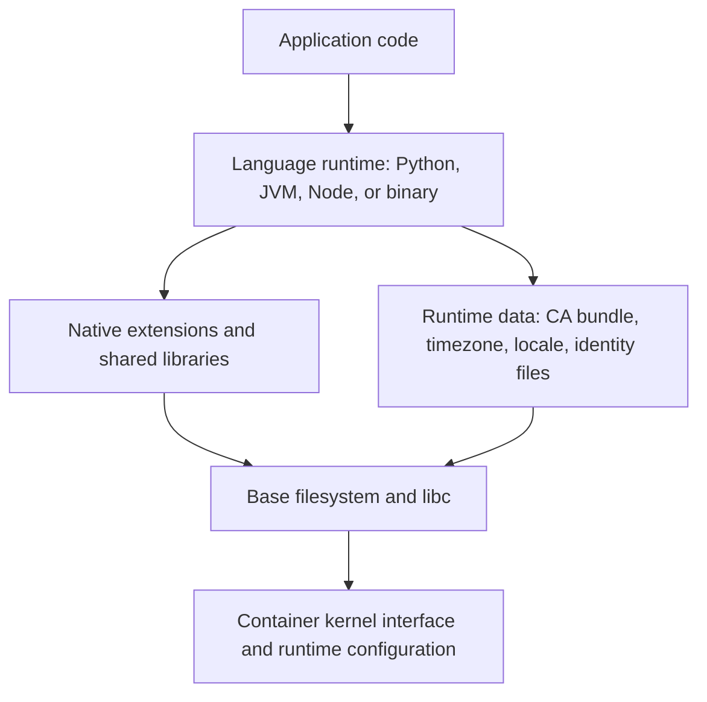

# Minimal and Distroless Base Images

Choosing a container base image is a runtime-compatibility and operating-model decision, not a contest to find the smallest image or the fewest scanner findings. This unit explains what base images provide, how `scratch`, BusyBox, Alpine/musl, Debian/Ubuntu slim, distroless, and Wolfi/Chainguard-style images differ, and how to test a real service across candidate bases. You will build evidence for image contents, native dependencies, TLS trust, startup readiness, debuggability, vulnerability findings, and lifecycle ownership, then write a decision memo that states trade-offs and uncertainty rather than claiming an automatic winner.

- **Stage:** 2E — Production DevOps & Platform Engineering
- **Module:** 01-Container-Image-Engineering-and-Registry-Hygiene (M01)
- **Unit:** 2 — Minimal and distroless base images
- **Target file:** `02-minimal-and-distroless-base-images.md`
- **Estimated time:** 12–16 hours including labs, measurement, and review
- **Prerequisites:** Stages 0–2D; Git, Linux shell, Python, basic containers, environment variables, file permissions, HTTP, and basic Docker CLI
- **Core tools:** Docker Engine/CLI, BuildKit / `docker buildx`, Trivy
- **Awareness/optional tools:** Syft (software bill of materials/SBOM), Grype, VEX, Sigstore/cosign, provenance tooling, Podman, Buildah, `docker debug`-style tooling, Kubernetes ephemeral containers, `nsenter`, Wolfi/Chainguard-style images, FIPS validation resources
- **Last reviewed:** 2026-10-24 (authoring date only; live documentation was not checked)
- **Assumed tool baseline:** Linux containers through Docker Engine or Docker Desktop with a working BuildKit-backed buildx builder; Trivy installed locally. Exact image variants, architectures, command flags, and scan behavior are version-sensitive and marked `[VERIFY]` where appropriate.

## Table of contents

- [Unit 2 — Minimal and distroless base images](#unit-2--minimal-and-distroless-base-images)
  - [2.0 Why this matters in production](#20-why-this-matters-in-production)
  - [2.1 Learning objectives](#21-learning-objectives)
  - [2.2 Concept map and vocabulary](#22-concept-map-and-vocabulary)
  - [2.3 Level 1 — Beginner](#23-level-1--beginner)
  - [2.4 Level 2 — Intermediate](#24-level-2--intermediate)
  - [2.5 Level 3 — Advanced](#25-level-3--advanced)
  - [2.6 Level 4 — Expert](#26-level-4--expert)
  - [2.7 SRE lens](#27-sre-lens)
  - [2.8 Security lens](#28-security-lens)
  - [2.9 Production checklist](#29-production-checklist)
  - [2.10 Hands-on lab set](#210-hands-on-lab-set)
  - [2.11 Self-check questions](#211-self-check-questions)
  - [2.12 Evidence artifacts](#212-evidence-artifacts)
  - [2.13 Common interview and design-review questions](#213-common-interview-and-design-review-questions)
  - [2.14 Sources and verification notes](#214-sources-and-verification-notes)
- [Appendix A — Claim register](#appendix-a--claim-register)
- [Appendix B — Independent audit report](#appendix-b--independent-audit-report)
- [Appendix C — Human verification checklist](#appendix-c--human-verification-checklist)
- [Appendix D — Assumptions and known limitations](#appendix-d--assumptions-and-known-limitations)
- [Appendix E — Sign-off](#appendix-e--sign-off)

## Unit 2 — Minimal and distroless base images

### 2.0 Why this matters in production

A base image supplies the operating-system user space and runtime files on which an application depends: the language runtime, libc, shared libraries, certificate authorities, timezone data, identity files, and sometimes package-management tools. If a team switches a Python service from Debian slim to Alpine or distroless based only on apparent size, the service may fail at import time, outbound TLS validation may fail because trust roots are missing, or an incident responder may discover that the expected shell is not present. These failures can delay recovery even when the application code did not change. The production objective is to select the smallest and simplest base that meets the application's tested runtime needs and the team's patching, debugging, and support obligations.

### 2.1 Learning objectives

By the end of this unit, the learner will be able to:

1. **[L1]** Explain the difference between a base image, application layers, image configuration, root filesystem, and runtime configuration.
2. **[L1]** Describe `scratch`, BusyBox, Alpine/musl, Debian/Ubuntu slim, distroless, and Wolfi/Chainguard-style images without equating size with security.
3. **[L2]** Select candidate bases for Python API, Python ETL, Go, Java, and Node.js workloads and list the tests needed to validate compatibility.
4. **[L2]** Diagnose native Python package failures using wheel tags, ABI, libc family, and runtime shared-library requirements.
5. **[L2]** Validate TLS CA trust, timezone/locale assumptions, resolver behavior, and user identity requirements without disabling TLS verification.
6. **[L3]** Run a controlled four-base comparison recording immutable references, image size, Trivy/database state, startup-to-readiness, debugability, and smoke-test results.
7. **[L3]** Interpret vulnerability findings with caveats about database freshness, distro backports, unfixed findings, detection limits, severity context, and VEX-style statements.
8. **[L3]** Write a base-image decision record grounded in measured evidence, provenance/license review, operational fit, and explicit limitations.
9. **[L4]** Design a golden-base-image program with owners, rebuild triggers, deprecation, downstream consumer inventory, exception expiry, and rollback.
10. **[L4]** Diagnose base-image incidents and define measurable service-level indicators (SLIs) and proposed service-level objectives (SLOs) for patch propagation.

### 2.2 Concept map and vocabulary

| Term | Precise definition | Common misconception |
|---|---|---|
| Base image | The starting filesystem and image configuration inherited by a build stage. | It is the entire application image. |
| Root filesystem (rootfs) | The filesystem tree visible as `/` to a process in its container namespace. | It contains the host's entire filesystem. |
| User space | Programs, libraries, configuration, and data files running above the kernel interface. | A container carries its own kernel. |
| libc | A C standard library providing common APIs used by many native programs. | glibc and musl are drop-in interchangeable in every binary/package. |
| Dynamic linking | Runtime resolution of shared libraries needed by an executable or extension. | A successful compile or package install proves all runtime libraries are present. |
| ABI | Application Binary Interface: binary-level conventions between compiled components. | Matching language version alone guarantees native compatibility. |
| CA bundle | A set of trusted certificate-authority certificates used to validate TLS peers. | Installing an application automatically guarantees a usable trust store. |
| Distroless | An image design focused on runtime dependencies rather than a general-purpose interactive distribution environment. | Distroless means no dependencies, no vulnerabilities, or automatic security. |
| Digest | Content-derived identifier for an image manifest or related content. | A human-readable tag is immutable. |
| SBOM | Software bill of materials: an inventory of software components in an artifact. | An SBOM proves that every component was detected or is safe. |
| VEX | Vulnerability Exploitability eXchange: a structured way to communicate a product's status/rationale regarding a vulnerability. | A VEX statement removes a vulnerability or substitutes for risk analysis. |
| Provenance | Evidence describing where and how an artifact was produced. | A digest alone proves who built the image and whether the process was trustworthy. |
| Debugability | How effectively responders can inspect and diagnose a workload under controlled access. | A shell inside every production container is the only way to debug it. |
| Golden base | An organization-maintained, supported base-image option with an owner and lifecycle policy. | It is a permanently frozen image that never needs updates. |

#### Base-image spectrum (conceptual, not a security ranking)

```text
General-purpose distribution
  Debian / Ubuntu
       |
       v
Reduced general-purpose distribution
  Debian slim / Ubuntu slim variants
       |
       v
Minimal runtime-focused images
  Distroless variants / Wolfi-style images
       |
       v
Purpose-built root filesystem
  scratch + explicitly copied runtime artifacts

BusyBox is a compact multi-call utility environment and can occupy a different point depending on how it is assembled.
This spectrum describes typical intent, not a universal size ordering or security ranking.
```

#### Runtime dependency diagram



The kernel is provided by the host/container platform, not packaged as a separate kernel inside the ordinary container image. A process can fail even if its application file exists: a dynamic loader may be missing, a shared library may not resolve, a certificate bundle may be absent, or an expected file path may not exist.

### 2.3 Level 1 — Beginner

#### 2.3.1 What a base image contains

A base image may contain a root filesystem, user-space utilities, libc and other shared libraries, package database metadata, certificate stores, timezone/locale data, identity files such as `/etc/passwd`, and image configuration such as environment variables or a default command. The exact set depends on the image family and variant. Application layers add code and dependencies above the base; runtime settings such as ports, mounts, environment, and resource limits may be supplied when a container starts.

Image contents and image configuration are related but distinct. `docker image inspect` can show configuration and metadata; it does not by itself prove every file or shared library needed by the app exists.

#### 2.3.2 `scratch`

`scratch` is an empty starting point in Dockerfile semantics, not a general-purpose Linux distribution. It has no shell, package manager, CA bundle, timezone database, passwd file, or shared library unless the build explicitly adds them. A statically linked program may run from a `scratch` image if it truly needs no other files, but many programs still require certificates, configuration, data files, or dynamic libraries.

**Example pattern — not a universal recommendation:**

```dockerfile
# File: examples/scratch-pattern/Dockerfile
# Replace the placeholder with a real binary produced for the target architecture.
FROM scratch
COPY --from=builder /out/service /service
ENTRYPOINT ["/service"]
```

This pattern is incomplete until a builder stage exists and the binary's runtime needs are verified. Do not use it as evidence that the application is self-contained.

#### 2.3.3 BusyBox

BusyBox packages many common Unix utilities into a compact multi-call executable, often used in constrained environments, initramfs, embedded systems, or diagnostic contexts. Its available applets depend on how BusyBox was built and configured. It is not a complete general-purpose distribution, and the presence of utilities does not guarantee that the application runtime, CA trust, package database, libc, or native libraries are suitable. A BusyBox-based image may use musl or another build configuration; verify the actual artifact rather than assuming.

#### 2.3.4 Alpine and musl

Alpine Linux is a small distribution that commonly uses musl libc and BusyBox utilities. Its footprint can be useful when dependencies are compatible and the team validates the application against Alpine's user space. The trade-off is that native packages and prebuilt Python wheels targeting glibc may not work unchanged in a musl environment. A successful `pip install` is not enough: import native extensions and run representative operations in the final image.

#### 2.3.5 Debian slim and Ubuntu

Debian and Ubuntu are general-purpose Linux distribution families with broad package ecosystems. Their slim variants omit some content compared with their fuller counterparts, but “slim” is a variant label—not a guarantee of a fixed size, vulnerability count, support policy, or security level. They may be a pragmatic choice when compatibility, troubleshooting familiarity, and access to common runtime libraries outweigh the benefit of a smaller runtime-focused image.

Do not infer that every Debian or Ubuntu image includes every locale, timezone database, or certificate package by default. Check the selected tag/digest and test the actual files and application behavior.

#### 2.3.6 Distroless

Distroless images aim to include an application's runtime dependencies without providing a general-purpose shell or package manager. Exact contents depend on the image family and variant. The lack of a shell can reduce some available utilities and makes in-container debugging different; it does not remove the application's libraries or guarantee zero vulnerabilities. Updates still matter because runtime libraries and other included components can have security advisories.

Official Distroless repository/documentation is the authority for current variant names, architectures, entrypoints, and debug variants. Those details are `[VERIFY]` before production use.

#### 2.3.7 Wolfi / Chainguard-style minimal images

Wolfi is associated with a purpose-built, container-oriented Linux distribution and Chainguard provides image products built around minimal runtime needs. The exact package model, image variants, support commitments, provenance metadata, licensing, and update behavior are product- and image-specific. Do not infer a security guarantee, patch SLA, compliance status, or package count from the brand or the word “minimal.” Verify claims against current official product documentation and the exact image artifact.

#### 2.3.8 Attack surface and usability

Fewer installed components can mean fewer components to maintain and potentially fewer places where a vulnerability applies. But the remaining application and runtime libraries still matter, and a raw vulnerability count depends on scanner data and package detection. Meanwhile, a shell-less image can increase the need for good logs, metrics, external diagnostics, and a rehearsed incident procedure. The engineering objective is to reduce unnecessary components while preserving validated runtime behavior and recoverability.

#### 2.3.9 Guided inspection lab

First inspect a known local image's metadata. The tag below is a discovery input, not a production pin.

```bash
# File: commands/inspect-base.sh
set -euo pipefail
docker pull python:3.12-slim
docker image inspect python:3.12-slim \
  --format 'ID={{.Id}} OS={{.Os}} ARCH={{.Architecture}} SIZE_BYTES={{.Size}} USER={{.Config.User}}'
docker history python:3.12-slim
```

**Expected output (example — your result will differ):** a successful pull, one line containing an image ID/platform/size/user field, and a history table. The exact ID and size vary by architecture and upstream image revision. `SIZE_BYTES` is Docker's local image-size field; it is not necessarily the compressed registry transfer size or unique disk use.

A shell-based inspection method works only when the selected image has a compatible shell:

```bash
# File: commands/inspect-shell-capable-image.sh
set -euo pipefail
docker run --rm --entrypoint /bin/sh python:3.12-slim -c \
  'printf "shell-present\n"; test -d /etc && ls /etc | head'
```

**Expected output (example — your result will differ):** `shell-present` followed by several `/etc` entries. This command is not suitable for every image. A shell-independent alternative is host-side image metadata plus a temporary container and `docker cp`; the exact procedure appears in Lab 2.4.

#### 2.3.10 Beginner mistakes

| Mistake | Why it fails | Corrective habit |
|---|---|---|
| Choosing only by size | Omits runtime compatibility and recovery needs | Test imports, TLS, readiness, and diagnostics |
| Assuming `scratch` is a tiny distro | It is an empty starting point | Explicitly inventory every runtime file |
| Assuming Alpine is interchangeable with Debian | libc and package ecosystems differ | Validate native dependencies on the target |
| Assuming distroless has no vulnerabilities | Runtime components still exist and need updates | Scan and review findings with context |
| Assuming every image has `/bin/sh` | Shell-less variants intentionally omit it | Use metadata, logs, external tools, or a debug workflow |
| Treating `docker image inspect .Size` as download bytes | Measurement definitions differ | Record exactly which size metric is used |

### 2.4 Level 2 — Intermediate

#### 2.4.1 Choose by workload, not fashion

| Workload | Candidate base families | Key runtime dependencies | Compatibility risks | Debugging needs | Validation tests |
|---|---|---|---|---|---|
| Python HTTP API / inference service | Debian slim; compatible Python distroless variant `[VERIFY]`; compatible Wolfi/Chainguard image `[VERIFY]` | Python interpreter, installed packages, native libraries, CA bundle for outbound TLS | Wheel ABI/libc mismatch; missing certificates; missing runtime files | Logs, health endpoint, metadata inspection, debug strategy | Import tests, health/readiness, representative request, TLS probe |
| Python batch ETL with pandas/PyArrow | Debian slim or another explicitly validated glibc-compatible base; other families only after evidence | Python, pandas/PyArrow native extensions, libc and shared libraries, timezone data if used | Large native dependency closure; wheel availability; libc mismatch; memory/disk limits | Stack traces, sample-file tests, external diagnostics | Import native packages, read/write representative formats, compare outputs |
| Go service/CLI | General-purpose slim, distroless suitable for binary, or `scratch` only after dependency proof | Binary, shared libraries if dynamically linked, CA bundle if HTTPS, timezone data if needed | CGO/dynamic linking; architecture; missing certificates or data | Logs, exit code, external tracing; shell may be absent | `file`/link inspection where applicable, HTTPS, smoke test |
| Java service | JRE-capable distribution or verified distroless Java variant `[VERIFY]` | JVM/runtime modules, application JAR, native libraries, CA bundle, timezone data | JDK/JRE mismatch; modules omitted; native library assumptions | JVM logs, diagnostic flags, external process/container tools | Startup/readiness, TLS, timezone-sensitive test, heap behavior |
| Node.js service | Supported Node runtime base, compatible distroless/Wolfi-style option `[VERIFY]` | Node runtime, native npm modules, CA bundle, application assets | Native module ABI, libc, architecture, package lifecycle scripts | Structured logs, health endpoint, external diagnostics | `npm ci`/lock consistency, native module load, TLS, smoke test |

No candidate is universally best. Select the base with evidence from the workload's actual runtime dependency closure and the team's operations model.

#### 2.4.2 Python wheels, ABI, and native libraries

A wheel is a built Python distribution. Its compatibility tags describe Python implementation/version, ABI, and platform constraints. Some wheels contain native extensions linked against shared libraries. A wheel may install successfully and still fail at import or when a code path loads a shared library, because installation is not a full runtime test.

- **glibc:** the C standard library used by Debian/Ubuntu and many other Linux distributions.
- **musl:** a different C standard library commonly used by Alpine.
- **ABI mismatch:** a binary extension or executable expects interfaces or libraries that the runtime does not provide.
- **Source build:** may compile against the target environment, but requires compilers/headers and can introduce its own reproducibility and maintenance concerns.
- **Runtime closure:** all shared libraries, data files, and configuration actually needed by the process.

Useful commands on a compatible host or builder:

```bash
# File: commands/python-native-checks.sh
set -euo pipefail
python -m pip debug --verbose
python -c 'import sys, platform; print(sys.version); print(platform.platform()); print(platform.machine())'
```

**Expected output (example — your result will differ):** Python version/platform/architecture and a long list of compatible wheel tags. This command describes the Python environment in which it runs, not necessarily a different final container. Run the equivalent checks inside the target image when possible, and then import the actual native package.

`ldd` is useful for many dynamically linked ELF binaries on compatible systems, but do not use it indiscriminately on untrusted binaries or assume it exists inside the image. A host-side `file` command and a purpose-built diagnostic image can help; architecture and tool availability still matter. For an image with no shell, inspect from the host and test by running the program.

#### 2.4.3 DNS and locale behavior

Container DNS behavior depends on the container runtime, network configuration, resolver configuration, libc implementation, and application/runtime behavior. Do not claim DNS always fails on Alpine or always works on Debian. Test name resolution from the actual runtime environment and network path. If the image has no diagnostic utilities, test through a small application-level resolver/HTTP check or a separately controlled diagnostic container attached to the same appropriate network.

Locale data and defaults differ across image families. An application that assumes a locale such as `en_US.UTF-8` may behave differently if locale data is missing or not generated. Python, Java, and Node have their own runtime details; validate the behavior the application actually requires. Mark distribution-specific paths and defaults `[VERIFY]`.

#### 2.4.4 `-slim` versus distroless

| Dimension | Slim distribution | Distroless |
|---|---|---|
| Size | Often reduced versus fuller distribution; actual size must be measured | May omit general-purpose tools; actual size depends on runtime variant |
| Shell/package manager | Commonly available, but verify the exact image | General-purpose shell/package manager typically absent by design |
| Debugging | In-container inspection can be more convenient | Requires logs, metadata, host-side tools, or a debug workflow |
| Compatibility | Broad package ecosystem and familiar troubleshooting | Runtime-only contents require explicit dependency validation |
| Patching | Update base and packages according to selected distribution policy | Update to a maintained variant/digest according to image-family policy |
| Team maturity | Can suit teams that need familiar operational tools | Requires a practiced shell-less debugging and release process |
| Best reason to choose | Compatibility and operational usability are valuable | Runtime closure is understood and operational diagnostics are mature |

A slim base can be the better engineering decision if the workload uses native dependencies, the team needs practical diagnostics, or a distroless migration adds untested complexity. Distroless can be a good choice when runtime contents are validated and the team is ready to debug externally. Neither wins without evidence.

#### 2.4.5 CA certificates, timezone, locale, and identity

**CA certificates.** HTTPS clients typically validate the server certificate chain against a trusted certificate store. A missing or inappropriate CA bundle can produce a TLS verification error. The correct fix is to include/use the intended trust store or configure the application with the approved trust source—not to disable certificate verification.

**Timezone data.** If an application uses UTC consistently, it may not need local timezone database files. If it converts named zones such as `Asia/Kolkata`, it may need IANA timezone data available in the runtime. Test the specific behavior; do not add timezone packages reflexively.

**Locale.** Locale settings can affect formatting, sorting, character handling, and defaults. The availability of locale data and generated locales varies. Test only the locale requirements the service actually has.

**`/etc/passwd` and identity.** Some runtimes or libraries resolve a numeric user ID to a name or home directory. Others work with a numeric UID without a passwd entry. If a minimal image needs a passwd entry, provide the smallest reviewed file necessary and avoid copying host identity data blindly. Confirm the selected image's user and runtime behavior.

#### 2.4.6 Running example: small Python JSON service

The same behavior will be used in the four-base lab. It exposes a health endpoint and a deterministic JSON calculation; it is a container compatibility exercise, not a model-serving workload.

```python
# File: app/app.py
from __future__ import annotations

import json
import os
from http.server import BaseHTTPRequestHandler, ThreadingHTTPServer
from typing import Any


class Handler(BaseHTTPRequestHandler):
    def do_GET(self) -> None:
        if self.path == "/health":
            body: dict[str, Any] = {"status": "ok"}
            self._send(200, body)
            return
        if self.path == "/predict":
            body = {"count": 3, "mean": 2.0}
            self._send(200, body)
            return
        self._send(404, {"error": "not found"})

    def _send(self, status: int, payload: dict[str, Any]) -> None:
        data = json.dumps(payload, sort_keys=True).encode("utf-8")
        self.send_response(status)
        self.send_header("Content-Type", "application/json")
        self.send_header("Content-Length", str(len(data)))
        self.end_headers()
        self.wfile.write(data)

    def log_message(self, format_string: str, *args: object) -> None:
        print(format_string % args, flush=True)


def main() -> None:
    host = os.environ.get("HOST", "0.0.0.0")
    port = int(os.environ.get("PORT", "8080"))
    server = ThreadingHTTPServer((host, port), Handler)
    print(f"ready host={host} port={port}", flush=True)
    server.serve_forever()


if __name__ == "__main__":
    main()
```

The code uses only the Python standard library, reducing third-party dependency differences. It does not test NumPy/PyArrow ABI behavior; add those packages only when your real workload needs them. The application prints a readiness line, and `/health` gives an explicit readiness check.

```dockerfile
# File: app/Dockerfile.debian
# Discovery tag only; resolve and review a real digest before production.
FROM python:3.12-slim
WORKDIR /app
COPY app.py /app/app.py
ENV PYTHONDONTWRITEBYTECODE=1 PYTHONUNBUFFERED=1
EXPOSE 8080
CMD ["python", "/app/app.py"]
```

For production, replace the discovery tag with a verified immutable reference in the form `python:3.12-slim@sha256:<REPLACE_WITH_VERIFIED_SHA256_DIGEST>`. Do not paste an unverified or fabricated digest. Resolve the actual manifest for the intended platform, review the source and update process, then record the exact value in the decision memo.

```dockerfile
# File: app/Dockerfile.alpine
# Discovery tag only; compatibility must be tested, not assumed.
FROM python:3.12-alpine
WORKDIR /app
COPY app.py /app/app.py
ENV PYTHONDONTWRITEBYTECODE=1 PYTHONUNBUFFERED=1
EXPOSE 8080
CMD ["python", "/app/app.py"]
```

The standard-library example is expected to be more portable than a service with native wheels, but that is a hypothesis to verify by building and testing. For distroless and Wolfi/Chainguard-style candidates, current Python variants and entrypoints must be verified against official documentation; do not invent tags. If a compatible Python runtime image is unavailable for the selected architecture or cannot be verified, record that candidate as blocked pending verification rather than pretending the same Dockerfile works.

#### 2.4.7 Pattern catalogue

| Pattern | When to use | When NOT to use | Evidence to collect |
|---|---|---|---|
| Debian/Ubuntu slim | Broad compatibility and familiar tooling are useful | The workload has a validated runtime-only option and strict operational reasons to reduce tools | Exact digest, package/runtime closure, smoke test, size |
| Alpine/musl | Dependencies are available and tested for musl; footprint matters | Required wheels or native libraries are glibc-specific or unvalidated | Wheel tags, import tests, library checks, target-architecture run |
| Distroless runtime | Runtime closure is understood and shell-less debugging is operationally supported | Team relies on ad hoc shell access and has no alternative diagnostic path | Variant/digest, entrypoint, TLS, readiness, debug runbook |
| Wolfi/Chainguard-style image | Exact image and support model fit the workload and have been reviewed | Product-specific claims or compatibility are assumed rather than verified | Official image docs, digest, package inventory, provenance/support review |
| `scratch` + static binary | Program and all required files are demonstrably self-contained or explicitly copied | App needs an interpreter, dynamic libraries, CA data, timezone files, or untracked resources | Binary format/linking, file inventory, TLS and smoke tests |
| Separate debug image/target | Debug tools are needed without shipping them in the normal runtime image | Debug artifact diverges so much that it cannot reproduce the release behavior | Artifact identity, permitted access, matching source/build metadata |

#### 2.4.8 Anti-pattern catalogue

| Bad example | Why it hurts | Corrected approach | Verification |
|---|---|---|---|
| Switching to Alpine because it looks smaller | Native dependencies may expect glibc or unavailable wheels | Test exact package/runtime closure; compare only after smoke tests | Import and workload tests in final image |
| Using `scratch` without dependency analysis | Missing loader, CA bundle, or data files cause runtime failures | Inventory dependencies and explicitly include required files | Execute the real app and TLS probe |
| Shipping distroless without a debug plan | Responders may be unable to use expected shell commands | Document logs, metadata, debug artifact, and escalation path | Run a no-shell incident drill |
| Disabling TLS verification to fix CA errors | Removes peer authentication and hides the root cause | Install/configure the intended trust store and retest | Verified HTTPS request without insecure flags |
| Comparing Trivy counts from different DB dates | Database changes can alter results independently of the image | Record Trivy version and DB freshness; align scan state where feasible | Save version/update metadata and reports |
| Treating `docker run` return as readiness time | Process creation is not application readiness | Poll a health endpoint or explicit ready signal | Record readiness timestamps over repeated trials |
| Pinning a digest but never rebuilding | Pinning can freeze vulnerable content indefinitely | Trigger reviewed digest updates and downstream rebuilds | Base age and patch-propagation metrics |

### 2.5 Level 3 — Advanced

#### 2.5.1 Distroless variants and debug images

The Distroless project has historically documented variant families described as `static`, `base`, `cc`, `python3`, and `java`, plus debug variants for some families. **Current names, tags, supported architectures, entrypoints, and availability are `[VERIFY]`** against the official GoogleContainerTools Distroless repository/documentation before use. Do not assume every variant exists for every release or architecture.

Conceptually, these names distinguish different runtime needs: a minimal/static-oriented base, a general runtime base, a C/C++ runtime-oriented base, and language runtime variants. The exact package set and entrypoint must be read from the current image documentation and tested against the app. A variant name is not a dependency audit.

Debug variants, where offered, may add diagnostic tools such as a shell. They are useful in controlled debugging, but do not make a debug image the default production artifact without an explicit decision. A debug variant can differ from the release image; use it to diagnose carefully, then reproduce the fix in the production build.

#### 2.5.2 Debugging without a shell

When `docker exec CONTAINER sh` fails, it may mean the image has no shell, not that the container runtime is broken. Use a layered diagnostic strategy:

1. `docker ps -a` to capture status and exit state.
2. `docker logs CONTAINER` to inspect application output.
3. `docker inspect CONTAINER` to inspect image reference, command, environment configuration, mounts, network settings, and exit information.
4. `docker image inspect IMAGE` and `docker history IMAGE` to inspect image metadata and build history.
5. `docker cp CONTAINER:/path ./local-copy` to retrieve a known path from a container when it exists and the container state allows it.
6. Run a diagnostic container based on a suitable tool image, with only the needed network/volume/namespace access. Do not casually mount host paths or production secrets.
7. Use `nsenter` only with an authorized host-level procedure; it can enter Linux namespaces and is not a normal unprivileged substitute for a shell.
8. `docker debug`-style tooling and Kubernetes ephemeral containers are availability/version-dependent. Kubernetes ephemeral containers are a forward reference to M03; this lesson does not teach Kubernetes operations.

Privilege boundaries matter. Host namespace inspection can expose process, network, and filesystem information beyond the container. Follow authorization, audit logging, and incident procedures.

#### 2.5.3 Trivy: controlled image comparison

Trivy is an open-source security scanner that can inspect container images for known vulnerabilities in detected operating-system packages and supported language dependencies. Its findings depend on scanner version, vulnerability database state, package detection, distro advisory mapping, the image digest, and time. A scan report is evidence, not a security certificate.

**Discovery commands — verify current syntax for your installed version:**

```bash
# File: commands/trivy-version-and-db.sh
set -euo pipefail
trivy --version
trivy image --help
trivy image --download-db-only
```

`--download-db-only` support and exact behavior are `[VERIFY]` for the installed Trivy version. If unsupported, use the current official Trivy documentation to identify the supported database update command. Do not silently continue with a stale database. **Expected output (example — your result will differ):** a version block, help text, and database update progress or an explicit error. The update command may download data and consume network/disk.

After resolving and pinning each real image reference, use a consistent command shape:

```bash
# File: commands/scan-one-image.sh
set -euo pipefail
IMAGE_REF="${1:?usage: scan-one-image.sh IMAGE_REF}"
trivy image --scanners vuln --format json --output trivy-report.json "$IMAGE_REF"
```

The exact scanner flags and report fields are `[VERIFY]` against the installed version's `trivy image --help` and official image-scanning docs. **Expected output (example — your result will differ):** a JSON report or a non-zero error; the report depends on the image, scanner version, and database. This script overwrites `trivy-report.json` in the current directory; run it in the lab evidence folder and inspect before re-running.

Record:
- full image reference and digest;
- host architecture and target platform;
- scan timestamp and Trivy version;
- database update/freshness status;
- operating-system and language-library findings;
- severity counts, unfixed findings, suppressed/ignored items, and errors;
- reason for any exception and review owner.

Do not invent CVE IDs or counts. Empty comparison cells must read `FILL WITH MEASUREMENT`.

#### 2.5.4 Why raw vulnerability counts are not a quality score

- **Database freshness:** a new database can add findings to an unchanged image.
- **Severity and context:** severity is one input; exposure, reachable code, deployment context, and compensating controls matter.
- **Exploitability limits:** scanner presence of a vulnerable component does not by itself prove exploitability in the deployed workload.
- **Unfixed findings:** no available fix may exist yet; record owner, mitigation, and reassessment date.
- **Distribution backports:** distributions may backport a patch while retaining a package version string that confuses simplistic comparisons. Review the distro advisory and scanner interpretation.
- **False positives/negatives:** package metadata may be incomplete, ambiguous, or undetected; scanner coverage is not exhaustive.
- **Inventory limits:** packages or files that the scanner cannot identify may not be represented in the report.
- **VEX-style statements:** VEX can communicate a product's status and rationale regarding a vulnerability. It does not remove the vulnerable code, magically change scanner truth, or replace a documented risk decision. Verify the applicable format and tool support in official documentation.

#### 2.5.5 Provenance, licenses, and update policy

Review the base image's source, publisher/maintainer, release process, supported architecture, component inventory, license information, signatures/attestations where available, and build provenance. A digest identifies content; it does not alone prove who built it or whether the build process was trustworthy. An SBOM is useful inventory evidence but may be incomplete and does not itself establish safety.

Do not claim that a base is license-compliant from a scanner report alone. License obligations depend on components, distribution, use, and legal interpretation. Refer uncertain obligations to legal/compliance counsel. FIPS is a question about validated cryptographic modules and the applicable configuration, not a property inferred from “minimal,” “distroless,” a distribution name, or a vulnerability scan. Current certification status is `[VERIFY]` against official validation sources.

**Proposed update policy [ILLUSTRATIVE]:**
- review base releases and relevant advisories at least weekly;
- perform a security-triggered assessment when a relevant high-impact advisory appears;
- rebuild and test supported bases after a reviewed upstream update;
- publish an immutable digest only after smoke tests and required scans;
- trigger downstream rebuilds and track completion;
- review exceptions at a defined expiry date, not indefinitely.

These are example controls, not universal SLA requirements. Tune them to risk, exposure, service criticality, and available automation.

#### 2.5.6 Four-base comparison experiment

Compare the same standard-library Python service from Section 2.4.6 across four candidates. Candidate families:

1. Debian slim (baseline general-purpose slim).
2. Alpine (musl-based).
3. A compatible Distroless Python runtime variant, if current official docs confirm one for the target architecture.
4. A compatible Wolfi/Chainguard-style Python runtime image, if the exact current image and usage terms can be verified.

If candidate 3 or 4 cannot be verified, do not invent a tag. Record `BLOCKED — resolve official image reference` and continue discovery; the comparison is not complete until all four candidates are recorded, including a documented incompatibility if one cannot run the app faithfully.

Resolve and review real digests. A discovery tag is not a production reference:

```bash
# File: commands/resolve-image-reference.sh
set -euo pipefail
IMAGE_TAG="${1:?usage: resolve-image-reference.sh repository:tag}"
docker pull "$IMAGE_TAG"
docker image inspect "$IMAGE_TAG" --format '{{json .RepoDigests}}'
docker image inspect "$IMAGE_TAG" --format 'OS={{.Os}} ARCH={{.Architecture}} ID={{.Id}}'
```

**Expected output (example — your result will differ):** pull output, repository digest list, and platform/ID line. If no digest is returned or the output is ambiguous, stop and consult the registry/official image documentation. Review the exact digest and platform before placing it into the decision record. Do not invent a digest.

Use a separate Dockerfile for each base family if the entrypoint or runtime layout differs. Keep source, port, endpoint behavior, architecture, and smoke-test input the same where feasible. Do not force a single Dockerfile across incompatible runtime families.

**Required result table — learner fills actual values:**

| Base image + digest | Architecture | Image size and measurement type | Trivy version/database timestamp | Vulnerability counts by severity | Unfixed findings/notes | Startup/readiness time | Debugability score | TLS/CA test | Locale/timezone/passwd assumptions | Smoke-test result | Limitations |
|---|---|---|---|---|---|---|---|---|---|---|---|
| Debian slim — `FILL WITH VERIFIED DIGEST` | FILL WITH MEASUREMENT | FILL WITH MEASUREMENT | FILL WITH MEASUREMENT | FILL WITH MEASUREMENT | FILL WITH MEASUREMENT | FILL WITH MEASUREMENT | FILL WITH MEASUREMENT | FILL WITH MEASUREMENT | FILL WITH MEASUREMENT | FILL WITH MEASUREMENT | FILL WITH MEASUREMENT |
| Alpine — `FILL WITH VERIFIED DIGEST` | FILL WITH MEASUREMENT | FILL WITH MEASUREMENT | FILL WITH MEASUREMENT | FILL WITH MEASUREMENT | FILL WITH MEASUREMENT | FILL WITH MEASUREMENT | FILL WITH MEASUREMENT | FILL WITH MEASUREMENT | FILL WITH MEASUREMENT | FILL WITH MEASUREMENT | FILL WITH MEASUREMENT |
| Distroless compatible runtime — `FILL WITH VERIFIED DIGEST OR BLOCKED REASON` | FILL WITH MEASUREMENT | FILL WITH MEASUREMENT | FILL WITH MEASUREMENT | FILL WITH MEASUREMENT | FILL WITH MEASUREMENT | FILL WITH MEASUREMENT | FILL WITH MEASUREMENT | FILL WITH MEASUREMENT | FILL WITH MEASUREMENT | FILL WITH MEASUREMENT | FILL WITH MEASUREMENT |
| Wolfi/Chainguard-style compatible runtime — `FILL WITH VERIFIED DIGEST OR BLOCKED REASON` | FILL WITH MEASUREMENT | FILL WITH MEASUREMENT | FILL WITH MEASUREMENT | FILL WITH MEASUREMENT | FILL WITH MEASUREMENT | FILL WITH MEASUREMENT | FILL WITH MEASUREMENT | FILL WITH MEASUREMENT | FILL WITH MEASUREMENT | FILL WITH MEASUREMENT | FILL WITH MEASUREMENT |

**Image-size metric:** use `docker image inspect IMAGE --format '{{.Size}}'` for Docker-reported local image size, in bytes. It is not compressed registry transfer size and not unique disk usage where layers are shared. If compressed transfer size is the decision metric, measure the actual registry/export path with a documented tool and record that separate measurement.

**Startup-to-readiness methodology:** run at least 10 trials per candidate as an exploratory minimum, with the same host load, platform, port mapping, request, and image digest. Define readiness as a successful `GET /health` response with expected JSON, not merely a successful `docker run`. Record warm/cold image state and whether the process starts from a cold host cache. Report median for 10 trials. Do not report p95 as a stable tail metric from only 10 trials; gather more samples if a p95 objective matters.

```python
# File: scripts/measure_readiness.py
from __future__ import annotations

import argparse
import json
import statistics
import subprocess
import time
import urllib.error
import urllib.request


def run_once(image: str, port: int, timeout_s: float) -> float:
    name = f"m02-base-test-{int(time.time_ns())}"
    started = time.monotonic()
    container_id = subprocess.run(
        ["docker", "run", "-d", "--rm", "--name", name, "-p", f"{port}:8080", image],
        check=True, capture_output=True, text=True,
    ).stdout.strip()
    try:
        deadline = started + timeout_s
        url = f"http://127.0.0.1:{port}/health"
        while time.monotonic() < deadline:
            state = subprocess.run(
                ["docker", "inspect", "--format", "{{.State.Running}}", container_id],
                check=False, capture_output=True, text=True,
            )
            if state.returncode != 0 or state.stdout.strip() != "true":
                logs = subprocess.run(
                    ["docker", "logs", container_id], check=False, capture_output=True, text=True,
                )
                raise RuntimeError(f"container exited before readiness; logs={logs.stdout}{logs.stderr}")
            try:
                with urllib.request.urlopen(url, timeout=0.5) as response:
                    payload = json.loads(response.read().decode("utf-8"))
                    if response.status == 200 and payload.get("status") == "ok":
                        return time.monotonic() - started
            except (urllib.error.URLError, TimeoutError, json.JSONDecodeError):
                pass
            time.sleep(0.1)
        raise TimeoutError(f"health endpoint not ready within {timeout_s}s")
    finally:
        subprocess.run(["docker", "rm", "-f", container_id], check=False, capture_output=True, text=True)


def main() -> int:
    parser = argparse.ArgumentParser(description="Measure container start to HTTP readiness.")
    parser.add_argument("image")
    parser.add_argument("--port", type=int, default=18080)
    parser.add_argument("--trials", type=int, default=10)
    parser.add_argument("--timeout", type=float, default=20.0)
    args = parser.parse_args()
    if args.port < 1024 or args.port > 65535 or args.trials < 1 or args.timeout <= 0:
        parser.error("port must be 1024–65535, trials >= 1, timeout > 0")
    samples = [run_once(args.image, args.port, args.timeout) for _ in range(args.trials)]
    print(json.dumps({
        "image": args.image,
        "trials": len(samples),
        "seconds": [round(x, 4) for x in samples],
        "median_seconds": round(statistics.median(samples), 4),
        "p95_seconds": None if len(samples) < 100 else round(sorted(samples)[int(0.95 * (len(samples) - 1))], 4),
        "p95_note": "reported only with >=100 samples; order-statistic method is approximate",
    }, indent=2))
    return 0


if __name__ == "__main__":
    raise SystemExit(main())
```

The script assumes the application listens on container port 8080 and exposes `/health`; adjust only in a lab copy if the chosen runtime requires a different command. **Expected output (example — your result will differ):** JSON with sample durations and median; no timings are supplied here. A container that exits early raises an error and includes logs. It removes only the named container it created. Run candidates sequentially and use a distinct host port or no concurrent runs to avoid conflicts.

**Debugability rubric (0–4):** score one point for each criterion supported by evidence: (1) approved method to obtain logs/exit status/config without a shell; (2) runtime dependencies can be inspected or reproduced from build artifacts; (3) a documented debug artifact/tool path exists and is access-controlled; (4) responders have rehearsed the procedure. A shell does not automatically earn a point; a shell-less image can score well if the external diagnostic process works.

#### 2.5.7 Design decision table

| Option | Benefit | Cost | Risk | Choose when |
|---|---|---|---|---|
| General-purpose Debian/Ubuntu | Broad package ecosystem and familiar tools | Larger content and more components to maintain | Unnecessary tools/packages may remain | Compatibility and operational familiarity are priorities |
| Slim distribution | Reduces some content while retaining familiar runtime environment | Still requires package and runtime review | “Slim” can be mistaken for a security guarantee | App needs broad compatibility and useful troubleshooting |
| Alpine/musl | Compact user space and musl-based environment | Native dependency validation may require extra work | glibc-targeted wheels/libraries may not work unchanged | Dependencies are proven compatible with musl |
| Distroless | Runtime-focused image without a general-purpose shell/package manager | Shell-less debugging requires maturity | Missing runtime data or untested assumptions can break service | Runtime closure is known and diagnostics are rehearsed |
| `scratch`/minimal rootfs | Only deliberately included files are present | Dependency assembly and ownership burden increase | Missing loader, CA data, timezone, identity, or libraries | Binary and all runtime files are explicitly verified |

#### 2.5.8 Copy-ready decision memo

```markdown
# Base-image decision record

- Service / owner:
- Decision date:
- Review date:
- Workload and criticality:
- Target architectures:
- Source commit/hash:
- Build host/tool versions:
- Selected base + immutable digest:
- Base-image owner and support path:

## Requirements
- Functional/runtime:
- TLS/CA, locale, timezone, identity:
- Startup/readiness objective:
- Debugging and incident-response:
- Size/storage/cost:
- License/compliance constraints:

## Candidates and evidence
- Debian slim: digest, build/smoke results, size metric, scan/DB state, readiness, debugability
- Alpine: digest, build/smoke results, size metric, scan/DB state, readiness, debugability
- Distroless: digest or blocked reason, build/smoke results, size metric, scan/DB state, readiness, debugability
- Wolfi/Chainguard-style: digest or blocked reason, build/smoke results, size metric, scan/DB state, readiness, debugability

## Decision and rejected alternatives
- Selected option:
- Evidence supporting selection:
- Why each alternative was rejected:
- Compatibility/provenance/license trade-offs:
- Uncertainty and limitations:

## Operations
- Update cadence and security-triggered rebuild:
- Downstream rebuild trigger:
- Exception owner/expiry/rationale:
- Canary and rollback:
- Rollback risk (including possible reintroduction of vulnerabilities):
- Approval:
```

#### 2.5.9 Worked illustrative decision example

**[ILLUSTRATIVE — hypothetical, not measured]** A Python batch ETL service uses native data-processing packages and has a strict correctness requirement. The team initially selects a maintained Debian slim-based runtime because the required native wheels and shared libraries pass integration tests, and the on-call team already has a documented external diagnostic workflow. Alpine is not selected until native dependency compatibility is demonstrated. A Distroless candidate remains under evaluation until its Python variant, current digest, and runtime file closure are verified. A Wolfi/Chainguard-style candidate is evaluated on the same basis, including source, support, provenance, and licensing review. The team does **not** select the winner based on hypothetical size or vulnerability counts; it records actual measurements and a review date first.

This example is a decision process, not a claim that Debian slim is always best or that the other candidates fail.

### 2.6 Level 4 — Expert

#### 2.6.1 Golden base-image program

A golden base-image program provides a small, curated catalog of maintained images for supported workload classes. Each entry has an owner, use case, supported architectures, immutable release references, component/license/provenance evidence, update cadence, deprecation policy, and a list of downstream consumers. It should reduce duplicated maintenance while avoiding an unowned internal fork.

Recommended catalog fields:

| Field | Required content |
|---|---|
| Image family / workload | Python API, Python ETL, Go, Java, Node, or another explicitly supported class |
| Owner and escalation | Named team/on-call path, not a generic mailbox with no response commitment |
| Immutable artifact | Registry/repository and verified digest for each supported architecture |
| Source and build | Source repository/revision, build pipeline, builder/tool versions, provenance evidence where available |
| Runtime contract | libc family, interpreter/runtime, expected shared libraries, CA/timezone/locale/identity assumptions |
| Security evidence | Trivy version/DB state, report location, exception records, update date |
| License evidence | Component inventory and legal/compliance review status where needed |
| Support lifecycle | First published, review date, deprecation announcement, final supported date |
| Consumers | Service owners and current deployed digests or inventory references |
| Rollback | Previous known-good digest and explicit risk approval if it contains a known vulnerability |

#### 2.6.2 Ownership and responsibility model

| Activity | Base-image owner | Service/application owner | Security/platform governance |
|---|---|---|---|
| Maintain base build pipeline | Responsible | Consulted | Consulted |
| Review upstream base updates | Responsible | Informed | Consulted for material risk |
| Rebuild and test application | Provides base and notice | Responsible | Consulted where policy requires |
| Trigger downstream rebuild | Owns event/notification | Owns app pipeline response | Monitors policy |
| Approve exception | Consulted | Requests and documents impact | Approver per governance policy |
| Deprecate base | Responsible for schedule and communication | Responsible for migration | Escalation/oversight |
| Incident caused by base change | Leads base diagnosis | Leads app-level diagnosis | Coordinates if security incident |

Assign actual team names in the organization. Avoid an image with no owner: an unowned image eventually becomes an unpatched dependency.

#### 2.6.3 Patch propagation workflow and illustrative SLOs

```mermaid
flowchart LR
    A[Upstream advisory or base release] --> B[Base owner reviews impact]
    B --> C[Rebuild candidate]
    C --> D[Scan + compatibility tests]
    D --> E[Publish immutable digest]
    E --> F[Notify/inventory consumers]
    F --> G[Downstream rebuild and test]
    G --> H[Canary/staged rollout]
    H --> I[Verify deployment and close event]
```



Proposed example targets **[ILLUSTRATIVE]**:
- publish a reviewed base rebuild within a defined number of hours/days after the team classifies an applicable critical advisory;
- trigger downstream rebuilds within one business day of publication;
- complete consumer adoption within a risk-based window based on exposure and service criticality.

Do not adopt these numbers as universal standards. Baseline first: record upstream advisory time, triage/classification time, publish time, notification time, downstream build completion, and deployed-digest observation. Calculate distributions by severity and workload criticality, then approve objectives that match staffing and risk.

Digest pinning makes the chosen content explicit; it does not keep that content secure forever. A pinned digest can become stale unless an automated or owned process evaluates updates and triggers downstream rebuilds.

#### 2.6.4 Downstream rebuild triggers

Use a combination of:
- scheduled rebuild checks for upstream base updates and dependency changes;
- event-driven notifications from the golden-base owner;
- dependency/update automation where supported;
- application compatibility tests and runtime smoke tests;
- immutable digest promotion after review;
- staged rollout/canary and rollback to a known-good artifact;
- consumer inventory that identifies services which did not rebuild.

A rollback may reintroduce a known vulnerability. The incident owner must explicitly weigh availability against security exposure, record approval, set an expiry/reassessment, and continue remediation. Do not silently treat an old digest as safe merely because it previously worked.

#### 2.6.5 Building a minimal root filesystem safely

A custom root filesystem is the result of dependency analysis, not a shortcut. For a simple static binary, a `scratch` stage can copy only the executable; for a dynamically linked program, the loader and required shared libraries may also be needed. HTTPS may require a CA bundle; named timezones may require timezone data; some runtimes may need identity or configuration files.

Safe local conceptual lab:

```dockerfile
# File: labs/rootfs-concept/Dockerfile
FROM alpine:3.20 AS builder
RUN printf '#include <stdio.h>\nint main(void){puts("rootfs-demo");return 0;}\n' > /tmp/main.c \
    && apk add --no-cache build-base \
    && cc -static -O2 -o /out-demo /tmp/main.c
FROM scratch
COPY --from=builder /out-demo /rootfs-demo
ENTRYPOINT ["/rootfs-demo"]
```

**[VERIFY]** This example's static-link build depends on the Alpine package/compiler toolchain and architecture; static linking can fail if the toolchain's static libraries are unavailable. It is a conceptual lab, not a guaranteed cross-platform build. Correct the output path if the builder's actual path differs; a production version should use a dedicated source file and explicitly verify the resulting binary with `file` and a run test.

**Expected output (example — your result will differ):** if the static binary builds, `docker run --rm m01-lab/rootfs:demo` prints `rootfs-demo`. If the static link fails, capture the compiler error and inspect the toolchain/package configuration rather than claiming success. This lab requires no privileged host modifications or kernel changes.

Hand-built root filesystems increase responsibility for component inventory, updates, license obligations, provenance, compatibility tests, and emergency patching. Prefer a maintained base family unless the operational benefit justifies owning those obligations.

#### 2.6.6 FIPS and compliance awareness

Federal Information Processing Standards (FIPS) and other compliance requirements must be evaluated against the specific cryptographic modules, validated versions/configurations, deployment conditions, and applicable certification records. “Minimal,” “distroless,” a distro name, or a clean Trivy report does not establish compliance. Current validation claims are `[VERIFY]` against official certification resources and the exact product documentation. This lesson is not legal advice; involve qualified security, compliance, and legal reviewers.

#### 2.6.7 Incident walkthrough A — Python works on Debian slim but fails on Alpine

- **Symptom:** service starts on Debian slim but an import fails or a native operation reports a missing symbol/library on Alpine.
- **Hypotheses:** wheel targets glibc; required shared library is absent; package compiled against a different ABI; architecture differs.
- **Tests:** compare `platform.machine()` and Python tags; inspect wheel tags/package build output; run imports and the exact failing operation in the final image; inspect dynamic dependencies on a compatible diagnostic environment.
- **Root cause:** only declare after evidence identifies the missing/incompatible component.
- **Fix:** use a compatible wheel/base, rebuild from source against the target environment when supported, or select a different base family. Do not copy arbitrary host libraries into production without dependency and license review.
- **Prevention:** make native import/operation tests mandatory for each supported architecture and base digest.

#### 2.6.8 Incident walkthrough B — TLS fails because CA trust is missing

- **Symptom:** outbound HTTPS fails with certificate verification errors after moving to a minimal image.
- **Hypotheses:** CA bundle missing; application uses a different trust path; corporate proxy CA is not installed; remote endpoint certificate chain is invalid; system clock is incorrect.
- **Tests:** inspect the final image's trust-store files from a compatible diagnostic method; run the application-level HTTPS request with certificate verification enabled; compare with a known-good environment; check system time and approved proxy configuration.
- **Root cause:** identify the actual trust-chain or file/configuration issue; do not assume every TLS error means the CA bundle is missing.
- **Fix:** include/configure the approved CA bundle or application trust source; if the server chain is wrong, fix the server. Never use disabled verification as the fix.
- **Prevention:** include a TLS smoke test against an approved endpoint and review certificate trust assumptions when changing bases.

#### 2.6.9 Incident walkthrough C — no shell in a production image

- **Symptom:** on-call tries `docker exec <container> sh` and receives an executable-not-found error.
- **Hypotheses:** the image intentionally has no shell; wrong entrypoint/image; container already exited; runtime failure occurred before logs flushed.
- **Tests:** `docker ps -a`; `docker logs`; `docker inspect`; `docker image inspect`; compare the running image digest and command with the release record. Use `docker cp` for a known file when possible, or run an approved diagnostic container with narrowly scoped access.
- **Root cause:** the expected shell is absent and the runbook assumed interactive access.
- **Fix:** use external diagnostics and, if needed, a matching debug artifact under controlled access. Rebuild the production image only if the application/runtime itself is defective.
- **Prevention:** rehearse shell-less incidents, keep logs and readiness signals, record release digests, and define escalation to authorized host-level tools.

#### 2.6.10 Policy-as-code sketch

The following script validates a base-image decision record's required fields. It does **not** prove the image is secure, that a digest exists in a registry, or that scan evidence is accurate.

```python
# File: scripts/validate_base_record.py
from __future__ import annotations

import json
import re
import sys
from pathlib import Path
from typing import Any


REQUIRED_NONEMPTY = (
    "image",
    "digest",
    "owner",
    "review_date",
    "supported_architectures",
    "trivy_version",
    "trivy_database_timestamp",
    "scan_evidence",
)


def validate(record: dict[str, Any]) -> list[str]:
    errors: list[str] = []
    for key in REQUIRED_NONEMPTY:
        value = record.get(key)
        if value is None or value == "" or value == []:
            errors.append(f"missing required field: {key}")
    digest = str(record.get("digest", ""))
    if digest and not re.fullmatch(r"sha256:[0-9a-fA-F]{64}", digest):
        errors.append("digest must use sha256:<64 hexadecimal characters>")
    if record.get("review_date") and not re.fullmatch(r"\d{4}-\d{2}-\d{2}", str(record["review_date"])):
        errors.append("review_date must use YYYY-MM-DD")
    if not isinstance(record.get("supported_architectures"), list):
        errors.append("supported_architectures must be a JSON array")
    return errors


def main() -> int:
    if len(sys.argv) != 2:
        print("usage: python scripts/validate_base_record.py path/to/base-record.json", file=sys.stderr)
        return 2
    path = Path(sys.argv[1])
    try:
        record = json.loads(path.read_text(encoding="utf-8"))
    except (OSError, json.JSONDecodeError) as exc:
        print(f"ERROR: cannot read JSON record: {exc}", file=sys.stderr)
        return 2
    if not isinstance(record, dict):
        print("ERROR: record must be a JSON object", file=sys.stderr)
        return 2
    errors = validate(record)
    if errors:
        for error in errors:
            print(f"FAIL: {error}")
        return 1
    print("PASS: required record fields present; manual review still required")
    return 0


if __name__ == "__main__":
    raise SystemExit(main())
```

Sample input (the digest is deliberately a placeholder and will fail validation until replaced with a real reviewed digest):

```json
{
  "image": "registry.example.invalid/team/python-runtime",
  "digest": "<REPLACE_WITH_VERIFIED_SHA256_DIGEST>",
  "owner": "platform-base-images",
  "review_date": "2026-10-24",
  "supported_architectures": ["amd64"],
  "trivy_version": "FILL WITH MEASUREMENT",
  "trivy_database_timestamp": "FILL WITH MEASUREMENT",
  "scan_evidence": "evidence/base-scan.json"
}
```

**Expected output (example — your result will differ):** `FAIL: digest must use sha256:<64 hexadecimal characters>` until a real digest is supplied; the other fields may still be placeholders and the script currently checks presence rather than semantic validity for them. Improve field-level validation before using this in an organization. This validator is a teaching sketch, not a security policy engine.

### 2.7 SRE lens

#### Service-level indicators and proposed objectives

Relevant service-level indicators (SLIs) include:

- base-image age since reviewed publication;
- time from upstream advisory/patch availability to rebuilt and published base;
- time from base publication to downstream application rebuild;
- successful base build and runtime smoke-test rate;
- startup-to-readiness time;
- image pull success where relevant;
- scan-evidence age and database freshness;
- number and age of open base-image exceptions.

Some indicators are directly observed timestamps or outcomes; others are proxies. For example, a fresh scan timestamp is not proof that all components were detected, and a base publication timestamp does not prove every consumer deployed it.

Proposed SLO examples are **[ILLUSTRATIVE]** only: a team may set a target for publishing a tested base within a risk-based window after classifying an applicable security advisory, and another target for downstream rebuild completion. Baseline these measurements over a defined window and group by severity/service criticality before selecting actual targets. Do not borrow a target without measuring current performance and staffing capacity.

#### Failure modes and blast radius

| Failure mode | Potential blast radius | Initial evidence |
|---|---|---|
| glibc/musl or ABI mismatch | One image family, architecture, or service fleet | Import errors, binary metadata, wheel tags, shared-library evidence |
| Missing shared library | Startup or code-path failure | Exit status/logs, final image dependency tests |
| Missing CA bundle | Outbound TLS calls fail | Application TLS test, trust-store inspection |
| Missing timezone/locale data | Incorrect formatting or time conversion | Focused application test with named timezone/locale |
| No debug shell | Incident diagnosis delayed | Failed exec attempt, logs, inspect metadata, runbook |
| Stale base digest | Fleet remains exposed to known issues | Base age, advisory timeline, deployed digest inventory |
| Wrong architecture | Container fails to start or binary fails | Image platform metadata, host architecture, runtime test |
| Unsupported or moved tag | Build becomes non-repeatable or changes unexpectedly | Tag/digest record, registry response, source docs |
| Stale scanner database | Incomparable or missed scan findings | Trivy version and DB timestamp/update status |
| Downstream consumer does not rebuild | Patched base exists but deployed apps remain on old content | Consumer inventory and deployed-digest telemetry |

#### Compact runbook: base-image regression

`Alert/symptom → triage → hypotheses → tests → mitigation → follow-up/prevention`

1. **Alert/symptom:** application fails after a base update, or a security advisory requires a rebuild.
2. **Triage:** record service owner, base owner, exact image digest, architecture, deployed revision, exit code, and customer impact.
3. **Hypotheses:** native library/ABI change, missing CA/timezone/locale/identity file, wrong architecture, changed entrypoint, upstream image change, or stale scan evidence.
4. **Tests:** inspect image/container metadata and logs; run the same smoke tests against old and candidate digests; test TLS and native imports; compare build/scan evidence.
5. **Mitigation:** roll back to the previous known-good digest only after recording the security/availability trade-off; otherwise patch or select a compatible base and canary it.
6. **Follow-up/prevention:** add a regression test, update the base-image record, notify consumers, assign an owner, and track the downstream rebuild objective.

#### Cost and capacity

A local base-image lab uses disk for pulled images, layer cache, scan databases, reports, and temporary containers. On a machine with 30 GB free disk, keep the four-base experiment limited to the selected candidates and inspect usage before cleanup. Trivy database downloads require network access and local storage. A native package source build can use substantially more CPU, RAM, and disk than installing a prebuilt wheel; avoid adding large data-science dependencies to the baseline comparison unless the workload requires them.

WSL2/Docker Desktop users should keep the repository in the Linux filesystem for file-heavy operations where practical; `/mnt/c` bind mounts may have different performance. Docker Desktop allocates its own CPU/memory/disk resources, which may be less than host capacity. Native Linux has different storage and resource accounting. Record the active Docker context and architecture because measurements from different daemons or platforms are not directly comparable.

**Ownership:** the base-image owner handles upstream review, base build, release notes, and consumer notification. The application/service owner handles app rebuilds, smoke tests, deployment, and rollback. Security/platform governance approves policy exceptions and escalates overdue patch propagation.

### 2.8 Security lens

| Threat | Control | Verification | Limit |
|---|---|---|---|
| Vulnerable base packages | Maintain an owned update/rebuild process and scan evidence | Record base digest, Trivy version/database state, and patch timeline | Scanner findings do not prove exploitability or absence of vulnerabilities |
| Compromised or untrusted upstream image | Review publisher/source, pin reviewed digest, preserve provenance evidence where available | Official source review, `docker image inspect`, recorded digest and attestation review | A digest identifies content but does not prove publisher identity |
| Mutable or misleading tags | Use immutable digest references in release records | Inspect `RepoDigests`, compare deployed digest, enforce registry policy where available | Tags may still be useful for discovery/update tracking |
| Missing provenance | Retain build/source metadata and signatures/attestations where supported | Verify artifact provenance with the relevant official tool/docs `[VERIFY]` | Tool support and trust policy vary |
| License obligations overlooked | Produce component inventory and route questions to legal/compliance reviewers | Review SBOM/package/license evidence and exception record | Scanner output is not legal advice or compliance certification |
| TLS trust misconfigured | Include the intended CA trust source and test HTTPS with verification enabled | Application-level TLS test; inspect trust-store assumptions | A passing single endpoint test does not validate every trust relationship |
| Poor update/deprecation process | Define owners, review dates, deprecation windows, consumer inventory, and rebuild triggers | Review lifecycle record and downstream adoption timestamps | A policy without enforcement/ownership may not be followed |
| Excessive runtime surface | Remove unneeded packages only after runtime validation | Compare component inventory and final image; run smoke/incident tests | Fewer packages do not guarantee a secure application |
| Runtime privilege/configuration issue | Apply runtime user and defaults in the runtime-hardening unit | Unit 8 checklist and runtime config inspection | Base selection alone does not establish runtime isolation |

Trivy findings are a point-in-time input. Record database freshness, unfixed findings, distro backport caveats, detection limits, severity/context, and any VEX-style status/rationale. Do not suppress a finding without a documented owner and review. An SBOM helps inventory components but can be incomplete and does not establish that components are safe.

**Scope boundaries and forward references:**
- Unit 1 covers multi-stage builds and layer optimization.
- Unit 3 covers reproducible/deterministic image builds.
- Unit 5 covers image tagging/versioning/immutability.
- Units 6–7 cover registries, mirrors, and retention.
- Unit 8 covers non-root containers and runtime defaults.
- M02 covers CI/CD implementation and enforcement.
- M03 covers Kubernetes operations, including ephemeral-container concepts.
- M08 covers GitOps.
- M09 covers secrets management.
- M12 covers supply-chain security and deeper provenance controls.
- M13 covers backup and disaster recovery.

A minimal or distroless base does not prove vulnerability freedom, runtime isolation, provenance, compliance, or operational readiness.

### 2.9 Production checklist

Use this checklist against the actual service repository and release record.

- [ ] Workload and language/runtime requirements are documented, including startup command and supported Python/JVM/Node/Go version.
- [ ] Supported CPU architectures are listed and tested.
- [ ] Native dependencies and wheel/platform tags are reviewed; libc family and ABI compatibility are known.
- [ ] Runtime shared-library closure is validated by imports, focused dependency inspection, and smoke tests.
- [ ] CA certificate needs and outbound TLS tests are documented; verification is not disabled.
- [ ] Timezone and locale assumptions are tested only where the application needs them.
- [ ] `/etc/passwd`, group resolution, numeric UID, home directory, and writable-path needs are tested where applicable.
- [ ] Debugging does not assume a shell; logs, inspect metadata, external diagnostics, and escalation are documented.
- [ ] Base image source, maintainer, release process, exact digest, architecture, and provenance evidence are recorded.
- [ ] Trivy version, database freshness/update status, report, unfixed findings, and limitations are recorded.
- [ ] Exceptions have rationale, owner, compensating controls, expiry/review date, and approval.
- [ ] License inventory and applicable compliance questions have been reviewed by the appropriate owner; no scanner-only compliance claim is made.
- [ ] Image size metric is named; startup-to-readiness methodology and host constraints are recorded.
- [ ] Base-image owner, application owner, update cadence, security-triggered rebuild, deprecation date, and rollback process are named.
- [ ] Four-base comparison records every candidate, including a blocked/incompatible candidate and reason.
- [ ] Production approval includes runtime tests, scan evidence, provenance/license review, operational readiness, and rollback risk.
- [ ] Rollback to a previous digest explicitly considers whether it reintroduces a known vulnerability.
- [ ] The selected base is justified by workload evidence and trade-offs, not only size or raw CVE count.

### 2.10 Hands-on lab set

All labs are free and local. Use the namespace `m02-base-lab` for temporary resources. Do not run broad prune commands. Before removing anything, inspect exact names. Commands and expected outputs below are examples; no lab execution is claimed.

#### Lab 2.1 — Inspect base-image contents

- **Goal:** compare metadata and available files/tools without assuming every image has a shell.
- **Prerequisites:** Docker Engine/CLI, network, approximately 2–4 GB free for the first image pull; more space may be required by the four-base comparison later.
- **Working directory/files:** create `labs/base-inspection/`; no app source required.
- **Steps:**

  ```bash
  # File: labs/base-inspection/inspect.sh
  set -euo pipefail
  docker pull python:3.12-slim
  docker image inspect python:3.12-slim --format 'OS={{.Os}} ARCH={{.Architecture}} SIZE={{.Size}} ID={{.Id}}'
  docker history python:3.12-slim
  docker run --rm --entrypoint /bin/sh python:3.12-slim -c 'test -x /bin/sh && echo shell-present'
  ```

  **Expected output (example — your result will differ):** platform/size/ID line, history table, and `shell-present` if the selected image contains that shell. This command intentionally tests a shell-capable candidate only.

- **Shell-independent alternative:** use `docker image inspect` and `docker history`; for a known file, start a disposable container and use `docker cp` to retrieve it, or use an approved host-side image inspection tool. Do not assume a shell exists in the image under test.
- **Interpretation/pass:** evidence records the exact image reference/platform, local size metric, history observations, and whether the shell test was applicable.
- **Failure path:** if pull fails, inspect network and registry error; if `/bin/sh` is absent, treat that as an image property to investigate, not a reason to assume Docker is broken.
- **Cleanup:** no container is left by `--rm`. Inspect with `docker image ls python:3.12-slim` before optional removal. **⚠ DESTRUCTIVE:** `docker image rm python:3.12-slim` removes the local tag/image data if no longer needed; do not run if another project depends on it.
- **Cleanup verification:** `docker ps -a --filter name=m02-base-lab` should be empty; if you removed the image, `docker image ls python:3.12-slim` should show no local match.
- **Stretch goal:** inspect a distroless image using only metadata and a runtime smoke test, without trying to execute a shell.

#### Lab 2.2 — Runtime compatibility check

- **Goal:** build/run the shared Python service and test health, CA trust, and relevant runtime data assumptions.
- **Prerequisites:** create `app/app.py` and `app/Dockerfile.debian` from Section 2.4.6; Docker; approximately 1–3 GB free for the candidate image and cache.
- **Commands:**

  ```bash
  # File: commands/lab-2-2.sh
  set -euo pipefail
  docker build -f app/Dockerfile.debian -t m02-base-lab/python-debian:local app
  docker run --rm -d --name m02-base-lab-api -p 18081:8080 m02-base-lab/python-debian:local
  curl --fail http://127.0.0.1:18081/health
  curl --fail http://127.0.0.1:18081/predict
  docker logs m02-base-lab-api
  docker stop m02-base-lab-api
  ```

  **Expected output (example — your result will differ):** health JSON `{"status":"ok"}`, prediction JSON `{"count":3,"mean":2.0}`, and a readiness/log line. Build output and image ID vary.

- **CA test:** use an approved HTTPS endpoint available in your environment and make a request with normal certificate verification. Do not use `curl -k`, `--insecure`, or equivalent as a fix. If the environment uses a corporate proxy, document the approved trust configuration instead of assuming the public endpoint is the only valid test.
- **Broken condition:** in a disposable copy of the Dockerfile, deliberately use a minimal candidate known to lack the required CA bundle, if such a candidate is verified. Run the same HTTPS test and capture the certificate verification failure; then restore the correct trust bundle and prove the test passes. Do not invent a current image variant known to lack certificates—verify first.
- **Interpretation/pass:** service smoke tests pass, TLS verification remains enabled, and any timezone/locale/passwd requirements are explicitly marked “needed and tested” or “not required for this workload.”
- **Cleanup:** `docker ps -a --filter name=m02-base-lab-api`; stop only that container if present. **⚠ DESTRUCTIVE:** `docker rm -f m02-base-lab-api` removes only the named lab container; inspect it first. **⚠ DESTRUCTIVE:** `docker image rm m02-base-lab/python-debian:local` removes the lab image tag; inspect `docker image ls m02-base-lab/python-debian` first.
- **Cleanup verification:** no container matching the lab name remains; the image tag is absent only if you chose to remove it.
- **Stretch goal:** add a test for a named timezone that the application actually needs, then document the exact data dependency.

#### Lab 2.3 — Four-base comparison

- **Goal:** compare the same app across Debian slim, Alpine, compatible Distroless runtime, and compatible Wolfi/Chainguard-style runtime candidates.
- **Prerequisites:** Section 2.4.6 app; Trivy; buildx; official image documentation; at least 5–10 GB free disk is a practical planning allowance, not a guarantee. Native compilation or large scanner caches may require more. Keep only one candidate active at a time if disk is tight.
- **Steps:**
  1. Resolve current candidate names/architectures from official documentation. If no compatible Python runtime variant can be verified, record a blocked reason and continue discovery; never invent a tag.
  2. Pull/build each candidate and record exact digest/platform. Production records must use verified digests.
  3. Run the same `/health` and `/predict` requests on each candidate.
  4. Run `docker image inspect IMAGE --format '{{.Size}}'` and label the result Docker-reported local size in bytes.
  5. Record Trivy version/database freshness, then scan with the command shape in Section 2.5.3.
  6. Run `scripts/measure_readiness.py IMAGE --trials 10 --port 18080` sequentially for each compatible candidate.
  7. Score debugability using the Section 2.5.6 rubric; complete every row in the four-base table, even if a candidate is incompatible or blocked.
  8. Write the decision memo, including rejected alternatives and limitations.

- **Expected evidence:** four rows, exact references/digests or a documented blocked reason, image size metric, scan metadata, readiness samples, debugability score, TLS/runtime assumptions, and memo.
- **Interpretation/pass:** no candidate is selected solely because it has the smallest image or fewest findings. Incompatibility is a valid result when supported by tests.
- **Failure path:** if a base cannot build the same app, capture the error and explain whether it is an image availability, runtime/ABI, architecture, or Dockerfile/entrypoint issue.
- **Cleanup:** inspect `docker ps -a` and `docker image ls m02-base-lab` first. **⚠ DESTRUCTIVE:** remove only the exact containers/tags created by this lab after preserving evidence. Do not use `docker system prune`, `docker image prune -a`, or volume-prune commands.
- **Cleanup verification:** `docker ps -a --filter name=m02-base-lab` is empty after cleanup; `docker image ls m02-base-lab` shows no lab images if you removed them. Record any intentionally retained image.
- **Stretch goal:** repeat the experiment on another architecture using a compatible builder/runner and report it as a separate platform comparison.

#### Lab 2.4 — Debug a no-shell failure

- **Goal:** diagnose a container failure without relying on an interactive shell.
- **Prerequisites:** a local image and Docker; approximately 1 GB free beyond the existing image.
- **Steps:**

  ```bash
  # File: commands/lab-2-4.sh
  set -euo pipefail
  docker run --name m02-base-lab-no-shell --entrypoint /does-not-exist m02-base-lab/python-debian:local
  status=$?
  printf 'exit_status=%s\n' "$status"
  docker ps -a --filter name=m02-base-lab-no-shell
  docker logs m02-base-lab-no-shell
  docker inspect m02-base-lab-no-shell --format 'Image={{.Image}} ExitCode={{.State.ExitCode}} Error={{.State.Error}}'
  docker image inspect m02-base-lab/python-debian:local --format 'ID={{.Id}} CMD={{json .Config.Cmd}} ENTRYPOINT={{json .Config.Entrypoint}}'
  ```

  Because `set -e` exits on the expected failing `docker run`, a safer version for this failure-injection lab is:

  ```bash
  # File: commands/lab-2-4-safe.sh
  set -euo pipefail
  if docker run --name m02-base-lab-no-shell --entrypoint /does-not-exist m02-base-lab/python-debian:local; then
    echo "Unexpected success: failure injection did not work" >&2
    exit 1
  else
    status=$?
    printf 'expected_failure_exit_status=%s\n' "$status"
  fi
  docker ps -a --filter name=m02-base-lab-no-shell
  docker logs m02-base-lab-no-shell || true
  docker inspect m02-base-lab-no-shell --format 'Image={{.Image}} ExitCode={{.State.ExitCode}} Error={{.State.Error}}'
  ```

  **Expected output (example — your result will differ):** a daemon/runtime error about the invalid entrypoint, a non-zero status, and inspect output with an exit/error field. This demonstrates an execution failure but does not prove the image itself lacks a shell. To rehearse a true no-shell scenario, use a verified shell-less candidate and observe that `docker exec ... sh` fails while logs/inspect still work.

- **Interpretation/pass:** diagnosis uses logs, exit status, and image/container metadata; no privileged host operations are required.
- **Failure path:** if the named container already exists, inspect it first; remove only that lab container and rerun. Do not silently overwrite a container from another lab.
- **Cleanup:** inspect `docker ps -a --filter name=m02-base-lab-no-shell`. **⚠ DESTRUCTIVE:** `docker rm m02-base-lab-no-shell` removes only the stopped lab container; use `docker rm -f` only if you have verified it is the disposable lab container.
- **Cleanup verification:** `docker ps -a --filter name=m02-base-lab-no-shell` returns no row.
- **Stretch goal:** repeat with an approved debug variant or external diagnostic container, comparing the evidence available in both workflows.

#### Lab 2.5 — Base-image lifecycle policy

- **Goal:** create and validate a golden-base-image record.
- **Prerequisites:** Python 3.10+ or a compatible Python runtime; no network required; negligible disk.
- **Files:** save the script in Section 2.6.10 as `scripts/validate_base_record.py`; create `evidence/base-record.json` using the sample input.
- **Steps:**

  ```bash
  # File: commands/lab-2-5.sh
  set -euo pipefail
  python scripts/validate_base_record.py evidence/base-record.json || status=$?
  printf 'validator_exit=%s\n' "${status:-0}"
  ```

  **Expected output (example — your result will differ):** the placeholder digest fails validation with a clear error; this is expected until a reviewed digest is supplied. A real digest has 64 hexadecimal characters after `sha256:`.

- **Interpretation/pass:** the learner can explain required fields and why the script is only a presence/format check. A passing record still requires manual review of image availability, scan evidence, provenance, licensing, and runtime compatibility.
- **Failure path:** remove the `owner` field and confirm the validator reports it; restore the field.
- **Cleanup:** no containers or temporary resources are created. Keep or delete only the lab evidence file according to repository policy.
- **Cleanup verification:** `docker ps -a --filter name=m02-base-lab` should remain empty; check `git status --short` to ensure only intended lab files changed.
- **Stretch goal:** add a unit test for missing fields and invalid digest formats, then integrate the validator into M02 CI later.

### 2.11 Self-check questions

1. **Why can `scratch` still require CA certificates or other files?**  
   **Answer:** `scratch` supplies no general-purpose user space; the application may still need trust roots, timezone data, identity files, configuration, or dynamic libraries.  
   **Tempting wrong answer:** “A static binary is always fully self-contained.” Static linking covers linked code, not every external data/configuration requirement.

2. **Why might a Python wheel install on Alpine but fail during import?**  
   **Answer:** A native extension may require a different libc, ABI, architecture, or shared library.  
   **Tempting wrong answer:** “If pip exits successfully, runtime compatibility is proven.” Installation does not exercise every import or code path.

3. **Does distroless mean vulnerability-free?**  
   **Answer:** No; the runtime still contains software and needs updates and risk review.  
   **Tempting wrong answer:** “No shell means no attack surface.” The application and runtime libraries remain exposed to relevant threats.

4. **Why should two Trivy scans record database freshness?**  
   **Answer:** Findings can change when the database changes even if the image does not.  
   **Tempting wrong answer:** “A scan is a fixed property of the image.” Scanner data and package detection are time- and version-dependent.

5. **What should fix a TLS verification error caused by missing trust roots?**  
   **Answer:** Provide/configure the approved CA trust source and retest with certificate verification enabled.  
   **Tempting wrong answer:** “Disable verification so the request succeeds.” That removes an essential security check and hides the root cause.

6. **Why is a shell not required to debug a container?**  
   **Answer:** Logs, exit status, inspect metadata, reproducible builds, external diagnostic containers, and authorized host tools can provide evidence.  
   **Tempting wrong answer:** “Without `sh`, nothing can be diagnosed.” It is harder only if the operating model depends on shell access.

7. **Why is a digest pin not a complete update policy?**  
   **Answer:** It identifies chosen content, but the organization still needs a process to review and promote newer fixed content.  
   **Tempting wrong answer:** “Pinned means permanently safe.” Pinning can freeze vulnerable content if updates never trigger.

8. **What should determine the winner of a four-base experiment?**  
   **Answer:** Functional compatibility, runtime dependencies, scan evidence with caveats, startup/readiness, debugability, provenance/license review, support ownership, and measured resource needs.  
   **Tempting wrong answer:** “The smallest image or fewest CVEs wins.” Both metrics are incomplete and may be incomparable.

9. **What is the role of VEX-style information?**  
   **Answer:** It records vulnerability status and rationale for a product/context; it does not remove code or replace risk analysis.  
   **Tempting wrong answer:** “VEX makes a finding disappear, so the issue is fixed.” Documentation of status is not a software patch.

10. **When should an organization reject a smaller base?**  
    **Answer:** When it cannot meet runtime compatibility, support, debugging, provenance/license, or update requirements with acceptable evidence.  
    **Tempting wrong answer:** “Smaller is always better for production.” Reliability and ownership are part of the engineering objective.

### 2.12 Evidence artifacts

Save artifacts under `evidence/M01-unit-02/`:

```text
evidence/M01-unit-02/
├── environment.txt
├── base-inspect-debian.json
├── base-history-debian.txt
├── app-smoke-results.txt
├── tls-ca-test.txt
├── runtime-assumptions.md
├── candidate-digests-and-platforms.csv
├── four-base-measurements.csv
├── trivy-version-and-db.txt
├── trivy-debian.json
├── trivy-alpine.json
├── trivy-distroless.json
├── trivy-wolfi-style.json
├── readiness-samples.json
├── debugability-rubric.md
├── base-image-decision-record.md
├── golden-base-record.json
├── policy-validator-output.txt
├── incident-drill-no-shell.md
├── cleanup-verification.txt
└── reviewer-signoff.md
```

`environment.txt` should contain date, OS/WSL2 or native Linux, Docker client/server and buildx versions, Trivy version/database state, active Docker context, architecture, resource limits, and free disk. Do not include credentials, secret values, or sensitive internal endpoints.

Completion requires a tested workload, a four-row comparison, a decision memo that uses actual measurements or explicitly records blocked candidates, a no-shell debugging drill, and a lifecycle record with owners and update triggers.

### 2.13 Common interview and design-review questions

1. **A smaller Alpine image fails on a Python native dependency. What is your diagnosis path?**  
   **Model answer:** Confirm target architecture and Python ABI, inspect wheel/platform tags, reproduce the import/operation in the final image, and identify libc/shared-library expectations. Select a compatible wheel/base or rebuild against the target only when supported. Do not claim a package is compatible because installation succeeded.

2. **How do you decide between Debian slim and distroless?**  
   **Model answer:** Compare runtime dependency closure, compatibility tests, image contents, debugability, update process, and team maturity. Distroless is appropriate when runtime needs are explicit and shell-less diagnostics are rehearsed; slim can be the better choice when broader compatibility and familiar tools materially reduce operational risk.

3. **Trivy reports fewer findings for candidate A than candidate B. Is A more secure?**  
   **Model answer:** Not necessarily. Align database state and scanner versions, verify image digests, review OS and language findings, unfixed findings, distro backports, severity/context, and detection limits. Use provenance and runtime tests as additional evidence; raw counts are not a quality score.

4. **How would you debug a distroless container that exits immediately?**  
   **Model answer:** Start with container status, exit code, logs, inspect metadata, image digest, command/entrypoint, and the build record. Reproduce with the same artifact and inputs. Use a controlled debug artifact or external diagnostic approach if needed; do not assume a shell exists or immediately add one to production.

5. **How would you operate a golden base-image program across hundreds of services?**  
   **Model answer:** Maintain a catalog with owners, supported architectures, immutable digests, runtime contracts, provenance/license evidence, update/deprecation policy, and consumer inventory. Trigger security-driven rebuilds, scan/test before publication, notify consumers, track downstream rebuild/deployment, canary changes, and allow time-bounded exceptions with rollback-risk review.

### 2.14 Sources and verification notes

This lesson is based on established concepts and named official documentation families. **Live documentation browsing and lab execution were not performed while authoring this file.** Therefore, image variant names, current tags, architectures, flags, support claims, and product-specific details are explicitly verification items.

- **Docker documentation — `docker image inspect`, `docker history`, `docker run`, `docker logs`, `docker inspect`, and `docker cp`:** use the CLI reference for current syntax and output fields.
- **Docker documentation — multi-stage builds, build context, image references, and Buildx:** use the current Docker build documentation for stage and platform behavior.
- **OCI Image Specification — Image Manifest, Image Configuration, and Image Index:** image content/configuration and multi-platform representation.
- **OCI Distribution Specification:** registry distribution concepts and content digests.
- **GoogleContainerTools Distroless official repository/documentation:** current variants, tags, architectures, entrypoints, and debug variants `[VERIFY]`.
- **Official Alpine Linux documentation:** Alpine's musl environment and package/runtime behavior `[VERIFY]`.
- **Official Debian and Ubuntu documentation:** supported releases, image variants, package behavior, CA certificates, locale/timezone data `[VERIFY]`.
- **Official Wolfi/Chainguard documentation:** exact image availability, construction/package model, provenance, licensing, support claims, and update commitments `[VERIFY]`.
- **Trivy official documentation — image scanning, vulnerability database, severity filtering, report formats, and exit codes:** confirm installed-version flags and database freshness reporting `[VERIFY]`.
- **Syft official documentation:** SBOM generation and supported output formats if used `[VERIFY]`.
- **Python Packaging User Guide — platform compatibility tags and binary distribution formats:** wheel compatibility principles.
- **Official Python documentation:** environment variables, runtime behavior, and interpreter/platform information.
- **Official Go, Java, and Node.js documentation:** use only for runtime/linking details relevant to the selected workload.
- **NIST SP 800-190 — Application Container Security Guide:** container security context.
- **SLSA documentation and official Sigstore/cosign documentation:** provenance/signature concepts and verification behavior `[VERIFY]`.
- **Official FIPS Cryptographic Module Validation Program resources:** current validation status and exact module/configuration `[VERIFY]`.
- **CIS Docker Benchmark:** operational hardening recommendations where applicable `[VERIFY]`.

Canonical starting points (confirm current contents before production use):
- Docker image inspect: `https://docs.docker.com/reference/cli/docker/image/inspect/`
- Docker image history: `https://docs.docker.com/reference/cli/docker/image/history/`
- Docker multi-stage builds: `https://docs.docker.com/build/building/multi-stage/`
- OCI Image Specification: `https://github.com/opencontainers/image-spec`
- Distroless official repository: `https://github.com/GoogleContainerTools/distroless`
- Trivy official documentation: `https://trivy.dev/`
- Python Packaging User Guide: `https://packaging.python.org/`
- NIST SP 800-190: `https://csrc.nist.gov/pubs/sp/800/190/final`

Do not infer that every current flag or product detail is unchanged. Use the installed tool's help and the official documentation for the exact version in use.

## Appendix A — Claim register

| ID | Section | Claim | Source (document + section) | Confidence | Tag |
|---|---|---|---|---|---|
| C01 | 2.2–2.3 | Base images provide a starting filesystem and image configuration | Docker documentation — image concepts and Dockerfile `FROM` | High | none |
| C02 | 2.3 | Containers use the host/platform kernel interface rather than shipping an independent kernel in ordinary images | NIST SP 800-190 — container architecture | High | none |
| C03 | 2.3 | `scratch` is an empty starting point rather than a general-purpose distribution | Dockerfile reference — `FROM` / `scratch` | High | none |
| C04 | 2.3 | Programs in scratch may still require runtime files and data | Docker documentation — multi-stage builds; application runtime dependency analysis | High | none |
| C05 | 2.3 | BusyBox provides multiple utilities through a multi-call executable | Official BusyBox documentation | High | [VERIFY] |
| C06 | 2.3 | Alpine commonly uses musl libc | Official Alpine Linux documentation | High | [VERIFY] |
| C07 | 2.3–2.4 | glibc and musl are not interchangeable for every binary/package | Python Packaging User Guide; Alpine documentation | High | none |
| C08 | 2.3 | Debian/Ubuntu slim labels do not guarantee a universal size/security result | Official Debian/Ubuntu image and release documentation | High | [VERIFY] |
| C09 | 2.3 | Distroless targets runtime dependencies rather than a general-purpose shell/package manager | Distroless official repository/documentation | High | [VERIFY] |
| C10 | 2.3 | Distroless does not mean dependency-free or vulnerability-free | Distroless documentation; NIST SP 800-190 | High | none |
| C11 | 2.3 | Wolfi/Chainguard product claims must be checked against the exact image and official docs | Official Wolfi/Chainguard documentation | Medium | [VERIFY] |
| C12 | 2.3 | Fewer packages do not prove application security | NIST SP 800-190 | High | none |
| C13 | 2.3 | `docker image inspect` exposes image metadata/configuration | Docker CLI reference — `docker image inspect` | High | none |
| C14 | 2.3 | Docker-reported local size is not identical to compressed transfer size | Docker CLI/storage documentation | High | none |
| C15 | 2.4 | Python wheel compatibility is described by Python/ABI/platform tags | Python Packaging User Guide — platform compatibility tags | High | none |
| C16 | 2.4 | Package installation success does not prove all runtime paths work | Python Packaging User Guide; native runtime testing practice | High | none |
| C17 | 2.4 | Native extensions can require shared libraries at runtime | Python Packaging User Guide; platform/runtime documentation | High | none |
| C18 | 2.4 | `ldd` is not appropriate as a universal tool for every binary/architecture | Linux manual pages for `ldd`; ELF/runtime docs | Medium | [VERIFY] |
| C19 | 2.4 | DNS behavior depends on runtime/network/resolver/libc/application factors | Docker networking docs; libc documentation | High | [VERIFY] |
| C20 | 2.4 | Locale availability and defaults vary by image/runtime | Official distribution and language-runtime documentation | High | [VERIFY] |
| C21 | 2.4 | CA bundles support TLS peer certificate validation | Official curl/Python TLS docs; distribution docs | High | none |
| C22 | 2.4 | Missing CA trust can surface as certificate verification failure | Official TLS client documentation | High | none |
| C23 | 2.4 | Named timezone conversion may require timezone database files | Python `zoneinfo` documentation; distribution docs | High | none |
| C24 | 2.4 | Some runtimes/libraries resolve numeric UIDs through passwd/group data | Linux/POSIX and language runtime documentation | Medium | [VERIFY] |
| C25 | 2.4 | Slim can be operationally preferable to distroless when compatibility/debugging needs justify it | Engineering trade-off based on Docker/Distroless docs | High | none |
| C26 | 2.5 | Distroless variants historically include names such as static/base/cc/python3/java | Distroless official repository/documentation | Medium | [VERIFY] |
| C27 | 2.5 | Current Distroless tags and architectures must be checked before use | Distroless official repository/documentation | High | [VERIFY] |
| C28 | 2.5 | Debug variants are image-family-specific and should be verified | Distroless official repository/documentation | High | [VERIFY] |
| C29 | 2.5 | A shell-less image can be debugged using logs and inspect metadata | Docker CLI references — logs/inspect | High | none |
| C30 | 2.5 | `docker cp` can copy files between container and local filesystem | Docker CLI reference — `docker cp` | High | none |
| C31 | 2.5 | `nsenter` is a host-level namespace tool with privilege implications | Linux man-pages — `nsenter` | High | [VERIFY] |
| C32 | 2.5 | Kubernetes ephemeral containers are version/cluster-policy dependent | Kubernetes documentation — ephemeral containers | High | [VERIFY] |
| C33 | 2.5 | Trivy findings depend on scanner version and vulnerability database state | Trivy official documentation — vulnerability database | High | [VERIFY] |
| C34 | 2.5 | Trivy can scan supported OS packages and language dependencies | Trivy official documentation — image scanning | High | [VERIFY] |
| C35 | 2.5 | Distro backports can complicate version-only vulnerability interpretation | Trivy documentation; official distribution security advisories | High | [VERIFY] |
| C36 | 2.5 | VEX communicates vulnerability status/rationale but does not patch software | Official OpenVEX/CISA VEX documentation | High | [VERIFY] |
| C37 | 2.5 | An SBOM inventories components but does not prove safety or completeness | Syft documentation; NIST supply-chain guidance | High | [VERIFY] |
| C38 | 2.5 | A digest identifies content but does not alone establish builder trust/provenance | OCI specifications; SLSA documentation | High | none |
| C39 | 2.5 | License obligations cannot be decided solely by vulnerability scanning | License review practice; component inventory documentation | High | none |
| C40 | 2.5 | FIPS status depends on validated cryptographic modules/configuration, not image size | Official CMVP/FIPS resources | High | [VERIFY] |
| C41 | 2.5 | Image tags are not immutable by default; digest references identify content | OCI Distribution Specification; Docker image reference docs | High | none |
| C42 | 2.5 | Four-base comparisons must preserve app behavior and measurement definitions | Experimental design principle; Docker/Trivy docs | High | none |
| C43 | 2.5 | Readiness should be measured by an application-level readiness condition | SRE measurement principle; application health endpoint | High | none |
| C44 | 2.5 | Ten trials are exploratory and insufficient for stable p95 inference | Statistical measurement principle | High | none |
| C45 | 2.6 | Golden base-image catalogs need owners, supported uses, and lifecycle metadata | Engineering operating-model recommendation | High | none |
| C46 | 2.6 | Digest pinning requires a process to promote updated base content | Docker image references; operational lifecycle design | High | none |
| C47 | 2.6 | Rollback can reintroduce a known vulnerability | Operational risk analysis | High | none |
| C48 | 2.6 | A custom rootfs increases dependency/provenance/update responsibilities | OCI/Docker concepts; NIST SP 800-190 | High | none |
| C49 | 2.6 | A minimal image does not imply FIPS validation | Official CMVP resources | High | [VERIFY] |
| C50 | 2.7 | Build duration and image size depend on environment/platform/cache | Docker build/storage docs; measurement principles | High | none |
| C51 | 2.7 | WSL2 filesystem placement and Docker Desktop resource limits can affect measurements | Microsoft WSL docs; Docker Desktop resource docs | High | [VERIFY] |
| C52 | 2.8 | Trivy output is evidence, not a security certification | Trivy official documentation; NIST SP 800-190 | High | none |
| C53 | 2.8 | Runtime hardening is distinct from base-image contents | Docker security docs; Stage 2E Unit 8 scope | High | none |
| C54 | 2.9 | A production base selection requires runtime, update, provenance, and owner evidence | Engineering checklist derived from this unit's requirements | High | none |
| C55 | 2.10 | `docker run --rm` removes the container after exit | Docker CLI reference — `docker run` | High | [VERIFY] |
| C56 | 2.10 | `docker rm -f` removes the specified container and may stop it first | Docker CLI reference — `docker container rm` | High | [VERIFY] |
| C57 | 2.10 | Trivy command flags/report format are version-sensitive | Trivy official documentation | High | [VERIFY] |
| C58 | 2.10 | The readiness script assumes port 8080 and `/health` contract | This lesson's example application code | High | none |
| C59 | 2.10 | The policy validator validates required fields/format, not actual security | Script implementation in Section 2.6.10 | High | none |
| C60 | 2.14 | OCI image indexes can reference platform-specific manifests | OCI Image Specification — Image Index | High | none |

## Appendix B — Independent audit report

This is a document-level self-audit. No Docker builds, Trivy scans, live documentation checks, or timing experiments were executed during authoring.

| Pass | Result (PASS/FIXED/OPEN) | Defects found | Fixes applied | Residual risk |
|---|---|---|---|---|
| 1. Completeness | FIXED | Required section order, four-base lab, lifecycle policy, and appendices needed explicit cross-checking | Added all `2.0`–`2.14` headings, four levels, comparison table/memo, 5 labs, and Appendices A–E | Human must compare against current repository syllabus before adoption |
| 2. Technical accuracy | OPEN | Current Distroless/Wolfi variants, Trivy flags, and image availability are version-sensitive | Tagged exact current variants/flags for verification; avoided invented digests/results | Official current docs and local tool help must be checked |
| 3. Executability | OPEN | Multi-family runtime availability cannot be guaranteed without live pulls; some labs depend on locally available tools | Provided runnable standard-library Python service, exact commands, failure paths, and blocked-candidate reporting | Run all scripts and validate current image refs locally; inspect readiness script on the target Docker setup |
| 4. Currency | OPEN | No live documentation browsing occurred | Added official documentation families and a human verification checklist | Current tags, supported architectures, CLI flags, and product claims remain unverified |
| 5. Security correctness | FIXED | Risk of implying minimal/distroless means secure or suggesting TLS bypass | Explicitly rejects size/CVE-count security rankings and requires TLS verification | Actual application threat model and security review remain necessary |
| 6. Fabrication scan | FIXED | Risk of inventing digests, scan results, sizes, or timings | All measurement cells are learner-filled; hypothetical example is labelled; digest placeholders are conspicuous | Learners must not report example outputs as actual observations |
| 7. Pedagogical consistency | FIXED | Need to define libc, ABI, CA, SBOM, VEX, SLI/SLO and keep example behavior consistent | Added glossary, dependency diagram, and one standard-library Python service | Native ETL dependencies need a separate workload-specific extension |
| 8. Cross-consistency | OPEN | Exact Distroless/Wolfi Python candidates may not exist for every architecture; sample policy record uses a placeholder that should fail | Required all four candidates be recorded, even if blocked; script clearly identifies placeholder failure | Complete comparison requires human resolution of exact candidates and compatible Dockerfiles |
| 9. Adversarial review | OPEN | Likely objections remain around non-apples-to-apples base comparison, scan data drift, shell-less operations, and product-specific support | Added fair-comparison constraints, DB freshness, debugability rubric, lifecycle ownership, and limitations | Ten staff-engineer objections should be discussed in review; see list below |
| 10. Reproducibility and safety | FIXED | Potential risk from broad cleanup, stale scan DB, unmeasured performance, and local resource pressure | Scoped cleanup, recorded tool/database state, measurement methodology, no invented outputs, WSL2 notes | Actual lab resource use and cleanup must be confirmed locally |

### Adversarial review — likely senior-engineer objections

1. **“The four Python base variants may not all exist.”** Correct; the prompt requires verification. Record an explicit blocked reason instead of inventing a tag or silently dropping the candidate.
2. **“A standard-library app doesn't exercise pandas/PyArrow ABI issues.”** Correct; it gives a fair baseline. Extend with actual native dependencies only for a real workload and document the extra requirements.
3. **“Trivy severity counts can change overnight.”** Correct; record scanner version and DB freshness and avoid comparisons across materially different states.
4. **“A debug image can differ from production.”** Correct; use it as a diagnostic aid, then reproduce the issue against the production digest and fix the build/runtime contract.
5. **“A shell-less image can make incident response slower.”** Correct; debugability is scored by a broader rubric and requires a rehearsed external process.
6. **“The image size field isn't compressed transfer size.”** Correct; the lab explicitly labels Docker's local size metric and requires a separate method for compressed bytes.
7. **“Ten trials cannot produce a stable p95.”** Correct; the script reports median and only offers an approximate p95 field at a larger sample threshold, with the limitation stated.
8. **“A clean scan doesn't prove security.”** Correct; provenance, runtime behavior, configuration, exploitability context, and update process remain relevant.
9. **“Pinning by digest can freeze an old vulnerable image.”** Correct; pinning must be paired with update/rebuild triggers and downstream inventory.
10. **“A custom scratch rootfs can create a hidden maintenance burden.”** Correct; the lesson emphasizes dependency, licensing, provenance, and patch ownership rather than treating `scratch` as a shortcut.

**Audit summary:** All mandatory section headings and appendices are present by editorial inspection; the claim register contains 60 entries; five labs are included; the four-base result table includes every required measurement field. Technical/version verification and local execution remain OPEN. This is a text audit, not automated proof that all commands run successfully.

## Appendix C — Human verification checklist

### Docker Engine / CLI / Buildx

- **Check:** `docker image inspect`, `docker history`, `docker logs`, `docker inspect`, `docker cp`, `docker run`, `docker rm`, Buildx platform/load behavior.
- **Official source:** Docker CLI reference and Docker Build documentation.
- **Local check:** `docker version`, `docker buildx version`, `docker buildx ls`, and run Lab 2.1/2.4. Capture exact output and verify current option behavior.

### Distroless

- **Check:** current `static`, `base`, `cc`, `python3`, `java` variant names, tags, architecture availability, entrypoints, debug variants, included runtime files.
- **Official source:** GoogleContainerTools Distroless official repository/documentation.
- **Local check:** review the official supported-image list; resolve the exact image reference; pull it; record `docker image inspect` output; run a smoke test without assuming a shell.

### Alpine / musl

- **Check:** current Alpine release/tag, architecture, musl behavior, package availability, and native wheel compatibility.
- **Official source:** Official Alpine Linux documentation; Python Packaging User Guide.
- **Local check:** build the same app; inspect Python platform tags; import every native dependency used by the real workload; run the actual operation in the final image.

### Debian / Ubuntu

- **Check:** current slim variant names, supported releases, CA certificate package/files, timezone/locale assumptions, package/runtime behavior.
- **Official source:** Official Debian and Ubuntu documentation and image documentation.
- **Local check:** inspect exact image metadata and trust-store/data-file assumptions; test TLS and any named timezone/locale behavior required by the app.

### Wolfi / Chainguard

- **Check:** exact image repository/tag, architecture, build/package model, support/update claims, provenance and license metadata.
- **Official source:** Official Wolfi and Chainguard documentation for the selected product.
- **Local check:** verify the image exists for the target platform; record digest; review image documentation and license/support terms; run the same smoke tests. Do not generalize claims across products.

### Trivy

- **Check:** current image-scan syntax, DB update/freshness output, report format, severity options, exit codes, and treatment of unfixed findings.
- **Official source:** Trivy documentation — image scanning and vulnerability database.
- **Local check:** `trivy --version`, `trivy image --help`, current documented DB update command, then scan one image and preserve the report plus timestamp. Do not compare scans with materially different DB states without noting it.

### Python packaging / native dependencies

- **Check:** wheel compatibility tags, supported Python ABI/platform, glibc/musl requirements, native shared-library closure.
- **Official source:** Python Packaging User Guide, official Python docs, and package-specific installation documentation.
- **Local check:** `python -m pip debug --verbose`; run imports and representative native operations inside the final image; inspect target architecture.

### Provenance / license / FIPS

- **Check:** current signature/attestation tooling, provenance verification method, component license inventory, and any required cryptographic module validation.
- **Official source:** OCI specifications, official Sigstore/cosign docs, SLSA docs, official FIPS CMVP resources, NIST SP 800-190.
- **Local/review check:** verify the artifact digest and any available attestation against the organization's trust policy; review SBOM/license evidence with legal/compliance where necessary; check exact cryptographic module and configuration against official validation records.

### Kubernetes debugging concepts

- **Check:** ephemeral-container support and policy, exact kubectl/cluster version behavior, authorization and audit requirements.
- **Official source:** Kubernetes documentation — ephemeral containers.
- **Local/review check:** this unit does not require a Kubernetes cluster. For later M03 work, verify cluster support and run an approved non-production exercise; do not infer availability from the concept alone.

### WSL2 / Docker Desktop

- **Check:** active Docker context, Docker Desktop CPU/memory/disk allocation, Linux filesystem versus `/mnt/c` path behavior, host/container architecture.
- **Official source:** Microsoft WSL documentation and Docker Desktop resource documentation.
- **Local check:** `docker context show`, `docker info`, `df -h .`, and record resource settings. Keep the lab repository in the Linux filesystem when practical for file-heavy operations.

## Appendix D — Assumptions and known limitations

- The learner has a working local Docker daemon and can pull public images and scanner data without paid services.
- The baseline machine is approximately 4 CPUs, 8 GB RAM, and 30 GB free disk. The four-base experiment can require more space depending on image variants, scanner databases, and caches; remove only lab resources after inspecting them.
- The standard-library Python service is intended to reduce third-party dependency variance. It does not represent the native-library closure of every AI/data workload; add real dependencies for a real service comparison.
- No current Distroless Python or Wolfi/Chainguard image tag or digest is asserted here. The learner must resolve and review exact official references.
- No scan result, CVE ID, image size, startup time, license conclusion, or compliance result is claimed as measured.
- Trivy findings are limited by database freshness, package detection, distro advisory mapping, and scanner support.
- Startup measurement depends on host load, image pull/cache state, Docker resource limits, and readiness definition; compare under controlled conditions.
- WSL2/Docker Desktop and native Linux differ in filesystem performance, resource allocation, networking, architecture, and storage accounting.
- FIPS/compliance, license interpretation, provenance trust, and production security approval require organization-specific review.
- Unit 1 covers multi-stage builds/layer optimization; Unit 3 covers reproducibility; Unit 5 tagging/immutability; Units 6–7 registries; Unit 8 runtime defaults; M02 CI/CD; M03 Kubernetes operations; M08 GitOps; M09 secrets; M12 supply-chain security; M13 backup/DR.
- Live documentation browsing and lab execution were not performed during authoring. All version-sensitive items listed in Appendix C require human verification.

## Appendix E — Sign-off

Content status: DRAFT-AUDITED | Audit date: 2026-10-24 | Auditor role: AI self-audit (requires human verification) | Unverified items count: 9 grouped verification areas in Appendix C

An AI self-audit does not replace running the labs, checking current official documentation, or human security/compliance review. Technical/version checks and local execution remain open.
