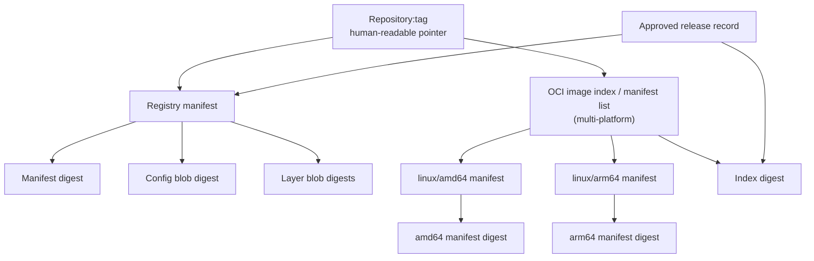

# Unit 5 — Image Tagging, Versioning, and Immutability

**Target file:** `05-image-tagging-versioning-and-immutability.md` | **Estimated time:** 6–8 hours | **Prerequisites:** Docker basics, Git, Linux shell, and completion of Units 1–4  
**Core tools:** Docker Engine/CLI, local image operations, optional local `registry:2` / CNCF Distribution, Python 3 | **Awareness:** OCI specifications, `cosign`/Sigstore, SLSA provenance, Kubernetes image references | **Last reviewed:** 2026-10-24 (AI self-audit; live documentation not checked)

> **Environment and evidence note:** This lesson is designed for WSL2 Ubuntu first and native Linux second, with a zero-budget local workflow. Commands and sample outputs are illustrative unless explicitly described as measured. They have not been executed in your environment. Replace every angle-bracket placeholder before use. Do not treat placeholder digests as real references.

## Table of contents

- [5.0 Why this matters in production](#50-why-this-matters-in-production)
- [5.1 Learning objectives](#51-learning-objectives)
- [5.2 Concept map and vocabulary](#52-concept-map-and-vocabulary)
- [5.3 Level 1 — Beginner — Foundations](#53-level-1--beginner--foundations)
- [5.4 Level 2 — Intermediate — Working Practice](#54-level-2--intermediate--working-practice)
- [5.5 Level 3 — Advanced — Production Engineering](#55-level-3--advanced--production-engineering)
- [5.6 Level 4 — Expert — Operating at Scale and Under Failure](#56-level-4--expert--operating-at-scale-and-under-failure)
- [5.7 SRE lens](#57-sre-lens)
- [5.8 Security lens](#58-security-lens)
- [5.9 Production checklist](#59-production-checklist)
- [5.10 Hands-on lab set](#510-hands-on-lab-set)
- [5.11 Self-check questions](#511-self-check-questions)
- [5.12 Evidence artifacts](#512-evidence-artifacts)
- [5.13 Common interview and design-review questions](#513-common-interview-and-design-review-questions)
- [5.14 Sources and verification notes](#514-sources-and-verification-notes)
- [Appendix A — Claim Register](#appendix-a--claim-register)
- [Appendix B — Audit Report](#appendix-b--audit-report)
- [Appendix C — Human Verification Checklist](#appendix-c--human-verification-checklist)
- [Appendix D — Known Limitations and Assumptions](#appendix-d--known-limitations-and-assumptions)
- [Appendix E — Sign-off](#appendix-e--sign-off)

## 5.0 Why this matters in production

A data platform can pass tests in staging and still deploy a different image in production if a mutable tag is reassigned between approval and pull. The result may be a changed Python dependency set, a different native library, or a different inference runtime without a corresponding release decision. Tags are useful names, but a tag name alone does not identify immutable content; a digest identifies a specific content-addressed object. A reliable release process records the approved digest, promotes that same digest through environments, and detects when a tag no longer resolves to the approved object. This unit teaches the controls and evidence needed to make that process auditable.

## 5.1 Learning objectives

By the end of this unit, the learner will be able to:

- **[L1]** Explain the difference between a registry, repository, tag, image ID/config digest, layer digest, manifest digest, and image-index digest.
- **[L1]** Inspect local image metadata and explain what `docker image inspect` does and does not establish.
- **[L2]** Select and justify a tagging scheme using SemVer, Git SHA, build numbers, date tags, environment pointers, and digest references.
- **[L2]** Build a realistic FastAPI data-service image and attach OCI metadata labels without presenting labels as cryptographic proof.
- **[L2]** Demonstrate that several tags can resolve to the same image manifest, and that a mutable tag can later resolve to different content.
- **[L3]** Design a release metadata contract and promote the same approved digest from development to staging to production.
- **[L3]** Distinguish tag immutability, digest pinning, signature verification, SBOM availability, vulnerability assessment, and provenance verification.
- **[L4]** Investigate tag drift, restore a known-good digest, and define ownership, exception expiry, and fleet-level policy enforcement.
- **[L4]** Produce auditable evidence, including an approved release record, drift-check output, rollback record, and post-incident actions.

## 5.2 Concept map and vocabulary

### Glossary

| Term | Precise definition | Common misconception |
|---|---|---|
| Registry | Service/API that stores and distributes image manifests, blobs, and related content. | A registry is not the same thing as a repository or a running container. |
| Repository | A named collection of related image references within a registry namespace. | A repository name does not by itself identify one image version. |
| Tag | A human-readable name associated with a manifest reference in a repository. | A version-looking tag is not inherently immutable. |
| Digest | A content-derived identifier, commonly written as an algorithm and hash such as `sha256:<value>`. | Not every digest refers to the same kind of object. |
| Image config | JSON metadata describing image configuration, runtime defaults, and root filesystem diff IDs. | Docker's local image ID/config digest is not interchangeable with a registry manifest digest. |
| Layer/blob digest | Content digest for a stored blob, often a compressed filesystem layer or config blob. | A layer digest is not the whole image's manifest digest. |
| Image manifest | A document that references an image config and its layer blobs, plus media-type information. | The manifest is not the same object as the config or any one layer. |
| Manifest list / OCI image index | A higher-level document that references platform-specific manifests and their platform descriptors. | An index digest is not necessarily the platform-specific manifest digest. |
| Platform-specific manifest | Manifest selected for a target platform, such as Linux/amd64 or Linux/arm64. | One tag may resolve to an index that selects different manifests on different platforms. |
| Image ID | Docker's local image identifier, generally associated with the image config. | It should not automatically be copied into a deployment field expecting a registry manifest digest. |
| Release candidate | A candidate artifact that may be tested and approved or rejected. | The string `release-candidate` does not create a release process or protection. |
| SemVer | `MAJOR.MINOR.PATCH` versioning with defined compatibility intent and prerelease/build metadata rules. | SemVer is not a cryptographic identity or a guarantee of compatibility. |
| Git SHA tag | A tag containing a source commit identifier. | It does not prove the image was built from that commit unless the build and provenance chain are trusted. |
| Digest pinning | Referencing the image by a specific manifest or index digest. | It identifies content but does not authenticate who published it or establish that it is safe. |
| Immutability policy | A control that prevents or rejects reassignment of a protected tag according to defined scope and rules. | Naming a tag `v1.2.3` is not enforcement. |
| OCI image label/annotation | Metadata fields attached to image config or manifests/indexes, depending on mechanism. | Metadata is not automatically signed or trustworthy. |
| SBOM | Inventory of software components and relationships represented by a particular artifact. | An SBOM does not prove the image has no vulnerabilities. |
| Provenance | Attestation describing how an artifact was built, such as source, builder, and build process claims. | Provenance is only as trustworthy as the attestation and its verification/root of trust. |
| Signature | Cryptographic evidence binding a signer identity/key to a signed object or digest, subject to verification policy. | A valid signature does not prove an artifact is benign. |
| Tag drift | Difference between the digest a tag currently resolves to and the digest approved in a release record. | Drift detection alone does not reveal whether the cause was malicious, accidental, or an approved update. |
| Promotion record | Auditable record that an already-built and tested artifact was approved for another environment. | Promotion should not silently rebuild from source and assume the output is identical. |
| Pull policy | Runtime/orchestrator behavior determining when an image is resolved or pulled. | A running container does not spontaneously replace its filesystem when a registry tag moves. |

### Identity map



Interpret the diagram carefully: a single-platform image tag may resolve directly to a manifest; a multi-platform tag may resolve to an index that selects a child manifest for a platform. Digest syntax alone does not tell you which object type it identifies. Keep the object type and platform alongside the digest in your release evidence.

### Release promotion map

```text
source revision
    │
    ▼
build once ──► test + scan + generate SBOM/provenance where available
    │
    ▼
candidate reference ──► resolve and record approved digest
    │
    ▼
development validation ──► staging approval ──► production approval
             same approved digest at each step; no independent rebuild
```

A digest is an artifact identity. Approval records express the organization's decision about that artifact. These are separate things.

## 5.3 Level 1 — Beginner — Foundations

**L1 — Beginner — Foundations:** explain concepts, run basic commands, interpret output.

### 5.3.1 A container image reference, piece by piece

A typical image reference looks like:

```text
registry.example.invalid/team/inference-api:1.4.2
```

- `registry.example.invalid` is a placeholder registry host.
- `team/inference-api` is the repository path.
- `1.4.2` is the tag.
- The hostname uses the reserved `.invalid` domain; it is not a real registry.

A digest reference has a different form:

```text
registry.example.invalid/team/inference-api@sha256:<approved-digest>
```

`<approved-digest>` is a placeholder, **not a valid digest**. Replace it only with a digest obtained from trusted inspection of the artifact you intend to use. The reference `repository@sha256:...` asks the registry/client to address content by digest rather than by a mutable tag. For a real pull, the digest must exist in the target registry and have the correct syntax.

### 5.3.2 Why the distinction matters

A tag is a name that can be updated. If `inference-api:stable` resolves to manifest A at 09:00 and an authorized publisher moves it to manifest B at 09:05, a later pull can retrieve B. A consumer that already created a container from A does not have its root filesystem silently rewritten by the tag update. New container creation, orchestration reconciliation, and pull behavior are separate events; see M03 for Kubernetes details.

A digest is content-addressed. It is useful for recording exactly which manifest or index was approved. Digest pinning still does not tell you whether the artifact was built by your trusted CI system, whether the publisher was authorized, or whether the software has vulnerabilities. Those require separate controls.

### 5.3.3 Image config, manifest, layers, and index

Conceptually:

1. **Layers** contain filesystem changes. Their blob digests identify those blobs.
2. **Image config** includes runtime configuration and root filesystem metadata. Docker's local image ID is generally derived from the config object.
3. **Manifest** references the config and layers. Its digest identifies that manifest document.
4. **Image index / manifest list** references manifests for platforms such as `linux/amd64` and `linux/arm64`. Its digest identifies the index.
5. **Tag** is a name in a repository that resolves to a manifest or index, depending on the artifact and registry.

Do not write a local image ID into a release field labelled `manifest_digest` unless you have explicitly resolved and verified that it is the manifest digest. They are not interchangeable.

### 5.3.4 Inspect a local image

First check that Docker is available:

```bash
docker version
docker info
```

Illustrative output excerpt:

```text
Client: Docker Engine - Community
 Version: <installed-version>
Server: Docker Engine - Community
 Version: <installed-version>
```

This output confirms that a client/server connection is available. It does not confirm the registry state of any particular tag. If `docker info` fails, start or connect to your Docker Engine before continuing. In WSL2, Docker Desktop integration and native Docker Engine setups differ; use the setup supported by your machine.

List local images:

```bash
docker image ls
```

Illustrative output:

```text
REPOSITORY          TAG       IMAGE ID       CREATED        SIZE
python              3.12-slim <local-id>     <time>         <size>
```

`IMAGE ID` is a local image identifier associated with the config, not a promise that the registry manifest digest has been shown. The list only describes images known to the local daemon.

Inspect a named local image:

```bash
docker image inspect python:3.12-slim
```

Illustrative JSON excerpt:

```json
[
  {
    "Id": "sha256:<local-config-id>",
    "RepoTags": ["python:3.12-slim"],
    "RepoDigests": ["python@sha256:<repository-manifest-digest>"],
    "Os": "linux",
    "Architecture": "amd64",
    "Config": {
      "Labels": null
    }
  }
]
```

This is a schematic example. Actual fields can be absent, null, or different depending on how the image was obtained and the Docker version. `RepoDigests` may be empty for an image that has only been built locally and not associated with a registry digest. Inspect output is evidence of the daemon's local metadata, not a signature or independent authenticity check.

### 5.3.5 Tag a local image

The following uses an image you already have locally. If `python:3.12-slim` is absent, pull it first or replace it with an existing image.

```bash
docker image tag python:3.12-slim demo-base:learning
docker image ls demo-base
docker image inspect demo-base:learning --format '{{.Id}} {{json .RepoTags}}'
```

Illustrative output:

```text
sha256:<local-config-id> ["demo-base:learning"]
```

The new tag is another local name for the image; it does not rebuild the image. Local image tags are useful for learning and local-only labs, but they do not demonstrate a remote registry's tag policy.

### 5.3.6 Basic command guide

| Command | What it does | What it does not prove |
|---|---|---|
| `docker image ls` | Lists local image records and tags. | Does not show authoritative remote tag state. |
| `docker image inspect REF` | Prints local daemon metadata for an image reference or ID. | Does not cryptographically authenticate the publisher. |
| `docker image tag SOURCE TARGET` | Creates another local tag reference to an image. | Does not create a distinct build or enforce immutability. |
| `docker image push REF` | Pushes an image reference to a registry, subject to authentication and registry behavior. | Does not guarantee a tag is immutable or that the registry accepted your intended policy. |
| `docker image pull REF` | Pulls/resolves an image reference from a registry. | A tag pull does not guarantee the tag will resolve identically later. |
| `docker buildx imagetools inspect REF` | Inspects registry-side image manifest/index information using Buildx. | It is not a signature or vulnerability verification command. |

`docker buildx imagetools inspect` requires a compatible Buildx installation and a reference it can inspect. **[VERIFY: version-sensitive]** Check the Docker Buildx command reference and `docker buildx version` on your machine before relying on output fields.

### 5.3.7 Guided L1 lab — observe local identity

Prerequisites: Docker Engine, network access only if the chosen base image must be pulled, and enough disk for the base image. No registry account is needed.

```bash
set -euo pipefail
docker pull python:3.12-slim
docker image tag python:3.12-slim demo-base:learning
docker image ls demo-base
docker image inspect demo-base:learning --format 'local_id={{.Id}} tags={{json .RepoTags}}'
```

Illustrative output:

```text
REPOSITORY   TAG       IMAGE ID
demo-base    learning  <local-id>
local_id=sha256:<local-config-id> tags=["demo-base:learning"]
```

What just happened?

- The pull obtained a base image from its configured registry.
- The tag command created another local reference.
- The local ID is not automatically the registry manifest digest.
- No release approval, signature verification, or immutability policy was created.

Beginner mistakes and fixes:

- **Mistake:** assuming `:1.2.3` cannot move. **Fix:** treat all tags as mutable unless policy enforcement and its scope are verified.
- **Mistake:** confusing `IMAGE ID` with `RepoDigests`. **Fix:** record the identity type in the field name and release record.
- **Mistake:** assuming changing a tag updates a running container. **Fix:** distinguish registry resolution, image pull, and container creation.
- **Mistake:** treating a Git SHA tag as proof of source provenance. **Fix:** require trusted build metadata and verifiable provenance where supported.

## 5.4 Level 2 — Intermediate — Working Practice

**L2 — Intermediate — Working Practice:** implement safe tagging and versioning for a realistic data service.

### 5.4.1 Tag strategy catalogue

| Pattern | Example | When to use | When not to use |
|---|---|---|---|
| SemVer | `v1.4.2` | Human-facing releases with compatibility intent and changelog discipline. | As the only deployment identity or as proof of immutability. |
| Git SHA | `git-a1b2c3d4` | Traceable build candidate tied to a source revision. | As proof that the artifact truly came from that revision without trusted CI/provenance. |
| CI build number | `build-1842` | Ordering and traceability inside one CI system. | As a portable version across multiple CI systems unless namespace and uniqueness are defined. |
| Date-based | `2026.10.24` or `20261024.3` | Scheduled data platform releases or daily snapshots with defined timezone/uniqueness. | When multiple builds can occur on the same date and no sequence/commit suffix exists. |
| Environment pointer | `staging`, `production`, `stable` | Discovery, convenience, and controlled promotion pointers. | As the sole production pin or when consumers need repeatable resolution. |
| Release candidate | `rc-<build-number>` | Candidate validation before approval. | As a permanent approved release label without a policy transition. |
| Digest reference | `repo@sha256:<digest>` | Deployment, promotion, rollback, and audit identity. | As a replacement for publisher authentication, vulnerability checks, or provenance verification. |

**Recommended convention for the running example**

For a FastAPI inference service:

- Human release tag: `v<version>` (for example, `v1.4.2` is an illustrative version label, not a claim about a published image).
- Source traceability tag: `git-<full-or-policy-defined-short-sha>`.
- CI uniqueness tag: `build-<CI-run-id>`.
- Candidate tag: `rc-<CI-run-id>`.
- Environment pointer: `staging` or `production` only as a convenience pointer, never the sole approved deployment identity.
- Deployment identity: `<registry>/<namespace>/inference-api@sha256:<approved-digest>`.

A tag policy must define allowed syntax, uniqueness, retention, mutation rights, whether abbreviated Git SHAs are allowed, and what event can update environment pointers. A tag's text is not enforcement.

### 5.4.2 A realistic data-service image

Create a working directory:

```bash
mkdir -p image-release-lab/app image-release-lab/evidence
cd image-release-lab
```

Create `app/main.py`:

```python
# app/main.py
from fastapi import FastAPI

app = FastAPI(title="Inference API", version="1.0.0")

@app.get("/health")
def health():
    return {"status": "ok"}

@app.post("/score")
def score(payload: dict):
    # Demonstration endpoint only; replace with validated production schema.
    value = payload.get("value", 0)
    return {"score": float(value) * 0.5, "model_version": "demo-model-1"}
```

Create `requirements.txt`:

```text
fastapi
uvicorn[standard]
```

For a production service, pin and lock dependencies, review transitive dependencies, and build with a controlled base-image digest. These unpinned requirements are intentionally minimal for the lesson and are not a production dependency-locking pattern.

Create `Dockerfile`:

```dockerfile
# Dockerfile
FROM python:3.12-slim

ARG VCS_REF=unknown
ARG VERSION=0.0.0-dev
ARG BUILD_DATE=unknown
ARG SOURCE_URL=unknown

LABEL org.opencontainers.image.title="Inference API" \
      org.opencontainers.image.description="Demo data-platform inference API" \
      org.opencontainers.image.version="${VERSION}" \
      org.opencontainers.image.revision="${VCS_REF}" \
      org.opencontainers.image.created="${BUILD_DATE}" \
      org.opencontainers.image.source="${SOURCE_URL}"

WORKDIR /app
COPY requirements.txt .
RUN pip install --no-cache-dir -r requirements.txt
COPY app/ ./app/

EXPOSE 8000
CMD ["uvicorn", "main:app", "--app-dir", "/app/app", "--host", "0.0.0.0", "--port", "8000"]
```

Labels use the `org.opencontainers.image.*` vocabulary where appropriate. The `created` label should follow a declared timestamp policy (for example, UTC RFC 3339 build time) and should not be represented as reproducible if it intentionally changes every build. `unknown` placeholders are explicit fallbacks, not acceptable release metadata for a production approval gate. Labels are informational metadata inside the image configuration; they do not prove that the revision or source URL is true.

Build with supplied metadata:

```bash
GIT_SHA="$(git rev-parse HEAD 2>/dev/null || printf 'local-uncommitted')"
VERSION="0.1.0-dev"
BUILD_DATE="$(date -u +'%Y-%m-%dT%H:%M:%SZ')"
SOURCE_URL="https://example.invalid/team/inference-api"

docker build \
  --build-arg VCS_REF="$GIT_SHA" \
  --build-arg VERSION="$VERSION" \
  --build-arg BUILD_DATE="$BUILD_DATE" \
  --build-arg SOURCE_URL="$SOURCE_URL" \
  -t inference-api:"$VERSION" \
  -t inference-api:git-"$GIT_SHA" \
  -t inference-api:release-candidate \
  .
```

The source URL is a reserved placeholder. Replace it with the actual repository URL when known. If the directory is not a Git repository, `GIT_SHA` will be `local-uncommitted`; do not approve that as a production source revision.

Illustrative output:

```text
[+] Building ... FINISHED
 => naming to docker.io/library/inference-api:0.1.0-dev
 => naming to docker.io/library/inference-api:git-<source-revision>
 => naming to docker.io/library/inference-api:release-candidate
```

The exact BuildKit progress display differs by builder/version. The example indicates intent only; it is not measured output.

Inspect the labels and local image identity:

```bash
docker image inspect inference-api:0.1.0-dev \
  --format 'id={{.Id}} tags={{json .RepoTags}} labels={{json .Config.Labels}}'
```

Illustrative output:

```text
id=sha256:<local-config-id> tags=["inference-api:0.1.0-dev","inference-api:git-<source-revision>","inference-api:release-candidate"] labels={"org.opencontainers.image.revision":"<source-revision>","org.opencontainers.image.version":"0.1.0-dev",...}
```

The labels and tags can be useful for traceability. They are not proof that the build pipeline was trusted, and local inspection does not show a remote registry's authoritative mapping.

Run the service locally:

```bash
docker run --rm --name inference-api-lab -p 127.0.0.1:8000:8000 inference-api:0.1.0-dev
```

In a second terminal:

```bash
curl --fail http://127.0.0.1:8000/health
curl --fail -X POST http://127.0.0.1:8000/score \
  -H 'Content-Type: application/json' \
  -d '{"value": 8}'
```

Illustrative responses:

```json
{"status":"ok"}
```

```json
{"score":4.0,"model_version":"demo-model-1"}
```

Stop the foreground container with `Ctrl+C`; it uses `--rm`. This is a local demonstration, not a production API hardening guide. Request validation, authentication, observability, dependency locking, non-root execution, and runtime resource limits are deferred to adjacent modules.

### 5.4.3 Multiple tags may refer to one artifact

Tags are names, not separate builds. Inspect the local image ID for each tag:

```bash
for ref in inference-api:0.1.0-dev inference-api:release-candidate; do
  docker image inspect "$ref" --format '{{.RepoTags}} {{.Id}}'
done
```

Illustrative output:

```text
[inference-api:0.1.0-dev ...] sha256:<same-local-config-id>
[inference-api:release-candidate ...] sha256:<same-local-config-id>
```

Equal local image IDs are useful evidence that both tags refer to the same local config/image record. They do not independently prove that remote registry references resolve to the same manifest digest. For registry-side identity, inspect the pushed references and record their manifest or index digest using supported tooling.

### 5.4.4 Safe push/pull flow (optional local registry)

The primary labs can remain local-only. To observe registry behavior without a hosted account, you may run a local Distribution registry. This consumes disk and binds a local port; do not expose it to an untrusted network.

Start the registry:

```bash
docker run -d --name unit5-registry \
  -p 127.0.0.1:5000:5000 \
  --restart=no \
  registry:2
```

Illustrative output:

```text
<container-id>
```

The exact image tag `registry:2` is used as requested by the lesson specification, but registry version and configuration must be verified before relying on any policy behavior. This default local instance is for a lab, not hardened production.

Tag and push:

```bash
docker image tag inference-api:0.1.0-dev localhost:5000/lab/inference-api:rc-1
docker image push localhost:5000/lab/inference-api:rc-1
```

Illustrative output:

```text
The push refers to repository [localhost:5000/lab/inference-api]
...
rc-1: digest: sha256:<manifest-digest> size: <size>
```

Use the actual digest printed by your push as evidence; do not copy the placeholder. Registry and client output formats can differ. Then inspect the local record:

```bash
docker image inspect localhost:5000/lab/inference-api:rc-1
```

This inspects local daemon metadata. For registry-side manifest/index detail, use a supported registry API client or `docker buildx imagetools inspect localhost:5000/lab/inference-api:rc-1` where the installed Buildx and local registry configuration support it. **[VERIFY: Buildx/registry compatibility and output fields]**. Avoid assuming `RepoDigests` is populated identically across all local workflows.

### 5.4.5 Pattern and anti-pattern catalogues

| Pattern | When to use | When not to use |
|---|---|---|
| `v1.4.2` plus digest-pinned deployment | Human release version plus exact deployment identity. | Never treat the version tag alone as immutable. |
| `git-<sha>` plus build record | Trace source revision and connect it to CI evidence. | If the SHA is truncated ambiguously or build provenance is absent. |
| `build-<run-id>` | Correlate artifact with a CI execution. | If build IDs are not unique across projects or tenants. |
| `production` pointer updated after approval | Human discovery or deployment convenience. | If production workloads are configured to rely on a mutable pointer without a controlled resolution policy. |
| Record digest immediately after push and approval | Promotion and rollback audit trail. | If the recorded digest is taken from an untrusted or ambiguous source. |

| Bad example | Risk | Corrected version |
|---|---|---|
| Deploy `inference-api:latest` with no release record. | Different nodes or later pulls may resolve different content over time. | Deploy `inference-api@sha256:<approved-digest>` and retain a release record. |
| Assume `v1.4.2` cannot be overwritten. | Tag may be reassigned unless registry policy prevents it. | Enforce registry-side immutable-tag rules and verify their scope. |
| Rebuild staging and production independently. | Build timestamps, dependencies, build environment, or nondeterminism may change the digest. | Build once; test and promote the same approved digest. |
| Use image config ID as `manifest_digest`. | Identity type mismatch breaks comparisons and auditability. | Store `local_config_id`, `manifest_digest`, and `index_digest` as separate typed fields. |
| Put tokens or passwords in image labels/build args. | Secrets may be persisted in image metadata/history or logs. | Use the dedicated secrets mechanism in M09; labels must contain non-secret metadata only. |
| Treat `org.opencontainers.image.revision` as proof of origin. | A builder can write any label value. | Verify trusted provenance/signature and CI identity under policy. |

### 5.4.6 Release metadata contract

Every approved release should have a machine-readable record. Example `evidence/release-record.json`:

```json
{
  "schema_version": 1,
  "service": "inference-api",
  "version": "<version>",
  "source_revision": "<git-sha>",
  "source_url": "<source-url>",
  "build_timestamp_utc": "<RFC3339-UTC-timestamp-or-policy-defined-value>",
  "image_reference": "<registry>/<namespace>/inference-api@sha256:<approved-digest>",
  "identity_type": "manifest-or-index",
  "platforms": ["linux/amd64"],
  "sbom_reference": "<SBOM-artifact-reference-or-null>",
  "provenance_reference": "<provenance-artifact-reference-or-null>",
  "changelog_reference": "<changelog-reference-or-null>",
  "approval": {
    "status": "pending",
    "approved_by": null,
    "approved_at_utc": null,
    "change_ticket": null
  }
}
```

Every angle-bracket value is a placeholder. `identity_type` must be set to the actual object type. For a multi-platform image, record the index digest and platform set; if a workload is pinned to a child manifest, record that platform-specific digest and platform explicitly. Do not silently mix them.

A production contract should define:

- Required fields and schema version.
- Source revision format and how it is bound to the build.
- Build timestamp format and policy (wall-clock time versus reproducible-build constraints).
- Canonical source URL and changelog location where available.
- Digest object type and platform semantics.
- SBOM and provenance locations, formats, producer identity, and verification status.
- Approval identity, timestamp, change/ticket reference, and environment promotion history.
- Missing-field behavior: fail closed for required fields; do not invent a value to make validation pass.

## 5.5 Level 3 — Advanced — Production Engineering

**L3 — Advanced — Production Engineering:** design immutability, digest-based promotion, metadata contracts, and verification controls.

### 5.5.1 Immutability is a policy, not a string convention

A tag is immutable only to the extent that a registry-side control prevents its reassignment under the relevant permissions and operations. The exact policy semantics vary by registry product, edition, configuration, and API. **[VERIFY: provider-specific]** Verify which repositories or tag patterns are protected, who can bypass protection, whether deletion/recreation is possible, and how the policy behaves for replication, retention, and administrative operations.

Separate the controls:

| Control | Benefit | Cost | Risk | Choose when |
|---|---|---|---|---|
| Naming convention (`v1.2.3`) | Readable and consistent. | Requires governance and tooling. | No enforcement by itself. | Always, as a human-facing layer. |
| Registry-side immutable-tag rule | Blocks configured tag reassignment. | Product-specific setup and exception handling. | Mis-scoped policy or privileged bypass may undermine it. | Protected release tags in shared registries. |
| Digest-pinned deployment | Exact content reference for the selected manifest/index. | Longer references and update workflow. | Does not authenticate publisher or establish safety. | Production and reproducible rollback. |
| Signature verification | Can bind an approved signer identity to a digest. | Keyless/key management and policy complexity. | Weak identity policy or bypass makes verification ineffective. | High-assurance supply-chain workflows. |
| SBOM + vulnerability assessment | Component inventory and risk signal. | Generation, storage, triage, refresh, and exception overhead. | SBOM completeness and scanner coverage are limited. | Every release under a defined risk policy. |
| Provenance verification | Evidence about build inputs/process/identity. | Requires trusted builder, attestations, and policy. | A signed but untrusted builder can attest to undesirable work. | Production release admission and audits. |

Registry authorization and tag immutability are not the same control. Authorization decides who may perform operations; immutability decides whether a particular class of update is rejected even for otherwise authorized operations. The exact interaction is registry-specific.

### 5.5.2 Promote the same digest

**Preferred flow:**

1. Build the candidate once in the controlled build pipeline.
2. Test the exact artifact, not a rebuild that merely uses the same source commit.
3. Generate and retain SBOM/provenance artifacts when available.
4. Resolve the pushed candidate to a manifest digest or image-index digest.
5. Create an approval record that binds the artifact digest to test results, policy decisions, and approver.
6. Promote that same digest to staging and production. If the registry workflow requires another repository, copy the artifact without rebuilding and verify the destination digest according to the registry/client semantics.
7. Record each environment transition, approver, timestamp, and change ticket.
8. Deploy by digest and verify the deployed reference.

A release record might include:

```json
{
  "release_id": "<release-id>",
  "service": "inference-api",
  "source_revision": "<git-sha>",
  "candidate_reference": "<registry>/<namespace>/inference-api:rc-<build-id>",
  "approved_reference": "<registry>/<namespace>/inference-api@sha256:<approved-digest>",
  "approved_identity_type": "index",
  "test_evidence": ["<test-report-reference>"],
  "sbom_reference": "<sbom-reference>",
  "provenance_reference": "<provenance-reference>",
  "promotions": [
    {"environment": "development", "digest": "sha256:<approved-digest>", "status": "validated"},
    {"environment": "staging", "digest": "sha256:<approved-digest>", "status": "approved"},
    {"environment": "production", "digest": "sha256:<approved-digest>", "status": "approved"}
  ]
}
```

This is a schema illustration. It intentionally uses placeholders; all three environment entries must contain the same actual digest value if the same artifact is promoted. A digest match proves artifact identity at the recorded object level, not that all environments have equivalent configuration, secrets, data, or runtime behavior.

Why not rebuild? Unit 3, [03-reproducible-and-deterministic-image-builds.md](03-reproducible-and-deterministic-image-builds.md), explains that same source does not automatically imply the same image digest. Timestamps, dependency resolution, build arguments, base image movement, toolchain changes, and nondeterministic steps can change the output. Digest promotion avoids asking a second build to recreate the tested artifact.

### 5.5.3 Multi-platform correctness

For a multi-platform image, the tag may resolve to an OCI image index (or Docker manifest list) whose descriptors select platform-specific manifests. The index digest and child manifest digests are different identities. The correct identity to pin depends on whether the deployment should preserve a multi-platform selection behavior or intentionally target one platform.

Inspect a remote image reference where supported:

```bash
docker buildx imagetools inspect <registry>/<namespace>/inference-api:<tag>
```

Illustrative output:

```text
Name:      <registry>/<namespace>/inference-api:<tag>
MediaType: application/vnd.oci.image.index.v1+json
Digest:    sha256:<index-digest>
Manifests:
  Name:    <registry>/<namespace>/inference-api@sha256:<amd64-manifest-digest>
  Platform: linux/amd64
  Name:    <registry>/<namespace>/inference-api@sha256:<arm64-manifest-digest>
  Platform: linux/arm64
```

Output shape and supported media types are version-sensitive. **[VERIFY: Docker Buildx `imagetools inspect` reference and OCI Image Specification image index section]**. The shown digests are placeholders, not actual published content. Confirm platform descriptors and object type before comparing approval records.

Common failure: one pipeline records an index digest while a runtime or verifier reports a child manifest digest. A naïve string comparison reports drift even though the child is referenced by the approved index. The policy must compare like with like or explicitly verify the parent-child relationship for the requested platform.

### 5.5.4 OCI labels, SBOM, provenance, signatures, and referrers

These artifacts answer different questions:

- **OCI labels:** What metadata does the image config declare? Labels can be self-asserted.
- **SBOM:** Which components does the SBOM producer report? Completeness and accuracy depend on the generator, inputs, and format.
- **Vulnerability report:** What findings did a particular scanner/database and policy identify at a point in time? Findings can change as databases change.
- **Provenance attestation:** What does the attestation claim about the build process, source, builder, and inputs? Verification must establish that the attestation is authentic and its builder is trusted.
- **Signature:** Does cryptographic verification succeed for the expected identity and artifact digest under the chosen trust policy? A valid signature is not a safety verdict.
- **OCI referrers/artifacts:** OCI mechanisms can associate related artifacts such as signatures, SBOMs, or attestations with an image. Registry support and discoverability differ. **[VERIFY: OCI Distribution Specification and registry support]**

`cosign`/Sigstore and SLSA are awareness-level in this unit. Optional local experimentation is acceptable, but no lab depends on a hosted identity provider, public transparency service, or paid service. Do not claim a signature or SBOM exists merely because a release record has a field for it.

### 5.5.5 Kubernetes boundary: reference and pull policy

This unit teaches how to record and verify image identity before deployment. It does not teach the full Kubernetes image-resolution lifecycle. Kubernetes has documented rules for image references and `imagePullPolicy`; the policy value and the image reference affect when the node attempts to pull an image. A running container does not have its filesystem rewritten just because a registry tag moves. New pod creation or replacement may resolve a mutable tag differently, depending on the configured reference, pull policy, cache state, and runtime behavior.

Forward reference: M03 covers Kubernetes image references, `imagePullPolicy`, rollout behavior, and admission controls. **[VERIFY: Kubernetes documentation, “Images” and `imagePullPolicy`]** before writing organization-specific guarantees.

### 5.5.6 Automated checks and policy boundaries

A release gate should reject disallowed references and missing evidence. A useful policy may require:

- Production image references use `@sha256:` with a digest of the expected type.
- Tags follow an allow-list and release tags are protected by registry policy.
- Release record source revision, version, build timestamp policy, source URL, digest type, and approval are present.
- SBOM and provenance references are present when policy requires them; their verification status is explicit.
- Signatures are verified against approved identities when required.
- Vulnerability policy is evaluated separately from signature/provenance policy.
- Exceptions include owner, rationale, compensating control, approval, expiry, and automatic expiry enforcement.

Digest pinning, signature verification, vulnerability policy, and provenance checks solve different problems. One must not be used as a substitute for the others.

### 5.5.7 Worked promotion decision

**Decision:** promote `inference-api` by digest, with tags retained for discovery.

- Candidate: `<registry>/<namespace>/inference-api:rc-<build-id>`.
- Tested identity: `sha256:<approved-digest>` (replace with actual verified digest).
- Staging reference: `<registry>/<namespace>/inference-api@sha256:<approved-digest>`.
- Production reference: `<registry>/<namespace>/inference-api@sha256:<approved-digest>`.
- Release record: source revision, version, UTC build timestamp policy, source URL, digest object type/platforms, tests, SBOM/provenance references, approver, change ticket, and promotion history.
- Rollback target: previous known-good digest plus compatibility decision.

**Rejected alternative:** rebuild the same Git revision separately for staging and production. It is rejected because matching source revisions do not guarantee matching artifacts. If rebuilding is unavoidable, treat the output as a new candidate and repeat validation and approval.

### 5.5.8 L3 lab — defend a release identity

1. Build the FastAPI image from §5.4.2 and record its local config ID.
2. If a local registry is available, push the candidate and record the actual registry-reported digest. Otherwise, save the local image ID and explicitly mark registry manifest identity as unavailable.
3. Fill a release record with actual values only where measured; use `null` for unavailable optional artifacts and a documented status for unverified fields.
4. Write staging and production promotion entries that use the same approved digest.
5. In a short design note, explain whether the digest represents an index or platform-specific manifest and why.
6. Explain why labels, a Git SHA tag, an SBOM file, and a digest do not individually establish all of authenticity, provenance, and safety.

Expected evidence: `evidence/release-record.json`, `evidence/identity-inspection.txt`, and `evidence/promotion-decision.md`. Do not mark a release approved while required identity fields remain placeholders.

## 5.6 Level 4 — Expert — Operating at Scale and Under Failure

**L4 — Expert — Operating at Scale and Under Failure:** diagnose tag drift, roll back safely, define fleet-wide policy, and automate enforcement.

### 5.6.1 Tag-moved incident scenario

**Symptom → hypothesis → test → root cause → mitigation → prevention**

- **Symptom:** a new deployment behaves differently although the deployment manifest text did not change.
- **Hypothesis:** the environment uses a mutable tag, and the tag's remote mapping changed.
- **Test:** retrieve the current tag identity, compare it with the approved release record, inspect deployment events and pull logs, and confirm whether the reported digest is an index or child manifest.
- **Root cause:** for example, a release automation account updated `production` before the approval step completed. This is a hypothetical scenario, not a claim about an actual incident.
- **Mitigation:** stop further rollout; pin or restore the known-good digest using the approved release record; verify compatibility and health; preserve logs, tag mapping evidence, and audit events.
- **Prevention:** enforce protected tags, use digest references, require promotion approval, separate publisher and approver roles, alert on drift, and test exception expiry.

Never rebuild during an incident merely because the original tag moved. First locate and verify the known-good artifact. If it cannot be retrieved, treat recovery as an artifact-availability incident and follow M13 backup/disaster-recovery procedures.

### 5.6.2 Drift detection

Drift detection compares an **approved release record** with the currently resolved identity of a tag. It must fail closed when evidence is missing, malformed, or ambiguous. A local-only test can demonstrate the logic using image IDs, but that is not a substitute for checking registry manifest digests in production.

#### Local tag-drift detector

Save as `scripts/check_local_tag_drift.py`:

```python
#!/usr/bin/env python3
"""Compare a local Docker tag's image ID with an approved local-image record.

This script intentionally checks Docker's local image ID/config identity.
It does NOT resolve a remote registry manifest digest and must not be used
as a production registry-drift detector without replacing the resolver.
"""
import json
import subprocess
import sys
from pathlib import Path

def fail(message: str, code: int = 2) -> int:
    print(f"ERROR: {message}", file=sys.stderr)
    return code

def docker_image_id(ref: str) -> str:
    if not ref or ref.startswith("-") or "\n" in ref:
        raise ValueError("invalid image reference")
    result = subprocess.run(
        ["docker", "image", "inspect", ref, "--format", "{{.Id}}"],
        check=False, capture_output=True, text=True, timeout=20
    )
    if result.returncode != 0:
        raise RuntimeError(result.stderr.strip() or "docker inspect failed")
    value = result.stdout.strip()
    if not value.startswith("sha256:") or len(value) <= len("sha256:"):
        raise ValueError("unparseable Docker local image ID")
    return value

def main() -> int:
    if len(sys.argv) != 3:
        return fail("usage: check_local_tag_drift.py RELEASE_RECORD.json IMAGE_TAG")
    record_path = Path(sys.argv[1])
    ref = sys.argv[2]
    try:
        record = json.loads(record_path.read_text(encoding="utf-8"))
        expected = record["approved_local_image_id"]
        identity_type = record["identity_type"]
        if identity_type != "docker-local-image-id":
            return fail("record identity_type must be docker-local-image-id for this local-only checker")
        if not isinstance(expected, str) or not expected.startswith("sha256:") or len(expected) <= 7:
            return fail("approved_local_image_id missing or malformed")
        actual = docker_image_id(ref)
    except FileNotFoundError:
        return fail(f"release record not found: {record_path}")
    except (json.JSONDecodeError, KeyError, TypeError, ValueError) as exc:
        return fail(f"invalid release record/input: {exc}")
    except (RuntimeError, subprocess.TimeoutExpired) as exc:
        return fail(f"cannot resolve image tag; failing closed: {exc}")
    if actual != expected:
        print(f"DRIFT: ref={ref} expected={expected} actual={actual}")
        return 1
    print(f"OK: ref={ref} identity={actual} matches approved local image ID")
    return 0

if __name__ == "__main__":
    raise SystemExit(main())
```

The script uses Python's argument list rather than a shell command string, validates the record, uses a timeout, and exits non-zero for missing evidence or drift. It is deliberately labelled **local-only**: Docker's local image ID is a config identity, not a registry manifest digest. A production implementation must resolve the remote tag through an approved registry/API client, capture the manifest/index digest and media type, and compare like object types. Registry API authentication, TLS, retries, pagination, and error semantics must be implemented and tested under Unit 6's boundary.

Example approved local record `evidence/approved-local-image.json`:

```json
{
  "schema_version": 1,
  "identity_type": "docker-local-image-id",
  "approved_local_image_id": "sha256:<replace-with-actual-local-image-id>",
  "service": "inference-api",
  "approved_by": "<reviewer>",
  "approval_reference": "<change-ticket>"
}
```

Do not run the detector with the placeholder. After the image is built, copy the actual `docker image inspect ... --format '{{.Id}}'` result into the record.

#### Demonstrate a mismatch

The full mutation workflow appears in Lab U5-LAB-02. Once the tag is moved to a different local image, the detector should print a `DRIFT` line and exit `1`. If the tag cannot be inspected or the record is malformed, it should print `ERROR` and exit `2`. A successful comparison exits `0`.

Example output is illustrative:

```text
DRIFT: ref=inference-api:release-candidate expected=sha256:<approved-local-id> actual=sha256:<different-local-id>
exit_code=1
```

Remediation: restore the tag only if the record and target image are trusted; otherwise, deploy the approved image by its known identity, revalidate availability and compatibility, and investigate why the tag changed. Do not simply update the approved record to match the unexpected image.

### 5.6.3 Fleet-wide image versioning

A fleet can include a FastAPI inference API, pandas/pyarrow batch ETL, Airflow-style workers, PySpark jobs, and shared runtime/base images. Define policy at both the shared-base and service-image layers:

- **Compatibility contract:** document supported Python/runtime versions, native libraries, data formats, API contracts, and worker protocol compatibility.
- **Coordinated upgrade:** test a new base image against downstream images and representative jobs before broad rollout.
- **Deprecation:** publish a sunset date, owner, affected consumers, migration path, and exception route.
- **Emergency patch:** build a new artifact from the patched base/dependency set, scan and test it, issue a new release record, and promote by digest.
- **Fleet inventory:** track service, owner, environment, deployed digest, source revision, base image, platform, SBOM/provenance state, and support/deprecation status.
- **Drift policy:** alert when deployed identity differs from approved identity; separate a legitimate rollout from unexplained mutation.
- **Rollback compatibility:** verify that the previous image is compatible with current schemas, event formats, model artifacts, and data migrations. A valid old digest can still be an unsafe rollback.

Shared base image updates are not a reason to silently mutate a service tag. Build a new downstream artifact, validate it, and promote it through the same gate.

### 5.6.4 CI and registry policy sketch

A CI check should validate deployment references and release records before promotion. The following Python example checks a deployment-reference string, not a complete manifest or registry policy. Production should parse YAML with a maintained parser, inspect every relevant workload/template path, and verify signatures/provenance separately.

```python
#!/usr/bin/env python3
# scripts/check_deployment_reference.py
import re
import sys

DIGEST_REF = re.compile(r"^[^\s@]+@sha256:[0-9a-f]{64}$")

def main() -> int:
    if len(sys.argv) != 2:
        print("usage: check_deployment_reference.py IMAGE_REFERENCE", file=sys.stderr)
        return 2
    ref = sys.argv[1]
    if not DIGEST_REF.fullmatch(ref):
        print("REJECT: production reference must be repository@sha256:<64-hex-digest>")
        return 1
    print("PASS: reference syntax is digest-pinned")
    return 0

if __name__ == "__main__":
    raise SystemExit(main())
```

This syntactic check cannot establish that the digest exists, is an image manifest/index, is approved, is signed, has acceptable vulnerabilities, or came from trusted provenance. It is only one gate. A real pipeline must resolve the reference and apply policy to evidence.

Illustrative results:

```text
$ python scripts/check_deployment_reference.py registry.invalid/team/api:production
REJECT: production reference must be repository@sha256:<64-hex-digest>
$ python scripts/check_deployment_reference.py registry.invalid/team/api@sha256:<placeholder>
REJECT: production reference must be repository@sha256:<64-hex-digest>
```

The second line is rejected because the placeholder is not a 64-character hexadecimal digest. A real test must use a syntactically valid test digest string or the actual digest from a controlled local registry.

**Registry-side policy sketch — not portable configuration:**

```yaml
# policy-sketch.yaml — illustrative policy, not a registry's executable config
release_tag_policy:
  protected_patterns:
    - "v*"
    - "production"
  allow_reassignment: false
  allow_delete_and_recreate: false
  permitted_writers:
    - "release-publisher-service-account"
  bypass:
    requires_approval: true
    requires_ticket: true
    exception_expiry_required: true
    audit_event_required: true
```

This is a conceptual policy sketch, not a valid config for Docker Distribution or any named hosted registry. **[VERIFY: registry-specific implementation]** Map each field to the chosen registry's actual settings/API. If a feature is not supported, document a compensating control (for example, separate release repository permissions plus a CI gate) and its residual risk.

### 5.6.5 Exception and ownership process

Every exception should include:

- A named service owner and approving security/platform owner.
- Affected repository, tag pattern, environment, and reason.
- Risk assessment and compensating controls.
- Exact start and expiry timestamps in UTC.
- A linked ticket/change record and approver identity.
- A scheduled expiry check and an explicit failure action when expired.
- Audit events for creation, approval, use, extension, and closure.

Expired exceptions must fail closed or trigger the team's documented escalation; they must not silently become permanent. Registry administrators should not be the only approvers of their own bypasses for high-risk production releases.

### 5.6.6 Rollback runbook

**Trigger:** failed health checks, regression, incompatible runtime, unexpected tag drift, or a release gate failure.

1. **Stop rollout:** pause the rollout mechanism using the platform-specific procedure; avoid broad destructive commands.
2. **Preserve evidence:** capture current image reference, resolved digest/index/platform, release record, deployment events, tag audit events, and relevant logs.
3. **Select known-good release:** identify the last approved digest from the release record; verify its availability, signature/provenance policy where required, and platform compatibility.
4. **Assess data compatibility:** confirm schema migrations, event formats, model versions, and stateful job side effects are compatible with the rollback target.
5. **Rollback by digest:** update the desired deployment reference to the known-good digest through the approved release process. Do not rebuild during response.
6. **Verify:** check service health, error rate, latency, job completion, and deployed identity.
7. **Communicate:** record incident owner, timeline, affected services, decision, and customer/business impact.
8. **Prevent recurrence:** protect tags, fix promotion policy, add drift alerting, and close corrective actions with owners/dates.

Rollback availability is not rollback correctness. A previous image may no longer be compatible with data or external contracts. For data services, consider idempotency, replay, schema evolution, and partial batch writes before reverting.

### 5.6.7 “Tag moved” incident report template

```markdown
# Tag-Moved Incident Report

- Incident ID:
- Severity:
- Incident commander / owner:
- Start and detection timestamps (UTC):
- Affected services/environments:
- Tag and repository:
- Approved identity type and digest:
- Observed identity type and digest:
- Platform(s):
- User/business impact:

## Timeline
- Detection:
- Triage:
- Containment:
- Rollback or mitigation:
- Recovery verified:

## Evidence
- Release record:
- Registry audit events:
- CI run and publisher identity:
- Signature/provenance verification:
- Deployment events and logs:
- Tag-to-digest observations:

## Analysis
- Symptom:
- Hypothesis:
- Tests:
- Root cause (confirmed vs. suspected):
- Contributing factors:
- Why preventive controls did not stop it:

## Remediation
- Immediate mitigation:
- Permanent corrective actions (owner, due date):
- Exception(s) and expiry:
- Detection improvements:
- Policy/permissions changes:
- Follow-up review date:
```

### 5.6.8 Automated policy ownership

| Control | Accountable owner | Evidence | Failure behavior |
|---|---|---|---|
| Tag naming and release version | Service team | Release metadata and changelog | Reject release if required fields are missing. |
| Registry immutability | Platform/registry owner | Policy config, tests, audit logs | Block protected-tag mutation; alert on bypass or unsupported policy. |
| Digest promotion | Release/platform engineering | Promotion record and resolved identity | Stop promotion on mismatch or missing approval. |
| Signature/provenance verification | Supply-chain/security owner | Verification report and policy version | Fail closed for required verification; time-bound exception only. |
| SBOM/vulnerability policy | Security + service owner | SBOM reference, scan report, decision record | Reject or exception with expiry based on defined severity policy. |
| Rollback readiness | Service owner + SRE | Known-good digest, compatibility evidence, runbook test | Do not assume rollback safe until data/runtime compatibility is checked. |
| Drift monitoring | SRE/platform team | Drift events, time-to-detect metric | Alert and preserve evidence; do not silently rewrite the approval record. |

## 5.7 SRE lens

### 5.7.1 Indicators and SLO design

Useful indicators include:

- **Digest-pinned production workload ratio:** number of production workload image references pinned to an approved digest divided by total in-scope production references.
- **Tag-drift detection latency:** elapsed time between a tag mapping changing unexpectedly and the first actionable alert.
- **Rollback time:** time from rollback decision to verified healthy service on the known-good digest.
- **Release metadata completeness:** percentage of production releases with all required contract fields and valid artifact references.
- **Promotion identity match rate:** percentage of environment promotions where the observed artifact identity matches the approved identity.
- **Policy bypass count and age:** count of active exceptions, time until expiry, and expired exceptions still in effect.

Do not adopt arbitrary targets without measuring baseline and risk. For example, a team may propose `[ILLUSTRATIVE]` 100% digest pinning for production workloads, but it must define the denominator, exceptions (if any), inventory freshness, and how deployment controllers or generated manifests are counted before committing to an SLO. Set targets from risk appetite, architecture, current baseline, and the cost of undetected drift.

### 5.7.2 Failure modes and blast radius

| Failure mode | Potential blast radius | Detection | Primary control |
|---|---|---|---|
| Shared `production` tag moved | Many services/nodes may pull different artifacts over time. | Tag-to-digest drift alert and audit logs. | Digest pinning and protected tags. |
| Release record has wrong digest | Rollback/promotion may consistently select the wrong artifact. | Independent identity resolution and dual review for high-risk releases. | Trusted pipeline and schema validation. |
| Platform mismatch | Deployment fails or runs an unintended platform variant. | Inspect index descriptors and node platform. | Platform-aware release record and validation. |
| Registry unavailable | New deployments/scale-outs may fail to pull. | Pull error rate and registry availability monitoring. | Registry resilience and artifact retention (Unit 6/7). |
| Old digest garbage-collected | Rollback target cannot be pulled. | Periodic availability probe for approved rollback artifacts. | Retention policy and backup/DR plan (Unit 7/M13). |
| Signature/provenance service or trust root misconfigured | Release verification fails or is bypassed. | Verification failure telemetry and policy audit. | Versioned policy, fail-closed gates, and tested recovery. |
| Rollback incompatible with data schema | Application may fail or corrupt/interpret data incorrectly. | Compatibility tests and post-rollback SLOs. | Expand/contract migrations and rollback rehearsal. |

### 5.7.3 Concise runbook

**Alert:** approved tag/digest mismatch or deployment identity mismatch.

- **Triage:** determine whether the comparison uses the same identity type and platform; inspect release record, registry state, CI/publisher events, and current deployment reference.
- **Mitigation:** halt promotion, pin a verified known-good digest, and confirm artifact availability and data compatibility.
- **Verification:** compare deployed identity to the approval record; watch health, latency, errors, and job success.
- **Follow-up:** preserve evidence, identify the actor/process that moved the tag, fix policy, add regression tests, and assign corrective-action owners.

### 5.7.4 Capacity and cost

Image tags are cheap metadata, but storing every build forever is not. Define retention for unapproved candidates separately from approved releases and rollback artifacts. Keep enough known-good artifacts for the recovery objective; do not let cleanup remove the only approved rollback image. Registry caching, replication, and garbage collection are Unit 6/7 concerns. During this unit, record artifact size, number of retained versions, pull time, and rollback-artifact availability rather than assuming a policy is cost-neutral.

## 5.8 Security lens

### 5.8.1 Threats and controls

| Threat / stage | Example | Control | Residual risk |
|---|---|---|---|
| Source/build | Untrusted source or compromised build runner produces an image. | Protected source branches, isolated CI, trusted builder identity, provenance verification. | A trusted builder can still build vulnerable or malicious source. |
| Publish | Authorized account moves a protected tag unexpectedly. | Least privilege, registry-side immutability, audit events, separated publisher/approver roles. | Admin bypass, misconfiguration, or registry compromise may remain. |
| Resolve/pull | Consumer resolves a mutable tag after it moved. | Digest-pinned references and tag-drift monitoring. | Wrong approved digest or compromised registry still requires other controls. |
| Metadata | False revision/source labels are written into image config. | Compare labels with trusted build record and verify provenance. | Labels alone are self-asserted. |
| Supply-chain artifacts | SBOM missing/incomplete or provenance untrusted. | Validate artifact format, producer, digest binding, policy and scanner freshness. | No SBOM or scanner can guarantee zero vulnerabilities. |
| Deployment | Workload uses a mutable tag or wrong platform identity. | CI/admission policy, platform-aware digest checks, rollout verification. | Misconfigured exceptions or alternate deployment paths can bypass policy. |
| Recovery | Old digest unavailable or incompatible. | Retention, backup/DR, compatibility tests, rollback drills. | External data migrations may not be reversible. |

STRIDE can be applied where useful: **Spoofing** (false publisher identity), **Tampering** (tag reassignment), **Repudiation** (missing audit logs), **Information disclosure** (secrets accidentally placed in labels/logs), **Denial of service** (registry/artifact unavailable), and **Elevation of privilege** (over-broad registry writers/admin bypass).

### 5.8.2 Verification boundaries

- **Tag convention vs. immutability:** `v1.2.3` is a name; a registry rule must enforce protected behavior.
- **Digest pinning vs. signature:** digest identifies content; signature verification evaluates a cryptographic binding and signer identity under policy.
- **SBOM vs. vulnerability status:** SBOM inventories reported components; a vulnerability assessment depends on scanner coverage, databases, configuration, and time.
- **Provenance vs. trust:** provenance records build claims; verification must establish trusted attestation identity and acceptable builder policy.
- **Registry authorization vs. immutability:** permissions control actors; immutable-tag rules constrain operations. One does not automatically imply the other.
- **Rollback availability vs. correctness:** the old artifact must be retained, and its compatibility with data and runtime contracts must be validated.

### 5.8.3 Useful verification commands

Inspect local labels and identity:

```bash
docker image inspect inference-api:0.1.0-dev \
  --format 'id={{.Id}} labels={{json .Config.Labels}}'
```

Illustrative output:

```text
id=sha256:<local-config-id> labels={"org.opencontainers.image.version":"0.1.0-dev",...}
```

This verifies what the local image config declares, not who created it.

Inspect remote index/manifests if supported:

```bash
docker buildx imagetools inspect <registry>/<namespace>/inference-api:<tag>
```

Use the installed command's official documentation to interpret media type, digest, and platform fields. It does not verify a signature.

Optional signature verification is intentionally not prescribed as a mandatory command here because the exact command, identity flags, keyless/key-based workflow, and artifact attachment behavior depend on the selected `cosign` version and trust model. **[VERIFY: Sigstore/cosign official verification documentation]**. Choose a policy that pins expected signer identity and issuer/identity constraints; do not accept “signature exists” as a sufficient policy.

### 5.8.4 What this unit does not cover

This unit does not implement a complete enterprise registry, identity provider, signing service, scanner policy, admission controller, secrets system, or disaster-recovery platform. M09 covers secrets management; M12 covers supply-chain security and policy controls; Unit 6 covers registry behavior/authentication/availability; Unit 7 covers retention, garbage collection, and access controls; M13 covers backup and disaster recovery. Do not expose the lab registry beyond loopback or use it to store production artifacts.

## 5.9 Production checklist

Use this as a release-review checklist; each item should have evidence, not just a checked box.

- [ ] Every production workload reference is digest-pinned or has a documented, time-bound exception.
- [ ] The digest field identifies whether it is a manifest or index digest.
- [ ] Multi-platform releases record supported platforms and distinguish index from child manifest digests.
- [ ] Human tags follow a defined convention for SemVer, Git SHA, CI build ID, and environment pointers.
- [ ] Registry-side immutability policy is configured and tested for the actual protected repositories/patterns.
- [ ] Registry write/delete/bypass permissions follow least privilege and have audit logging.
- [ ] Source revision, version, timestamp policy, source URL, digest, and approval are present in the release record.
- [ ] OCI labels are populated where appropriate and are treated as informational metadata.
- [ ] SBOM reference and scan decision are recorded where required; neither is treated as a guarantee of safety.
- [ ] Provenance is verified against a trusted builder/policy where required.
- [ ] Signature verification checks the expected identity and policy where required.
- [ ] Staging and production reference the same approved digest; no unvalidated rebuild occurred between environments.
- [ ] CI checks reject malformed, mutable, or unapproved production references.
- [ ] Policy exceptions have owner, rationale, approval, compensating controls, expiry, and audit trail.
- [ ] Rollback digest is retained, retrievable, and tested for runtime/data compatibility.
- [ ] Tag-drift monitoring has a defined owner, alert route, and measured detection latency.
- [ ] Incident runbook preserves evidence before mitigation where practical.
- [ ] Cross-module controls are linked to M02 (CI/CD), M03 (Kubernetes), M08 (GitOps), M09 (secrets), M12 (supply-chain security), Unit 6/7 (registry), and M13 (DR).

## 5.10 Hands-on lab set

All labs are intended for a local, zero-budget environment. Run only resources named by these labs. The commands below are examples to execute after inspecting the prerequisites; no lab has been run by this document's authoring process. For each lab, save actual outputs under `evidence/`. Never replace an observed digest with a sample value.

### U5-LAB-01 — Build and tag a realistic data-service image

**Goal:** build a FastAPI service image and attach multiple tags and OCI metadata labels.

**Prerequisites:** Docker Engine, Python knowledge, shell, and files from §5.4.2. Local build may pull a public base image; no registry account is required.

**Steps:**

1. Create the files in §5.4.2 under `image-release-lab/`.
2. Build the image with a development version, Git revision, timestamp, and source URL placeholders replaced appropriately.
3. Inspect local image ID, tags, and labels.
4. Run the health endpoint and score endpoint.
5. Save actual command output.

```bash
# Run from image-release-lab/
mkdir -p evidence
docker image inspect inference-api:0.1.0-dev \
  --format 'id={{.Id}} tags={{json .RepoTags}} labels={{json .Config.Labels}}' \
  | tee evidence/lab01-inspect.txt
```

Illustrative evidence:

```text
id=sha256:<actual-local-config-id> tags=[...] labels={...}
```

**Expected evidence:** `app/main.py`, `requirements.txt`, `Dockerfile`, `evidence/lab01-inspect.txt`, and a health/score response capture.

**Cleanup:** stop the lab container with `Ctrl+C` if it is running in the foreground. Verify no named lab container remains:

```bash
docker ps -a --filter name=inference-api-lab
```

Expected: no matching container rows. This filter is an inspection step and does not delete unrelated containers.

**Stretch goal:** add a pinned dependency lock file and run a test suite before approving a release.

### U5-LAB-02 — Mutable tag reassignment, observed drift, then digest pinning

**Goal:** make tag movement observable locally, show the failure mode, then restore an approved identity and prove the detector's behavior.

**Prerequisites:** Docker Engine, Python 3, and the image from Lab 01. This local-only experiment compares Docker local image IDs; it does not claim to simulate every remote registry's tag semantics.

**Steps:**

1. Create a second image with a different config by changing a label, while keeping the same service behavior.
2. Record the approved local image ID for `inference-api:release-candidate`.
3. Point a local mutable tag to the first image, then reassign it to the second image.
4. Run the detector and observe non-zero drift exit.
5. Restore the tag to the approved image and rerun the detector.
6. Use the approved identity rather than relying on the mutable tag for a deployment decision.

Build the alternate image with a changed version label:

```bash
docker build \
  --build-arg VCS_REF="lab-mutation" \
  --build-arg VERSION="0.1.0-mutated" \
  --build-arg BUILD_DATE="2026-01-01T00:00:00Z" \
  --build-arg SOURCE_URL="https://example.invalid/team/inference-api" \
  -t inference-api:mutation \
  .
```

Illustrative output:

```text
[+] Building ... FINISHED
```

This is expected to create different image config metadata because the build arguments differ; the actual image ID must be measured. Build cache and timestamps may affect other details.

Record the currently approved local ID:

```bash
APPROVED_ID="$(docker image inspect inference-api:0.1.0-dev --format '{{.Id}}')"
printf '%s\n' "$APPROVED_ID"
```

Create the record, replacing values with the actual ID:

```bash
python3 - <<'PY'
import json, subprocess
approved = subprocess.check_output(
    ["docker", "image", "inspect", "inference-api:0.1.0-dev", "--format", "{{.Id}}"],
    text=True
).strip()
record = {
    "schema_version": 1,
    "identity_type": "docker-local-image-id",
    "approved_local_image_id": approved,
    "service": "inference-api",
    "approved_by": "local-lab-learner",
    "approval_reference": "U5-LAB-02"
}
with open("evidence/approved-local-image.json", "w", encoding="utf-8") as f:
    json.dump(record, f, indent=2)
    f.write("\n")
print(approved)
PY
```

Expected: one `sha256:<local-config-id>` line. This is actual output from your machine, not a value supplied by this lesson.

Create `scripts/check_local_tag_drift.py` from §5.6.2, then point the tag at the approved local image:

```bash
mkdir -p scripts
docker image tag inference-api:0.1.0-dev inference-api:release-candidate
python3 scripts/check_local_tag_drift.py evidence/approved-local-image.json inference-api:release-candidate
```

Expected success:

```text
OK: ref=inference-api:release-candidate identity=sha256:<approved-local-id> matches approved local image ID
```

Now mutate the tag:

```bash
docker image tag inference-api:mutation inference-api:release-candidate
python3 scripts/check_local_tag_drift.py evidence/approved-local-image.json inference-api:release-candidate
status=$?
printf 'detector_exit=%s\n' "$status"
test "$status" -eq 1
```

Expected mismatch (illustrative):

```text
DRIFT: ref=inference-api:release-candidate expected=sha256:<approved-local-id> actual=sha256:<different-local-id>
detector_exit=1
```

The test succeeds only if the detector returns `1` for the mismatch. Because the script is intentionally designed to exit non-zero, do not wrap the detector invocation in an unconditional `set -e` context without capturing the status as shown.

**Consumer behavior:** a new `docker run inference-api:release-candidate` resolves the tag to the image currently named by that local tag. An already-running container created from the earlier image continues using its existing container image filesystem; changing the tag does not mutate the running container. If you test this, inspect the container's configured image ID and compare it with the current tag's local image ID. Do not infer remote pull behavior from this local-only lab.

Restore the approved tag and verify:

```bash
docker image tag inference-api:0.1.0-dev inference-api:release-candidate
python3 scripts/check_local_tag_drift.py evidence/approved-local-image.json inference-api:release-candidate
```

Expected: `OK: ... matches approved local image ID`.

**Digest-pinning note:** this lab's local image ID is not a registry manifest digest and cannot be substituted into a `repository@sha256:` deployment reference. To demonstrate real registry digest pinning, use the optional local-registry workflow in Lab 03 and record the actual digest printed by the push/registry inspection. The lesson does not fabricate a digest.

**Expected evidence:** `evidence/approved-local-image.json`, `evidence/lab02-drift-output.txt`, and a short note explaining why local config ID differs from registry manifest/index digest.

**Cleanup:** remove only the lab-created local tags and images after recording evidence, if no longer needed. First inspect exact IDs and tags:

```bash
docker image ls inference-api
docker image inspect inference-api:mutation --format '{{.Id}}'
```

⚠ DESTRUCTIVE — `docker image rm` removes the specified local tag/image and may remove image data if no references remain. Do not run until you have saved evidence and verified the exact targets. Example cleanup, only for these lab-created references:

```bash
docker image rm inference-api:release-candidate inference-api:mutation
```

Do not remove `inference-api:0.1.0-dev` if you still need it for another lab. Verify remaining references with `docker image ls inference-api`.

**Stretch goal:** implement a registry-backed resolver that records manifest media type, digest, and platform; fail closed if the registry response cannot be verified.

### U5-LAB-03 — Local registry push/pull and digest evidence (optional)

**Goal:** observe a registry-published reference and record the digest that the registry/client reports.

**Prerequisites:** Docker Engine, Lab 01 image, local port 5000 free, and disk capacity. No hosted registry account is needed.

Start the local registry:

```bash
docker run -d --name unit5-registry -p 127.0.0.1:5000:5000 --restart=no registry:2
```

Illustrative output: `<container-id>`.

Push the candidate:

```bash
docker image tag inference-api:0.1.0-dev localhost:5000/lab/inference-api:rc-1
docker image push localhost:5000/lab/inference-api:rc-1
```

Record the actual digest from the output:

```text
rc-1: digest: sha256:<actual-manifest-or-index-digest> size: <size>
```

Do not assume this sample is the actual digest or that output identifies the same object type for every client/media type. Verify with `docker buildx imagetools inspect localhost:5000/lab/inference-api:rc-1` if supported. **[VERIFY: compatibility of the installed Buildx version with the local registry and media type]**

Pull and inspect:

```bash
docker image pull localhost:5000/lab/inference-api:rc-1
docker image inspect localhost:5000/lab/inference-api:rc-1
```

Illustrative output includes local image metadata. It may not independently repeat the same registry digest in a predictable field; record the push/registry inspection evidence and identity type.

**Expected evidence:** `evidence/lab03-push.txt`, `evidence/lab03-inspect.txt`, and `evidence/registry-digest-record.json` with actual values.

**Cleanup:** inspect before cleanup:

```bash
docker ps -a --filter name=unit5-registry
docker image ls localhost:5000/lab/inference-api
```

⚠ DESTRUCTIVE — remove only the named lab container after evidence is saved:

```bash
docker rm -f unit5-registry
```

Then verify it is gone:

```bash
docker ps -a --filter name=unit5-registry
```

Remove lab tags only if they are no longer needed and after inspecting their exact references. Do not delete unrelated volumes or images. The default registry container may have stored content in its writable container layer; removing it removes that lab state. If you added a named volume, remove only that exact volume after inspection.

**Stretch goal:** compare the recorded digest against a second registry-side inspection and document whether the identity is an index or a platform manifest.

### U5-LAB-04 — Release record and promotion gate

**Goal:** demonstrate an auditable promotion decision with the same digest across environments.

**Prerequisites:** completed Lab 01 and, for a registry digest, Lab 03.

**Steps:**

1. Create `evidence/release-record.json` using the contract in §5.4.6.
2. Replace all required placeholders with observed values. Mark unavailable SBOM/provenance references as `null` only if the contract allows them; otherwise keep the release status pending.
3. Record whether the digest is a manifest or index digest and list the platforms.
4. Add staging and production promotion entries using the exact same approved digest.
5. Review source revision, timestamp policy, source URL, changelog, test evidence, and approver.
6. Reject the record if the digest is missing, the type is ambiguous, or promotion values differ.

Illustrative promotion table:

| Environment | Recorded identity | Decision |
|---|---|---|
| Development | `sha256:<approved-digest>` | Validated |
| Staging | `sha256:<same-approved-digest>` | Approved |
| Production | `sha256:<same-approved-digest>` | Approved |

All values are placeholders. Use the same actual digest only after verifying that each field refers to the same object type.

**Expected evidence:** `evidence/release-record.json` and `evidence/promotion-review.md`.

**Cleanup:** no running resources are required. Verify no lab registry/container remains if Lab 03 was used. Keep evidence files for review.

**Stretch goal:** write a schema validator and require two-person approval for production.

### U5-LAB-05 — Policy gate, rollback drill, and post-incident review

**Goal:** reject mutable deployment references, rehearse rollback to a known-good digest, and document residual risk.

**Prerequisites:** release record from Lab 04, a known-good artifact still available locally or in the lab registry, and the reference checker from §5.6.4.

**Steps:**

1. Save `scripts/check_deployment_reference.py`.
2. Test it with a mutable tag; confirm exit code `1`.
3. Test it with a syntactically valid 64-hex digest placeholder (for syntax testing only); confirm the syntax gate passes. This does **not** prove the digest exists or is approved.
4. Select the known-good release record and verify the actual artifact is still available.
5. Prepare a rollback note with digest type, platform, compatibility checks, owner, and expected verification signals. Do not trigger production actions in this local lab.
6. Complete a “tag moved” incident report using §5.6.7.

Syntax test (the value below is deliberately all zeros and is not a real image digest; it tests syntax only):

```bash
python3 scripts/check_deployment_reference.py \
  'registry.example.invalid/team/inference-api@sha256:0000000000000000000000000000000000000000000000000000000000000000'
```

Illustrative output:

```text
PASS: reference syntax is digest-pinned
```

The pass is intentionally limited to syntax. It does not establish existence, approval, safety, or authenticity.

**Expected evidence:** `evidence/lab05-policy-results.txt`, `evidence/rollback-runbook.md`, and `evidence/tag-moved-incident-report.md`.

**Cleanup:** no remote or production resources should be changed. Verify any local lab container or network you created is gone. Do not delete the known-good image until evidence and rollback-retention requirements have been reviewed.

**Stretch goal:** add CI integration and a registry-side immutable-tag policy test in a disposable registry environment.

## 5.11 Self-check questions

1. **What does a tag identify?**  
   **Answer:** A named reference in a repository that resolves to a manifest or index. It may be mutable. **Why the tempting answer is wrong:** a tag such as `v1.2.3` does not automatically enforce immutability.

2. **Is Docker's local image ID the same as a registry manifest digest?**  
   **Answer:** No; the local ID is generally associated with the image config, while a manifest digest identifies a manifest document. **Why the tempting answer is wrong:** both may be printed as `sha256:...`, but digest syntax does not make object types interchangeable.

3. **Can two tags refer to the same artifact?**  
   **Answer:** Yes. Multiple tags can name the same manifest/image identity. Inspect the identities rather than assuming each tag is a separate build.

4. **Why is `latest` risky for a controlled production release?**  
   **Answer:** Its mapping can move, so a later pull or replacement may resolve different content. It can still be a discovery convenience if deployment identity is separately pinned and policy is clear.

5. **Does digest pinning prove who built the image?**  
   **Answer:** No. It identifies content at a specific object level. Publisher identity and build trust require signature/provenance and trusted policy.

6. **Does a signed image guarantee that it is safe?**  
   **Answer:** No. A signature can establish a cryptographic binding to an identity/key under policy, not benign behavior or absence of vulnerabilities.

7. **What is the distinction between an index digest and a platform manifest digest?**  
   **Answer:** The index digest identifies the multi-platform index; a child manifest digest identifies one platform's manifest. Record platform and identity type to avoid false drift results.

8. **Why promote the same digest instead of rebuilding for production?**  
   **Answer:** The rebuild may differ due to timestamps, dependency movement, base-image changes, or nondeterminism. Promotion of the tested digest preserves artifact identity.

9. **What should a drift detector do if the approved record is missing or malformed?**  
   **Answer:** Fail closed with a non-zero exit and actionable error. It must not invent an expected value or silently approve the current tag.

10. **If a previous digest is available, is rollback automatically safe?**  
    **Answer:** No. Verify artifact identity, platform, availability, runtime compatibility, and data/schema compatibility. Rollback correctness is a separate decision.

## 5.12 Evidence artifacts

Store evidence under the repository's existing evidence convention if one exists; otherwise use the suggested paths below. Avoid committing credentials, tokens, internal registry secrets, or sensitive production logs.

| Suggested path | Contents | What it establishes | Limitation |
|---|---|---|---|
| `evidence/lab01-inspect.txt` | Local ID, tags, labels, platform. | Local image metadata at capture time. | Not a signature or remote mapping proof. |
| `evidence/lab01-health.json` | Health/score response. | Local endpoint behavior during test. | Not production SLO evidence. |
| `evidence/approved-local-image.json` | Approved local ID and record metadata. | Expected local identity for the lab detector. | Local config identity, not registry manifest digest. |
| `evidence/lab02-drift-output.txt` | Success, mismatch, and exit codes. | Detector behavior for observed local tag reassignment. | Does not prove hosted registry policy behavior. |
| `evidence/lab03-push.txt` | Push output and digest. | Client-reported push identity. | Preserve output and media-type context; verify object type. |
| `evidence/lab03-inspect.txt` | Registry reference inspection. | Observed manifest/index and platform details where supported. | Tool/version and registry support may affect fields. |
| `evidence/registry-digest-record.json` | Registry, repository, tag, digest, object type, platform, capture time. | Recorded registry identity observation. | Must be collected from trusted resolver and timestamped. |
| `evidence/release-record.json` | Release contract and approval state. | Intended artifact, source, and approval linkage. | Record correctness depends on trusted collection and review. |
| `evidence/promotion-review.md` | Same-digest comparison across environments. | Promotion decision and approver rationale. | Must be reconciled with deployed state. |
| `evidence/lab05-policy-results.txt` | Policy checker results and exit codes. | Syntax-gate behavior. | Syntax alone does not prove artifact approval. |
| `evidence/rollback-runbook.md` | Known-good digest, platform, compatibility, and rollback steps. | Readiness evidence. | Requires periodic rehearsal and artifact retention. |
| `evidence/tag-moved-incident-report.md` | Incident timeline, evidence, root cause, actions. | Auditable response record. | Hypotheses must be marked until confirmed. |

Suggested registry digest record:

```json
{
  "schema_version": 1,
  "registry": "<registry-host>",
  "repository": "<namespace>/inference-api",
  "tag_observed": "rc-<build-id>",
  "digest": "sha256:<actual-observed-digest>",
  "identity_type": "manifest-or-index",
  "platforms": ["linux/amd64"],
  "observed_at_utc": "<RFC3339-UTC-timestamp>",
  "resolver": "<tool-and-version>",
  "evidence_file": "<path-to-command-output>"
}
```

## 5.13 Common interview and design-review questions

1. **Why do you use both a SemVer tag and a digest in a production release?**  
   **Model answer:** SemVer communicates release intent and compatibility to humans; the digest identifies the exact manifest/index used by the workload. The release record binds the version, source revision, test evidence, and approval to that digest. A tag can be mutable unless registry policy prevents reassignment.

2. **How would you prove staging and production run the same image?**  
   **Model answer:** Capture the resolved digest and object type for each environment, accounting for index versus platform-specific manifest selection. Compare the same identity type and expected platform; record the comparison in a promotion record. Also inspect actual deployed references rather than trusting only the pipeline's desired configuration.

3. **What controls would you add after discovering a production tag was moved?**  
   **Model answer:** Stop rollout, preserve registry/CI/deployment evidence, compare the current tag mapping to the approved record, and restore a verified known-good digest after compatibility checks. Then enforce digest-pinned deployments, protected release tags, least-privilege publishing, immutable-tag policy where supported, drift alerts, and auditable expiring exceptions.

4. **Does an SBOM plus a signature mean an image is safe?**  
   **Model answer:** No. The SBOM is an inventory claim, and the signature binds an artifact to a signer identity/key under a trust policy. Neither guarantees no vulnerabilities or malicious behavior. Evaluate scanner results and freshness, verify the signer identity, and check trusted build provenance separately.

5. **How do you design tag immutability for a fleet using several registries?**  
   **Model answer:** Define a registry-independent release contract and policy intent, then map it to each registry's documented enforcement and bypass semantics. Test protected patterns, deletion/recreation behavior, replication, permissions, and audit logs. Where a registry lacks equivalent controls, document compensating controls, owner, residual risk, and expiring exceptions; use digest pinning as a separate deployment control.

## 5.14 Sources and verification notes

The following are canonical documentation/specification entry points known to the author, but **live pages and current version-specific behavior have not been checked during authoring**. Verify them against the installed tool versions and selected registry before using this lesson as a production procedure.

1. Docker CLI reference — `docker image tag`, `docker image push`, `docker image pull`, `docker image inspect`, and `docker image ls`:  
   https://docs.docker.com/reference/cli/docker/image/
2. Docker Buildx reference — `docker buildx imagetools inspect`:  
   https://docs.docker.com/reference/cli/docker/buildx/imagetools/inspect/
3. Docker image build documentation:  
   https://docs.docker.com/build/
4. OCI Image Specification — image manifest, image index, descriptors, image configuration, and annotations:  
   https://github.com/opencontainers/image-spec
5. OCI Distribution Specification — registry API and content distribution:  
   https://github.com/opencontainers/distribution-spec
6. CNCF Distribution / registry documentation:  
   https://distribution.github.io/distribution/
7. OCI annotations convention — `org.opencontainers.image.*`:  
   https://github.com/opencontainers/image-spec/blob/main/annotations.md
8. Kubernetes documentation — Images and `imagePullPolicy`:  
   https://kubernetes.io/docs/concepts/containers/images/
9. Sigstore documentation — signing and verification concepts:  
   https://docs.sigstore.dev/
10. SLSA specifications — provenance and build levels:  
    https://slsa.dev/spec/

### Verification items

- **[VERIFY: Docker CLI output]** Confirm the installed Docker version's `docker image inspect` fields and format behavior. Consult Docker CLI `image inspect` reference; run `docker version` and inspect a known local image.
- **[VERIFY: Buildx support]** Confirm `docker buildx version` and `docker buildx imagetools inspect` syntax/output/media-type support. Consult the official Buildx `imagetools inspect` reference.
- **[VERIFY: Registry semantics]** Confirm local Distribution version, tag update behavior, digest reporting, and any immutability feature before making a registry-specific claim. Consult the selected registry's official documentation and test in a disposable instance.
- **[VERIFY: Registry immutability]** Map protected tag patterns, deletion/recreation, admin bypass, replication, and audit behavior to the chosen registry. No universal policy config is provided here.
- **[VERIFY: OCI media types]** Confirm whether the target reference is a manifest or image index and inspect platform descriptors. Consult OCI Image Specification sections for image manifest, image index, and descriptors.
- **[VERIFY: OCI labels/annotations]** Confirm whether a metadata field is stored as an image config label or manifest/index annotation in the chosen tooling. Consult OCI Image Specification annotations and Docker build metadata docs.
- **[VERIFY: Kubernetes]** Check current image-reference and `imagePullPolicy` documentation before applying runtime-specific behavior. This unit only provides a forward reference.
- **[VERIFY: Sigstore/cosign]** Check current verification commands, identity flags, keyless/key-based assumptions, and OCI artifact/referrer support for the exact version and registry. Consult official Sigstore docs.
- **[VERIFY: SLSA]** Check current provenance format/specification and trust requirements before adopting an enforcement rule. Consult the current SLSA specification.
- **[VERSION-SENSITIVE]** BuildKit/Buildx progress output, image inspection fields, registry media types, and artifact/referrer discovery can change with versions. Record the tool versions in evidence.
- **[VERSION-SENSITIVE]** Tag immutability features and exact semantics differ by registry product, plan/edition, and configuration. Do not infer behavior from a generic registry example.
- **[VERSION-SENSITIVE]** Kubernetes pull behavior and defaults depend on the documented Kubernetes version and image reference form. Verify the deployed cluster's version and policy.

### Cross-module boundaries

- Unit 3: [03-reproducible-and-deterministic-image-builds.md](03-reproducible-and-deterministic-image-builds.md) — same source does not guarantee same digest; this unit promotes an already-tested digest.
- Unit 6: [06-container-registries-mirrors-and-pull-through-caches.md](06-container-registries-mirrors-and-pull-through-caches.md) — registry behavior, authentication, availability, and hosted-registry configuration.
- Unit 7: [07-registry-retention-garbage-collection-and-access-control.md](07-registry-retention-garbage-collection-and-access-control.md) — retention, deletion, garbage collection, and access controls.
- M02 — CI/CD workflow enforcement and promotion automation.
- M03 — Kubernetes image references and `imagePullPolicy`.
- M08 — GitOps reconciliation and desired-state references.
- M09 — secrets management.
- M12 — supply-chain security, signatures, provenance, and policy controls.
- M13 — backup and disaster recovery.

These links are intended as cross-references to neighboring modules; they do not imply those files were inspected or modified during this task.

## Appendix A — Claim Register

| ID | Section | Claim | Source (document + section/title) | Confidence (High/Medium/Low) | Tag ([VERIFY]/[VERSION-SENSITIVE]/none) |
|---|---|---|---|---|---|
| C01 | 5.2, 5.3 | A tag is a named reference and may be mutable. | OCI Distribution Specification; Docker image reference documentation | High | none |
| C02 | 5.2, 5.3 | A digest identifies content at a particular object level. | OCI Image Specification; OCI Distribution Specification | High | none |
| C03 | 5.2, 5.3 | Image config/local image ID is not interchangeable with manifest digest. | OCI Image Specification: Image Configuration and Image Manifest | High | none |
| C04 | 5.2, 5.5 | An OCI image index can reference platform-specific manifests. | OCI Image Specification: Image Index | High | none |
| C05 | 5.3 | `docker image inspect` reports local daemon metadata for a reference. | Docker CLI reference: `docker image inspect` | High | [VERSION-SENSITIVE] |
| C06 | 5.3 | `docker image tag` creates a local tag reference without rebuilding. | Docker CLI reference: `docker image tag` | High | none |
| C07 | 5.3, 5.4 | `docker image push` publishes an image reference to a registry, subject to registry behavior. | Docker CLI reference: `docker image push` | High | [VERSION-SENSITIVE] |
| C08 | 5.4 | Multiple tags can point to the same image identity. | Docker image reference docs; OCI Distribution Specification | High | none |
| C09 | 5.4 | SemVer communicates versioning intent but does not enforce artifact immutability. | Semantic Versioning specification; OCI Distribution Specification | High | none |
| C10 | 5.4 | Git SHA labels/tags alone do not prove artifact provenance. | OCI annotations; SLSA provenance specification | High | none |
| C11 | 5.4 | `org.opencontainers.image.*` metadata is informational, not cryptographic proof. | OCI Image Specification: Pre-Defined Annotation Keys | High | none |
| C12 | 5.5 | Registry-side immutable-tag behavior is registry-specific. | Selected registry's official immutability documentation | Medium | [VERIFY] |
| C13 | 5.5 | Digest promotion avoids rebuilding a tested artifact between environments. | Docker build documentation; reproducible-build concepts in Unit 3 | High | none |
| C14 | 5.5 | Same source revision does not guarantee same output digest. | Docker build documentation; Unit 3 reproducibility lesson | High | none |
| C15 | 5.5 | Index digest and platform-specific manifest digest identify different objects. | OCI Image Specification: Image Index and Image Manifest | High | none |
| C16 | 5.5 | OCI referrer/artifact support and discovery may vary by registry/tool. | OCI Distribution Specification; selected registry documentation | Medium | [VERIFY] |
| C17 | 5.5, 5.8 | Signature verification does not prove software is safe. | Sigstore verification documentation; supply-chain security principles | High | none |
| C18 | 5.5, 5.8 | An SBOM does not guarantee that no vulnerabilities exist. | SBOM specification/tool documentation; scanner documentation | High | none |
| C19 | 5.5, 5.8 | Provenance describes build claims; trust requires verification of attestation and builder policy. | SLSA provenance specification | High | none |
| C20 | 5.5 | Kubernetes image resolution/pull policy is a separate runtime concern. | Kubernetes documentation: Images | High | [VERSION-SENSITIVE] |
| C21 | 5.6 | A tag move does not rewrite an already-running container filesystem. | Docker container/image model; Kubernetes Images documentation for orchestration boundary | High | none |
| C22 | 5.6 | Drift detector must fail closed on missing or unparsable evidence. | This lesson's release-control design requirement | High | none |
| C23 | 5.6 | Local Docker image ID is not a production substitute for registry manifest digest. | OCI Image Specification; Docker CLI inspect documentation | High | none |
| C24 | 5.6 | Rollback to an old image can be unsafe if data/schema compatibility changed. | SRE release/rollback design principle; application migration policy | High | none |
| C25 | 5.7 | Digest-pinned workload ratio and tag-drift latency are useful operational indicators. | This lesson's SRE indicator design | High | none |
| C26 | 5.8 | Registry authorization and tag immutability are separate controls. | OCI Distribution Specification; selected registry permissions/policy docs | High | [VERIFY] |
| C27 | 5.8 | Labels can be self-asserted and are not proof of source origin. | OCI Image Specification annotations; SLSA provenance specification | High | none |
| C28 | 5.10 | The local tag-reassignment lab tests local tag behavior, not hosted registry policy. | Docker CLI reference: `docker image tag`; lab scope definition | High | none |
| C29 | 5.10 | The all-zero digest in Lab 05 is syntax-only and is not claimed to exist. | Lab design in this document | High | none |
| C30 | 5.14 | Buildx `imagetools inspect` output and supported media types should be verified against installed versions. | Docker Buildx CLI reference | Medium | [VERSION-SENSITIVE] |
| C31 | 5.14 | Kubernetes `imagePullPolicy` behavior must be checked against the deployed cluster version. | Kubernetes documentation: Images | High | [VERSION-SENSITIVE] |
| C32 | 5.14 | Sigstore/cosign commands and identity policies must be checked against selected workflow/version. | Sigstore documentation | Medium | [VERIFY] |
| C33 | 5.14 | SLSA provenance formats and requirements should be checked against the current specification. | SLSA specifications | Medium | [VERSION-SENSITIVE] |
| C34 | 5.5, 5.6 | A syntactic digest-reference gate does not establish digest existence, approval, authenticity, or safety. | This lesson's CI check design; OCI Image Specification | High | none |

## Appendix B — Audit Report

**Audit scope:** static review of this authored Markdown document and its examples. No Docker command, lab, registry interaction, benchmark, or live documentation lookup was executed during authoring. The audit therefore distinguishes document-level checks from runtime verification.

| Pass | Result | Defects found / fixes applied | Residual risks |
|---|---|---|---|
| 1. Completeness | PASS — static structure | Required sections 5.0–5.14, Appendices A–E, L1–L4, tag strategies, promotion, drift detector, policy sketch, rollback template, and labs are included. | Human must compare against the supplied syllabus/repository files to confirm exact alignment. |
| 2. Technical accuracy | PASS WITH OPEN VERIFICATION | Identity types are explicitly distinguished; registry-specific behavior and version-sensitive commands are marked. | Docker/Buildx output fields and local Distribution behavior are not runtime-verified. |
| 3. Executability | PARTIAL | Scripts include input validation, timeouts, meaningful exit codes, and fail-closed handling; lab paths are described. | Scripts and commands were not executed. Docker build context, image availability, and Python environment may differ. |
| 4. Currency | OPEN | Official documentation entry points are provided and live-check limitation is stated. | Current versions, URLs, flags, Kubernetes behavior, and registry features must be checked by a human. |
| 5. Security correctness | PASS — static review | No claim that tags, digest pinning, signatures, SBOMs, labels, or provenance alone guarantees safety; secrets are excluded. | Production threat model, registry IAM, trust roots, and admission policy are not implemented here. |
| 6. Fabrication scan | PASS — static review | Digests, IDs, timestamps, outputs, and sizes are placeholders or marked illustrative; no measured benchmark is claimed. | Example behavior still needs local execution and source verification. |
| 7. Pedagogical consistency | PASS — static review | L1→L4 progression and running FastAPI example are maintained; advanced terms are defined in the glossary. | Instructor may need to adapt for the exact learner's installed environment. |
| 8. Cross-consistency | PASS WITH OPEN VERIFICATION | Evidence paths, lab names, record types, and cross-module boundaries are aligned within the document. | Actual neighboring module paths and repository naming were not inspected independently. |
| 9. Adversarial review | PASS WITH OPEN ITEMS | Ten objections and resolution steps are listed below. | Registry-specific immutable-tag behavior and multi-platform resolver semantics require real tests. |
| 10. Lab safety and reproducibility | PASS WITH OPEN VERIFICATION | Labs use local resources, avoid hosted accounts, scope cleanup, and identify destructive commands. | Port 5000 may be occupied; image pulls consume network/disk; all labs must be rehearsed before learner use. |

### Ten senior-engineer objections

1. **“You compare local image IDs but call it tag drift.”**  
   Resolved by explicitly naming the detector local-only and distinguishing config identity from registry manifest/index digest. Production requires a registry-backed resolver.

2. **“The local registry does not enforce the same policy as our hosted registry.”**  
   Resolved by treating the local registry as an identity/push-pull demonstration only and marking immutability semantics `[VERIFY]`.

3. **“The index digest and child manifest digest may differ.”**  
   Resolved by requiring identity type and platform in the release record and by instructing the reviewer to compare like with like.

4. **“A Git SHA tag is not proof of the source used.”**  
   Resolved by separating labels/tags from trusted provenance and builder identity verification.

5. **“A signed image can still be vulnerable or malicious.”**  
   Resolved by separating signature, provenance, SBOM, and vulnerability policy.

6. **“The sample digest reference is invalid.”**  
   Resolved by marking all digests as placeholders except the all-zero syntax-only test, which is explicitly not a real digest.

7. **“The sample policy YAML is not accepted by our registry.”**  
   Resolved by labelling it a conceptual sketch, not executable configuration, and requiring mapping to official provider-specific controls.

8. **“The lesson says a running container doesn't change, but a rollout can create replacement containers.”**  
   Resolved by distinguishing existing container filesystem from future pulls/replacements and deferring full Kubernetes behavior to M03.

9. **“Rollback to an old image may break data compatibility.”**  
   Resolved by including schema, event, model, and state compatibility checks in the runbook.

10. **“The audit says PASS although commands were not run.”**  
    Resolved by using PASS WITH OPEN VERIFICATION/PARTIAL where appropriate and explicitly stating that no labs or live docs were executed/checked.

### Remaining audit defects / open questions

- No live check of official URLs or current command output.
- No runtime test of the Python scripts or Dockerfiles.
- No verification of the supplied repository tree or exact syllabus file contents beyond the prompt's requirements.
- The local registry's exact image digest/media-type behavior is not measured.
- Production registry policy syntax is intentionally unspecified until the target registry is selected.

## Appendix C — Human Verification Checklist

The items below remain open; none is claimed closed by this AI self-audit.

### Docker Engine and CLI

- [ ] **[VERIFY: Docker CLI output]** Run `docker version`; inspect `docker image inspect --help` and a known local image. Confirm field names, template support, and local `RepoDigests` behavior. Consult Docker CLI `docker image inspect` documentation.
- [ ] Confirm `docker image tag`, `push`, `pull`, and `ls` syntax in the installed Docker CLI reference. Run the labs in a disposable local environment and capture actual output.
- [ ] Confirm `registry:2` is the intended image/version for the local lab and review its official documentation. Check port 5000 availability and registry container cleanup.

### Buildx and multi-platform identities

- [ ] **[VERIFY: Buildx support]** Run `docker buildx version`; consult the official `imagetools inspect` reference. Confirm the command works with the chosen registry and records media type, digest, and platform descriptors.
- [ ] **[VERSION-SENSITIVE]** Verify whether the inspected reference resolves to an OCI index, Docker manifest list, or a single manifest. Save tool version and output.
- [ ] Confirm whether the deployment policy pins the index digest or platform-specific child manifest digest and ensure all comparisons use compatible identity types.

### Registry immutability and distribution

- [ ] **[VERIFY: Registry semantics]** For the selected registry, verify tag reassignment, deletion/recreation, permissions, replication, and digest reporting in a disposable repository.
- [ ] **[VERIFY: Registry immutability]** Map each policy requirement to an actual supported registry setting or API. Test bypass, admin roles, and audit events.
- [ ] **[VERIFY: OCI referrers/artifacts]** Check registry support and discoverability for signatures, SBOMs, and attestations against the OCI Distribution Specification and registry documentation.
- [ ] Confirm registry authentication, TLS, and credential handling in Unit 6; do not expose a local unauthenticated lab registry outside loopback.

### OCI labels and supply-chain artifacts

- [ ] **[VERIFY: OCI labels/annotations]** Consult the OCI Image Specification's pre-defined annotation keys and confirm the selected builder writes labels in the expected config/manifest location.
- [ ] Confirm the build timestamp format and policy, and whether timestamp variation is compatible with reproducibility requirements.
- [ ] **[VERIFY: Sigstore/cosign]** Consult current official docs for exact verification commands, signer identity/issuer policy, keyless/key-based assumptions, and artifact storage behavior.
- [ ] **[VERIFY: SLSA]** Consult the current SLSA provenance specification; confirm format, required fields, builder trust, and verification policy before enforcement.
- [ ] Confirm the SBOM format and generator, scanner version/database freshness, and policy decision process. Do not equate SBOM presence with absence of vulnerabilities.

### Kubernetes and deployment gates

- [ ] **[VERIFY: Kubernetes]** Consult the current Kubernetes “Images” documentation for image references and `imagePullPolicy` using the deployed cluster version. Validate behavior in a non-production cluster.
- [ ] Confirm CI parses every supported deployment template/workload path and rejects mutable production references where policy requires.
- [ ] Confirm digest existence, approval linkage, signature verification, vulnerability checks, and provenance checks are separate gates rather than one syntax check.
- [ ] Test that missing/malformed release records and expired exceptions fail closed and produce actionable audit events.

### Labs and safety

- [ ] Execute Labs 01–05 in WSL2 Ubuntu; note Docker Desktop versus native Engine differences.
- [ ] Verify that the drift script exits `0` for a match, `1` for mismatch, and `2` for malformed/missing evidence or resolver failure.
- [ ] Verify the mutable tag reassignment creates a different local image ID; if not, investigate the build inputs rather than assuming drift occurred.
- [ ] Capture actual command output and replace all example placeholders only in evidence records—not in the lesson's explanatory examples.
- [ ] Verify every created container/network/volume is removed by the lab cleanup without deleting unrelated resources.
- [ ] Verify disk capacity and remove only known lab artifacts after evidence has been retained.

## Appendix D — Known Limitations and Assumptions

- **Tool versions:** No specific Docker Engine, Buildx, Python, registry, Kubernetes, cosign, or scanner version is asserted as tested. Check installed versions before execution.
- **WSL2:** Docker Desktop integration and native Docker Engine in WSL2 differ in daemon access, networking, filesystem performance, and service management. Use the setup already supported on the machine. Native Linux may use systemd-managed Docker; WSL2 may not.
- **Resource budget:** The labs use a small FastAPI image and an optional local registry. Image pulls/builds consume disk and network; clean up only lab-created resources after evidence capture. A 30 GB disk can still be exhausted by unrelated images and caches.
- **Local identity limitation:** The main drift detector compares Docker local image IDs/config identity. It is not a registry manifest-digest resolver and must not be represented as production-grade registry drift monitoring.
- **Local registry limitation:** A disposable local registry demonstrates basic push/pull and digest observation but does not establish hosted registry immutability, replication, auth, artifact/referrer, retention, or audit semantics.
- **Hosted registry behavior:** No provider-specific immutability configuration is included because the target registry was not specified and live documentation was not checked.
- **Multi-platform behavior:** Examples show the conceptual difference between an index and child manifests. Actual output and media types depend on how the image was built/published and on the tooling.
- **Release metadata:** Placeholder values must be replaced with actual values. A production gate should reject required fields that remain placeholders or `unknown`.
- **SBOM/provenance/signatures:** Their production is not automated by these labs. The lesson explains the trust boundaries and points to official documentation; verification workflow must be chosen and tested separately.
- **Kubernetes:** Only the image-reference/pull-policy boundary is introduced. Rollout mechanics and admission policy are deferred to M03/M08.
- **Other modules:** CI/CD automation (M02), GitOps (M08), secrets (M09), supply-chain policy (M12), registry behavior (Unit 6), retention/access control (Unit 7), and backup/DR (M13) are cross-referenced, not re-authored.
- **Unresolved question:** the exact registry product and desired production policy are unknown. Select a registry before converting the policy sketch into executable configuration.
- **Unresolved question:** the repository's exact conventions for evidence paths, front matter, and lesson cross-links were not independently inspected. Adapt paths to the existing repository convention if necessary.

## Appendix E — Sign-off

Content status: DRAFT-AUDITED | Audit date: 2026-10-24 | Auditor role: AI self-audit (requires human verification) | Unverified items count: 19

An AI self-audit does not replace running the labs or independently verifying version-sensitive claims. The lesson is ready for human technical review, not for unreviewed use as a production release policy.
