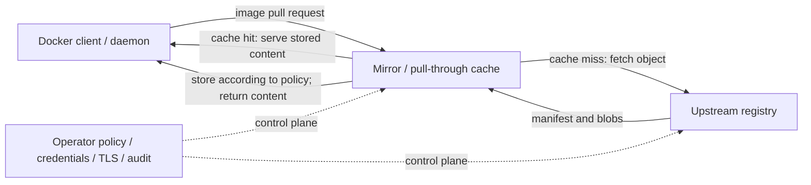
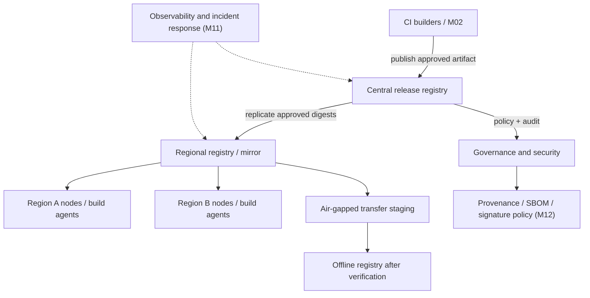

# Unit 6 — Container Registries, Mirrors, and Pull-Through Caches

**Target file:** `06-container-registries-mirrors-and-pull-through-caches.md` | **Estimated time:** 7–9 hours | **Prerequisites:** Docker basics, Git, Linux shell, image identity and tag/digest fundamentals from Unit 5  
**Core tools:** Docker Engine/CLI, `curl`, shell tools, CNCF Distribution registry (`registry:2`), Buildx where available | **Awareness tools:** containerd, Kubernetes, Podman, Buildah, Harbor, Quay, Docker Hub, GHCR, ECR, Google Artifact Registry, ACR, `mkcert`, Trivy | **Last reviewed:** 2026-10-24 (AI self-audit; live documentation not checked)

> **Evidence and currency notice:** This lesson is designed for WSL2 Ubuntu first and native Linux second, with a zero-budget local workflow. Commands and outputs are representative unless explicitly labelled measured; none of the commands or labs in this document were executed during authoring. Registry configuration, authentication behavior, provider features, pricing, quotas, and rate limits are version- and provider-sensitive. Items needing current confirmation are marked `[VERIFY]` or `[VERSION-SENSITIVE]`.

## Table of contents

- [6.0 Why this matters in production](#60-why-this-matters-in-production)
- [6.1 Learning objectives](#61-learning-objectives)
- [6.2 Concept map and vocabulary](#62-concept-map-and-vocabulary)
- [6.3 Level 1 — Beginner](#63-level-1--beginner)
- [6.4 Level 2 — Intermediate](#64-level-2--intermediate)
- [6.5 Level 3 — Advanced](#65-level-3--advanced)
- [6.6 Level 4 — Expert](#66-level-4--expert)
- [6.7 SRE lens](#67-sre-lens)
- [6.8 Security lens](#68-security-lens)
- [6.9 Production checklist](#69-production-checklist)
- [6.10 Hands-on lab set](#610-hands-on-lab-set)
- [6.11 Self-check questions](#611-self-check-questions)
- [6.12 Evidence artifacts](#612-evidence-artifacts)
- [6.13 Common interview and design-review questions](#613-common-interview-and-design-review-questions)
- [6.14 Sources and verification notes](#614-sources-and-verification-notes)
- [Appendix A — Claim Register](#appendix-a--claim-register)
- [Appendix B — Audit Report](#appendix-b--audit-report)
- [Appendix C — Human Verification Checklist](#appendix-c--human-verification-checklist)
- [Appendix D — Known Limitations and Assumptions](#appendix-d--known-limitations-and-assumptions)
- [Appendix E — Sign-off](#appendix-e--sign-off)

### 6.0 Why this matters in production

A data-platform deployment can fail even when the application and release are correct if the registry is unavailable, an upstream is throttling requests, or a mirror cannot serve an image that has never been cached. A registry with insufficient storage can reject pushes or become unavailable during an incident; a stale or untrusted cache can also distribute the wrong content or conceal a supply-chain problem. A registry architecture therefore needs an explicit trust boundary, persistence and capacity planning, observability, and a tested recovery path. This unit teaches registry operations and distribution behavior; tag immutability is covered in Unit 5, while retention and garbage collection belong to Unit 7.

### 6.1 Learning objectives

- **[L1]** Explain the difference between registry, repository, tag, manifest, image config, blob, mirror, proxy, and pull-through cache.
- **[L1]** Use Docker CLI and the OCI Distribution API's basic `/v2/` endpoint to inspect local and registry behavior without exposing credentials.
- **[L2]** Operate a local CNCF Distribution registry with a named container, persistent storage, predictable loopback port, and verified push/pull workflow.
- **[L2]** Explain the difference between plaintext HTTP lab configuration and TLS trust, including certificate hostname/SAN requirements.
- **[L2]** Compare hosted and self-managed registries using ownership, authentication/integration, and operational trade-offs rather than unverified pricing claims.
- **[L3]** Configure and evaluate a pull-through cache or mirror while distinguishing cold misses, warm hits, upstream errors, and cached-object behavior.
- **[L3]** Measure pull success, latency, errors, and cache behavior with a reproducible protocol rather than inferring cache hits from low latency alone.
- **[L4]** Design registry topology, failure isolation, recovery, regional distribution, and air-gapped image transfer for a data-service fleet.
- **[L4]** Produce an outage runbook, registry architecture decision record (ADR), evidence bundle, and policy ownership model.

### 6.2 Concept map and vocabulary

| Term | Precise definition | Common misconception |
|---|---|---|
| Registry | A service that stores and distributes image manifests and content blobs. | A registry is not a repository. |
| Repository | A named collection of image references within a registry namespace. | A repository is not the entire registry service. |
| Tag | A human-readable name that resolves to a manifest or index. | A tag is not inherently immutable. Unit 5 covers tag policy. |
| Manifest | A document referencing image configuration and layer blobs. | A manifest is not the image config or a layer. |
| Config blob | JSON describing image configuration and root filesystem metadata. | A local image ID/config digest is not the same identity as a registry manifest digest. |
| Content-addressed blob | Content stored and addressed by a digest. | A digest alone does not authenticate the publisher. |
| OCI Distribution API | HTTP API convention for pushing and pulling manifests/blobs. | Every registry's authentication, extensions, and errors are identical. |
| Local registry | Registry service operated on the learner's machine or local network. | “Local” automatically means secure or persistent. |
| Hosted registry | Registry service operated by a provider. | Hosted means no customer responsibility for permissions, retention, or architecture. |
| Mirror | An endpoint intended to provide an alternate route/source for image content. | Every mirror is a complete, always-current replica. |
| Pull-through cache | A proxy-like registry that fetches upstream content on demand and stores cached content according to its implementation. | It can always serve uncached content while the upstream is down. |
| Registry proxy | A service forwarding requests to another registry; it may cache, transform, or enforce policy depending on implementation. | “Proxy” necessarily means persistent cache. |
| Cache hit | A request served from the cache for the relevant object/request. | Low latency alone proves a hit. |
| Cache miss | The cache must retrieve or otherwise obtain the requested object from upstream. | Every miss results in success; upstream may fail. |
| Upstream | The registry/source a mirror or cache depends on. | Upstream availability is under the local operator's control. |
| OCI Distribution `/v2/` | Common API base endpoint used to determine registry API availability and possibly trigger authentication challenge. | One status code universally proves the registry is healthy. |
| TLS | Transport Layer Security, which protects transport and authenticates the endpoint when correctly configured and trusted. | Encrypting traffic alone makes a registry trustworthy. |
| Certificate SAN | Subject Alternative Name, the certificate field used to identify valid DNS names/IP addresses. | A certificate for `localhost` automatically validates a different hostname. |
| Persistent volume | Storage mounted so registry data can survive container replacement. | A named volume is a backup or a complete disaster-recovery plan. |
| Air-gapped distribution | Moving approved artifacts into an environment without direct network access to the source. | Copying a tarball alone preserves all trust and audit context. |
| SLI/SLO | Service-level indicator/objective: a measurement and a target for service behavior. | A target is useful without a defined numerator, denominator, and window. |

#### Request and control flow



**Data plane**: manifest/blob requests and responses, including cache hits and upstream fetches. **Control plane**: endpoint configuration, credentials, access policy, TLS trust, logging, retention, upgrades, and operator decisions. A cache is both a data path and a trust boundary.

#### OCI request lifecycle, in plain language

A client first contacts a registry endpoint, commonly under `/v2/`. Depending on configuration, it may receive a successful response, an authentication challenge, a redirect, or an error. A client then obtains the manifest for the requested repository/reference and downloads the config/layer blobs it needs. Pushes typically involve uploading blobs (potentially through upload sessions) and publishing a manifest that references them. Exact HTTP methods, headers, auth flows, redirects, and error bodies depend on the OCI Distribution Specification version and registry implementation. **[VERIFY: OCI Distribution Specification endpoint semantics and the chosen registry's auth configuration]**

### 6.3 Level 1 — Beginner

**L1 — Beginner: Foundations** — explain concepts, run basic commands, and interpret output.

#### 6.3.1 Registry versus repository

Consider `registry.example.invalid/data/inference-api:1.0.0`:

- `registry.example.invalid` is a placeholder registry host.
- `data/inference-api` is the repository path.
- `1.0.0` is the tag.
- The `.invalid` hostname is reserved for examples and is not a real registry.

A registry can contain many repositories. A repository can have multiple tags, and a tag resolves to a manifest or image index. For production deployment identity and tag immutability, see [Unit 5 — Image Tagging, Versioning, and Immutability](05-image-tagging-versioning-and-immutability.md). This unit only uses tags/digests as needed to operate and verify distribution.

#### 6.3.2 Basic commands

Check client/server availability:

```bash
docker version
docker info
```

Representative output excerpt:

```text
Client: Docker Engine - Community
 Version: <installed-version>
Server: Docker Engine - Community
 Version: <installed-version>
```

Interpretation: a reachable server section indicates the CLI can query the Docker daemon. It does not prove a remote registry is available. If the server section is missing or the command fails, resolve the local Docker Engine setup first.

List and inspect an image:

```bash
docker image ls
docker image inspect python:3.12-slim --format 'id={{.Id}} os={{.Os}} arch={{.Architecture}}'
```

Representative output:

```text
id=sha256:<local-config-id> os=linux arch=amd64
```

The image must already exist locally or the inspect command fails. The local ID is associated with image configuration; it is not automatically the registry manifest digest.

Pulling a base image:

```bash
docker pull python:3.12-slim
```

Representative output:

```text
3.12-slim: Pulling from library/python
...
Status: Downloaded newer image for python:3.12-slim
```

Docker output varies by version and whether content was already present. If the image was already available, the client may report that the image is up to date. A successful pull shows that the request completed for that reference at that time; it does not prove publisher authenticity by itself.

#### 6.3.3 Login and credential handling

`docker login` authenticates the client to a registry. The exact command depends on the registry and authentication method. For interactive use:

```bash
docker login <registry-host>
```

`<registry-host>` is a placeholder and must be replaced. Never place a real password or token directly in a command that may be stored in shell history. Prefer the provider's documented credential helper or a supported interactive/stdin mechanism for automation; verify the current Docker CLI login documentation before selecting flags.

Docker configuration is commonly stored under `~/.docker/config.json`, unless `DOCKER_CONFIG` changes the location. Depending on setup, the file may contain credential-helper references, auth material, or registry configuration. Treat it as sensitive. Do not `cat` it into logs, commit it, or paste it into a ticket. On a shared machine, review file permissions and credential-helper configuration.

Logout when appropriate:

```bash
docker logout <registry-host>
```

Representative output:

```text
Removing login credentials for <registry-host>
```

The command's effect depends on the configured credential store. It does not revoke a provider-side token if the provider's token lifecycle requires separate revocation.

#### 6.3.4 Registry API probe

For a local or otherwise authorized registry endpoint:

```bash
curl -i http://127.0.0.1:5000/v2/
```

Possible representative outcomes:

```text
HTTP/1.1 200 OK
Content-Length: 0
```

or, if authentication is configured:

```text
HTTP/1.1 401 Unauthorized
WWW-Authenticate: Bearer realm="...",service="..."
```

These are examples, not guarantees. A `200` can indicate that this endpoint responded successfully; a `401` can indicate that authentication is required and may include a challenge. A `404`, `5xx`, TLS error, connection refusal, or timeout has a different interpretation. Inspect headers and server logs. Do not interpret every `401` as an outage or every `200` as proof that pushes, storage, and upstream dependencies are healthy.

#### 6.3.5 Public, private, local, hosted, mirror, and cache

- **Public registry/repository:** content is publicly retrievable under the service's policy.
- **Private registry/repository:** access is restricted by authentication/authorization.
- **Local registry:** an operator-controlled registry for local development, testing, or a private environment.
- **Hosted registry:** registry service operated by a provider, with customer configuration and responsibility boundaries.
- **Mirror:** alternate endpoint used to retrieve image content.
- **Pull-through cache:** retrieves upstream content on demand and stores content according to its cache behavior.
- **General proxy:** forwards requests and may or may not persist content.

A cache can improve repeat-pull latency and reduce upstream traffic, but it adds a dependency and a security boundary. It does not automatically provide replication, immutability, or offline availability for uncached content.

#### 6.3.6 Beginner mistakes: symptom → cause → fix

| Symptom | Likely cause | Fix |
|---|---|---|
| `docker push` says access denied | Wrong repository namespace, no login, insufficient write permission, or provider policy. | Check the exact reference, authenticate using the official method, and request least-privilege access. |
| `/v2/` returns `401` | Registry requires authentication or sends a challenge. | Inspect `WWW-Authenticate`; follow the registry's documented auth flow. |
| Pull fails with certificate error | Untrusted CA, wrong hostname/SAN, expired certificate, or TLS interception. | Verify the hostname and certificate chain; install the correct trust root through the supported mechanism. Do not disable TLS verification as a routine fix. |
| Local tag exists but registry pull behaves differently | Local cache/tag state differs from remote state. | Inspect the reference and digest; test with a controlled fresh client/daemon where practical. |
| Cache is fast but stale content is suspected | Latency was mistaken for proof of freshness or identity. | Record the digest, inspect cache/upstream behavior, and apply freshness/trust policy. |
| Registry data disappears after container replacement | Data was stored only in the container writable layer. | Mount a named persistent volume and test restart/replacement behavior. A volume is not a backup. |

### 6.4 Level 2 — Intermediate

**L2 — Intermediate: Working Practice** — operate a local registry, push/pull images, inspect endpoints, and configure safe local TLS/auth examples.

#### 6.4.1 Start a local CNCF Distribution registry with persistent storage

The local registry is an isolated lab service. It is not a production security baseline. Use a named volume so registry data is not tied only to the container's writable layer. For repeatability, resolve the selected `registry:2` image to an immutable digest and record it; do not invent a digest or treat the floating tag as a production pin.

Inspect the image reference before use:

```bash
docker pull registry:2
docker image inspect registry:2 --format 'id={{.Id}} repo_digests={{json .RepoDigests}}'
```

Representative output:

```text
id=sha256:<local-config-id> repo_digests=["registry@sha256:<observed-digest>"]
```

Actual `RepoDigests` output may be empty or differ by acquisition path/client version. If the digest is not available here, use the registry's official publication guidance and a supported registry inspection method to resolve it. Record the chosen immutable reference and tool/version. **[VERIFY: registry image publication and digest resolution procedure]**

Create the lab network and volume:

```bash
docker network create unit6-net
docker volume create unit6-registry-data
```

Representative output:

```text
unit6-net
unit6-registry-data
```

Start the registry bound to loopback:

```bash
docker run -d \
  --name unit6-registry \
  --network unit6-net \
  -p 127.0.0.1:5000:5000 \
  --restart=no \
  -v unit6-registry-data:/var/lib/registry \
  registry:2
```

Representative output:

```text
<container-id>
```

For a production-like repeatable lab, replace `registry:2` with the immutable digest reference you resolved and recorded. The command uses a named volume, named network, predictable container name, and loopback-only port mapping. Do not expose this unauthenticated HTTP registry to a shared or untrusted network.

Verify container and endpoint:

```bash
docker ps --filter name=unit6-registry
curl -i http://127.0.0.1:5000/v2/
```

Representative output includes a running container and either a context-appropriate success response or an error that must be investigated. The default registry may return `200 OK` on `/v2/` without auth; that is not a universal guarantee.

#### 6.4.2 Build a small data-service image and push/pull through the local registry

Create a working directory:

```bash
mkdir -p unit6-lab/app unit6-lab/evidence
cd unit6-lab
```

Create `app/main.py`:

```python
# app/main.py
from fastapi import FastAPI

app = FastAPI(title="Inference API", version="1.0.0")

@app.get("/health")
def health():
    return {"status": "ok"}

@app.post("/score")
def score(payload: dict):
    value = payload.get("value", 0)
    return {"score": float(value) * 0.5, "model_version": "demo-model-1"}
```

Create `requirements.txt`:

```text
fastapi
uvicorn[standard]
```

Create `Dockerfile`:

```dockerfile
# Dockerfile
FROM python:3.12-slim
WORKDIR /app
COPY requirements.txt .
RUN pip install --no-cache-dir -r requirements.txt
COPY app/ ./app/
EXPOSE 8000
CMD ["uvicorn", "main:app", "--app-dir", "/app/app", "--host", "0.0.0.0", "--port", "8000"]
```

This minimal dependency list is for a lab, not a production lock strategy. Production builds should lock and review dependencies, control base-image identity, and apply the supply-chain controls in M12.

Build and tag:

```bash
docker build -t inference-api:unit6-lab .
docker image tag inference-api:unit6-lab localhost:5000/lab/inference-api:unit6-lab
docker image inspect localhost:5000/lab/inference-api:unit6-lab --format 'id={{.Id}} tags={{json .RepoTags}}'
```

Representative output:

```text
id=sha256:<local-config-id> tags=["localhost:5000/lab/inference-api:unit6-lab"]
```

Push and record output:

```bash
docker image push localhost:5000/lab/inference-api:unit6-lab
```

Representative output:

```text
The push refers to repository [localhost:5000/lab/inference-api]
...
unit6-lab: digest: sha256:<observed-manifest-digest> size: <size>
```

The actual digest and size must be captured from your run. The digest is a registry-reported content identity; record the object type if verified. See Unit 5 for full digest and immutability policy.

Verify registry API response and local pull:

```bash
curl -i http://127.0.0.1:5000/v2/
docker image pull localhost:5000/lab/inference-api:unit6-lab
docker image inspect localhost:5000/lab/inference-api:unit6-lab
```

A pull may reuse already-local content, so it does not by itself prove that all blobs were downloaded over the network during this invocation. To prove the endpoint used, inspect the image reference, push output, registry logs, and—if needed—perform a controlled test using an isolated disposable daemon or a reference not already present locally. Do not delete unrelated images to force a cold pull.

Run the service:

```bash
docker run --rm --name unit6-inference-api \
  -p 127.0.0.1:8000:8000 \
  localhost:5000/lab/inference-api:unit6-lab
```

In another terminal:

```bash
curl --fail http://127.0.0.1:8000/health
curl --fail -X POST http://127.0.0.1:8000/score \
  -H 'Content-Type: application/json' \
  -d '{"value": 8}'
```

Representative output:

```json
{"status":"ok"}
```

```json
{"score":4.0,"model_version":"demo-model-1"}
```

Stop the foreground container with `Ctrl+C`. The `--rm` option removes that named container when it exits.

#### 6.4.3 Registry API request lifecycle and authentication challenge

The OCI Distribution API uses HTTP endpoints for repository manifests and blobs. A common discovery request is:

```bash
curl -i http://127.0.0.1:5000/v2/
```

Representative output for an unauthenticated local registry may include:

```text
HTTP/1.1 200 OK
Content-Length: 0
```

An auth-enabled registry may instead respond with `401 Unauthorized` and `WWW-Authenticate`. In a bearer-token flow, the challenge describes a realm/service and possibly required scope; the client obtains a token through the configured identity flow and retries. Do not copy bearer tokens into terminal output, logs, or evidence files.

The endpoint examples below are conceptual. Do not assume all registries expose every response in exactly this form without authentication:

```text
GET /v2/<repository>/manifests/<reference>
GET /v2/<repository>/blobs/<digest>
```

The first retrieves a manifest for a tag or digest; the second retrieves a content blob. Actual media-type negotiation, redirects, upload sessions, headers, and error codes are defined by the OCI Distribution Specification and implementation. **[VERIFY: OCI Distribution Specification endpoint requirements and the target registry's auth/redirect behavior]**

#### 6.4.4 HTTP versus TLS, local CA, and certificate names

**Production rule:** use TLS with certificate validation for registry traffic. Plain HTTP is permitted only as an explicit, isolated local lab exception. Never normalize a global daemon setting that trusts arbitrary insecure registries.

For this lab, the registry is bound to `127.0.0.1` and is used over loopback. Some Docker Engine configurations will reject HTTP registry pushes unless the endpoint is explicitly marked insecure. Docker Desktop, native Linux Docker Engine, and WSL2 configurations differ. **[VERIFY: Docker daemon registry/mirror documentation for the installed version and platform]**

If your daemon requires an insecure-registry exception for the loopback endpoint, use the narrowest possible local-only configuration supported by that daemon, document the change, restart only the relevant local engine as required, and remove the exception after the lab. Do not make host-wide firewall changes. If you cannot safely scope the exception, skip the HTTP push lab and use the TLS extension or another isolated environment.

**TLS extension (optional):**

1. Choose a local DNS name that resolves to loopback, such as `registry.local.test`.
2. Generate a local development CA/certificate with a tool such as `mkcert` or a documented local CA workflow. Do not invent flags; consult the tool's current official documentation.
3. Ensure the server certificate SAN includes the exact hostname the client uses. A certificate for `localhost` does not automatically validate `registry.local.test`.
4. Configure the registry's TLS certificate/key paths according to the selected Distribution version and mount them read-only.
5. Install/trust the CA in the Docker daemon's relevant trust location using the documented procedure for the platform. Trusting a CA in the shell's operating system does not necessarily mean the Docker daemon trusts it.
6. Test the TLS endpoint and certificate name:

```bash
curl --verbose --cacert ./certs/local-ca.pem https://registry.local.test:5000/v2/
```

Representative output should show successful certificate verification and an HTTP response. It will fail if DNS, SAN, trust chain, validity, or listener configuration is wrong. Do not use `curl -k` as a fix; it disables certificate validation and hides the failure.

Cleanup the insecure exception or local trust configuration using the exact platform-specific steps used to add it. Verify Docker's daemon configuration and repeat the endpoint test. Certificate installation/removal is not a universal one-command operation; **[VERIFY: Docker Desktop or native Linux trust-store documentation]**.

#### 6.4.5 Hosted and self-managed registry comparison

This table compares operational patterns, not current prices or feature guarantees. Pricing, quotas, rate limits, identity integrations, immutability, scanning, replication, and artifact support change; verify the official documentation and plan/region before making a decision.

| Registry | Intended use | Operational ownership | Authentication/integration model | Important trade-offs |
|---|---|---|---|---|
| Docker Hub | Public images and hosted private repositories. | Provider operates service; customer manages namespaces, access, and image lifecycle. | Docker account/team and supported credential mechanisms; details vary by plan. | Broad ecosystem and convenience; rate limits, plan limits, and terms must be verified. `[VERIFY]` |
| GitHub Container Registry (GHCR) | Images associated with GitHub workflows and packages. | Provider operates service; customer manages package visibility, permissions, and automation. | GitHub identity/tokens and workflow permissions, subject to current docs. | Strong workflow integration; permission model and package access need careful setup. `[VERIFY]` |
| Amazon Elastic Container Registry (ECR) | AWS-native private/public image storage and distribution. | Provider operates service; customer configures IAM, repository policy, networking, and lifecycle. | AWS IAM and registry authentication flow. | Strong AWS integration; region/account architecture and cross-account access need design. Pricing and quotas `[VERIFY]`. |
| Google Artifact Registry | Managed artifact repositories, including container images, in Google Cloud. | Provider operates service; customer manages IAM, repository, network, and lifecycle policy. | Google Cloud IAM and supported auth tooling. | Integrated cloud IAM and regional choices; egress, location, and permissions matter. Pricing/quotas `[VERIFY]`. |
| Azure Container Registry (ACR) | Azure-native container image registry. | Provider operates service; customer configures identities, networking, and repository policy. | Microsoft Entra/Azure identity and registry auth options. | Azure integration and network/security options; SKU capabilities and cost vary. `[VERIFY]` |
| Harbor | Self-hosted registry platform with policy and supply-chain features depending on deployment/version. | Organization owns infrastructure, upgrades, storage, backup, and availability. | Configurable identity integrations and role-based access, depending on setup. | More control and features, but meaningful operational and upgrade burden. |
| Quay | Hosted or supported registry platform, depending on offering. | Ownership boundary depends on hosted versus self-managed/enterprise offering. | Product/identity integrations depend on deployment and offering. | Feature and operating model vary by offering; verify current docs and support lifecycle. `[VERIFY]` |

**Selection guidance:** choose a managed registry when a team wants provider-operated availability and integrated cloud identity; choose Harbor or another self-managed registry when policy/control requirements justify operating the service. Neither choice removes the need for least privilege, artifact retention, release policy, and tested recovery.

#### 6.4.6 Pattern catalogue

| Pattern | Use when | Avoid when |
|---|---|---|
| Loopback-only Distribution registry | Local labs, reproducible demos, isolated development. | Production distribution, untrusted shared networks, or when no backup/monitoring exists. |
| Managed cloud registry | Existing cloud identity/network and a team wants provider-operated registry infrastructure. | Requirements demand local control the service cannot provide, or the cost/region/availability model is unsuitable. |
| Self-managed Harbor/Quay-style platform | Organization needs policy controls and can own upgrades, storage, security, and recovery. | No team can own patching, backup, capacity, and incident response. |
| Pull-through cache near build agents | Repeated upstream pulls create latency/egress/throttling concerns and the cache's trust/availability model is acceptable. | Workloads require immediate access to arbitrary uncached images during upstream outage. |
| Regional mirror | Geographically distributed clusters need lower-latency pulls and independent failure domains. | The team cannot synchronize policy, freshness, and artifact verification across regions. |
| Digest verification at distribution boundaries | Exact content identity must be preserved through copy, cache, or air-gap transfer. | Used as the only publisher-authentication control. |

#### 6.4.7 Anti-pattern catalogue

| Bad example | Impact | Corrected version |
|---|---|---|
| Run an unauthenticated HTTP registry on `0.0.0.0:5000`. | Untrusted clients may access or tamper with the lab registry; traffic lacks TLS protection. | Bind to loopback for a lab; use authenticated TLS for shared/production environments. |
| Store registry data only in the container writable layer. | Replacing the container may lose registry data. | Mount named persistent storage and test backup/restore separately. |
| Assume `/v2/` returning 200 means pushes and storage are healthy. | A shallow health check may miss disk, auth, or upstream failures. | Combine endpoint checks with representative push/pull probes, storage signals, and dependency checks. |
| Treat a mirror as an automatic trust boundary. | A compromised or misconfigured mirror can serve untrusted or stale content. | Validate TLS, access controls, digest identity, upstream policy, and provenance. |
| Assume all cached images remain available during upstream outage. | Uncached or evicted content may fail to pull. | Test the exact cache implementation/state and maintain an outage plan. |
| Use `docker system prune -a` to clean up a lab. | Unrelated images/build cache may be deleted. | Inspect and remove only named lab resources. |
| Disable certificate validation to “fix” TLS. | Enables interception and hides hostname/trust errors. | Fix SAN, CA chain, trust-store, and endpoint configuration. |

### 6.5 Level 3 — Advanced

**L3 — Advanced: Production Engineering** — configure and reason about mirrors and pull-through caches, reliability, cache behavior, security, and operational trade-offs.

#### 6.5.1 Mirror versus pull-through cache versus general proxy

| Mechanism | Typical behavior | Persistence | Main benefit | Main caveat |
|---|---|---|---|---|
| Mirror/replica | Copies or synchronizes selected content from source to another registry. | Usually stores copied content according to replication policy. | Independent serving path and potential regional resilience. | Freshness/sync lag, policy synchronization, and replication failure need monitoring. |
| Pull-through cache | Fetches requested content from upstream on demand and caches it. | Implementation-specific; commonly stores fetched objects until retention/eviction/deletion rules apply. | Reduces repeated upstream pulls and can improve warm-pull latency. | Cold misses depend on upstream; cache behavior during outage is implementation-specific. |
| Forward proxy | Forwards HTTP/network requests; may not understand registry manifests/blobs. | Not necessarily persistent image content. | Network routing/control in some environments. | May not provide registry-aware cache semantics. |
| Registry mirror endpoint | A client/runtime is configured to try an alternate registry endpoint under documented rules. | Depends on endpoint implementation. | Centralizes pulls and reduces external access. | Fallback and trust semantics differ by client/runtime/version. |

Do not use these terms interchangeably in architecture documents. Specify what is replicated, what is fetched on demand, which identity/credentials are used, how failures are handled, and whether the service can serve content without upstream access.

#### 6.5.2 CNCF Distribution pull-through cache

CNCF Distribution supports a proxy/cache configuration pattern with an upstream remote URL. The exact configuration keys and constraints must be checked against the installed Distribution release. **[VERIFY: Distribution configuration reference, proxy section, version used in the lab]**

Conceptual configuration:

```yaml
# config.yml — illustrative; validate against the selected Distribution version
version: 0.1
storage:
  filesystem:
    rootdirectory: /var/lib/registry
http:
  addr: 0.0.0.0:5000
proxy:
  remoteurl: https://registry-1.docker.io
```

This is a configuration sketch, not a claim that every Distribution version accepts every field in every deployment. A proxy configuration may impose restrictions on storage, authentication, deletion, and cache behavior. Check official docs and test with the exact version. Do not assume this service is a full mirror of all upstream repositories.

A safe deployment should:
- persist the cache data directory using a dedicated volume;
- restrict inbound access to approved clients;
- validate upstream TLS;
- avoid forwarding credentials to an untrusted upstream or mirror;
- log request outcomes and upstream errors without logging bearer tokens;
- set capacity alerts and document cache reset/restore procedures;
- test cold miss, warm hit, upstream outage, uncached image, and recovery behavior.

#### 6.5.3 Docker daemon registry mirrors

Docker Engine supports registry mirror configuration for Docker Hub in documented configurations, but exact semantics and supported endpoints depend on engine version and environment. **[VERIFY: Docker Engine “Registry mirrors” documentation for the installed version]**

Conceptual daemon configuration:

```json
{
  "registry-mirrors": [
    "https://mirror.example.invalid"
  ]
}
```

This is a snippet, not a complete daemon configuration file. Merge it into the existing configuration rather than overwriting unrelated settings. The `.invalid` hostname is a placeholder. Do not add a random or untrusted mirror. Restart requirements and configuration locations differ between Docker Desktop and native Linux.

Validate JSON before applying a change:

```bash
python3 -m json.tool daemon.json >/dev/null
```

Representative output: no output and exit code `0` for valid JSON; a parse error and non-zero exit for invalid JSON. This checks JSON syntax only, not whether Docker accepts the key or the endpoint.

After a controlled configuration change, inspect daemon info and logs using the documented procedure for the environment. Test a known image pull and record the resolved identity. Do not infer that a mirror was used solely because a pull succeeded.

#### 6.5.4 containerd registry host configuration

Containerd deployments commonly use a registry host configuration directory and `hosts.toml` to describe endpoints and capabilities. Exact path, schema, capability semantics, and reload behavior depend on containerd version and distribution packaging. **[VERIFY: official containerd registry host configuration documentation]**

Conceptual example only:

```toml
# /etc/containerd/certs.d/docker.io/hosts.toml
server = "https://registry-1.docker.io"

[host."https://mirror.example.invalid"]
  capabilities = ["pull", "resolve"]
```

This is illustrative, not a verified universal configuration. Replace the placeholder only with a trusted endpoint and validate syntax/semantics against the installed containerd documentation. Do not grant `push` capability to a mirror unless the architecture explicitly requires and secures it. Configure TLS trust and authentication as documented for the actual runtime. Kubernetes nodes may use containerd or another runtime; this unit does not teach the full node configuration or `imagePullSecrets` flow.

#### 6.5.5 Cache hit/miss: what evidence means

A **cold miss** occurs when the cache needs content it does not currently have in a usable form and must contact upstream. A **warm hit** occurs when the requested content can be served from cached state. The exact unit of caching (manifest, config, layer/blob, metadata), cache key, eviction, freshness, and logging differs by implementation.

Evidence can include:
- cache logs showing an upstream request on first pull and a local serve on repeat;
- upstream request counters or access logs;
- cache storage growth after first pull;
- digest equality for the content retrieved through the cache and the expected upstream artifact;
- timing data collected under a repeatable protocol.

Low latency alone is weak evidence. The image may already exist in the Docker daemon, a different local layer cache may satisfy the request, or the network may simply be fast. To measure the cache, use a controlled client/daemon or a fresh reference, record the cache logs, and distinguish Docker's local image/layer reuse from the registry cache's behavior.

#### 6.5.6 Cache failure matrix

| Scenario | Possible behavior | Required test/interpretation |
|---|---|---|
| Upstream available, object absent from cache | Cache fetches upstream, stores according to policy, returns content. | Confirm upstream request/log and digest; do not infer hit. |
| Upstream available, object cached | Cache may serve stored content without upstream fetch. | Confirm cache-specific log/counter and digest. |
| Upstream unavailable, object cached | May continue serving the cached object if it remains available and the implementation permits it. | Test exact implementation and cache state; do not generalize. |
| Upstream unavailable, object absent | Usually cannot fetch it; pull may fail. | Confirm failure mode and alert path. |
| Upstream tag deleted/moved | Cache may retain previously fetched content, revalidate, or behave differently. | Verify exact semantics and use digest-based release identity; Unit 5 covers release policy. |
| Credentials expire or lack scope | Authentication may fail at cache, upstream, or both. | Inspect challenge/status and auth logs without exposing tokens. |
| DNS/TLS fails | Requests fail before content is retrieved. | Check resolver, endpoint name, certificate chain, SAN, and system time. |
| Cache disk full | New writes or metadata operations may fail; behavior depends on implementation. | Monitor filesystem utilization and test failure handling. |
| Cache compromised | It may return malicious/stale content or disrupt pulls. | Trust the endpoint, verify digest/signature/provenance, restrict access, and preserve audit evidence. |

A cache may be useful for availability, but it is not a substitute for upstream trust, digest verification, artifact retention, or a tested offline distribution strategy.

#### 6.5.7 Reliability and performance techniques

- **Persistent storage:** mount the registry/cache data path and test container replacement. A volume is not a backup.
- **Capacity management:** track filesystem free space, growth, and write errors. Retention/garbage collection design is deferred to Unit 7.
- **Health checks:** distinguish process/endpoint health from successful end-to-end pull ability. Use a representative test image and controlled credentials where appropriate.
- **Failure isolation:** keep the cache's upstream credentials and service identity narrowly scoped; avoid a single shared cache becoming an unbounded blast radius.
- **Timeout/retry policy:** configure only documented client/server settings. Avoid synchronized aggressive retries that overload a recovering upstream.
- **Concurrency:** load-test expected parallel image pulls and monitor upstream, storage, network, and file descriptor limits using product-supported metrics.
- **Warm-up:** prefetch known critical images before maintenance or a planned disconnected period, then verify digests and availability.
- **Eviction/retention:** define which content is disposable cache state versus approved release artifact. Do not assume cache retention equals rollback retention.
- **TLS and identity:** validate upstream and client connections; avoid disabling certificate checks.
- **Measurement:** compare cold and warm runs using a controlled client, same image/reference, same network path, and recorded versions. Repeat multiple times and report median/p95 only when actually measured.

#### 6.5.8 Trade-off table

| Option | Benefit | Cost | Risk | Choose when |
|---|---|---|---|---|
| Direct upstream pulls | Fewer internal components; simpler initial setup. | Repeated egress and dependence on upstream availability/rate policies. | Broad upstream outage/throttling can affect many builds/nodes. | Small fleet or low pull volume with acceptable upstream dependency. |
| Single pull-through cache | Reduces repeated upstream traffic and may improve warm pulls. | Operating storage, monitoring, credentials, and upgrades. | Single cache becomes a dependency; cold misses still depend on upstream. | Repeated image pulls and a team able to operate the cache. |
| Multiple regional caches | Lower regional latency and some failure isolation. | Replicated configuration, capacity, monitoring, and trust policy. | Configuration drift or inconsistent freshness/policy. | Distributed fleet with clear regional ownership. |
| Full replication/mirror | Predictable local copy of selected artifacts and possible disconnected operation. | Replication pipeline, storage, freshness controls, and verification. | Stale or incomplete replica if sync fails. | Known set of approved images or air-gapped requirements. |
| Managed registry | Provider operates core service infrastructure. | Service costs and provider-specific architecture. | IAM/configuration mistakes and provider/region dependency remain. | Organization prefers managed operations and integration. |
| Self-managed registry platform | More control over topology and policy. | Patching, HA, backup, monitoring, and on-call burden. | Operational failure if ownership is unclear. | Requirements justify dedicated platform operations. |

#### 6.5.9 L3 design decision lab

Write `evidence/unit-06/cache-design-decision.md` with:

1. The workload mix: FastAPI inference service, pandas/pyarrow ETL, Airflow-style worker, PySpark image, and shared base images.
2. Current pull pattern and measured baseline (if not measured, label it `[OPEN]`).
3. Candidate options from the trade-off table.
4. Trust boundary: who may configure the mirror, publish to upstream, and administer cache credentials.
5. Cold-miss and warm-hit evidence plan.
6. Upstream-outage behavior and which critical images must be prewarmed.
7. Storage/capacity and retention boundary (Unit 7).
8. Decision, rejected options, owner, review date, and triggers for reconsideration.

Do not fabricate latency, hit ratio, cost, or rate-limit figures. The lab is complete when the decision is traceable to evidence or explicit open questions.

### 6.6 Level 4 — Expert

**L4 — Expert: Operating at Scale and Under Failure** — design organizational registry architecture, handle outages, plan air-gapped/multi-region distribution, and define ownership, observability, and recovery practices.

#### 6.6.1 Organization-scale reference architecture



**Reference design principle:** the central release registry is the controlled source of approved artifacts; regional endpoints reduce distance and isolate some failures; air-gapped transfer is an explicit, audited process. The diagram is conceptual and not a provider-specific topology.

#### 6.6.2 Architecture patterns

| Architecture | Governance | Latency | Blast radius | Ownership/cost | Main trade-off |
|---|---|---|---|---|---|
| One central registry | Centralized policy and audit. | May be high for distant consumers. | Central outage can affect all regions. | Lower topology complexity; high central criticality. | Simplicity versus availability/latency. |
| Per-team registries | Teams control local release workflows. | Can be low for local consumers. | Failures may be isolated. | Policy drift and duplicated operations increase. | Team autonomy versus consistency. |
| Per-environment registries | Separates dev/staging/prod boundaries. | Depends on topology. | Limits some cross-environment access. | Promotion/copy and access policy become more complex. | Stronger separation versus replication overhead. |
| Regional mirrors | Improves local pull paths and may reduce WAN dependency. | Usually lower for regional consumers when warm. | Regional failure can be isolated if routing/failover is designed. | Requires synchronization, capacity, and policy ownership. | Availability/latency versus consistency complexity. |
| Air-gapped registry | Supports disconnected environments. | Local once populated. | External network outage is decoupled after transfer. | Requires controlled transfer, verification, and update process. | Strong isolation versus freshness and operational burden. |

#### 6.6.3 Air-gapped and multi-region distribution

A safe air-gap process is more than `docker save` and a file copy:

1. Select approved image references and record manifest/index digest, platform, source revision, and release record.
2. Export using a documented tool and format appropriate to the artifact. Verify the format preserves required manifest/platform metadata.
3. Transfer through the approved media/process with access logging and malware scanning where required.
4. Verify the received artifact identity against the approved digest or a documented manifest-level mapping; do not compare unrelated digest types.
5. Import into the target registry using the documented tooling.
6. Re-resolve the target registry reference and record its digest/media type/platform.
7. Verify signature/provenance according to M12 policy and preserve evidence.
8. Update the offline inventory and expiry/freshness record.
9. Test rollback artifact availability and recovery procedures.

For multi-region distribution, define replication lag/freshness expectations, conflict behavior, failure isolation, artifact deletion policy, credentials per region, and who owns synchronization. Do not assume all registries preserve tags, signatures, or OCI referrers identically during copy/replication; **[VERIFY: source and destination registry documentation]**.

#### 6.6.4 Broken configuration exercise

**Broken example:** a daemon is configured with a mirror hostname that does not resolve or whose certificate SAN does not match the hostname.

**Symptom:** image pulls fail with DNS lookup errors or TLS verification errors.

**Hypotheses:** wrong endpoint, resolver issue, stale config, missing CA trust, SAN mismatch, or unreachable port.

**Tests:**

```bash
getent hosts mirror.example.invalid
curl --verbose https://mirror.example.invalid/v2/
docker info
```

Representative output for the placeholder host may be a DNS failure. That is expected for `.invalid`; it is not a live mirror test. Replace it with your controlled lab endpoint before testing. `curl --verbose` can show certificate and connection details; redact any credentials/tokens before saving output.

**Root cause:** in this exercise, the endpoint is deliberately invalid; in a real incident, confirm the root cause from DNS/TLS/config evidence rather than guessing.

**Mitigation:** revert the mirror setting using the environment's documented procedure, restore the known-good registry endpoint, and validate pulls. Do not disable TLS checks.

**Prevention:** configuration validation, staged rollout, health probes, certificate expiry monitoring, and rollback-ready daemon/runtime configuration.

#### 6.6.5 Failure scenarios: symptom → hypotheses → tests → root cause → mitigation → prevention

| Symptom | Hypotheses | Tests | Root cause examples | Mitigation | Prevention |
|---|---|---|---|---|---|
| Pulls fail across a region | Registry outage, DNS, TLS, network, auth, storage. | Endpoint probes, logs, TLS checks, representative pull, storage metrics. | Expired cert, exhausted disk, upstream outage. | Route to a verified alternate endpoint or use approved cached artifacts if policy allows. | HA design, capacity alerts, certificate lifecycle, rehearsed failover. |
| Cold pulls fail but warm pulls work | Upstream unavailable or credentials expired. | Test uncached approved image, inspect upstream/auth logs. | Cache serves stored content but cannot fill misses. | Restore upstream/auth; prewarm critical images from trusted source if possible. | Cold-miss alerts, credential rotation tests, upstream dependency SLO. |
| Cache serves unexpected image identity | Wrong tag, cache state, malicious mirror, wrong platform comparison. | Record digest/media type/platform; compare trusted release record and provenance. | Mutable tag drift or trust boundary compromise. | Stop rollout, use approved digest, preserve evidence. | Digest verification, trusted endpoint allowlist, policy and audit. |
| Registry disk full | Growth, unbounded cache, retention mismatch. | Filesystem utilization, write errors, growth trend. | Cache or repository content exceeded capacity. | Expand capacity or remove only policy-approved content through supported procedure. | Capacity forecasts, Unit 7 retention/GC, tested alert thresholds. |
| Regional replica is stale | Replication delay or failed sync. | Compare source/destination digest and sync status. | Replication backlog or policy error. | Route to trusted source or re-sync approved artifacts. | Freshness SLO, sync monitoring, digest verification. |
| Authentication fails after rotation | Stale secret, changed identity permissions, token scope mismatch. | Inspect auth challenge/status and identity audit without logging tokens. | Credential rotation not propagated or role removed. | Restore approved identity/permission path and rotate safely. | M09 secrets workflow, rotation tests, least privilege. |

#### 6.6.6 Ownership and migration strategy

Define explicit owners:

- **Registry platform owner:** service availability, upgrades, capacity, TLS, access control, backup/restore.
- **Service owner:** correct image references, release records, dependency compatibility, and rollback readiness.
- **Security/supply-chain owner:** trusted upstreams, signature/provenance policy, vulnerability policy, exception review.
- **SRE/on-call:** SLI/SLO monitoring, incident response, capacity, failover, and post-incident actions.
- **CI/CD owner:** publish permissions, artifact promotion, cache integration, and reproducible evidence.

Migration from direct upstream pulls to a cache should be staged: inventory image sources; select trusted upstreams; test authentication and TLS; compare digest identity; measure cold/warm behavior; canary a subset of builders/nodes; observe failures; define rollback; then expand. Do not switch the whole fleet at once without an escape route.

### 6.7 SRE lens

#### 6.7.1 Useful SLIs and definitions

Define each indicator precisely. The example window is a template, not a prescribed target.

| SLI | Definition | Window/exclusions | Caveats |
|---|---|---|---|
| Successful image-pull ratio | Successful eligible pull operations divided by all eligible pull operations. | Rolling window such as 30 days; define whether client retries count as attempts or one logical pull. | Avoid hiding retry storms by counting only final successes. |
| p95 pull latency | 95th percentile elapsed time from defined pull start to completion for eligible pulls. | Segment by image size, cold/warm cache state, region, and client type. | Do not mix cached daemon hits with registry network pulls. |
| Upstream error rate | Upstream requests ending in defined error classes divided by upstream requests. | State whether timeouts, auth failures, and 5xx are grouped separately. | Requires reliable upstream request telemetry. |
| Cache hit ratio | Cache-served eligible requests/objects divided by total eligible requests/objects, as exposed by the implementation. | Define unit of measurement and whether manifest/blob requests are counted. | Product-specific; do not invent a metric name. |
| Storage utilization | Used bytes divided by usable capacity for registry/cache storage. | Monitor trend and forecast time to exhaustion. | Container writable layer and mounted volume may differ. |
| Time to restore pull service | Time from incident declaration to validated successful pull from approved source. | Include validation of digest and representative workloads. | Recovery is not complete merely because `/v2/` responds. |

#### 6.7.2 SLOs and targets

Targets must be derived from workload criticality, observed baseline, and the consequences of failed pulls. Example only: `[ILLUSTRATIVE]` a platform team may propose a successful pull ratio target for critical production pulls, but it must define eligible attempts, retry treatment, maintenance exclusions, and time window before adopting the number. This lesson intentionally does not invent a numeric SLO.

Use this method:
1. Instrument the current system for a representative period.
2. Segment by cold/warm, image size, region, and workload criticality.
3. Identify user-visible consequences of pull failure and recovery delay.
4. Set an initial target and error budget with service owners.
5. Review misses, alert quality, and cost; revise through governance rather than silently changing the definition.

#### 6.7.3 Failure mode and blast-radius table

| Failure mode | Impact | Detection | Mitigation | Owner | Follow-up |
|---|---|---|---|---|---|
| Central registry outage | New deploys/scale-outs may fail fleet-wide. | Pull failures, endpoint checks, registry logs. | Use verified regional/alternate endpoint or approved cached artifacts. | Registry platform/SRE | Review HA and recovery objective. |
| Upstream outage | Cold cache misses fail; cached content may or may not remain usable. | Upstream error rate and cold-miss failures. | Restore upstream/auth; prewarm critical images from trusted source if available. | Platform owner | Test upstream outage scenarios. |
| Cache storage exhaustion | Cache writes or registry operations fail. | Storage utilization, write errors. | Expand capacity or apply supported retention/cleanup procedure. | Registry platform | Capacity forecast; Unit 7 retention design. |
| TLS/CA failure | Pulls fail or clients reject endpoint. | TLS error telemetry, certificate expiry alerts. | Restore valid cert/CA and hostname alignment. | Platform/security | Certificate lifecycle automation. |
| Cache compromise | Malicious content or denial of service. | Digest/provenance mismatch, audit anomalies. | Stop traffic, use trusted source and approved digest, preserve evidence. | Security/platform | Incident review and credential rotation. |

#### 6.7.4 Registry outage runbook

**Alert → triage → mitigation → follow-up**

1. **Alert and declare:** record time, affected regions, registry/cache endpoint, and representative failed image references. Assign incident commander and registry technical lead.
2. **Triage:** check DNS, TLS certificate/hostname, `/v2/` response, authentication challenge, storage availability, process health, upstream reachability, and recent changes. Separate warm-cache pulls from cold misses.
3. **Bound the blast radius:** identify which workloads need new pulls (deploys, scale-outs, node replacement) versus already-running workloads. Do not claim running containers stop automatically merely because the registry is down.
4. **Mitigate:** route to a verified alternate registry/mirror only if its trust, identity, and policy are acceptable; otherwise pause rollout and use approved cached/retained artifacts. Avoid unreviewed tag changes or untrusted mirrors.
5. **Communicate:** state impact, current workaround, affected environments, next update time, and escalation owner. Do not include secrets or tokens in incident channels.
6. **Recover:** restore service, validate representative pulls from cold and warm states, compare digest identity to approved records, and test critical workloads.
7. **Close:** record timeline, cause, recovery time, data/artifact loss if any, and whether the SLO/error budget was affected.
8. **Follow up:** assign owners and due dates for capacity, certificate, auth, mirror configuration, backup/restore, and monitoring improvements.

#### 6.7.5 Capacity and cost

Plan for:
- unique blob storage and shared layers across images;
- growth from new service releases and base-image updates;
- cache miss traffic and concurrent pulls;
- network egress and regional transfer;
- temporary staging/replication copies;
- disk exhaustion headroom and recovery time;
- backup storage and restore bandwidth.

Retention and garbage collection policy is Unit 7. A pull-through cache's eviction policy is not a substitute for retaining approved rollback artifacts. Hosted pricing, transfer charges, quotas, and rate limits are provider- and region-specific; **[VERIFY]** official pricing and quota documentation before estimating cost.

### 6.8 Security lens

#### 6.8.1 Threats mapped to supply-chain stages / STRIDE

| Threat | Example | Controls | Residual risk |
|---|---|---|---|
| Spoofing | Fake mirror endpoint or misleading registry hostname. | TLS certificate validation, trusted endpoint allowlist, DNS controls. | Compromised trusted CA/DNS or host remains possible. |
| Tampering | Cache or upstream serves altered content under a mutable tag. | Record digest, pin approved identities, verify signatures/provenance under M12 policy. | Digest identity does not prove publisher trust by itself. |
| Repudiation | Publisher denies changing a tag or credential use. | Registry audit logs, identity attribution, immutable audit retention. | Logs may be incomplete or tampered with if not protected. |
| Information disclosure | Bearer token or registry password appears in logs/config. | Credential helper, least privilege, redaction, secret scanning. | Debug traces may still leak sensitive headers. |
| Denial of service | Registry disk full or upstream unavailable. | Capacity alerts, HA/failover, controlled retries, prewarming. | Uncached images can still fail during upstream outage. |
| Elevation of privilege | Broad registry write/admin role allows tag/image replacement. | Least privilege, separation of publisher/admin, scoped credentials and review. | Misconfiguration and privileged bypass remain possible. |
| Cache poisoning/staleness | Cache key/metadata or upstream trust is compromised. | Trusted upstreams, digest checks, provenance verification, audit and incident response. | Cache hit alone does not prove content is current or trustworthy. |

#### 6.8.2 Credential storage and access boundaries

- Use the official authentication mechanism for the selected registry; prefer short-lived or narrowly scoped credentials where supported.
- Treat `~/.docker/config.json`, credential-helper stores, environment variables, and CI secret stores as sensitive.
- Never put credentials in Dockerfiles, image labels, command-line arguments likely to enter history, or evidence files.
- Use separate identities for read-only pulls, publishing, administration, and replication where practical.
- Do not forward upstream credentials to a mirror unless the architecture explicitly requires it and the mirror is trusted.
- Redact `Authorization`, bearer tokens, cookies, signed URLs, and secret-bearing query parameters from logs.
- Test credential rotation and revocation; a successful cache hit may hide that upstream credentials are expired until a cold miss occurs.

#### 6.8.3 TLS, cache trust, and verification

A cache is a trust boundary, not automatically a security control. Validate:
- client-to-cache TLS and cache-to-upstream TLS;
- certificate chain and SAN/hostname;
- registry endpoint ownership and upstream allowlist;
- repository authorization and least privilege;
- digest identity against a trusted release record;
- signature/provenance policy when required by M12;
- cache logs and administrative changes.

Verification commands:

```bash
curl --verbose https://<trusted-registry-host>/v2/
```

`<trusted-registry-host>` is a placeholder. The command's verbose output may contain sensitive connection details; redact before saving. A valid HTTP response plus successful TLS verification does not prove the image is safe.

```bash
docker image inspect <local-image-reference> --format 'id={{.Id}} repo_digests={{json .RepoDigests}}'
```

This inspects local metadata. It does not validate provenance or publisher identity. For full digest and signature semantics, see Unit 5 and M12.

#### 6.8.4 Explicit non-goals

This unit does not implement a full identity provider, enterprise certificate authority, production-grade HA registry, signature-verification policy, vulnerability management system, or Kubernetes node fleet. It does not teach the full retention/garbage-collection process (Unit 7), CI/CD release automation (M02), Kubernetes pull-secret operation (M03), secrets management (M09), observability platform (M11), supply-chain attestation policy (M12), or backup/disaster recovery (M13). Those boundaries are explicit; this unit gives the registry-specific foundations and operational design.

### 6.9 Production checklist

- [ ] Registry/repository ownership and support model are documented.
- [ ] Registry endpoint uses TLS with validated certificate chain and correct SAN/hostname in shared or production environments.
- [ ] Lab-only HTTP/insecure-registry exceptions are loopback-scoped, documented, and removed after use.
- [ ] Registry data is stored on a deliberate persistent volume or managed storage service.
- [ ] Persistence is not mistaken for backup; restore procedures are tested under M13.
- [ ] Pull/push identities use least privilege and separate responsibilities where practical.
- [ ] Docker credentials/config files are protected and never copied into logs or repository artifacts.
- [ ] `/v2/` checks are supplemented with representative push/pull, storage, auth, and dependency checks.
- [ ] Hosted registry pricing, quotas, and rate limits are verified from current official sources before budgeting.
- [ ] Mirror/cache upstreams are allowlisted and TLS-validated.
- [ ] Cold miss, warm hit, upstream outage, uncached image, auth failure, and disk-pressure scenarios have been tested.
- [ ] Cache logs/counters are interpreted with documented semantics; latency alone is not used as proof of a hit.
- [ ] Digest and platform identity are captured where content crosses registry/cache/replication boundaries.
- [ ] Cache availability is not treated as proof of artifact freshness or provenance.
- [ ] Capacity forecasts include blobs, shared layers, cache growth, concurrency, egress, and rollback artifact needs.
- [ ] Retention/garbage collection is handled by Unit 7 policy, not ad hoc broad prune commands.
- [ ] Registry outage runbook has named owners, escalation, recovery validation, and communications steps.
- [ ] Regional/air-gapped transfers have digest verification and audit evidence.
- [ ] CI/CD and Kubernetes integration follow M02/M03/M08 boundaries.
- [ ] Signature, provenance, and vulnerability policy are handled under M12, not inferred from cache behavior.
- [ ] Exceptions have owner, rationale, approval, expiry, and audit trail.

### 6.10 Hands-on lab set

All labs are intended for a zero-budget local environment. They have not been executed by the authoring process. Save real outputs under `evidence/unit-06/`; examples below are representative only. Do not run cleanup against resources not created by these labs.

#### U6-LAB-01 — Local registry persistence and push/pull

**Goal:** run a local registry with persistent storage, push a FastAPI image, pull it, and inspect the endpoint.

**Prerequisites:** Docker Engine/CLI, `curl`, Python knowledge, enough disk for base images; no hosted registry account.

**Steps:**

1. Create `unit6-net` and `unit6-registry-data`, then start `unit6-registry` using the commands in §6.4.1.
2. Build the FastAPI image using §6.4.2 and push to `localhost:5000/lab/inference-api:unit6-lab`.
3. Save `/v2/` response headers and push output.
4. Stop and restart the registry container without removing the named volume, then verify the repository can still be pulled/inspected.
5. Save `docker version`, registry image identity, push output, API output, and pull verification.

**Expected evidence:** `evidence/unit-06/lab01-docker-version.txt`, `lab01-v2-response.txt`, `lab01-push.txt`, `lab01-inspect.txt`, and a short persistence note.

**Cleanup:** inspect before removal:

```bash
docker ps -a --filter name=unit6-registry
docker network ls --filter name=unit6-net
docker volume ls --filter name=unit6-registry-data
```

Representative output lists only resources with those names. ⚠ DESTRUCTIVE — after preserving evidence, remove only the named lab container and network:

```bash
docker rm -f unit6-registry
docker network rm unit6-net
```

If the registry container is already stopped, `docker rm -f` still targets only that named container. **Do not remove the volume until you have confirmed that all needed evidence is saved and the volume belongs to this lab.** If deleting the lab volume is intended, inspect it first and then run `docker volume rm unit6-registry-data`; this deletes registry data. Verify the named resources are gone.

**Stretch goal:** repeat with a digest-pinned registry image reference after resolving and recording its actual digest.

#### U6-LAB-02 — Local API and credential-safety review

**Goal:** interpret `/v2/` responses and practice safe handling of registry credentials.

**Prerequisites:** local registry from Lab 01 or another authorized registry endpoint.

**Steps:**

1. Run `curl -i http://127.0.0.1:5000/v2/`.
2. Record the status and headers, redacting any sensitive fields.
3. If using an auth-enabled registry, inspect the `WWW-Authenticate` challenge without printing or saving bearer tokens.
4. Review the Docker config path using `printf '%s\n' "${DOCKER_CONFIG:-$HOME/.docker}"` but do not dump the config contents.
5. Write a short note explaining why `401` may be expected and why a successful `/v2/` response is not a complete health check.

Representative output may be `200 OK` or `401 Unauthorized` depending on configuration. No single status is promised.

**Expected evidence:** `evidence/unit-06/lab02-v2-response.txt` and `lab02-credential-review.md`.

**Cleanup:** no resources need to be created. If a temporary login was performed, use the documented logout/revocation procedure and verify no temporary credentials remain. Do not delete existing user credentials or overwrite the Docker config file.

**Stretch goal:** compare the challenge and error response from two registries using only authorized test accounts and redacted evidence.

#### U6-LAB-03 — Mandatory pull-through cache: cold miss, warm hit, upstream outage

**Goal:** use a local Distribution registry/cache to compare cold miss and warm hit behavior, record digests, safely simulate upstream unavailability, and test cached versus uncached content.

**Prerequisites:** Docker Engine, `curl`, available port 5001, enough disk for the upstream image and cache; no hosted account. This lab uses Docker Hub as upstream only if network access is available. It does not modify host-wide firewall settings.

**Version/config warning:** Distribution proxy configuration is version-sensitive. Consult the official Distribution configuration reference for the selected image version before using `proxy.remoteurl`. Resolve and pin the `registry:2` image to an actual digest where possible. The following is an **illustrative configuration** and must be validated against that version.

Create a dedicated directory and config:

```bash
mkdir -p evidence/unit-06/cache-config
cat > evidence/unit-06/cache-config/config.yml <<'YAML'
version: 0.1
storage:
  filesystem:
    rootdirectory: /var/lib/registry
http:
  addr: 0.0.0.0:5000
proxy:
  remoteurl: https://registry-1.docker.io
YAML
```

Representative result: the file is created with no output. Validate YAML using an available YAML parser if installed; syntax validation alone does not confirm the registry supports the keys.

Start cache with dedicated storage and loopback port:

```bash
docker network create unit6-cache-net
docker volume create unit6-cache-data
docker run -d \
  --name unit6-pull-cache \
  --network unit6-cache-net \
  -p 127.0.0.1:5001:5000 \
  --restart=no \
  -v unit6-cache-data:/var/lib/registry \
  -v "$PWD/evidence/unit-06/cache-config/config.yml:/etc/distribution/config.yml:ro" \
  registry:2
```

**[VERIFY]** The config path/entrypoint and proxy support must match the selected Distribution image. If the container exits, inspect its logs and configuration before proceeding; do not repeatedly restart a broken configuration.

Inspect logs:

```bash
docker logs --tail 100 unit6-pull-cache
```

Representative output may show service startup or a configuration error. It is not evidence of a cache hit by itself.

Choose a modest public image/reference supported by the upstream and the cache configuration. For example, `library/alpine:<explicit-tag>` is only a candidate; resolve and record the tag/digest first. Do not use a mutable tag as the sole identity in the results record. The exact pull-through naming/reference requirements depend on Distribution's proxy implementation and upstream. **[VERIFY: official Distribution proxy documentation for repository naming and supported upstream]**

Pull through the cache using a fresh reference appropriate to the implementation:

```bash
docker pull 127.0.0.1:5001/<upstream-repository>:<tag>
```

Both placeholders must be replaced according to the selected proxy's documented reference format. Representative output on a successful cold miss shows manifest/layer activity and a completed pull. Capture cache logs before and after. Repeat the exact same pull and capture logs again; the second request is a candidate warm hit only if the logs/counters demonstrate cached service rather than merely low latency or Docker daemon reuse.

Record the image's local identity:

```bash
docker image inspect 127.0.0.1:5001/<upstream-repository>:<tag> \
  --format 'id={{.Id}} repo_digests={{json .RepoDigests}}'
```

This output may not expose the exact remote manifest digest in every client path. Use a supported registry inspection method and record the object type/platform. Compare digest identities only when they refer to the same object type.

**Safely simulate upstream unavailability:** do not block host networking or edit firewall rules. Use an isolated local upstream stand-in or, if the selected proxy supports a controlled upstream endpoint, point it at a dedicated lab service that can be stopped and started. If using the public upstream directly, do not intentionally disrupt the user's general network; instead document that the upstream-outage case remains untested. The local stand-in must serve registry API responses consistent with the chosen cache's expected upstream behavior; do not assume an arbitrary HTTP server can act as a registry.

Test:
- **Cached reference:** repeat a pull while upstream is unavailable; it may succeed if the specific implementation serves all required cached objects.
- **Uncached reference:** request a different image/tag that has not been fetched; it should fail if the cache cannot contact upstream.
- Restore the local upstream or network dependency, repeat the pull, and verify successful retrieval and digest identity.

These outcomes are **implementation-dependent**. If the selected setup cannot safely simulate upstream failure, record the limitation rather than claiming the scenario passed.

**Expected evidence:** `evidence/unit-06/lab03-cache-config.yml` (redacted), `lab03-cold-pull.txt`, `lab03-warm-pull.txt`, `lab03-cache-logs.txt`, `lab03-outage-test.txt`, and `lab03-results.csv`.

Results table template (do not pre-fill with fabricated measurements):

| Scenario | Image/reference | Digest and identity type | Cache state | Pull result | Elapsed time (measured) | Relevant log evidence | Interpretation |
|---|---|---|---|---|---|---|---|
| Cold pull | `<reference>` | `<observed digest/type>` | Candidate miss | `<success/failure>` | `<measure>` | `<log lines>` | `<interpret>` |
| Warm pull | `<same reference>` | `<observed digest/type>` | Candidate hit | `<success/failure>` | `<measure>` | `<log lines>` | `<interpret>` |
| Upstream unavailable, cached | `<reference>` | `<observed digest/type>` | Cached | `<success/failure>` | `<measure>` | `<log lines>` | `<interpret>` |
| Upstream unavailable, uncached | `<new reference>` | `<none or observed>` | Miss | `<success/failure>` | `<measure>` | `<log lines>` | `<interpret>` |
| Upstream restored | `<reference>` | `<observed digest/type>` | Refreshed/available | `<success/failure>` | `<measure>` | `<log lines>` | `<interpret>` |

**Cleanup:** inspect named resources:

```bash
docker ps -a --filter name=unit6-pull-cache
docker network ls --filter name=unit6-cache-net
docker volume ls --filter name=unit6-cache-data
```

⚠ DESTRUCTIVE — after saving evidence, remove only the lab cache container and network:

```bash
docker rm -f unit6-pull-cache
docker network rm unit6-cache-net
```

Remove `unit6-cache-data` only if the lab data is no longer needed and you have confirmed the exact volume name; volume removal deletes cached content. Verify all lab-created containers/networks/volumes are gone. Do not use broad prune commands.

**Stretch goal:** repeat with a trusted internal upstream, digest comparison, and a documented policy for which images must be prewarmed before planned outages.

#### U6-LAB-04 — Registry outage tabletop and ADR

**Goal:** make an architecture decision based on evidence and rehearse incident response without disrupting production.

**Prerequisites:** results or open questions from Labs 01–03.

**Steps:**

1. Fill in the ADR template below for direct pulls, one pull-through cache, regional caches, and managed registry.
2. Use measured results where available; otherwise label them `[OPEN]`.
3. Walk through the outage runbook for: registry unavailable, upstream unavailable, TLS certificate mismatch, and storage full.
4. Assign an owner and a follow-up trigger for each unresolved risk.

ADR template:

```markdown
# ADR-006 — Registry Distribution Architecture

- Status: Proposed / Accepted / Rejected
- Date:
- Decision owner:
- Review date:
- Related services: FastAPI inference API, pandas/pyarrow ETL, Airflow-style worker, PySpark jobs

## Context
- Pull patterns and image inventory:
- Regions/environments:
- Availability and compliance needs:
- Measured baseline / open questions:

## Options considered
1. Direct upstream pulls:
2. One local/central pull-through cache:
3. Regional mirrors/caches:
4. Managed registry:
5. Self-managed registry platform:

## Decision
- Selected option:
- Trust boundary and approved upstreams:
- Persistence/backup/retention boundary:
- Authentication and TLS:
- SLOs and monitoring:
- Ownership/on-call:

## Consequences
- Benefits:
- Costs and operational burden:
- Failure modes and mitigations:
- Residual risks:

## Review triggers
- Pull latency or error SLO misses:
- Storage/cost threshold:
- New region or air-gap:
- Security incident or provider policy change:
```

**Expected evidence:** `evidence/unit-06/adr-006-registry-distribution.md` and `lab04-tabletop.md`.

**Cleanup:** no service changes are required. If a local lab service remains, verify and remove only the named resources from Labs 01–03.

**Stretch goal:** create a game-day schedule with clear abort conditions and an evidence checklist.

#### U6-LAB-05 — Mirror configuration review and rollback

**Goal:** evaluate a mirror configuration safely without making unreviewed host-wide changes.

**Prerequisites:** access to a disposable Docker daemon or local test environment. Do not change a shared production daemon.

**Steps:**

1. Save the current daemon/runtime configuration securely; do not copy secrets into the evidence folder.
2. Review the official docs for the installed Docker Engine or containerd version.
3. Validate JSON/TOML syntax using available local tools. Syntax validation is not semantic validation.
4. Configure only a trusted local test mirror endpoint; use a narrow scope and preserve a known-good rollback copy.
5. Restart/reload only the disposable daemon/runtime as documented.
6. Pull a known test image, record logs and digest, and confirm the expected endpoint was used.
7. Restore the original configuration and verify a pull succeeds through the original path.

**Expected evidence:** `evidence/unit-06/lab05-before-config-redacted.txt`, `lab05-after-config-redacted.txt`, `lab05-test-pull.txt`, `lab05-rollback-check.txt`.

**Cleanup:** restore the exact pre-lab config and verify daemon/runtime status and pull behavior. Remove only temporary files created by the lab after confirming they are not the original config. No host-wide firewall changes are permitted in this lab.

**Stretch goal:** add a CI configuration check that rejects unknown mirror hosts and verifies ownership/TLS policy.

### 6.11 Self-check questions

1. **What is the difference between a registry and a repository?**  
   **Answer:** A registry is the service; a repository is a named collection within it. A repository is not the whole registry.

2. **What does `/v2/` returning `401` necessarily mean?**  
   **Answer:** It does not necessarily mean the registry is down. It may require authentication and provide a challenge. Inspect the response headers and registry configuration.

3. **Why is a named volume not a disaster-recovery plan?**  
   **Answer:** It provides persistence across container replacement but does not prove backup integrity, off-host durability, or successful restore. Those are M13 concerns.

4. **Which statement best describes a pull-through cache?**  
   A. It is always a complete replica. B. It fetches upstream content on demand and may cache it. C. It guarantees offline pulls for any image. D. It authenticates all publishers.  
   **Answer:** B. A is tempting because cached content may be retained, but the cache is not necessarily a complete replica. C ignores uncached content and implementation-specific outage behavior. D confuses caching with trust/authentication.

5. **Does low pull latency prove a cache hit?**  
   **Answer:** No. Local daemon reuse, small image size, or a fast network may explain latency. Use cache logs/counters and a controlled test.

6. **What should happen if the upstream is down and an image is uncached?**  
   **Answer:** The pull may fail because the cache cannot obtain the missing object. Test the selected implementation; do not promise offline behavior for uncached images.

7. **Does a digest prove publisher trust?**  
   **Answer:** No. A digest identifies content. Publisher identity and build trust require separate signature/provenance verification and policy.

8. **Why is disabling TLS verification a poor fix for certificate errors?**  
   **Answer:** It removes endpoint authentication and can enable interception. Fix hostname/SAN, CA chain, certificate validity, and trust-store configuration.

9. **What should be measured in a cache comparison lab?**  
   **Answer:** Pull result, elapsed time, image identity, cache state evidence, upstream logs, and tool/config versions. Do not report fabricated hit ratios or infer a hit from timing alone.

10. **Why can a warm cached pull succeed while a cold pull fails?**  
    **Answer:** The warm request may be served from cached objects while the cold request requires an unavailable upstream. Whether this occurs depends on the cache implementation and whether all required objects remain available.

### 6.12 Evidence artifacts

Suggested layout; adapt to the repository's existing convention if one exists. Do not save credentials, bearer tokens, private keys, or unredacted config files.

```text
evidence/
└── unit-06/
    ├── environment.txt
    ├── lab01-docker-version.txt
    ├── lab01-v2-response.txt
    ├── lab01-push.txt
    ├── lab01-inspect.txt
    ├── lab01-persistence-note.md
    ├── lab02-v2-response.txt
    ├── lab02-credential-review.md
    ├── lab03-cache-config-redacted.yml
    ├── lab03-cold-pull.txt
    ├── lab03-warm-pull.txt
    ├── lab03-cache-logs.txt
    ├── lab03-outage-test.txt
    ├── lab03-results.csv
    ├── lab04-tabletop.md
    ├── lab05-before-config-redacted.txt
    ├── lab05-after-config-redacted.txt
    ├── lab05-test-pull.txt
    ├── lab05-rollback-check.txt
    ├── adr-006-registry-distribution.md
    ├── outage-runbook-review.md
    └── diagrams/
        ├── registry-flow.mmd
        └── regional-reference-architecture.mmd
```

Record versions and environment:

```bash
{
  date -u +'%Y-%m-%dT%H:%M:%SZ'
  docker version
  docker buildx version 2>&1 || true
  uname -a
  python3 --version
  curl --version | head -n 1
} > evidence/unit-06/environment.txt
```

This captures local tool output. The `buildx version` command may be unavailable; `|| true` permits evidence collection to continue, but record that absence rather than treating it as a successful Buildx check. Review the output before sharing because host details can be sensitive.

Suggested results CSV header for Lab 03:

```csv
scenario,image_reference,digest,identity_type,cache_state,pull_result,elapsed_seconds,log_evidence,interpretation
```

Use measured values only after execution. Leave cells blank or mark `OPEN` where not measured; do not fill in plausible-looking fabricated times or hit rates.

### 6.13 Common interview and design-review questions

1. **When would you choose a pull-through cache instead of full replication?**  
   **Model answer:** A pull-through cache is attractive when a large fraction of pulls repeat and demand-driven fetches reduce upstream traffic, but cold misses still depend on upstream availability. Full replication is preferable when a known set of approved images must be available independently or in an air-gapped region. The decision should consider freshness, storage, trust, failure behavior, and operating ownership.

2. **How would you prove that a warm pull was served from cache?**  
   **Model answer:** Control for Docker daemon's local image/layer cache, record tool versions and reference identity, capture cache logs or counters showing no upstream fetch for the relevant request, and compare digest/media type/platform. Latency alone is not sufficient evidence.

3. **What happens if the upstream registry becomes unavailable?**  
   **Model answer:** Behavior depends on cache implementation and state. Cached objects may remain servable if present and usable; uncached content usually cannot be fetched. Test both cases, prewarm critical artifacts when justified, monitor cold-miss failures, and maintain an alternate trusted path or recovery process.

4. **How do you secure a mirror or cache?**  
   **Model answer:** Treat it as a trust boundary. Enforce TLS on client and upstream paths, validate SAN/CA, restrict endpoint and upstream allowlists, use least-privilege credentials, redact logs, verify digest and trusted provenance/signatures as policy requires, and monitor administrative changes. A cache hit does not establish provenance.

5. **How would you design registry distribution for a multi-region AI/data platform?**  
   **Model answer:** Establish a central approved release source, then use regional mirrors or replicas according to latency and availability needs. Define replication/freshness SLOs, digest verification, credentials, ownership, failure isolation, capacity, and rollback artifact retention. For air-gapped regions, use an audited export-transfer-import process and verify identity and supply-chain evidence after import.

### 6.14 Sources and verification notes

**Source discipline:** official documentation entry points are listed below. They were not live-checked during authoring, so the URLs and version-sensitive behaviors must be confirmed before production use.

#### Docker

- Docker CLI reference — `docker login`, `docker logout`, `docker image inspect`, `docker image push`, `docker image pull`: https://docs.docker.com/reference/cli/docker/
- Docker Engine — Registry mirrors: https://docs.docker.com/docker-hub/image-library/mirror/
- Docker Engine daemon configuration: https://docs.docker.com/engine/daemon/
- Docker credential storage: Docker CLI login documentation and credential-store sections. **[VERIFY: current page/section and platform-specific credential helper behavior]**

#### CNCF Distribution and OCI

- CNCF Distribution documentation — configuration and proxy/pull-through cache sections: https://distribution.github.io/distribution/
- OCI Distribution Specification — API endpoints, manifests, blobs, upload sessions, and errors: https://github.com/opencontainers/distribution-spec
- OCI Image Specification — manifest, image index, config, and descriptors: https://github.com/opencontainers/image-spec

#### containerd and Kubernetes

- containerd documentation — Registry host configuration / `hosts.toml`: https://github.com/containerd/containerd/blob/main/docs/hosts.md **[VERIFY: current path and version-specific schema]**
- Kubernetes documentation — Images, image pull behavior, and `imagePullSecrets`: https://kubernetes.io/docs/concepts/containers/images/ **[VERSION-SENSITIVE; forward reference to M03]**

#### Hosted registry providers

- Docker Hub docs: https://docs.docker.com/docker-hub/
- GitHub Packages / Container registry docs: https://docs.github.com/en/packages
- Amazon ECR docs: https://docs.aws.amazon.com/ecr/
- Google Artifact Registry docs: https://cloud.google.com/artifact-registry/docs
- Azure Container Registry docs: https://learn.microsoft.com/azure/container-registry/
- Harbor docs: https://goharbor.io/docs/
- Quay documentation: https://docs.quay.io/

**[VERIFY]** Current pricing, quotas, rate limits, authentication mechanisms, artifact/referrer support, immutability, replication, and feature availability must be checked on official provider pages for the selected region, plan, product version, and date. No specific price, quota, or rate limit is asserted in this lesson.

#### Security references

- NIST SP 800-190, *Application Container Security Guide* — use for container security risk framing; verify the relevant section before citing a specific control.
- CIS Docker Benchmark — use the current applicable benchmark and platform/version; do not assume every recommendation applies identically to Docker Desktop and native Linux.
- Sigstore documentation: https://docs.sigstore.dev/
- SLSA specifications: https://slsa.dev/spec/

#### Cross-module boundaries

- Unit 5 — [05-image-tagging-versioning-and-immutability.md](05-image-tagging-versioning-and-immutability.md): tag/digest semantics, immutable release policy, and promotion by digest.
- Unit 7 — [07-registry-retention-garbage-collection-and-access-control.md](07-registry-retention-garbage-collection-and-access-control.md): retention, garbage collection, and registry access controls.
- M02: CI/CD workflows and promotion automation.
- M03: Kubernetes operations, image pulls, and `imagePullSecrets`.
- M08: GitOps desired state and reconciliation.
- M09: secrets management and credential lifecycle.
- M11: observability and alerting.
- M12: supply-chain security, signatures, SBOM, and provenance.
- M13: backup and disaster recovery.

These links are cross-references only; they do not imply the neighboring files were inspected or modified.

### Appendix A — Claim Register

| ID | Section | Claim | Source (document + section) | Confidence | Tag |
|---|---|---|---|---|---|
| C01 | 6.2, 6.3 | A registry is a service; a repository is a named collection within it. | OCI Distribution Specification; registry API concepts | High | none |
| C02 | 6.2, 6.3 | A tag is a named reference and may be mutable. | Docker image reference docs; Unit 5 release policy | High | none |
| C03 | 6.2 | A manifest references config and layer blobs. | OCI Image Specification: Image Manifest | High | none |
| C04 | 6.2 | The `/v2/` endpoint is a common registry API base endpoint. | OCI Distribution Specification: API endpoint requirements | High | [VERIFY] |
| C05 | 6.3 | `/v2/` may return success or an authentication challenge depending on configuration. | OCI Distribution Specification; selected registry auth docs | High | [VERIFY] |
| C06 | 6.3 | Docker credential storage behavior depends on configuration and credential helpers. | Docker CLI `login` documentation | High | [VERSION-SENSITIVE] |
| C07 | 6.4 | A named volume can persist registry data across container replacement. | Docker volume documentation; Distribution storage config | High | none |
| C08 | 6.4 | Persistence does not by itself provide backup/DR. | Docker volume docs; NIST SP 800-190; M13 boundary | High | none |
| C09 | 6.4 | An unauthenticated HTTP registry should be restricted to isolated local lab use. | Docker daemon registry/mirror docs; NIST SP 800-190 | High | none |
| C10 | 6.4 | TLS certificate hostname/SAN and trust chain must match the client endpoint. | TLS/X.509 standards; Docker daemon TLS/trust docs | High | [VERIFY] |
| C11 | 6.4 | Hosted registry pricing and quotas vary and require current official verification. | Official provider pricing/quota docs | High | [VERIFY] |
| C12 | 6.5 | Pull-through cache fetches content on demand and may retain it. | CNCF Distribution configuration: proxy section | Medium | [VERIFY] |
| C13 | 6.5 | A cache may not serve uncached content when upstream is unavailable. | CNCF Distribution proxy docs; implementation-specific behavior | High | [VERIFY] |
| C14 | 6.5 | Low latency alone does not prove a cache hit. | Measurement methodology and cache observability principles | High | none |
| C15 | 6.5 | Docker daemon registry mirror semantics are version/platform-specific. | Docker Engine registry mirrors documentation | Medium | [VERSION-SENSITIVE] |
| C16 | 6.5 | containerd registry host configuration uses documented host configuration such as `hosts.toml` in supported versions. | containerd registry host configuration documentation | Medium | [VERSION-SENSITIVE] |
| C17 | 6.5 | Cache logs/counters should be interpreted according to implementation-specific semantics. | Selected cache/registry docs | High | [VERIFY] |
| C18 | 6.5 | A cache hit does not prove provenance or publisher trust. | OCI Distribution Specification; Sigstore/SLSA concepts | High | none |
| C19 | 6.6 | Regional mirrors introduce synchronization/freshness and ownership requirements. | Registry provider replication docs; architecture design | High | [VERIFY] |
| C20 | 6.6 | Air-gapped transfer requires identity verification after import. | OCI Image Specification; supply-chain verification principles | High | none |
| C21 | 6.7 | Successful pull ratio needs a defined numerator, denominator, window, and retry treatment. | SRE indicator design in this lesson | High | none |
| C22 | 6.7 | `/v2/` endpoint health alone is not end-to-end pull health. | OCI Distribution API concepts; SRE health-check design | High | none |
| C23 | 6.7 | Registry storage capacity should account for blobs, shared layers, cache growth, and concurrency. | Distribution storage docs; capacity-planning principles | High | [VERIFY] |
| C24 | 6.8 | Credentials in Docker config/credential stores must be treated as sensitive. | Docker CLI credential storage docs; NIST SP 800-190 | High | none |
| C25 | 6.8 | TLS alone does not establish that image content is safe. | NIST SP 800-190; supply-chain security principles | High | none |
| C26 | 6.8 | Digest identifies content but does not authenticate publisher by itself. | OCI Image Specification; Sigstore documentation | High | none |
| C27 | 6.8 | Successful vulnerability scanning does not prove an image is safe. | NIST SP 800-190; scanner documentation | High | none |
| C28 | 6.10 | The cold/warm cache lab must control for the Docker daemon's local image/layer cache. | Docker CLI docs; lab methodology | High | none |
| C29 | 6.10 | A local registry proxy's outage behavior depends on implementation and cached state. | CNCF Distribution proxy docs | Medium | [VERIFY] |
| C30 | 6.10 | Host-wide firewall changes are unnecessary for the prescribed outage lab. | Lab safety design in this lesson | High | none |
| C31 | 6.14 | Docker mirror configuration should be checked against the installed engine documentation. | Docker Engine registry mirrors docs | High | [VERSION-SENSITIVE] |
| C32 | 6.14 | containerd `hosts.toml` syntax and path depend on version/package. | containerd registry host configuration docs | Medium | [VERSION-SENSITIVE] |
| C33 | 6.14 | Provider pricing/quotas/rate limits should not be assumed constant. | Official vendor pricing/quota pages | High | [VERIFY] |
| C34 | 6.14 | Registry artifact/referrer and replication behavior may vary by implementation. | OCI Distribution Specification; provider documentation | Medium | [VERIFY] |
| C35 | 6.7 | Registry recovery requires validation of actual pulls and digest identity, not only endpoint health. | SRE runbook design in this lesson | High | none |
| C36 | 6.6 | A cache/registry outage does not by itself rewrite an already-running container filesystem. | Docker container/image model; Kubernetes Images docs | High | none |

### Appendix B — Audit Report

**Audit scope:** static review of the authored lesson and its command/config examples. No Docker commands, local registry, cache, scripts, or labs were executed, and official web documentation was not live-checked during authoring.

| Pass | Status | Defects found / fixes applied | Residual risk |
|---|---|---|---|
| 1. Completeness | PASS — static structure | Required sections 6.0–6.14, Appendices A–E, L1–L4, hosted-registry comparison, cache matrix, ADR, outage runbook, and lab set included. | Human must compare against the repository's complete syllabus/tree. |
| 2. Technical accuracy | OPEN | Common commands and OCI concepts are qualified; version-sensitive config is marked `[VERIFY]`. | Distribution proxy config, daemon mirrors, and containerd `hosts.toml` were not live-verified. |
| 3. Executability | OPEN | Lab paths, commands, expected evidence, and cleanup are provided. | Commands/configs were not executed; container entrypoint/config paths may differ by image version. |
| 4. Currency | OPEN | Provider pricing/quotas and current syntax are explicitly marked for verification. | Official URLs, current product capabilities, and docs sections need live review. |
| 5. Security | PASS — static review | No real credentials; loopback lab binding; TLS verification is recommended; no host-wide firewall mutation; cache trust caveats included. | Actual local daemon setup and trust store remain environment-dependent. |
| 6. Fabrication scan | PASS — static review | No measured timings, cache-hit rates, prices, quotas, or actual digests are invented. Outputs are labelled representative. | Example response formats and config behavior need execution against selected versions. |
| 7. Pedagogy | PASS — static review | L1→L4 progression, glossary, running FastAPI example, and cross-module boundaries are present. | Learner's actual platform setup may require adaptation. |
| 8. Cross-consistency | PASS WITH OPEN ITEMS | Labs, evidence paths, checklist, runbook, and ADR are aligned. | Actual neighboring file names and repository conventions were not independently inspected. |
| 9. Adversarial production review | PASS WITH OPEN ITEMS | Ten objections and resolutions are listed below. | Cache outage and mirror behavior must be tested with the selected implementation. |
| 10. Reproducibility/safety | OPEN | Labs are local/free, use named resources, avoid broad prune/firewall commands, and include cleanup checks. | All labs must be rehearsed; cache cold/warm/outage behavior remains unmeasured. |

#### Ten likely staff-engineer objections

1. **“You use `registry:2`, a floating tag.”**  
   Resolved by requiring the learner to resolve and record an immutable digest and explicitly marking the floating tag as lab convenience only.

2. **“The Distribution proxy config may not work with this exact image version.”**  
   OPEN: current configuration keys and config path are marked `[VERIFY]`; verify against the selected version and capture startup logs before proceeding.

3. **“A second pull may be served by Docker's local cache, not the registry cache.”**  
   Resolved by requiring controlled client/cache state, logs/counters, digest evidence, and warning that timing alone is insufficient.

4. **“Stopping the upstream could disrupt the learner's network.”**  
   Resolved by forbidding host-wide firewall changes and requiring a local upstream stand-in or leaving the outage test OPEN.

5. **“A `200` from `/v2/` does not prove the registry is healthy.”**  
   Resolved by combining API checks with push/pull, storage, authentication, and upstream checks.

6. **“The HTTP registry example could teach an unsafe default.”**  
   Resolved by binding the port to loopback, labelling HTTP/insecure configuration as temporary, and recommending TLS for shared/production use.

7. **“The registry volume is being treated like a backup.”**  
   Resolved by explicitly distinguishing persistence from backup/restore and linking to M13.

8. **“The hosted provider table may become stale.”**  
   Resolved by avoiding numeric prices/quotas/rate limits and marking provider-specific features `[VERIFY]`.

9. **“The `hosts.toml` sample may not match the installed containerd.”**  
   OPEN: it is labelled conceptual and version-sensitive; verify schema/path/capabilities using the official documentation for the installed version.

10. **“A cache can serve stale or malicious content.”**  
    Resolved by treating the cache as a trust boundary and requiring endpoint trust, digest identity, provenance/signature policy, access controls, and auditability.

#### Remaining open audit items

- Live documentation review and version-specific command/config verification.
- Actual execution of local registry push/pull and persistence labs.
- Actual cold-miss/warm-hit log interpretation with the selected Distribution version.
- Safe upstream-outage simulation with a registry-compatible local stand-in.
- Verification of provider-specific feature and authentication statements.
- Verification of the repository's exact adjacent file names and existing evidence conventions.

### Appendix C — Human Verification Checklist

No item below is claimed closed. For each, record the version/date, official page/section, test performed, and result.

#### Docker Engine and CLI

- [ ] **[VERIFY: Docker registry mirrors]** Consult Docker Engine documentation on registry mirrors for the installed Docker version. Confirm supported scope, configuration location, restart/reload requirements, and fallback semantics. Test in a disposable daemon.
- [ ] **[VERIFY: Docker daemon configuration]** Validate the complete merged `daemon.json`, not just a snippet. Run JSON parsing, then restart/reload only according to the platform's official instructions.
- [ ] **[VERIFY: Docker credentials]** Consult current `docker login`/credential-store docs. Confirm whether the environment uses a helper or stores sensitive material in config; never include it in evidence.
- [ ] Verify `docker image push/pull/inspect`, `docker network`, and `docker volume` commands on the installed CLI. Save `docker version` output.

#### CNCF Distribution and OCI

- [ ] **[VERIFY: Distribution proxy config]** Consult the exact selected Distribution release's configuration reference, especially `proxy.remoteurl`, storage settings, config file path, auth/TLS behavior, and supported upstream. Confirm startup logs show the intended configuration loaded.
- [ ] **[VERIFY: Distribution image identity]** Resolve the selected registry image to a real digest using official publication/registry documentation; record tool version and digest. Do not invent or reuse an unverified digest.
- [ ] **[VERIFY: OCI API]** Consult OCI Distribution Specification sections for `/v2/`, manifests, blobs, upload sessions, errors, and auth challenges. Compare behavior with the selected registry's response headers.
- [ ] **[VERIFY: Registry API response]** Test `/v2/` with and without credentials where authorized; redact tokens and sensitive headers.

#### containerd and Kubernetes

- [ ] **[VERSION-SENSITIVE: containerd `hosts.toml`]** Consult the official registry host configuration documentation for the installed version/distribution. Verify directory path, `server`, host capabilities, TLS, auth, and reload behavior.
- [ ] **[VERSION-SENSITIVE: Kubernetes image pulls]** Consult Kubernetes “Images” and `imagePullSecrets` docs for the deployed version/runtime. This unit only provides an awareness-level forward reference.
- [ ] Test mirror configuration on a disposable node/runtime before fleet rollout; verify resolved digest and fallback behavior.

#### Hosted registry providers

- [ ] **[VERIFY: Docker Hub]** Check current authentication, rate-limit/usage policy, mirror guidance, pricing, and terms on official Docker Hub docs.
- [ ] **[VERIFY: GHCR]** Check current package permissions, token scopes, workflow integration, quotas, and pricing/terms on official GitHub docs.
- [ ] **[VERIFY: ECR]** Check current IAM/auth flow, repository policy, region/account behavior, replication, pricing, and quotas on official AWS docs.
- [ ] **[VERIFY: Google Artifact Registry]** Check current IAM, regional behavior, auth, replication, pricing, and quotas on official Google Cloud docs.
- [ ] **[VERIFY: ACR]** Check current identity, networking, SKU capabilities, replication, pricing, and quotas on official Microsoft docs.
- [ ] **[VERIFY: Harbor]** Check the selected version's identity, replication, scanning, storage, upgrade, and backup docs.
- [ ] **[VERIFY: Quay]** Confirm current product/hosting model, auth, feature availability, and support lifecycle from official docs.
- [ ] Do not add pricing or rate-limit numbers until checked for the selected date, region, and plan.

#### TLS, cache, security, and operations

- [ ] **[VERIFY: TLS/CA]** Check the platform-specific Docker daemon trust instructions and confirm the server certificate SAN matches the actual hostname. Test `curl --cacert` and a Docker pull without disabling validation.
- [ ] **[VERIFY: `mkcert`]** If using the optional extension, consult the current official docs for certificate creation and trust-store installation/removal. Ensure no local CA is trusted more broadly than intended.
- [ ] Test cold miss and warm hit with cache logs/counters; ensure Docker daemon local cache does not confound the result.
- [ ] Test cached and uncached pulls with a safely isolated upstream outage; if a registry-compatible stand-in is unavailable, document the scenario as OPEN.
- [ ] Confirm cache hit/miss metrics are actually exposed by the selected implementation and document their exact semantics.
- [ ] Verify that logs redact credentials/tokens and that cache/admin changes are auditable.
- [ ] Confirm capacity alert thresholds and retention/garbage-collection boundaries with Unit 7.
- [ ] Review the outage runbook with registry owner, SRE/on-call, security, and service owners.
- [ ] Confirm all lab resources are cleaned up without broad prune commands and that evidence files contain no secrets.

### Appendix D — Known Limitations and Assumptions

- **Tool versions:** no Docker Engine, Buildx, Distribution, containerd, Kubernetes, or provider version is asserted as tested. Version-specific commands and configuration must be verified.
- **Live docs:** official source URLs are listed as known entry points, but were not opened or checked during authoring.
- **Environment:** WSL2 Ubuntu is primary; Docker Desktop and native Linux Engine may differ in daemon access, networking, ports, certificate trust, filesystem performance, and resource limits.
- **Resource budget:** the labs use small images and local containers but still require image-pull network access and disk space. Check free disk before pulling/building. Do not use broad image/cache prune commands.
- **Local registry:** the default example is a lab-only service. It is not hardened for production; HTTP, if used, must be scoped to loopback and any insecure exception removed after the lab.
- **Image pinning:** the lesson instructs learners to resolve and record an actual immutable digest; no registry digest is fabricated. `registry:2` is a convenient image reference in examples, not a production pin.
- **Proxy configuration:** Distribution's `proxy.remoteurl`, storage, auth, and supported upstream semantics must be verified against the chosen version. The config is explicitly illustrative until checked.
- **Cache outage simulation:** a valid test needs a registry-compatible upstream stand-in or a reversible isolated dependency. An arbitrary HTTP server is not necessarily a valid registry upstream. Do not modify host-wide firewall rules.
- **Cold/warm measurement:** results depend on Docker daemon cache state, image size, network, cache implementation, and logs. No timing, hit ratio, or performance result is supplied as measured.
- **Hosted registries:** provider comparison is qualitative. Pricing, quotas, rate limits, authentication options, replication, immutability, and feature availability require current official verification.
- **Security scope:** this lesson does not implement full enterprise IAM, PKI, signature verification, scanning, admission control, or supply-chain policy.
- **Retention and DR:** persistence is covered here; retention/garbage collection/access control are Unit 7 and backup/restore is M13.
- **Kubernetes:** node-level mirrors and `imagePullSecrets` are awareness-level only; M03 covers Kubernetes operations and M09 covers secrets.
- **Repository alignment:** cross-links follow the target names in the prompt; the neighboring files and repository conventions were not independently inspected during authoring.

### Appendix E — Sign-off

Content status: DRAFT-AUDITED | Audit date: 2026-10-24 | Auditor role: AI self-audit (requires human verification) | Unverified items count: 24

An AI self-audit does not replace executing the labs, testing the cache against the selected Distribution/container runtime versions, or independently verifying current official documentation and provider-specific behavior. The document is ready for human technical review, not for unreviewed production deployment.
