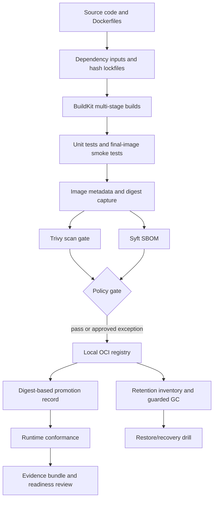

# Hardened, Optimized Image Pipeline for Data Services

> **Status:** `DRAFT — SPECIFICATION ONLY; NOT EXECUTED`
>
> This file is the single capstone specification. It does not modify the repository. Copy it to the target path listed below only after reviewing the open verification items.

## 1. Title and metadata

| Field | Value |
|---|---|
| Target file | `Stage 2E — Production DevOps & Platform Engineering/01-Container-Image-Engineering-and-Registry-Hygiene/Projects/01-hardened-optimized-image-pipeline-for-data-services.md` |
| Module | M01 — Container Image Engineering and Registry Hygiene |
| Project | Hardened, Optimized Image Pipeline for Data Services |
| Learner | Data/AI engineer who has completed Stages 0–2D |
| Prerequisites | Git, Linux shell, Python, basic Docker build/run; Units 1–8 |
| Estimated duration | 18–28 focused hours `[ASSUMPTION]`; depends on downloads, hardware, troubleshooting and prior experience |
| Environment | WSL2 Ubuntu primary; native Linux secondary; approximately 4 CPU cores, 8 GB RAM, 30 GB disk |
| Cost | Zero-budget local-first path; no paid cloud, registry or scanner required |
| Review date | 2026-10-24; version-sensitive details remain `[VERIFY]` |
| Execution status | No Docker builds, application tests, scans, benchmarks, registry push/pull, GC/restore operations or CI runs were executed while authoring this specification |

**Source alignment.** The attached generation prompt and the Library copy of `PROMPT-Container-Image-Engineering-and-Registry-Hygiene.md` were inspected, including the Unit 10 requirements. The Library Roadmap project tree was inspected and confirms this exact `Projects/` destination. The source syllabus Unit 10 calls for the three workload images, 13 exact Make targets, ADRs, digest/hash pinning, two-build reproducibility, cold/warm benchmark, digest promotion, local registry/cache, guarded retention/GC, hardening/conformance, Trivy, Syft, a written CI workflow, three runbooks, readiness review, learner-measured results, milestones, rubric, evidence structure, and self-review. No live official documentation was consulted in this authoring pass; source verification tasks remain open.

## 2. Project purpose and production scenario

A data platform team ships three services:

1. a FastAPI inference/API service;
2. a pandas/pyarrow batch ETL job;
3. an Airflow-style worker image that can later be adapted to PySpark.

The inherited images are reported to build slowly, exceed 1 GB, run as root, use mutable `latest` tags, vary between builds, and rely on an unmanaged registry that has run out of disk. Those are scenario facts, not measurements from this learner's machine.

The capstone builds a local-first pipeline that makes build inputs explicit, uses multi-stage builds and cache-friendly instruction ordering, tests the actual final runtime, measures image and build behavior, scans images, emits SBOMs, publishes to a local registry, promotes by digest, applies safe retention controls, and runs non-root conformance checks.

### Success means evidence, not merely a green command

The learner must distinguish three statuses in the final report:

- **Implemented locally:** the artifact or behavior was created and verified in the local environment; attach command output and versions.
- **Specified but not operated:** configuration or code is included, but the learner did not execute it or lacks the required local prerequisite.
- **Future production integration:** requires organization-specific CI, identity, TLS/PKI, registry, monitoring, backup, policy or platform work outside this local capstone.

A successful build is not proof that an image is secure. A zero-finding scan is not proof of zero vulnerabilities. An SBOM is not proof of origin. A digest pin is not proof that every build input is deterministic. A local registry is not a highly available production registry.

## 3. Learning outcomes mapped to L1–L4

| Level | Outcomes | Evidence |
|---|---|---|
| L1 — Beginner | Explain build context, layers, multi-stage builds, tags/digests, registry authentication, non-root identity, SBOM and scan limitations. | Architecture diagram; vocabulary answers; reviewed Dockerfiles. |
| L2 — Intermediate | Build three workload-appropriate images, run tests, inspect effective identity, use BuildKit cache, generate SBOMs and scan outputs. | Build logs; test report; `docker image inspect`; Trivy/Syft artifacts. |
| L3 — Advanced | Pin base-image and dependency inputs, compare two builds, benchmark cold/warm/partial changes, promote by digest, detect drift, and safely rehearse retention/recovery. | Reproducibility report; benchmark CSV/JSON; release manifest; dry-run GC plan; runbook evidence. |
| L4 — Expert | Defend base-image choices, isolate trust boundaries, state what evidence does not prove, prioritize incident response, and present a readiness/design review. | Four ADRs; incident runbooks; policy exception; scored defense and sign-off. |

## 4. Scope boundaries

| Area | Capstone scope | Boundary |
|---|---|---|
| Docker Engine/CLI, OCI concepts, BuildKit/buildx | Hands-on | Version-sensitive flags are `[VERIFY]`. |
| FastAPI, pandas/pyarrow ETL, Airflow-style worker | Hands-on | Keep datasets and dependencies small; use bounded fixtures. |
| PySpark | Awareness/optional variant | Full Spark may exceed the default laptop resource envelope. The main third image is a lightweight Airflow-style worker. |
| Local CNCF Distribution registry (`registry:2`) | Hands-on | Local demonstration only; not HA or production identity management. |
| Pull-through cache | Optional local experiment | Do only after current Distribution docs are checked; use isolated configuration and clearly label cache hit/miss evidence. |
| Trivy and Syft | Hands-on if installed | Record version and database state; scan output is time-dependent. |
| cosign/Sigstore | Optional stretch | Describe or perform only if installed and verified; do not claim signing occurred otherwise. |
| Docker Hub, GHCR, ECR, Google Artifact Registry, ACR, Harbor, Quay | Awareness/comparison | Pricing, quotas, retention and features change; verify official docs at review time. |
| Podman, Buildah, Kaniko, ko, Jib, Bazel `rules_oci`, Nix, Grype, Dive, Hadolint | Awareness/optional | Not required to complete the local capstone. |
| GitHub Actions | YAML authored and locally linted where possible | Hosted execution is not implied. `act` is optional and may differ from hosted runners. |
| Kubernetes `securityContext` | Forward reference | Do not deploy a cluster as part of this capstone. M03 owns Kubernetes operations. |
| Enterprise secrets, identity federation, HA, disaster recovery | Design only | Requires organization-specific architecture and testing. |

Forward references: M02 CI/CD pipeline engineering; M03 platform/orchestration security context; M08 observability/SRE operations; M09 supply-chain controls; M12 policy-as-code; M13 production release and governance. The exact future module names must be checked against the current Roadmap before cross-linking.

## 5. Architecture and data/control flow



### Control flow

- **Build inputs:** source revision, Dockerfiles, `.dockerignore`, base image digests, dependency lockfiles/hashes, OS package inputs, platform, builder version and build arguments.
- **Build output:** three tagged images plus immutable digest records.
- **Quality gates:** tests, size measurement, reproducibility comparison, Trivy threshold, SBOM generation, and runtime conformance.
- **Publication:** local registry with persistent project-owned storage; credentials and TLS configuration are local-only.
- **Promotion:** retag/copy the already-tested digest; do not rebuild independently for each environment.
- **Operations:** tag drift detection, capacity observation, retention inventory, dry-run GC, and restore evidence.
- **Audit trail:** commands, exit codes, tool versions, timestamps, output artifacts and explicit `NOT RUN` markers.

## 6. Requirements and non-functional requirements

### Functional requirements

- Three multi-stage Dockerfiles: API, ETL, and Airflow-style worker.
- The same Make targets are used locally and by the authored CI workflow.
- Dependency files are locked and hashed using a verified toolchain.
- Base images are selected by a real, reviewed digest for each supported platform; this document deliberately does not invent a digest.
- Image metadata includes known OCI labels; unknown values must not be fabricated.
- Images run under numeric non-root UID/GID.
- API image has a meaningful HTTP health endpoint. Finite batch/worker images are not given a misleading long-running health check.
- Runtime test covers read-only root where compatible, narrow writable paths, dropped capabilities, no-new-privileges, resource limits, and shutdown behavior.
- Trivy scan policy and exception record are versioned; Syft SBOMs are saved.
- Registry operations require explicit configuration and fail safely if prerequisites are missing.
- `gc` defaults to dry-run; destructive behavior requires explicit opt-in and an in-use digest inventory.
- `clean` deletes only the project's named output directories and temporary containers it can identify.

### Non-functional requirements

- Zero paid services and no cloud account required.
- Keep total local storage under the learner's 30 GB budget; measure actual disk usage before image pulls/builds.
- Default path should fit 4 CPU cores and 8 GB RAM, but dependency downloads may consume time and disk.
- Keep test fixtures small; never download large public datasets as a hidden prerequisite.
- Never place secrets in source control, `ARG`, `ENV`, image layers, command logs or build output.
- All destructive operations have a preflight, explicit confirmation, audit record and recovery path.
- Numeric targets for image size, build time and vulnerability counts are project decisions established from baseline evidence, not universal industry standards.

## 7. Proposed repository and evidence layout

The capstone code is shown inside this one Markdown file; the learner creates these files locally.

```text
image-pipeline-capstone/
├── README.md
├── Makefile
├── .dockerignore
├── .env.example
├── .gitignore
├── requirements/
│   ├── api.in
│   ├── etl.in
│   ├── worker.in
│   ├── api.lock
│   ├── etl.lock
│   └── worker.lock
├── services/
│   ├── api/
│   │   └── app.py
│   ├── etl/
│   │   └── run_etl.py
│   └── worker/
│       └── worker.py
├── docker/
│   ├── Dockerfile.api
│   ├── Dockerfile.etl
│   └── Dockerfile.worker
├── scripts/
│   ├── preflight.sh
│   ├── test_local.sh
│   ├── size_report.py
│   ├── repro_check.sh
│   ├── benchmark_builds.sh
│   ├── drift_check.py
│   ├── gc_plan.py
│   ├── conformance.sh
│   └── write_release_record.py
├── policy/
│   ├── trivy.env.example
│   └── exceptions.vex.yaml
├── registry/
│   ├── compose.yaml
│   ├── config.yml
│   └── README.md
├── .github/
│   └── workflows/
│       └── image-pipeline.yml
└── evidence/
    ├── README.md
    ├── versions/
    ├── build/
    ├── tests/
    ├── size/
    ├── reproducibility/
    ├── benchmarks/
    ├── scans/
    ├── sbom/
    ├── registry/
    ├── retention/
    ├── conformance/
    ├── incidents/
    └── readiness/
```

### Evidence rules

- Store outputs, not secrets. Redact credentials, tokens, internal hostnames and private paths before submission.
- Every report records date/time, Git commit, platform, tool versions, image reference/digest and command.
- A missing artifact is `NOT RUN` or `NOT AVAILABLE`, never a fabricated successful result.
- The `evidence/` directory is project-owned. `clean` must not remove the registry data directory or unrelated Docker images.

## 8. Milestones and completion gates

| Milestone | Estimate `[ASSUMPTION]` | Work | Gate |
|---|---:|---|---|
| 1. Baseline and preflight | 2–3 hours | Create layout, record versions/disk, build baseline images, document inherited risks. | All tools/prerequisites are recorded; no secret committed. |
| 2. Workloads and image design | 4–6 hours | Implement API, ETL and worker; build three multi-stage images; write four ADRs. | All three final images build and pass workload smoke tests. |
| 3. Integrity, cache and measurements | 3–5 hours | Pin digests and hash locks, run two builds, benchmark cold/warm/partial changes, capture size. | Results contain real learner measurements or explicit `NOT RUN`. |
| 4. Registry and release control | 3–5 hours | Start local registry, push/pull, create digest release record, test drift and safe retention plan. | Digest is traceable; destructive GC remains guarded; recovery path documented. |
| 5. Hardening and supply-chain evidence | 3–5 hours | Run conformance, Trivy, Syft, exception policy and CI YAML checks. | Effective user, scan policy, SBOM and test evidence recorded. |
| 6. Readiness and defense | 3–4 hours | Runbooks, results table, readiness review, rubric self-score and design defense. | Every required artifact has a status, owner and evidence path. |

Time excludes unusually slow downloads, fixing WSL2/Docker integration, or optional PySpark/`act`/cosign experiments.

## 9. Detailed implementation plan

1. **Inspect and record environment.** Confirm WSL2/native Linux, Docker Engine, buildx, Python, Git, available disk and CPU/memory limits. Save outputs under `evidence/versions/`.
2. **Create the file layout.** Keep source, dependency inputs, Dockerfiles, scripts, policy and evidence separated. Add `.gitignore` before generating credentials or local outputs.
3. **Implement workload code and bounded tests.** Use a small JSON API, a tiny CSV ETL fixture and a lightweight worker task. No large model or dataset is required.
4. **Create dependency inputs and locks.** Generate hash-locked files using a selected, versioned locking tool; review the resulting lockfiles and commit them. Do not paste invented hashes.
5. **Resolve and review base digests.** Choose a maintained Python base compatible with all selected wheels and target platform. Obtain digest from trusted registry metadata; verify platform and provenance according to team policy. Substitute a real digest at build time.
6. **Build baseline images.** Record image sizes and build times before optimization. A baseline may be a deliberately simple local build, but do not push unsafe baseline images into shared registries.
7. **Build multi-stage optimized images.** Copy dependency manifests first, use BuildKit cache mounts only after checking syntax, keep secrets out of layers, copy only runtime artifacts, and test final images.
8. **Run tests, size report and benchmarks.** Measure cold/warm/partial-change cases with repeated runs; capture medians and p95 only when the sample size supports the report. Do not use sample values as learner results.
9. **Run reproducibility check.** Build twice from the same source and explicit inputs; compare image digests and explain differences. A differing digest is evidence of different image content, not proof of tampering.
10. **Scan and generate SBOM.** Run Trivy and Syft, record tool/database state, apply threshold policy, and document any exception with expiry.
11. **Start the local registry.** Configure persistent project-owned storage, TLS and basic authentication. Confirm `/v2/`, push and pull. Pull-through cache is optional and version-sensitive.
12. **Promote by digest.** Create a release record that connects Git SHA, source, image digest, platform, scan, SBOM and approval. Demonstrate tag-drift detection.
13. **Exercise retention safely.** Inventory tags and digests, protect in-use/rollback digests, review a dry-run deletion plan, and rehearse recovery using disposable test content. Do not run destructive GC against a shared/production registry.
14. **Run runtime conformance.** Check image metadata and actual runtime behavior under non-root, read-only root where compatible, dropped capabilities, no-new-privileges, bounded resources, health and shutdown.
15. **Review CI and operations.** Validate YAML syntax locally if a linter is available; do not claim hosted execution. Complete runbooks, readiness checklist, grading and final design defense.

## 10. Complete illustrative project files

### 10.1 `README.md`

**Purpose:** entry point and reproducible instructions.  
**Prerequisites:** Git, Docker Engine with BuildKit/buildx, Python 3.11+ for helper scripts, Make, and enough disk for base images.  
**Validation:** follow `make all`; review `evidence/README.md`. No commands are claimed executed by this specification.

```markdown
# Image Pipeline Capstone

A local-first image pipeline for a FastAPI API, pandas/pyarrow ETL job, and
Airflow-style worker. The project is a learning lab, not a production registry.

## Before building
1. Review `.env.example` and create an untracked local `.env`.
2. Generate and review the three hash-locked dependency files.
3. Resolve a real base image digest for each supported platform.
4. Run `make lint` and `make test` before `make build`.

## Main workflow
- `make all`: safe local validation/build/scan/SBOM/size/conformance workflow.
- `make push`: requires a running authenticated local registry and explicit image names.
- `make promote`: records/promotes an already-built digest; it does not rebuild.
- `make gc`: dry-run inventory only by default.
- `make clean`: removes project-owned evidence/temp artifacts only.

See this project specification for ADRs, runbooks, acceptance criteria and
the limitations of local simulations.
```

### 10.2 `.gitignore`

```gitignore
.env
.env.*
!.env.example
*.pem
*.key
*.crt
registry/auth/
registry/certs/
registry/data/
evidence/*
!evidence/README.md
__pycache__/
*.py[cod]
.venv/
.cache/
dist/
build/
```

`registry/data/` is ignored because it may contain local registry blobs. Never commit credentials, private keys or registry data. The generated evidence folders should be added selectively when sanitized and intentionally reviewed.

### 10.3 `.dockerignore`

```dockerignore
.git
.env
.env.*
*.pem
*.key
*.crt
registry/
evidence/
.venv/
venv/
__pycache__/
*.py[cod]
.pytest_cache/
.mypy_cache/
.ruff_cache/
dist/
build/
*.parquet
*.csv
data/
models/
notebooks/
```

Review these exclusions against the actual app: do not accidentally exclude a required small test fixture or model artifact. Keep test data small and copy only what the image needs.

### 10.4 `.env.example`

```dotenv
# Copy to .env; never commit .env.
REGISTRY_HOST=localhost:5001
REGISTRY_NAMESPACE=capstone
IMAGE_VERSION=0.1.0
GIT_SHA=local
# Supply a real reviewed digest through the build command/environment:
# PYTHON_BASE=python:3.12-slim-bookworm@sha256:<verified digest>
# The placeholder is intentionally not a valid digest.
PYTHON_BASE=
TARGET_PLATFORM=linux/amd64
TRIVY_SEVERITY=HIGH,CRITICAL
```

### 10.5 Workload code

#### `services/api/app.py`

**Purpose:** small but realistic inference-style HTTP API with health and prediction routes.  
**Prerequisites:** `fastapi` and `uvicorn` in the generated lock.  
**Validation:** run `pytest`/smoke checks or start the final image and query `/health`.

```python
from fastapi import FastAPI
from pydantic import BaseModel, Field

app = FastAPI(title="Capstone Inference API", version="0.1.0")

class PredictRequest(BaseModel):
    values: list[float] = Field(min_length=1, max_length=256)

class PredictResponse(BaseModel):
    score: float
    model: str

@app.get("/health")
def health() -> dict[str, str]:
    return {"status": "ok"}

@app.post("/predict", response_model=PredictResponse)
def predict(payload: PredictRequest) -> PredictResponse:
    # Deliberately simple deterministic placeholder, not a trained model.
    score = sum(payload.values) / len(payload.values)
    return PredictResponse(score=score, model="mean-baseline-v1")
```

The arithmetic baseline is an interface fixture, not a claim about model quality. A real model introduces artifact provenance, memory sizing, warm-up and writable-cache requirements.

#### `services/etl/run_etl.py`

```python
import argparse
from pathlib import Path
import pandas as pd

def run(input_path: Path, output_path: Path) -> int:
    frame = pd.read_csv(input_path)
    required = {"record_id", "value"}
    missing = required - set(frame.columns)
    if missing:
        raise ValueError(f"missing required columns: {sorted(missing)}")
    frame["value"] = pd.to_numeric(frame["value"], errors="raise")
    result = frame.groupby("record_id", as_index=False)["value"].mean()
    output_path.parent.mkdir(parents=True, exist_ok=True)
    result.to_parquet(output_path, index=False)
    print(f"rows_in={len(frame)} rows_out={len(result)} output={output_path}")
    return 0

def main() -> int:
    parser = argparse.ArgumentParser()
    parser.add_argument("--input", type=Path, default=Path("/app/data/input.csv"))
    parser.add_argument("--output", type=Path, default=Path("/tmp/output/result.parquet"))
    args = parser.parse_args()
    return run(args.input, args.output)

if __name__ == "__main__":
    raise SystemExit(main())
```

#### `services/worker/worker.py`

```python
import json
import os
import signal
import sys
import time
from pathlib import Path

stopping = False

def request_stop(signum, _frame):
    global stopping
    stopping = True
    print(json.dumps({"event": "shutdown_requested", "signal": signum}), flush=True)

def main() -> int:
    signal.signal(signal.SIGTERM, request_stop)
    signal.signal(signal.SIGINT, request_stop)
    interval = float(os.getenv("WORK_INTERVAL_SECONDS", "2"))
    max_cycles = int(os.getenv("WORK_MAX_CYCLES", "3"))
    out_dir = Path(os.getenv("WORK_OUTPUT_DIR", "/tmp/worker"))
    out_dir.mkdir(parents=True, exist_ok=True)
    for cycle in range(1, max_cycles + 1):
        if stopping:
            break
        target = out_dir / f"cycle-{cycle}.json"
        target.write_text(json.dumps({"cycle": cycle, "status": "complete"}) + "\n")
        print(json.dumps({"event": "cycle_complete", "cycle": cycle}), flush=True)
        time.sleep(interval)
    print(json.dumps({"event": "worker_exit", "stopping": stopping}), flush=True)
    return 0

if __name__ == "__main__":
    raise SystemExit(main())
```

This is an Airflow-style task worker fixture, not an Airflow distribution. It exercises finite work, signal handling and writable paths without pulling in a large scheduler stack. A production Airflow image requires a pinned Airflow version, a matching constraints file, provider dependencies, metadata database connectivity and a separate operational design.

### 10.6 Dependency inputs and hash-locked files

**Files:** `requirements/api.in`, `requirements/etl.in`, `requirements/worker.in`.  
**Purpose:** readable direct dependencies; generated lock files capture the resolved transitive graph and hashes.  
**Prerequisites:** Python/pip and a reviewed `pip-tools` version in an isolated virtual environment.  
**Validation:** check lockfiles are committed, hash checking is enabled, and the exact install command succeeds in a clean build.

`requirements/api.in`:

```text
fastapi
uvicorn[standard]
httpx
pytest
```

`requirements/etl.in`:

```text
pandas
pyarrow
pytest
```

`requirements/worker.in`:

```text
pytest
```

Generate the actual lock files; do not invent hashes:

```bash
python -m venv .venv-lock
. .venv-lock/bin/activate
python -m pip install --upgrade pip
python -m pip install 'pip-tools'
pip-compile --generate-hashes --output-file requirements/api.lock requirements/api.in
pip-compile --generate-hashes --output-file requirements/etl.lock requirements/etl.in
pip-compile --generate-hashes --output-file requirements/worker.lock requirements/worker.in
python -m pip --version
pip-compile --version
```

Record the tool versions and review lockfile diffs. For strict reproducibility, pin the locking tool itself and use a controlled package index/mirror. The commands above are a bootstrap procedure, not a claim that lock files were generated here. Verify current pip-tools options against its official documentation before relying on them in a release process.

### 10.7 Base-image digest selection

No valid digest is hardcoded in this document. Resolve and review one for the intended platform using the selected registry's trusted metadata and local Docker tooling. A readable tag is useful context; the digest is the immutable content identifier.

```bash
# Example discovery only; inspect the returned RepoDigests and platform metadata.
docker pull python:3.12-slim-bookworm
docker image inspect python:3.12-slim-bookworm \
  --format '{{json .RepoDigests}}'
docker image inspect python:3.12-slim-bookworm \
  --format '{{.Os}}/{{.Architecture}}'
```

Use the exact reviewed reference, for example the pattern `python:3.12-slim-bookworm@sha256:<REAL_DIGEST>`, after replacing the placeholder with a digest actually obtained and reviewed. Do not copy a made-up digest. Digest references can differ by platform and registry/index behavior; record target platform and child manifest where relevant. Refresh the selected digest intentionally as part of a reviewed update process.

### 10.8 `docker/Dockerfile.api`

**Purpose:** multi-stage FastAPI image; builder and runtime use the same pinned Python base family to reduce ABI mismatch risk.  
**Prerequisites:** `requirements/api.lock`, resolved `PYTHON_BASE` containing a real digest, BuildKit-enabled buildx.  
**Validation:** build, run tests, inspect user/config, query `/health`, test shutdown and scan the final digest.

```dockerfile
# syntax=docker/dockerfile:1.7
ARG PYTHON_BASE
FROM ${PYTHON_BASE} AS builder
ENV VIRTUAL_ENV=/opt/venv
RUN python -m venv "${VIRTUAL_ENV}"
ENV PATH="${VIRTUAL_ENV}/bin:${PATH}"
WORKDIR /build
COPY requirements/api.lock ./requirements.lock
RUN --mount=type=cache,target=/root/.cache/pip \
    python -m pip install --require-hashes -r requirements.lock
COPY services/api/ ./services/api/
RUN python -m compileall -q services/api

FROM ${PYTHON_BASE} AS runtime
ARG VCS_REF=unknown
ARG VERSION=0.1.0
ARG CREATED=unknown
ARG SOURCE_URL=unknown
LABEL org.opencontainers.image.title="capstone-inference-api" \
      org.opencontainers.image.description="Local capstone FastAPI inference API" \
      org.opencontainers.image.source="${SOURCE_URL}" \
      org.opencontainers.image.revision="${VCS_REF}" \
      org.opencontainers.image.version="${VERSION}" \
      org.opencontainers.image.created="${CREATED}"
ENV VIRTUAL_ENV=/opt/venv \
    PATH="/opt/venv/bin:${PATH}" \
    PYTHONDONTWRITEBYTECODE=1 \
    PYTHONUNBUFFERED=1 \
    HOME=/home/app
RUN groupadd --gid 10001 app && \
    useradd --uid 10001 --gid 10001 --create-home --home-dir /home/app \
      --shell /usr/sbin/nologin app
WORKDIR /app
COPY --from=builder --chown=10001:10001 /opt/venv /opt/venv
COPY --from=builder --chown=10001:10001 /build/services/api/ /app/
USER 10001:10001
EXPOSE 8000
CMD ["uvicorn", "app:app", "--app-dir", "/app", "--host", "0.0.0.0", "--port", "8000"]
```

Notes: `groupadd`/`useradd` availability depends on the selected Debian-based base; verify the actual image. The OCI source label defaults to `unknown`; pass `SOURCE_URL` only when the real repository URL is known. Do not invent a source URL. The `RUN --mount=type=cache` syntax is BuildKit-specific and `[VERSION-SENSITIVE]`; verify the Dockerfile frontend/buildx version. Do not add a healthcheck instruction without validating the chosen runtime and health semantics; the conformance script probes `/health` from the host.

### 10.9 `docker/Dockerfile.etl`

```dockerfile
# syntax=docker/dockerfile:1.7
ARG PYTHON_BASE
FROM ${PYTHON_BASE} AS builder
ENV VIRTUAL_ENV=/opt/venv
RUN python -m venv "${VIRTUAL_ENV}"
ENV PATH="${VIRTUAL_ENV}/bin:${PATH}"
WORKDIR /build
COPY requirements/etl.lock ./requirements.lock
RUN --mount=type=cache,target=/root/.cache/pip \
    python -m pip install --require-hashes -r requirements.lock
COPY services/etl/ ./services/etl/
RUN python -m compileall -q services/etl

FROM ${PYTHON_BASE} AS runtime
ARG VCS_REF=unknown
ARG VERSION=0.1.0
ARG CREATED=unknown
ARG SOURCE_URL=unknown
LABEL org.opencontainers.image.title="capstone-pandas-pyarrow-etl" \
      org.opencontainers.image.description="Bounded pandas/pyarrow batch ETL" \
      org.opencontainers.image.source="${SOURCE_URL}" \
      org.opencontainers.image.revision="${VCS_REF}" \
      org.opencontainers.image.version="${VERSION}" \
      org.opencontainers.image.created="${CREATED}"
ENV VIRTUAL_ENV=/opt/venv \
    PATH="/opt/venv/bin:${PATH}" \
    PYTHONDONTWRITEBYTECODE=1 \
    PYTHONUNBUFFERED=1 \
    HOME=/home/app
RUN groupadd --gid 10001 app && \
    useradd --uid 10001 --gid 10001 --create-home --home-dir /home/app \
      --shell /usr/sbin/nologin app
WORKDIR /app
COPY --from=builder --chown=10001:10001 /opt/venv /opt/venv
COPY --from=builder --chown=10001:10001 /build/services/etl/ /app/
USER 10001:10001
ENTRYPOINT ["python", "/app/run_etl.py"]
CMD ["--input", "/app/data/input.csv", "--output", "/tmp/output/result.parquet"]
```

The sample ETL input is mounted read-only at runtime; output is written to a dedicated writable mount. pandas/pyarrow/numpy include native components. Build and runtime must use compatible Python ABI, CPU architecture and libc assumptions. This uses a Debian/glibc-family slim image deliberately rather than assuming Alpine/musl compatibility. Verify actual wheel metadata and runtime imports.

### 10.10 `docker/Dockerfile.worker`

```dockerfile
# syntax=docker/dockerfile:1.7
ARG PYTHON_BASE
FROM ${PYTHON_BASE} AS builder
ENV VIRTUAL_ENV=/opt/venv
RUN python -m venv "${VIRTUAL_ENV}"
ENV PATH="${VIRTUAL_ENV}/bin:${PATH}"
WORKDIR /build
COPY requirements/worker.lock ./requirements.lock
RUN --mount=type=cache,target=/root/.cache/pip \
    python -m pip install --require-hashes -r requirements.lock
COPY services/worker/ ./services/worker/
RUN python -m compileall -q services/worker

FROM ${PYTHON_BASE} AS runtime
ARG VCS_REF=unknown
ARG VERSION=0.1.0
ARG CREATED=unknown
ARG SOURCE_URL=unknown
LABEL org.opencontainers.image.title="capstone-airflow-style-worker" \
      org.opencontainers.image.description="Lightweight finite task worker fixture" \
      org.opencontainers.image.source="${SOURCE_URL}" \
      org.opencontainers.image.revision="${VCS_REF}" \
      org.opencontainers.image.version="${VERSION}" \
      org.opencontainers.image.created="${CREATED}"
ENV VIRTUAL_ENV=/opt/venv \
    PATH="/opt/venv/bin:${PATH}" \
    PYTHONDONTWRITEBYTECODE=1 \
    PYTHONUNBUFFERED=1 \
    HOME=/home/app \
    WORK_OUTPUT_DIR=/tmp/worker
RUN groupadd --gid 10001 app && \
    useradd --uid 10001 --gid 10001 --create-home --home-dir /home/app \
      --shell /usr/sbin/nologin app
WORKDIR /app
COPY --from=builder --chown=10001:10001 /opt/venv /opt/venv
COPY --from=builder --chown=10001:10001 /build/services/worker/ /app/
USER 10001:10001
ENTRYPOINT ["python", "/app/worker.py"]
```

This is the selected third workload because it fits the local laptop. It models a finite task worker, not the Airflow scheduler/webserver. A true Airflow worker needs a matching Airflow constraints set and careful provider/version compatibility. A PySpark image is a stretch option: Spark/JVM, native libraries, and memory overhead can push the laptop beyond 8 GB; use a small local job, measure actual memory/disk, and do not imply that the lightweight worker validates Spark runtime behavior.

### 10.11 `scripts/preflight.sh`

```bash
#!/usr/bin/env bash
set -Eeuo pipefail
missing=0
for cmd in docker make python3 git; do
  if ! command -v "$cmd" >/dev/null 2>&1; then
    printf 'MISSING: required command %s\n' "$cmd" >&2
    missing=1
  fi
done
if (( missing )); then
  printf 'Preflight failed; install missing tools and retry.\n' >&2
  exit 2
fi
docker info >/dev/null 2>&1 || {
  printf 'Docker daemon is not reachable for this user.\n' >&2
  printf 'Start Docker Desktop/Engine and verify WSL2 integration; avoid sudo as a workaround unless your local setup requires it.\n' >&2
  exit 2
}
docker buildx version >/dev/null 2>&1 || {
  printf 'docker buildx is unavailable; enable/install a supported buildx plugin.\n' >&2
  exit 2
}
python3 --version
docker version --format 'client={{.Client.Version}} server={{.Server.Version}}'
docker buildx version
git rev-parse --show-toplevel >/dev/null 2>&1 || {
  printf 'Run this command inside the project Git repository.\n' >&2
  exit 2
}
df -h .
printf 'Preflight checks passed. This does not prove any image is secure.\n'
```

### 10.12 `scripts/test_local.sh`

```bash
#!/usr/bin/env bash
set -Eeuo pipefail
python3 -m compileall -q services scripts
python3 - <<'PY'
from pathlib import Path
required = [
    Path("services/api/app.py"),
    Path("services/etl/run_etl.py"),
    Path("services/worker/worker.py"),
    Path("docker/Dockerfile.api"),
    Path("docker/Dockerfile.etl"),
    Path("docker/Dockerfile.worker"),
]
missing = [str(p) for p in required if not p.is_file()]
if missing:
    raise SystemExit("Missing required project files: " + ", ".join(missing))
print("Source syntax and required-file checks passed.")
PY
printf 'Dependency-backed API/ETL/worker tests run in containers through scripts/conformance.sh.\n'
```

Run from the project root. This deliberately does not require pandas/pyarrow installed on the host; dependency-backed ETL testing runs in the image. It is a syntax/file gate, not a substitute for container smoke tests.

### 10.13 `scripts/size_report.py`

```python
#!/usr/bin/env python3
import json
import subprocess
import sys
from datetime import datetime, timezone

def run(*args: str) -> str:
    return subprocess.check_output(args, text=True).strip()

def main() -> int:
    if len(sys.argv) != 2:
        print("usage: size_report.py IMAGE", file=sys.stderr)
        return 2
    image = sys.argv[1]
    raw = run("docker", "image", "inspect", image)
    info = json.loads(raw)[0]
    size = info.get("Size")
    digest = (info.get("RepoDigests") or [])
    record = {
        "timestamp_utc": datetime.now(timezone.utc).isoformat(),
        "image": image,
        "image_id": info.get("Id"),
        "repo_digests": digest,
        "os": info.get("Os"),
        "architecture": info.get("Architecture"),
        "configured_user": (info.get("Config") or {}).get("User"),
        "image_size_bytes_unpacked_estimate": size,
        "note": "Docker inspect Size is not the compressed registry transfer size."
    }
    print(json.dumps(record, indent=2))
    return 0

if __name__ == "__main__":
    raise SystemExit(main())
```

The `Size` field is a local image-size measure, not the compressed transfer size. Use registry manifest/layer metadata or a verified tool to estimate transfer size, and label the measure clearly.

### 10.14 `scripts/repro_check.sh`

```bash
#!/usr/bin/env bash
set -Eeuo pipefail
: "${PYTHON_BASE:?Set PYTHON_BASE to a reviewed tag@sha256:digest reference}"
[[ "$PYTHON_BASE" == *@sha256:* ]] || {
  echo "PYTHON_BASE must include @sha256:<digest>; resolve and review it first." >&2
  exit 2
}
IMAGE="${IMAGE:-capstone/api:repro-check}"
PLATFORM="${TARGET_PLATFORM:-linux/amd64}"
TMP="$(mktemp -d)"
trap 'rm -rf "$TMP"' EXIT
for n in 1 2; do
  docker buildx build \
    --platform "$PLATFORM" \
    --build-arg "PYTHON_BASE=$PYTHON_BASE" \
    --build-arg "VCS_REF=$(git rev-parse HEAD)" \
    --build-arg "VERSION=${IMAGE_VERSION:-0.1.0}" \
    --provenance=false \
    --load \
    -f docker/Dockerfile.api \
    -t "$IMAGE" .
  docker image inspect "$IMAGE" --format '{{.Id}}' > "$TMP/image-id-$n"
  docker image inspect "$IMAGE" --format '{{json .RootFS.Layers}}' > "$TMP/layers-$n"
  docker image inspect "$IMAGE" --format '{{json .Config}}' > "$TMP/config-$n"
  if [[ "$n" == "1" ]]; then
    cp "$TMP/image-id-1" "$TMP/first-image-id"
    cp "$TMP/layers-1" "$TMP/first-layers"
    cp "$TMP/config-1" "$TMP/first-config"
  fi
done
printf 'Image IDs:\n'; cat "$TMP/image-id-1" "$TMP/image-id-2"
if cmp -s "$TMP/image-id-1" "$TMP/image-id-2"; then
  echo "Image ID equality: PASS for this run pair"
else
  echo "Image ID equality: DIFFERENT; investigate rather than hardcoding a pass."
fi
if cmp -s "$TMP/layers-1" "$TMP/layers-2"; then
  echo "Layer list equality: PASS for this run pair"
else
  echo "Layer list equality: DIFFERENT"
fi
if cmp -s "$TMP/config-1" "$TMP/config-2"; then
  echo "Image config equality: PASS for this run pair"
else
  echo "Image config equality: DIFFERENT"
fi
echo "Capture tool versions, platform, source SHA, base digest, lockfile hashes and full build logs in evidence/reproducibility/."
```

**Important limitations:** This is a starting comparison harness, not a universal proof of reproducibility. Rebuilding the same tag replaces the prior local tag; the recorded comparison files are temporary. For a formal report, preserve full build logs and both artifacts/digests using separate temporary tags or OCI exports. The example disables provenance metadata to simplify one comparison dimension; do not use that flag without verifying current buildx support and understanding the provenance trade-off. A production release should retain provenance evidence, not discard it to make equality easier.

### 10.15 `scripts/benchmark_builds.sh`

```bash
#!/usr/bin/env bash
set -Eeuo pipefail
: "${PYTHON_BASE:?Set PYTHON_BASE to a reviewed tag@sha256:digest reference}"
[[ "$PYTHON_BASE" == *@sha256:* ]] || { echo "PYTHON_BASE must include a digest" >&2; exit 2; }
OUT="${1:-evidence/benchmarks}"
mkdir -p "$OUT"
RAW="$OUT/build-times-seconds.csv"
printf 'case,run,elapsed_seconds,platform,cache_note\n' > "$RAW"
PLATFORM="${TARGET_PLATFORM:-linux/amd64}"
run_build() {
  local case_name="$1" run_n="$2" cache_note="$3"
  local start end elapsed
  start="$(date +%s)"
  docker buildx build --platform "$PLATFORM" \
    --build-arg "PYTHON_BASE=$PYTHON_BASE" \
    -f docker/Dockerfile.api -t capstone/api:benchmark .
  end="$(date +%s)"
  elapsed=$((end-start))
  printf '%s,%s,%s,%s,%s\n' "$case_name" "$run_n" "$elapsed" "$PLATFORM" "$cache_note" >> "$RAW"
}
# Cold-cache procedure is manual and intentionally not destructive by default:
# use a dedicated builder/cache namespace and document how it was isolated.
# Do not run `docker builder prune -a` on a shared developer machine.
for n in 1 2 3; do run_build warm "$n" "warm-or-existing-cache; record exact state"; done
echo "Warm measurements recorded. For cold and partial cases, use a disposable builder or controlled cache namespace, then run the same measured function and document the cache reset. Do not claim this file alone measured cold/partial cases."
echo "Raw timings: $RAW"
```

This starter script records elapsed whole seconds for a repeated warm-like case. It does **not** automatically create a clean cold-cache state or a partial-source-change workload. To complete the required benchmark, use a dedicated disposable builder/cache namespace, create a controlled source-only change for partial runs, repeat at least five times per condition where practical, and append actual observations to the CSV with notes. Do not prune shared caches just to manufacture a cold run. For `n >= 5`, compute median and p95 from observed samples; state percentile method. If fewer runs were possible, report sample count and mark p95 as low-confidence or `NOT REPORTED`.

### 10.16 `scripts/drift_check.py`

```python
#!/usr/bin/env python3
import argparse
import json
import subprocess
import sys

def inspect_digest(image: str) -> str:
    result = subprocess.run(
        ["docker", "image", "inspect", image, "--format", "{{json .RepoDigests}}"],
        check=True, text=True, capture_output=True
    )
    values = json.loads(result.stdout or "[]")
    if not values:
        raise RuntimeError(f"no RepoDigest found for {image}; is it pulled from a registry?")
    return values[0].split("@", 1)[1]

def main() -> int:
    parser = argparse.ArgumentParser()
    parser.add_argument("--image", required=True)
    parser.add_argument("--expected-digest", required=True,
                        help="sha256:... copied from a trusted release record")
    args = parser.parse_args()
    if not args.expected_digest.startswith("sha256:"):
        parser.error("--expected-digest must be a sha256: digest")
    observed = inspect_digest(args.image)
    print(json.dumps({"image": args.image, "expected": args.expected_digest,
                      "observed": observed}, indent=2))
    if observed != args.expected_digest:
        print("DRIFT: observed digest differs from the release record", file=sys.stderr)
        return 1
    print("No digest mismatch detected for this local image record.")
    return 0

if __name__ == "__main__":
    raise SystemExit(main())
```

This checks a locally available `RepoDigest`, not a universal remote registry API. For remote verification, use a current registry-aware client or OCI Distribution API method verified for that registry and authentication configuration. Record the exact command/tool/version. A mutable tag is not sufficient expected state.

### 10.17 `scripts/gc_plan.py`

```python
#!/usr/bin/env python3
import argparse
import json
from pathlib import Path
from datetime import datetime, timezone

def main() -> int:
    parser = argparse.ArgumentParser(description="Create a review-only registry retention plan.")
    parser.add_argument("--inventory", required=True, help="JSON list of candidate digest records")
    parser.add_argument("--protected", required=True, help="JSON list of digests used by deployments/rollback")
    parser.add_argument("--out", default="evidence/retention/gc-plan.json")
    parser.add_argument("--execute", action="store_true", help="NOT IMPLEMENTED: this tool never deletes registry data")
    args = parser.parse_args()
    if args.execute:
        parser.error("This script intentionally does not execute deletion or garbage collection.")
    inventory = json.loads(Path(args.inventory).read_text(encoding="utf-8"))
    protected = set(json.loads(Path(args.protected).read_text(encoding="utf-8")))
    if not isinstance(inventory, list) or not all(isinstance(x, dict) for x in inventory):
        raise ValueError("inventory must be a JSON array of objects")
    candidates = []
    held = []
    for item in inventory:
        digest = item.get("digest")
        if not digest or not str(digest).startswith("sha256:"):
            raise ValueError(f"invalid or missing digest in inventory record: {item!r}")
        if digest in protected:
            held.append(item)
        else:
            candidates.append(item)
    report = {
        "generated_utc": datetime.now(timezone.utc).isoformat(),
        "mode": "DRY_RUN_ONLY",
        "candidate_count": len(candidates),
        "protected_count": len(held),
        "candidates": candidates,
        "protected": held,
        "warning": "This plan does not prove candidates are unreachable or safe to delete. Verify registry-specific retention/GC semantics and every reference before any operator action."
    }
    target = Path(args.out)
    target.parent.mkdir(parents=True, exist_ok=True)
    target.write_text(json.dumps(report, indent=2) + "\n", encoding="utf-8")
    print(f"Dry-run plan written: {target}; candidates={len(candidates)} protected={len(held)}")
    return 0

if __name__ == "__main__":
    raise SystemExit(main())
```

The script creates an inventory plan only. It does not delete tags, blobs, volumes or registry data. `protected` must be a verified list of in-use and rollback digests; an empty list is not proof that no digest is in use.

### 10.18 `scripts/conformance.sh`

**Purpose:** run bounded workload-specific runtime checks and emit explicit PASS/FAIL/NOT RUN evidence.  
**Prerequisites:** Docker, `timeout`, `curl`, and the relevant local image.  
**Validation:** run once for each image and inspect the report and exit code.

```bash
#!/usr/bin/env bash
set -Eeuo pipefail
IMAGE="${1:?usage: conformance.sh IMAGE api|etl|worker}"
KIND="${2:?usage: conformance.sh IMAGE api|etl|worker}"
REPORT_DIR="${REPORT_DIR:-evidence/conformance}"
mkdir -p "$REPORT_DIR"
safe_name="$(printf '%s' "$IMAGE" | tr '/:' '__')"
REPORT="$REPORT_DIR/${safe_name}-${KIND}.txt"
CONTAINER="capstone-conf-$$"
TMP="$(mktemp -d)"
status=0
record() { printf '%s: %s\n' "$1" "$2" | tee -a "$REPORT"; }
cleanup() {
  docker rm -f "$CONTAINER" >/dev/null 2>&1 || true
  rm -rf "$TMP"
}
trap cleanup EXIT INT TERM
: > "$REPORT"

for cmd in docker timeout; do
  if ! command -v "$cmd" >/dev/null 2>&1; then
    record NOT_RUN "required command missing: $cmd"
    exit 2
  fi
done
if ! docker image inspect "$IMAGE" >/dev/null 2>&1; then
  record NOT_RUN "image not present locally"
  exit 2
fi
user="$(docker image inspect "$IMAGE" --format '{{.Config.User}}')"
record INFO "configured_user=${user:-<empty>}"
if [[ -n "$user" && "$user" != "0" && "$user" != "root" ]]; then
  record PASS "image declares non-root user"
else
  record FAIL "image does not clearly declare a non-root user"
  status=1
fi

case "$KIND" in
  api)
    if ! command -v curl >/dev/null 2>&1; then
      record NOT_RUN "curl missing; API endpoint check skipped"
      exit 2
    fi
    docker run -d --name "$CONTAINER" --read-only \
      --tmpfs /tmp:rw,noexec,nosuid,size=64m,uid=10001,gid=10001 \
      --cap-drop=ALL --security-opt=no-new-privileges \
      --pids-limit 128 --memory 512m --cpus 1 \
      -p 127.0.0.1:18081:8000 "$IMAGE" >/dev/null
    if timeout 30 bash -c 'until curl --fail --silent http://127.0.0.1:18081/health >/dev/null; do sleep 1; done'; then
      record PASS "API health endpoint responded within 30 seconds"
    else
      record FAIL "API health endpoint did not respond within timeout"
      status=1
    fi
    ;;
  etl)
    mkdir -p "$TMP/data" "$TMP/output"
    chmod 0777 "$TMP/output"
    printf 'record_id,value\na,2\na,4\nb,9\n' > "$TMP/data/input.csv"
    chmod 0444 "$TMP/data/input.csv"
    if timeout 60 docker run --rm --name "$CONTAINER" --read-only \
      --tmpfs /tmp:rw,noexec,nosuid,size=128m,uid=10001,gid=10001 \
      --mount "type=bind,src=$TMP/data,dst=/app/data,readonly" \
      --mount "type=bind,src=$TMP/output,dst=/tmp/output" \
      --cap-drop=ALL --security-opt=no-new-privileges \
      --pids-limit 128 --memory 1g --cpus 1 "$IMAGE"; then
      if find "$TMP/output" -maxdepth 1 -type f -name '*.parquet' -size +0c | grep -q .; then
        record PASS "ETL produced a non-empty Parquet file"
      else
        record FAIL "ETL exited but expected Parquet output was absent"
        status=1
      fi
    else
      record FAIL "ETL failed or exceeded 60-second timeout"
      status=1
    fi
    ;;
  worker)
    mkdir -p "$TMP/output"
    chmod 0777 "$TMP/output"
    if timeout 30 docker run --rm --name "$CONTAINER" --read-only \
      --tmpfs /tmp:rw,noexec,nosuid,size=64m,uid=10001,gid=10001 \
      --cap-drop=ALL --security-opt=no-new-privileges \
      --pids-limit 128 --memory 256m --cpus 1 \
      -e WORK_OUTPUT_DIR=/tmp/worker -e WORK_MAX_CYCLES=1 -e WORK_INTERVAL_SECONDS=0 \
      --mount "type=bind,src=$TMP/output,dst=/tmp/worker" "$IMAGE"; then
      if find "$TMP/output" -maxdepth 1 -type f -name 'cycle-*.json' -size +0c | grep -q .; then
        record PASS "worker completed bounded task and wrote expected output"
      else
        record FAIL "worker exited without expected output"
        status=1
      fi
    else
      record FAIL "worker failed or exceeded 30-second timeout"
      status=1
    fi
    ;;
  *)
    record NOT_RUN "unknown workload kind: $KIND"
    exit 2
    ;;
esac
record INFO "Limited checks do not prove image security; review the threat model and all report fields."
exit "$status"
```

This script is a starter and must be executed and debugged locally before acceptance. The ETL bind-mounted output uses permissive temporary-directory permissions only inside a newly created temporary directory; a production volume should use explicit ownership/ACLs rather than `0777`. API port 18081 must be unused. The script cleans up only its named container and its own temporary directory. It distinguishes unsupported prerequisites (`NOT_RUN`) from failed checks (`FAIL`) and uses bounded commands.

### 10.19 `scripts/write_release_record.py`

```python
#!/usr/bin/env python3
import argparse
import json
import subprocess
from datetime import datetime, timezone
from pathlib import Path

def main() -> int:
    parser = argparse.ArgumentParser()
    parser.add_argument("--image", required=True)
    parser.add_argument("--source-revision", required=True)
    parser.add_argument("--platform", required=True)
    parser.add_argument("--scan-file", required=True)
    parser.add_argument("--sbom-file", required=True)
    parser.add_argument("--out", default="evidence/registry/release-record.json")
    args = parser.parse_args()
    inspect = subprocess.run(
        ["docker", "image", "inspect", args.image],
        check=True, capture_output=True, text=True
    )
    image = json.loads(inspect.stdout)[0]
    digests = image.get("RepoDigests") or []
    if not digests:
        raise SystemExit("No RepoDigest available. Push/pull the approved image and record its digest first.")
    record = {
        "created_utc": datetime.now(timezone.utc).isoformat(),
        "image_reference": args.image,
        "image_id": image.get("Id"),
        "repo_digests": digests,
        "source_revision": args.source_revision,
        "platform": args.platform,
        "scan_evidence": args.scan_file,
        "sbom_evidence": args.sbom_file,
        "approval_status": "REVIEW_REQUIRED",
        "note": "This record links evidence but does not itself prove provenance or approval."
    }
    out = Path(args.out)
    out.parent.mkdir(parents=True, exist_ok=True)
    out.write_text(json.dumps(record, indent=2) + "\n", encoding="utf-8")
    print(f"Release record written for review: {out}")
    return 0

if __name__ == "__main__":
    raise SystemExit(main())
```

### 10.20 `policy/trivy.env.example`

```dotenv
TRIVY_SEVERITY=HIGH,CRITICAL
TRIVY_EXIT_CODE=1
# Record the actual scanner version and DB update time in evidence/scans/.
# Do not suppress findings globally to get a green build.
```

The threshold is a proposed project gate, not an industry standard. A policy exception must be explicit, reviewed, time-bounded, and reevaluated when the image digest, component version, threat context or scanner data changes.

### 10.21 `policy/exceptions.vex.yaml`

```yaml
# Example schema for the capstone's documented exception record.
# This is not asserted to be a formal VEX schema; verify a selected VEX format
# before exchanging it with external tooling.
document:
  id: "capstone-exception-example"
  status: "EXAMPLE_NOT_APPROVED"
  created: "REPLACE_WITH_ACTUAL_DATE"
  owner: "REPLACE_WITH_TEAM_OR_PERSON"
  image_digest: "REPLACE_WITH_REAL_SHA256_DIGEST"
  component:
    name: "REPLACE_WITH_COMPONENT"
    version: "REPLACE_WITH_VERSION"
    vulnerability_id: "REPLACE_WITH_REAL_FINDING_ID"
  assessment:
    reason: "REPLACE_WITH_EVIDENCE_BASED_RATIONALE"
    exploitability_assessment: "NOT_ASSESSED"
    risk: "REPLACE_WITH_RISK_STATEMENT"
    compensating_controls:
      - "REPLACE_WITH_CONTROL_AND_EVIDENCE"
  approval:
    approver: "REPLACE_WITH_AUTHORIZED_REVIEWER"
    approved_at: "NOT_APPROVED"
    expires_at: "REPLACE_WITH_EXPIRY_DATE"
  reevaluation_triggers:
    - "image digest changes"
    - "component version changes"
    - "scanner database or advisory changes materially"
    - "new exploitability evidence"
```

Do not treat the example as an approved exception. Acceptance requires a real finding (if any), owner, approver, reason, risk, compensating control, expiry and re-evaluation trigger. If no exception is needed, record `no exceptions` with date and reviewer.

### 10.22 Registry configuration: local-only TLS and authentication

**Intended paths:** `registry/compose.yaml`, `registry/config.yml`, `registry/README.md`.  
**Purpose:** run a local Distribution registry with persistent project-owned storage and authenticated TLS.  
**Prerequisites:** Docker Compose plugin, local certificate-generation tool, and current Distribution documentation.  
**Status:** version-sensitive configuration; verify before use.

`registry/config.yml`:

```yaml
version: 0.1
log:
  level: info
  fields:
    service: registry
storage:
  filesystem:
    rootdirectory: /var/lib/registry
  delete:
    enabled: true
http:
  addr: :5000
  headers:
    X-Content-Type-Options: [nosniff]
auth:
  htpasswd:
    realm: "Capstone Registry"
    path: /auth/htpasswd
```

`registry/compose.yaml`:

```yaml
services:
  registry:
    image: ${REGISTRY_IMAGE:?Set REGISTRY_IMAGE to a reviewed registry:2@sha256:digest reference}
    container_name: capstone-registry
    restart: unless-stopped
    ports:
      - "127.0.0.1:5001:5000"
    environment:
      REGISTRY_HTTP_TLS_CERTIFICATE: /certs/registry.crt
      REGISTRY_HTTP_TLS_KEY: /certs/registry.key
    volumes:
      - ./config.yml:/etc/docker/registry/config.yml:ro
      - ./data:/var/lib/registry
      - ./auth:/auth:ro
      - ./certs:/certs:ro
    command: ["serve", "/etc/docker/registry/config.yml"]
```

Before starting, generate a certificate with a SAN for `localhost` and `127.0.0.1`, create an htpasswd file with a locally installed tool or a disposable helper container, and protect the key/password files. Example local certificate flow (inspect the certificate and verify the OpenSSL version first):

```bash
mkdir -p registry/certs registry/auth registry/data
chmod 700 registry/certs registry/auth registry/data
cat > registry/certs/localhost.cnf <<'EOF'
[req]
distinguished_name = dn
x509_extensions = v3_req
prompt = no
[dn]
CN = localhost
[v3_req]
subjectAltName = @alt_names
keyUsage = critical,digitalSignature,keyEncipherment
extendedKeyUsage = serverAuth
[alt_names]
DNS.1 = localhost
IP.1 = 127.0.0.1
EOF
openssl req -x509 -nodes -newkey rsa:3072 -days 30 \
  -keyout registry/certs/registry.key \
  -out registry/certs/registry.crt \
  -config registry/certs/localhost.cnf
chmod 600 registry/certs/registry.key
openssl x509 -in registry/certs/registry.crt -noout -subject -issuer -dates -ext subjectAltName
```

This is a short-lived lab certificate, not a production PKI pattern. Trust installation differs between Docker Desktop/WSL2 and native Linux; verify the selected client trust-store procedure and remove/revoke the lab trust when finished. Create the `htpasswd` file using a verified local `htpasswd` command or a disposable helper container; pass the password interactively, never put it in a Dockerfile or commit it. Keep credentials out of terminal transcripts and evidence. Exact cert and auth commands depend on installed OpenSSL/htpasswd versions; verify syntax and avoid printing passwords to logs. Do not bind the registry to `0.0.0.0`. Configure the Docker client to trust the certificate according to its operating system and Docker Desktop/WSL2 setup. Do not disable TLS verification or mark the registry insecure as a production fix.

`registry/README.md` should record:
- registry image digest and version actually used;
- certificate SAN, trust installation location and expiry;
- credential creation and rotation steps (without secret values);
- local push/pull and `/v2/` test results;
- storage path and disk-monitoring method;
- documented shutdown/backup/recovery process;
- any limitations of basic auth and the local-only bind.

Example inspection, after TLS trust and auth are configured:

```bash
curl --fail --silent --show-error \
  --user "$REGISTRY_USER:$REGISTRY_PASSWORD" \
  https://localhost:5001/v2/
```

Do not put credentials literally on the command line in shared terminals or recorded logs. Prefer a protected shell environment or an interactive login workflow; sanitize evidence. Expected response shape depends on registry configuration and auth challenge, so record the actual status/body rather than hardcoding a transcript.

#### Optional pull-through cache

A pull-through cache may depend on registry version, upstream authentication and mirror configuration. Verify the official CNCF Distribution documentation for the exact version before enabling it. Use a separate disposable cache instance/config and isolated storage. Do not edit global Docker daemon mirror settings for this exercise. Demonstrate hit/miss by collecting registry logs and comparing a first pull with a repeated pull; label any outage simulation as a limited stand-in if upstream isolation is not truly reproduced.

### 10.23 `Makefile`

**Purpose:** consistent local task interface.  
**Prerequisites:** GNU Make, Docker/buildx, Python, and generated dependency lockfiles.  
**Validation:** `make -n all` reviews command expansion; run each target only after reading its prerequisites and effects.

```makefile
SHELL := /usr/bin/env bash
.SHELLFLAGS := -Eeuo pipefail -c
.DEFAULT_GOAL := all

PYTHON_BASE ?=
TARGET_PLATFORM ?= linux/amd64
IMAGE_VERSION ?= 0.1.0
GIT_SHA ?= $(shell git rev-parse --short=12 HEAD 2>/dev/null || echo local)
CREATED ?= unknown
REGISTRY_HOST ?= localhost:5001
REGISTRY_NAMESPACE ?= capstone
TRIVY_SEVERITY ?= HIGH,CRITICAL
OUT := evidence
API_IMAGE := $(REGISTRY_NAMESPACE)/api:$(IMAGE_VERSION)
ETL_IMAGE := $(REGISTRY_NAMESPACE)/etl:$(IMAGE_VERSION)
WORKER_IMAGE := $(REGISTRY_NAMESPACE)/worker:$(IMAGE_VERSION)

.PHONY: lint build test scan sbom size-check repro-check push promote gc conformance clean all preflight locks

preflight:
	@bash scripts/preflight.sh
	@test -n "$(PYTHON_BASE)" || { echo "Set PYTHON_BASE to a reviewed tag@sha256:digest"; exit 2; }
	@case "$(PYTHON_BASE)" in *@sha256:*) ;; *) echo "PYTHON_BASE must include @sha256:"; exit 2;; esac
	@test -s requirements/api.lock -a -s requirements/etl.lock -a -s requirements/worker.lock || { echo "Generate all hash-locked requirements/*.lock first"; exit 2; }

locks:
	@test -s requirements/api.lock -a -s requirements/etl.lock -a -s requirements/worker.lock || { echo "Missing lockfile; see project instructions to generate with hashes"; exit 2; }

lint: preflight
	@python3 -m compileall -q services scripts
	@python3 -c "import yaml" >/dev/null 2>&1 && python3 -c "import yaml; yaml.safe_load(open('.github/workflows/image-pipeline.yml'))" || echo "YAML parser unavailable or workflow expression syntax needs separate validation"
	@echo "Lint baseline complete; add pinned Ruff/Hadolint/yamllint checks if installed."

build: preflight
	@mkdir -p $(OUT)/build
	@for target in api etl worker; do \
	  docker buildx build --load --platform "$(TARGET_PLATFORM)" \
	    --build-arg "PYTHON_BASE=$(PYTHON_BASE)" \
	    --build-arg "VCS_REF=$(GIT_SHA)" --build-arg "VERSION=$(IMAGE_VERSION)" \
	    --build-arg "CREATED=$(CREATED)" --build-arg "SOURCE_URL=$(SOURCE_URL)" \
	    -f "docker/Dockerfile.$$target" -t "$(REGISTRY_NAMESPACE)/$$target:$(IMAGE_VERSION)" . \
	    2>&1 | tee "$(OUT)/build/$$target.log"; \
	done

test: preflight
	@bash scripts/test_local.sh
	@bash scripts/conformance.sh "$(API_IMAGE)" api
	@bash scripts/conformance.sh "$(ETL_IMAGE)" etl
	@bash scripts/conformance.sh "$(WORKER_IMAGE)" worker
	@echo "Workload smoke/conformance checks attempted; review evidence for FAIL and NOT RUN."

scan: preflight
	@command -v trivy >/dev/null 2>&1 || { echo "Trivy missing; install a supported free version and record DB state"; exit 2; }
	@mkdir -p $(OUT)/scans
	@for target in api etl worker; do \
	  trivy image --severity "$(TRIVY_SEVERITY)" --exit-code 1 \
	    --format json --output "$(OUT)/scans/$$target-trivy.json" \
	    "$(REGISTRY_NAMESPACE)/$$target:$(IMAGE_VERSION)"; \
	done

sbom: preflight
	@command -v syft >/dev/null 2>&1 || { echo "Syft missing; install a supported free version"; exit 2; }
	@mkdir -p $(OUT)/sbom
	@for target in api etl worker; do \
	  syft "$(REGISTRY_NAMESPACE)/$$target:$(IMAGE_VERSION)" \
	    -o "cyclonedx-json=$(OUT)/sbom/$$target.cdx.json"; \
	done

size-check: preflight
	@mkdir -p $(OUT)/size
	@for target in api etl worker; do \
	  python3 scripts/size_report.py "$(REGISTRY_NAMESPACE)/$$target:$(IMAGE_VERSION)" \
	    > "$(OUT)/size/$$target.json"; \
	done

repro-check: preflight
	@mkdir -p $(OUT)/reproducibility
	@PYTHON_BASE="$(PYTHON_BASE)" TARGET_PLATFORM="$(TARGET_PLATFORM)" \
	  IMAGE_VERSION="$(IMAGE_VERSION)" bash scripts/repro_check.sh \
	  | tee "$(OUT)/reproducibility/api-repro-check.txt"

push: preflight
	@test -n "$${REGISTRY_USER:-}" -a -n "$${REGISTRY_PASSWORD:-}" || { echo "Set REGISTRY_USER and REGISTRY_PASSWORD in a protected local environment"; exit 2; }
	@docker login "$(REGISTRY_HOST)" --username "$${REGISTRY_USER}" --password-stdin <<< "$${REGISTRY_PASSWORD}"
	@for target in api etl worker; do \
	  docker tag "$(REGISTRY_NAMESPACE)/$$target:$(IMAGE_VERSION)" "$(REGISTRY_HOST)/$(REGISTRY_NAMESPACE)/$$target:$(IMAGE_VERSION)"; \
	  docker push "$(REGISTRY_HOST)/$(REGISTRY_NAMESPACE)/$$target:$(IMAGE_VERSION)"; \
	done

promote: preflight
	@test -n "$${SOURCE_REF:-}" -a -n "$${TARGET_REF:-}" -a -n "$${EXPECTED_DIGEST:-}" || { echo "Missing SOURCE_REF/TARGET_REF/EXPECTED_DIGEST"; exit 2; }
	@case "$${EXPECTED_DIGEST}" in sha256:*) ;; *) echo "EXPECTED_DIGEST must start with sha256:"; exit 2;; esac
	@command -v docker >/dev/null 2>&1
	@docker buildx imagetools inspect "$${SOURCE_REF}@$${EXPECTED_DIGEST}" >/dev/null
	@docker buildx imagetools create --tag "$${TARGET_REF}" "$${SOURCE_REF}@$${EXPECTED_DIGEST}"
	@observed="$$(docker buildx imagetools inspect --raw "$${TARGET_REF}" | sha256sum | awk '{print "sha256:"$$1}')"; \
	  printf 'expected=%s\nobserved=%s\n' "$${EXPECTED_DIGEST}" "$$observed"; \
	  test "$$observed" = "$${EXPECTED_DIGEST}" || { echo "Digest changed or registry manifest differs; stop and investigate." >&2; exit 1; }
	@echo "Digest-based promotion verified; no rebuild was performed. Confirm buildx version and registry support before use."

gc:
	@mkdir -p $(OUT)/retention
	@test -s "$${GC_INVENTORY:-}" -a -s "$${GC_PROTECTED:-}" || { echo "Set GC_INVENTORY and GC_PROTECTED JSON files; no defaults"; exit 2; }
	@python3 scripts/gc_plan.py --inventory "$${GC_INVENTORY}" --protected "$${GC_PROTECTED}" --out "$(OUT)/retention/gc-plan.json"
	@if [[ "$${GC_CONFIRM:-}" == "YES_DELETE" ]]; then \
	  echo "This project does not execute GC. Follow the registry-version-specific reviewed runbook manually."; \
	else \
	  echo "DRY RUN ONLY. No registry content was deleted."; \
	fi

conformance: preflight
	@mkdir -p $(OUT)/conformance
	@for target in api etl worker; do \
	  bash scripts/conformance.sh "$(REGISTRY_NAMESPACE)/$$target:$(IMAGE_VERSION)" "$$target" || echo "Conformance returned nonzero for $$target; review report and preserve FAIL/NOT RUN."; \
	done

clean:
	@echo "This removes only evidence generated by this project (build logs/reports), not registry data, Docker images, volumes, credentials, or source."
	@rm -rf "$(OUT)/build" "$(OUT)/tests" "$(OUT)/size" "$(OUT)/reproducibility" "$(OUT)/benchmarks" "$(OUT)/scans" "$(OUT)/sbom" "$(OUT)/conformance" "$(OUT)/retention"
	@echo "Project-owned evidence output directories removed."

all: lint build test size-check scan sbom conformance
	@echo "Base local pipeline complete. Run repro-check and benchmark explicitly; push/promote/gc are intentionally separate operations."
```

**Target contract (all 13 required targets):**

| Target | Purpose/inputs | Outputs | Failure behavior | Repeatability / safety |
|---|---|---|---|---|
| `lint` | Static syntax and available YAML parser; source/scripts/workflow. | Console output; optional lint artifacts. | Fails on compile errors; parser absence is reported for manual follow-up. | Safe to repeat. |
| `build` | Three Dockerfiles, lockfiles, `PYTHON_BASE`, platform and metadata. | Images and logs under `evidence/build/`. | Stops on first failed build. | Repeatable; tag updates are local and should be recorded. |
| `test` | Built images and bounded fixtures. | Test/conformance reports. | Fails on source checks or workload conformance; review any NOT RUN output. | Safe; only named temporary containers/fixtures. |
| `scan` | Built images, Trivy and current database. | JSON scan reports. | Nonzero if configured severity threshold is exceeded or scanner errors. | Safe; results change with DB. |
| `sbom` | Built images and Syft. | CycloneDX JSON files. | Fails if tool/output fails. | Safe; outputs reflect image digest and scanner version. |
| `size-check` | Built local images. | JSON metadata/size report. | Fails if image absent or inspect fails. | Safe. |
| `repro-check` | Base digest, same source/lockfiles/platform. | Comparison log. | Fails on missing prerequisites; reports mismatch without fabricating a pass. | Re-runs are safe but rebuild local tags; preserve evidence. |
| `push` | Local registry, protected credentials, images. | Registry tags/digests and push logs. | Fails if credentials/registry unavailable. | Repeated pushes may update mutable tags; verify digests. |
| `promote` | Source/target refs and verified expected digest. | Planned promotion record/operation evidence. | Fails on missing or malformed inputs. | No rebuild; uses buildx registry-side manifest copy and verifies the target raw manifest digest. Verify buildx/registry compatibility before use; multi-platform index and single-platform manifest behavior may differ. |
| `gc` | Inventory and protected digest files. | Dry-run plan JSON. | Fails on invalid/missing inventory. | Dry-run only; this Make target never deletes data. |
| `conformance` | Built images and runtime support. | Text reports. | Missing prerequisites are NOT RUN; failures must be reviewed. | Safe with bounded runtime; workload-specific checks still required. |
| `clean` | Project-owned evidence output paths. | Removes generated report folders. | Shell errors fail the target. | Deletes only named evidence subfolders; never registry data/images/volumes. |
| `all` | Lint, test, build, size, scan, SBOM and conformance. | Combined evidence. | Stops if a prerequisite target fails. | Excludes push, promote and GC; safe local workflow. |

**Implementation caveat:** the Makefile is a starter interface, not yet a fully validated release pipeline. It intentionally refuses to invent a digest and keeps `promote` as a guarded interface until a registry-aware copy mechanism is selected and verified. `conformance` includes a generic probe that must be supplemented with workload-specific tests before claiming acceptance. Complete those explicit gaps; do not mark them as passing merely because `make all` exits zero.


### 10.24 Architecture Decision Records (ADRs)

These four ADRs are proposed decisions for the local capstone. They are not claims that production review has approved them. Replace placeholders with actual evidence and revisit each decision when the triggers occur.

#### ADR-001 — FastAPI runtime base

- **Status:** Proposed; human verification required.
- **Context:** A small FastAPI API needs a Python runtime, CA trust, predictable startup and a non-root identity. A distroless image may reduce included tools but complicate debugging and may require careful Python/runtime packaging.
- **Options:** (A) maintained Debian-based Python slim image; (B) a minimal/distroless Python runtime; (C) Alpine/musl-based Python image.
- **Decision:** Start with a maintained Debian/glibc-family slim image, pinned by a verified digest. Keep builder and runtime on the same reviewed base family; copy only the virtual environment and app files. Consider distroless only after proving interpreter, shared-library, CA and debugging requirements.
- **Evidence required:** image digest/platform; startup and `/health` tests; actual effective UID; TLS test; size and scan reports; final image dependency closure; shutdown evidence.
- **Consequences:** A conventional Python runtime is easier to inspect and likely compatible with common Python wheels, but may be larger than a carefully engineered distroless image.
- **Security implications:** Explicit non-root identity, narrow writable paths, capability dropping and no-new-privileges remain necessary. Slim does not mean vulnerability-free.
- **Compatibility risks:** Python ABI, CPU architecture, native wheels, CA bundle, timezone/locale and entrypoint behavior. Confirm the actual image supports `groupadd`/`useradd`.
- **Update cadence:** Review base digest and vulnerability data on each planned dependency/base update and after relevant security advisories; set an organization-approved cadence.
- **Revisit triggers:** material CVE/advisory, Python version change, architecture expansion, dependency/native-library change, size regression, or evidence that distroless improves the operational outcome without reducing debuggability.

#### ADR-002 — pandas/pyarrow ETL runtime base

- **Status:** Proposed; human verification required.
- **Context:** pandas, NumPy and PyArrow may include native components and shared-library dependencies. The runtime must parse CSV and write Parquet without the compiler/toolchain used during dependency installation.
- **Options:** (A) Debian/glibc-family slim base shared with the builder; (B) Alpine/musl base; (C) a custom minimal runtime with explicitly copied libraries.
- **Decision:** Start with the same pinned Debian/glibc-family base in builder and runtime. Install dependencies from a hash-locked file in the builder, copy the virtual environment and ETL code, run as UID/GID 10001, and mount input read-only/output writable.
- **Evidence required:** successful `import pandas, pyarrow`; a tiny end-to-end Parquet round trip; wheel/platform metadata; shared-library diagnostics where available; image size and scan output.
- **Consequences:** This prioritizes compatibility and a manageable lab over minimum image size. Runtime libraries may be retained that a more specialized image could omit.
- **Security implications:** Do not install compilers in the final stage; scan final images and keep input/output mounts narrow. Native dependencies do not remove the need for least privilege and resource limits.
- **Compatibility risks:** glibc versus musl, Python ABI, NumPy/Pandas/PyArrow version constraints, architecture-specific wheels, memory use and locale/timezone assumptions.
- **Update cadence:** Regenerate and review locks as a controlled change; update base digest when approved and repeat ETL/import/Parquet tests.
- **Revisit triggers:** unsupported wheel, repeated native-library vulnerability, architecture expansion, size/disk pressure, or a justified need for a custom runtime.

#### ADR-003 — Airflow-style worker versus full PySpark/Airflow image

- **Status:** Proposed; human verification required.
- **Context:** The learner's default environment is approximately 4 CPU cores, 8 GB RAM and 30 GB disk. A full Spark/JVM or Airflow installation can materially increase downloads, image size, memory and compatibility burden.
- **Options:** (A) lightweight finite Python task-worker fixture; (B) a full Airflow worker with version-matched constraints/providers; (C) a PySpark/JVM image with a small local job.
- **Decision:** Implement the lightweight worker as the required third workload. Treat full Airflow and PySpark as optional variants that require a separate resource and dependency plan. Do not claim the lightweight worker proves Spark or Airflow compatibility.
- **Evidence required:** worker build/start/exit logs; numeric user; writable output behavior; SIGTERM response; size and memory/disk observation. For any optional variant, capture exact Python/JVM/Spark/Airflow versions and actual resource usage.
- **Consequences:** The default project stays feasible on the stated laptop and still exercises image hygiene, signals and filesystem controls. It does not validate a production Spark/Airflow stack.
- **Security implications:** Use a non-root user, bounded resources, least writable access and no Docker socket/host-root mount. Full orchestration images need separate secrets, plugin and scheduler threat analysis.
- **Compatibility risks:** Spark/JVM version matrix, native dependencies, Python/JVM memory overhead, Airflow constraints/providers, architecture and local container resource limits.
- **Update cadence:** Review versions on each planned stack upgrade and before extending the capstone to a real scheduler or cluster.
- **Revisit triggers:** project requirement explicitly needs Spark/Airflow semantics, laptop resources are expanded, or a production deployment target is selected.

#### ADR-004 — Local registry, TLS/authentication and trust boundary

- **Status:** Proposed; human verification required.
- **Context:** The scenario's unmanaged registry is out of disk. The learner needs a free local registry to exercise push/pull, immutable digests, capacity and retention without a paid provider.
- **Options:** (A) local CNCF Distribution registry bound to loopback with persistent project-owned storage and TLS/basic auth; (B) unauthenticated HTTP local registry; (C) hosted registry; (D) a more feature-rich local Harbor deployment.
- **Decision:** Use a loopback-bound local Distribution registry with persistent project-owned storage, TLS and basic auth after verifying the selected registry version. Do not expose it on all interfaces. Treat pull-through cache as optional and isolate its configuration.
- **Evidence required:** registry image version/digest; certificate SAN/trust result; auth challenge and successful authenticated `/v2/` check; push/pull digest; data path and free disk; restart/recovery result; logs for cache hit/miss if cache is enabled.
- **Consequences:** This is a low-cost lab for registry semantics, not production HA, enterprise identity or a complete artifact-governance system.
- **Security implications:** Protect credentials/private keys, scope local binding, separate pull/push/delete rights where possible, monitor storage and avoid disabling TLS verification.
- **Compatibility risks:** Docker Desktop/WSL2 trust-store behavior, certificate SANs, registry config schema, basic-auth limitations, mirror client differences, GC semantics and upstream cache behavior.
- **Update cadence:** Review config against the selected registry release before upgrades; rotate credentials/certificates according to a documented local policy.
- **Revisit triggers:** multiple users, network exposure, production workloads, need for SSO/role separation/audit/HA, registry version change, or repeated disk/outage incidents.


## 11. Verification commands and acceptance criteria

### 11.1 Environment and source

```bash
git status --short
bash scripts/preflight.sh
docker buildx inspect --bootstrap
df -h .
```

Acceptance:
- tool versions and builder/platform are recorded;
- free disk is sufficient for three images plus registry data;
- `git status` shows no secret or generated registry data staged;
- buildx bootstrap output is saved and inspected.

### 11.2 Dependency integrity

```bash
sha256sum requirements/*.lock
grep -n -- '--hash=sha256:' requirements/*.lock | head
```

Acceptance:
- all three lockfiles exist, are committed and were generated with the selected locking tool;
- the actual lockfiles contain hashes for resolved packages where supported;
- base image reference includes a reviewed digest;
- the selected platform is recorded.
- **Do not** accept the sample `.in` files as a replacement for generated locks.

### 11.3 Build and runtime

```bash
make build PYTHON_BASE="$PYTHON_BASE" TARGET_PLATFORM=linux/amd64
docker image ls capstone/api capstone/etl capstone/worker
docker image inspect capstone/api:0.1.0 --format '{{.Config.User}}'
docker image inspect capstone/etl:0.1.0 --format '{{.Config.User}}'
docker image inspect capstone/worker:0.1.0 --format '{{.Config.User}}'
```

Acceptance:
- all three images build from the selected platform/digest;
- effective configured user is numeric non-root;
- image IDs, tags, source revision and base digest are recorded;
- final-image tests pass, not merely builder-stage tests;
- native dependency imports work inside the ETL runtime.

### 11.4 API smoke test

```bash
docker run --rm -d --name capstone-api-smoke -p 127.0.0.1:18000:8000 capstone/api:0.1.0
trap 'docker rm -f capstone-api-smoke >/dev/null 2>&1 || true' EXIT
curl --fail --silent --show-error http://127.0.0.1:18000/health
curl --fail --silent --show-error -H 'Content-Type: application/json' \
  -d '{"values":[2,4,6]}' http://127.0.0.1:18000/predict
docker stop --time 10 capstone-api-smoke
```

Acceptance: actual response validates health and request schema; termination completes within the documented grace period. Record observed response rather than copying an illustrative result.

### 11.5 ETL smoke test

Create a tiny input fixture under `evidence/tests/input.csv`, mount it read-only and mount a dedicated output directory at `/tmp/output`. Ensure the directory is owned/writable by UID 10001. Run the ETL container and verify the Parquet output can be read back using a small Python verification step. Do not mount the host root or broad home directory.

Acceptance: input is unchanged, output exists, row counts are recorded, and a repeat run behaves as intended.

### 11.6 Worker and signal test

Run the worker with a bounded cycle count and output directory mounted as a dedicated writable temporary path. Send SIGTERM during a controlled run and record whether it exits within the expected grace period. Test under the same read-only-root and dropped-capability options intended for the final runtime.

Acceptance: no writes to the container root are required; logs show shutdown handling; cleanup removes only the named test container and temporary output.

### 11.7 Scan and SBOM

```bash
trivy --version
syft version
mkdir -p evidence/scans evidence/sbom
trivy image --severity HIGH,CRITICAL --exit-code 1 \
  --format json --output evidence/scans/api-trivy.json capstone/api:0.1.0
syft capstone/api:0.1.0 -o cyclonedx-json=evidence/sbom/api.cdx.json
```

Repeat for ETL and worker. Acceptance:
- scanner version and database update time are recorded;
- image digest, severity policy and exceptions are linked;
- gate result is reported honestly;
- SBOM parses with a compatible validator or is reviewed for valid JSON and expected component inventory;
- no CVE count is fabricated.

### 11.8 Reproducibility and performance

Run `make repro-check` twice from the same clean Git commit and controlled input state. Record exact build command, builder version, base digest, lockfile hashes, platform and image config/layer comparisons. Investigate timestamps, generated files, package repositories, build backend, ownership/order, `.pyc` and environment metadata if outputs differ.

For benchmark completion, run at least five repetitions per cold, warm and partial-change condition where laptop constraints permit. Record sample count and raw seconds; calculate median and p95 from those actual observations only. If a case could not be measured, mark it `NOT RUN`, state why and do not substitute the illustrative target.

Acceptance:
- raw measurements are preserved;
- cache state and test conditions are documented;
- compressed transfer size and unpacked/local image size are not conflated;
- SLO is explicitly labelled as a proposed team objective and justified from baseline data.

### 11.9 Registry and release

After local TLS trust and authentication are configured:

```bash
curl --fail --silent --show-error --user "$REGISTRY_USER:$REGISTRY_PASSWORD" \
  https://localhost:5001/v2/
docker login localhost:5001
docker tag capstone/api:0.1.0 localhost:5001/capstone/api:0.1.0
docker push localhost:5001/capstone/api:0.1.0
docker pull localhost:5001/capstone/api:0.1.0
docker image inspect localhost:5001/capstone/api:0.1.0 --format '{{json .RepoDigests}}'
```

Avoid placing real passwords in command history or evidence. If the TLS trust configuration is not ready, stop and fix it; do not turn off verification. Acceptance: push/pull succeeds, expected digest is recorded, local registry storage is persistent and project-owned, and a cold pull failure is not mistaken for an application failure.

### 11.10 Retention/GC

Prepare:
- a complete candidate inventory of tags/manifests/digests;
- a protected list derived from active deployment and rollback records;
- a dry-run report and reviewer approval;
- a restore/recovery rehearsal using disposable data.

**Destructive-operation warning:** Do not run garbage collection against a shared or production registry as part of this capstone. Before any local destructive test, verify the exact registry version's official procedure, isolate the disposable registry, back up its data, stop or quiesce writes as required by that version, record approval, and confirm restore. The supplied script never deletes registry content.

Acceptance: protected digests are excluded from the candidate plan, dry-run output is reviewed, and a documented recovery test proves the team knows what can and cannot be restored.

## 12. Image-size, build-time and reproducibility measurement methodology

### 12.1 Image size

Capture:
- `docker image inspect` size and image ID;
- registry manifest/layer metadata or a verified tool for compressed transfer size;
- `docker system df` before/after where helpful;
- exact image digest, platform and tool version.

Do not compare a compressed download size with an unpacked root filesystem size. Record whether the metric includes shared layers. Do not promise a universal target such as “under 100 MB” without workload-specific baseline and dependency evidence.

### 12.2 Build-time benchmark

Use three distinct conditions:

- **Cold:** a dedicated disposable builder/cache namespace with no reusable project cache. Do not prune a shared developer cache.
- **Warm:** unchanged inputs and available expected cache.
- **Partial change:** a source-only change that should not invalidate dependency installation; record the exact diff.

For each condition record run count, raw elapsed time, median, p95, CPU/memory/disk, platform, network conditions, Docker/buildx/BuildKit versions, cache state, source SHA and image size. Five or more runs per condition are preferred for this lab; if fewer are possible, report sample size and uncertainty. p95 from very small samples is unstable; explain the method rather than presenting false precision.

**Proposed SLO method:** establish baseline median and p95 from representative runs, agree a target with the team based on developer/release needs, then define alert thresholds and a review window. A local lab cannot establish a universal industry SLO or error budget.

### 12.3 Reproducibility

Record:
- Git commit and dirty-tree state;
- base digest and platform;
- lockfile SHA-256 hashes;
- OS package repository/snapshot inputs where used;
- Python/pip/pip-tools versions and builder version;
- build args, timestamps, environment and generated files;
- image ID, config and layer digests for both builds.

Compare artifact hashes and image digest/config/layers separately. Same source SHA does not guarantee byte-identical image. A mismatch is a starting point for investigation; it is not proof of malicious activity. A pinned base digest does not pin every network dependency or generated timestamp.

## 13. Registry operations, retention/GC, recovery and access control

### 13.1 Authentication and authorization

Authentication establishes which client identity is presented; authorization determines what that identity can do. Basic auth over correctly configured TLS is acceptable for a local lab, but it is not a complete enterprise identity solution. Use separate identities/permissions for pull, push, delete and administration in production. Avoid sharing admin credentials with runtime workloads.

### 13.2 Capacity and disk-full response

Monitor registry data directory size and free disk. Establish a warning threshold from the laptop's actual free space and project storage budget, not an invented industry number. If the registry is full:
1. stop unnecessary pushes and avoid deleting files manually from the registry storage directory;
2. identify registry version, data path, active writers and failed requests;
3. inspect image/digest inventory and protected rollback set;
4. add safe capacity or move to a planned cleanup window;
5. use only the registry's documented retention/GC procedure;
6. verify pulls of required digests and document recovered capacity.

### 13.3 Retention proposal

Proposed starting policy `[ASSUMPTION — team to approve]`:
- retain the currently deployed digest and at least one known-good rollback digest per workload;
- retain all release digests for the agreed rollback window;
- exclude active, in-flight, quarantined or incident-related digests from cleanup;
- require dry-run inventory and a second-person review for deletion;
- store release records and SBOM/scan evidence separately from registry blobs;
- document expiry and owner for exceptions.

This policy is a proposal, not a universal retention standard. Set duration from business recovery objectives and registry capacity evidence.

### 13.4 Garbage collection

Deleting a tag and reclaiming blob storage are different operations. Shared layers may be referenced by multiple manifests, and registry products differ in how they remove unreferenced blobs. For CNCF Distribution, verify the exact version's official garbage-collection instructions, write-quiescence/read-only requirements, and recovery semantics before use. Never assume a procedure for Distribution applies to Harbor, GHCR, ECR, ACR or another registry.

The provided `gc_plan.py` only generates a candidate plan. It is not a GC executor. Any future executor must require explicit confirmation, verify the target registry and namespace, compare protected digest inventory, produce an audit log, and stop if inventory is stale or incomplete.

### 13.5 Recovery drill

Use a disposable registry and a test image only. Document:
- backup method and what it covers;
- a known test digest and manifest;
- a controlled removal/retention action consistent with the selected registry version;
- restore from backup or repush from trusted source;
- digest verification after recovery;
- time taken and gaps.

If the operation is too risky or unsupported locally, run a documented simulation using an inventory file and a known retained copy; label it `SIMULATED`, not `RESTORE TEST PASSED`.

## 14. Runtime hardening and conformance

### 14.1 Baseline policy

- Use numeric UID/GID 10001 for these examples, verify effective runtime identity and filesystem ownership.
- Use exec-form `ENTRYPOINT`/`CMD` so signals reach the application; verify graceful shutdown.
- Prefer read-only root filesystem; add only narrow tmpfs/volume mounts for required scratch, model cache or outputs.
- Drop all Linux capabilities by default and add only a demonstrated requirement.
- Use `no-new-privileges`, default seccomp and AppArmor/SELinux controls where supported.
- Set PID, memory and CPU limits based on measured workload behavior; test for OOM and timeout failure modes.
- Avoid `--privileged`, broad host filesystem mounts and Docker socket mounts.
- Do not force a health check on a finite batch process that exits successfully. Test service health endpoints from the orchestrator/host.
- Rootless Docker/Podman and a non-root process inside a rootful engine are distinct controls with different threat models.

### 14.2 Example API runtime invocation

```bash
docker run --rm --name capstone-api-hardened \
  --read-only \
  --tmpfs /tmp:rw,noexec,nosuid,size=64m,uid=10001,gid=10001 \
  --cap-drop=ALL \
  --security-opt=no-new-privileges \
  --pids-limit 128 \
  --memory 512m \
  --cpus 1 \
  -p 127.0.0.1:18000:8000 \
  capstone/api:0.1.0
```

Verify tmpfs option syntax and support in the installed Docker/runtime. This is a starting local example; it must be tested against actual app behavior and resource use. Do not add capabilities unless a failing operation and audit evidence justify them.

### 14.3 Kubernetes mapping — forward reference only

| Local/container concept | Kubernetes concept to study later |
|---|---|
| Numeric non-root user/group | `securityContext.runAsUser`, `runAsGroup`, `runAsNonRoot` |
| Read-only root filesystem | `securityContext.readOnlyRootFilesystem` |
| Drop capabilities | `securityContext.capabilities.drop` |
| no-new-privileges / seccomp | `allowPrivilegeEscalation: false`, `seccompProfile` |
| CPU/memory limits | container `resources.requests` and `resources.limits` |
| Health endpoints | `readinessProbe`, `livenessProbe`, `startupProbe` |
| Writable scratch | explicit `emptyDir`/volume mounts and size policy |

Verify fields and behavior against the Kubernetes version in use. This mapping is not a Kubernetes deployment guide.

## 15. Scanning, SBOM, exception policy and provenance/signing awareness

### 15.1 Trivy gate

Scan the final image by immutable digest when available. Record Trivy version, vulnerability database update time, image digest, platform, severity threshold, exit code and exception status. A proposed default gate is `HIGH,CRITICAL` with a nonzero exit code; the team must decide whether this is appropriate and document the decision.

A scanner can miss vulnerabilities because of database freshness, package metadata, unsupported ecosystems, configuration or detection limits. Findings require triage; severity does not by itself prove exploitability. Do not invent CVE counts or declare a finding non-exploitable without evidence.

### 15.2 Exception/VEX-style record

The included YAML is a human-readable example, not a claim of conformance to a formal VEX schema. For any exception, record affected image digest, component/version, finding identifier, reason, risk, owner, approver, compensating control, expiry and re-evaluation triggers. If no exception is granted, record that decision and reviewer.

### 15.3 Syft SBOM

Generate a CycloneDX JSON SBOM per image and retain it alongside digest-linked scan results. Validate output and record Syft version. An SBOM lists identified components under the tool's detection model; it does not prove that every component was discovered, that the image is safe, or that the image was built from a claimed source.

### 15.4 cosign/Sigstore and provenance

Optional stretch only. Signing can provide evidence that a signing identity signed a specific artifact under a particular trust policy. Provenance can describe build inputs/process. Neither replaces access control, build isolation, review or vulnerability management. Do not claim signatures or provenance were generated unless the learner actually ran and verified them.

## 16. CI workflow — `.github/workflows/image-pipeline.yml`

**Purpose:** demonstrate a plausible GitHub Actions workflow using the same Make targets.  
**Status:** syntax and action versions must be verified; no hosted run is claimed.  
**Security:** least permissions, no secrets for pull-request validation, no automatic production push/promotion.

```yaml
name: local-image-pipeline

on:
  pull_request:
  push:
    branches: [main]

permissions:
  contents: read

jobs:
  validate:
    runs-on: ubuntu-latest
    steps:
      - name: Checkout source
        uses: actions/checkout@v4 # [VERSION-SENSITIVE] review and pin by policy
      - name: Set up Python
        uses: actions/setup-python@v5 # [VERSION-SENSITIVE] review and pin by policy
        with:
          python-version: "3.12"
      - name: Install local helper dependencies
        run: |
          python -m pip install --upgrade pip
          python -m pip install pip-tools
      - name: Generate or verify dependency locks
        run: |
          test -s requirements/api.lock
          test -s requirements/etl.lock
          test -s requirements/worker.lock
      - name: Static checks
        run: make lint
      - name: Unit tests
        run: make test
```

This workflow is intentionally a validation skeleton. It does not build/push images because a verified base digest and registry policy must be supplied. To make it fully executable in CI, configure `PYTHON_BASE` as a reviewed non-secret variable and install Docker/buildx/Trivy/Syft versions with a reviewed pin policy. Do not pass registry credentials to pull-request jobs. For release jobs, separate permissions, environments, approval and digest promotion. `act` is optional; local emulation may differ from hosted runners and cannot prove the hosted workflow ran.

**Acceptance:** YAML parses using a suitable parser, actions are pinned according to team policy, `make` targets agree with the Makefile, pull-request permissions are read-only, and no secret is printed or exposed.

## 17. Incident runbooks

### Runbook A — Registry disk full

**Symptoms:** pushes fail, registry logs show storage errors, or free disk falls below the locally approved threshold.

**Immediate response**
1. Confirm the target is the local capstone registry, not a shared registry.
2. Stop unnecessary pushes; do not delete files directly from registry storage.
3. Record free disk, registry container state/logs, registry version, data path and affected digests.
4. Check whether existing pulls still work; do not restart all workloads just to test.
5. Review a dry-run inventory and protected rollback list.
6. If no safe cleanup is immediately available, stop the lab and free unrelated user-owned space or expand the dedicated disk safely.

**Recovery**
- Follow the exact registry-version GC/maintenance procedure only in a disposable local environment after backup and write coordination.
- Verify pulls of protected digests and inspect free disk.
- Record start/end time, changes, evidence and remaining risk.

**Prevention:** capacity monitoring, retention review, registry data on a dedicated path, no manual blob deletion, tested recovery.

### Runbook B — Tag drift or unexpected image change

**Symptoms:** the same tag resolves to a different digest, nodes report inconsistent image IDs, or a new deployment differs from the approved release record.

**Immediate response**
1. Freeze tag mutation and promotion.
2. Record tag, registry, observed digest, expected digest, platform, node/pod image IDs and timestamps.
3. Compare against the release record and determine whether this is a legitimate promotion, platform index selection, or unauthorized change.
4. Preserve healthy instances; avoid mass restarts.
5. Roll back or forward only to a verified approved digest.

**Recovery:** restore the intended immutable reference, verify all target nodes use expected content, audit credentials and tag-write logs, then re-enable promotion with approval.

**Prevention:** deploy by digest, restrict tag mutation, log writes, detect drift and retain release metadata.

### Runbook C — Upstream registry rate limit or outage

**Symptoms:** pulls fail on cold nodes, cached images work while uncached images fail, or registry returns rate-limit/auth/network errors.

**Immediate response**
1. Separate DNS/TLS/auth/rate-limit errors from missing content.
2. Determine whether requested digest is already available in a trusted local cache or alternate registry.
3. Avoid deleting cached content or restarting healthy containers.
4. Use only an approved alternate copy and verify its digest against the release record.
5. If no trusted copy exists, wait for upstream recovery or restore connectivity; do not bypass TLS or switch to an unverified tag.

**Recovery:** validate pulls and application startup; record cache hit/miss, registry error, duration and affected workloads.

**Prevention:** controlled pull-through caching, capacity monitoring, digest-based mirrors, upstream retry/backoff policy and documented cold-start behavior.

## 18. Before/after results template

**All cells remain blank until the learner supplies measured evidence.** Do not enter the scenario's reported “1 GB+” as a measured baseline for this machine.

| Workload | Baseline image size (metric specified) | Final image size (same metric) | Cold build median / p95 | Warm build median / p95 | High/Critical findings | Effective UID:GID | Reproducibility result | SBOM evidence path |
|---|---|---|---|---|---|---|---|---|
| FastAPI API |  |  |  |  |  |  |  |  |
| pandas/pyarrow ETL |  |  |  |  |  |  |  |  |
| Airflow-style worker |  |  |  |  |  |  |  |  |

Additional record:
- Date and machine:
- WSL2/native Linux version:
- Docker Engine/buildx/BuildKit versions:
- Target platform:
- Base image reference and digest:
- Lockfile SHA-256 values:
- Number of benchmark runs per condition:
- Cache state and network conditions:
- Trivy version and database update time:
- Scanner exception IDs/expiry:
- What changed and why:
- Which results are `NOT RUN` or uncertain:

## 19. Production-readiness review — one page

Complete this review from evidence, not assumptions.

| Domain | Ready criteria | Status (PASS/PARTIAL/FAIL/NOT RUN) | Evidence / owner |
|---|---|---|---|
| Inputs and supply chain | Base digests, lockfiles/hashes, source SHA, tool versions and build inputs recorded. |  |  |
| Build quality | Three multi-stage images build; cache ordering reviewed; final-image tests pass. |  |  |
| Runtime compatibility | Native imports, CA trust, timezone needs and platform tested. |  |  |
| Image efficiency | Same size metric before/after; cold/warm/partial benchmarks have raw evidence. |  |  |
| Reproducibility | Two-build comparison documented; mismatches investigated; limits explicit. |  |  |
| Identity and filesystem | Numeric non-root; writable paths scoped; read-only root tested where compatible. |  |  |
| Runtime controls | Capabilities, no-new-privileges, seccomp, resource limits and shutdown behavior reviewed. |  |  |
| Registry | TLS/auth, push/pull, persistence, capacity and cold-start behavior documented. |  |  |
| Release integrity | Digest promotion and drift check; rollback digest protected. |  |  |
| Vulnerability management | Trivy policy, DB state, finding triage and time-bound exceptions documented. |  |  |
| SBOM/provenance | SBOM tied to digest; limitations understood; signing only claimed if verified. |  |  |
| Retention/recovery | Dry-run, protected digest list, registry-specific GC review and restore evidence. |  |  |
| CI | Workflow YAML checked; hosted execution clearly distinguished. |  |  |
| Operations | Three runbooks reviewed; ownership and escalation defined. |  |  |

**Decision:** `GO / CONDITIONAL GO / NO-GO` — reviewer: ______ date: ______.  
**Open blockers:** ______. **Accepted risks and expiry:** ______. **Next review trigger:** ______.

A local capstone can demonstrate engineering controls but cannot certify production readiness for an organization without its threat model, policy, runtime, identity, network, monitoring and recovery context.

## 20. Grading rubric — 100 points

| Criterion | Points | Poor | Adequate | Strong | Exemplary |
|---|---:|---|---|---|---|
| Architecture and scope | 8 | Diagram missing or misleading. | Major components shown. | Data/control flow and trust boundaries clear. | Failure paths, assumptions and forward references explicit. |
| Three workload images | 14 | One or more fail or run as root. | Three build with basic separation. | Cache-friendly, runtime-tested, correct native dependencies and user. | Evidence-driven base trade-offs and workload-specific tests. |
| Dependency/digest integrity | 10 | Mutable inputs, no locks. | Some versions pinned. | Digest and hash-locked inputs recorded. | Update/review strategy and platform identity are defensible. |
| Reproducibility | 8 | Claims without repeat build. | Two builds attempted. | Inputs and output comparisons documented. | Nondeterminism isolated with careful artifact/config/layer analysis. |
| Cache/performance/size | 10 | No baseline or fabricated numbers. | Some measures with gaps. | Cold/warm/partial method and size metrics defined. | Repeatable raw data, median/p95, uncertainty and proposed SLO rationale. |
| Tags, digest promotion, drift | 8 | Uses `latest` as release identity. | Version tags exist. | Digest record and drift procedure work. | Promotion preserves artifact and rollback/drift evidence is auditable. |
| Registry, access, retention/GC | 10 | Unsafe registry or deletion. | Local push/pull and basic controls. | TLS/auth, inventory, dry-run, protected digest and recovery documented. | Registry-version semantics, capacity and recovery are explicitly validated. |
| Runtime hardening/conformance | 10 | Root/privileged defaults. | Non-root and some controls. | Writable paths, read-only root, caps, limits, signals tested. | FAIL/NOT RUN distinction, timeouts, cleanup and policy limitations are rigorous. |
| Scan and SBOM | 7 | No artifacts or fabricated findings. | Scanner/SBOM run attempted. | Version/DB/digest/policy and exception evidence recorded. | Triage, expiry and control limitations clearly reasoned. |
| CI, docs and runbooks | 7 | Incoherent workflow and no runbooks. | YAML and basic docs exist. | Shared Make interface, three runbooks and readiness review complete. | Trust boundaries, approval and operational evidence are precise. |
| Evidence and design defense | 8 | Missing artifacts; unsupported claims. | Evidence partly complete. | Evidence folder, self-review and defense cover trade-offs. | Every claim traceable, uncertainty candid, and recommendations defended against alternatives. |
| **Total** | **100** |  |  |  |  |

**Interpretation:** 80–100: pass if no critical security gate fails; 60–79: remediate and retest; below 60: repeat relevant modules. Unsafe advice such as disabling TLS, embedding secrets, broad registry admin, unguarded GC or unverified digest promotion fails the relevant gate even with a high total.

## 21. Stretch goals and common failure points

### Stretch goals

- Add cosign/Sigstore signing and verify signatures using a documented identity/trust policy.
- Export and review provenance attestations; do not equate presence with trustworthy provenance.
- Compare slim with distroless for the API using runtime dependency and debugging evidence.
- Add a local pull-through cache after verifying current Distribution documentation.
- Add a small Go static binary sidecar and compare build/runtime dependencies.
- Run optional `act` checks and document differences from hosted GitHub Actions.
- Compare Trivy with Grype or inspect layers with Dive; these tools are optional.
- Build a tiny PySpark job only if disk/memory allow; record peak usage and cleanup.
- Add policy-as-code for required labels, numeric user, digest references and forbidden privilege settings.

### Common failure points

- **Builder succeeds, runtime fails:** missing shared library, CA roots, locale/timezone data, or ABI mismatch.
- **pandas/pyarrow fails after base change:** wheel/libc/architecture mismatch or missing runtime library; do not assume Alpine works identically to glibc-based images.
- **Cache misses on every source edit:** broad `COPY` precedes dependency installation or relevant build inputs changed.
- **Secret leaks:** secret placed in `ARG`, `ENV`, copied config, logs or shell history; rotate any exposed credential and inspect layers.
- **Reproducibility claim is too broad:** source SHA or pinned base alone does not control every input.
- **Image size comparisons are invalid:** compressed transfer size compared with unpacked image size or shared layers double-counted.
- **Zero scan findings overinterpreted:** scanner database or package detection incomplete.
- **Registry cannot start:** certificate SAN/trust mismatch, wrong auth path, storage permissions or unsupported config.
- **Pull-through cache assumed complete:** a cache miss still requires upstream access.
- **GC causes outage:** in-use digest inventory incomplete or registry-specific maintenance conditions ignored.
- **Conformance reports a false pass:** unsupported probe treated as pass, command has no timeout, or cleanup misses containers.
- **CI YAML is mistaken for execution:** authored configuration does not prove hosted job ran.
- **Resource exhaustion:** Spark/native libraries/cache/image layers fill the laptop; stop, inspect disk and clean only project-owned data.

## 22. Evidence artifacts and submission checklist

### Required evidence tree

```text
evidence/
├── README.md
├── versions/
│   ├── environment.txt
│   ├── docker-version.txt
│   └── buildx-version.txt
├── build/
│   ├── api.log
│   ├── etl.log
│   └── worker.log
├── tests/
│   ├── local-tests.txt
│   ├── api-smoke.txt
│   ├── etl-smoke.txt
│   └── worker-shutdown.txt
├── size/
│   ├── api.json
│   ├── etl.json
│   └── worker.json
├── reproducibility/
│   ├── commands.txt
│   ├── comparison.json
│   └── analysis.md
├── benchmarks/
│   ├── raw.csv
│   └── report.md
├── scans/
│   ├── api-trivy.json
│   ├── etl-trivy.json
│   └── worker-trivy.json
├── sbom/
│   ├── api.cdx.json
│   ├── etl.cdx.json
│   └── worker.cdx.json
├── registry/
│   ├── release-record.json
│   ├── push-pull.txt
│   └── drift-check.txt
├── retention/
│   ├── inventory.json
│   ├── protected-digests.json
│   ├── gc-plan.json
│   └── restore-drill.md
├── conformance/
│   ├── api.txt
│   ├── etl.txt
│   └── worker.txt
├── incidents/
│   ├── disk-full.md
│   ├── tag-drift.md
│   └── upstream-outage.md
└── readiness/
    ├── before-after.md
    ├── production-readiness.md
    └── design-defense.md
```

### Submission checklist

- [ ] Architecture diagram and four ADRs.
- [ ] Three Dockerfiles and three workload sources.
- [ ] Generated hash-lock files and selected base digest evidence.
- [ ] Makefile with all 13 exact targets.
- [ ] Build/test logs and actual runtime identity evidence.
- [ ] Before/after table with measured values or explicit `NOT RUN`.
- [ ] Two-build reproducibility report with mismatches explained.
- [ ] Cold/warm/partial benchmark raw data, medians/p95 where supported.
- [ ] Trivy JSON per image, scanner/database metadata, policy and exception decision.
- [ ] Syft SBOM per image, tied to digest.
- [ ] Local registry TLS/auth and push/pull evidence.
- [ ] Digest promotion/release record and drift-check evidence.
- [ ] GC dry-run, protected inventory, and restore test or labelled simulation.
- [ ] Runtime conformance reports with PASS/FAIL/NOT RUN.
- [ ] CI workflow YAML syntax evidence; hosted-run status stated honestly.
- [ ] Three incident runbooks and readiness review.
- [ ] Grading/self-review and final design defense.
- [ ] No secrets, fake digests, fabricated metrics or unverified claims.

## 23. Design-defense and interview questions

1. Why use multi-stage builds instead of installing all build dependencies in the runtime image?
2. Why is a digest not a substitute for a dependency lockfile?
3. Why can two builds from the same Git SHA differ?
4. What does a cache mount cache, and why is it not a trust mechanism?
5. How do glibc/musl and CPU architecture affect pandas/pyarrow?
6. What does a zero-finding Trivy scan prove—and not prove?
7. How do an SBOM, signature and provenance statement differ?
8. Why should production promotion use a digest instead of rebuilding from source?
9. How would you investigate a tag that resolves to a different digest?
10. Why does a pull-through cache not guarantee availability during an upstream outage?
11. Why is deleting a tag different from reclaiming blob storage?
12. What must be inventoried before registry garbage collection?
13. How do rootless engine operation and a non-root container process differ?
14. What changes when the root filesystem becomes read-only?
15. Why is `--cap-drop=ALL` not a complete security policy?
16. How do PID 1 and signal forwarding affect graceful shutdown?
17. Why is a finite batch job's health-check semantics different from an API?
18. How would you define a build-time SLO from measured baseline data?
19. What evidence is required before approving a vulnerability exception?
20. Which parts of this local lab would need redesign before production use?

### Model-answer guidance

Strong answers state assumptions, identify the trust boundary, name evidence needed, distinguish facts from hypotheses, discuss trade-offs and explain what the proposed control does not protect against. Answers should not claim a tool or product is secure by definition. For each response, ask: “What would change my mind?” and “What would I record so another engineer can reproduce the conclusion?”

## 24. Sources and verification notes

No external pages were consulted live for this document; therefore no live-check date or source-section verification is claimed. Use the following official primary-source documents and record exact versions/sections during human review:

| Topic | Official document to consult | Verification status |
|---|---|---|
| Dockerfile syntax, build context, multi-stage builds, `USER`, `COPY --chown` | Dockerfile reference | `NOT VERIFIED` in this authoring pass |
| BuildKit secret/cache mounts and build cache | Docker Build documentation | `NOT VERIFIED`; version-sensitive |
| buildx multi-platform build, cache backends, provenance | Docker Buildx documentation | `NOT VERIFIED`; version-sensitive |
| Image config, manifests, descriptors and digests | OCI Image Specification | `NOT VERIFIED` |
| Registry API and authentication behavior | OCI Distribution Specification and CNCF Distribution docs | `NOT VERIFIED` |
| Distribution storage, pull-through cache, garbage collection | CNCF Distribution official docs for the selected version | `NOT VERIFIED`; version-sensitive |
| Python lockfiles, hash checking, native wheels | Python packaging and pip documentation; pip-tools documentation | `NOT VERIFIED`; version-sensitive |
| Scanner behavior and database freshness | Trivy official documentation | `NOT VERIFIED`; database changes |
| SBOM formats and generation | Syft official documentation | `NOT VERIFIED` |
| Labels | OCI image-spec annotations and Docker image metadata docs | `NOT VERIFIED` |
| Runtime capabilities, seccomp, rootless mode | Docker Engine security documentation and Linux capabilities manual | `NOT VERIFIED`; host/runtime-dependent |
| Kubernetes mapping | Kubernetes security context documentation | `NOT VERIFIED`; forward reference |
| VEX and vulnerability exception formats | Official OpenVEX/CISA VEX resources or selected ecosystem schema | `NOT VERIFIED` |
| Signing and provenance | Sigstore/cosign and SLSA official documentation | `NOT VERIFIED`; optional stretch |
| GitHub Actions syntax and action pinning | GitHub Actions official documentation and each action's release metadata | `NOT VERIFIED`; version-sensitive |

Do not add exact section numbers or direct URLs until they are opened and checked. When verifying, record title, URL, version/date, section, access date and the claim supported. Mark changing provider pricing/quotas as `[VERIFY]` with a review date.

## 25. Claim Register

| ID | Claim | Why it matters | Official source / exact section | Version/date sensitivity | Verification status | Evidence still needed |
|---|---|---|---|---|---|---|
| C01 | `.dockerignore` reduces files sent as build context. | Avoid accidental inclusion and excess transfer. | Dockerfile reference — build context and `.dockerignore` | Low/moderate | NOT VERIFIED | Check exact matching semantics for chosen frontend. |
| C02 | Multi-stage builds separate build and runtime contents. | Limits unnecessary runtime tooling. | Dockerfile reference — multi-stage builds | Low | NOT VERIFIED | Build and inspect all final stages. |
| C03 | Copying dependency manifests before source can improve cache reuse. | Avoid repeated dependency installs. | Docker build docs — cache invalidation | Moderate | NOT VERIFIED | Compare build logs before/after source-only edit. |
| C04 | BuildKit secret mounts are preferable to embedding secrets in `ARG`/`ENV`. | Prevent accidental secret persistence. | Docker Build docs — build secrets | High | NOT VERIFIED | Check supported syntax and inspect logs/layers. |
| C05 | Cache mounts are not dependency locks. | Cache is an optimization, not input integrity. | Docker Build docs — cache mounts | Moderate | NOT VERIFIED | Confirm selected builder behavior. |
| C06 | Base tags may move; digests identify content. | Release identity must be stable. | OCI Image Specification — descriptors/digests | Low | NOT VERIFIED | Inspect actual selected reference and platform. |
| C07 | Digest pinning alone does not make a whole build reproducible. | Other dependencies/timestamps may vary. | Reproducible Builds docs; Docker build docs | Moderate | NOT VERIFIED | Compare repeated build inputs and outputs. |
| C08 | Python dependency hashes can verify downloaded artifacts when enforced. | Detect altered package bytes. | pip docs — hash-checking mode | Moderate | NOT VERIFIED | Validate generated locks and clean install. |
| C09 | Native wheels depend on Python ABI/platform/libc compatibility. | Prevent runtime import failures. | Python packaging docs — platform compatibility | Moderate | NOT VERIFIED | Test final image on each supported platform. |
| C10 | Slim/minimal/distroless choices involve runtime and debugging trade-offs. | Size alone is not a quality metric. | Base-image vendor docs; distroless project docs | High | NOT VERIFIED | Check current base contents and support policy. |
| C11 | CA roots may be required for TLS clients. | Outbound HTTPS may fail without trust data. | Base-image/vendor CA certificate docs | Moderate | NOT VERIFIED | Run a final-image TLS smoke test. |
| C12 | Timezone/locale data may be required by workload behavior. | Avoid silent runtime differences. | Base-image/vendor docs | Moderate | NOT VERIFIED | Test actual timezone/locale requirements. |
| C13 | Local image `Size` is not the same as compressed registry transfer size. | Prevent misleading optimization claims. | Docker CLI image inspect docs; OCI manifests | Moderate | NOT VERIFIED | Capture both metrics using validated methods. |
| C14 | Cold, warm and partial-change builds represent different conditions. | Benchmarks need comparable cache states. | Docker Buildx cache documentation | Moderate | NOT VERIFIED | Run repeated controlled measurements. |
| C15 | Median and p95 require actual repeated observations. | Avoid fabricated performance claims. | Team measurement method; statistical method to be documented | Sample-dependent | NOT VERIFIED | Preserve raw samples and percentile method. |
| C16 | A mutable tag is not a reliable deployment identity. | Avoid tag drift. | OCI Image Specification — descriptors/digests | Low | NOT VERIFIED | Demonstrate observed digest comparison. |
| C17 | OCI labels are metadata, not cryptographic proof. | Avoid trusting self-asserted fields. | OCI annotations / Docker image metadata docs | Moderate | NOT VERIFIED | Compare labels with trusted build record. |
| C18 | A multi-platform index and child platform manifests are different objects. | Tests must cover supported platforms. | OCI Image Specification — image index | Low | NOT VERIFIED | Inspect index and child digests. |
| C19 | Local registry authentication does not replace TLS. | Protect credentials and endpoint identity. | CNCF Distribution and Docker registry TLS docs | High | NOT VERIFIED | Verify certificate trust and auth challenge. |
| C20 | Pull-through caches can miss and depend on upstream availability. | Cold-start outage risk. | CNCF Distribution docs — pull-through cache | High | NOT VERIFIED | Verify selected version and simulate safely. |
| C21 | Docker Engine and containerd registry configuration differ. | Configure the actual image-pull client. | Docker Engine and containerd registry docs | High | NOT VERIFIED | Identify actual runtime and test pull. |
| C22 | Deleting a tag may not reclaim all blob storage. | Avoid unsafe storage assumptions. | CNCF Distribution docs — storage and GC | High | NOT VERIFIED | Inspect version-specific retention/GC behavior. |
| C23 | Registry GC behavior is implementation/version-specific. | Prevent outage or data loss. | CNCF Distribution docs for selected release | High | NOT VERIFIED | Verify maintenance/write coordination procedure. |
| C24 | In-use/rollback digests must be protected from retention. | Preserve recovery options. | Project policy / registry retention docs | Organization-specific | NOT VERIFIED | Review active deployment inventory. |
| C25 | Authentication and authorization are different controls. | Scope identities to operations. | Registry auth/permissions docs | High | NOT VERIFIED | Verify role model for chosen registry. |
| C26 | A numeric non-root user should be verified in the actual runtime. | Reduce privilege and identity ambiguity. | Dockerfile reference — `USER`; Engine security docs | Moderate | NOT VERIFIED | Inspect image and effective process identity. |
| C27 | `COPY --chown` affects file ownership in the image. | Non-root apps need correct permissions. | Dockerfile reference — `COPY --chown` | Moderate | NOT VERIFIED | Inspect ownership and test writable paths. |
| C28 | Read-only root filesystem requires explicit writable paths. | Avoid runtime failure and broad writable workaround. | Docker run reference — read-only filesystem | High | NOT VERIFIED | Test app cache/scratch/output paths. |
| C29 | Capabilities, no-new-privileges, seccomp and resource limits are complementary. | Defense in depth. | Docker security docs; Linux capabilities manual | High | NOT VERIFIED | Test chosen flags and host support. |
| C30 | PID 1 and signal forwarding affect graceful shutdown. | Reliable deployment termination. | Docker run docs — init/stop signal/exec form | Moderate | NOT VERIFIED | Record SIGTERM shutdown evidence. |
| C31 | Rootless engine and non-root process are distinct. | Different threat boundaries. | Docker Engine docs — rootless mode | High | NOT VERIFIED | Verify local mode and threat model. |
| C32 | Health checks must match workload semantics. | Batch jobs may exit successfully rather than stay healthy. | Docker healthcheck docs; workload design | Moderate | NOT VERIFIED | Test API and finite worker behavior. |
| C33 | Trivy findings depend on scanner/database state and detection coverage. | Avoid interpreting zero findings as zero risk. | Trivy official docs — DB and image scanning | High | NOT VERIFIED | Record version/database timestamp. |
| C34 | An SBOM lists identified components but does not prove safety or provenance. | Set correct assurance expectations. | Syft official docs; SBOM format docs | Moderate | NOT VERIFIED | Validate output and link to digest. |
| C35 | A vulnerability exception needs owner, rationale, approval and expiry. | Keep residual risk accountable. | Organization policy; selected VEX format | Organization-specific | NOT VERIFIED | Approver and expiry evidence. |
| C36 | Signatures and provenance are distinct from scanning and SBOM. | Avoid conflating supply-chain controls. | Sigstore/cosign and SLSA docs | High | NOT VERIFIED | Verify signatures/provenance only if implemented. |
| C37 | CI YAML authored locally does not prove a hosted workflow ran. | Honest status reporting. | GitHub Actions docs | High | NOT VERIFIED | YAML lint and actual run link if executed. |
| C38 | Hosted registry pricing, quotas and feature availability change. | Prevent stale provider claims. | Official provider docs/pricing pages | High | NOT VERIFIED | Dated region/plan comparison if needed. |
| C39 | WSL2 and native Linux may differ in filesystem, daemon and trust configuration. | Local test results are environment-dependent. | Docker Desktop WSL2 documentation | High | NOT VERIFIED | Record actual WSL2/host configuration. |
| C40 | A local registry does not demonstrate production HA. | Prevent overclaiming readiness. | CNCF Distribution docs and production architecture review | Architecture-specific | NOT VERIFIED | Define HA, backup, identity and monitoring needs. |
| C41 | A dry-run inventory is not proof that blobs are safe to delete. | Inventory may be incomplete or stale. | Registry implementation docs and project policy | High | NOT VERIFIED | Validate all references and snapshot freshness. |
| C42 | Disk-full mitigation should not manually delete registry blobs. | Avoid storage corruption/data loss. | CNCF Distribution storage/GC docs | High | NOT VERIFIED | Verify official recovery procedure. |
| C43 | A pinned action version should follow a documented CI supply-chain policy. | Prevent unreviewed workflow changes. | GitHub Actions security documentation | High | NOT VERIFIED | Choose tag/SHA policy and validate syntax. |
| C44 | PySpark can exceed the stated local memory/disk envelope. | Avoid hidden resource failure. | Spark official deployment/configuration docs | High | NOT VERIFIED | Measure actual local job footprint if attempted. |
| C45 | Build cache trust must be separated across trust domains. | Reduce risk from untrusted cache writers. | BuildKit cache docs and CI threat model | High | NOT VERIFIED | Review cache backend ACLs and release isolation. |
| C46 | A vulnerability scan does not alone establish exploitability. | Triage requires workload/context evidence. | Trivy docs and vulnerability advisory data | High | NOT VERIFIED | Record triage basis and reviewer. |
| C47 | A release record links evidence but is not itself a signature. | Avoid overstating integrity assurance. | OCI/SLSA/Sigstore docs | High | NOT VERIFIED | Add cryptographic verification only if implemented. |
| C48 | `clean` should be limited to project-owned outputs. | Avoid accidental deletion. | Project safety requirement | Stable | INTERNAL DESIGN REVIEW REQUIRED | Test on disposable copy and inspect paths. |
| C49 | Destructive GC must be explicitly guarded and registry-specific. | Prevent irreversible loss. | CNCF Distribution docs for selected version | High | NOT VERIFIED | Human-reviewed preflight and restore drill. |
| C50 | Local measurements cannot establish a universal image-size or build-time goal. | Targets depend on workload and baseline. | Project measurement methodology | Workload-specific | NOT VERIFIED | Team-approved target with measured baseline. |

## 26. Human Verification Checklist

Use a dated record and evidence path for every checked item.

- [ ] **Dockerfile syntax/build:** build all three workload images with the selected Dockerfile frontend and buildx; record versions, platform, logs and final digests.
- [ ] **Lockfiles/base digests:** validate generated lockfiles, hashes, package source and base digest for every supported platform.
- [ ] **BuildKit mounts:** verify secret/cache mount syntax and builder support; inspect layers/logs for accidental secret exposure.
- [ ] **Reproducibility:** run the two-build procedure, preserve artifacts/logs, compare image IDs/config/layers and explain remaining nondeterminism.
- [ ] **Benchmark:** validate harness; run cold, warm and partial-change measurements; record raw samples, sample count, median/p95 method and actual results.
- [ ] **Trivy:** verify scanner version/database freshness, severity threshold, exit behavior and exception process.
- [ ] **Syft:** validate SBOM output format and component inventory; tie each SBOM to the image digest.
- [ ] **Registry TLS/auth:** validate SAN, trust chain, credentials, least privilege, `/v2/`, push/pull and certificate expiry.
- [ ] **Pull-through cache:** verify current configuration; demonstrate hit/miss from evidence; document outage limitation without global network changes.
- [ ] **GC safety/recovery:** confirm exact registry version semantics, in-use protection, dry-run, backup and restore drill; no production GC.
- [ ] **Runtime:** test numeric non-root user, writable paths, read-only root, signal handling, limits, capabilities, and conformance output.
- [ ] **CI:** validate YAML syntax, action pinning and permissions; state clearly whether `act` or hosted CI actually ran.
- [ ] **Measured values:** populate results only from learner-owned evidence; mark missing metrics `NOT RUN`.
- [ ] **Cleanup:** verify `clean` removes only project-owned evidence; verify no unrelated images, volumes, credentials or registry blobs were deleted.
- [ ] **Security review:** confirm no secrets in Git/layers/logs, no unsafe privileged defaults, no host-root or Docker socket mounts.
- [ ] **Editorial/source review:** open every official document referenced in Section 24, record exact section/version/date and keep unresolved claims marked.
- [ ] **Human approval:** record reviewer, date, accepted risks, blockers and expiry for exceptions.

## 27. Known Limitations and explicit sign-off status

- Local simulation is not production high availability, identity federation, managed registry operations, or a disaster-recovery guarantee.
- Scan findings depend on scanner version, database freshness, package metadata and detection coverage.
- Reproducibility may be partial; image digest equality is only one comparison criterion, and equality does not prove security.
- Hosted registry pricing, quotas, rate limits, retention features and authentication models change and require current official verification.
- Kubernetes `securityContext` is a forward reference, not a deployment implementation.
- Signing/provenance may remain awareness-only unless actually performed and verified.
- The project does not prove a runtime is secure solely because a scan or conformance script passes.
- Registry configuration, TLS trust installation, BuildKit syntax, cache backend and garbage-collection behavior remain version-sensitive.
- The sample Makefile and conformance script are starter implementations. They contain explicit completion gaps (registry-specific digest promotion and workload-specific conformance) that must be closed before the project is considered fully accepted. Do not silently mark those gates PASS.
- No official documentation was live-checked and no command, build, scan, benchmark, push/pull, GC, restore drill, or CI workflow was executed while this specification was authored.

### Ten-pass audit summary

| Pass | Result | Findings and disposition |
|---|---|---|
| 1. Source alignment | PARTIAL | Unit 10 requirements and target path were read from the supplied prompt and Library source files. Exact line-by-line mapping to every Unit 1–8 lesson remains open. |
| 2. Scope integrity | PASS | Only this standalone project specification is generated; no repository file is claimed changed. |
| 3. Completeness | PARTIAL | Required sections, 13 Make targets, three workload Dockerfiles, four ADRs, runbooks, results template, milestones, rubric, evidence layout and checklists are present. Some starter scripts (promotion/conformance/benchmark cold/partial) need completion and local validation. |
| 4. Technical accuracy | PARTIAL | Version-sensitive details are marked; no live official docs were consulted. Human verification is mandatory. |
| 5. Runnable consistency | PARTIAL | Filenames, image names, env variables and Make targets are aligned in the specification, but code was not executed; fix any local integration defects found. |
| 6. Security | PARTIAL | Safe defaults and explicit destructive-operation guards are specified. Registry TLS/auth and runtime controls remain untested. |
| 7. Reproducibility and measurement | PARTIAL | Two-build and benchmark procedures/templates exist; no measured values are supplied and the starter benchmark does not automate cold/partial conditions. |
| 8. Resource fit | PARTIAL | Main workload is a lightweight worker rather than full PySpark. Actual disk/memory fit must be measured locally; image pulls may consume significant disk. |
| 9. Teaching quality | PASS | The plan progresses from setup and workload builds to integrity, measurement, registry operations, hardening, incidents and defense. |
| 10. Editorial/evidence audit | PARTIAL | Placeholders, `[VERIFY]` notes and evidence requirements are visible. Source URLs/sections and execution evidence remain open. |

**Final status:** `DRAFT — HUMAN VERIFICATION REQUIRED`.  
**Repository status:** no repository files were edited.  
**Execution status:** no builds, tests, scans, benchmarks, registry operations, destructive cleanup or CI runs were executed.  
**Acceptance decision:** not yet accepted; close the PARTIAL items and replace all placeholders with reviewed, learner-owned evidence before treating this as a completed capstone.
