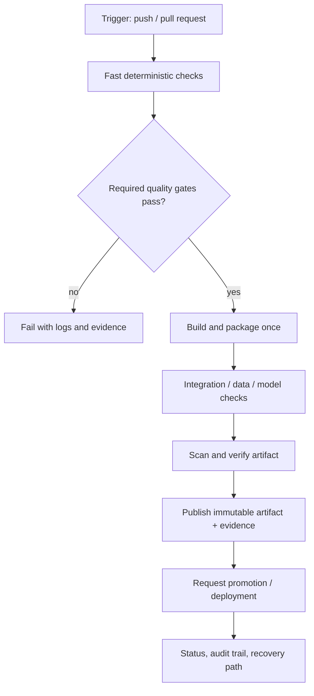
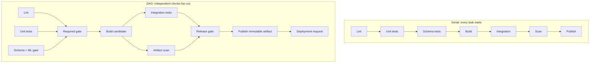
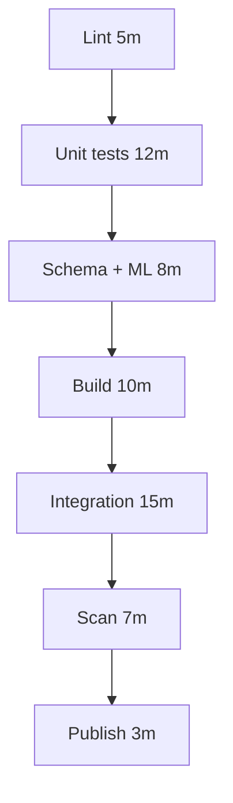

# CI/CD Architecture and Pipeline Design Principles

> **Abstract:** This lesson develops a production-minded way to design continuous integration and delivery for a Python data/ML service. It moves from a minimal lint-and-test workflow to dependency-graph design, immutable artifact promotion, failure isolation, security boundaries, measurement, and architecture review. Examples are intentionally small and local-first; illustrative timings are not measurements.

**Module:** M02 — CI/CD Pipeline Engineering  
**Stage:** 2E — Production DevOps & Platform Engineering  
**Unit:** 1  
**Target file:** `01-ci-cd-architecture-and-pipeline-design-principles.md`  
**Estimated time:** 8–12 hours [ASSUMPTION; adjust after completing the labs]  
**Last reviewed:** 2026-10-24 (authoring date; live documentation verification not performed)  
**Assumed tool baseline:** Git, Python, pytest, Ruff, GitHub Actions, and Docker/BuildKit concepts from M01. Check current supported versions before adopting a production baseline.

## Contents

- [1.0 Why this matters in production](#10-why-this-matters-in-production)
- [1.1 Learning objectives](#11-learning-objectives)
- [1.2 Concept map and vocabulary](#12-concept-map-and-vocabulary)
- [1.3 Level 1 — Beginner](#13-level-1--beginner)
- [1.4 Level 2 — Intermediate](#14-level-2--intermediate)
- [1.5 Level 3 — Advanced](#15-level-3--advanced)
- [1.6 Level 4 — Expert](#16-level-4--expert)
- [1.7 SRE lens](#17-sre-lens)
- [1.8 Security lens](#18-security-lens)
- [1.9 Production checklist](#19-production-checklist)
- [1.10 Hands-on lab set](#110-hands-on-lab-set)
- [1.11 Self-check questions](#111-self-check-questions)
- [1.12 Evidence artifacts](#112-evidence-artifacts)
- [1.13 Common interview and design-review questions](#113-common-interview-and-design-review-questions)
- [1.14 Sources and verification notes](#114-sources-and-verification-notes)
- [Audit Appendix A — Claim register](#audit-appendix-a--claim-register)
- [Audit Appendix B — Ten-pass self-audit](#audit-appendix-b--ten-pass-self-audit)
- [Audit Appendix C — Human verification checklist](#audit-appendix-c--human-verification-checklist)

## Unit 1 — CI/CD architecture and pipeline design principles

**Target file:** `01-ci-cd-architecture-and-pipeline-design-principles.md` | **Estimated time:** 8–12 hours | **Prerequisites:** Git, shell, Python, pytest basics, M01 container-image outcomes

**Core tools:** Git, GitHub Actions, Python, pytest, Ruff, artifact checksums/digests | **Awareness:** GitLab CI, Jenkins, Buildkite, CircleCI, Tekton, Argo Workflows, Dagger, Earthly | **Last reviewed:** 2026-10-24 (authoring date; official docs not live-checked)

### 1.0 Why this matters in production

A pipeline that rebuilds an image separately for staging and production can ship different bytes under the same release label. A slow serial pipeline can make developers wait while independent checks sit idle, encouraging risky bypasses. A broad token exposed to pull-request code can turn a test job into a release-system compromise. Flaky tests and missing ownership make failures hard to distinguish from real regressions. Good architecture makes the path from source change to verified, promotable artifact explicit, observable, and recoverable.

### 1.1 Learning objectives

- [L1] Distinguish continuous integration, continuous delivery, and continuous deployment using the release decision point.
- [L1] Trace a change through triggers, jobs, steps, gates, artifacts, and status.
- [L1] Run a minimal Ruff-and-pytest workflow and interpret success and failure.
- [L2] Design stages and dependencies for a Python data/ML service, including data and model-quality gates.
- [L2] Explain how idempotency, hermeticity, environment parity, and least privilege reduce release risk.
- [L3] Design a DAG that improves critical-path time without weakening required checks.
- [L3] Identify a release artifact by immutable digest/checksum and promote it without rebuilding.
- [L4] Review a pipeline for systemic anti-patterns and propose a migration with measurable acceptance criteria.
- [L4] Define pipeline SLIs/SLOs, ownership, evidence retention, and recovery procedures.

### 1.2 Concept map and vocabulary



| Term | Precise definition | Common misconception |
|---|---|---|
| Pipeline | A defined process that transforms a change into validated outputs and status. | It is just a YAML file. |
| Workflow | In GitHub Actions, a YAML-defined automation triggered by events or manual invocation. | Every platform calls it a workflow. |
| Trigger | An event or condition that starts work. | A trigger is the same as a job dependency. |
| Stage | A conceptual grouping of work, often used to organize or order jobs. | All CI systems implement stages identically. |
| Job | A unit of work scheduled on a runner; it may depend on other jobs. | Jobs execute in file order by default. |
| Step | An action or shell command within a job. | Steps are isolated from one another by default. |
| Runner | The machine or execution environment that runs a job. | A hosted runner is automatically trusted for every secret. |
| DAG edge | A dependency relationship in a directed acyclic graph. | Visual order in YAML establishes a dependency. |
| Artifact | A produced file or object, such as a wheel, image, test report, or model file. | Every artifact is intended for release. |
| Release artifact | A versioned, identifiable output approved for distribution or deployment. | Rebuilding from the same commit guarantees identical bytes. |
| Digest/checksum | A content-derived identifier, commonly a cryptographic hash. | A digest proves who built the content or that it is safe. |
| Gate | A condition that must pass before a protected next step proceeds. | A green optional report is equivalent to a required gate. |
| Promotion | Advancing the same identified artifact to another environment or release state. | Promotion means rebuilding for the target environment. |
| Deployment request | A request or change that asks a delivery system to deploy an artifact. | A request means the workload is already deployed. |
| Rollback | Returning to a prior known application version or state when safe. | Rolling back application code also safely reverses database changes. |
| Pipeline-as-code | Keeping pipeline definitions in version control and reviewing them like application code. | YAML changes are harmless configuration edits. |

GitHub Actions uses *workflow → job → step* terminology. GitLab CI commonly uses *pipeline → stage → job*; the labels differ, but the design questions—inputs, dependencies, trust, outputs, and failure handling—transfer.

**Three concepts that must stay separate**

- **Workflow file vs architecture:** the file is one implementation; architecture is the dependency, trust, artifact, and recovery model behind it.
- **Job dependency vs visual order:** a dependency such as GitHub Actions `needs` determines whether a job may start; placing a job later in YAML does not by itself serialize jobs.
- **Test report vs release artifact:** a JUnit XML file is evidence about a run; a wheel or container image may be a releasable output. Both should be traceable to the commit and run.

### 1.3 Level 1 — Beginner

#### CI, continuous delivery, and continuous deployment

| Practice | Definition | Example | Human decision point |
|---|---|---|---|
| Continuous integration (CI) | Developers integrate changes frequently; automated checks provide rapid evidence about the integrated change. | Every pull request runs lint and unit tests. | Review/merge policy remains a separate decision. |
| Continuous delivery | The system keeps changes in a deployable state and can release them through a controlled process. | A verified image is ready; a release manager approves production promotion. | Production approval may remain manual or business-controlled. |
| Continuous deployment | Every qualifying change that passes the defined automated controls is automatically released to production. | Successful mainline changes are automatically deployed after all gates. | No routine human release approval for qualifying changes. |

Teams sometimes use these terms differently. Write down the local policy: which branch qualifies, which checks block, who can approve, and what automatically reaches production.

#### Branching choices

| Trunk-based development | Long-lived branches |
|---|---|
| Short-lived branches integrate frequently into a healthy mainline; feature flags can hide unfinished behavior. | Branches diverge for longer, increasing merge distance and delayed integration feedback. |
| Works well when checks are fast and changes can be safely sliced. | May be useful for coordinated releases or constraints that require longer isolation. |
| Requires discipline around compatibility and incomplete features. | Requires active integration, conflict management, and a plan to avoid late surprises. |

Neither model is universally correct. Measure integration delay, merge conflicts, and release constraints rather than choosing by slogan.

#### Minimal runnable example

Create the following files from a clean directory. The example uses a minimal package and does not call external services.

```text
ci-cd-example/
├── .github/
│   └── workflows/
│       └── ci.yml
├── src/
│   └── scoring_service/
│       └── __init__.py
├── tests/
│   └── test_smoke.py
├── pyproject.toml
├── README.md
└── .gitignore
```

```toml
# File: pyproject.toml
[build-system]
requires = ["setuptools>=68"]
build-backend = "setuptools.build_meta"

[project]
name = "scoring-service-example"
version = "0.1.0"
requires-python = ">=3.11"
dependencies = []

[project.optional-dependencies]
dev = ["pytest>=8,<9", "ruff>=0.6,<1"]

[tool.setuptools.packages.find]
where = ["src"]

[tool.pytest.ini_options]
testpaths = ["tests"]
addopts = "-ra"

[tool.ruff]
line-length = 100
target-version = "py311"

[tool.ruff.lint]
select = ["E", "F", "I"]
```

```python
# File: src/scoring_service/__init__.py
def score(features: list[float]) -> float:
    """Return a simple deterministic score for pipeline teaching."""
    if not features:
        raise ValueError("features must not be empty")
    return sum(features) / len(features)
```

```python
# File: tests/test_smoke.py
import pytest

from scoring_service import score


def test_score_returns_mean() -> None:
    assert score([2.0, 4.0, 6.0]) == 4.0


def test_score_rejects_empty_features() -> None:
    with pytest.raises(ValueError, match="must not be empty"):
        score([])
```

```yaml
# File: .github/workflows/ci.yml
name: CI

on:
  pull_request:
  push:
    branches: [main]
  workflow_dispatch:

permissions:
  contents: read

concurrency:
  group: ci-${{ github.workflow }}-${{ github.ref }}
  cancel-in-progress: true

jobs:
  lint-and-test:
    runs-on: ubuntu-latest
    timeout-minutes: 10
    steps:
      - name: Check out source
        uses: actions/checkout@<FULL_40_CHAR_COMMIT_SHA> # Replace only after verifying the official release SHA.
      - name: Set up Python
        uses: actions/setup-python@<FULL_40_CHAR_COMMIT_SHA> # Replace only after verifying the official release SHA.
        with:
          python-version: "3.11"
      - name: Install package and development tools
        run: python -m pip install --upgrade pip && python -m pip install -e ".[dev]"
      - name: Check formatting and lint
        run: ruff check . && ruff format --check .
      - name: Run unit tests
        run: pytest
```

**Important:** The SHA strings above are placeholders, not valid executable action references. Look up and review each official action release, verify its full commit SHA, and replace the placeholders before committing this workflow. Do not invent or guess a SHA. A tag-only version can be convenient in a tutorial, but the production policy in this lesson is full-SHA pinning for third-party actions. The placeholder file will fail until corrected.

```bash
# From ci-cd-example/
python -m venv .venv
. .venv/bin/activate
python -m pip install -e ".[dev]"
ruff check .
ruff format --check .
pytest
```

**Example — yours will differ**

```text
All checks passed!
2 passed in 0.04s
```

Interpretation: lint and tests exited successfully. The duration and exact text vary by tool version and machine; these are representative, not execution evidence.

```bash
git init
git add .
git commit -m "Add minimal CI example"
git branch -M main
git remote add origin <URL-OF-YOUR-PRIVATE-TEST-REPOSITORY>
git push -u origin main
```

**Example — yours will differ**

```text
Enumerating objects: ...
Writing objects: 100% (...)
To <your-private-repository>
 * [new branch] main -> main
```

Interpretation: the branch was pushed. The remote workflow runs only after the action placeholders are replaced with verified SHAs and the repository is configured. **⚠ OUTWARD-FACING:** `git push` sends commits to your own private test repository; do not use a work or public repository for experiments.

#### What just happened?

GitHub Actions receives a `push`, `pull_request`, or manual trigger. A runner checks out the source, installs the package and development dependencies, then executes Ruff and pytest. The job reports a status. A non-zero exit code fails the step and normally prevents later steps in that job from running. The workflow has read-only repository permissions because this example needs no write access.

#### Beginner mistakes

| Symptom | Likely cause | Fix |
|---|---|---|
| Import fails in tests | Package not installed or source layout misconfigured | Install the project with `pip install -e ".[dev]"` and verify package discovery. |
| Workflow cannot resolve an action | Placeholder SHA was not replaced or SHA is incorrect | Verify the official action repository and release commit. |
| Tests pass locally but fail in CI | Runtime/dependency/environment differences | Pin compatible dependencies and reproduce the CI environment locally. |
| A job starts before a prerequisite | No explicit dependency edge | Add `needs` where the dependency is real. |
| A secret appears in logs | Script printed a value or enabled tracing | Stop the run, revoke/rotate the secret, inspect artifacts and logs, and fix the leak path. |

### 1.4 Level 2 — Intermediate

#### A practical stage design for data/ML delivery

The order below is a design pattern, not a universal mandate. Independent checks may run concurrently. A release publication should not happen until the artifact and the required evidence have passed their gates.

| Stage/job | Purpose | Inputs | Outputs/evidence | Blocking? | Parallelizable? |
|---|---|---|---|---|---|
| Lint/type check | Catch cheap code issues | Source, config | Lint/type logs | Yes for merge | Usually yes |
| Unit tests | Verify local behavior | Source, fixtures | Test report | Yes for merge | Usually yes |
| Data/schema contract | Check schema, ranges, nullability, row-count expectations | Small fixture/schema | Contract report | Yes if contract is release-critical | Often with unit tests |
| ML metric gate | Check baseline metrics on a seeded small dataset | Code, fixture, metric policy | Metric JSON/report | Yes when threshold policy is stable | Often with other checks |
| Build/package | Produce wheel/image once | Commit, lockfiles, build config | Wheel/image + checksum/digest | Yes for release | After relevant checks or in parallel if cost-effective |
| Integration test | Exercise service/package boundary | Built package/image, test services | Integration report | Yes for release | Independent integration suites can fan out |
| Scan/verify | Check dependencies/image and artifact metadata | Candidate artifact | Scan report/SBOM/digest record | Policy-dependent; release scan normally blocking | Can run alongside some tests if artifact exists |
| Publish | Store approved artifact | Verified artifact and evidence | Immutable version/digest | Yes for release | Only after gates |
| Deployment request | Request promotion by digest | Digest, evidence, target | PR/request/audit record | Yes for promotion workflow | Separate from validation CI |

A model metric gate should use a small, versioned evaluation dataset and an explicit tolerance policy. A fixed seed improves repeatability but does not guarantee identical output across every library, hardware, or numerical backend. Full model registry governance and production serving evaluation belong to later MLOps modules.

#### Idempotency and hermeticity

An **idempotent operation** can be retried without creating unintended additional effects. Re-running `pytest` is normally safe. Re-running a publish step that creates a new release every time is not automatically safe. Make publication conditional on an immutable version/digest, detect “already exists,” and make the recovery behavior explicit.

A **hermetic job** controls its inputs sufficiently that results do not silently depend on arbitrary machine state or changing external services. Pinning a Python version and lockfile, using a known build image, and testing with fixtures improve control. Containerization alone is not hermetic: the job may still download mutable dependencies, use network APIs, read host state, or rely on unpinned base images.

#### CI vs CD boundary

- **CI** validates the change and produces a candidate artifact with evidence.
- **Promotion/release orchestration** selects an already-built artifact, checks policy and approvals, then requests the next step.
- **GitOps reconciliation** continuously compares desired state with actual state and applies changes. That implementation is deferred to M08; this unit ends at “produce a verified, promotable artifact and request deployment.”

Configuration has its own lifecycle: ordinary non-secret configuration can be versioned; source code is reviewed and built; secrets are injected by an approved secret/identity mechanism and must not be committed or printed. Environment parity means matching relevant runtime and dependency assumptions, not copying production secrets or data into CI.

#### Pattern catalogue

| Pattern | When to use | When NOT to use |
|---|---|---|
| Cheap checks first | Fast lint/unit failures avoid expensive work | When a security-critical check should start immediately in parallel |
| Fan-out/fan-in DAG | Independent suites can run concurrently and a final gate collects results | When setup/queue overhead outweighs saved time |
| Build once, promote many | Same release artifact must be tested and promoted through environments | When the artifact is environment-bound by design; prefer external configuration rather than rebuilding where possible |
| Reusable workflow/template | Teams need a shared, versioned policy | When abstraction hides important ownership or makes debugging impossible |
| Advisory report | Informational coverage/trend reports should not block every change | For required correctness, security, or release-policy controls |
| Local fixture for ML tests | Fast, stable regression signal | As a substitute for representative offline/online model evaluation |

#### Anti-pattern catalogue

| Bad example | Why it hurts | Corrected version |
|---|---|---|
| Rebuild separately for staging and prod | Different bytes may be deployed | Build once; record digest; promote that digest |
| Every job runs serially | Independent checks extend critical path | Declare real dependencies; parallelize independent jobs |
| `permissions: write-all` | Expands blast radius | Set top-level read-only permissions; elevate only the job that needs it |
| Print `$TOKEN` for debugging | Leaks credentials to logs/artifacts | Test presence without printing; rotate if exposed |
| Retry every failure automatically | Hides deterministic defects and flakes | Retry only classified transient operations; preserve first failure and report flake rate |
| “Latest” tag is the release identity | Mutable tag can point to different content | Record digest/checksum and immutable version metadata |
| Skip all tests for docs-only changes without a gate | Required status may be absent or bypassed | Use a reliable aggregate gate that always reports; see Unit 5 for path-filter pitfalls |

#### Required checks and review

A required status check should have a stable identity and a defined policy. Verify that it reports a terminal result on normal changes, no-op/path-filtered changes, cancellations, and failed prerequisite jobs. Branch rules and UI fields change; check current repository ruleset documentation before enforcing a policy `[VERIFY: current GitHub rulesets and required-status-check behavior]`.

Before approving a workflow change, review: trigger scope; untrusted PR behavior; action SHA/version changes; job-level permissions; secret references and logging; cache read/write scope; artifact name and digest; timeout/cancellation behavior; required-check naming; and any publish/deploy side effects.

### 1.5 Level 3 — Advanced

#### Speed vs safety

Optimize the critical path, not the count of jobs. Running lint, unit tests, schema checks, and a small seeded ML gate in parallel may reduce elapsed time, but parallel setup consumes resources and can increase queue contention. Keep required checks blocking even if they are slower. A security scan may start as soon as the candidate artifact exists; do not postpone important risk detection just to make a graph look fast.

#### Sequential pipeline vs DAG



`needs` expresses job dependencies in GitHub Actions. A fan-in job should not accidentally report success when a required upstream job failed or was skipped. Verify status-function semantics and conditional behavior in the current workflow syntax documentation before relying on a complex gate `[VERIFY]`.

#### Worked redesign: a bad 60-minute pipeline

The fictional “before” process is a serial chain: lint 5 min → unit tests 12 min → schema/ML checks 8 min → build 10 min → integration tests 15 min → scan 7 min → package/publish 3 min. The sum is 60 minutes. These values are **[ILLUSTRATIVE]**, not measured. The pipeline also reads a token from repository configuration and prints it while debugging.



**Vulnerable snippet — defensive demonstration only; do not copy**

```yaml
# File: .github/workflows/bad-example.yml
# VULNERABLE — DO NOT COPY
- name: Debug deployment configuration
  run: echo "token=${{ secrets.DEPLOY_TOKEN }}"
```

This explicitly writes a secret into logs. Do not run it with a real credential. The fixed version consumes the secret only in a narrowly scoped trusted job and never prints it:

```yaml
# File: .github/workflows/fixed-release-step.yml
# Illustrative fragment; integrate only after reviewing the full workflow and action SHAs.
permissions:
  contents: read

jobs:
  request-release:
    if: github.event_name == 'push' && github.ref == 'refs/heads/main'
    runs-on: ubuntu-latest
    timeout-minutes: 5
    permissions:
      contents: read
    steps:
      - name: Check that a token was supplied without displaying it
        env:
          DEPLOY_TOKEN: ${{ secrets.DEPLOY_TOKEN }}
        shell: bash
        run: |
          set -euo pipefail
          if [[ -z "${DEPLOY_TOKEN}" ]]; then
            echo "Required release credential is missing" >&2
            exit 1
          fi
          echo "Credential is present; value intentionally not displayed."
```

This fragment is not a complete deploy implementation; it illustrates safe handling only. Prefer short-lived identity federation where supported (M09) over static credentials. A secret can still leak through shell tracing, process arguments, debug output, or artifacts; masking is not a guarantee.

**After**: run lint, unit tests, schema checks, and a small ML metric gate in parallel; fan into a required gate; build a candidate; run integration tests and scan against that candidate in parallel where dependencies allow; fan into a release gate; publish once; create a deployment request referencing the recorded digest. With the same illustrative durations, a simplified critical path might be `max(5,12,8) + 10 + max(15,7) + 3 = 40 minutes`, excluding queue/setup overhead. This is **[ILLUSTRATIVE]**, assumes parallel capacity and no added setup cost, and is not a promised speedup.

| Dimension | Before | After design |
|---|---|---|
| Critical-path duration | 60 min by stated illustrative serial sum | 40 min simplified illustrative critical path; measure actual p50/p95 |
| Parallelism | None | Independent checks fan out; release gates fan in |
| Feedback timing | Cheap lint waits behind earlier work only if ordering is changed poorly; failures may arrive late | Lint/unit/schema/ML checks start early |
| Secret handling | Token printed into logs | Secret injected only into a trusted narrow job; never printed |
| Artifact identity | Potentially rebuilt per environment or tagged only | Build once; record immutable digest/checksum and run metadata |
| Failure isolation | One failure stops all later work; unrelated diagnostics may be lost | Independent checks finish/report where useful; required gates still block release |
| Permissions | Broad shared token | Read-only default; narrow job-level permissions and scoped secret |
| Audit evidence | Logs and mutable labels | Commit, run identity, test/scan evidence, artifact digest, approval/request record |

**Residual risks:** parallelism does not fix flaky tests, malicious dependencies, a compromised runner, incorrect quality thresholds, mutable external inputs, or unsafe state migrations. It may increase contention and cost. A digest identifies content but does not prove origin, authorization, or provenance.

#### Trade-off table

| Option | Benefit | Cost | Risk | Choose when |
|---|---|---|---|---|
| One monolithic workflow | Easy to discover and start | Can become difficult to own and debug | Broad coupling and slow path | Small repository with one release cadence |
| Composable workflows | Shared standards and clear interfaces | Versioning and abstraction work | Shared template becomes a failure point | Many repos/components with common controls |
| Push-based deployment | Direct feedback and simple event flow | CI identity may need deployment permissions | CI compromise can affect runtime | Small controlled environment with strong scoping |
| Pull-based/GitOps delivery | Desired state review and reconciliation | Additional controller/repository model | Drift or controller misconfiguration | Teams need auditable declarative rollout; implementation deferred to M08 |
| Rebuild per environment | Environment-specific build can be simple | More build time and divergence | Tested bytes may differ from deployed bytes | Only where artifact is intentionally environment-bound |
| Promote same digest | Strong artifact continuity | Requires digest-aware release plumbing | Digest alone does not establish trust | Default for immutable container promotion |

#### Artifact identity and reproducible builds

Tags such as `v1.4.2` or `main` are human-readable names and may be mutable depending on the registry/policy. A digest identifies content. For containers, record the image digest from M01, the source commit, build/run identity, dependency lock state, tests, scan results, and approval. A digest does not prove the artifact came from an authorized builder; provenance/signing and broader supply-chain controls are covered in M12.

Reproducibility has levels: pinned inputs and a controlled environment make a build more repeatable; bit-for-bit reproducibility means independent builds yield identical bytes. Timestamps, file ordering, base-image movement, compiler/tool versions, and network-resolved dependencies can change outputs. See M01 Unit 3 for detailed container-build techniques. ML training adds nondeterminism from numerical kernels, hardware, sampling, and library behavior; do not promise deterministic model output solely because a random seed is set.

#### Rollback and idempotent deployment requests

A deployment request should identify the artifact digest and intended environment. Repeating the request should not create uncontrolled duplicate releases. A rollback can redeploy a previously approved application artifact, but database migrations, data backfills, feature flags, and model state may not be reversible. Define whether recovery is rollback, roll-forward, revert, or restoration from a backup, and verify compatibility before acting.

### 1.6 Level 4 — Expert

#### Failure scenarios

| Symptom | Hypothesis | Test | Root cause example | Fix | Prevention |
|---|---|---|---|---|---|
| Pipeline time doubles | Cache miss, queue delay, or new serial dependency | Compare queue/run time and job critical path | Heavy install moved into every job | Cache carefully or share setup where safe | Track p50/p95 and dependency changes |
| Green pipeline, wrong production image | Release rebuilt after tests | Compare recorded and deployed digests | Environment-specific rebuild | Promote exact tested digest | Gate deploy request on digest match |
| PR can influence release job | Trigger/permission boundary is wrong | Review event, context, token permissions, job conditions | Untrusted PR code runs in privileged context | Separate validation and trusted release workflows | Threat-model triggers and enforce policy |
| Required check never appears | Path filter or skipped workflow prevents reporting | Inspect checks on a no-op/docs-only change | Required check identity is absent | Use an aggregate gate that always reports | Add no-change and skip-path tests; see Unit 5 |
| Intermittent red tests | Time, ordering, shared state, or resource race | Repeat randomized runs; isolate fixture state | Test depends on execution order | Fix state/time dependency; quarantine only with owner/expiry | Track flake rate; never blindly retry forever |

#### Golden paths and platform ownership

A **golden path** is a supported, versioned route that makes safe delivery the easiest route. A platform team owns templates, release notes, migration guidance, support, and deprecation policy; product teams own service-specific tests, runtime behavior, and deployment readiness. Provide a documented escape hatch with an owner and expiry rather than silently allowing permanent divergence. Measure adoption, upgrade lag, failure rate, and developer feedback. M16 covers platform engineering and shared paved roads in more depth.

A shared template is a potential single point of failure. Use staged rollouts, compatibility tests, pinned versions, changelogs, rollback to a known template release, and a small pilot cohort before organization-wide migration.

#### Reusable anti-pattern audit

Check each repository for:

- [ ] One giant serial pipeline with no critical-path justification.
- [ ] Rebuild-per-environment drift.
- [ ] Mutable-only artifact tags and no digest/checksum record.
- [ ] Broad workflow write permissions or long-lived tokens shared by jobs.
- [ ] Third-party actions not pinned to reviewed full commit SHAs.
- [ ] Secrets in logs, source, workflow outputs, command-line arguments, or artifacts.
- [ ] Untrusted pull-request code on privileged/self-hosted runners.
- [ ] No timeout, cancellation, or concurrency policy.
- [ ] Blind retries that conceal flaky tests.
- [ ] No named owner, runbook, or recovery path.
- [ ] Required checks that can disappear under path filters or conditional skips.
- [ ] No evidence linking source commit, run, tests, scan, artifact, and promotion request.

#### Migration between CI systems

1. Inventory workflows, secrets, runners, caches, artifacts, branch rules, and deployment side effects.
2. Build a parity matrix for triggers, dependencies, matrices, caches, artifacts, environments, permissions, reusable logic, and required checks.
3. Pilot one low-risk service with no production side effects.
4. Dual-run on the same commit and compare outputs, durations, failures, and artifact digests.
5. Resolve behavioral differences; do not accept “green” as parity if gates differ.
6. Cut over with a rollback path and explicit owner.
7. Observe through a defined period, then decommission old credentials/runners and archive required evidence.

GitHub Actions is the primary platform here; GitLab CI is covered at working depth in Unit 3. Jenkins, Buildkite, CircleCI, Tekton, Argo Workflows, Dagger, and Earthly are awareness-only comparisons in this module.

#### Architecture Decision Record (ADR) template

```markdown
# ADR-NNN: <decision title>
- Status: Proposed | Accepted | Superseded
- Date:
- Owner:
- Review date:

## Context
What problem and constraints matter?

## Decision drivers
Safety, feedback latency, cost, reliability, ownership, audit evidence.

## Options considered
For each option: benefit, cost, risk, operational burden.

## Decision
What is selected and why?

## Consequences and residual risks
What improves, what gets harder, and what remains unresolved?

## Validation plan
Commands, measurements, failure scenarios, acceptance criteria.

## Rollback / reconsideration trigger
How to reverse or revisit the decision.
```

#### Pipeline as a product

Treat the pipeline as a service used by developers. Define users, support ownership, change communication, compatibility policy, and a way to report friction. Potential SLIs include workflow availability, queue time, p50/p95 duration, successful completion rate, flake rate, and time to restore pipeline service. Derive targets from user needs and a baseline; do not copy universal numbers. Keep exceptions time-bound, publish incident reviews, and avoid using individual developer metrics as performance scores.

### 1.7 SRE lens

An SLI is a measured signal; an SLO is a target for that signal over a defined window. Example targets below are **[ILLUSTRATIVE]**, not universal standards.

| SLI | Definition | Example SLO approach |
|---|---|---|
| p50/p95 pipeline duration | Time from defined start to terminal result; state whether queue is included | Set a target by pipeline class after collecting a representative baseline |
| Queue time | Scheduled/eligible time to actual runner start | Separate capacity problems from slow jobs |
| Completion rate | Completed runs passing required checks / eligible runs | Segment by workflow and change type |
| Flake rate | Tests that pass/fail inconsistently under controlled repeated conditions / tests or test executions, with denominator stated | Establish a baseline and alert on sustained increases |
| Pipeline restore time | Time from pipeline service incident to restored normal delivery | Track incidents and recovery actions |
| Change failure rate | Qualifying deployments that cause a failure/rollback/hotfix divided by qualifying deployments, using a written definition | Derive from deployment and incident records, not CI status alone |

**Runbook: alert → triage → mitigation → follow-up**

1. **Alert:** p95 duration or failure rate breaches the team-defined threshold.
2. **Triage:** separate queue time, setup, test execution, cache, network, and artifact-publishing time; compare against recent known-good commits.
3. **Mitigation:** disable a newly introduced optional expensive step only if policy permits; do not bypass required safety gates. Roll back a bad workflow/template change if that is the cause.
4. **Follow-up:** preserve run IDs and relevant redacted logs, identify owner, create corrective action, and verify the metric returns to baseline.

**Cost and capacity:** use local runs for fast iteration, free-tier CI only after checking current limits `[VERIFY: current GitHub plan and usage documentation]`, and avoid large matrix fan-out on every documentation-only change. Measure runner queue time and setup overhead before adding concurrency. Never assume a free tier has a fixed quota.

### 1.8 Security lens

This unit addresses CI/CD design risks that include insufficient flow control, weak identity/credential management, dependency/supply-chain exposure, insecure configuration, inadequate logging, and insufficient separation between untrusted change validation and privileged release operations. Use the current OWASP Top 10 CI/CD Security Risks and SLSA documentation as reference frameworks; the mapping below is conceptual, not a claim of conformance.

| Threat / failure class | Control taught here | Verification |
|---|---|---|
| Excessive permissions | Explicit read-only workflow permissions; narrow job-level elevation | Inspect every workflow/job permission block |
| Secret exposure | Inject via secret reference; never print; avoid shell tracing and sensitive artifacts | Search workflow/source/logs for token values; review redacted logs |
| Untrusted PR influence | Separate PR validation from trusted publish/deploy jobs; do not run untrusted code on privileged runners | Review event types, job conditions, runner labels, and token scope |
| Mutable artifact substitution | Record digest/checksum and link evidence to artifact | Compare digest in release manifest with the promoted artifact |
| Unreviewed pipeline changes | CODEOWNERS/review and protected-branch policy where available | Inspect repository policy and a sample workflow-change PR |
| Missing traceability | Record commit, run identity, dependency lock state, reports, digest, approval/request | Verify a release evidence bundle for a sample commit |
| Dependency compromise | Lock dependencies, review updates, scan artifacts, consider provenance | Inspect lockfile and scan output; full supply-chain controls deferred to M12 |

Limits: SHA pinning does not prove an action is benign or vulnerability-free. A passing test or scan does not prove correctness or security. A digest does not prove trusted origin or provenance. Secret masking does not guarantee that a secret cannot leak. Branch protection is only as strong as its configuration and administrative bypass controls. SLSA provenance/signing and broader software supply-chain security are introduced here but deferred to M12; secrets/identity/OIDC implementation is deferred to M09.

### 1.9 Production checklist

- [ ] CI, delivery, and deployment policy is written down.
- [ ] Triggers and untrusted contribution behavior are explicit.
- [ ] Workflow configuration is reviewed as code.
- [ ] Workflow permissions are explicit and least-privilege.
- [ ] Third-party actions use verified full commit SHAs.
- [ ] Jobs have sensible timeouts and a deliberate cancellation/concurrency policy.
- [ ] Required checks reliably report success/failure on ordinary and no-op changes.
- [ ] Cheap deterministic checks run early without delaying important security checks.
- [ ] Real secrets are not committed, printed, or copied into artifacts.
- [ ] Unit, integration, schema/data, and ML checks have explicit blocking/advisory policies.
- [ ] Build inputs and dependency lock state are recorded.
- [ ] Release artifact is built once and identified by digest/checksum.
- [ ] Scan/test evidence is associated with the same artifact being promoted.
- [ ] Publish and deployment-request jobs are separated from untrusted PR execution.
- [ ] Rollback/roll-forward behavior is documented for application and stateful changes.
- [ ] Pipeline SLIs have definitions, data sources, owners, and review cadence.
- [ ] Runbooks identify triage, mitigation, follow-up, and escalation owners.
- [ ] Exceptions have rationale, owner, expiry, and compensating control.
- [ ] Evidence retention avoids secrets and sensitive customer data.
- [ ] M01/M08/M09/M10/M11/M12/M16/M17 boundaries are documented.

### 1.10 Hands-on lab set

All outputs below are representative and have **not** been executed during authoring. Commands may vary by OS/tool version. Every lab should be performed in a disposable local directory and, for hosted runs, the learner’s own private test repository.

#### Lab 1 — Minimal CI

**Goal:** create the example project, run lint/tests locally, then inspect a hosted workflow run.

**Prerequisites:** Git, Python 3.11 or a verified supported local version, pip, and a private test repository.

**Steps**

1. Create the files shown in Section 1.3.
2. Run the local commands from the example.
3. Verify official action SHAs and replace both placeholders in `ci.yml`.
4. Push only to your private test repository and inspect the run summary and logs.

```bash
python -m pip install -e ".[dev]"
ruff check .
ruff format --check .
pytest
```

**Example — yours will differ**

```text
All checks passed!
2 passed in 0.04s
```

Interpretation: local checks pass; exact timing and output are environment-specific. On WSL2, keep the project in the Linux filesystem rather than a mounted Windows path if file I/O becomes a bottleneck. Native Linux usually avoids the Windows-mounted-filesystem boundary; verify behavior on your own machine.

**Expected evidence:** `ci.yml`, redacted run URL/ID, test output, and action SHA verification notes.

**Cleanup and verification:** remove `.venv`, verify it is gone, and delete the disposable private repository when no longer needed.

```bash
deactivate 2>/dev/null || true
rm -rf .venv
test ! -e .venv && echo "cleanup verified"
```

**Example — yours will differ**

```text
cleanup verified
```

Interpretation: the local virtual environment was removed. Deleting the remote test repository is an optional **⚠ DESTRUCTIVE** UI action; export evidence first and verify the repository name before deletion.

#### Lab 2 — Deliberate failure and diagnosis

**Goal:** make a harmless test fail, locate the earliest useful feedback, fix it, and rerun.

**Steps**

1. Temporarily change `assert score([2.0, 4.0, 6.0]) == 4.0` to `== 5.0`.
2. Run `pytest -q`.
3. Read the assertion diff and exit code; do not change the workflow to ignore failure.
4. Restore the expected value and rerun.

```bash
pytest -q
```

**Example — yours will differ**

```text
FAILED tests/test_smoke.py::test_score_returns_mean
assert 4.0 == 5.0
1 failed, 1 passed
```

Interpretation: the failure is deterministic and localized; the code’s mean calculation returned 4.0. Fix the test expectation, not the gate.

**Expected evidence:** before/after test output and a short note identifying the first failing step.

**Cleanup and verification:** restore the original assertion, run `pytest -q`, and verify no test failure remains. If using Git, `git diff -- tests/test_smoke.py` should be empty after restoration.

**Example — yours will differ**

```text
2 passed in 0.04s
```

Interpretation: the deliberate failure is cleared. Do not introduce real secrets for a “secret leak” test; inspect only fake values and configuration structure.

#### Lab 3 — DAG redesign and benchmark

**Goal:** calculate the critical path and distinguish execution duration from queue and setup overhead.

Use the fictional timings from Section 1.5: lint 5, unit 12, schema/ML 8, build 10, integration 15, scan 7, publish 3 minutes. The serial sum is 60. If the first three checks run in parallel, followed by build, then integration and scan in parallel, then publish, the simplified critical path is `max(5,12,8)+10+max(15,7)+3 = 40` minutes. These are **[ILLUSTRATIVE]** values.

```python
# File: calculate_critical_path.py
checks = {"lint": 5, "unit": 12, "schema_ml": 8}
build = 10
integration = 15
scan = 7
publish = 3

serial = sum(checks.values()) + build + integration + scan + publish
dag = max(checks.values()) + build + max(integration, scan) + publish
print(f"serial_minutes={serial}")
print(f"dag_minutes={dag}")
```

```bash
python calculate_critical_path.py
```

**Example — yours will differ**

```text
serial_minutes=60
dag_minutes=40
```

Interpretation: this calculation excludes queue/setup overhead and assumes enough runner capacity. It is not a performance benchmark.

For real measurements, record a consistent start and end boundary, queue time separately, commit, runner class, cache state, and workload. Collect multiple representative runs (for example, 10 runs **[ILLUSTRATIVE sampling suggestion, not a standard]**), compare median and p95 only when the sample size supports interpretation, and report cold/warm/partial-change scenarios separately. Do not claim a speedup from one run.

CSV template:

```csv
run_id,commit,scenario,queue_seconds,execution_seconds,total_seconds,cache_state,runner,notes
run-001,abc123,cold,12,420,432,cold,hosted,illustrative example only
run-002,abc123,warm,8,300,308,warm,hosted,illustrative example only
```

**Expected evidence:** DAG drawing, calculation, CSV with actual measurements or clearly labeled synthetic rows, and defended explanation of which jobs may run in parallel.

**Cleanup and verification:** remove the scratch script/CSV if not retained as evidence; verify no remote workflow or runner remains active.

#### Lab 4 — Artifact identity and promotion design

**Goal:** build a local wheel or image, record its checksum/digest, and create a dry-run deployment request that references the same identity.

For a local wheel, install the build frontend if needed and build the project. This does not publish it to a public index.

```bash
python -m pip install build
python -m build
sha256sum dist/*
```

**Example — yours will differ**

```text
Successfully built scoring_service_example-0.1.0-py3-none-any.whl
<sha256-value>  dist/scoring_service_example-0.1.0-py3-none-any.whl
```

Interpretation: the hash identifies the exact wheel bytes. It does not establish who built the wheel or whether its contents are trustworthy.

Record the checksum in a local `release-manifest.json` and have a dry-run request print the intended target and checksum without contacting a deployment system. For a container image, use the M01 digest workflow and record the resolved digest rather than relying only on a mutable tag.

**Expected evidence:** wheel, checksum, manifest, dry-run request output, and a note explaining the trust limitation.

**Cleanup and verification:** remove `dist/` and temporary manifest after copying non-sensitive evidence, then verify the output directory is absent. Do not run a real publish or production deploy.

#### Lab 5 — Architecture review and ADR

**Goal:** audit a flawed pipeline, prioritize fixes, and defend the selected design.

Review a sample workflow with a serial chain, broad permissions, no timeouts, a mutable `latest` tag, and a release step sharing credentials with PR validation. Use the checklist in Section 1.9 and anti-pattern audit in Section 1.6. Create an ADR using the template above. The exercise must not run the vulnerable secret-printing snippet.

**Expected evidence:** completed checklist, one ADR, risk-ranked remediation plan, and a reviewer’s list of assumptions.

**Cleanup and verification:** remove any disposable sample credentials or scratch repository. Verify no token was created, no external release occurred, and the ADR states what remains open.

### 1.11 Self-check questions

1. **Why is continuous delivery not synonymous with continuous deployment?**  
   **Answer:** Delivery keeps changes deployable but may require a production approval; deployment automatically releases qualifying changes. **Tempting wrong answer:** both terms sound like “release automatically,” but the human decision point differs.

2. **If job B appears after job A in YAML, must B wait for A?**  
   **Answer:** Not unless the platform’s dependency/ordering semantics make it wait; in GitHub Actions use `needs` for an explicit job dependency. **Tempting wrong answer:** file order looks sequential to a reader.

3. **Why is a digest stronger than a mutable tag for artifact identity?**  
   **Answer:** The digest identifies content; a tag is a name that may move. **Tempting wrong answer:** tags are readable, but readability is not immutability.

4. **Does a digest prove provenance?**  
   **Answer:** No; it identifies content but does not by itself prove who built or authorized it. **Tempting wrong answer:** cryptographic hash is confused with signed provenance.

5. **When should a check be advisory rather than blocking?**  
   **Answer:** When it is informational and a written risk decision says it is not a release prerequisite. Correctness/security controls that policy requires must remain blocking. **Tempting wrong answer:** advisory checks make pipelines faster.

6. **What is the danger of rebuilding for each environment?**  
   **Answer:** Different bytes may be tested and deployed. Promote the same verified artifact where possible. **Tempting wrong answer:** rebuilding seems like a fresh, clean step.

7. **Why can parallelism fail to improve wall-clock time?**  
   **Answer:** Queue contention and repeated setup can exceed saved execution time. **Tempting wrong answer:** more jobs appear to mean less elapsed time automatically.

8. **Why is a fixed ML random seed not a full determinism guarantee?**  
   **Answer:** Hardware, numerical kernels, library versions, and other nondeterministic operations can vary. **Tempting wrong answer:** the seed controls only one source of randomness.

9. **What must happen after a secret is printed to logs?**  
   **Answer:** Treat it as exposed: stop further exposure, revoke/rotate it, inspect logs/artifacts and access, then fix the leak path. **Tempting wrong answer:** masking may make the displayed value appear hidden, but it is not a guarantee.

10. **What belongs at the end of this unit’s delivery boundary?**  
    **Answer:** A verified, promotable artifact and a deployment request; reconciliation-based deployment is deferred to M08. **Tempting wrong answer:** a green CI workflow is assumed to mean production has converged.

### 1.12 Evidence artifacts

Save the following in a local evidence directory. Do not include tokens, unredacted secrets, customer data, or sensitive logs.

```text
evidence/M02-U01/
├── workflow/
│   └── ci.yml
├── test-results/
│   ├── local-test-output.txt
│   └── deliberate-failure-and-fix.md
├── architecture/
│   ├── pipeline-dag.mmd
│   ├── before-after-table.md
│   └── ADR-001-ci-cd-architecture.md
├── measurements/
│   ├── pipeline-runs.csv
│   └── benchmark-method.md
├── artifact/
│   ├── checksum.txt
│   └── release-manifest-example.json
├── review/
│   ├── production-checklist.md
│   └── anti-pattern-audit.md
└── verification/
    └── open-items.md
```

Keep only outputs needed to prove completion. A workflow URL/run ID may be enough instead of copying large logs. If evidence is synthetic, label it `[ILLUSTRATIVE]`.

### 1.13 Common interview and design-review questions

1. **How do you reduce pipeline duration without lowering confidence?**  
   Start with a baseline split into queue/setup/execution and identify the critical path. Parallelize independent required checks, remove redundant work, and improve caching only with clear trust boundaries. Compare like-for-like runs using median/p95 where sample size supports it. Keep required gates blocking and document any change in coverage.

2. **Why build once and promote by digest?**  
   It keeps the artifact tested in CI identical to the artifact requested for deployment. The digest is a content identity, while tags provide human-readable names. The release record should also retain source commit, run identity, test/scan evidence, and authorization/provenance controls; digest alone is not proof of trust.

3. **Would you always split a monolithic workflow into reusable workflows?**  
   No. Split when reuse, ownership, or policy consistency outweigh interface/versioning/debugging costs. Keep a small workflow simple when it has one owner and one release path. Define inputs/outputs, version shared logic, test changes, and provide a rollback route.

4. **How do you handle a failing test that passes on retry?**  
   Preserve the first failure and classify it as a possible flake rather than silently converting it to success. Repeat under controlled/randomized conditions, identify time/order/shared-state/resource causes, assign an owner, and if quarantine is necessary give it an expiry and compensating control. Track flake rate and avoid indefinite blind retries.

5. **What is your response to a partially published release?**  
   Freeze further publication, identify which artifacts/tags/releases exist, compare their digests with the release manifest, and avoid overwriting immutable identities. Decide whether to resume idempotently, publish a corrected version, or yank/revoke the bad release according to policy. Rotate exposed credentials if implicated, preserve evidence, communicate impact, and test the recovery runbook in a disposable repository.

### 1.14 Sources and verification notes

**Source policy:** The lesson was authored from the supplied Unit 1 prompt and general platform knowledge. The official documentation below was **not live-consulted during authoring**; therefore this document is a draft and links/behavior must be checked before production use.

- GitHub Docs — *Understanding GitHub Actions*: https://docs.github.com/en/actions/about-github-actions
- GitHub Docs — *Workflow syntax for GitHub Actions*: https://docs.github.com/en/actions/writing-workflows/workflow-syntax-for-github-actions
- GitHub Docs — *Using jobs in a workflow* / job dependencies and `needs`: https://docs.github.com/en/actions/using-jobs
- GitHub Docs — *Controlling permissions for `GITHUB_TOKEN`*: https://docs.github.com/en/actions/security-for-github-actions/security-guides/automatic-token-authentication
- GitHub Docs — *Secure use reference* / security hardening: https://docs.github.com/en/actions/security-for-github-actions/security-guides/security-hardening-for-github-actions
- GitHub Docs — *Store and share data with workflow artifacts*: https://docs.github.com/en/actions/using-workflows/storing-workflow-data-as-artifacts
- GitHub Docs — *Control the concurrency of workflows and jobs*: https://docs.github.com/en/actions/using-jobs/using-concurrency
- GitHub Docs — *Events that trigger workflows* and fork pull-request behavior: https://docs.github.com/en/actions/using-workflows/events-that-trigger-workflows
- Git documentation — *Branching and Merging*: https://git-scm.com/book/en/v2/Git-Branching-Branches-in-a-Nutshell
- Semantic Versioning 2.0.0 (only relevant if a versioning policy is referenced): https://semver.org/
- DORA — current delivery metrics and definitions: https://dora.dev/ (verify current definitions and publication before operationalizing metrics)
- OWASP — *Top 10 CI/CD Security Risks*: https://owasp.org/www-project-top-10-ci-cd-security-risks/
- SLSA — framework and provenance concepts: https://slsa.dev/

**Open verification items**

- `[VERIFY: GitHub Actions syntax]` Confirm current workflow syntax, job `needs` behavior, expression/status-function semantics, concurrency behavior, and artifact APIs against the official documentation.
- `[VERIFY: action SHA pinning]` Replace placeholder action references only after reviewing the official repository/release and confirming full commit SHA.
- `[VERIFY: Python baseline]` Confirm Python 3.11 and selected tool-version constraints are appropriate for the target project and currently supported platform runners.
- `[VERIFY: repository policy]` Confirm current branch-protection/ruleset UI, required status checks, bypass controls, and available plan features.
- `[VERIFY: free-tier limits]` Check current GitHub plan and usage documentation; this lesson asserts no quota.
- `[VERIFY: current DORA definitions]` Confirm metric names/definitions and measurement boundaries before adopting a dashboard.
- `[VERIFY: OWASP/SLSA mapping]` Check current risk-category names and SLSA version/requirements; this lesson does not claim conformance.
- `[VERIFY: local emulation]` If using `act` or another emulator, compare its support with the actual hosted runner; emulation is not equivalent to hosted execution.

---

## Audit Appendix A — Claim register

The following register lists material claims and the evidence or verification required. “General design claim” means it is an architectural principle, not a claim of current platform syntax. Platform-specific behavior remains open until official docs and tests are checked.

| ID | Claim | Type | Evidence / verification | Status |
|---|---|---|---|---|
| C01 | CI validates changes through frequent integration and automated feedback. | Definition | Local team policy and CI design references | Draft; human review |
| C02 | Continuous delivery may retain a human production approval. | Definition | Local release policy | Draft; human review |
| C03 | Continuous deployment automatically releases qualifying changes. | Definition | Local release policy | Draft; human review |
| C04 | GitHub Actions uses workflow/job/step terminology. | Platform | GitHub workflow documentation | `[VERIFY]` |
| C05 | YAML order alone is not a substitute for an explicit dependency edge. | Platform/design | Workflow syntax and job dependency docs | `[VERIFY]` |
| C06 | `permissions: contents: read` is sufficient for the sample’s repository needs. | Example configuration | Run workflow after action SHAs are verified | `[VERIFY]` |
| C07 | Full-SHA action pinning improves reference immutability compared with a moving tag. | Security design | GitHub secure-use documentation | `[VERIFY]` |
| C08 | SHA pinning does not prove an action is benign. | Security limitation | Review action source and vulnerability posture | Draft; human review |
| C09 | A digest identifies artifact content, not authorization or provenance. | Cryptographic concept | Digest/provenance design review | Draft; human review |
| C10 | A mutable tag may point to different content over time. | Registry policy | Verify registry/tag policy | `[VERIFY]` |
| C11 | Parallel checks can reduce critical path when dependencies permit. | Performance design | DAG and measured runs | Measure locally |
| C12 | Parallel jobs may add setup and queue overhead. | Performance design | Runner timing data | Measure locally |
| C13 | The 60-minute serial example is the sum of explicitly stated job times. | Synthetic example | 5+12+8+10+15+7+3 | `[ILLUSTRATIVE]` |
| C14 | The 40-minute DAG example assumes parallel capacity and no added overhead. | Synthetic example | max(5,12,8)+10+max(15,7)+3 | `[ILLUSTRATIVE]` |
| C15 | Containerization alone does not make a job hermetic. | Architecture | Review external inputs, network, host state, and dependency resolution | Draft; human review |
| C16 | A fixed random seed does not guarantee identical ML outputs in all environments. | ML design | Compare runtime/hardware/library conditions | Draft; human review |
| C17 | Secrets can leak through logs, shell tracing, arguments, or artifacts. | Security | Review job scripts and artifact contents | Draft; human review |
| C18 | Secret masking is not a guarantee against leakage. | Security limitation | GitHub security documentation | `[VERIFY]` |
| C19 | Required checks must reliably report a terminal status. | Release policy | Test success/failure/no-op/skip paths | `[VERIFY]` |
| C20 | Path-filtered required checks can fail to report as expected. | Platform edge case | Dedicated Unit 5 lab and current docs | `[VERIFY; Unit 5]` |
| C21 | Promotion by digest preserves artifact identity across environments. | Release design | Compare source digest and promoted digest | Verify in M01/Unit 9 |
| C22 | A deployment request is distinct from GitOps reconciliation. | Scope boundary | M08 architecture | Draft; human review |
| C23 | Application rollback may not safely reverse schema/data changes. | Reliability | Compatibility and migration plan | Draft; domain review |
| C24 | CI/CD metrics require explicit numerator, denominator, and event definitions. | Measurement | Metric specification and data audit | Draft; human review |
| C25 | Mean duration alone can hide tail latency. | Statistics | Compare distribution and percentiles | Draft; human review |
| C26 | DORA definitions may evolve and should be checked against current publication. | Version-sensitive | Current DORA publication | `[VERIFY]` |
| C27 | Workflow examples with placeholder SHAs will not run until corrected. | Example behavior | Validate action references before running | Explicitly disclosed |
| C28 | `python -m build` produces a distribution for a correctly configured Python project. | Tool behavior | Check current `build` docs and run lab | `[VERIFY]` |
| C29 | The local wheel checksum identifies the exact wheel bytes. | Cryptographic concept | Recompute with `sha256sum` | Verify in lab |
| C30 | The lesson’s command outputs are representative, not executed results. | Provenance of this document | Authoring record | Disclosed |

## Audit Appendix B — Ten-pass self-audit

This is an AI self-audit, not an independent human audit or an execution-based validation. Open items are intentionally retained.

| Pass | Review area | Finding | Status |
|---|---|---|---|
| 1 | Coverage | Required L1–L4 concepts, redesign, five labs, tables, diagrams, SRE/security lenses, evidence, and questions are represented. | PASS — structural self-review |
| 2 | Technical accuracy | GitHub Actions syntax, action SHAs, status-function details, and current platform behavior need official-doc verification. | OPEN |
| 3 | Executability | Python example is internally coherent; workflow SHA placeholders intentionally prevent accidental copy-and-run. No commands were executed here. | OPEN — run locally |
| 4 | Currency | Python/tool baselines, free-tier limits, DORA definitions, and repository UI fields are version-sensitive. | OPEN |
| 5 | Security correctness | Vulnerable snippet is fake, explicitly labelled, and paired with safer handling; no weaponized payload or real secret is included. | PASS — content review |
| 6 | Fabrication scan | Timing values are explicitly illustrative; action SHAs, current quotas, and measured gains are not invented. | PASS — content review |
| 7 | Pedagogical consistency | Concepts progress from definitions to practical design and expert operations with a coherent Python example. | PASS — structural self-review |
| 8 | Cross-consistency | M01, M08, M09, M10, M11, M12, M16, and M17 boundaries are stated. Sibling file availability/path should be checked in the repository. | OPEN |
| 9 | Adversarial review | Likely objections and disposition listed below. | OPEN — human review |
| 10 | Lab safety and feasibility | Labs use local/private resources and cleanup; remote push/repository deletion are clearly marked. Actual machine fit remains untested. | OPEN — run safely |

### Ten likely skeptical staff-engineer objections

1. **“The workflow has placeholder SHAs, so it does not run as pasted.”**  
   Resolved intentionally: no SHA is fabricated. Replace each placeholder after official verification; test in the private repository.

2. **“The minimal workflow installs tools from version ranges, so it is not fully reproducible.”**  
   OPEN: the sample is a teaching baseline. A production repo should commit a lockfile or pin tool versions according to its dependency-management policy.

3. **“The illustrated DAG timing ignores queue/setup overhead.”**  
   Resolved in the text: the 40-minute figure is explicitly illustrative and excludes overhead; real runs must measure queue and execution separately.

4. **“The secret-handling fragment does not implement a real deployment.”**  
   Resolved in the text: it is an illustration of safe credential handling, not a deployment implementation. This unit ends at a deployment request.

5. **“A digest is not proof of provenance.”**  
   Resolved explicitly: provenance/signing and broader supply-chain controls are deferred to M12.

6. **“A seeded ML test can still be nondeterministic.”**  
   Resolved explicitly: the lesson lists hardware, numerical kernels, library versions, and other sources of variation.

7. **“The example uses `ubuntu-latest`, which can change.”**  
   OPEN: verify current runner behavior and consider a pinned runner image/toolchain strategy appropriate to the organization; hosted images themselves have lifecycle constraints.

8. **“A required check can be skipped or misconfigured.”**  
   Resolved as a risk and forward reference to Unit 5; the actual repository policy must be tested against no-op, failure, and skipped paths.

9. **“The source links and DORA definitions might have changed.”**  
   OPEN: URLs are canonical candidates, but live verification was not performed; use the human verification checklist.

10. **“The lesson has not been executed on WSL2 or native Linux.”**  
    Disclosed: all commands and outputs are representative. A human must run the labs in the target environment and record actual evidence.

**Content status: DRAFT-AUDITED**  
**Audit date:** 2026-10-24 (authoring date)  
**Auditor:** AI self-audit; human verification required  
**Open/unverified items:** 8 grouped verification items in Section 1.14, plus execution and repository-path checks listed above.  
AI self-audit does not replace running the labs, validating workflow syntax with a real linter/runner, and checking current official documentation.

## Audit Appendix C — Human verification checklist

| Platform/tool | What to verify | Where to verify | How to test |
|---|---|---|---|
| GitHub Actions | Workflow syntax, job dependencies, conditions, concurrency, and permissions | Official workflow syntax, jobs, and concurrency docs linked in Section 1.14 | Replace SHA placeholders; run in a private test repo; optionally run `actionlint` after installing a verified version |
| GitHub Actions | Full SHA for each action | Official action repository and release/commit | Review source/release, confirm 40-character commit SHA, then rerun workflow |
| GitHub repository policy | Required checks, branch/ruleset controls, bypass behavior | Current official rulesets and branch-protection docs | Test a passing change, failing change, and no-op/skipped change in a private repo |
| Python toolchain | Supported Python baseline and package/tool constraints | Official Python, pytest, and Ruff docs | Create a clean virtual environment and run all commands |
| Free-tier use | Current limits and available repository features | Current GitHub plan/usage documentation | Check account UI before enabling recurring or matrix-heavy workflows |
| DORA | Current metric names and definitions | Current DORA publication | Write local definitions for deployment, failure, restore, lead time, and frequency before calculating |
| OWASP/SLSA | Current risk taxonomy and framework/version claims | Official OWASP CI/CD Top 10 and SLSA docs | Review current categories; do not claim conformance from this lesson alone |
| Local environments | WSL2 vs native Linux file and Docker behavior | Local machine and Docker/WSL documentation | Run labs in the intended filesystem; note timing and integration differences |
| Artifact promotion | Same digest is used for tested and promoted artifact | M01 image/digest workflow and local release manifest | Compare recorded and requested deployment digest; ensure no rebuild occurs |
| Evidence | No secret or customer data is retained | Evidence folder and logs/artifacts | Search evidence before sharing; redact URLs/IDs if organizational policy requires it |

**Scope boundaries and forward references**

- **M01:** image builds, registry hygiene, image digest, reproducible container build practices; consumed here, not re-taught.
- **M08:** GitOps and reconciliation-based delivery; this lesson ends at a verified artifact and deployment request.
- **M09:** secrets, identity federation, and OIDC setup; introduced but not implemented in depth here.
- **M10/M11:** service SLOs and application observability; this unit covers pipeline-level signals only.
- **M12:** signing, provenance, and software supply-chain security; concepts introduced, conformance deferred.
- **M16:** platform engineering, golden paths, and platform-owned templates; forward reference.
- **M17:** end-to-end capstone; this unit supplies architecture foundations, not the capstone implementation.
