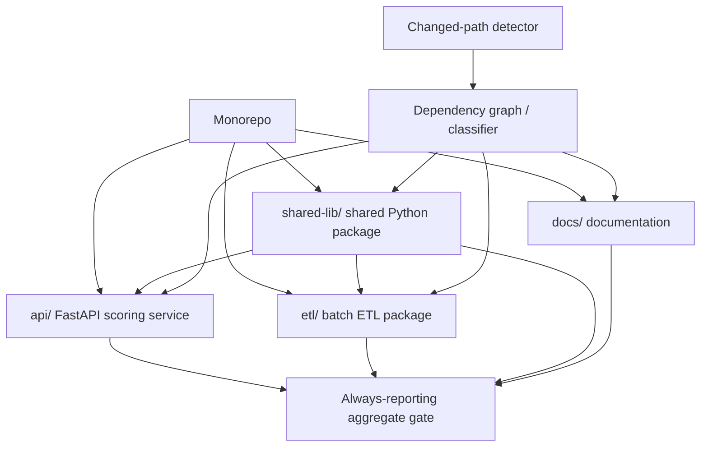

# Monorepo and Path-Based Pipelines

**Abstract:** This lesson develops a correctness-first approach to selective CI in a monorepo. It explains how to classify changed paths, propagate shared-library changes to dependents, compute changes against a defensible Git base, generate bounded matrices, and preserve a stable required status even when component jobs are intentionally skipped. The running example uses `api/`, `etl/`, `shared-lib/`, and `docs/`.

**Module:** M02 — CI/CD Pipeline Engineering  
**Stage:** 2E — Production DevOps & Platform Engineering  
**Estimated time:** 8–12 hours, including labs  
**Last reviewed:** 2026-10-24 (authoring date; official documentation not live-verified)  
**Assumed tool baseline:** Git, Python 3.10+, Bash, GitHub Actions, GitLab CI familiarity; examples use ordinary Git and Python standard library. Platform-specific behavior is marked for verification.

> **Status note:** This is an instructional draft. Commands, workflows, and labs have not been executed as part of this document's preparation. Treat all displayed outputs as illustrative, validate workflow syntax, and run the labs in a disposable local repository or private test repository before adopting a production policy.

## Table of contents

- [Unit 5 — Monorepo and path-based pipelines](#unit-5--monorepo-and-path-based-pipelines)
  - [5.0 Why this matters in production](#50-why-this-matters-in-production)
  - [5.1 Learning objectives](#51-learning-objectives)
  - [5.2 Concept map and vocabulary](#52-concept-map-and-vocabulary)
  - [5.3 Level 1 — Beginner](#53-level-1--beginner)
  - [5.4 Level 2 — Intermediate](#54-level-2--intermediate)
  - [5.5 Level 3 — Advanced](#55-level-3--advanced)
  - [5.6 Level 4 — Expert](#56-level-4--expert)
  - [5.7 SRE lens](#57-sre-lens)
  - [5.8 Security lens](#58-security-lens)
  - [5.9 Production checklist](#59-production-checklist)
  - [5.10 Hands-on lab set](#510-hands-on-lab-set)
  - [5.11 Self-check questions](#511-self-check-questions)
  - [5.12 Evidence artifacts](#512-evidence-artifacts)
  - [5.13 Common interview and design-review questions](#513-common-interview-and-design-review-questions)
  - [5.14 Sources and verification notes](#514-sources-and-verification-notes)
- [Appendix A — Claim Register](#appendix-a--claim-register)
- [Appendix B — Ten-pass self-audit](#appendix-b--ten-pass-self-audit)
- [Appendix C — Adversarial review](#appendix-c--adversarial-review)
- [Appendix D — Human verification checklist](#appendix-d--human-verification-checklist)
- [Appendix E — Known limitations and sign-off](#appendix-e--known-limitations-and-sign-off)

## Unit 5 — Monorepo and path-based pipelines

**Target file:** 05-monorepo-and-path-based-pipelines.md | **Estimated time:** 8–12 hours | **Prerequisites:** Git basics, shell, Python basics, Unit 2 GitHub Actions concepts, basic CI/CD concepts from Unit 1

**Core tools:** Git, GitHub Actions, GitHub required checks/rulesets, GitLab CI rules, Python/shell, CODEOWNERS | **Awareness:** Bazel, Nx, Turborepo, Pants, merge-queue-specific behavior, third-party path-filter actions | **Last reviewed:** 2026-10-24 (authoring date; not live-verified)

### 5.0 Why this matters in production

A path-based pipeline can reduce unnecessary work, but an incorrect classifier can also skip tests for a service that depends on a changed shared library. A pull request may look green while the required status never reports, leaving a merge blocked—or worse, leaving a policy gap if checks are configured incorrectly. A diff against the wrong base can omit files changed earlier in a branch, especially after rebases, squash merges, force-pushes, or synthetic merge commits. Repository ownership rules are also operational controls: a `CODEOWNERS` file does not itself enforce review unless repository settings require the relevant approvals. The production goal is not “run fewer jobs”; it is “run the smallest defensible set of checks while making every relevant change observable and testable.”

### 5.1 Learning objectives

- [L1] Explain monorepo/polyrepo trade-offs and identify when path routing is useful.
- [L1] Classify example changes under `api/`, `etl/`, `shared-lib/`, and `docs/`.
- [L2] Configure GitHub path filters and explain workflow-trigger filtering versus job-level conditions.
- [L2] Implement component routing with shared-library fan-out and an always-reporting aggregate gate.
- [L3] Compute a changed-file set from an explicit base/head pair and use a merge base when the event model requires it.
- [L3] Build and unit-test a fail-closed classifier that handles deleted, renamed, unknown, and empty change sets.
- [L3] Produce a bounded dynamic matrix safely, including empty-matrix behavior.
- [L4] Diagnose history/event edge cases and defend a no-change-untested policy with measurable evidence.

Objective evidence is collected in Labs 1–4 and in the workflow, classifier tests, routing fixtures, gate logs, and decision record listed in Section 5.12.

### 5.2 Concept map and vocabulary



| Term | Precise definition | Common misconception |
|---|---|---|
| Monorepo | One version-control repository containing multiple packages or services. | It means one release cadence or one deployable. |
| Polyrepo | Multiple repositories, often split by service or team. | It necessarily prevents shared-code reuse. |
| Path filter | A rule that matches changed file paths to decide whether a workflow or job should run. | A path match proves all dependencies were tested. |
| Changed component | A component selected because its own files or a dependency changed. | Only directly edited directories count. |
| Dependency graph | Directed relationships describing which components depend on which others. | A folder tree is a complete dependency graph. |
| Fan-out | Propagating a change to all affected downstream components. | Shared-library changes need only test the library itself. |
| Merge base | A best common ancestor commit of two Git commits. | It is always the previous commit on the branch. |
| Diff base | The chosen comparison point used to calculate a change set. | It can be guessed from the branch name. |
| Base/head SHA | The exact commits chosen as the comparison endpoints. | Branch names are immutable commit identifiers. |
| Shallow clone | A repository clone with limited commit history. | It always contains enough history to compute any merge base. |
| Dynamic matrix | A job matrix generated at workflow runtime from validated data. | Arbitrary filenames should be interpolated into a shell command. |
| Required status check | A named check that repository merge policy requires before merging. | Any skipped workflow automatically satisfies the check. |
| Skipped workflow | A workflow that did not start because its event/path conditions did not match. | It is equivalent to a successful test run. |
| Aggregate gate | A stable final job that reports an overall pass/fail result after relevant jobs finish or are intentionally skipped. | It should always pass when component jobs are skipped. |
| CODEOWNERS | A path-to-reviewer mapping used by supported repository review features. | The file alone forces approval. |
| Release train | A coordinated release schedule for multiple components. | It is always safer than independent releases. |
| Independent release | A component can be versioned and released without every component releasing together. | It eliminates compatibility concerns. |
| Merge queue | A mechanism that tests proposed changes in a merge-oriented queue context before integration. | Its synthetic commits are identical to ordinary PR heads in every detail. |
| Force-push | Updating a branch ref to a commit that is not a fast-forward descendant of its previous value. | It changes file contents but not history semantics. |
| Squash merge | Integrating a set of commits as a new combined commit. | The resulting SHA is one of the original PR commits. |
| No-change-untested policy | Every changed path is classified; relevant dependents are tested, while unknown paths fail closed. | It means every test must run for every change. |

**Workflow trigger versus job condition.** A workflow-level trigger decides whether GitHub starts a workflow at all. A job-level condition decides whether a job inside an already-started workflow runs. This distinction is central to required checks: if a workflow never starts because its path filter excludes a docs-only change, its aggregate job cannot report a status. A workflow with a broad trigger and internal path classification can still run a stable `gate` job for every relevant event. Exact required-check behavior depends on current GitHub configuration and event context: **[VERIFY: GitHub Actions workflow syntax, workflow events, and required status checks/rulesets documentation].**

Path filtering is an optimization, not a correctness proof. Correctness depends on a reviewed dependency graph, complete path classification, a safe unknown-path fallback, and merge rules that require the stable aggregate gate.

### 5.3 Level 1 — Beginner

#### Monorepo or polyrepo?

Use a monorepo when teams frequently change shared code and benefit from one atomic change, one dependency view, and consistent tooling. Use polyrepos when access boundaries, independent ownership, repository scale, release autonomy, or compliance boundaries justify the extra cross-repository coordination. Neither layout removes dependency management: a shared package in a monorepo creates internal edges; a shared package in polyrepos creates version and publication edges.

In our example, both `api/` and `etl/` import `shared-lib/`. An API-only edit normally runs API checks. An ETL-only edit normally runs ETL checks. A shared library edit must run checks for the library and both dependents. A docs-only edit can skip component builds, but a stable gate still needs to report.

#### Create a local teaching repository

Commands below create a disposable directory under the current directory. Do not run them inside an important repository. The script refuses to overwrite an existing `monorepo-ci-lab` directory.

```bash
# File: terminal (Bash)
set -euo pipefail
if [ -e monorepo-ci-lab ]; then
  printf 'Refusing to overwrite existing path: monorepo-ci-lab\n' >&2
  exit 2
fi
mkdir -p monorepo-ci-lab/{api,etl,shared-lib,docs}
cd monorepo-ci-lab
git init
printf 'def score(x: float) -> float:\n    return x\n' > shared-lib/scoring.py
printf 'from shared_lib.scoring import score\n' > api/app.py
printf 'from shared_lib.scoring import score\n' > etl/job.py
printf '# Architecture notes\n' > docs/architecture.md
git add .
git -c user.name='CI Lab' -c user.email='ci-lab@example.invalid' commit -m 'baseline'
```

**Example — yours will differ**

```text
Initialized empty Git repository ...
[main (root-commit) abc1234] baseline
 4 files changed, ...
```

The SHA and Git's exact wording are illustrative, not observed. The initial commit establishes a baseline so later diffs have a known comparison point.

Make a docs-only change and inspect the changed paths:

```bash
# File: terminal (Bash)
set -euo pipefail
printf '\nAdd a local architecture note.\n' >> docs/architecture.md
git status --short
git diff --name-only
```

**Example — yours will differ**

```text
 M docs/architecture.md
docs/architecture.md
```

`git status --short` shows the worktree state; `git diff --name-only` lists changed tracked paths relative to the index. For untracked files, `git diff` alone does not show them; use `git status --short` or stage them in a disposable lab before inspecting the staged diff.

#### A first classifier

```python
# File: classify_paths_l1.py
from pathlib import PurePosixPath

def classify(paths: list[str]) -> set[str]:
    components: set[str] = set()
    for raw_path in paths:
        path = PurePosixPath(raw_path)
        parts = path.parts
        if not parts:
            continue
        if parts[0] == "api":
            components.add("api")
        elif parts[0] == "etl":
            components.add("etl")
        elif parts[0] == "shared-lib":
            components.update({"shared-lib", "api", "etl"})
        elif parts[0] == "docs":
            continue
        else:
            # Fail closed: unknown paths request broad validation.
            components.update({"api", "etl", "shared-lib"})
    return components
```

```python
# File: terminal (Bash)
python - <<'PY'
from classify_paths_l1 import classify
print(sorted(classify(["api/app.py"])))
print(sorted(classify(["shared-lib/scoring.py"])))
print(sorted(classify(["docs/architecture.md"])))
print(sorted(classify(["pyproject.toml"])))
PY
```

**Example — yours will differ**

```text
['api']
['api', 'etl', 'shared-lib']
[]
['api', 'etl', 'shared-lib']
```

Interpretation: a shared change fans out to every dependent. A docs-only change selects no component tests, while an unknown root-level file triggers broad checks. This is only a first approximation; the advanced classifier below adds explicit base/head validation, rename/deletion handling, and unit tests.

#### What just happened?

A path filter answers “which work seems relevant?” The dependency map answers “which components could be affected?” These are different questions. The classifier translates changed paths into affected components using both path ownership and dependency edges. The final gate converts component outcomes into a stable result that repository merge policy can require.

| Symptom | Likely cause | Fix |
|---|---|---|
| Shared library edit runs only library tests | Missing reverse-dependency fan-out | Add `api` and `etl` dependents and test the mapping |
| Docs change blocks merge indefinitely | Workflow was skipped before its required gate could report | Use a broadly triggered workflow with job-level routing and an always-reporting gate |
| API edit runs every component job | Broad fallback rule matches too much | Narrow known-path rules; keep broad fallback only for unknown/shared configuration |
| New root config is not tested | Root-level paths were unclassified | Explicitly route manifests, workflow files, scripts, and build config |
| Classifier misses a deleted file | It only inspects files that currently exist | Use Git's change metadata; do not require the new path to exist |

### 5.4 Level 2 — Intermediate

#### GitHub Actions workflow-level path filters

A workflow-level filter is useful when a workflow genuinely need not exist for a class of changes, and its status is not a required check. For required CI, a broadly triggered workflow with internal job routing is usually easier to reason about.

```yaml
# File: .github/workflows/api-only-example.yml
name: API checks (illustrative workflow-level filter)

on:
  pull_request:
    paths:
      - "api/**"
      - "shared-lib/**"
      - "pyproject.toml"
  push:
    branches: ["main"]
    paths:
      - "api/**"
      - "shared-lib/**"
      - "pyproject.toml"

permissions:
  contents: read

jobs:
  api:
    runs-on: ubuntu-latest
    steps:
      - uses: actions/checkout@<full-40-char-sha> # replace with verified SHA
      - run: python -m compileall api shared-lib
```

The action SHA is deliberately a placeholder and is not runnable until replaced with a verified full commit SHA. The example illustrates the routing concept; it is not a production-ready test suite.

`paths` runs the workflow only when changed paths match the filter. `paths-ignore` excludes a workflow when all relevant changed paths are ignored according to platform semantics. **[VERIFY: GitHub Actions workflow syntax — `on.<push|pull_request>.paths` and `paths-ignore`; pull-request event documentation; current file-diff limits and required-check behavior.]** Do not assume `paths` and `paths-ignore` can be combined arbitrarily for the same event; check the current syntax reference. Path-filter evaluation can also be affected by event type and diff construction. For a required gate, avoid making the existence of the entire workflow conditional.

#### Job-level routing with a stable gate

The following is a conceptual, coherent single-workflow pattern. It triggers for pull requests and pushes to `main`, then routes component jobs internally. For production, use a tested classifier and ensure the gate's conditions match the actual event types used in the repository.

```yaml
# File: .github/workflows/monorepo-ci.yml
name: Monorepo CI

on:
  pull_request:
  push:
    branches: ["main"]

permissions:
  contents: read

jobs:
  classify:
    runs-on: ubuntu-latest
    outputs:
      api: ${{ steps.routes.outputs.api }}
      etl: ${{ steps.routes.outputs.etl }}
      shared: ${{ steps.routes.outputs.shared }}
      unknown: ${{ steps.routes.outputs.unknown }}
    steps:
      - uses: actions/checkout@<full-40-char-sha> # replace with verified SHA
        with:
          fetch-depth: 0 # justified here for the illustrative history-based classifier
      - id: routes
        shell: bash
        run: |
          set -euo pipefail
          # Replace this simplified example with the tested classifier below.
          echo "api=true" >> "$GITHUB_OUTPUT"
          echo "etl=true" >> "$GITHUB_OUTPUT"
          echo "shared=true" >> "$GITHUB_OUTPUT"
          echo "unknown=false" >> "$GITHUB_OUTPUT"

  api:
    needs: classify
    if: needs.classify.outputs.api == 'true'
    runs-on: ubuntu-latest
    steps:
      - uses: actions/checkout@<full-40-char-sha> # replace with verified SHA
      - run: python -m compileall api shared-lib

  etl:
    needs: classify
    if: needs.classify.outputs.etl == 'true'
    runs-on: ubuntu-latest
    steps:
      - uses: actions/checkout@<full-40-char-sha> # replace with verified SHA
      - run: python -m compileall etl shared-lib

  shared:
    needs: classify
    if: needs.classify.outputs.shared == 'true'
    runs-on: ubuntu-latest
    steps:
      - uses: actions/checkout@<full-40-char-sha> # replace with verified SHA
      - run: python -m compileall shared-lib

  gate:
    if: ${{ always() }}
    needs: [classify, api, etl, shared]
    runs-on: ubuntu-latest
    steps:
      - name: Evaluate component outcomes
        env:
          CLASSIFY_RESULT: ${{ needs.classify.result }}
          API_RESULT: ${{ needs.api.result }}
          ETL_RESULT: ${{ needs.etl.result }}
          SHARED_RESULT: ${{ needs.shared.result }}
        shell: bash
        run: |
          set -euo pipefail
          printf 'classify=%s api=%s etl=%s shared=%s\n' \
            "$CLASSIFY_RESULT" "$API_RESULT" "$ETL_RESULT" "$SHARED_RESULT"
          if [ "$CLASSIFY_RESULT" != "success" ]; then
            echo "Classifier did not succeed; failing gate." >&2
            exit 1
          fi
          for result in "$API_RESULT" "$ETL_RESULT" "$SHARED_RESULT"; do
            if [ "$result" = "failure" ] || [ "$result" = "cancelled" ]; then
              echo "A required component job failed or was cancelled." >&2
              exit 1
            fi
          done
          echo "Gate passed: selected jobs succeeded; unselected jobs were skipped."
```

**Important limitations:** this YAML intentionally sets all routes to `true` and is a syntax-shaped teaching scaffold, not a selective classifier. It does not satisfy the no-change-untested policy until the classification step is replaced and tested. The checkout SHA placeholders must be replaced. Validate the exact semantics of `always()`, skipped dependencies, and required status checks against current GitHub Actions documentation before relying on this pattern. A robust gate should also validate that every expected job result is either `success` or an explicitly permitted `skipped`, and should fail if classification is unknown or malformed.

A better production architecture is: a broadly triggered workflow → classifier job → selected component jobs → stable aggregate gate. The gate must fail on classifier failure, unknown paths without broad fallback, any selected job failure/cancellation, or any unexpected job state. The stable required check should be the aggregate job's check name as observed in a real run. Configure required checks in a test repository first. **[VERIFY: GitHub branch protection/rulesets and required status checks documentation; exact UI names and merge-queue compatibility.]**

#### Dependency map

| Changed path class | Selected checks |
|---|---|
| `api/**` | `api` |
| `etl/**` | `etl` |
| `shared-lib/**` | `shared-lib`, `api`, `etl` |
| `docs/**` | no component build/test; classifier and gate still run |
| workflow files, root manifests/lockfiles, build scripts, shared config | broad checks: `api`, `etl`, `shared-lib` |
| unknown path | broad checks or classification failure; never silent skip |

A practical classifier may represent a component's direct paths and dependencies in a manifest, then calculate reverse dependencies. Keep the manifest under code review and test it as production code.

#### GitLab CI comparison

```yaml
# File: .gitlab-ci.yml
stages:
  - classify
  - test
  - gate

api_tests:
  stage: test
  script:
    - python -m compileall api shared-lib
  rules:
    - changes:
        - api/**/*
        - shared-lib/**/*
        - pyproject.toml
    - when: never

etl_tests:
  stage: test
  script:
    - python -m compileall etl shared-lib
  rules:
    - changes:
        - etl/**/*
        - shared-lib/**/*
        - pyproject.toml
    - when: never
```

`rules:changes` evaluates changed paths in relation to the pipeline context; its comparison behavior can differ between branch pipelines, merge-request pipelines, and pipelines without a push-associated diff. **[VERIFY: GitLab CI/CD `rules:changes` documentation for the GitLab version and pipeline source in use.]** This example shows basic selection, not a complete stable-gate implementation. For production, add an explicit aggregate stage/job and verify how skipped jobs and `needs` interact with your GitLab version. Do not teach legacy `only/except` as the default for new configuration.

#### Pattern catalogue

| Pattern | When to use | When NOT to use |
|---|---|---|
| Broad workflow + job-level routing | Required aggregate gate must report for every PR | A workflow is genuinely optional and has no required status role |
| Separate workflow per component | Ownership and lifecycle are independent, and gate aggregation is designed | Shared dependency fan-out and cross-workflow status become opaque |
| Custom classifier + dependency graph | Rules are complex, testable, and under repository ownership | No team owns the classifier or fixture suite |
| Third-party path-filter action | Standard patterns fit and upstream is reviewed | The action is unpinned, unreviewed, or critical behavior is untested |
| Always run broad tests | Small repo, uncertain dependency graph, high risk | Runtime/capacity is unacceptable and selective routing can be validated |
| Dynamic matrix | Many similar components and bounded job fan-out | Components require very different workflows or matrix can grow without a cap |

#### Anti-pattern catalogue

| Bad example | Why it hurts | Corrected version |
|---|---|---|
| Workflow has `paths: [api/**]` and its workflow check is required | Docs/ETL PR may never create the required check | Trigger broadly; require stable `gate` job |
| `shared-lib/**` triggers only library tests | Dependents may break without their tests running | Explicitly fan out to `api` and `etl` |
| Unknown path maps to no jobs | New config can bypass checks silently | Unknown path → broad checks or fail classification |
| `git diff HEAD~1` for every PR | Misses changes relative to the true PR comparison base | Define event base/head and calculate merge base when appropriate |
| Unbounded matrix from repository paths | Can create huge, expensive job fan-out | Validate component IDs against a manifest and enforce a maximum |
| Trust `CODEOWNERS` file alone | Review may not be required by repository settings | Require CODEOWNER review in branch protection/rulesets and test it |

**Lab evidence:** save a routing table for API, ETL, shared library, docs, root config, and unknown paths. Include actual run links/screenshots only if you execute the workflow; otherwise label evidence “local simulation.”

### 5.5 Level 3 — Advanced

#### Define the comparison before writing the classifier

A change detector is only as correct as its base/head pair. For a pull request, the platform exposes base and head commit information; a robust design should consume the event's exact SHAs rather than assume a branch name still points to the same commit. For a push, the event often provides a before/after pair. A new branch may have a zero/missing “before” SHA, so that case needs a documented fallback such as a full classification or broad tests. **[VERIFY: GitHub pull_request and push event payload documentation, including merge-queue event behavior.]**

`git diff --name-only BASE...HEAD` compares the merge base of the two commits to `HEAD`; `git diff --name-only BASE HEAD` compares the exact two trees. These are not interchangeable. `git merge-base BASE HEAD` returns a best common ancestor when one exists. For a PR, merge-base comparison can capture the branch's changes since divergence; exact endpoint comparison can be appropriate when event semantics explicitly define the intended tree comparison. Record which meaning the policy needs.

`HEAD~1` is a parent-relative shortcut, not a general PR base. It fails for multi-commit branches because it only covers the last commit's parent relationship. A local branch named `main` may be stale. A force-push can rewrite branch history. A squash merge creates a new commit, so relying on original commit identity can be brittle. Always treat event SHAs as immutable identifiers and validate they exist locally before diffing.

#### Git commands and exit behavior

```bash
# File: terminal (Bash)
set -euo pipefail
BASE_SHA="${BASE_SHA:?set BASE_SHA to an existing commit}"
HEAD_SHA="${HEAD_SHA:-HEAD}"
git cat-file -e "${BASE_SHA}^{commit}"
git cat-file -e "${HEAD_SHA}^{commit}"
git diff --name-status --find-renames "$BASE_SHA" "$HEAD_SHA"
git merge-base "$BASE_SHA" "$HEAD_SHA"
```

**Example — yours will differ**

```text
M	api/app.py
R100	shared-lib/old_name.py	shared-lib/new_name.py
<merge-base-sha>
```

The displayed status rows and SHA are illustrative. `--name-status` exposes change status; rename detection is heuristic and can vary with similarity thresholds. `--diff-filter` can restrict statuses, but filtering only added/modified files may omit deletions and renames. For routing, consider both old and new paths for renames. A deletion still matters even though the file no longer exists in the head tree. A diff with no changed paths can be legitimate; it must not be confused with a missing or invalid base reference.

Git commands have distinct failure behavior: `git cat-file -e` exits nonzero if an object cannot be resolved; `git merge-base` can fail if no suitable common ancestor is available; `git diff` normally returns nonzero for command errors, not simply because differences exist. Do not use `git diff`'s exit code as a “files changed” boolean unless using a mode whose semantics you explicitly understand.

#### Shallow history and checkout depth

A shallow clone deliberately limits history. If the chosen base and head objects exist but their common ancestry is absent, `git merge-base` may fail or give an incomplete basis for the intended calculation. `actions/checkout` supports a fetch-depth input; its default and current behavior are **[VERIFY: `actions/checkout` README/input reference for the pinned release]**. Do not reflexively fetch all history for every job: full history costs network and checkout time. Prefer the minimum depth that reliably includes the event SHAs and required ancestry; deepen or fetch the specific base ref when necessary; use full history only when the policy depends on arbitrary ancestry and the cost is justified. Test force-pushes and first-push cases in a private repository.

#### Robust Python classifier

This implementation expects a newline-delimited `git diff --name-status -z` stream to preserve unusual path names safely. It does not parse filenames from shell output with whitespace splitting. It accepts a base/head pair and uses Git to compute the merge base; if any required reference or diff fails, it exits nonzero so CI can fail closed. The policy deliberately routes root-level build/config files broadly and treats unknown paths conservatively.

```python
# File: scripts/classify_changes.py
from __future__ import annotations

import json
import subprocess
import sys
from dataclasses import dataclass
from typing import Sequence

COMPONENTS = ("api", "etl", "shared-lib")
BROAD_ROOT_FILES = {
    "pyproject.toml",
    "poetry.lock",
    "requirements.txt",
    "requirements-dev.txt",
    "Makefile",
    "Dockerfile",
}
BROAD_PREFIXES = (
    ".github/workflows/",
    "scripts/",
    "config/",
)
KNOWN_PREFIXES = ("api/", "etl/", "shared-lib/", "docs/")

@dataclass(frozen=True)
class Classification:
    components: tuple[str, ...]
    paths: tuple[str, ...]
    unknown_paths: tuple[str, ...]
    reason: str

def run_git(args: Sequence[str], *, cwd: str = ".") -> bytes:
    result = subprocess.run(
        ["git", *args],
        cwd=cwd,
        check=False,
        stdout=subprocess.PIPE,
        stderr=subprocess.PIPE,
    )
    if result.returncode != 0:
        message = result.stderr.decode("utf-8", errors="replace").strip()
        raise RuntimeError(f"git {' '.join(args)} failed: {message}")
    return result.stdout

def require_commit(ref: str) -> str:
    if not ref or ref.startswith("-"):
        raise ValueError("base/head ref is missing or malformed")
    return run_git(["rev-parse", "--verify", f"{ref}^{{commit}}"]).decode().strip()

def parse_name_status_z(raw: bytes) -> list[str]:
    """Return all old/new paths from `git diff --name-status -z` output."""
    tokens = raw.decode("utf-8", errors="surrogateescape").split("\0")
    if tokens and tokens[-1] == "":
        tokens.pop()
    paths: list[str] = []
    i = 0
    while i < len(tokens):
        status = tokens[i]
        i += 1
        if status.startswith(("R", "C")):
            if i + 1 >= len(tokens):
                raise ValueError("malformed rename/copy record")
            paths.extend((tokens[i], tokens[i + 1]))
            i += 2
        else:
            if i >= len(tokens):
                raise ValueError("malformed name-status record")
            paths.append(tokens[i])
            i += 1
    return paths

def classify_paths(paths: Sequence[str]) -> Classification:
    selected: set[str] = set()
    unknown: list[str] = []
    if not paths:
        return Classification((), (), (), "empty diff: no component work selected")
    for path in paths:
        normalized = path.replace("\\", "/")
        if normalized in BROAD_ROOT_FILES or normalized.startswith(BROAD_PREFIXES):
            selected.update(COMPONENTS)
        elif normalized.startswith("api/"):
            selected.add("api")
        elif normalized.startswith("etl/"):
            selected.add("etl")
        elif normalized.startswith("shared-lib/"):
            selected.update(("shared-lib", "api", "etl"))
        elif normalized.startswith("docs/"):
            pass
        else:
            unknown.append(path)
            # Fail closed by selecting every component.
            selected.update(COMPONENTS)
    return Classification(
        tuple(sorted(selected)),
        tuple(paths),
        tuple(sorted(set(unknown))),
        "unknown path -> broad checks" if unknown else "classified",
    )

def changed_paths(base: str, head: str) -> list[str]:
    base_sha = require_commit(base)
    head_sha = require_commit(head)
    merge_base = run_git(["merge-base", base_sha, head_sha]).decode().strip()
    # -z avoids quoting/escaping ambiguity for unusual filenames.
    raw = run_git([
        "diff", "--name-status", "-z", "--find-renames",
        merge_base, head_sha,
    ])
    return parse_name_status_z(raw)

def main() -> int:
    if len(sys.argv) != 3:
        print("usage: classify_changes.py BASE_REF HEAD_REF", file=sys.stderr)
        return 2
    try:
        paths = changed_paths(sys.argv[1], sys.argv[2])
        result = classify_paths(paths)
    except (RuntimeError, ValueError) as exc:
        print(f"classification failed closed: {exc}", file=sys.stderr)
        return 1
    print(json.dumps({
        "components": list(result.components),
        "paths": list(result.paths),
        "unknown_paths": list(result.unknown_paths),
        "reason": result.reason,
    }, ensure_ascii=True, separators=(",", ":")))
    return 0

if __name__ == "__main__":
    raise SystemExit(main())
```

**Important implementation note:** `git diff --name-status -z` uses NUL-delimited records; status/path token structure must be validated against the Git version and tested with filenames containing tabs, newlines, spaces, and rename records. The parser is intentionally simple and should be regression-tested on the supported Git baseline before production use. `startswith(BROAD_PREFIXES)` is valid for a tuple of string prefixes. For security and correctness, the classifier's input refs should come from trusted event metadata, not user-supplied shell fragments.

#### Unit tests and fixtures

```python
# File: tests/test_classify_changes.py
import unittest
from scripts.classify_changes import classify_paths, parse_name_status_z

class ClassifierTests(unittest.TestCase):
    def test_api_only(self):
        self.assertEqual(classify_paths(["api/app.py"]).components, ("api",))

    def test_etl_only(self):
        self.assertEqual(classify_paths(["etl/job.py"]).components, ("etl",))

    def test_shared_fans_out(self):
        self.assertEqual(
            classify_paths(["shared-lib/scoring.py"]).components,
            ("api", "etl", "shared-lib"),
        )

    def test_docs_only(self):
        self.assertEqual(classify_paths(["docs/guide.md"]).components, ())

    def test_unknown_fails_closed(self):
        result = classify_paths(["new-component/main.py"])
        self.assertEqual(result.components, ("api", "etl", "shared-lib"))
        self.assertEqual(result.unknown_paths, ("new-component/main.py",))

    def test_root_manifest_is_broad(self):
        self.assertEqual(
            classify_paths(["pyproject.toml"]).components,
            ("api", "etl", "shared-lib"),
        )

    def test_deleted_path_still_routes(self):
        self.assertEqual(classify_paths(["etl/removed.py"]).components, ("etl",))

    def test_rename_considers_both_paths(self):
        paths = parse_name_status_z(b"R100\0api/old.py\0shared-lib/new.py\0")
        self.assertEqual(paths, ["api/old.py", "shared-lib/new.py"])
        self.assertEqual(
            classify_paths(paths).components,
            ("api", "etl", "shared-lib"),
        )

    def test_empty_diff_is_empty(self):
        self.assertEqual(classify_paths([]).components, ())

if __name__ == "__main__":
    unittest.main()
```

```bash
# File: terminal (Bash)
set -euo pipefail
python -m unittest tests.test_classify_changes -v
```

**Example — yours will differ**

```text
test_api_only ... ok
test_docs_only ... ok
test_empty_diff_is_empty ... ok
...
Ran 9 tests in ...
OK
```

This is representative expected output, not an execution claim. Add integration tests that create temporary commits and invoke `changed_paths`; unit tests alone do not prove the Git command's event base is correct. For a robust production classifier, test malformed refs, missing objects, merge-base failure, rename/copy parsing, deletion, first push, force-push, shallow history, and unknown paths.

#### Dynamic matrix generation

The classifier can emit JSON for a matrix, but only after validating component names against a fixed allowlist. Do not construct shell code from changed paths. Use job outputs and pass the output to `fromJSON` only after the classifier has emitted valid, bounded JSON.

```yaml
# File: .github/workflows/monorepo-matrix.yml
name: Monorepo matrix

on:
  pull_request:

permissions:
  contents: read

jobs:
  classify:
    runs-on: ubuntu-latest
    outputs:
      matrix: ${{ steps.matrix.outputs.matrix }}
      has_work: ${{ steps.matrix.outputs.has_work }}
    steps:
      - uses: actions/checkout@<full-40-char-sha> # replace with verified SHA
        with:
          fetch-depth: 0
      - id: matrix
        shell: bash
        run: |
          set -euo pipefail
          # Example only: production code should invoke the tested classifier.
          matrix='{"component":["api","etl"]}'
          printf 'matrix=%s\n' "$matrix" >> "$GITHUB_OUTPUT"
          printf 'has_work=true\n' >> "$GITHUB_OUTPUT"

  test:
    needs: classify
    if: needs.classify.outputs.has_work == 'true'
    strategy:
      fail-fast: false
      max-parallel: 3
      matrix: ${{ fromJSON(needs.classify.outputs.matrix) }}
    runs-on: ubuntu-latest
    steps:
      - uses: actions/checkout@<full-40-char-sha> # replace with verified SHA
      - run: python -m compileall "${{ matrix.component }}"
```

The final `run` example illustrates why a validated allowlisted matrix is necessary; even then, expressions inserted into shell source deserve care. Prefer an environment variable to interpolate a value as data:

```yaml
# File: .github/workflows/monorepo-matrix-safe-step.yml
- name: Validate selected component
  env:
    COMPONENT: ${{ matrix.component }}
  shell: bash
  run: |
    set -euo pipefail
    case "$COMPONENT" in
      api|etl|shared-lib) ;;
      *) echo "Invalid component" >&2; exit 1 ;;
    esac
    python -m compileall "$COMPONENT"
```

The matrix must have a hard bound: use only known component IDs from a manifest and fail classification if the requested set exceeds the configured maximum. An empty matrix can be awkward because matrix expansion may not produce a runnable job; set an explicit `has_work` output and conditionally skip the matrix job, while keeping `gate` unconditional and aware that “no component jobs selected” is an allowed result only when classification succeeded and all paths are classified as docs-only. Validate exact matrix expression semantics with the current GitHub workflow syntax reference. **[VERIFY: GitHub Actions job outputs, `fromJSON`, matrix strategy, and skipped-job semantics.]**

#### Dependency-graph-aware execution

Represent dependencies as edges from a dependency to its dependents for fan-out: `shared-lib → api` and `shared-lib → etl`. For transitive relationships, compute reverse reachability. If `etl` depends on `feature-engineering`, which depends on `shared-lib`, a change in `shared-lib` should select all reachable downstream components.

A minimal breadth-first traversal:

```python
# File: scripts/dependency_graph.py
from collections import deque

DEPENDENTS = {
    "shared-lib": {"api", "etl"},
    "api": set(),
    "etl": set(),
}

def transitive_dependents(changed: str) -> set[str]:
    visited: set[str] = set()
    queue = deque(DEPENDENTS.get(changed, ()))
    while queue:
        item = queue.popleft()
        if item in visited:
            continue
        visited.add(item)
        queue.extend(DEPENDENTS.get(item, ()))
    return visited
```

```bash
# File: terminal (Bash)
python - <<'PY'
from scripts.dependency_graph import transitive_dependents
print(sorted(transitive_dependents("shared-lib")))
PY
```

**Example — yours will differ**

```text
['api', 'etl']
```

Interpretation: dependency fan-out should be derived from a maintained graph, not duplicated independently in a dozen workflow files. Include generated code, root lockfiles, workflow changes, test harnesses, shared configuration, and build scripts in the graph or broad-check policy.

#### Third-party path filters

An action such as `dorny/paths-filter` can provide path matching and outputs. It may simplify common use cases, but it adds a supply-chain dependency and still needs correct base/head semantics, permissions, and required-gate design. Any workflow example must pin the action to a verified full commit SHA; this lesson intentionally does not invent one. Use `<full-40-char-sha>` and replace it only after checking the upstream repository/release and reviewing the code. **[VERIFY: official action README for current inputs, outputs, pull-request permissions, and event support.]** SHA pinning makes a reference immutable; it does not prove that the pinned code is safe.

#### CODEOWNERS and per-path approvals

A repository may contain a `.github/CODEOWNERS` file:

```text
# File: .github/CODEOWNERS
/api/           @example-org/api-maintainers
/etl/           @example-org/data-platform
/shared-lib/    @example-org/platform
/.github/       @example-org/platform
/scripts/       @example-org/platform
```

These names are placeholders, not real teams. CODEOWNERS identifies suggested/relevant reviewers in supported workflows. To require approval, configure branch protection or rulesets to require code-owner review and ensure the setting applies to the target branch. Verify bypass permissions and administrator behavior. **[VERIFY: GitHub CODEOWNERS documentation and protected branch/ruleset review requirements.]** Review ownership and CI routing should agree but serve different purposes: CODEOWNERS selects review responsibility; the classifier selects tests.

#### Build-tool awareness

| Tool | Purpose | Strengths | Cost/complexity | When to investigate |
|---|---|---|---|---|
| Bazel | Build/test orchestration with explicit dependency graph | Hermetic, graph-oriented builds and remote execution ecosystem | Requires disciplined build definitions and learning investment | Many languages/services, reproducibility and graph scale are major concerns |
| Nx | Monorepo task graph and affected-project tooling | Project graph and affected task selection | Ecosystem conventions and plugin maintenance | A compatible JavaScript/TypeScript or supported mixed-language workspace |
| Turborepo | Task orchestration and caching, especially JS/TS monorepos | Simple task pipelines and cache integration | Cache configuration and task-input correctness | JS/TS-heavy repositories with repeated tasks |
| Pants | Build/test/dependency management across multiple languages | Fine-grained dependency and test selection | Build-system adoption and metadata maintenance | Large multi-language repos needing consistent dependency analysis |

This is awareness only. No labs require these tools. Confirm current language support, feature scope, licensing, and operating requirements in official documentation before selecting one.

#### Versioning cross-reference to Unit 8

A monorepo can use independent versions (each component releases separately) or fixed/lockstep versions (components share a version). Independent versions improve release autonomy but require compatibility metadata and careful shared-package publication. Lockstep versions simplify coordinated compatibility but can force unrelated releases. A shared-library change may require rebuilding dependents even if their version number does not change; whether it requires releasing them depends on the compatibility and packaging model. Unit 8 covers release automation and versioning in depth; this lesson only establishes the routing dependency.

#### Trade-off table

| Option | Benefit | Cost | Risk | Choose when |
|---|---|---|---|---|
| Full test suite for every PR | Simple correctness argument | Higher queue time and compute use | Slow feedback can encourage bypasses | Small repository or dependency graph is unknown |
| Path-only routing | Minimal selected work | Requires complete mapping and edge-case testing | False negatives skip relevant tests | Components are isolated and mapping is maintained |
| Dependency-aware routing + broad fallback | Selective with conservative handling | Classifier and graph maintenance | Incorrect graph still causes misses | Shared libraries and root configuration exist |
| Third-party filter action | Less custom code | Upstream trust and interface dependency | Misconfiguration or supply-chain compromise | Action semantics fit and are reviewed |
| Build graph tool | Fine-grained affected-target logic | Adoption and build-file migration | Incorrect declared dependencies hide work | Scale justifies explicit build graph |

**Advanced lab requirement:** defend your selected strategy using four axes—correctness, runtime, maintenance, and failure behavior. Do not claim measured savings without a repeatable baseline.

### 5.6 Level 4 — Expert

#### Failure scenarios

| Symptom → Hypothesis | Test | Root cause | Fix | Prevention |
|---|---|---|---|---|
| PR changes are missing → wrong diff base | Compare event SHAs and run `git diff --name-status` against intended base/head | Used `HEAD~1` or stale local branch | Use event SHAs and documented merge-base/tree semantics | Fixtures for multi-commit PRs and rebases |
| Force-push causes surprising routing → stale event/ref assumption | Compare payload SHAs with fetched refs | Branch ref moved after event creation | Fetch and validate exact event objects; fail closed if missing | Log base/head SHAs and test force-push scenarios |
| Squash merge breaks path calculation → assumes original commits remain ancestors | Compare resulting tree and event base/head | Squash creates a new combined commit | Classify the relevant tree diff, not commit identity | Test squash merge in a private repository |
| Deleted/renamed file escapes tests → only new existing paths scanned | Use `git diff --name-status --find-renames` | Old path ignored or file-existence filter used | Include old and new rename paths; retain deletion path | Regression fixtures for A/D/R/C statuses |
| Shared library merged without dependent tests → fan-out omitted | Run classifier fixture for `shared-lib/**` | Dependency graph incomplete | Select library and all transitive dependents | Ownership of graph + required classifier tests |
| Required check does not report → workflow never started | Inspect Actions run list and branch-rule check name | Workflow-level path filter excluded event | Broad trigger and stable aggregate job | Docs-only PR acceptance test |
| Merge queue result differs → synthetic merge context | Inspect event type, tested SHA, and queue run | Assumed ordinary PR head semantics | Test the proposed merge result and keep gate compatible | **[VERIFY]** current merge-queue docs and integration tests |
| Branch name mismatch → ref string incorrect | `git show-ref` and `git cat-file -e` for exact SHA | Hard-coded `main`/remote tracking name is absent or stale | Use event SHA, fetch required ref, validate object | Avoid name-only comparisons |
| Merge base missing → shallow history | `git rev-parse --is-shallow-repository`; test `git merge-base` | Required ancestor not fetched | Fetch specific ancestry or deepen/full-fetch when justified | Test at configured checkout depth |
| Unknown path silently skipped → catch-all maps to empty | Add fixture for a new root directory | Classifier assumes all paths known | Broad fallback or fail classification | New-path mutation test in CI |

#### Merge queues and synthetic merge commits

Merge queues commonly test a proposed combination of a pull request with the target branch and possibly queued changes. The exact event names, commit representation, required-check expectations, and branch-protection/ruleset interaction are platform-specific. **[VERIFY: current GitHub merge queue documentation and `merge_group` event documentation.]** The invariant is platform-independent: the required gate must test the tree that is actually eligible to merge, and the required status must be reported for the commit/context the repository rules expect. Do not hard-code the assumption that the pull request head SHA is always the final merge candidate.

#### Scaling to hundreds of components

At scale, avoid copying path patterns into hundreds of independent workflow files. Maintain a versioned component manifest with component ID, path roots, dependencies, owners, test command, and release strategy. Validate unique IDs, path overlap, dependency cycles, missing owners, and unknown directories in a dedicated classifier test. Generate a bounded matrix from allowlisted IDs, cap parallelism, and group components where per-component jobs would cause a job explosion. Use reusable workflows for common mechanics, but keep component-specific inputs explicit and validated.

Observe routing decisions: log base/head SHA, selected component IDs, unknown paths, classifier version, and the reason for broad fallback. Do not log secrets or sensitive file contents. Keep a small deterministic fixture corpus plus integration fixtures that create actual commits. Treat a classifier change like a build-system change: require review, tests, and a rollback path.

#### No-change-untested policy

1. Every changed path is classified.
2. Every component path has an owner and a routing rule.
3. Shared dependencies fan out to all transitive dependents.
4. Root manifests, lockfiles, reusable workflows, scripts, generated-code definitions, and shared configuration route broadly unless proven safe to narrow.
5. Unknown paths cause broad checks or classifier failure; they never silently produce an empty set.
6. A successful classifier emits a bounded, schema-validated result.
7. A stable aggregate gate reports for every required event.
8. The gate fails for classifier failure, selected-job failure/cancellation, unexpected result states, or invalid routing output.
9. The classifier itself has unit and integration tests, including deliberate incorrect-base regression cases.
10. Required-check settings are verified in a test repository and periodically audited.

“Docs-only means no component tests” is a permitted optimization only when docs paths are fully classified and no relevant generated or build inputs changed. If a commit changes both docs and a shared library, shared-library fan-out wins.

#### Release trains versus independent releases

A release train coordinates component versions and deployment windows, which can simplify cross-component compatibility but expands the blast radius and may delay an otherwise safe component release. Independent releases reduce coupling but require explicit compatibility contracts, artifact provenance, and a way to know which shared-library version each service consumes. For either strategy, CI routing and release routing must agree: a shared package change should test consumers, and release policy should decide whether consumers need new artifacts. Rollback of a shared dependency may require coordinated rollback or forward-fix if consumers have already adopted incompatible behavior. See Unit 8 for implementation of versioning and release automation.

#### Polyrepo-to-monorepo migration plan

1. **Inventory:** list repositories, owners, build/test commands, dependencies, release cadence, permissions, and compliance constraints.
2. **Dependency discovery:** identify shared packages, generated code, duplicated workflows, and cross-repo release coupling.
3. **History/licensing review:** choose whether to preserve history; audit licenses, secrets accidentally committed, large files, and submodule/subtree implications.
4. **CI baseline:** record current tests, required checks, build times, flaky failures, and release steps before moving anything.
5. **Layout design:** define directory conventions, ownership, manifest schema, and path routing before migration.
6. **Pilot:** migrate one low-risk service and its shared dependency into a private test repository or controlled branch.
7. **Path routing:** implement classifier and routing fixtures; test docs-only, service-only, shared, root-config, delete, rename, and unknown paths.
8. **Gate validation:** prove stable gate behavior for success, failure, skipped components, cancellation, and classifier errors.
9. **Release strategy:** decide independent versions versus lockstep/release train; preserve rollback artifacts and compatibility policy.
10. **Cutover:** dual-run old and new CI long enough to compare results; define a rollback point and communicate ownership changes.
11. **Exit criteria:** no unexplained routing mismatches, all required checks stable, ownership mapped, release/rollback tested, and operational dashboards in place.

**Decision record template**

```markdown
# ADR: Polyrepo-to-monorepo migration
- Status: Proposed / Accepted / Rejected
- Date:
- Decision owner:
- Repositories/components in scope:
- Drivers:
- Options considered:
- Dependency and ownership model:
- CI routing policy:
- Required aggregate gate:
- Versioning/release strategy:
- Security/licensing/history considerations:
- Rollback plan:
- Measurable exit criteria:
- Risks and mitigations:
- Review date:
```

#### Organizational design

The platform team owns the shared classifier framework, workflow templates, required-gate contract, and routing observability. Component teams own test commands, path manifests, dependency declarations, and service-level acceptance evidence. Security/repository administrators own the policy settings that require review and checks. Changes to routing rules require review from both platform ownership and affected component owners. Audit quarterly or after any missed-test incident: new paths, orphaned components, dependency graph drift, skipped required statuses, unknown-path rate, CODEOWNERS coverage, workflow permission changes, and merge-queue behavior.

### 5.7 SRE lens

Useful service-level indicators (SLIs) include time-to-feedback by change type, required-gate reporting rate, classifier failure rate, missed-dependent-test incidents, queue time, p50/p95 pipeline duration, unnecessary-job ratio, and time to recover from broken routing. An SLO might define a target for the percentage of eligible pull requests whose stable gate reports within a chosen window; choose a target only after measuring the baseline. A gate reporting successfully is an availability signal, not direct proof that the correct tests were selected. Direct correctness evidence comes from routing fixtures, integration tests, dependency graph review, and incident-free validation—not from green badges alone.

Blast radius depends on what the classifier omits. Missing `shared-lib → api, etl` fan-out can affect multiple deployables; an incorrect docs-only classification is lower risk only if docs generation does not feed builds. A root lockfile omitted from routing can invalidate every component's dependency resolution.

**Runbook — shared library merged without downstream tests**

1. **Alert:** a shared-library merge lacks API/ETL checks, or classifier telemetry shows an unexpected empty component set.
2. **Triage:** record commit SHA, event type, base/head SHA, classifier version, changed paths, selected jobs, and gate result. Confirm whether the relevant checks were absent or actually skipped.
3. **Mitigation:** pause release/deployment of affected consumers; run the broad test suite on the merged tree; if confidence is insufficient, revert or forward-fix through the normal review process.
4. **Follow-up:** add a regression fixture, correct the dependency manifest, verify required-check settings, and review prior merges for the same routing gap.

Capacity notes: selective routing can lower unnecessary work, but classifier setup, matrix scheduling, checkout history, and queueing all consume time. Do not assume path filters always improve end-to-end latency. Track baseline and post-change distributions; avoid inventing cost or speedup numbers.

### 5.8 Security lens

- **Untrusted paths:** filenames can contain spaces and unusual characters. Use NUL-delimited Git output or a library API; do not splice raw paths into shell source or expressions.
- **Third-party actions:** pin to verified full SHAs, review source and permissions, monitor updates, and treat pinning as immutability—not a security audit.
- **Workflow changes:** changes under `.github/workflows/` can alter permissions or routing. Route them through broad checks and require platform-owner review.
- **Untrusted pull requests:** do not grant broad write permissions or expose secrets to untrusted code. Use read-only `permissions: contents: read` unless a documented need requires more.
- **Over-broad tokens:** path detection normally needs repository read access, not write access. Avoid write permissions merely to calculate diffs.
- **Review bypass:** ensure rulesets/branch protection require the intended reviews and checks, and audit bypass actors. CODEOWNERS alone is not enforcement.
- **Selective-test false confidence:** path filters do not sandbox code, protect secrets, or prove dependency completeness. A missing graph edge can skip tests while producing a green gate.
- **Classifier tampering:** tests, manifest, and classifier code should have ownership protection. A pull request that changes routing must be evaluated under a policy that does not let the change disable its own validation.
- **Matrix injection:** restrict matrix values to a known set of component IDs and pass them as environment data, not executable shell fragments.
- **Artifact and cache boundaries:** do not assume selective CI makes untrusted artifacts or caches safe; follow the cache and test-isolation guidance in Unit 4 and Unit 6.

Verification checks: inspect workflow permissions, verify action SHAs against upstream source, test PRs that modify workflow/classifier files, and demonstrate that an unknown path fails closed. Do not test by exfiltrating secrets or running offensive payloads.

### 5.9 Production checklist

- [ ] Every top-level directory and root-level build/config file has an explicit routing rule.
- [ ] `api/` changes select API checks and do not select unrelated ETL checks without a documented dependency.
- [ ] `etl/` changes select ETL checks.
- [ ] `shared-lib/` changes select the library and all direct/transitive dependents.
- [ ] `docs/` changes select no component build/test jobs when truly docs-only.
- [ ] Docs-only events still produce a stable aggregate gate result.
- [ ] Unknown paths trigger broad checks or fail classification; they never silently skip.
- [ ] Base/head SHAs are explicit and validated; merge-base semantics are documented.
- [ ] Push, pull-request, first-push, force-push, squash, rename/delete, and merge-queue contexts have fixtures or test plans.
- [ ] Checkout depth is justified and missing-history failures are handled.
- [ ] Dynamic matrix values come from an allowlist, have a maximum size, and handle empty sets.
- [ ] Selected job failures, cancellations, classifier failures, and unexpected states fail the gate.
- [ ] Required-check names are verified from actual runs and repository rules.
- [ ] CODEOWNERS paths map to active owners, and settings require code-owner review where intended.
- [ ] Workflow files, scripts, manifests, lockfiles, and classifier changes receive broad checks and appropriate review.
- [ ] Third-party actions are pinned to verified full SHAs and reviewed.
- [ ] Classifier unit tests and integration fixtures cover path and history edge cases.
- [ ] Local simulation evidence is distinguished from real GitHub/GitLab run evidence.
- [ ] A rollback and incident runbook exists for incorrect routing.

### 5.10 Hands-on lab set

Labs are designed for local Linux/WSL2 or a private test repository. Outputs are representative, not observed. Use `git -C` or a fresh temporary directory if you already have a directory with the lab name. Avoid applying required-check settings to a real organization.

| ID | Goal | Steps | Expected evidence | Cleanup | Stretch |
|---|---|---|---|---|---|
| LAB-1 | Classify API, ETL, shared library, docs, root config, unknown paths | Create the four-folder repository from 5.3; save the classifier and tests; run the unit suite | Output shows API-only → `api`, ETL-only → `etl`, shared → all dependents, docs → empty, unknown → broad | Remove only the disposable lab directory after verifying its path | Add generated-code and workflow paths |
| LAB-2 | Prove merge-base and shallow-history assumptions | Create a multi-commit branch, compare `HEAD~1` with merge-base-based diff, then make a shallow clone and test history availability | A fixture demonstrates why one-commit diff can omit earlier branch changes; record shallow state and any missing-base failure | Delete only the lab clone/temporary directory | Add force-push and first-push fixtures |
| LAB-3 | Prove required gate and component routing | In a private test repository, use a broadly triggered workflow with classifier outputs and stable `gate`; test API, ETL, shared, docs, root-config, and unknown changes | Run records show selected jobs and gate result for each path class | Revert/delete only lab branch/workflow in the private test repository; confirm default branch is unchanged | Test merge queue if enabled |
| LAB-4 | Bound dynamic matrix and test empty/unknown sets | Generate JSON from an allowlisted manifest; validate JSON and maximum component count; test empty docs-only and unknown-path cases | Valid JSON fixture, empty-set handling, overflow failure, unknown fallback, matrix IDs from allowlist | Remove temporary fixture outputs and branch | Add graph-based transitive dependents |
| LAB-5 | Translate core routing to GitLab | Apply `rules:changes` in a private project; run branch and merge-request pipeline contexts available to you; inspect pipeline/job statuses | CI Lint result and pipeline evidence; context-dependent behavior documented | Remove only lab config/branch after saving evidence | Add stable aggregate gate and skipped-job tests |

#### LAB-1 detailed steps: mandatory three-package routing acceptance

1. Create a disposable repository with `api/`, `etl/`, `shared-lib/`, and `docs/`; add baseline files and commit.
2. Save the classifier and unit tests from Section 5.5. Run tests with `python -m unittest tests.test_classify_changes -v`.
3. Add a fixture table that calls `classify_paths` for each path class. Required outcomes:
   - `api/app.py` → `api`
   - `etl/job.py` → `etl`
   - `shared-lib/scoring.py` → `api`, `etl`, `shared-lib`
   - `docs/guide.md` → no component jobs
   - `pyproject.toml` → all components
   - `new-area/file.txt` → all components or classifier failure
4. Introduce a deliberate defect in the disposable copy only: remove the shared-library fan-out rule so `shared-lib/**` selects only `shared-lib`. Label the defect in your notes; do not deploy the broken rule.
5. Run the regression test. It should fail because the expected API and ETL dependents are absent.
6. Restore the rule and rerun the tests. Save both the failing defect evidence and passing corrected evidence.
7. For workflow evidence, run the broadly triggered workflow in a private repository. Confirm a stable `gate` appears for each path class, including docs-only. Do not make branch protection changes in a real organization.
8. Confirm that selected jobs pass, intentionally unselected component jobs are skipped, and the gate passes only when classification succeeded and all selected jobs succeeded. Force classifier failure in a safe test branch and prove the gate fails.
9. Record event base/head SHAs and selected components for each run.

**Example — yours will differ**

```text
api/app.py               -> ["api"]
etl/job.py               -> ["etl"]
shared-lib/scoring.py    -> ["api", "etl", "shared-lib"]
docs/guide.md            -> []
pyproject.toml           -> ["api", "etl", "shared-lib"]
new-area/file.txt        -> ["api", "etl", "shared-lib"]  # fail-closed fallback
```

Interpretation: this fixture proves classifier policy locally. It does not prove GitHub status behavior until a real private-repository workflow run is inspected.

#### LAB-2 detailed steps: wrong base and shallow history

Create a baseline commit, make two commits on a feature branch, and compare the diff against the previous commit and the merge base. Use explicit SHAs recorded with `git rev-parse`. Then create a shallow clone (if supported by your local Git transport) and test whether the necessary commits and ancestry exist. If local shallow-clone behavior differs from hosted checkout behavior, record that as a limitation rather than generalizing.

```bash
# File: terminal (Bash)
set -euo pipefail
git switch -c lab/wrong-base
printf 'first feature change\n' > api/first.py
git add api/first.py && git commit -m 'first feature change'
printf 'second feature change\n' > api/second.py
git add api/second.py && git commit -m 'second feature change'
printf 'HEAD~1 diff:\n'
git diff --name-only HEAD~1 HEAD
printf 'merge-base to head diff:\n'
git diff --name-only "$(git merge-base main HEAD)" HEAD
```

**Example — yours will differ**

```text
HEAD~1 diff:
api/second.py
merge-base to head diff:
api/first.py
api/second.py
```

Interpretation: the parent-relative comparison includes only the last commit's tree change, while the merge-base comparison includes both feature changes. This illustrates the defect; exact output depends on your branch history. Cleanup: switch back to your original branch, confirm `git status --short`, and remove only the disposable repository when finished.

#### LAB-3 detailed steps: stable gate

In a private test repository, replace the classifier scaffold in Section 5.4 with a tested classifier. Use the same stable job name `gate` for all relevant events. Configure a required check only after you verify the check's exact name from a real run. Test component success, component failure, classifier failure, docs-only skip, unknown-path broad fallback, and cancellation. **[VERIFY: current GitHub rulesets/required-check configuration and skipped-job behavior.]**

**Example — yours will differ**

```text
api-only PR: api=success, etl=skipped, gate=success
docs-only PR: api=skipped, etl=skipped, shared=skipped, gate=success
shared-lib PR: api=success, etl=success, shared=success, gate=success
unknown path: broad checks selected; gate=success only after all selected checks pass
classifier failure: gate=failure
```

These are acceptance targets, not observed runs. Cleanup verification: ensure the default branch has not changed, remove only the lab branch/workflow, and verify no real repository rule was edited.

#### LAB-4 detailed steps: bounded dynamic matrix

Generate a JSON object with component IDs from a fixed manifest; reject unknown IDs and more than a configured maximum (for example, a small local test cap). Validate with Python's `json` module, then inspect the output. Keep docs-only as an explicit no-work state rather than emitting an invalid empty matrix. If any path is unknown, use broad fallback or fail classification.

```bash
# File: terminal (Bash)
python - <<'PY'
import json
allowed = {"api", "etl", "shared-lib"}
selected = ["api", "etl"]
if not set(selected) <= allowed:
    raise SystemExit("unknown matrix component")
payload = {"component": sorted(set(selected))}
encoded = json.dumps(payload, separators=(",", ":"))
print(encoded)
print("valid:", json.loads(encoded) == payload)
PY
```

**Example — yours will differ**

```text
{"component":["api","etl"]}
valid: True
```

Interpretation: JSON is data, not executable shell text. In production, generate it from the classifier output and enforce the matrix maximum before publishing the job output. Cleanup verification: remove generated output files (if any) and rerun the fixture to prove it is deterministic.

#### LAB-5 detailed steps: GitLab translation

Use a private project or local GitLab environment if available; otherwise validate syntax using the current official GitLab CI Lint service without exposing private source. Exercise branch and merge-request contexts and record which changes are considered by `rules:changes`. Verify the stable gate's behavior for docs-only and unknown paths. **[VERIFY: current GitLab `rules:changes` behavior by pipeline source.]**

**Example — yours will differ**

```text
CI Lint: valid configuration
api change: api job selected
shared-lib change: api and etl jobs selected
docs-only: component jobs skipped, aggregate gate reports
```

These are target observations, not claimed results. Cleanup verification: delete only the temporary project/branch or lab file after evidence has been saved.

### 5.11 Self-check questions

1. **Why is a workflow-level path filter risky for a required gate?**  
   **Answer:** The workflow may not start, so its gate cannot report a status.  
   **Tempting wrong answer:** “Skipped means passed.” Skipping and success are different states.

2. **What should happen when `shared-lib/` changes?**  
   **Answer:** Run shared-library checks and all dependent component checks (`api` and `etl` here).  
   **Tempting wrong answer:** “Only test the package that changed.” That ignores downstream compatibility.

3. **Why is `HEAD~1` not a general PR diff base?**  
   **Answer:** It compares only against the first parent of the selected commit and may omit earlier branch changes.  
   **Tempting wrong answer:** “The latest commit contains the entire PR.” Git commits represent tree snapshots, but the diff against a parent only describes that comparison.

4. **What should an unknown path do?**  
   **Answer:** Trigger broad checks or fail classification; it must not silently select zero jobs.  
   **Tempting wrong answer:** “No matching rule means irrelevant.” New config can affect every component.

5. **Does CODEOWNERS force approval by itself?**  
   **Answer:** No. Repository review settings must require code-owner review.  
   **Tempting wrong answer:** “The file is the policy.” It maps owners; repository settings enforce the requirement.

6. **When can an empty change set be legitimate?**  
   **Answer:** When the chosen, validated base/head comparison truly has no changed paths and classification succeeded.  
   **Tempting wrong answer:** “Any empty output means docs-only.” Missing refs or failed detection must not be converted to an empty set.

7. **What does a shallow clone risk?**  
   **Answer:** Required commits or ancestry may be unavailable for merge-base/history calculations.  
   **Tempting wrong answer:** “The working tree is enough.” Some routing policies depend on history.

8. **Why bound a dynamic matrix?**  
   **Answer:** To prevent unexpected job explosion and constrain values to known components.  
   **Tempting wrong answer:** “More jobs only improve parallelism.” They also increase queueing, cost, and operational complexity.

### 5.12 Evidence artifacts

Save the following in a dedicated evidence directory, avoiding secrets and private filenames:

- `evidence/repository-tree.txt` — output of `find . -maxdepth 2 -type f` or an equivalent tree listing.
- `evidence/dependency-map.md` — component dependency edges and path routing policy.
- `scripts/classify_changes.py` and `tests/test_classify_changes.py` — classifier and unit tests.
- `evidence/path-fixtures.json` — expected component selections for API, ETL, shared library, docs, root config, unknown, deletion, and rename cases.
- `evidence/classifier-test-output.txt` — local test output labelled as locally run evidence.
- `evidence/matrix-output.json` — bounded matrix sample plus empty/unknown behavior.
- `evidence/workflow-run-evidence.md` — base/head SHA, changed-path class, selected jobs, job results, gate result, event type, and run link for actual GitHub/GitLab runs.
- `evidence/required-gate-settings.md` — screenshot or text record of the required check/ruleset configuration in a test repository; redact sensitive information.
- `CODEOWNERS` plus `evidence/codeowner-enforcement.md` — intended owners and proof that the repository setting requires review.
- `evidence/before-after.md` — baseline full-pipeline behavior versus selected routing; use measured data only if collected, otherwise label values `[ILLUSTRATIVE]`.
- `evidence/ADR-monorepo-routing.md` — selected strategy, rejected options, correctness argument, runtime trade-offs, fallback behavior, and rollback.
- `evidence/known-limitations.md` — unverified platform behaviors and tests still required.

**Local simulation evidence** proves the classifier function behaves for its fixtures. **Actual platform evidence** proves workflow trigger semantics, required-check names, job skipping, event SHA selection, and merge-queue behavior in the platform. Do not conflate the two.

### 5.13 Common interview and design-review questions

1. **How do you decide between a monorepo and polyrepo?**  
   **Model answer:** Evaluate atomic cross-component changes, dependency visibility, access boundaries, ownership, tooling, release independence, and repository scale. A monorepo simplifies atomic shared changes but requires routing and ownership governance; polyrepos provide stronger boundaries but add cross-repository version and coordination costs. Choose based on team and system constraints, not fashion.

2. **How do you guarantee shared-library fan-out?**  
   **Model answer:** Maintain an explicit dependency graph, compute reverse/transitive dependents, route root manifests and shared configuration conservatively, and test the classifier with fixtures and integration commits. Make the graph owned and reviewed; an implicit list copied into multiple workflows will drift.

3. **How do you avoid the required-check-with-skipped-workflow pitfall?**  
   **Model answer:** Trigger the CI workflow broadly for relevant PRs, classify paths inside it, conditionally run component jobs, and make a stable aggregate gate report after all required jobs. Require that gate, not a workflow that might not start. Verify actual status names and branch rules in a private test repository.

4. **How do you make change detection merge-base-aware?**  
   **Model answer:** Define the intended base/head semantics per event, use immutable event SHAs, validate objects, compute merge base when comparing branch changes since divergence, and handle missing refs, shallow history, force-push, squash, rename/delete, and merge queue. Never substitute `HEAD~1` or a stale branch name without a documented reason.

5. **How do you scale selective CI to hundreds of components without weakening correctness?**  
   **Model answer:** Use a validated component manifest and dependency graph, bounded allowlisted matrices, reusable workflow mechanics, explicit root/shared-config policies, classifier unit and integration tests, stable gates, routing observability, ownership metadata, and fail-closed handling for unknown paths. Track both efficiency and correctness signals; a lower job count is not success if dependent tests are missed.

### 5.14 Sources and verification notes

The following official documents are the authoritative verification targets. This lesson was authored without live verification; do not interpret this list as proof that current pages or behavior were checked.

- **GitHub Actions workflow syntax:** verify `on`, `paths`, `paths-ignore`, job `if`, `needs`, `permissions`, `strategy.matrix`, job outputs, and `fromJSON`.
- **GitHub Actions events that trigger workflows:** verify `pull_request`, `push`, event payload fields, changed-file comparison rules, and event-specific caveats.
- **GitHub required status checks / protected branches / rulesets:** verify exact required-check names, skipped workflow behavior, code-owner review enforcement, bypass rules, and merge requirements.
- **GitHub merge queue and `merge_group` event:** verify which events run, which commit is tested, and required-check compatibility.
- **`actions/checkout` README and input reference:** verify `fetch-depth`, ref/SHA checkout, and fetch behavior for the pinned release.
- **Git documentation:** `git diff`, `git diff --name-status`, `--find-renames`, `-z`, `--diff-filter`, `git merge-base`, `git rev-parse`, and shallow repository behavior.
- **GitLab CI/CD `rules:changes`:** verify branch versus merge-request pipeline behavior and any comparison-base options for the deployed version.
- **Third-party path-filter action documentation:** verify current inputs, outputs, permission needs, event support, and commit SHA before use.
- **Bazel, Nx, Turborepo, Pants official documentation:** verify current supported languages, affected-target capabilities, caching, and licensing if evaluating one.

Where current platform behavior affects required-check correctness, validate it in a disposable/private repository. Use GitHub's workflow validation and an optional `actionlint` installation for YAML/workflow checks; use GitLab CI Lint for GitLab configuration. These tools were not run for this lesson.

---

## Appendix A — Claim Register

Confidence describes the general stability of the claim, not whether the current platform docs were live-checked. “Not live-verified” applies throughout.

| ID | Section | Claim | Source (official document + section/title) | Confidence | Tag/verification action |
|---|---|---|---|---|---|
| C01 | 5.2, 5.4 | Workflow-level path filters decide whether a workflow starts | GitHub Actions workflow syntax — `on.<event>.paths` / `paths-ignore` | High | [VERIFY] current syntax and event semantics |
| C02 | 5.2, 5.4 | Job-level conditions decide whether an individual job runs | GitHub Actions workflow syntax — jobs.<job_id>.if | High | Validate with current workflow syntax |
| C03 | 5.4 | A skipped workflow cannot run an internal aggregate gate | GitHub Actions workflow syntax and workflow events | High | Test docs-only PR in private repo |
| C04 | 5.4 | Required checks depend on stable status/check names and repository settings | GitHub protected branches / rulesets — required status checks | High | [VERIFY] exact UI and current ruleset behavior |
| C05 | 5.4 | Shared dependency edits should fan out to dependent components | Repository-specific dependency graph policy | High | Validate graph against imports/build manifests |
| C06 | 5.4 | GitHub `paths` and `paths-ignore` have event-specific semantics | GitHub Actions workflow syntax — path filters | High | [VERIFY] current limits and interaction rules |
| C07 | 5.4 | GitLab `rules:changes` depends on pipeline comparison context | GitLab CI/CD — `rules:changes` | Medium | [VERIFY] deployed version and pipeline source |
| C08 | 5.5 | `git diff --name-only` lists changed path names for the chosen comparison | Git documentation — `git diff` | High | Test against fixture commits |
| C09 | 5.5 | `git diff BASE...HEAD` uses merge-base comparison semantics | Git documentation — `git diff` | High | Verify installed Git documentation |
| C10 | 5.5 | `git merge-base` identifies a best common ancestor when one exists | Git documentation — `git merge-base` | High | Test divergent and unrelated histories |
| C11 | 5.5 | `HEAD~1` is not a general PR diff base | Git documentation — revisions and `git diff` | High | Reproduce with multi-commit feature branch |
| C12 | 5.5 | Shallow history can prevent ancestry-based comparisons | Git documentation — shallow repositories / `git merge-base` | High | Test configured checkout depth |
| C13 | 5.5 | `actions/checkout` exposes fetch-depth behavior | `actions/checkout` README — inputs | High | [VERIFY] pinned release's current input behavior |
| C14 | 5.5 | Deleted and renamed paths can matter to routing | Git documentation — `git diff --name-status`, `--find-renames` | High | Add deletion/rename integration fixtures |
| C15 | 5.5 | NUL-delimited Git output avoids whitespace-based path splitting | Git documentation — `git diff -z` | High | Test tabs, spaces, newlines, rename records |
| C16 | 5.5 | Git diff exit status is not a general “changes exist” signal | Git documentation — `git diff` exit status/options | High | Verify command mode and script behavior |
| C17 | 5.5 | Dynamic matrix values should be validated and bounded | GitHub Actions workflow syntax — matrix and job outputs | High | [VERIFY] current `fromJSON` semantics |
| C18 | 5.5 | Empty matrix behavior needs an explicit no-work policy | GitHub Actions workflow syntax — matrix/conditions | Medium | Test empty selection in current runner |
| C19 | 5.5 | Third-party actions can be referenced by full commit SHA | GitHub secure use reference — pinning actions to full-length commit SHA | High | Verify SHA against upstream repository |
| C20 | 5.5 | SHA pinning does not prove action code is safe | GitHub secure use reference — using third-party actions | High | Review source, permissions, provenance |
| C21 | 5.5 | CODEOWNERS maps paths to owners but settings enforce review requirements | GitHub CODEOWNERS and protected branches/rulesets docs | High | [VERIFY] required-review setting and bypass actors |
| C22 | 5.6 | Merge queue may use a synthetic merge-oriented event/commit context | GitHub merge queue and `merge_group` event docs | Medium | [VERIFY] current event and required-check semantics |
| C23 | 5.6 | Force-push can rewrite branch history | Git documentation — `git push` / non-fast-forward updates | High | Integration fixture and event SHA logging |
| C24 | 5.6 | Squash merge creates a new combined commit | GitHub pull request merge methods / Git merge docs | High | Verify exact repository merge method |
| C25 | 5.6 | Unknown paths must trigger broad checks or fail classification for this policy | This lesson's no-change-untested policy | High | Test unknown-path fixture |
| C26 | 5.6 | Root manifests, lockfiles, workflows, and scripts may affect multiple components | Repository-specific build/dependency model | Medium | Audit actual dependency inputs |
| C27 | 5.7 | Pipeline duration percentiles and gate reporting rate are useful operational indicators | SRE measurement design in this lesson | Medium | Define SLI window and collect baseline |
| C28 | 5.7 | A successful gate is not proof the classifier selected correct jobs | Logical distinction between status and routing correctness | High | Validate with fixtures and integration tests |
| C29 | 5.8 | Least-privilege workflow permissions reduce token authority | GitHub Actions security hardening — `permissions` | High | [VERIFY] current permission defaults and event behavior |
| C30 | 5.8 | Workflow changes should receive explicit review and broad validation | Repository-specific security policy | High | Verify CODEOWNERS and routing policy |
| C31 | 5.4 | GitLab `rules:changes` is the modern rules-based comparison taught here | GitLab CI/CD — `rules` and `rules:changes` | High | [VERIFY] current GitLab version |
| C32 | 5.5 | Build tools such as Bazel, Nx, Turborepo, and Pants support graph/task-based workflows in different ecosystems | Each tool's official documentation | Medium | Awareness only; verify current capabilities |
| C33 | 5.6 | Independent and lockstep versioning create different release-coupling trade-offs | Unit 8 cross-reference and software release design | High | Record chosen compatibility model |
| C34 | 5.10 | Local fixtures prove classifier policy but not hosted workflow event behavior | Test design distinction | High | Keep local and platform evidence separate |
| C35 | 5.4 | Free-tier quotas and limits can change | Official GitHub/GitLab plan and billing docs | High | [VERIFY] current plan and usage limits; no quota claims made |
| C36 | 5.5 | Workflow outputs are data that should be schema-validated before matrix expansion | GitHub Actions workflow syntax — outputs and matrix | High | Test malformed JSON and unknown component IDs |

## Appendix B — Ten-pass self-audit

| Pass | Result (PASS/FIXED/OPEN) | Defects found | Fixes applied | Residual risk |
|---|---|---|---|---|
| 1. Completeness | FIXED | Large scope risks omission of migration, gate, and evidence requirements | Sections 5.0–5.14, L1–L4, labs, evidence, and appendices included | Human must compare against the authoritative curriculum prompt |
| 2. Technical accuracy | OPEN | Current platform semantics and YAML have not been executed or live-verified | Unverified behaviors are tagged; SHA placeholders are explicit | Validate all YAML, Git edge cases, event semantics, and required checks |
| 3. Executability | OPEN | Scripts and labs were authored but not run; NUL parser needs integration validation across Git versions | Unit tests and expected fixture behavior supplied; edge cases identified | Run tests, shell checks, and temporary-commit integration suite |
| 4. Currency | OPEN | Current GitHub/GitLab UI, merge queue, action inputs, and plan behavior not checked live | Version-sensitive claims are marked `[VERIFY]` | Consult official current docs before production |
| 5. Security correctness | FIXED | A simple matrix example can tempt unsafe expression interpolation | Safe environment-variable pattern and allowlist guidance included; least-privilege permissions shown | Review workflow trust boundaries and action code before adoption |
| 6. Fabrication scan | PASS | No verified action SHA, benchmark, quota, or live execution evidence available | SHA placeholders and illustrative output labels used | Do not replace placeholders with unverified values |
| 7. Pedagogical consistency | FIXED | Beginner classifier is intentionally simpler than production classifier | Running repo evolves from basics to graph-aware classification; limitations stated | Instructor may need to align examples with local repo conventions |
| 8. Cross-consistency | OPEN | Workflow scaffold's simplified all-true outputs are not a production classifier | Scaffold is explicitly labelled as such; production classifier and tests supplied later | Replace scaffold and reconcile gate logic before platform use |
| 9. Adversarial review | FIXED | Staff engineer may challenge diff semantics, empty changes, merge queue, and gate states | Explicit base/head model, fail-closed policy, tests, and verification checklist included | Merge-queue and event-specific behavior still requires real platform tests |
| 10. Lab safety and feasibility | FIXED | Hosted platform evidence requires a private test repository; local Git behavior may differ from hosted CI | Local-first labs, safe cleanup, and no real branch-protection changes required | User must preserve existing files and verify cleanup paths |

## Appendix C — Adversarial review

1. **Objection: “A merge base is not always the comparison GitHub itself uses for a PR.”**  
   **Resolution:** The lesson explicitly distinguishes the intended comparison policy from platform-generated diffs and instructs the learner to use event payload SHAs and verify event-specific semantics. **OPEN:** confirm current behavior for every event type used.

2. **Objection: “The NUL parser may not cover every Git rename/copy output variant.”**  
   **Resolution:** It handles ordinary status/path records and rename/copy pairs and explicitly requires integration fixtures for supported Git versions, unusual filenames, and rename detection. **OPEN:** parser tests must be run before production.

3. **Objection: “The workflow example marks every component true, so it is not selective CI.”**  
   **Resolution:** It is explicitly identified as a teaching scaffold, not production-ready; the later classifier and acceptance lab define required behavior. **OPEN:** replace scaffold outputs before any use.

4. **Objection: “The gate might pass when a job was skipped unexpectedly.”**  
   **Resolution:** The policy requires a stable gate, classifier success, explicit allowed skip states, and failure on unknown/unexpected states. The short YAML example is illustrative and needs hardening to enumerate expected outcomes. **OPEN:** implement and test a strict state table in the production workflow.

5. **Objection: “`actions/checkout` with `fetch-depth: 0` is overkill.”**  
   **Resolution:** The lesson explains the cost and says to fetch the minimum reliable history; full history is only an example justified where arbitrary ancestry is needed. **OPEN:** measure checkout cost and test actual event refs.

6. **Objection: “Path routing can become a second build system nobody owns.”**  
   **Resolution:** A manifest, owner mapping, classifier tests, quarterly audit, and platform/component ownership model are required. **OPEN:** name actual owners in the target organization.

7. **Objection: “CODEOWNERS is advisory unless settings enforce review.”**  
   **Resolution:** This distinction is explicit and required-review settings are part of the checklist. **OPEN:** verify actual repository settings and bypass actors.

8. **Objection: “A dynamic matrix can be empty or exceed service count unexpectedly.”**  
   **Resolution:** Explicit `has_work`, allowlisted IDs, a maximum size, and fail-closed unknown-path behavior are specified. **OPEN:** test empty matrix behavior on the current GitHub platform.

9. **Objection: “GitLab `rules:changes` differs by pipeline source.”**  
   **Resolution:** The lesson tags the behavior for verification and requires tests in branch and merge-request contexts; no full GitLab curriculum is attempted. **OPEN:** verify deployed version and pipeline source.

10. **Objection: “A green gate can hide an incorrect dependency graph.”**  
    **Resolution:** The lesson separates status availability from correctness evidence and requires graph ownership, mutation/regression tests, integration commits, and missed-dependent-test incident tracking. **OPEN:** periodically audit real dependencies against the manifest.

## Appendix D — Human verification checklist

| Platform/tool | What to verify | Official document/section | Concrete test |
|---|---|---|---|
| GitHub Actions path filters/events | `paths`, `paths-ignore`, diff semantics, event-specific limitations | Workflow syntax — filter patterns; events that trigger workflows | Create private PRs changing API, ETL, shared, docs, root config, and unknown paths |
| Required checks/rulesets | Stable aggregate job name, skipped workflow behavior, required status association | Protected branches / rulesets — required status checks | Observe exact check name from run; test docs-only PR with required gate |
| Merge queue | `merge_group` event, candidate SHA, required-check context | Merge queue and `merge_group` event docs | Queue a test PR and verify classifier/gate run against intended tree |
| `actions/checkout` | Pinned version's `fetch-depth`, ref/SHA fetch behavior | `actions/checkout` README and input reference | Compare merge-base result at chosen depth; test missing ancestry |
| Git/GitHub CLI | Diff output formats, rename detection, missing refs; CLI output if used | Git `diff`, `merge-base`, `rev-parse`; `gh` CLI manual if used | Run integration fixtures for add/modify/delete/rename/force-push; do not rely on guessed CLI fields |
| GitLab CI | `rules:changes` in branch, MR, and non-push contexts | GitLab CI/CD `rules:changes` docs | Run CI Lint and actual test pipelines for supported contexts |
| CODEOWNERS/branch protection | File location/format, required owner reviews, bypass settings | GitHub CODEOWNERS and protected branch/ruleset docs | Use a private test repo and a PR touching owned paths; verify required approval |
| Third-party path-filter action | Current inputs/outputs, permissions, event support, pinned SHA | Official upstream action README and source | Verify full SHA, inspect source, test outputs against known fixtures |
| Optional Bazel/Nx/Turborepo/Pants | Current language support, affected-target logic, license, cache behavior | Each tool's official documentation | Prototype only if scale/stack justifies adoption |
| Plan/free-tier behavior | Current free-tier minutes, storage, concurrency, and restrictions | Official GitHub/GitLab plan and billing docs | Check current account/project plan UI; no quota assumptions in this lesson |

Additional checks:
- Run `actionlint` if installed and validate the YAML with current GitHub tooling; this lesson did not run either.
- Run `python -m unittest tests.test_classify_changes -v` and add integration tests using real temporary commits.
- Validate shell scripts with `bash -n` and execute only in the disposable lab.
- Record Git version (`git --version`), Python version (`python --version`), runner OS, action SHA, event type, base/head SHA, and checkout depth in evidence.
- For WSL2 versus native Linux, check filesystem case sensitivity, line endings (`core.autocrlf` and `.gitattributes`), path separators, shell quoting, executable bits, and whether commands run under Bash versus PowerShell. The classifier normalizes backslashes for path classification, but Git path output should be tested on the actual environment.

## Appendix E — Known limitations and sign-off

Out of scope:
- Full GitLab curriculum (covered in Unit 3).
- Full CI speed and caching engineering (covered in Unit 4).
- Full test-stage design and flaky-test management (covered in Unit 6).
- Release automation and detailed versioning implementation (covered in Unit 8).
- Deep Bazel, Nx, Turborepo, or Pants implementation.
- Full GitOps/continuous delivery (CD).
- Organization-specific compliance, identity, and approval configuration.

Assumptions and caveats:
- The running repository has `api/`, `etl/`, `shared-lib/`, and `docs/`; the shared library is a dependency of both API and ETL.
- The component routing map is illustrative and must be reconciled with the real repository's manifests, generated files, test fixtures, and runtime dependencies.
- Action SHA placeholders are intentionally not runnable until replaced with verified full commit SHAs.
- Workflow snippets are teaching examples, not a guarantee of current platform validity. Validate them with current official docs, linters, and private test runs.
- Free-tier limits, platform event semantics, merge queue behavior, and settings can change; verify before relying on them.
- All expected outputs are illustrative. No commands, workflows, tests, linters, hosted runs, or benchmarks are claimed to have been executed for this lesson.
- The no-change-untested policy is a design goal that must be evidenced through classifier tests, integration tests, stable required checks, and ongoing dependency review.

**Content status: DRAFT-AUDITED | Audit date: 2026-10-24 | Auditor: AI self-audit (human verification required) | Open verification items: 12**

AI self-audit does not replace running the labs and checking current official documentation.
