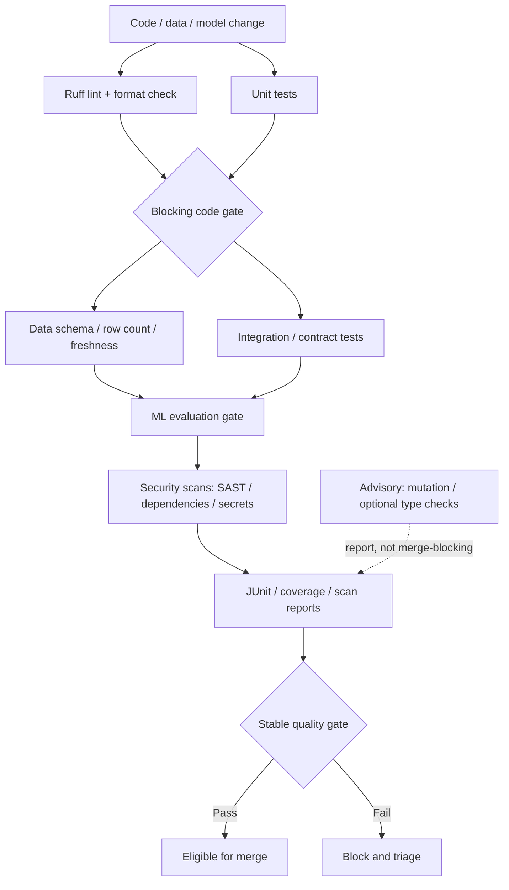

# Test Stages, Quality Gates, and Flaky-Test Management

**Abstract:** Build a correctness-first test platform for a small data/ML repository. This lesson moves from pytest fundamentals to CI quality gates, synthetic data contracts, cautious ML metric thresholds, report artifacts, and a measurable process for finding and fixing flaky tests without hiding defects.

**Module:** M02 — CI/CD Pipeline Engineering  
**Stage:** 2E — Production DevOps & Platform Engineering  
**Target file:** `06-test-stages-quality-gates-and-flaky-test-management.md`  
**Estimated time:** 10–14 hours, including labs  
**Last reviewed:** 2026-10-24 (authoring date; documentation not live-verified)  
**Assumed tool baseline:** Python 3.10+, Git, pytest, Ruff, coverage.py, Bash, GitHub Actions. Exact current tool and plugin behavior must be verified before production use.

## Table of contents

- [Unit 6 — Test stages, quality gates, and flaky-test management](#unit-6--test-stages-quality-gates-and-flaky-test-management)
  - [6.0 Why this matters in production](#60-why-this-matters-in-production)
  - [6.1 Learning objectives](#61-learning-objectives)
  - [6.2 Concept map and vocabulary](#62-concept-map-and-vocabulary)
  - [6.3 Level 1 — Beginner](#63-level-1--beginner)
  - [6.4 Level 2 — Intermediate](#64-level-2--intermediate)
  - [6.5 Level 3 — Advanced](#65-level-3--advanced)
  - [6.6 Level 4 — Expert](#66-level-4--expert)
  - [6.7 SRE lens](#67-sre-lens)
  - [6.8 Security lens](#68-security-lens)
  - [6.9 Production checklist](#69-production-checklist)
  - [6.10 Hands-on lab set](#610-hands-on-lab-set)
  - [6.11 Self-check questions](#611-self-check-questions)
  - [6.12 Evidence artifacts](#612-evidence-artifacts)
  - [6.13 Common interview and design-review questions](#613-common-interview-and-design-review-questions)
  - [6.14 Sources and verification notes](#614-sources-and-verification-notes)
- [Audit and Verification Appendix](#audit-and-verification-appendix)
  - [Appendix A — Claim Register](#appendix-a--claim-register)
  - [Appendix B — Ten-pass Audit Report](#appendix-b--ten-pass-audit-report)
  - [Appendix C — Human Verification Checklist](#appendix-c--human-verification-checklist)
  - [Appendix D — Known Limitations and Assumptions](#appendix-d--known-limitations-and-assumptions)
  - [Appendix E — Sign-off](#appendix-e--sign-off)

## Unit 6 — Test stages, quality gates, and flaky-test management

**Target file:** 06-test-stages-quality-gates-and-flaky-test-management.md | **Estimated time:** 10–14 hours | **Prerequisites:** Python and pytest basics, Git, shell, CI/CD foundations (M02 Units 1–2)

**Core tools:** Python, pytest, Ruff, GitHub Actions, JUnit XML, coverage tooling, Git | **Awareness:** mypy/pyright, mutation testing, contract-testing tools, Great Expectations-style validation, pytest-rerunfailures, pytest-randomly | **Last reviewed:** 2026-10-24 (authoring date; not live-verified)

### 6.0 Why this matters in production

A false-green pipeline can ship a broken scoring endpoint because a test never asserted the behavior that matters. A flaky test can block safe changes repeatedly, training engineers to distrust or bypass the gate. A high line-coverage percentage can be gamed by executing code without checking outcomes. A data pipeline can pass software unit tests while emitting stale, duplicated, or schema-incompatible rows. An ML metric can fluctuate enough to produce false failures if its threshold ignores sample size and variance. This unit teaches how to build evidence-based gates and how to treat intermittent failures as defects to diagnose—not noise to conceal.

### 6.1 Learning objectives

- [L1] Explain the test pyramid, test boundaries, pytest exit codes, and the limits of coverage; prove understanding in Lab 1 and save its test log.
- [L2] Build pytest fixtures, parametrized tests, registered markers, and Ruff checks; demonstrate them in Lab 2 and save configuration/test artifacts.
- [L2] Generate coverage and JUnit XML reports and distinguish file generation from CI rendering; demonstrate in Lab 2 and save report summaries.
- [L3] Design blocking and advisory gates with a coverage ratchet, data contract, and ML metric decision; defend the design in Lab 3 and save an ADR-style decision note.
- [L3] Separate data-quality failures from service/infrastructure failures and explain reproducibility limits of seeded evaluation; prove it in Lab 3.
- [L4] Calculate an operational flake rate, diagnose three controlled flaky patterns, fix their root causes, and preserve first-attempt evidence; complete Lab 4.
- [L4] Define a quarantine record, test-suite SLOs, and an auditable bypass policy; save them in the evidence folder and review them in Lab 5.

### 6.2 Concept map and vocabulary



Stages that do not depend on one another may run in parallel; later stages should wait for the minimum upstream conditions they actually require. A security or report-upload failure needs its own policy: decide whether it invalidates the merge decision or only the report service, and make that choice explicit.

| Term | Precise definition | Common misconception |
|---|---|---|
| Test pyramid | A heuristic to balance fast, isolated tests with fewer broader tests. | Every repository must use the same fixed percentages. |
| Unit test | Tests a small unit in isolation from external systems. | It must test one line or one function only. |
| Integration test | Verifies behavior across a boundary, such as application plus database/API. | It is just a slower unit test. |
| End-to-end test | Exercises a user-relevant path through a system boundary. | It proves every internal component is correct. |
| Fixture | Test setup/teardown resource managed by the test framework. | Fixtures are always global and shared. |
| Parametrization | Runs the same test logic against multiple inputs/expected outcomes. | It replaces thoughtful test-case design. |
| Marker | Metadata used to select or categorize tests. | An unregistered marker is always harmless. |
| Assertion | An executable statement that checks expected behavior. | Executing a line is equivalent to asserting correctness. |
| Exit code | Process status conventionally used by automation to determine command success/failure. | Any printed “FAILED” text automatically changes the process status. |
| Test isolation | Preventing tests from depending on other tests' mutable state or order. | A fresh test process always eliminates all shared-state problems. |
| Test data | Inputs and fixtures used to validate behavior. | Real production data is necessary for basic CI tests. |
| Hermetic test | Test whose relevant inputs and environment are controlled and declared. | It can never fail outside a developer laptop. |
| Coverage | A measure of which code or branches executed during tests. | High coverage proves tests are meaningful. |
| Line coverage | Fraction of executable lines reported as executed. | It measures correctness. |
| Branch coverage | Fraction of measured control-flow branches exercised. | It proves every possible input was tested. |
| Quality gate | A policy combining test/check outcomes into a decision. | Any green badge is a complete quality argument. |
| Blocking gate | Failure prevents merge/release under the configured policy. | Every useful check must be blocking. |
| Advisory gate | Reports evidence but does not block by itself. | Advisory means the result can be ignored forever. |
| Required check | A status/check that repository policy requires before merge. | A skipped job always satisfies it. |
| Coverage ratchet | Policy that prevents a baseline metric from regressing, usually incrementally. | It instantly removes legacy testing debt. |
| Diff coverage | Coverage associated with changed lines under a tool's model. | It detects missing tests for every changed behavior. |
| JUnit XML | A common XML representation of test cases and outcomes. | Generating XML means the CI UI automatically displays it. |
| Flaky test | A test whose outcome varies under materially equivalent conditions. | Every intermittent failure is a test-only problem. |
| Flake rate | A defined ratio of flaky outcomes to a stated denominator. | There is one universal formula used by every team. |
| Retry | Re-execution after a failure. | A passing retry erases the first failure. |
| Quarantine | A time-limited, visible exception that isolates a known flaky test from a blocking path. | Permanent quarantine is a fix. |
| Quarantine owner | Named person/team responsible for diagnosis and removal. | A ticket without an owner is sufficient. |
| Quarantine expiry | Date when the exception must be removed or explicitly re-approved. | Expiry can pass without action. |
| Deterministic test | A test expected to produce the same result under a specified controlled environment. | Determinism is guaranteed across every CPU, library, and runtime. |
| Seeded randomness | Pseudorandom generation initialized with a known seed. | A seed fixes thread scheduling and floating-point kernels. |
| Golden dataset | A small, versioned reference dataset for regression checks. | It should be the only data used to evaluate a model. |
| Schema contract | Expected shape/types/constraints at a data or API boundary. | Schema validity guarantees semantic correctness. |
| Freshness assertion | Checks whether data falls within a defined recency window. | It can identify every upstream outage cause by itself. |
| Row-count assertion | Checks count or count range against a stated expectation. | The same row count guarantees the same data. |
| Model-metric gate | Decision rule over model evaluation metrics and uncertainty. | One point estimate is always enough. |
| Confidence interval/variance | A way to represent uncertainty or spread under a specified statistical model. | Any interval automatically captures all sources of uncertainty. |
| Contract test | Verifies an agreed interface/behavior between components. | It replaces all integration tests. |
| SAST | Static application security testing: analyzes source or representations for likely security defects. | A clean result proves code secure. |
| Dependency scan | Checks dependencies against known vulnerabilities or policies. | It catches every vulnerable dependency and configuration. |
| Secret scan | Searches for credential-like material in scanned content. | Log masking makes secret leakage harmless. |
| Test-suite SLO | Target for a defined test-platform/test-suite service indicator. | A target without a measured baseline is operationally meaningful. |
| Bypass policy | Rules governing exceptional override of a blocking gate. | Admin bypasses need no record. |
| Mutation testing | Deliberately changes code behavior to assess whether tests detect the mutation. | A mutation score is a complete quality metric. |

Unit, integration, and end-to-end are boundaries and feedback-cost categories, not a rigid formula. Choose the boundary based on the defect being detected, the external state involved, the speed and reliability required, and the maintenance cost.

**Outcome distinctions matter:**
- **Failure:** a test assertion or test execution failed.
- **Infrastructure failure:** the test could not produce a trustworthy result because setup, runner, service, or environment failed.
- **Skipped:** the test was not run by selection or a runtime skip condition.
- **Expected failure (`xfail`):** a known failure is declared under the framework's expected-failure mechanism; unexpected pass behavior should be reviewed according to project policy.
- **Flaky outcome:** an outcome is inconsistent across sufficiently comparable executions. One intermittent result is a signal to investigate, not automatic proof that the product is correct or incorrect.

### 6.3 Level 1 — Beginner

#### Test pyramid and boundaries

A unit test should be cheap, deterministic, and focused on logic such as scoring a single record. An integration test might check that the ETL transforms a batch and validates its output schema. An end-to-end test might submit a request to the running FastAPI service and verify the response contract. Broader tests catch integration defects but usually need more setup and create more opportunities for environmental failure. Keep tests close to the smallest boundary that can prove the behavior, and add broader tests for risks that unit tests cannot cover.

Pytest discovers tests using configured/default filename and function naming conventions. Assertions fail by raising an assertion error; the test runner collects failures and returns a process exit code. Automation should use that exit code, not scrape human-readable output. Coverage reports describe execution, not the strength of assertions.

#### Guided local lab

Create this disposable layout:

```text
test-stages-lab/
  pyproject.toml
  shared_lib/
    __init__.py
    scoring.py
  tests/
    test_scoring.py
```

```toml
# File: pyproject.toml
[tool.pytest.ini_options]
testpaths = ["tests"]
python_files = ["test_*.py"]
python_functions = ["test_*"]
```

```python
# File: shared_lib/scoring.py
def score(raw_value: float, weight: float = 1.0) -> float:
    if weight < 0:
        raise ValueError("weight must be non-negative")
    return raw_value * weight
```

```python
# File: shared_lib/__init__.py
from .scoring import score

__all__ = ["score"]
```

```python
# File: tests/test_scoring.py
import pytest
from shared_lib import score

def test_score_multiplies_value_by_weight() -> None:
    assert score(3.0, 2.0) == 6.0

def test_negative_weight_is_rejected() -> None:
    with pytest.raises(ValueError, match="non-negative"):
        score(3.0, -1.0)

def test_intentionally_wrong_expectation() -> None:
    # LAB ONLY: this assertion is deliberately wrong; remove/fix it after observing failure.
    assert score(2.0, 3.0) == 5.0
```

Run the tests:

```bash
# File: terminal (Bash)
set -euo pipefail
python -m pytest -q
```

**Example — yours will differ**

```text
..F
FAILED tests/test_scoring.py::test_intentionally_wrong_expectation
assert 6.0 == 5.0
1 failed, 2 passed
```

This output is representative, not an observed run. Pytest normally returns a non-zero exit code when tests fail. To inspect it without stopping the shell immediately, run:

```bash
# File: terminal (Bash)
set +e
python -m pytest -q
status=$?
printf 'pytest exit code: %s\n' "$status"
exit 0
```

**Example — yours will differ**

```text
2 passed, 1 failed
pytest exit code: 1
```

Interpretation: the shell command reports the test runner's status; the final `exit 0` makes this diagnostic shell snippet itself succeed so you can inspect the captured value. Do not copy that final `exit 0` into a CI gate because it would hide test failure.

Fix the test:

```python
# File: tests/test_scoring.py
import pytest
from shared_lib import score

def test_score_multiplies_value_by_weight() -> None:
    assert score(3.0, 2.0) == 6.0

def test_negative_weight_is_rejected() -> None:
    with pytest.raises(ValueError, match="non-negative"):
        score(3.0, -1.0)

def test_score_handles_integer_inputs() -> None:
    assert score(2.0, 3.0) == 6.0
```

```bash
# File: terminal (Bash)
set -euo pipefail
python -m pytest -q
```

**Example — yours will differ**

```text
...                                                                      [100%]
3 passed
```

The test suite is now green for the tested cases. It does not prove the entire scoring package is correct; add cases for boundaries, invalid values, and meaningful behavior as the contract evolves.

#### What just happened?

Pytest discovered test functions, executed them, evaluated assertions, and returned a process status. CI uses that status to decide whether a step and job succeeded. The intentionally wrong test demonstrated a real red state, and correcting the expectation made the suite pass. A coverage report could show that `score()` was executed even if the test asserted nothing meaningful; assertions and test design remain the key evidence.

| Mistake | Symptom | Diagnosis | Fix |
|---|---|---|---|
| Test file is not discovered | No tests run | Filename/function outside configured patterns | Use `test_*.py` and `test_*` or explicitly configure discovery |
| Assertion is too weak | Test passes for incorrect behavior | Assertion checks only existence/type or no meaningful property | Assert contract-relevant values and failure modes |
| Shared state leaks between tests | Results depend on order | Mutable module/global state or shared fixture | Use function-scoped setup and restore state |
| Ignore exit code | CI step green despite failure text | Shell wrapper masks non-zero status | Let runner exit code propagate; use `set -e` where appropriate |
| Treat coverage as correctness | High coverage but defects escape | Execution counted without strong assertions | Add boundary, negative, and contract tests |

### 6.4 Level 2 — Intermediate

#### Maintainable pytest structure

Use tests named for behavior, small fixtures for repeated setup, and parametrization for input classes. Choose fixture scope carefully: function scope gives isolation; module/session scope can save setup cost but risks state leakage and order coupling. Fixtures that open files, start services, or allocate resources should clean them up in teardown/finally blocks. Avoid mutable objects shared across tests unless sharing is the explicit subject of the test.

```toml
# File: pyproject.toml
[build-system]
requires = ["setuptools>=68"]
build-backend = "setuptools.build_meta"

[project]
name = "quality-gates-demo"
version = "0.1.0"
requires-python = ">=3.10"
dependencies = []

[project.optional-dependencies]
test = ["pytest", "coverage"]

[tool.pytest.ini_options]
testpaths = ["tests"]
addopts = "-ra"
markers = [
  "unit: fast isolated unit tests",
  "integration: tests crossing a component or service boundary",
  "slow: tests that take longer than the normal unit suite",
]

[tool.ruff]
line-length = 100
target-version = "py310"

[tool.ruff.lint]
select = ["E", "F", "I"]

[tool.coverage.run]
branch = true
source = ["shared_lib", "etl", "api"]

[tool.coverage.report]
show_missing = true
fail_under = 70
```

The `fail_under = 70` value is an illustrative starting floor, not a universal target. Confirm that `source` entries exist in the real package layout and adjust the threshold only after measuring a baseline. The exact current project configuration and supported Ruff/coverage options are **[VERIFY: Ruff configuration and coverage.py configuration documentation for installed versions]**.

Ruff can lint and check formatting separately:

```bash
# File: terminal (Bash)
set -euo pipefail
ruff check .
ruff format --check .
```

**Example — yours will differ**

```text
All checks passed!
15 files already formatted
```

These are representative examples; exact wording varies by version. `ruff check` performs lint checks; `ruff format --check` verifies formatting without rewriting files. A formatting check should not silently modify the repository in CI.

Optional type checking can add useful static feedback:

```bash
# File: terminal (Bash)
set -euo pipefail
python -m mypy shared_lib etl api
```

**Example — yours will differ**

```text
Success: no issues found in 8 source files
```

This is illustrative. Mypy is optional here; first configure it to match the project's typing strategy and dependencies. Pyright is an alternative. A type checker does not replace runtime tests or input validation.

#### Fixtures, parametrization, and markers

```python
# File: tests/test_scoring.py
import pytest
from shared_lib.scoring import score

@pytest.fixture
def valid_weight() -> float:
    return 1.5

@pytest.mark.unit
@pytest.mark.parametrize(
    ("raw", "weight", "expected"),
    [(0.0, 1.0, 0.0), (2.0, 3.0, 6.0), (-2.0, 0.5, -1.0)],
)
def test_score_cases(raw: float, weight: float, expected: float) -> None:
    assert score(raw, weight) == expected

@pytest.mark.unit
def test_negative_weight_raises(valid_weight: float) -> None:
    with pytest.raises(ValueError):
        score(2.0, -valid_weight)
```

```bash
# File: terminal (Bash)
set -euo pipefail
python -m pytest -m unit -q
```

**Example — yours will differ**

```text
4 passed, 0 deselected
```

Interpretation: markers are selection metadata, and `-m unit` selects tests marked `unit`. The exact count depends on the final test file. Registered markers make intent explicit and reduce accidental misspellings; current pytest configuration behavior should be checked against the installed version.

#### Coverage, reports, and CI rendering

Coverage is a floor to prevent accidental loss of tested code, not a quality score. A ratchet begins with a measured baseline and prevents regressions, then is raised as teams add tests. Branch coverage can expose untested decision paths but still cannot tell whether assertions are meaningful. Diff coverage focuses attention on changed lines but can be gamed by moving logic, excludes important unchanged code, and does not measure whether the tests would detect a defect.

Generate a terminal report and JUnit XML:

```bash
# File: terminal (Bash)
set -euo pipefail
python -m coverage run -m pytest
python -m coverage report
python -m pytest --junitxml=reports/junit.xml
```

**Example — yours will differ**

```text
Name                      Stmts   Miss Branch BrPart Cover
----------------------------------------------------------
shared_lib/scoring.py         5      0      2      0   100%
----------------------------------------------------------
TOTAL                         5      0      2      0   100%
```

The table is illustrative. If the test suite is run twice, it may create separate reports or overwrite data depending on configuration; keep one documented report-generation path in CI. JUnit XML generation creates a file. A CI platform only renders test results if a compatible report-publishing action or native integration consumes it. **[VERIFY: current GitHub Actions artifact/report support and selected report action behavior.]**

#### Complete running example

```text
quality-gates-demo/
  api/
    __init__.py
    app.py
  shared_lib/
    __init__.py
    scoring.py
  etl/
    __init__.py
    transform.py
  tests/
    test_scoring.py
    test_etl.py
    test_contracts.py
    test_ml_gate.py
  data/
    synthetic_rows.json
  pyproject.toml
  .github/workflows/tests.yml
```

```python
# File: shared_lib/scoring.py
def score(features: list[float], weights: list[float]) -> float:
    if len(features) != len(weights):
        raise ValueError("features and weights must have equal length")
    return sum(value * weight for value, weight in zip(features, weights, strict=True))
```

```python
# File: etl/transform.py
from typing import Any

REQUIRED_FIELDS = {"record_id", "event_time", "feature", "label"}

def validate_rows(rows: list[dict[str, Any]]) -> None:
    for index, row in enumerate(rows):
        missing = REQUIRED_FIELDS - row.keys()
        if missing:
            raise ValueError(f"row {index} missing fields: {sorted(missing)}")
        if not isinstance(row["record_id"], str) or not row["record_id"]:
            raise ValueError(f"row {index} has invalid record_id")
        if not isinstance(row["feature"], (int, float)):
            raise ValueError(f"row {index} has invalid feature")
        if row["label"] not in (0, 1):
            raise ValueError(f"row {index} has invalid label")

def transform_rows(rows: list[dict[str, Any]]) -> list[dict[str, Any]]:
    validate_rows(rows)
    return [{"record_id": r["record_id"], "x": float(r["feature"]), "y": int(r["label"])} for r in rows]
```

```python
# File: api/app.py
from fastapi import FastAPI, HTTPException
from pydantic import BaseModel
from shared_lib.scoring import score

app = FastAPI()

class ScoreRequest(BaseModel):
    features: list[float]
    weights: list[float]

class ScoreResponse(BaseModel):
    score: float

@app.post("/score", response_model=ScoreResponse)
def score_endpoint(request: ScoreRequest) -> ScoreResponse:
    try:
        value = score(request.features, request.weights)
    except ValueError as exc:
        raise HTTPException(status_code=422, detail=str(exc)) from exc
    return ScoreResponse(score=value)
```

FastAPI and Pydantic are illustrative dependencies for the service layer. Add them to the project's dependency declaration if running the API. This lesson does not attempt to teach FastAPI deployment; API boundary validation is the relevant concept.

```python
# File: tests/test_etl.py
import pytest
from etl.transform import transform_rows, validate_rows

@pytest.fixture
def valid_rows() -> list[dict[str, object]]:
    return [
        {"record_id": "synthetic-001", "event_time": "2026-01-01T00:00:00Z", "feature": 0.2, "label": 0},
        {"record_id": "synthetic-002", "event_time": "2026-01-01T00:01:00Z", "feature": 0.8, "label": 1},
    ]

@pytest.mark.unit
def test_transform_preserves_row_count(valid_rows: list[dict[str, object]]) -> None:
    output = transform_rows(valid_rows)  # type: ignore[arg-type]
    assert len(output) == len(valid_rows)
    assert output[0] == {"record_id": "synthetic-001", "x": 0.2, "y": 0}

@pytest.mark.unit
def test_missing_field_fails_contract() -> None:
    with pytest.raises(ValueError, match="missing fields"):
        validate_rows([{"record_id": "synthetic-001"}])
```

```python
# File: tests/test_contracts.py
from etl.transform import REQUIRED_FIELDS, validate_rows

def test_contract_fields_are_explicit() -> None:
    assert REQUIRED_FIELDS == {"record_id", "event_time", "feature", "label"}

def test_duplicate_ids_are_rejected_by_contract_extension() -> None:
    rows = [
        {"record_id": "same", "event_time": "2026-01-01T00:00:00Z", "feature": 0.1, "label": 0},
        {"record_id": "same", "event_time": "2026-01-01T00:01:00Z", "feature": 0.2, "label": 1},
    ]
    ids = [str(row["record_id"]) for row in rows]
    assert len(ids) != len(set(ids))
```

The duplicate-ID test above demonstrates detecting a duplicate fixture condition; as written, it asserts that the fixture is duplicated rather than that production validation rejects duplicates. In a production contract, implement a uniqueness rule and assert it raises on duplicate identifiers. Do not confuse a test documenting bad data with a test proving the pipeline rejects bad data.

#### GitHub Actions workflow

This workflow shows separated lint, unit, and integration stages, plus report upload. It assumes a committed `requirements-test.txt` (or equivalent locked dependency file) installs the project's tested versions and packages. The action references are illustrative first-party tags; full-SHA pinning is stricter for production. **[VERIFY: current `actions/checkout` and `actions/upload-artifact` syntax, supported runtimes, and report retention behavior.]**

```yaml
# File: .github/workflows/tests.yml
name: Test quality gates

on:
  pull_request:
  push:
    branches: ["main"]

permissions:
  contents: read

jobs:
  lint:
    runs-on: ubuntu-latest
    steps:
      - uses: actions/checkout@v4 # first-party tag shown for readability; pin full SHA for stricter production immutability
      - uses: actions/setup-python@v5 # first-party tag shown for readability; pin full SHA for stricter production immutability
        with:
          python-version: "3.11"
      - run: python -m pip install -r requirements-test.txt
      - run: ruff check .
      - run: ruff format --check .

  unit:
    runs-on: ubuntu-latest
    steps:
      - uses: actions/checkout@v4
      - uses: actions/setup-python@v5
        with:
          python-version: "3.11"
      - run: python -m pip install -r requirements-test.txt
      - run: python -m coverage run -m pytest -m "not integration"
      - run: python -m coverage report
      - run: python -m coverage xml -o coverage.xml
      - run: python -m pytest -m "not integration" --junitxml=junit-unit.xml
      - uses: actions/upload-artifact@v4
        if: always()
        with:
          name: unit-test-reports
          path: |
            coverage.xml
            junit-unit.xml
          if-no-files-found: warn

  integration:
    runs-on: ubuntu-latest
    steps:
      - uses: actions/checkout@v4
      - uses: actions/setup-python@v5
        with:
          python-version: "3.11"
      - run: python -m pip install -r requirements-test.txt
      - run: python -m pytest -m integration --junitxml=junit-integration.xml
      - uses: actions/upload-artifact@v4
        if: always()
        with:
          name: integration-test-reports
          path: junit-integration.xml
          if-no-files-found: warn

  quality-gate:
    if: ${{ always() }}
    needs: [lint, unit, integration]
    runs-on: ubuntu-latest
    steps:
      - name: Enforce blocking jobs
        env:
          LINT_RESULT: ${{ needs.lint.result }}
          UNIT_RESULT: ${{ needs.unit.result }}
          INTEGRATION_RESULT: ${{ needs.integration.result }}
        shell: bash
        run: |
          set -euo pipefail
          printf 'lint=%s unit=%s integration=%s\n' \
            "$LINT_RESULT" "$UNIT_RESULT" "$INTEGRATION_RESULT"
          for result in "$LINT_RESULT" "$UNIT_RESULT" "$INTEGRATION_RESULT"; do
            if [ "$result" != "success" ]; then
              echo "Blocking check failed, was cancelled, or did not complete." >&2
              exit 1
            fi
          done
```

**Important:** validate the exact workflow syntax and gate behavior in a private repository before making `quality-gate` required. If an integration job is intentionally optional for a particular event, model that as an explicit allowed state rather than broadly accepting every skipped result. The example uses tags for first-party actions only for readability; production can pin full SHAs. It does not claim the report action or workflow has been executed. If upload fails, `if: always()` attempts the upload step after test failure, but the artifact may still be absent if earlier setup failed.

For a local integration service, start only an ephemeral service bound to loopback, use a bounded readiness probe, and clean it up with a trap. Do not assume a service container is automatically available on the same hostname/port across all runner contexts. **[VERIFY: GitHub Actions service-container networking and health-check documentation.]** A local substitute is often sufficient for this unit: inject a fake repository/client into unit tests and keep only a small number of true boundary tests.

#### Pattern catalogue

| Pattern | Use when | Do not use when |
|---|---|---|
| Function-scoped fixture | Isolation matters and setup is cheap | Setup cost dominates and state is proven immutable |
| Parametrized boundary tests | One contract has multiple meaningful input classes | Cases need very different setup/assertions |
| Coverage floor + ratchet | Legacy coverage exists and regressions must stop | Team uses the number as a substitute for test review |
| JUnit XML artifact | CI needs machine-readable test evidence | No consumer is configured and the file is treated as rendered UI |
| Advisory type check | Team is introducing typing gradually | A critical type boundary is knowingly left unchecked without a plan |
| Small synthetic integration dataset | Contract behavior can be tested locally | It is mistaken for validation of production data distributions |

#### Anti-pattern catalogue

| Bad example | Why it hurts | Corrected version |
|---|---|---|
| `pytest || true` | Converts failures to success | Preserve the runner's non-zero exit code |
| Set coverage to 100% overnight | Encourages low-value assertions or blocks all changes | Measure baseline, set floor, ratchet incrementally |
| Re-run until green and discard first result | Hides flakiness and intermittent defects | Preserve initial result, retry metadata, and triage |
| Use production data in test fixtures | Risks privacy and data leakage | Use small synthetic fixtures with documented constraints |
| Run every test as end-to-end | Slow feedback and broad failure diagnosis | Put logic at unit boundary; use broader tests for cross-boundary risks |
| Upload reports only on success | Losing evidence precisely when failure occurs | Attempt report upload with an always condition and handle missing files |
| Treat seed as universal determinism | Ignores kernels, versions, parallelism, and ordering | Pin environment, record seed, compare with tolerance, track variance |

### 6.5 Level 3 — Advanced

#### Blocking versus advisory gates

A blocking gate should protect a concrete merge/release invariant: unit tests, critical contract checks, required integration tests, and high-confidence security policies. Advisory checks are useful for introducing new checks, expensive analyses, mutation testing, or exploratory metrics where false positives are still being characterized. Advisory does not mean “never act”: assign an owner, track trends, and define a date or evidence threshold for promotion to blocking.

A stable aggregate quality job is preferable when some checks are conditionally selected. The final gate must understand the difference between `success`, `failure`, `cancelled`, `skipped`, and infrastructure failure. A skipped optional job can be allowed only if the policy explicitly says it is irrelevant for that event and the required gate still reports. This is consistent with Unit 5's path-routing design. Keep workflow syntax and reusable workflow mechanics scoped to Unit 2.

#### Coverage ratchets and diff coverage

For a legacy repository, measure coverage using a repeatable command and store the baseline with the commit/environment that produced it. Set the initial floor at or just below the trustworthy baseline, then prevent regressions. Raise it only when evidence and review support the change. Avoid treating one percentage as the objective: meaningful assertions, branch behavior, mutation sensitivity, and defect history are stronger signals.

Diff coverage can direct attention to changed lines, but has blind spots: behavior can move to an unchanged helper; a changed line can be executed without checking the outcome; generated code can distort the denominator; and a narrow diff may omit an upstream contract risk. Use it as one lens, not as the sole required gate.

#### Data-quality gates

A useful data gate combines independent checks:
- **Schema/contract:** required columns/keys and types exist.
- **Null/uniqueness:** required values are non-null and identifiers unique.
- **Range/domain:** values fall within a documented domain.
- **Row count:** count is non-zero and within a defensible range or compared with a known fixture expectation.
- **Freshness:** maximum event timestamp or ingestion watermark is within an agreed window.
- **Semantic invariants:** relationships such as totals, foreign keys, or label domains hold.

Distinguish a data-quality failure from an infrastructure failure. A successful read followed by a schema violation is a data failure. A database connection timeout before data can be read is an infrastructure/availability failure. Both may block a pipeline, but they require different owners and incident labels.

```python
# File: tests/test_data_contract.py
from datetime import datetime, timezone
from etl.transform import validate_rows

def test_synthetic_batch_contract() -> None:
    rows = [
        {"record_id": "row-001", "event_time": "2026-01-01T00:00:00Z", "feature": 0.25, "label": 0},
        {"record_id": "row-002", "event_time": "2026-01-01T00:01:00Z", "feature": 0.75, "label": 1},
    ]
    validate_rows(rows)
    assert len(rows) == 2
    ids = [row["record_id"] for row in rows]
    assert len(ids) == len(set(ids))
    assert all(0.0 <= float(row["feature"]) <= 1.0 for row in rows)
    # A real freshness gate should compare parsed timestamps with a configured clock/window.
    assert datetime.fromisoformat(rows[0]["event_time"].replace("Z", "+00:00")).tzinfo == timezone.utc
```

This is an illustrative synthetic contract. It does not implement production-grade timestamp parsing, freshness windows, or duplicate rejection in `validate_rows`; add those rules to the production contract and test failure cases explicitly.

An open-source Great-Expectations-style validator can express dataset expectations, but package APIs and configuration change. **[VERIFY: current Great Expectations documentation for expectation suites, schema validation, and checkpoint/validation workflow.]** Keep the concept portable: define expectations, run them against synthetic data, produce a machine-readable result, and decide which violations block the pipeline. Do not add a dependency solely to validate two local rows if plain Python assertions meet the teaching goal.

#### ML evaluation gates under uncertainty

A model gate needs a metric, direction, baseline, sample-size requirement, and tolerance for uncertainty. “Accuracy must be at least 0.90” is incomplete without specifying the evaluation dataset, class balance, sample size, and how the metric varies across samples or environments. A tiny seeded dataset is useful for a smoke/regression test, not a claim about production generalization.

```python
# File: tests/test_ml_gate.py
import random
from statistics import mean

def predict(feature: float) -> int:
    return int(feature >= 0.5)

def test_seeded_golden_dataset_regression() -> None:
    rng = random.Random(2026)
    rows = [(rng.random(), 1) for _ in range(20)] + [(rng.random(), 0) for _ in range(20)]
    # This synthetic fixture is illustrative and intentionally simple.
    # A real gate uses a versioned labeled dataset and a justified metric.
    predictions = [predict(x) for x, _label in rows]
    assert len(predictions) == len(rows)
    assert all(prediction in (0, 1) for prediction in predictions)
    observed_positive_rate = mean(predictions)
    assert 0.0 <= observed_positive_rate <= 1.0
```

This is a deterministic smoke test of the evaluation harness, not a meaningful model-quality threshold. A real gate should:
1. Store a versioned golden dataset and label provenance.
2. Define metric direction (higher/lower is better), minimum sample count, and baseline.
3. Compare the candidate to the baseline with a documented tolerance or uncertainty estimate.
4. Avoid claiming a regression from a tiny point-estimate difference when the sample is too small.
5. Check data integrity and model artifact metadata/model-card fields separately.
6. Keep evaluation logic and dataset version visible in the report.

A seed controls pseudorandom sequence generation in a particular context; it does not guarantee identical results across hardware, numerical libraries, dependency versions, parallel workers, GPU kernels, floating-point reduction order, or data iteration order. Use tolerances where scientifically justified and record environment/seed/dataset version. Avoid false precision: a metric such as `0.873` on a tiny sample does not imply three-decimal certainty.

#### Contract tests and hermeticity

Contract tests verify that a producer and consumer agree on an interface. The API's request/response schema, the shared scoring function's input constraints, and ETL output fields are contracts. Unit tests can validate each side; a small integration test validates actual serialization and wiring. Contract testing does not replace all integration tests, especially when deployment configuration or network behavior matters.

A hermetic test controls declared inputs: dependency versions, environment variables, clock/randomness where relevant, test data, locale, temporary directories, network access, and cleanup. Avoid relying on mutable public APIs or external services in the blocking unit suite. Use local substitutes for most tests and a small number of bounded integration checks for real boundaries.

#### Security gates

- **SAST:** scans source or intermediate representations for patterns/rules associated with security defects. It may produce false positives and miss runtime/configuration issues.
- **Dependency scanning:** checks declared dependencies against vulnerability/advisory databases and policy. It may miss unknown vulnerabilities, transitive resolution issues, or runtime components not represented in manifests.
- **Secret scanning:** looks for credential-like patterns in scanned files/commits. It cannot guarantee that no secret exists in logs, external systems, or unscanned artifacts.

A clean scan is evidence from a particular tool, ruleset, and scan scope—not proof that the system is secure. Assign findings to owners, define severity policy, suppress only with a reason and expiry, and connect the deeper supply-chain policy to M12. Do not over-expand this unit into a full security-program design.

#### Parallelism trade-offs

Parallel tests can reduce wall-clock time while increasing CPU/memory pressure, database contention, race exposure, and nondeterministic order. Start with correct isolated tests, then measure duration and resource use before adding concurrency. Unit 4 covers caching/parallelism and pipeline performance in detail. A slow test may be a fixture or architecture problem rather than a reason to add more workers.

| Option | Benefit | Cost | Risk | Choose when |
|---|---|---|---|---|
| Blocking unit/contract tests | Fast feedback on core invariants | Requires stable fixtures and clear ownership | Weak assertions create false confidence | Every PR |
| Blocking integration tests | Catches wiring and boundary defects | Setup/readiness/cleanup complexity | External service instability creates false red | Critical interfaces have reliable local/ephemeral test support |
| Advisory mutation testing | Tests whether assertions detect code changes | More compute and interpretation effort | Score can be misread as quality | Team is improving test effectiveness |
| Coverage floor + ratchet | Prevents unintentional regression | Baseline/configuration maintenance | Coverage gaming | Legacy codebase with existing test debt |
| Blocking ML metric gate | Protects model-quality invariant | Dataset, metric, and variance governance | False positives from small samples or drift | Metric has justified threshold and evaluation protocol |
| Advisory new security scan | Builds baseline and tunes false positives | Findings triage effort | Advisory can become permanent backlog | Tool/rules are being introduced |
| Retry-on-failure | Captures some intermittent evidence | Extra time and more complex results | Can hide real defects | Retry is diagnostic, bounded, and first failure stays visible |

**Lab design task:** write a short decision record for the running API/ETL/ML repository. Select at least one blocking gate, one advisory gate, one data/ML threshold, and one false-positive mitigation. Explain failure mode, owner, evidence, bypass rule, and promotion criteria. Copying a sample policy without defending the trade-off does not complete the lab.

### 6.6 Level 4 — Expert

#### Flakiness: define the denominator

For this lesson, define operational flake rate as:

\[
\text{flake rate} =
\frac{\text{eligible test executions that fail initially and pass on a diagnostic rerun}}
{\text{all eligible initial test executions}}
\]

This is one documented operational definition, not a universal standard. Teams may instead report the fraction of test cases with at least one inconsistent outcome over a window; those measures answer different questions. Always state whether retries, infrastructure failures, expected failures, and quarantined tests are included. Keep initial failures visible; a pass after retry does not erase the initial failure or prove that the product is correct.

A flaky test differs from:
- a **real intermittent product defect**, where valid execution schedules or inputs expose a product bug;
- an **infrastructure failure**, where the runner/service could not provide a valid test result;
- **valid ML variation**, where a metric naturally varies and should be evaluated with a statistical decision rule rather than brittle exact equality.

#### Detection and diagnosis

Useful signals include repeated runs, randomized order, historical first-attempt outcomes, retry metadata, duration/resource telemetry, and clusters of similar stack traces. Re-running only after a failure is a biased sample: it observes the tests already suspected of failing and may hide failures if only the final status is retained. Periodic repeated runs and randomized order reveal different classes of instability.

Root-cause categories:
- **Order dependence/shared state:** tests mutate module globals, files, environment variables, or singleton resources.
- **Time dependence:** tests assume wall-clock precision, fixed time zones, or scheduler timing.
- **Network/external dependency:** endpoint availability or mutable remote data changes outcomes.
- **Concurrency/race:** multiple workers share a file/database/object without isolation or synchronization.
- **Resource limits:** memory, file descriptors, CPU contention, or port exhaustion.
- **Cleanup defects:** leaked processes, temporary files, locks, or database rows.
- **Randomness:** uncontrolled seeds or assumptions about a random sample.

Fix the root cause where possible: isolate state, inject a clock, use bounded synchronization primitives, scope temporary resources, replace external dependencies with controlled fakes, and record the seed. Do not “fix” a race by adding a long sleep or blindly retrying.

#### Mandatory flaky-test lab: exactly three controlled patterns

Run only in a throwaway local project. These three tests intentionally illustrate order dependence, a brittle timing assumption, and a resource race. Their failure is not guaranteed on every run or platform; record what actually happens and do not fabricate a failure. Do not use unbounded sleeps, heavy load, or shared resources outside the lab.

```python
# File: flaky_lab/stateful.py
VALUES: list[str] = []

def add_value(value: str) -> None:
    VALUES.append(value)

def reset_values() -> None:
    VALUES.clear()
```

```python
# File: flaky_lab/test_order_dependent.py
from flaky_lab import stateful

def test_a_leaves_shared_state() -> None:
    stateful.add_value("left behind")
    assert "left behind" in stateful.VALUES

def test_b_assumes_empty_global_state() -> None:
    # This test passes alone but can fail after test_a if order is preserved.
    assert stateful.VALUES == []
```

The defect is shared mutable state plus an assumption about execution order. The corrected tests should reset state with an isolated fixture or make the production API avoid global mutable state.

```python
# File: flaky_lab/test_time_dependent.py
import time

def test_brittle_timing_assumption() -> None:
    # Bounded demonstration only: scheduler delays can exceed this threshold.
    started = time.monotonic()
    time.sleep(0.01)
    elapsed = time.monotonic() - started
    # Intentionally brittle: exact scheduling is not a stable contract.
    assert elapsed < 0.01
```

This uses a bounded sleep and may fail often rather than intermittently on a given machine. Its lesson is that a test should not assert a scheduler timing guarantee unless that timing is the product contract. The fix is to test behavior using an injected/fake clock or explicit synchronization, not to increase the allowed delay until it passes.

```python
# File: flaky_lab/test_resource_race.py
from concurrent.futures import ThreadPoolExecutor
from pathlib import Path
import tempfile

def test_shared_temp_file_race() -> None:
    # Bounded demonstration: workers overwrite the same file without ownership.
    with tempfile.TemporaryDirectory(prefix="flake-race-") as directory:
        shared = Path(directory) / "shared.txt"
        def write_payload(payload: str) -> None:
            shared.write_text(payload, encoding="utf-8")
        with ThreadPoolExecutor(max_workers=2) as pool:
            futures = [
                pool.submit(write_payload, "A" * 1000),
                pool.submit(write_payload, "B" * 1000),
            ]
            for future in futures:
                future.result(timeout=2)
        result = shared.read_text(encoding="utf-8")
        # Incorrect assumption: both workers' writes should be preserved.
        assert result == ("A" * 1000 + "B" * 1000)
```

This third test races two writes to the same file and expects append-like behavior from overwrite operations. It is a controlled resource-sharing defect; it may consistently fail because the assertion contradicts the write semantics, which itself is a useful diagnosis. A true intermittent race needs a meaningful concurrent contract. Fix by giving each worker a separate file or by using a synchronized append protocol if the contract genuinely requires combining results. Do not treat this teaching example as a benchmark of filesystem races.

Corrected versions:

```python
# File: flaky_lab/test_fixed.py
from concurrent.futures import ThreadPoolExecutor
from pathlib import Path
import tempfile
import time
import pytest
from flaky_lab import stateful

@pytest.fixture(autouse=True)
def isolated_global_state():
    stateful.reset_values()
    yield
    stateful.reset_values()

def test_state_is_isolated() -> None:
    stateful.add_value("this test's value")
    assert stateful.VALUES == ["this test's value"]

def test_time_behavior_without_scheduler_threshold() -> None:
    # Test the behavior under a fake/injected clock in real code.
    # Here, test only that monotonic time is non-decreasing.
    before = time.monotonic()
    after = time.monotonic()
    assert after >= before

def test_workers_use_independent_files() -> None:
    with tempfile.TemporaryDirectory(prefix="flake-fixed-") as directory:
        root = Path(directory)
        def write_payload(name: str, payload: str) -> None:
            (root / name).write_text(payload, encoding="utf-8")
        with ThreadPoolExecutor(max_workers=2) as pool:
            futures = [
                pool.submit(write_payload, "a.txt", "A" * 1000),
                pool.submit(write_payload, "b.txt", "B" * 1000),
            ]
            for future in futures:
                future.result(timeout=2)
        assert (root / "a.txt").read_text(encoding="utf-8") == "A" * 1000
        assert (root / "b.txt").read_text(encoding="utf-8") == "B" * 1000
```

The time “fix” illustrates the principle but is not a replacement for testing time-dependent business logic. Production code should inject a clock or use a time-free domain function so tests can control the time input. All race tasks have bounded waits and resources are scoped to temporary directories.

#### Repeat runs and randomized order

First run the suite repeatedly in the local throwaway project. If the optional `pytest-randomly` plugin is installed, consult its current official documentation for supported random-order and seed options. **[VERIFY: pytest-randomly current command-line options and behavior.]** Do not invent flags or assume plugin availability.

```bash
# File: terminal (Bash)
set -u
for run in 1 2 3 4 5; do
  printf '\n=== diagnostic run %s ===\n' "$run"
  python -m pytest -q flaky_lab || printf 'run %s returned non-zero\n' "$run"
done
```

**Example — yours will differ**

```text
=== diagnostic run 1 ===
...F
1 failed, 2 passed
run 1 returned non-zero
```

This is a representative possible outcome, not an observed run. Repeat evidence should include run number, exit status, order/seed if available, environment, failing test, and whether the failure reproduces in isolation. A fixed number of runs cannot prove the absence of flakiness.

#### Flake-report job in CI

The report job should run a bounded diagnostic suite and upload a report even when tests fail. A production workflow should retain first-attempt outcomes and should not convert the required test job to green simply because a retry passes. The example below is an illustrative separate diagnostic job; it is not a substitute for the normal blocking suite.

```yaml
# File: .github/workflows/tests.yml (flake-report job fragment)
# Insert this job into the workflow only after validating the complete workflow.
flake-report:
  if: ${{ always() }}
  needs: [unit]
  runs-on: ubuntu-latest
  permissions:
    contents: read
  steps:
    - uses: actions/checkout@v4 # first-party tag for readability; full SHA pin is stricter
    - uses: actions/setup-python@v5 # first-party tag for readability; full SHA pin is stricter
      with:
        python-version: "3.11"
    - run: python -m pip install -r requirements-test.txt
    - name: Repeat a bounded diagnostic subset
      shell: bash
      run: |
        set -u
        mkdir -p reports
        : > reports/flake-runs.txt
        for run in 1 2 3 4 5; do
          printf 'run=%s\n' "$run" | tee -a reports/flake-runs.txt
          python -m pytest -q flaky_lab >> reports/flake-runs.txt 2>&1
          status=$?
          printf 'exit=%s\n' "$status" | tee -a reports/flake-runs.txt
        done
    - uses: actions/upload-artifact@v4
      if: always()
      with:
        name: flake-diagnostic-report
        path: reports/flake-runs.txt
        if-no-files-found: warn
```

This fragment intentionally records non-zero runs and continues the loop, but the job result policy needs an explicit decision. As written, the final loop status is not converted into a blocking test decision; use it as diagnostic evidence only and keep the regular `unit` job blocking. For stronger automation, write a parser that counts first-attempt failures and emits a structured report, then decide whether a diagnostic-job failure should alert without masking the primary job. Verify action syntax and artifact behavior before use. **[VERIFY: GitHub Actions `if: always()`, job result semantics, artifact action version/retention, and current runner behavior.]**

#### Quarantine and gate bypass

A quarantine record must include:
- Test identifier and failure signature.
- Owner/team and issue/ticket.
- Reason and evidence of intermittency.
- Creation date, expiry date, and scope of exclusion.
- Which required check still protects the affected behavior.
- Notification route and escalation if expiry passes.
- Criteria to unquarantine and evidence that the fix works.

Quarantine is a time-limited containment measure. If the expiry passes, the policy should fail the audit or require explicit re-approval; silently extending quarantine turns an exception into permanent debt. A bypass policy should identify authorized roles, allowed circumstances (for example, confirmed test infrastructure outage with independent evidence), rationale, expiry, notification, audit record, and after-action review. Never make “the release is urgent” the entire justification.

Mutation testing and testing in production are awareness topics here. Mutation testing assesses whether tests detect selected code changes; it is not a universal quality score. Testing in production requires carefully bounded blast radius, monitoring, rollback, and safety controls beyond this lesson's scope.

### 6.7 SRE lens

Define test-platform service-level indicators (SLIs) operationally:

- **Initial suite success rate:** initial test runs that finish without test failure divided by eligible initial runs. Report infrastructure failures separately.
- **Flake rate:** use the definition in 6.6 and state inclusion/exclusion rules.
- **Duration p50/p95:** median and 95th-percentile elapsed time from a consistent start/end boundary.
- **Queue time:** scheduled time to actual start, if the platform exposes it.
- **Rerun rate:** test/job executions rerun divided by eligible executions, with manual and automatic reruns distinguished.
- **Infrastructure-failure rate:** runs that cannot produce a valid test result due to runner/service/setup failure divided by eligible runs.
- **Report publication success:** eligible runs with expected reports available divided by eligible runs.
- **Time to diagnose/restore:** elapsed time from confirmed platform/test-suite incident to diagnosis and recovery.

**[ILLUSTRATIVE]** A team might initially target “at least 98% of eligible runs publish the required report within 10 minutes,” but should not adopt that number blindly. Establish a baseline across representative weeks, segment by test type and runner class, identify user impact, choose a target the team can sustain, and review the error budget. A target can be gamed by excluding slow/failing runs, rerunning until green, or moving work out of the measured boundary. Publish definitions and exclusions.

Blast-radius examples:
- **False green:** broken behavior merges; mitigation is to stop rollout, run focused/broad tests, and assess affected commits.
- **False red/flaky suite:** safe changes queue or bypasses rise; mitigation is to preserve failure evidence and isolate root cause.
- **Shared service outage:** many integration tests fail at once; classify infrastructure separately and avoid filing hundreds of product defects.
- **Overloaded runners:** duration and race failures increase; cap concurrency and inspect resource telemetry.
- **Stale test data:** assertions fail or pass incorrectly; version fixtures and verify freshness.
- **Report upload failure:** evidence disappears even if tests ran; treat report availability as a separate indicator and preserve local logs.

**Runbook — alert → triage → mitigation → follow-up**

1. **Alert:** flake rate or p95 duration exceeds the team's documented threshold, required report publication fails, or many unrelated tests fail simultaneously.
2. **Triage:** classify test versus infrastructure failure; capture commit, runner, dependency lock, seed/order, first-attempt result, retries, duration, and related failure signatures.
3. **Mitigation:** isolate the affected dependency or temporarily quarantine with owner/expiry; keep unaffected blocking checks active. Do not silently mark the full suite green.
4. **Follow-up:** fix root cause, add regression coverage, remove quarantine, update SLO dashboard and runbook, and review any bypass.

Capacity: integration services, parallel workers, coverage instrumentation, and repeated diagnostics consume CPU, memory, disk, and CI minutes. Use small local fixtures and a bounded subset first. **[VERIFY: current hosted CI free-tier quotas and billing rules in official plan documentation.]** No cost or speedup numbers are assumed here.

### 6.8 Security lens

Tests and scans reduce selected risks; they do not prove a system secure. A test may assert the wrong behavior, a scanner may miss a vulnerability, and a passing dependency scan says nothing about authorization logic that was never tested. The OWASP Top 10 CI/CD Security Risks is a useful threat-model reference; map controls to actual pipeline trust boundaries and defer the full supply-chain program to M12.

| Control | Threat | Verification command/evidence | Limitation |
|---|---|---|---|
| No real secrets in fixtures/logs/reports | Credential leakage | Search test fixtures and generated reports for known fake sentinel strings; review artifact content | Pattern search cannot prove no secret exists |
| Least-privilege workflow permissions | Over-privileged token | Inspect `permissions:` in workflow and job definitions | External action behavior also needs review |
| Untrusted test input handled safely | Injection/path traversal/unsafe parsing | Unit tests for malformed input; static review of file/path handling | Test cases are not exhaustive |
| Dependency/security scanning scoped appropriately | Known vulnerable dependencies | Save scanner name/version, lockfile input, report and policy result | Database coverage and false positives vary |
| Test artifacts/logs sanitized | Sensitive values in reports | Inspect sample JUnit, coverage, and logs before upload | CI masking is not guaranteed for all transformations |
| Integration services ephemeral/local | Exposed service or shared-state contamination | Inspect bind address, port, cleanup trap, and service logs | Runner networking differs by environment |
| Untrusted PRs get no secrets/privileged execution | Secret theft or unauthorized write | Review event trigger, token permissions, environment protection | Workflow changes themselves require review |
| Gate bypasses limited/auditable | Unreviewed override | Inspect bypass logs, rationale, approver, expiry, and after-action record | Platform capabilities/settings are version-sensitive |

Security controls should be tested in a private repository before production. Do not put real tokens into sample fixtures. Log masking is not a guarantee against exposure, especially if secrets are transformed or printed in unexpected forms.

### 6.9 Production checklist

- [ ] Test boundaries are documented for unit, integration, and end-to-end tests.
- [ ] Critical behavior has meaningful positive, negative, and boundary assertions.
- [ ] Test fixtures are isolated and clean up files, processes, and services.
- [ ] Test data is synthetic or approved and contains no customer secrets.
- [ ] Parametrization covers meaningful input classes without duplicating assertions blindly.
- [ ] Markers are registered and selection commands are documented.
- [ ] Ruff lint and formatting checks run in CI with the intended configuration.
- [ ] Optional type checking has an explicit owner and policy.
- [ ] Coverage floor is based on a measured baseline and ratchet policy is documented.
- [ ] JUnit XML and coverage reports are generated and consumed/retained intentionally.
- [ ] Report upload is attempted after test failure and missing-report behavior is visible.
- [ ] Data schema, null/uniqueness, range, row-count, and freshness checks match the contract.
- [ ] ML gates define metric, direction, baseline, minimum sample size, variance/tolerance, and dataset version.
- [ ] Seeded tests document limits across dependency versions, hardware, parallelism, and floating-point operations.
- [ ] Blocking and advisory gates are explicitly named, with a stable required quality gate.
- [ ] Skipped, failed, cancelled, expected-failure, and infrastructure states have explicit policy.
- [ ] Flake rate has a documented numerator, denominator, window, and exclusions.
- [ ] Retries preserve first-attempt evidence and do not silently convert required failures into success.
- [ ] Quarantined tests have owner, ticket, reason, creation date, expiry, scope, and removal criteria.
- [ ] Bypass authority, rationale, expiry, notification, audit, and after-action review are documented.
- [ ] Security scans have scope, ownership, false-positive handling, and no overclaim.
- [ ] Workflow permissions are least-privilege; third-party actions are reviewed and pinned appropriately.
- [ ] Test-suite SLOs have baselines, definitions, dashboards, and a named owner.
- [ ] Incident runbook identifies triage, mitigation, follow-up, and rollback/escalation.

### 6.10 Hands-on lab set

Labs are local-first and use only synthetic data. Expected outputs are representative, not observed. Run in a disposable repository, and never point cleanup commands at an existing project.

| ID | Goal | Prerequisites | Exact files | Steps/commands | Expected evidence | Interpretation | Cleanup | Stretch |
|---|---|---|---|---|---|---|---|---|
| LAB-1 | Learn test discovery, assertion failure, and exit codes | Python and pytest | `shared_lib/scoring.py`, `tests/test_scoring.py`, `pyproject.toml` | Create the 6.3 files, run pytest, inspect status, correct the intentionally failing assertion | Initial failure log and corrected passing log | Runner exit status is the gate input; test output is diagnostic | Delete only the throwaway lab directory after verifying its path | Add invalid-input and boundary tests |
| LAB-2 | Add Ruff, coverage, JUnit, and CI gate | Git, Python, Ruff, pytest | `pyproject.toml`, `requirements-test.txt`, `.github/workflows/tests.yml` | Run lint, format check, pytest, coverage, JUnit; validate workflow in private repo | Config, logs, XML report, coverage summary, workflow run | File generation is distinct from CI rendering | Remove only lab-created reports/branch; verify repository status | Add optional type-check job |
| LAB-3 | Validate synthetic ETL contract and ML gate | Python and test basics | `etl/transform.py`, `tests/test_data_contract.py`, `tests/test_ml_gate.py`, synthetic fixture | Add schema, row count, freshness, and metric decisions; test invalid fixtures | Contract result, ML evaluation summary, gate decision note | A seed and passing smoke test do not establish model generalization | Remove temporary generated data/reports; keep only intentional source | Compare candidate/baseline with a justified uncertainty method |
| LAB-4 | Diagnose exactly three flaky patterns and wire flake report | Local pytest; optional plugin only after docs check | `flaky_lab/stateful.py`, three flaky tests, corrected tests, workflow job fragment | Repeat suite 5 times, record order/status, fix shared state/time/race, repeat, add CI report job | Before/after logs, root-cause notes, structured flake report, cleanup evidence | A single passing run cannot prove flake absence; preserve first failure | Remove temp dirs/reports and confirm no process remains | Add a trend summary over multiple commits |
| LAB-5 | Design gate, quarantine, SLO, and bypass policy | Labs 1–4 | `evidence/decision-record.md`, `evidence/quarantine-record.md`, `evidence/runbook.md` | Choose blocking/advisory checks, thresholds, owner/expiry, bypass and SLO; peer-review | Decision record and auditable policy | A gate is a socio-technical policy, not only YAML | Remove only generated evidence if not retained intentionally; verify paths | Propose promotion criteria for advisory checks |

#### LAB-1 command and evidence

```bash
# File: terminal (Bash)
set -euo pipefail
python -m pytest -q
```

**Example — yours will differ**

```text
..F
1 failed, 2 passed
```

Interpretation: the deliberately wrong assertion must fail. Fix it, rerun, and save both outputs. Cleanup: inspect the disposable directory path, remove only that directory, and verify it no longer exists while your original repository remains untouched.

```bash
# File: terminal (Bash)
set -euo pipefail
python -m pytest -q
```

**Example — yours will differ**

```text
...                                                                      [100%]
3 passed
```

#### LAB-2 command and evidence

```bash
# File: terminal (Bash)
set -euo pipefail
ruff check .
ruff format --check .
python -m coverage run -m pytest
python -m coverage report
python -m pytest --junitxml=reports/junit.xml
```

**Example — yours will differ**

```text
All checks passed!
3 passed
TOTAL ... 82%
wrote report to reports/junit.xml
```

All values are illustrative and exact output varies. Save the report and coverage summary. In CI, verify that the report artifact exists on both passing and failing test runs. Cleanup: delete only `reports/` generated by the lab and verify `git status --short` shows no unrelated changes.

#### LAB-3 command and evidence

```bash
# File: terminal (Bash)
set -euo pipefail
python -m pytest tests/test_data_contract.py tests/test_ml_gate.py -q
```

**Example — yours will differ**

```text
....                                                                     [100%]
4 passed
```

Interpretation: this shows that the implemented assertions ran, not that the ML metric is statistically justified. Add an invalid schema, duplicate identifier, stale timestamp, and a metric regression fixture; prove each is rejected for the intended reason. Cleanup: remove generated reports and any temporary data file, then confirm only intended source files remain.

#### LAB-4 mandatory flaky-test evidence

Run the three intentionally flawed patterns in the throwaway project. Record actual outcomes; if the order-dependent test does not fail, randomize/reorder safely or run it after the state-mutating test explicitly. If the race example consistently fails because its contract is wrong, document that it is a deterministic reproduction of unsafe shared-resource semantics rather than claiming it is probabilistically flaky. The goal is diagnosis, not to force a fake flake rate.

```bash
# File: terminal (Bash)
set -u
for run in 1 2 3 4 5; do
  printf '\n=== run %s ===\n' "$run"
  python -m pytest -q flaky_lab
  printf 'exit=%s\n' "$?"
done
```

**Example — yours will differ**

```text
=== run 1 ===
.FF
2 failed, 1 passed
exit=1
```

This is an illustrative possible output only. After fixing each root cause, rerun and record the corrected outcomes. A clean short run is not proof of zero flakiness. Integrate the `flake-report` fragment into a private test workflow, validate it, and ensure diagnostic retries do not overwrite the normal required test result. Cleanup: verify temporary directories were removed by `TemporaryDirectory`, stop any lab-created processes, remove only generated reports, and check `git status --short`.

#### LAB-5 decision record template

```markdown
# Quality-gate decision record
- Date / owner:
- Blocking checks and invariant protected:
- Advisory checks and owner:
- Data contract and failure categories:
- ML metric, direction, baseline, minimum sample size, uncertainty method:
- Coverage baseline and ratchet:
- Flake-rate formula and measurement window:
- Quarantine owner / ticket / expiry:
- Bypass authority / rationale / expiry / notification:
- SLOs and baseline method:
- False-positive mitigation:
- Evidence required before promotion to blocking:
- Rollback / follow-up:
```

**Example — yours will differ**

```text
Blocking: lint + unit + API/ETL contract tests
Advisory: mutation testing during baseline period
ML gate: seeded smoke test is blocking for harness integrity; quality metric is advisory until baseline/uncertainty protocol is approved
```

This is illustrative policy, not a recommendation to use these exact gates for every system. Cleanup is not destructive: retain the decision record if it is the intended evidence artifact; otherwise remove only the lab-created evidence file and verify the path.

### 6.11 Self-check questions

1. **[L1] What does a non-zero pytest exit code tell CI?**  
   **Answer:** The command did not complete as a success under the test runner's semantics; CI should treat it as a failed step unless an explicit policy handles the outcome.  
   **Tempting wrong answer:** “The log says failed, so exit code is irrelevant.” Automation should use process status, not parse text.

2. **[L1] Why is line coverage not a correctness score?**  
   **Answer:** Code can execute without meaningful assertions; coverage does not measure whether tests would detect a defect.  
   **Tempting wrong answer:** “100% means all behavior is tested.” Execution is not equivalent to behavior validation.

3. **[L2] When should a fixture be function-scoped?**  
   **Answer:** When isolated state per test is important and setup cost is acceptable.  
   **Tempting wrong answer:** “Session scope is faster, so it is always better.” Shared state can cause order dependence.

4. **[L2] Does a JUnit XML file automatically appear as rendered test results in CI?**  
   **Answer:** No; the platform or an action must consume/publish it.  
   **Tempting wrong answer:** “XML exists, so the UI knows what to do.” File generation and report rendering are separate operations.

5. **[L3] What makes a coverage ratchet better than immediately requiring a very high threshold?**  
   **Answer:** It starts from a measured baseline and prevents regression while allowing debt to be reduced incrementally.  
   **Tempting wrong answer:** “A high number is always stricter and therefore better.” An arbitrary threshold can incentivize gaming.

6. **[L3] Why does a seed not guarantee identical ML metrics everywhere?**  
   **Answer:** Libraries, hardware, parallel execution, floating-point order, kernels, and data ordering can still vary.  
   **Tempting wrong answer:** “A seed fixes every source of nondeterminism.” It controls only the relevant pseudorandom generator state.

7. **[L3] How should a schema violation differ from a connection timeout in the report?**  
   **Answer:** A schema violation is a data-quality failure; a timeout is usually an infrastructure/availability failure because the data could not be evaluated.  
   **Tempting wrong answer:** “Both are red, so classify them identically.” They require different owners and mitigations.

8. **[L4] Why must a retry preserve the first failure?**  
   **Answer:** A pass on retry can indicate flakiness or an intermittent product defect; discarding it hides reliability information.  
   **Tempting wrong answer:** “The final attempt is the truth.” It erases the instability that needs diagnosis.

9. **[L4] What belongs in a quarantine record?**  
   **Answer:** Test ID, owner, reason/evidence, ticket, creation and expiry dates, scope, mitigation, and removal criteria.  
   **Tempting wrong answer:** “Just mark it skipped.” That creates permanent invisible debt.

### 6.12 Evidence artifacts

Suggested evidence tree; distinguish checked-in source from generated artifacts:

```text
evidence/
  README.md
  repository-tree.txt
  test-boundaries.md
  local-test-output.txt
  ruff-output.txt
  coverage-summary.txt
  junit-sample.xml
  data-contract-result.json
  synthetic-data-schema.md
  ml-gate-summary.md
  flake-runs.txt
  flake-rate-definition.md
  flaky-root-cause-notes.md
  quarantine-record.md
  quality-gate-decision-record.md
  test-suite-slo.md
  incident-runbook.md
  security-gate-audit.md
  required-check-settings.md
  cleanup-verification.txt
```

- **Checked-in source:** `pyproject.toml`, `requirements-test.txt` or equivalent lockfile, package source, tests, workflow YAML, synthetic fixture definitions, and report parser.
- **Generated evidence:** JUnit XML, coverage XML/terminal summary, run logs, scanner reports, flake diagnostic reports, and screenshots/links from a private CI run.
- **ML evidence:** dataset version/hash, seed, dependency/environment metadata, metric definition/direction, baseline, sample count, variance/tolerance method, and decision outcome.
- **Quarantine evidence:** owner, ticket, creation date, expiry, scope, reason, fallback protection, and removal criteria.
- **Governance evidence:** gate decision record, SLO definitions, bypass logs/approvals, runbook owner, and audit date.

Do not include secrets, real customer data, sensitive request bodies, or full production logs. An illustrative JUnit excerpt must be labelled illustrative; do not represent it as generated by a run that did not occur.

### 6.13 Common interview and design-review questions

1. **How do you choose test boundaries for a data/ML service?**  
   **Model answer:** Put deterministic scoring and transformations in unit tests; validate schemas and producer/consumer contracts at component boundaries; keep a smaller set of integration/end-to-end tests for wiring, serialization, deployment configuration, and service interactions. The pyramid is a heuristic, not a fixed percentage. Trade off speed and diagnosis against realistic integration coverage.

2. **How do you introduce quality gates into a legacy repository with low coverage?**  
   **Model answer:** Measure a trustworthy baseline, add meaningful tests around high-risk behavior, set a floor that prevents regression, and ratchet upward as coverage improves. Combine coverage with mutation/defect evidence, contract assertions, and test review. Avoid an arbitrary high threshold that creates incentives for meaningless assertions.

3. **How do you handle flaky tests without hiding defects?**  
   **Model answer:** Preserve first-attempt results, reproduce under controlled repeated/randomized runs, classify test versus infrastructure versus product behavior, isolate shared state/time/network/race causes, and fix root cause. If temporary quarantine is needed, require owner, ticket, expiry, visible reporting, and an explicit fallback gate. Retries are diagnostic, not a fix.

4. **How do you gate an ML metric when evaluation is uncertain?**  
   **Model answer:** Define the metric and direction, baseline, dataset version, minimum sample size, uncertainty/tolerance method, and failure response. Use a golden dataset for regression smoke tests but do not confuse it with evidence of generalization. A seed supports repeatability only within specified environment limits.

5. **How would you define test-suite SLOs and bypass governance?**  
   **Model answer:** Measure initial success, flake rate with a precise denominator, p50/p95 duration, report availability, infrastructure-failure rate, and time to diagnose. Set targets from a baseline and segment out infrastructure failures transparently. Bypass requires named authority, rationale, time limit, notification, audit record, and after-action review; track repeat bypasses as a policy signal.

### 6.14 Sources and verification notes

Documentation targets below are recommended for human verification. The lesson was authored without live browsing; this list does not claim that pages were consulted during authoring.

- **pytest documentation:** “Get Started,” “How to use fixtures,” “Parametrizing tests,” “Marking test functions with attributes,” “Managing pytest's output,” and current guidance for flaky tests/plugins.
- **Ruff documentation:** “The Ruff Linter,” “The Ruff Formatter,” “Configuration,” and command-line usage for `ruff check` and `ruff format --check`.
- **coverage.py documentation:** “Measurement,” “Reporting,” “Configuration reference,” branch coverage, and `fail_under`.
- **GitHub Actions documentation:** “Workflow syntax,” “Setting permissions for `GITHUB_TOKEN`,” “Workflow artifacts,” “Service containers,” “Security hardening for GitHub Actions,” and job status/conditions.
- **Python documentation:** `subprocess`, `tempfile`, `time.monotonic`, `random`, and standard-library behavior used in the labs.
- **JUnit/reporting:** pytest JUnit XML output documentation and the selected CI report consumer's official documentation.
- **Data validation:** Great Expectations official documentation for current expectation/validation configuration; verify package APIs before use.
- **OWASP:** “OWASP Top 10 CI/CD Security Risks.”
- **Optional plugins:** official `pytest-rerunfailures` and `pytest-randomly` documentation for current installation, options, order randomization, and retry semantics.
- **Optional type checking:** mypy or Pyright official configuration and CLI docs.
- **Mutation testing:** official documentation for a selected mutation-testing tool if adopted.

Do not copy plugin flags or action versions from memory. Verify exact syntax against the installed version and official docs. Use a private repository to validate the full workflow, required-check behavior, artifact availability on failure, and untrusted-PR permissions. For WSL2 versus native Linux, note that path handling, line endings, filesystem behavior, process scheduling, and container/service networking may differ; do not infer hosted-runner behavior from a single local run.

---

## Audit and Verification Appendix

### Appendix A — Claim Register

Confidence describes the general stability of the claim, not whether it was live-verified. Current documentation and tool behavior remain unverified unless explicitly stated otherwise.

| ID | Section | Claim | Source (document + section/title) | Confidence | Tag/verification needed |
|---|---|---|---|---|---|
| C01 | 6.2–6.3 | Pytest discovers tests using configured/default file and function patterns | pytest docs — “Good Integration Practices” / “Get Started” | High | Verify installed config and discovery patterns |
| C02 | 6.3 | Failed assertions contribute to non-zero pytest process status | pytest docs — “Exit codes” | High | Verify current exit-code reference |
| C03 | 6.2–6.3 | Coverage measures execution, not assertion quality | coverage.py docs — “How coverage works” / reporting | High | Interpret metric alongside test design |
| C04 | 6.4 | Fixtures manage setup/teardown and can have different scopes | pytest docs — “How to use fixtures” | High | Verify fixture-scope behavior in installed version |
| C05 | 6.4 | Parametrization executes test logic against multiple input cases | pytest docs — “Parametrizing tests” | High | Verify syntax against installed pytest |
| C06 | 6.4 | Markers categorize/select tests and should be documented/registered | pytest docs — “Marking test functions with attributes” | High | Check marker configuration and strictness |
| C07 | 6.4 | Ruff exposes separate lint and format commands | Ruff docs — “The Ruff Linter” and “The Ruff Formatter” | High | Verify installed Ruff CLI/config |
| C08 | 6.4 | Coverage `fail_under` can enforce a minimum threshold | coverage.py docs — configuration reference | High | Verify current config key and threshold semantics |
| C09 | 6.4 | A coverage floor is not proof of test quality | Test design inference based on coverage semantics | High | Review assertions and defect-detection evidence |
| C10 | 6.4 | Pytest can emit JUnit XML | pytest docs — JUnit XML report option | High | Verify current CLI option and output path |
| C11 | 6.4 | Generating XML is distinct from CI rendering it | Selected CI report consumer docs / workflow artifact docs | High | Verify configured report consumer |
| C12 | 6.4 | GitHub workflow syntax supports explicit top-level permissions | GitHub Actions docs — workflow syntax and GITHUB_TOKEN permissions | High | Validate workflow in current platform |
| C13 | 6.4 | First-party action tags are less immutable than full-SHA pinning | GitHub Actions security hardening docs | High | Verify action SHA against upstream |
| C14 | 6.4 | `if: always()` is used to attempt steps/jobs after failure | GitHub Actions docs — expressions and status check functions | Medium | Verify job/step semantics for current workflow |
| C15 | 6.5 | Required checks should be stable and report for relevant events | GitHub required status checks/rulesets docs | High | Test exact check name and skipped behavior |
| C16 | 6.5 | Coverage ratchets prevent regression against a baseline | Design recommendation | High | Define baseline and policy in repository |
| C17 | 6.5 | Diff coverage has blind spots and does not prove behavior correctness | Coverage design inference | High | Compare with assertions and integration tests |
| C18 | 6.5 | Data contracts can include schema, null, uniqueness, range, count, and freshness constraints | Data-quality design recommendation | High | Validate each invariant against actual domain |
| C19 | 6.5 | Great Expectations APIs/configuration may change | Great Expectations official docs | Medium | [VERIFY] current package/API and validation model |
| C20 | 6.5 | A seed does not guarantee cross-environment numerical determinism | Python random docs and numerical library/hardware documentation | High | Verify relevant model stack/hardware |
| C21 | 6.5 | A model metric gate needs a metric, direction, baseline, sample size, and uncertainty policy | ML evaluation design recommendation | High | Document domain-specific decision rule |
| C22 | 6.5 | Contract tests validate producer/consumer interface assumptions | Contract testing design principle | High | Verify contract coverage for actual boundaries |
| C23 | 6.5 | SAST, dependency scanning, and secret scanning have different scopes and blind spots | OWASP CI/CD Security Risks and scanner docs | High | Verify tool-specific scope and false positives |
| C24 | 6.6 | Flake rate requires a stated numerator and denominator | Operational metric definition in this lesson | High | Publish inclusion/exclusion rules |
| C25 | 6.6 | Rerun-on-fail can hide initial failures if results are discarded | Test reliability design inference | High | Ensure report retains first-attempt outcome |
| C26 | 6.6 | Randomized ordering can expose order-dependent tests | pytest-randomly docs / pytest test-order behavior | Medium | [VERIFY] current plugin setup/options |
| C27 | 6.6 | Time-dependent tests should avoid brittle scheduler precision assumptions | Python time docs and test design principles | High | Validate clock injection strategy |
| C28 | 6.6 | Shared resource access without isolation/synchronization can create races | Python concurrency and filesystem semantics docs | High | Test only in bounded disposable environment |
| C29 | 6.6 | Quarantine should have owner, reason, expiry, and removal criteria | Reliability governance recommendation | High | Verify policy ownership and expiry monitoring |
| C30 | 6.7 | Duration p50/p95 and report publication success are useful test-platform SLIs | SRE measurement recommendation | High | Define measurement boundaries and baseline |
| C31 | 6.7 | Example SLO targets must be calibrated to observed baseline | SRE design recommendation | High | [ILLUSTRATIVE] target only; measure locally |
| C32 | 6.8 | Secret masking does not guarantee all secret exposure is prevented | GitHub Actions security hardening docs | High | Review transformed output and artifacts |
| C33 | 6.8 | Untrusted pull requests should not receive unnecessary secrets or write permissions | GitHub Actions security hardening docs | High | Verify event triggers, permissions, environments |
| C34 | 6.8 | A clean scan is not proof of system security | OWASP and scanner documentation | High | Record scanner scope and limitations |
| C35 | 6.10 | Repeated runs provide evidence but cannot prove absence of flakiness | Statistical/testing design inference | High | Report sample count and context |
| C36 | 6.6 | `pytest-rerunfailures` and `pytest-randomly` options are version-sensitive | Official plugin documentation | Medium | [VERIFY] exact flags and retry/order semantics |
| C37 | 6.4 | Service-container networking/readiness depends on runner configuration | GitHub Actions docs — service containers | Medium | [VERIFY] local versus hosted networking |
| C38 | 6.7 | Hosted CI quota/pricing can change | Official GitHub plans/billing docs | High | [VERIFY] current plan; no quota claim made |
| C39 | 6.5 | Mutation testing tests whether selected code mutations are detected | Selected mutation-testing tool docs | High | Awareness only; verify selected tool behavior |
| C40 | 6.12 | Local test logs and hosted CI run evidence prove different things | Evidence design recommendation | High | Keep local and platform evidence separate |

### Appendix B — Ten-pass Audit Report

| Pass | Result (PASS/FIXED/OPEN) | Defects found | Fixes applied | Residual risk |
|---|---|---|---|---|
| 1. Completeness | FIXED | Scope could omit required gate, flake lab, or governance | Sections 6.0–6.14 and appendices included; all four levels covered | Human should compare against source curriculum |
| 2. Technical accuracy | OPEN | Current CLI/plugin/action behavior has not been live-verified or executed | Version-sensitive items tagged; no plugin flags invented | Validate config and commands with current versions |
| 3. Executability | OPEN | Full package/workflow was authored but not run; examples are instructional and require dependency setup | File paths and commands supplied; expected outputs labelled | Run tests, Ruff, coverage, workflow linter, and hosted workflow |
| 4. Currency | OPEN | Current pytest/Ruff/coverage/plugin/action versions and GitHub UI not checked live | Verification targets named in 6.14 and Appendix C | Confirm current docs and exact syntax |
| 5. Security correctness | FIXED | Test reports and untrusted PRs can leak sensitive information if mishandled | Synthetic data, least-privilege permissions, artifact review, and security table included | Review actual repository trust boundaries and actions |
| 6. Fabrication scan | PASS | No actual tool runs or verified action SHAs available | Outputs are labelled representative; action tags noted as illustrative; no performance claims asserted | Do not describe examples as observed evidence |
| 7. Pedagogical consistency | FIXED | ML smoke example could be mistaken for a production quality metric | Explicitly labelled as harness smoke test, with limitations and advanced design criteria | Domain-specific statistical policy still needs design |
| 8. Cross-consistency | OPEN | Some illustrative package/workflow snippets require integration into one coherent repo and dependency file | Layout and requirements assumptions documented; report and gate roles described | Reconcile all snippets, dependencies, markers, and paths before running |
| 9. Adversarial review | FIXED | Retry, coverage, seeded determinism, and quarantine can be misused | First-failure visibility, ratchets, uncertainty caveats, and expiry governance included | Verify gate policy and report consumer in a private repository |
| 10. Lab safety and feasibility | FIXED | Flaky behavior is not guaranteed to reproduce identically across platforms | Three bounded local patterns, no external services, cleanup, and non-fabrication rules included | Repeat in disposable project; race behavior may vary |

### Appendix C — Human Verification Checklist

| Tool/platform | What to verify | Official document/title | Concrete check |
|---|---|---|---|
| pytest | Discovery, fixtures, markers, parametrization, exit codes, JUnit XML | pytest “Get Started,” fixtures, markers, parametrization, exit codes, JUnit XML | `python -m pytest --help`; run a deliberate failing test and inspect status |
| Ruff | `ruff check`, `ruff format --check`, config keys | Ruff “The Ruff Linter,” “The Ruff Formatter,” configuration | `ruff --version`, then run both commands against the repository |
| coverage.py | Branch coverage, report output, `fail_under`, XML | coverage.py configuration/reporting docs | `python -m coverage --version`; generate terminal and XML reports |
| Python | `time.monotonic`, `tempfile`, threading/concurrency, random seed behavior | Python standard library docs for each module | Run bounded disposable examples on WSL2 and native Linux |
| GitHub Actions | Workflow syntax, job/step conditions, `needs`, permissions, artifacts, status functions | Workflow syntax, GITHUB_TOKEN permissions, workflow artifacts | Validate YAML/action syntax; run private PR with both passing and failing tests |
| GitHub service containers | Network host/port behavior, readiness, cleanup | GitHub Actions “Communicating with Docker service containers” | Verify the service is ready before tests; use bounded health/readiness check |
| Action pinning | Exact action commit SHA and source | GitHub Actions security hardening; upstream action repository | Verify SHA from official upstream; review action code and permissions |
| pytest-rerunfailures | Install and retry configuration, reporting of first failure | Official plugin docs | [VERIFY] check installed plugin help and inspect reports in private test run |
| pytest-randomly | Random order/seed flags and reproducibility | Official plugin docs | [VERIFY] inspect current help/docs; record seed and reproduce a failure |
| mypy/Pyright | Optional CLI/config and baseline | Official mypy/Pyright docs | Run only if adopted; document included files and exclusions |
| Great Expectations | Current package API, expectation configuration, validation result | Official Great Expectations docs | [VERIFY] follow current quickstart in a disposable environment |
| JUnit/report consumer | Whether report file is rendered, artifact retention, failure-path upload | Selected report action/native CI documentation | Confirm report is visible and artifact exists after a deliberate test failure |
| Security scanners | Scan scope, ruleset, false positives, report handling | OWASP CI/CD Security Risks and each scanner's official docs | Save tool/version, input manifest, findings, suppression rationale |
| Free-tier CI | Current minutes/storage/concurrency and plan restrictions | Official GitHub plans/billing docs | [VERIFY] check current plan/account UI; no quota assumptions here |

Further validation:
- Use `actionlint` if installed, but do not treat YAML lint as proof that a workflow behaves correctly.
- Run the unit tests and report commands locally; record actual outputs, versions, and exit codes.
- Run the full workflow only in a private test repository until permissions, artifacts, and required-check behavior are validated.
- WSL2 and native Linux may differ in filesystem case sensitivity, line endings, process timing, path handling, and service networking. A local result does not prove hosted-runner behavior.

### Appendix D — Known Limitations and Assumptions

Out of scope:
- Full GitHub Actions workflow architecture and reusable workflows (M02 Unit 2).
- Full GitLab CI curriculum (M02 Unit 3).
- Full cache/parallelism performance engineering (M02 Unit 4).
- Monorepo path routing and dependency fan-out (M02 Unit 5).
- Artifact publishing/release automation (M02 Unit 7 and Unit 8).
- Container image building/scanning (M01).
- Broader production observability and reliability engineering (M10/M11).
- Full software supply-chain security program (M12).
- Full MLOps, model governance, statistical validation, and production monitoring.
- Deep mutation-testing implementation and testing-in-production design.

Assumptions:
- The running repository has `api/`, `shared_lib/`, `etl/`, and `tests/`.
- Data examples are synthetic and deliberately small.
- Action tags in workflow snippets are instructional examples, not verified current recommendations; full-SHA pinning is stricter and requires verified SHAs.
- Exact tool/plugin syntax and current platform behavior have not been live-verified.
- Sample outputs and SLO values are illustrative, not measured.
- The three flaky patterns are designed to teach failure modes; actual reproducibility depends on order, runtime, filesystem semantics, and environment. Do not claim a flake occurred without actual run evidence.
- A seeded test improves repeatability only within defined limits and does not establish statistical confidence or cross-hardware determinism.

### Appendix E — Sign-off

**Content status: DRAFT-AUDITED | Audit date: 2026-10-24 | Auditor: AI self-audit (requires human verification) | Unverified items count: 14**

AI self-audit does not replace a human running the labs, validating workflow/test syntax, reviewing the security model, and checking current official documentation.
