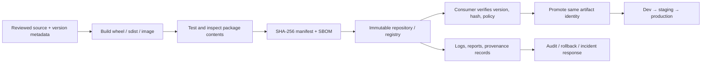
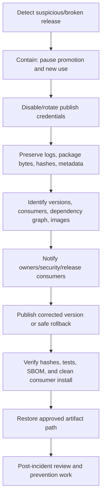

# Artifact Repositories and Package Publishing

**Abstract:** Learn to treat generated outputs as versioned, verifiable release inputs rather than disposable build leftovers. This unit builds a Python wheel and source distribution, publishes and installs through a local package repository, verifies SHA-256 hashes, designs safe promotion and credentials, associates an SBOM with immutable artifact identity, and practices a local-only dependency-confusion scenario and bad-release response.

**Module:** M02 — CI/CD Pipeline Engineering  
**Stage:** 2E — Production DevOps & Platform Engineering  
**Unit:** 7 — Artifact Repositories and Package Publishing  
**Target file:** `07-artifact-repositories-and-package-publishing.md`  
**Estimated time:** 10–14 hours  
**Prerequisites:** Git, Linux shell, Python virtual environments, pytest basics, CI/CD foundations, and M01 container image/digest/registry basics  
**Core tools:** Python, `pyproject.toml`, PyPA `build`, `pip`, `sha256sum`, Git, a local PyPI-compatible repository, GitHub Actions concepts  
**Awareness:** TestPyPI, PyPI Trusted Publishing/OIDC, GitHub Packages, GitLab Package Registry, OCI registries, Syft, DVC, MLflow/model registries, Nexus, Artifactory, Harbor, SBOM/provenance/attestation  
**Last reviewed:** 2026-10-24 (authoring date; official documentation not live-checked)  
**Assumed tool baseline:** Python 3.10+, pip, `build`, a PEP 517-compatible build backend, Bash on WSL2 Ubuntu or native Linux. Provider settings and tool syntax marked `[VERIFY]` must be checked before use.

## Table of contents

- [Unit 7 — Artifact Repositories and Package Publishing](#unit-7--artifact-repositories-and-package-publishing)
  - [7.0 Why this matters in production](#70-why-this-matters-in-production)
  - [7.1 Learning objectives](#71-learning-objectives)
  - [7.2 Concept map and vocabulary](#72-concept-map-and-vocabulary)
  - [7.3 Level 1 — Beginner](#73-level-1--beginner)
  - [7.4 Level 2 — Intermediate](#74-level-2--intermediate)
  - [7.5 Level 3 — Advanced](#75-level-3--advanced)
  - [7.6 Level 4 — Expert](#76-level-4--expert)
  - [7.7 SRE lens](#77-sre-lens)
  - [7.8 Security lens](#78-security-lens)
  - [7.9 Production checklist](#79-production-checklist)
  - [7.10 Hands-on lab set](#710-hands-on-lab-set)
  - [7.11 Self-check questions](#711-self-check-questions)
  - [7.12 Evidence artifacts](#712-evidence-artifacts)
  - [7.13 Common interview and design-review questions](#713-common-interview-and-design-review-questions)
  - [7.14 Sources and verification notes](#714-sources-and-verification-notes)
- [Appendix A — Claim Register](#appendix-a--claim-register)
- [Appendix B — Ten-Pass Audit Report](#appendix-b--ten-pass-audit-report)
- [Appendix C — Human Verification Checklist](#appendix-c--human-verification-checklist)
- [Appendix D — Known Limitations and Assumptions](#appendix-d--known-limitations-and-assumptions)
- [Appendix E — Sign-off](#appendix-e--sign-off)

## Unit 7 — Artifact Repositories and Package Publishing

**Target file:** `07-artifact-repositories-and-package-publishing.md` | **Estimated time:** 10–14 hours | **Prerequisites:** Git, Python packaging basics, shell, CI/CD foundations, and M01 container image concepts

**Core tools:** Python, `pyproject.toml`, `build`, `pip`, `sha256sum`, Git, local package repository | **Awareness:** TestPyPI, PyPI Trusted Publishing/OIDC, GitHub Packages, GitLab Package Registry, OCI registries, Syft, DVC/MLflow/model registries, Nexus/Artifactory/Harbor | **Last reviewed:** 2026-10-24 (authoring date; no live documentation verification)

### 7.0 Why this matters in production

A team that rebuilds the same application independently for development, staging, and production can accidentally deploy different bytes while believing it promoted one release. A package index misconfiguration can resolve a public package with the same name as a private dependency, creating a dependency-confusion path. A lost or mutable release artifact can make rollback impossible, while an exposed publish token can let an attacker ship a malicious version. This unit establishes artifact identity, controlled publication, hash verification, promotion, and response practices without requiring paid services or a real public package release.

### 7.1 Learning objectives

- [L1] Distinguish build artifacts from release artifacts and explain wheel versus source distribution; prove it with the build lab and saved file listing.
- [L1] Create a complete `pyproject.toml` package and build a wheel and sdist; save the build log and artifact names.
- [L2] Publish to a local PyPI-compatible repository, install into a clean virtual environment, and verify the installed version; save configuration and install evidence.
- [L2] Generate and verify a SHA-256 manifest while explaining the limits of a hash; save manifest and verification output.
- [L2] Compare CI artifacts, package registries, OCI registries, and release assets; produce a decision record in Lab 2.
- [L3] Design immutable versioning, least-privilege credentials, safe index configuration, promotion, and SBOM association; defend the design in Lab 3.
- [L3] Simulate a local dependency-confusion-style configuration mistake and demonstrate a corrected private-package source strategy; save before/after evidence.
- [L4] Define retention, cache/proxy, yank/revoke, and recovery policies; complete the bad-release runbook and checklist.
- [L4] Measure artifact retrieval/publication reliability from observed local or CI runs without treating publication success as consumer success; save metric definitions and evidence.

### 7.2 Concept map and vocabulary



The build produces candidate bytes; tests and policy checks determine whether those bytes are eligible for publication. A checksum records byte identity, while an SBOM records a view of included components. Repository publication makes the artifact available; approval/promotion is a separate decision. In a mature pipeline, promotion points to the same verified artifact rather than rebuilding from the same source and assuming the output will be identical.

| Term | Precise definition | Common misconception |
|---|---|---|
| Artifact | A generated file or package that is stored or passed between pipeline stages. | Every artifact is a deployable release. |
| Build artifact | Output of a build or test stage, often temporary until validated. | It is automatically approved for production. |
| Release artifact | A versioned, validated output authorized for consumption/deployment. | It must be rebuilt for each environment. |
| Wheel | A built Python distribution in the `.whl` format, designed for installation. | It is the same thing as source code. |
| sdist | A source distribution, typically an archive used by a build frontend to build a wheel. | It guarantees a build will succeed on every platform. |
| Package index | An index that exposes package candidates and metadata to installers. | It is necessarily a durable artifact repository with enterprise governance. |
| Repository | A managed location for storing, indexing, controlling, and retrieving artifacts. | It is interchangeable with a CI job's temporary artifact store. |
| Registry | A repository service specialized for a format or ecosystem, such as OCI images or Python packages. | Every registry uses the same identity/version semantics. |
| Immutable artifact | Content whose identity cannot be silently changed after publication; content-addressed digests help identify bytes. | A mutable tag is immutable because the team promises not to change it. |
| Package version | A declared version used by package tooling to distinguish releases. | Reusing a version is safe if the source commit changed. |
| Checksum | A digest computed from bytes to detect mismatch against a trusted expected value. | A matching hash proves who published the bytes. |
| Hash pinning | Requiring allowed package bytes to match recorded hashes during installation. | One hash automatically covers every platform wheel. |
| Dependency index | A configured source from which a package installer discovers candidates. | Multiple indexes are always searched in a safe, predictable priority order. |
| Proxy/cache | A service that fetches and may retain upstream artifacts or metadata for consumers. | A cached package is necessarily fresh or safe. |
| Namespace | A name scope used to distinguish projects/packages/owners. | A private package name is protected merely because it is uncommon. |
| Dependency confusion | A risk where resolution selects an unintended public package instead of the intended private dependency. | It only happens if an attacker compromises the private repository. |
| SBOM | A structured inventory of software components detected or declared in an artifact. | It proves the artifact is benign or complete. |
| Provenance | Evidence about how, where, and from what inputs an artifact was produced. | A build log alone always constitutes trustworthy provenance. |
| Attestation | A signed or otherwise authenticated statement binding claims to an artifact or process. | Every attestation is trustworthy regardless of issuer and policy. |
| Retention | Policy governing how long artifacts and related metadata are kept. | Retention can be designed without considering rollback and legal needs. |
| Yank | A repository-level signal that a release should generally not be newly selected by compatible installers, subject to ecosystem behavior. | A yank deletes copies already downloaded. |
| Revoke | A broad term for invalidating trust, credentials, or a release's eligibility; exact meaning depends on the system. | Revocation automatically removes every downstream copy. |
| Trusted Publishing | A publishing mechanism that can use workload identity/OIDC instead of a long-lived API token when supported and correctly configured. | OIDC automatically authorizes every publish action. |
| OCI digest | Content digest identifying an OCI image or manifest. | A human-readable tag is always a stable content identity. |
| Promotion | A controlled change in an artifact's release status/channel/repository while preserving identity where the platform supports it. | Promotion means rebuilding the artifact. |
| Reproducible build | A build process designed to produce identical outputs from the same declared inputs under defined conditions. | Same Git commit alone guarantees identical bytes. |

#### Artifact types and repository boundaries

| Artifact type | Typical use | Primary identity | Typical consumer |
|---|---|---|---|
| CI workflow artifact | Pass test logs, coverage, or build output between jobs; often short-lived | Run/job/name plus file hash | CI workflow, reviewer |
| Python wheel/sdist | Distribute Python library/application package | Package name/version plus file hash | `pip`, downstream build |
| OCI image | Deploy containerized service | Registry/repository plus immutable digest; tags are aliases | Container runtime/orchestrator |
| SBOM | Describe detected/declared components of a specific artifact | File hash and associated artifact digest | Security/release tooling |
| Release asset | Attach binaries, archives, checksums, notes to a release | Release/version and asset hash | Human or automation |
| Model/data artifact | Store model weights, feature data, evaluation dataset, or report | Version/object ID/hash plus metadata | ML job, model serving, analyst |

Build artifacts and release artifacts are different states, not necessarily different file formats. A wheel generated in a CI run is a build artifact until it passes the intended checks and policy. It can then become the release artifact without changing its bytes. “Build once, promote the same artifact” reduces accidental drift; it does not remove the need to verify the artifact, environment compatibility, or release policy.

**Trust boundary:**

```text
Untrusted source change
        |
        v
Build job (no release credential)
        |
        v
Test / inspect / hash / SBOM
        |
        v
Approval + protected release job
        |
        v
Repository publish identity (short-lived where supported)
        |
        v
Read-only consumers verify exact version + hash/digest
```

Separate build permissions from publish permissions where practical. A pull-request job should not receive release credentials simply because it needs to run tests. OIDC is an identity mechanism; the repository must still constrain which workflow, project, environment, and package is allowed to publish.

### 7.3 Level 1 — Beginner

#### Python packaging mechanism

A Python package project describes its name, version, Python compatibility, build backend, and which source files belong in the distribution. The `build` frontend reads `pyproject.toml` and asks the configured backend to produce distribution files. A wheel is a built distribution intended to be installed; an sdist contains source/build metadata that a consumer may use to build a wheel. Platform-specific dependencies such as NumPy, pandas, PyArrow, and scikit-learn may have prebuilt wheels for some Python/platform combinations; an installation may need a compatible wheel or a local build path. That is one reason to record Python version, operating system/architecture, and dependency lock data.

#### Complete minimal package

```text
artifact-lab/
  pyproject.toml
  README.md
  src/
    shared_scoring/
      __init__.py
      scoring.py
  tests/
    test_scoring.py
```

```toml
# File: pyproject.toml
[build-system]
requires = ["setuptools>=68"]
build-backend = "setuptools.build_meta"

[project]
name = "shared-scoring-artifact-lab"
version = "0.1.0"
description = "Synthetic scoring helpers for an artifact publishing lesson"
readme = "README.md"
requires-python = ">=3.10"
license = { text = "MIT" }
authors = [{ name = "Example Engineering Team" }]
dependencies = []

[tool.setuptools]
package-dir = {"" = "src"}

[tool.setuptools.packages.find]
where = ["src"]
```

The build requirement `setuptools>=68` is intentionally a lower bound for this teaching example, not a lock. For reproducible release builds, use a reviewed, locked build environment and document the supported backend version. **[VERIFY: current PyPA packaging guidance and setuptools configuration.]**

```markdown
<!-- File: README.md -->
# Shared Scoring Artifact Lab

A tiny synthetic package used to demonstrate build, publication, and verification.
It contains no customer data, credentials, or external service calls.
```

```python
# File: src/shared_scoring/scoring.py
def weighted_score(value: float, weight: float = 1.0) -> float:
    """Return a simple weighted score for a synthetic feature."""
    if weight < 0:
        raise ValueError("weight must be non-negative")
    return value * weight
```

```python
# File: src/shared_scoring/__init__.py
from .scoring import weighted_score

__all__ = ["weighted_score"]
```

```python
# File: tests/test_scoring.py
import pytest
from shared_scoring import weighted_score

def test_weighted_score_multiplies() -> None:
    assert weighted_score(3.0, 2.0) == 6.0

def test_negative_weight_is_rejected() -> None:
    with pytest.raises(ValueError, match="non-negative"):
        weighted_score(3.0, -1.0)
```

Build and test from the project root:

```bash
# File: terminal (Bash)
set -euo pipefail
python -m venv .venv
source .venv/bin/activate
python -m pip install --upgrade pip build pytest
python -m pytest -q
python -m build
```

**Example — yours will differ**

```text
2 passed
Successfully built shared_scoring_artifact_lab-0.1.0.tar.gz and shared_scoring_artifact_lab-0.1.0-py3-none-any.whl
```

This is representative output only. The exact filename normalization and build log vary by tool version. The command sequence creates a virtual environment, installs the build/test tools into it, runs the tests, then creates wheel and sdist files in `dist/`. A successful build proves the backend created distributions; it does not prove package contents are complete, safe, compatible with all target systems, or approved for release.

Inspect files and compute checksums:

```bash
# File: terminal (Bash)
set -euo pipefail
find dist -maxdepth 1 -type f -printf '%f\n' | sort
sha256sum dist/*
```

**Example — yours will differ**

```text
shared_scoring_artifact_lab-0.1.0-py3-none-any.whl
shared_scoring_artifact_lab-0.1.0.tar.gz
<64-hex-character-digest>  dist/shared_scoring_artifact_lab-0.1.0-py3-none-any.whl
<64-hex-character-digest>  dist/shared_scoring_artifact_lab-0.1.0.tar.gz
```

The digest strings above are placeholders, not real checksums. Do not copy them into a manifest. `sha256sum` computes a digest of each file's bytes. It detects a mismatch when compared with a trusted expected digest, but an attacker who can replace both the artifact and its manifest can replace both values. Hashes establish byte identity relative to a trusted record, not publisher identity or provenance.

#### “What just happened?”

- `pyproject.toml` tells the frontend which backend to use and declares package metadata.
- The source tree contains the importable package.
- `python -m pytest` checks behavior before publication.
- `python -m build` produces a wheel and an sdist in `dist/`.
- `sha256sum` computes a digest for each output.
- A release process would now inspect package contents, test installation in a clean environment, attach reports/SBOM evidence as appropriate, and publish through a protected release path.

#### Common beginner errors

| Symptom | Diagnosis | Fix |
|---|---|---|
| Build says no build system or backend found | Missing or invalid `[build-system]` metadata | Declare backend and build requirements |
| Import works in source tree but installed package is empty | Packaging configuration does not include `src/` package | Configure package discovery and inspect wheel contents |
| Build output exists but tests fail after installation | Source-tree imports may have hidden packaging omissions | Install the wheel in a clean virtual environment and test from outside project root |
| SHA-256 differs after copying | Bytes changed or the wrong file was compared | Recompute from the exact downloaded file and compare with trusted manifest |
| Same version is rebuilt and republished | Release identity is being reused | Publish a new version; keep released bytes immutable |
| Build succeeds on one OS but fails elsewhere | Dependency/platform/backend differences | Test supported Python/platform matrix and record build environment |

### 7.4 Level 2 — Intermediate

#### Install the exact built wheel in a clean environment

The clean environment helps detect accidental imports from the checkout and undeclared dependencies. Activate it from a directory outside the source tree and install the wheel by path for the first verification pass.

```bash
# File: terminal (Bash)
set -euo pipefail
python -m venv .verify-venv
source .verify-venv/bin/activate
python -m pip install --no-deps dist/*.whl
python -c 'import importlib.metadata as m; print(m.version("shared-scoring-artifact-lab"))'
python -c 'from shared_scoring import weighted_score; assert weighted_score(2.0, 3.0) == 6.0; print("installed package smoke test passed")'
```

**Example — yours will differ**

```text
0.1.0
installed package smoke test passed
```

Interpretation: the installed metadata reports the declared version and the import works in the clean environment. `--no-deps` is appropriate here because the example intentionally has no runtime dependencies. Do not use it for a package that requires external dependencies unless they are installed and verified separately.

#### Publish to a local PyPI-compatible repository

A local index lets you practice publication without publishing to public PyPI. One possible tool is `devpi`, but its installation, initialization, authentication, index configuration, and upload command can vary by version. **[VERIFY: devpi official documentation for current installation, `devpi-server`/`devpi-client` setup, index creation, login, and upload syntax.]** Use a disposable environment and a loopback-bound service only.

A safe workflow is:
1. Create a temporary directory and virtual environment for the local repository.
2. Install the selected repository server/client from a reviewed package source.
3. Bind the service to loopback, not a public interface.
4. Create a lab-only index and a local-only credential or token supported by that version.
5. Upload only the synthetic package.
6. Install from the local index in a separate clean consumer environment.
7. Stop the service and delete only the lab-created directory.

Because current devpi commands/auth details have not been live-verified, do not blindly copy guessed server/client commands. The following is a command *shape*, not an executable sequence, and must be replaced with the current official quickstart for the selected version:

```bash
# File: terminal (Bash) — illustrative command shape; verify against current devpi docs
# [VERIFY: exact current devpi initialization, login, index creation, upload flags, and auth]
devpi-server --host 127.0.0.1
```

**Example — yours will differ**

```text
Server startup message showing a local URL and listening state
```

This output is a description, not a claimed exact output. Confirm the server binds to `127.0.0.1` and is not exposed on a LAN/public interface. If the local repository's auth setup is too version-sensitive for a short lab, use the safe fallback: build and serve a static local wheelhouse using `pip download`/local directory installation, and treat it as a local package source rather than claiming it is an authenticated package index. That fallback teaches artifact identity and clean install but does not satisfy the publication-to-index objective by itself; complete the index publication using the current official local-repository instructions.

#### Hash manifest and installation verification

Create a manifest only after the final artifact bytes have been built and validated. Use a trusted manifest distributed through a protected release channel. For a local wheelhouse:

```bash
# File: terminal (Bash)
set -euo pipefail
sha256sum dist/* > SHA256SUMS
sha256sum --check SHA256SUMS
```

**Example — yours will differ**

```text
dist/shared_scoring_artifact_lab-0.1.0-py3-none-any.whl: OK
dist/shared_scoring_artifact_lab-0.1.0.tar.gz: OK
```

Interpretation: this checks that files currently present match the digests recorded in `SHA256SUMS`. It does not prove that the manifest was obtained from a trusted publisher. Keep the manifest itself protected and associate it with the release record.

For pip hash-checking mode, requirements must enumerate permitted hashes for every allowed distribution. Different platform wheels and sdists have different hashes; a lock must include the hashes for the distributions that are allowed on supported environments. **[VERIFY: current pip documentation for secure installs and `--require-hashes` requirements.]**

#### Repository-type decision table

| Store | Use case | Retention/durability | Consumer model | Versioning/identity | Access control | Recommended use |
|---|---|---|---|---|---|---|
| CI workflow artifacts | Logs, coverage, test outputs, intermediate packages between jobs | Often run-scoped and policy-limited; verify provider settings | CI jobs/reviewers | Run ID/name plus file digest | Workflow/repository permissions | Evidence and temporary handoff, not sole long-term release archive |
| Python package registry/index | Wheels, sdists, Python metadata | Depends on provider retention and deletion policy | `pip`, build tools | Package name/version/file hash | Package/project/token policy | Python library/application distribution |
| OCI/container registry | Images, manifests, possibly OCI artifacts | Provider-specific lifecycle/retention | Docker/Podman/runtime/cluster | Repository + digest; tag is alias | Registry IAM/robot accounts | Deployable container images and supported OCI artifacts |
| Release assets | Signed archives, checksums, release notes, binaries | Depends on host/release retention policy | Humans, scripts, release automation | Release version + asset hash | Repo/release permissions | Curated release bundle and human-facing notes |
| Object storage/model store | Large datasets, model weights, evaluation artifacts | Lifecycle/versioning policy required | ML jobs, serving systems | Object version/hash/URI + metadata | Bucket/object IAM | Large model/data files; link from code/release metadata |

GitHub Packages and GitLab Package Registry are platform package-registry offerings; their supported formats, authentication, visibility, and permissions differ. OCI registries store container images by OCI semantics. A CI artifact is usually tied to a workflow run. A release asset is a curated attachment. Do not use these terms interchangeably.

#### Repeatability and heavy dependencies

A `pyproject.toml` describes package/build metadata but is not, by itself, a complete environment lock. Repeatability also depends on pinned or constrained runtime dependencies, transitive dependencies, Python version, OS/architecture, index contents, build backend, and platform-specific wheels. NumPy, pandas, PyArrow, and scikit-learn may have native components and compatibility constraints. A source package can build differently across platforms or fail if the compiler/system libraries are missing. Keep small shared logic in a Python package; use a separately managed image or environment for a full ETL/ML runtime when dependency weight warrants it.

Distinguish these states in logs and dashboards:
- **Build completed:** build process exited successfully.
- **Artifact validated:** tests, package inspection, metadata checks, hashes, and policy checks passed.
- **Artifact published:** repository accepted bytes and metadata.
- **Artifact approved/promoted:** policy authorized this exact artifact identity for a release channel/environment.
- **Consumer verified:** a clean consumer successfully retrieved, verified, and installed the artifact.

Publication success alone does not prove downstream installation success.

#### Pattern catalogue

| Pattern | Use when | Avoid when |
|---|---|---|
| Build once, promote same digest/hash | Release consistency matters across environments | Target format fundamentally requires environment-specific packaging; in that case record the relationship explicitly |
| Unique package version per release | Package indexes treat versions as release identities | Reusing version is considered “convenient” |
| Local index in a disposable lab | Learning upload/install safely | Treating it as a production repository without auth/backup/retention controls |
| Hash manifest from final bytes | Need to detect byte mismatch | Manifest is stored beside an untrusted artifact without a trusted channel |
| Clean virtual environment install | Validate actual distribution contents | Source-tree import is assumed to be enough |
| Separate CI evidence and release store | Test reports and releases have different retention needs | CI run artifacts are the only copy of a release |
| Explicit private index strategy | Private package names must resolve predictably | Multiple indexes are configured casually without analyzing candidate selection |

#### Anti-pattern catalogue

| Bad example | Why it hurts | Corrected version |
|---|---|---|
| Rebuild for each environment | Produces potentially different bytes from nominally identical source | Build once, validate, and promote the same immutable identity |
| Re-upload a changed file under the same version | Consumers may receive inconsistent bytes for one version | Publish a new version and preserve the prior artifact/evidence |
| `pip install --extra-index-url <public-index>` as a default private-package strategy | Multiple indexes can create candidate ambiguity and dependency-confusion risk | Prefer a single trusted internal index/proxy that controls upstream policy; verify exact resolver/index behavior |
| Trust a hash from an untrusted download page | Attacker can replace both artifact and hash | Obtain expected hash from a protected trusted release record |
| Store release package only as a temporary CI artifact | Artifact may expire or disappear before rollback | Publish to durable versioned repository and define retention |
| Treat an SBOM as a security verdict | SBOM inventory can be incomplete and says little about exploitability by itself | Use it as one input to review, scanning, and provenance controls |
| Print publish token for debugging | Logs and artifacts can leak credentials | Use secret store, scoped credentials, masking plus no-print discipline |
| Delete a bad package and assume recovery is complete | Existing caches, vendored copies, and deployed environments remain | Identify consumers, contain, revoke credentials, publish correction, and coordinate remediation |

### 7.5 Level 3 — Advanced

#### Immutability, versioning, and promotion

Treat package name plus version plus file hash as the identity of a Python distribution. A release should not be silently overwritten. If the published bytes are wrong, create a corrected version and communicate the migration; use repository-supported yank/disable mechanisms where appropriate, but do not assume they erase existing copies. OCI images should be referenced by digest for deployment identity when exact content matters; tags are useful labels but may be mutable depending on policy.

A promotion workflow has separate phases:
1. Build from reviewed source.
2. Test and inspect package contents.
3. Record checksums and SBOM.
4. Publish to a staging/snapshot repository.
5. Approve the exact artifact hash/digest.
6. Promote/copy the same bytes or reference the same immutable identity.
7. Verify from the release repository and retain audit evidence.

If the repository cannot promote without changing bytes, treat the resulting artifact as a new build/release and record the relationship. Do not claim byte identity without comparing hashes/digests.

#### Credentials: static token versus Trusted Publishing/OIDC

A static API token is a secret value that must be stored, scoped, rotated, and protected from logs. A short-lived OIDC-based publishing flow lets a CI workload request an identity token and exchange it with a supported package host, subject to trust configuration. It can reduce long-lived secret management but is not automatic authorization: the package host must trust the correct identity claims, project/repository, workflow/environment, and package scope. **[VERIFY: current PyPI Trusted Publishing documentation, supported CI provider configuration, claim constraints, and project setup.]**

Use least privilege:
- Build/test jobs do not need publish credentials.
- Release jobs run only on protected events/branches/environments.
- Tokens are scoped to the package/project and minimal permissions.
- Do not print tokens; masking is a safety net, not a guarantee.
- Rotate/revoke credentials after exposure and audit their use.
- Separate read and publish credentials where the repository supports it.

#### Dependency confusion and index configuration

If a private project uses a package name also available publicly, an installer configured to consult multiple indexes can select an unintended candidate according to resolver behavior and version metadata. `--extra-index-url` is not a universal safe way to combine private and public package sources. Avoid casual multiple-index configuration for private names.

Safer strategies include:
- One trusted internal index/proxy that serves private packages and applies explicit upstream allowlisting/policy.
- Namespace/project naming governance and monitoring for public name collisions.
- Pinning exact approved versions and hashes for controlled deployments.
- Explicit package source configuration in the organization's supported tooling, tested against current installer behavior.
- Restricting publication permissions and monitoring unexpected package/version changes.

**Local-only demonstration:** never publish a competing package to public PyPI. Create two local directories/repositories containing harmless packages with the same synthetic name and different versions/messages, then demonstrate that an ambiguous resolver setup is difficult to reason about. Because exact pip candidate selection and index semantics can change, **[VERIFY: current pip “Finding and choosing files” / index options documentation before asserting which candidate wins.]** The objective is to prove the configuration has more than one source of truth and to fix it by installing from one controlled local index or explicit local artifact with a hash. Do not use malicious code.

#### Large ML artifacts and version relationships

Ordinary Python packages are suitable for source code, small metadata, and reusable library logic—not necessarily multi-gigabyte model weights or datasets. Consider object storage with versioning, DVC for data/model file references, MLflow or a specialist model registry for model metadata/lifecycle, or a provider's managed model store. These are awareness-level options; this unit does not implement a model registry.

Link artifacts explicitly:
- source commit and package version;
- ETL schema/contract version;
- dataset identifier/version/hash;
- training code/environment and dependency lock;
- model artifact URI/version/hash;
- evaluation dataset/version and metrics report;
- container image digest for serving;
- release record and SBOM/provenance references.

A model name such as `production-model` is not enough to reproduce a deployment if it points to mutable weights. Record immutable version/digest and the compatibility contract.

#### SBOM, provenance, and attestation

An SBOM is an inventory associated with a specific artifact. Syft, introduced in M01, can generate SBOMs for supported images and files. Exact input formats and output options are version-sensitive. **[VERIFY: official Syft documentation for current CLI, supported sources, and output formats.]** Associate the SBOM with the exact artifact digest/hash, record tool/version and generation time, and store it with the release evidence. A mismatched SBOM can be misleading if it describes a different image or package build.

An SBOM does not prove an artifact is safe, complete, unmodified, or from a trusted builder. Provenance describes build inputs/process; an attestation binds claims to an artifact through a verifiable statement. M12 covers deeper signing, provenance/attestation validation, and SLSA-oriented supply-chain policy. This unit introduces the boundary but does not implement a full signing or SLSA verification system.

#### Publication reliability and trade-offs

Measure with a defined observation window:
- **Publication success rate:** accepted publication attempts / eligible attempts, with retries and permanent failures reported separately.
- **Retrieval success rate:** successful consumer retrievals / eligible retrieval attempts.
- **p95 retrieval latency:** elapsed time from request start to complete verified artifact retrieval, segmented by artifact size and location.
- **Build-to-publish duration:** build start to repository acceptance; do not confuse it with consumer readiness.
- **Reproducibility rate:** fraction of controlled repeat builds whose outputs match under a documented environment and method.
- **Storage consumption:** bytes retained by artifact type and age; include duplicated versions and SBOM/log attachments.

Bias risks include counting retries as independent successes, excluding slow clients, measuring only cache hits, ignoring artifact size, or excluding failed releases from the denominator. Record first attempt and retry outcomes separately.

| Option | Benefit | Cost | Risk | Choose when |
|---|---|---|---|---|
| Static scoped token | Broadly supported and operationally straightforward | Storage, rotation, exposure management | Long-lived credential theft | OIDC unsupported and secret handling is mature |
| Trusted Publishing/OIDC | Can avoid long-lived publish token | Trust setup and provider constraints | Misconfigured trust claims or overly broad authorization | Package host and CI provider support it and policy is verified |
| Single internal index/proxy | One policy-controlled resolution source | Operations and upstream mirroring | Proxy compromise or outage | Private packages and upstream policy need central control |
| Multiple indexes | Can expose separate package sources | Resolution complexity | Dependency confusion/ambiguity | Only with explicit, tested source policy and strong namespace controls |
| Promote immutable artifact | Consistent bytes across environments | Repository/promotion design | Incorrect artifact promoted consistently | Release reproducibility and rollback matter |
| Rebuild per environment | Environment-specific build possible | More build time and drift risk | Different bytes under same release label | Only where target differences are required and recorded |
| SBOM per release artifact | Improves inventory and incident triage | Storage and scanner/tool maintenance | Incomplete/mismatched inventory | Security/release policy requires component visibility |
| Object store/model registry for weights | Handles large files and metadata separately | Access/version/lifecycle design | Mutable pointer or missing lineage | ML assets exceed normal package distribution needs |

**Lab design decision:** choose the source of truth for internal Python packages, static-token versus OIDC publishing, artifact promotion model, SBOM association, and a policy for duplicate public package names. Explain why the choice is safe enough for the stated threat model, how it can fail, what evidence proves correct operation, and how you will reverse a bad release. The learner must defend the decision, not just paste YAML.

### 7.6 Level 4 — Expert

#### Lifecycle, retention, garbage collection, and legal hold

Retention should reflect artifact purpose and recovery requirements:
- Keep supported release versions for the declared support window.
- Retain the exact artifact and checksum needed to roll back a deployed service.
- Keep required SBOM, provenance, test reports, and approval records for the same or longer policy-defined window.
- Separate disposable snapshots/nightly builds from supported releases.
- Define who can delete/revoke artifacts and who can authorize exceptions.
- Use legal hold where required by organizational/legal policy.
- Run garbage collection only after confirming references, retention windows, and rollback obligations.

Repository-specific deletion, immutability, retention, legal hold, and garbage-collection behavior varies by provider. **[VERIFY: current provider documentation and UI/API semantics before enabling deletion automation.]** A policy-as-code checker can flag old artifacts, but deletion should require dry-run output, a reviewed allowlist/scope, and an audit record.

#### Proxy/cache resilience

A package proxy/cache can improve resilience to upstream outages and reduce repeated downloads. It introduces freshness and trust questions: when is metadata refreshed, how are upstream changes detected, what happens when the upstream is unavailable, can stale metadata be served, and how are compromised packages blocked? A cache is not a trust boundary by itself. Use allowlists and policy for upstream sources, record package hashes, monitor cache errors/staleness, and test outage behavior. For critical releases, preserve approved artifacts in a durable internal repository instead of depending on a live public index at deployment time.

#### Yank versus delete/revoke

A yank normally signals that a release should not be newly selected by compatible installers, while preserving some availability for exact pins or existing consumers depending on ecosystem behavior. It is not equivalent to deleting a file, revoking a credential, or purging every cached copy. Exact behavior varies by repository and client. **[VERIFY: current PyPI/Python Packaging guidance and target repository behavior.]**

- **Yank/disable:** signal that a release is unsuitable for new resolution under supported client semantics.
- **Delete:** remove an artifact from a repository if the provider allows it; copies elsewhere may remain.
- **Revoke credential:** prevent future use of a credential; does not remove packages already published.
- **Corrected release:** publish a new version with verified bytes and migration instructions.
- **Consumer remediation:** identify dependency graph, caches, lockfiles, deployed images, and vendored copies; upgrade/rebuild where necessary.

#### Multi-format repository operations

Nexus and Artifactory provide broad repository management capabilities; Harbor focuses on OCI/container registry use cases and related ecosystem capabilities. These are awareness/comparison examples only; feature matrices, licensing, retention, and integration behavior must be verified from current official documentation. Do not assume one repository product has identical semantics across Python packages, OCI images, SBOMs, release assets, and ML files. Standardize metadata and policy even if storage backends differ.

#### Incident runbook: malicious or broken package published



**Runbook steps:**

1. **Detect:** confirm the exact package name, version, repository, upload time, artifact hash, and suspicious signal. Preserve the first report and avoid deleting evidence.
2. **Contain:** pause promotion and new deployments; block the affected version through repository-supported policy; notify release owners. Do not assume yank/delete removes cached copies.
3. **Disable credentials:** revoke/rotate exposed or suspect publish credentials and audit recent uses. For OIDC, inspect and constrain the trust relationship rather than rotating a nonexistent static token.
4. **Preserve evidence:** copy exact package bytes, hashes, metadata, upload logs, workflow run, source commit, SBOM, provenance/attestation if present, and approval record to a controlled incident location.
5. **Identify consumers:** search lockfiles, dependency graphs, image digests, build logs, deployed services, caches, vendored copies, and model/ETL environments.
6. **Communicate:** state affected versions, impact known/unknown, required action, corrected version, and deadlines; avoid unsupported claims that all consumers are clean.
7. **Correct:** publish a new version from reviewed source through the protected path; never overwrite a version to hide the incident.
8. **Validate:** clean-install the corrected version, verify trusted hash/source, run tests and security checks, inspect package contents, and confirm the SBOM maps to the corrected bytes.
9. **Recover:** promote the approved artifact, rebuild affected images/environments, verify runtime behavior, and track consumer acknowledgements.
10. **Follow up:** document root cause, update namespace/index rules, access controls, detection, retention, and incident drills.

#### Failure scenarios

| Symptom | Hypothesis | Test | Root cause | Fix | Prevention |
|---|---|---|---|---|---|
| CI build green, consumer import fails | Package omitted source files | Install wheel in clean venv outside checkout | Packaging discovery misconfigured | Fix package configuration and publish a new version | Clean-install test is required |
| Hash mismatch after download | Wrong artifact or bytes changed | Recompute hash from downloaded file and compare trusted manifest | Transfer/cache corruption or wrong source | Fetch approved artifact; investigate source | Store trusted digest with release record |
| Private dependency resolves unexpectedly | Multiple indexes or name collision | Inspect pip configuration and resolved package metadata | Ambiguous source policy | Use one trusted internal index/proxy and pinned version/hash | Namespace policy and resolver tests |
| Registry unavailable during deployment | Upstream dependency or registry outage | Check health, cache state, recent deploys, and retrieval tests | Availability/capacity failure | Use preserved approved release artifacts or approved cache | Resilience tests and recovery plan |
| Publish succeeds but installation fails | Bad metadata, incompatible wheel, missing dependency | Install from repository in clean supported environment | Consumer compatibility not validated | Corrected version and support-matrix testing | Consumer install test before promotion |
| SBOM does not match image | SBOM generated for different tag/build | Compare artifact digest referenced in SBOM evidence | Tag moved or wrong file used | Regenerate against exact digest and reattach | Require immutable digest association |
| Old release deleted unexpectedly | Retention job scope too broad | Review deletion audit and policy preview | Unreviewed garbage-collection policy | Restore if possible; preserve remaining copies | Dry-run, allowlist, owner approval, legal hold |

#### Policy-as-code example: verify a checksum manifest

This small script checks that a manifest lists files that exist and that each recorded SHA-256 matches. It is intentionally narrow: it does not verify publisher identity, signatures, provenance, repository permissions, or whether the manifest itself is trusted.

```python
# File: scripts/verify_sha256_manifest.py
from __future__ import annotations

import hashlib
import sys
from pathlib import Path

def sha256_file(path: Path) -> str:
    digest = hashlib.sha256()
    with path.open("rb") as handle:
        for chunk in iter(lambda: handle.read(1024 * 1024), b""):
            digest.update(chunk)
    return digest.hexdigest()

def main(manifest: Path) -> int:
    root = manifest.parent.resolve()
    failures = 0
    for line_number, raw in enumerate(manifest.read_text(encoding="utf-8").splitlines(), start=1):
        if not raw.strip():
            continue
        parts = raw.split(maxsplit=1)
        if len(parts) != 2:
            print(f"line {line_number}: malformed manifest row", file=sys.stderr)
            failures += 1
            continue
        expected, relative_name = parts
        relative_name = relative_name.lstrip("*")
        candidate = (root / relative_name).resolve()
        if root not in candidate.parents and candidate != root:
            print(f"line {line_number}: path escapes manifest directory", file=sys.stderr)
            failures += 1
            continue
        if not candidate.is_file():
            print(f"line {line_number}: missing file: {relative_name}", file=sys.stderr)
            failures += 1
            continue
        actual = sha256_file(candidate)
        if actual != expected.lower():
            print(f"line {line_number}: HASH MISMATCH: {relative_name}", file=sys.stderr)
            failures += 1
        else:
            print(f"OK: {relative_name}")
    return 1 if failures else 0

if __name__ == "__main__":
    if len(sys.argv) != 2:
        print("usage: python scripts/verify_sha256_manifest.py SHA256SUMS", file=sys.stderr)
        raise SystemExit(2)
    raise SystemExit(main(Path(sys.argv[1])))
```

```bash
# File: terminal (Bash)
set -euo pipefail
python scripts/verify_sha256_manifest.py dist/SHA256SUMS
```

**Example — yours will differ**

```text
OK: shared_scoring_artifact_lab-0.1.0-py3-none-any.whl
OK: shared_scoring_artifact_lab-0.1.0.tar.gz
```

This output is representative. Ensure the manifest format matches the script's parser and paths are relative to the manifest directory. For a production policy, test malformed lines, duplicate entries, symlink/path behavior, empty manifests, and untrusted manifest sources. A script that checks hashes cannot make an untrusted manifest trustworthy.

### 7.7 SRE lens

#### SLIs and SLOs

Define indicators before setting targets:

- **Artifact availability:** successful health/retrieval checks divided by eligible checks, separated by repository and region/network path.
- **Retrieval success:** successful complete downloads that pass integrity verification divided by eligible retrieval attempts.
- **Publication success:** accepted publications divided by eligible publication attempts; report first-attempt success separately from retries.
- **p95 retrieval latency:** request start to complete download/hash verification, segmented by artifact size and cache-hit/miss.
- **Time to publish:** start of release pipeline to repository acceptance; do not confuse it with approval or consumer installation.
- **Retention compliance:** sampled required artifacts/evidence still retrievable and disposable artifacts expired according to policy.
- **Recovery time:** time from confirmed registry/package incident to a validated safe retrieval/deployment path.

**[ILLUSTRATIVE]** A service might propose 99.5% monthly retrieval success for supported releases, but this is not a universal target and is not measured here. Choose targets from consumer criticality, observed baseline, failure history, rollback requirements, and the cost of an outage. Segment by artifact size and consumer location; a tiny metadata lookup and a multi-gigabyte model download should not share an unqualified latency target.

#### Failure modes and blast radius

- **Registry unavailable:** fresh installs/deployments fail; cached environments may keep running but new recovery can be blocked.
- **Corrupt package:** consumers may fail installation or, worse, install wrong bytes if verification is absent.
- **Stale cache:** a known bad or vulnerable version remains resolvable.
- **Expired token:** publication fails even though builds are healthy.
- **Compromised maintainer:** unauthorized package version or release metadata may be published.
- **Bad release:** downstream services/ETL jobs may break after upgrade.
- **Checksum mismatch:** artifact identity cannot be confirmed; stop promotion and investigate.
- **Missing rollback artifact:** incident recovery becomes slower or impossible without rebuild.
- **SBOM/report upload failure:** inventory/evidence is missing even if package bytes exist.

**Runbook snippet — alert → triage → mitigation → follow-up**

1. **Alert:** retrieval failures, unexpected version/hash, publish error, retention violation, or unusual credential activity.
2. **Triage:** identify repository, package/version/digest, first failed request, cache status, credential identity, affected consumers, and recent policy changes.
3. **Mitigation:** pause promotion, use a previously approved immutable artifact, route to an approved internal cache if available, and revoke suspect credentials. Avoid unreviewed source changes.
4. **Follow-up:** restore service, validate consumer install, repair retention/cache policy, reconcile SBOM/provenance, and document impact.

Capacity and cost depend on artifact size, retained versions, egress, duplicate formats, SBOM/log retention, cache hit rate, and concurrent downloads. No provider quota or price is asserted. **[VERIFY: current provider plan, storage/egress pricing, retention limits, and concurrency constraints before production budgeting.]** For a zero-budget lab, use local files and a loopback repository; do not depend on a hosted service.

### 7.8 Security lens

This unit covers package identity, access control, index configuration, hash verification, basic SBOM association, and incident response. It does not implement a complete signing/provenance verification chain or SLSA policy; those are deferred to M12. OWASP Top 10 CI/CD Security Risks provides a useful threat-model checklist for pipeline access, credential exposure, dependency integrity, and release controls. A green scan, matching hash, or SBOM is evidence with a defined scope—not proof of safety.

| Threat | Control | Verification | Residual risk |
|---|---|---|---|
| Over-privileged publish identity | Least-privilege token/OIDC trust scoped to project and release workflow | Inspect token scope and provider settings; review workflow permissions | Provider misconfiguration or compromised authorized workflow |
| Long-lived token leakage | Prefer Trusted Publishing/OIDC where supported; otherwise scoped secret, rotation, no-print policy | Search logs/config for token patterns; inspect secret settings and rotation record | Masking can fail for transformed values; stolen token may be used before revocation |
| Dependency confusion | One trusted internal index/proxy, namespace rules, exact version/hash policy | Inspect pip config/lockfiles and resolved package metadata | Internal index/proxy compromise or policy gap |
| Artifact substitution | Hash verification from a trusted manifest; immutable digest/version references | Recompute SHA-256 or OCI digest and compare with protected release record | Hash alone does not establish origin |
| Mutable release version | Unique versions and no-overwrite policy | Inspect repository permissions/settings and publication audit | Some providers permit deletion/re-upload; verify exact semantics |
| Missing or mismatched SBOM | Generate SBOM and bind it to exact artifact digest/hash | Compare release digest and SBOM metadata; retain tool/version | Scanner coverage may be incomplete |
| False provenance confidence | Keep provenance/attestation verification policy explicit | Inspect issuer, subject, claims, signature and policy in M12 workflow | This lesson does not implement full verification |
| Repository data loss | Retention, backup/restore, legal hold, deletion approvals | Sample retrieval test, retention config, audit log | Backup may be stale or incomplete |
| Build/release privilege conflation | Separate build/test and release jobs/identities | Inspect workflow permissions and event triggers | Workflow supply-chain compromise remains possible |
| Malicious/broken publication | Incident runbook, version blocking/yank where supported, consumer inventory | Conduct tabletop exercise and inspect logs | Downstream copies cannot be centrally erased |

### 7.9 Production checklist

- [ ] `pyproject.toml` declares project name, version, supported Python, build backend, and package discovery.
- [ ] Build environment and build backend versions are recorded or locked for release builds.
- [ ] Wheel and sdist are generated from the intended source commit.
- [ ] Package contents are inspected and clean-install tested outside the checkout.
- [ ] Unit/integration tests pass before publication; the exact evidence is retained.
- [ ] Package name/version and artifact hashes are recorded in the release manifest.
- [ ] Published versions cannot be silently overwritten under the repository's actual settings.
- [ ] A corrected release receives a new version and prior bytes/evidence remain available under policy.
- [ ] Publish identity is least-privilege and separate from ordinary test jobs.
- [ ] Trusted Publishing/OIDC is used only if supported and correctly constrained; otherwise token scope/rotation are documented.
- [ ] No token is printed in logs or committed to source; log masking is not the sole control.
- [ ] Private package source strategy avoids unreviewed multiple-index ambiguity.
- [ ] Lockfiles/constraints record intended dependency resolution; platform-specific dependencies are considered.
- [ ] SHA-256 manifest is generated from final bytes and verified against a trusted record.
- [ ] Hash verification is not presented as proof of publisher identity or provenance.
- [ ] SBOM is associated with the exact wheel/image/artifact digest and retained with release evidence.
- [ ] Provenance/attestation claims are deferred to a verified M12 process where not implemented here.
- [ ] Promotion preserves the same artifact identity or records a new build relationship explicitly.
- [ ] CI artifacts, package registries, OCI registries, release assets, and model/data stores have separate retention/consumer policies.
- [ ] Retention covers rollback/support windows; legal hold and deletion authority are defined.
- [ ] Garbage collection has dry-run, scope limits, approvals, and audit evidence.
- [ ] Proxy/cache freshness, upstream outage behavior, and compromised-package response are documented.
- [ ] Yank/delete/revoke behavior is verified for the target repository/client.
- [ ] Release consumers and dependency relationships can be identified during an incident.
- [ ] Retrieval/publication SLI definitions include denominator, retries, and artifact-size segmentation.
- [ ] Repository access, publication, deletion, and bypass actions are auditable.
- [ ] Recovery runbook is owned, reviewed, and exercised without a public package release.

### 7.10 Hands-on lab set

There are four labs. They are local-first and use synthetic artifacts. Commands and outputs below are representative examples, not observed executions. Provider-specific local-index commands are explicitly marked `[VERIFY]`; complete them using the current official quickstart before claiming the repository-publication objective is finished.

#### LAB-1 — Build, inspect, and hash a Python package

- **Level:** L1
- **Estimated time:** 60–90 minutes
- **Goal:** Build wheel and sdist, run tests, inspect outputs, and compute a checksum manifest.
- **Prerequisites:** Python, Bash, Git optional.
- **Exact files:** the complete `artifact-lab/` tree and file contents from 7.3.

**Steps and commands**

```bash
# File: terminal (Bash) — run from artifact-lab/
set -euo pipefail
python -m venv .venv
source .venv/bin/activate
python -m pip install --upgrade pip build pytest
python -m pytest -q
python -m build
find dist -maxdepth 1 -type f -printf '%f\n' | sort
sha256sum dist/* > SHA256SUMS
sha256sum --check SHA256SUMS
```

**Example — yours will differ**

```text
2 passed
Successfully built shared_scoring_artifact_lab-0.1.0.tar.gz and shared_scoring_artifact_lab-0.1.0-py3-none-any.whl
dist/shared_scoring_artifact_lab-0.1.0-py3-none-any.whl
dist/shared_scoring_artifact_lab-0.1.0.tar.gz
dist/shared_scoring_artifact_lab-0.1.0-py3-none-any.whl: OK
dist/shared_scoring_artifact_lab-0.1.0.tar.gz: OK
```

Interpretation: the test and build commands succeeded in this illustrative sequence; the checksum check validates current bytes against the locally created manifest. Because the manifest is generated locally, it is not independent authenticity evidence.

- **Negative test:** copy one artifact to a disposable file, append a harmless byte, and run a checksum check against the original manifest. It should report mismatch. Do not modify the original `dist/` artifact.
- **Verification criteria:** wheel and sdist exist; tests pass; manifest contains both filenames; altered copy does not match the original digest.
- **Evidence:** package tree, build log, filenames, `SHA256SUMS`, verification and mismatch logs.
- **Cleanup:** remove only `.venv`, `.verify-venv`, `build/`, `dist/`, `*.egg-info`, temporary altered copy, and `SHA256SUMS` if not retaining evidence. Confirm the path is the lab root first.
- **Cleanup verification:**

```bash
# File: terminal (Bash)
set -euo pipefail
test ! -e .venv
test ! -e build
test ! -e dist
printf 'lab-generated build paths absent\n'
```

**Example — yours will differ**

```text
lab-generated build paths absent
```

The check verifies only the named paths. Keep the source and test files if they are intended to remain as a learning repository.

- **Stretch:** install the built wheel from outside the checkout and run the smoke test.

#### LAB-2 — Publish to a local index and install in a clean environment

- **Level:** L2
- **Estimated time:** 2–3 hours
- **Goal:** Publish the synthetic package to a loopback-only PyPI-compatible repository, install the pinned version in a fresh environment, and verify its hash.
- **Prerequisites:** LAB-1, sufficient local disk, current official local-repository instructions.
- **Exact files:** `artifact-lab/`, built `dist/` outputs, `SHA256SUMS`, and a lab evidence directory.

**Setup and repository publication**

Use a disposable environment and a local repository such as devpi. Exact installation and authentication commands are version-sensitive. **[VERIFY: official devpi documentation for current server/client install, initialization, user/index creation, login, upload, and clean shutdown.]** Do not expose the server beyond loopback and do not reuse an organization credential. Use a locally generated lab-only password/token supported by the selected repository version; never store it in source control or print it.

```bash
# File: terminal (Bash) — safe preparation only
set -euo pipefail
LAB_ROOT="$(pwd)/artifact-lab"
REPO_STATE="$(mktemp -d "${TMPDIR:-/tmp}/artifact-repo-lab.XXXXXX")"
printf 'Lab repository state directory: %s\n' "$REPO_STATE"
printf 'Confirm this path is disposable before continuing.\n'
```

**Example — yours will differ**

```text
Lab repository state directory: /tmp/artifact-repo-lab.ab12cd
Confirm this path is disposable before continuing.
```

This command only creates a temporary directory and prints its path. Keep the path in your evidence record; use it as the only target for repository state cleanup.

Use the official current devpi quickstart to complete these actions:
1. Install the selected server/client into a separate virtual environment.
2. Initialize the repository under `REPO_STATE` and bind it to `127.0.0.1`.
3. Create a lab-only user/index and local credential.
4. Upload `dist/*.whl` and `dist/*.tar.gz`.
5. Capture upload logs without including the credential.
6. Stop the local server using the documented shutdown method.

The exact commands are intentionally not fabricated because this prompt requires current repository/auth syntax and it has not been live-verified. If you use a static local wheelhouse fallback, you can still practice clean installation and hashes, but mark the local-index publication objective incomplete until a PyPI-compatible server accepts an upload.

**Install from the local index**

After configuring the clean consumer environment to use only the local index for this synthetic package, install the exact version and verify metadata. Do not add a public fallback index casually.

```bash
# File: terminal (Bash) — template; replace LOCAL_INDEX_URL with the verified loopback index URL
set -euo pipefail
python -m venv .consumer-venv
source .consumer-venv/bin/activate
python -m pip install --index-url "$LOCAL_INDEX_URL" "shared-scoring-artifact-lab==0.1.0"
python -c 'import importlib.metadata as m; print(m.version("shared-scoring-artifact-lab"))'
python -c 'from shared_scoring import weighted_score; assert weighted_score(2.0, 3.0) == 6.0; print("consumer smoke test passed")'
```

**Example — yours will differ**

```text
0.1.0
consumer smoke test passed
```

This output is illustrative. `LOCAL_INDEX_URL` must be set to the verified loopback index endpoint and must not contain a real credential in the shell history. Use the repository's documented authentication mechanism. Avoid copying a secret-bearing URL into logs.

**Hash evidence:** download the exact published file to a separate directory and compare it with the hash recorded at build time. If the repository serves the same bytes, the digest should match. If it differs, stop: do not promote the package until the mismatch is explained.

- **Verification criteria:** repository accepts the upload; fresh environment resolves intended package/version from the local source; smoke test passes; downloaded wheel hash matches trusted build evidence.
- **Evidence:** sanitized repository config, upload log, clean install output, installed version, source URL/index config with credentials removed, hash comparison.
- **Cleanup:** deactivate environments; stop repository server using its documented shutdown; delete only `REPO_STATE` after checking its printed path; remove lab virtual environments and generated files if not retained.
- **Cleanup verification:**

```bash
# File: terminal (Bash)
set -euo pipefail
test ! -e .consumer-venv
test ! -e "$REPO_STATE"
printf 'consumer environment and temporary repository state removed\n'
```

**Example — yours will differ**

```text
consumer environment and temporary repository state removed
```

The command checks only the environment and exact temporary repository path. If repository shutdown or cleanup fails, investigate before deleting state; do not broadly remove `/tmp` or other repository directories.

- **Stretch:** install the sdist in a second clean environment and compare the build/install behavior with the wheel.

#### LAB-3 — Dependency-confusion misconfiguration and safe correction

- **Level:** L3
- **Estimated time:** 90–120 minutes
- **Goal:** Demonstrate locally why multiple package sources and overlapping names create risk; fix the source-of-truth policy without publishing anything publicly.
- **Prerequisites:** LAB-2 or two local package directories/indexes; no external publishing credentials.
- **Exact files:** two harmless local package builds with the same synthetic package name, such as `internal-demo-metrics`, but distinct versions and a function returning `"source-a"` or `"source-b"`; `evidence/index-misconfiguration.md`.

Create two local packages or wheelhouses in isolated directories. Both contain harmless code and must never be uploaded to a public index. The intentionally broken configuration is for local analysis only.

```ini
# File: evidence/pip.conf (INTENTIONALLY MISCONFIGURED — LOCAL LAB ONLY)
[global]
index-url = http://127.0.0.1:PORT_A/simple
extra-index-url = http://127.0.0.1:PORT_B/simple
```

This file is deliberately misconfigured for the lab: it presents two candidate sources without a clear single source of truth. Do not treat it as a recommended private-package configuration. Exact resolver behavior depends on available candidates and pip version. **[VERIFY: current pip documentation for `--index-url`, `--extra-index-url`, candidate selection, and secure installs.]**

**Example — yours will differ**

```text
Configuration review flags two package sources for the same synthetic name.
```

This is expected review evidence, not a claimed install outcome. If you run a local experiment, record the exact pip version, package metadata, both index contents, selected candidate, and logs. Do not claim a particular candidate must win without verifying current resolver behavior.

**Corrected configuration:** configure the consumer to use one trusted internal index/proxy that contains the intended private package and applies explicit upstream policy, or install an explicitly approved local artifact by path with a verified hash. For the local demonstration, use one index endpoint only:

```bash
# File: terminal (Bash) — template using a single trusted local index
set -euo pipefail
python -m pip install --index-url "$TRUSTED_LOCAL_INDEX_URL" "internal-demo-metrics==1.0.0"
python -c 'import importlib.metadata as m; print(m.version("internal-demo-metrics"))'
```

**Example — yours will differ**

```text
1.0.0
```

The example version is illustrative. Verify that the configured index actually contains the approved version and that no public fallback is consulted. If using a direct wheel, use the local wheel path and compare its hash to the protected manifest.

- **Verification criteria:** the before configuration visibly has ambiguous multiple sources; the corrected config has one controlled source; installed package version and hash match the intended local artifact; no public package is created or published.
- **Evidence:** broken config, pip version, local index contents, sanitized resolver output, corrected config, version/hash output, decision record.
- **Cleanup:** stop both local index services if used, remove only the two lab-created package directories/index state and temp venvs, and clear lab-specific pip config. Do not delete global pip configuration without backing it up and restoring it exactly.
- **Cleanup verification:**

```bash
# File: terminal (Bash)
set -euo pipefail
test ! -e "$INDEX_A_STATE"
test ! -e "$INDEX_B_STATE"
printf 'dependency-confusion lab state removed\n'
```

**Example — yours will differ**

```text
dependency-confusion lab state removed
```

Set `INDEX_A_STATE` and `INDEX_B_STATE` only to paths created by this lab. If using another method, adapt the checks to the exact lab paths.

- **Stretch:** add a policy test that fails CI if a private package's install configuration introduces an unapproved index.

#### LAB-4 — Release promotion, SBOM association, and incident tabletop

- **Level:** L3/L4
- **Estimated time:** 2 hours
- **Goal:** Produce a release manifest, associate an SBOM with the exact artifact identity, define promotion, and rehearse a broken-package incident.
- **Prerequisites:** LAB-1; Syft optional for SBOM generation.
- **Exact files:** `release/SHA256SUMS`, `release/release-record.md`, `release/incident-runbook.md`, optional `release/sbom.*`.

```bash
# File: terminal (Bash)
set -euo pipefail
mkdir -p release
cp dist/*.whl dist/*.tar.gz release/
(
  cd release
  sha256sum ./*.whl ./*.tar.gz > SHA256SUMS
  sha256sum --check SHA256SUMS
)
```

**Example — yours will differ**

```text
./shared_scoring_artifact_lab-0.1.0-py3-none-any.whl: OK
./shared_scoring_artifact_lab-0.1.0.tar.gz: OK
```

This demonstrates local copying and hash verification, not repository promotion. A production promotion needs provider-specific permissions, immutable identity, audit logs, and consumer verification.

If Syft is installed, use its current official documentation to generate an SBOM for a supported local artifact or image. **[VERIFY: Syft current CLI syntax, input type support, and output format.]** Store the SBOM with a record of the exact artifact hash/digest and Syft version. Do not claim an SBOM is complete or proves safety.

- **Verification criteria:** release record identifies source commit, package version, wheel/sdist hashes, test evidence, SBOM file/hash, approval owner, and promotion target. Incident tabletop follows detect → contain → rotate/revoke → preserve evidence → identify consumers → communicate → corrected version → validate → recover → review.
- **Evidence:** release record, checksum manifest, optional SBOM, incident tabletop notes, owner/expiry and recovery criteria.
- **Cleanup:** if the release directory is only temporary, inspect its exact path and remove only that directory. If it is the intended evidence artifact, retain it and record the decision.
- **Cleanup verification:**

```bash
# File: terminal (Bash)
set -euo pipefail
test -d release
test -s release/SHA256SUMS
printf 'release evidence retained intentionally\n'
```

**Example — yours will differ**

```text
release evidence retained intentionally
```

This verifies the retained evidence exists. If cleanup was intended instead, use a dedicated temporary release directory and assert only that directory is absent after removal.

- **Stretch:** design a policy that refuses promotion if the manifest or SBOM association is missing.

### 7.11 Self-check questions

1. **[L1] What is the main distinction between a wheel and an sdist?**  
   **Answer:** A wheel is a built distribution intended for installation; an sdist provides source/build inputs from which a wheel may be built.  
   **Tempting wrong answer:** “They are interchangeable archives.” Build backend and platform compatibility can make their consumer behavior differ.

2. **[L1] Does a successful `python -m build` prove the package is production-ready?**  
   **Answer:** No. It proves the build process produced distributions; contents, tests, installability, security, provenance, and release approval remain separate checks.  
   **Tempting wrong answer:** “The build system accepted it, so the package is valid.” A build can omit files or encode incorrect metadata.

3. **[L2] What does `sha256sum --check` establish?**  
   **Answer:** It checks current file bytes against the hashes recorded in the manifest.  
   **Tempting wrong answer:** “It proves the publisher is trusted.” The manifest itself must come from a trusted source.

4. **[L2] Why distinguish CI artifacts from a package registry?**  
   **Answer:** CI artifacts are often run-scoped evidence or handoffs; package registries provide ecosystem-aware versioned distribution and resolution. Their retention and access controls differ.  
   **Tempting wrong answer:** “Both store files, so either is equally durable.” Lifecycle and consumer semantics differ.

5. **[L3] Why is `--extra-index-url` not a universal safe default for private packages?**  
   **Answer:** Multiple sources can create candidate ambiguity and dependency-confusion risk. Use a controlled internal index/proxy or another explicit source policy verified against current resolver behavior.  
   **Tempting wrong answer:** “pip always prioritizes the private index.” Do not assume a simple priority rule.

6. **[L3] Does Trusted Publishing/OIDC automatically authorize a release?**  
   **Answer:** No. The package host must trust the right workload identity claims and apply package/workflow/environment constraints.  
   **Tempting wrong answer:** “OIDC removes all authorization decisions.” Identity and authorization are related but distinct.

7. **[L3] What does an SBOM prove?**  
   **Answer:** It records components detected or declared for a particular artifact and tool scope. It does not prove safety, integrity, completeness, or trusted origin.  
   **Tempting wrong answer:** “No vulnerable component in the SBOM means secure.” Detection scope and unknown vulnerabilities remain.

8. **[L4] What is the difference between yanking and deleting a release?**  
   **Answer:** Yanking generally signals a release should not be newly selected under supported client behavior; deletion removes a repository copy if allowed. Neither guarantees removal of downstream copies.  
   **Tempting wrong answer:** “Yank removes every copy.” Caches and vendored artifacts persist.

9. **[L4] What should happen first after a suspected malicious package publication?**  
   **Answer:** Contain further promotion/use while preserving evidence, then disable suspect credentials, scope consumers, communicate, and recover with a validated corrected version.  
   **Tempting wrong answer:** “Delete the package immediately and move on.” Deletion can destroy evidence and does not remediate downstream copies.

### 7.12 Evidence artifacts

Save the following in an evidence folder; sanitize credentials and avoid sensitive logs.

```text
evidence/
  README.md
  package-source-tree.txt
  pyproject.toml
  build-output.txt
  distribution-files.txt
  SHA256SUMS
  hash-check-output.txt
  clean-venv-install-output.txt
  installed-version.txt
  local-index-config-redacted.md
  local-publication-log-redacted.txt
  dependency-confusion/
    intentionally-misconfigured-index.md
    resolver-observation.md
    corrected-index-policy.md
    corrected-install-output.txt
  release-record.md
  sbom-file-or-reference.txt
  sbom-artifact-digest.txt
  promotion-decision.md
  production-checklist.md
  incident-runbook.md
  incident-tabletop-notes.md
  cleanup-verification.txt
```

- **Source files:** `pyproject.toml`, package modules, tests, lock/constraints files, and policy scripts.
- **Generated build artifacts:** wheel, sdist, hash manifest, build/test logs, and local publication files.
- **Generated security evidence:** SBOM and the exact artifact digest/hash it describes, tool/version metadata, and scan report if used.
- **Repository evidence:** redacted index settings, publication log, installed version, retrieval/hash proof, and audit record.
- **Governance evidence:** promotion approval, retention policy, owner/expiry, bypass record, and incident notes.

Do not include live tokens, private keys, credential-bearing URLs, production data, or unredacted sensitive logs. Keep local credentials out of source control and shell history where practical.

### 7.13 Common interview and design-review questions

1. **When would you distribute a wheel versus an sdist?**  
   **Model answer:** A wheel is generally preferred for predictable installation when a compatible built distribution exists; an sdist is useful for source availability and platform/build variation. Neither alone guarantees portability. Validate supported Python/platform combinations, package contents, and dependency requirements. Heavy native dependencies may need platform-specific wheels or a controlled build environment.

2. **How do you guarantee the same artifact reaches development, staging, and production?**  
   **Model answer:** Build once, validate and hash the exact output, publish it under a unique immutable identity, and promote that same hash/digest through controlled channels. If a repository requires copying, compare hashes after promotion. Separate approval from build and keep audit records. A matching source commit is not enough if the build is nondeterministic.

3. **How would you prevent dependency confusion for internal Python packages?**  
   **Model answer:** Establish namespace governance and a controlled package source, preferably a single internal index/proxy with explicit upstream policy for private names. Avoid casual multiple-index configuration and treat `--extra-index-url` as a risk requiring deliberate analysis. Pin approved versions/hashes for controlled deployments and test actual resolver behavior with harmless local fixtures.

4. **What is the difference between checksum, signature, and provenance?**  
   **Model answer:** A checksum detects whether bytes match an expected digest. A signature can authenticate a statement or signer under a trust policy. Provenance describes how an artifact was built and from what inputs; an attestation can bind claims to an artifact. A hash from an untrusted source is not publisher identity, and a signature/attestation is only as trustworthy as its issuer, claims, and verification policy.

5. **How do you respond to a compromised or broken package release?**  
   **Model answer:** Pause promotion and new use, preserve exact package bytes and logs, revoke suspect credentials, block/yank the release where supported, identify consumers and downstream copies, communicate impact, publish a corrected new version, validate its hash and install behavior, and recover affected services. Do not assume deleting the repository entry removes caches or vendored copies. Follow with root-cause and governance changes.

### 7.14 Sources and verification notes

**Source consultation status:** Written from knowledge of the documentation; verify against current official docs. No live official documentation was consulted while authoring this lesson. The code, local-repository steps, workflow behavior, and examples have not been executed.

Recommended primary sources:
- **Python Packaging User Guide:** `pyproject.toml`, “Packaging Python Projects,” “Binary distribution format,” “Source distribution format,” and package installation guidance. **[VERIFY: exact current titles and canonical URLs.]**
- **PyPA `build` documentation:** building distributions, frontend/backend roles, and CLI usage. **[VERIFY: current command options and backend behavior.]**
- **pip documentation:** package indexes, configuration, dependency resolution, secure installs, and hash-checking mode. **[VERIFY: current index resolution semantics and `--require-hashes` requirements.]**
- **PyPI documentation:** project publishing, API tokens, Trusted Publishing, yanking, and project settings. **[VERIFY: current OIDC setup, trusted identity claims, and yank semantics.]**
- **devpi documentation:** current server/client installation, local index setup, authentication, upload, and shutdown. **[VERIFY: all lab commands and auth behavior.]**
- **GitHub Packages and GitHub Actions documentation:** package publishing permissions, workflow artifacts, secrets/permissions, and artifact retention. **[VERIFY: current supported package formats and plan-dependent behavior.]**
- **GitLab Package Registry documentation:** Python package registry, authentication, publishing, and retention behavior. **[VERIFY: current support and token scopes.]**
- **Docker/OCI documentation:** image digest semantics, registry behavior, and OCI artifacts where applicable. **[VERIFY: target registry's tag immutability and retention configuration.]**
- **Anchore Syft documentation:** CLI usage, supported source types, SBOM output formats, and artifact identification. **[VERIFY: current version/options and supported package/image sources.]**
- **OWASP Top 10 CI/CD Security Risks:** threats relevant to dependency integrity, credential exposure, access control, and release pipeline compromise. **[VERIFY: current official page and risk names.]**
- **SLSA specification:** provenance concepts and verification boundary. **[VERIFY: current specification version and levels if referenced.]**
- **M01 — Container/Image Engineering & Registry Hygiene:** build, image digest, registry, and Syft foundations are consumed here.
- **M12 — Supply-chain security:** deeper signing, provenance/attestation verification, and SLSA-aligned controls are deferred.
- **Related M02 units:** Unit 1 architecture; Unit 2 GitHub Actions; Unit 4 caching/parallelism; Unit 6 testing/quality gates; Unit 8 versioning/releases; Unit 9 promotion/approvals. These links indicate curriculum relationships only; do not assume undocumented details from those files.

---

## Appendix A — Claim Register

Confidence is about the general stability of the concept, not whether a current page was checked. Every provider/tool detail marked `[VERIFY]` remains unverified.

| ID | Section | Claim | Source (document + section/page) | Confidence | Tag | Verification action |
|---|---|---|---|---|---|---|
| C01 | 7.2–7.3 | Python project metadata and build-system configuration are described in `pyproject.toml` | PyPA — “The `pyproject.toml` file” | High | [VERIFY] | Check current PyPA guide and exact backend config |
| C02 | 7.3 | PyPA `build` can build wheel and sdist distributions | PyPA `build` — CLI/quickstart | High | [VERIFY] | Run `python -m build` with selected version |
| C03 | 7.3 | Wheel is a built distribution format; sdist is a source distribution format | Python Packaging User Guide — distribution formats | High | [VERIFY] | Confirm current definitions and filenames |
| C04 | 7.3 | A successful build does not prove package completeness or runtime correctness | Engineering inference from build/test separation | High | Design rule | Inspect wheel contents and clean-install test |
| C05 | 7.3 | `sha256sum` computes SHA-256 digests of file bytes | GNU Coreutils — `sha2 utilities` / `sha256sum` | High | [VERIFY] | Check installed command help and verify a file |
| C06 | 7.3–7.4 | A checksum detects mismatch relative to an expected digest but does not authenticate its source | Cryptographic integrity design principle | High | Design rule | Verify manifest comes from protected release evidence |
| C07 | 7.4 | A clean virtual environment can expose packaging/import omissions hidden by checkout paths | Python venv docs and packaging best practice | High | Recommendation | Install wheel outside source tree |
| C08 | 7.4 | Package indexes and artifact repositories have different consumer/lifecycle semantics | PyPA and repository vendor docs | High | [VERIFY] | Compare selected provider's retention and access docs |
| C09 | 7.4 | CI workflow artifacts can be run-scoped and subject to retention settings | GitHub Actions — workflow artifacts | Medium | [VERIFY] | Inspect current artifact retention settings/docs |
| C10 | 7.4 | OCI images have content digests and human-readable tags | OCI image specification / Docker docs | High | [VERIFY] | Verify target registry's digest/tag behavior |
| C11 | 7.4 | Python dependencies may have platform-specific wheels and native compatibility constraints | PyPA packaging docs and dependency project docs | High | [VERIFY] | Test declared supported Python/OS matrix |
| C12 | 7.4–7.5 | `--extra-index-url` is not a universal safe private-package strategy | pip docs — package index options and dependency resolution | High | [VERIFY] | Check current pip index/resolution guidance |
| C13 | 7.4 | A hash manifest must be compared against a trusted expected value | Security design principle | High | Design rule | Store digest in protected release record |
| C14 | 7.4 | pip hash-checking mode requires hashes for allowed distributions | pip docs — secure installs/hash-checking mode | High | [VERIFY] | Check current `--require-hashes` requirements |
| C15 | 7.5 | A unique version should not be republished with different bytes | Release engineering recommendation | High | Design rule | Verify repository overwrite policy and enforce unique version |
| C16 | 7.5 | Build-once/promote-same-artifact reduces environment drift | Release engineering recommendation | High | Design rule | Compare digest/hash across promotion stages |
| C17 | 7.5 | OIDC Trusted Publishing can avoid a long-lived static token where supported | PyPI Trusted Publishing docs | High | [VERIFY] | Verify current CI support and identity-claim configuration |
| C18 | 7.5 | OIDC identity does not automatically grant authorization | OIDC and repository authorization concepts | High | Design rule | Review repository trust policy and scope |
| C19 | 7.5 | Multiple package sources can create dependency-confusion risk | pip docs and package supply-chain threat guidance | High | [VERIFY] | Test harmless local competing packages with installed pip |
| C20 | 7.5 | A controlled internal index/proxy can centralize private/public package policy | Repository architecture recommendation | High | Design rule | Review upstream allowlist and namespace rules |
| C21 | 7.5 | Large ML artifacts may be better handled by object storage or specialist model/data tools | DVC/MLflow/model-registry docs and architecture inference | Medium | Awareness | Verify selected platform semantics; no full registry built here |
| C22 | 7.5 | Syft can generate SBOMs for supported artifacts/images | Anchore Syft official docs | High | [VERIFY] | Verify current CLI, source support, and output formats |
| C23 | 7.5 | SBOM presence does not prove artifact safety or complete inventory | SBOM design/security principle | High | Design rule | Record tool/scope and use additional controls |
| C24 | 7.5 | Provenance and attestation describe claims about artifact production/identity | SLSA specification and attestation docs | High | [VERIFY] | Check current SLSA terminology and policy boundary |
| C25 | 7.6 | Retention and garbage collection must preserve rollback/support obligations | Repository operations recommendation | High | Design rule | Verify support window and deletion approval policy |
| C26 | 7.6 | Proxy/cache behavior includes freshness and upstream outage trade-offs | Repository architecture recommendation | High | Design rule | Test stale cache and upstream outage behavior |
| C27 | 7.6 | Yanking is not equivalent to deleting every downstream copy | PyPI/Python packaging docs and ecosystem semantics | High | [VERIFY] | Check current yank behavior for target repository/client |
| C28 | 7.6 | Credential revocation does not remove already-published artifacts | Credential/repository security principle | High | Design rule | Include downstream consumer remediation |
| C29 | 7.6 | Deleting a package from one repository cannot guarantee deletion of cached/vendored copies | Distributed artifact lifecycle principle | High | Design rule | Inventory caches, images, lockfiles, and deployed copies |
| C30 | 7.7 | Publication success and consumer install success are separate indicators | SRE measurement recommendation | High | Design rule | Track publish and retrieval/install outcomes separately |
| C31 | 7.7 | Retrieval latency should be segmented by artifact size/cache path | SRE measurement recommendation | High | Design rule | Define start/end boundaries and dimensions |
| C32 | 7.8 | Least-privilege publication identity reduces release blast radius | OWASP CI/CD Security Risks and access-control principles | High | [VERIFY] | Map actual roles/tokens to least privilege |
| C33 | 7.8 | Secret masking does not guarantee transformed credentials cannot leak | GitHub Actions security hardening docs | High | [VERIFY] | Inspect logs and ensure secrets are never printed |
| C34 | 7.8 | SBOM association must identify the exact artifact digest/hash | Supply-chain evidence design principle | High | Design rule | Compare artifact identity in release and SBOM records |
| C35 | 7.8 | Build and release permissions should be separated where practical | OWASP CI/CD Security Risks and least-privilege principle | High | [VERIFY] | Inspect workflow jobs, triggers, and environment protection |
| C36 | 7.9–7.10 | Clean install is stronger packaging evidence than importing directly from source checkout | Python packaging best practice | High | Recommendation | Test from outside checkout in fresh environment |
| C37 | 7.10 | Local repository setup and authentication commands are tool-version-sensitive | devpi official docs | Medium | [VERIFY] | Follow current official quickstart and test loopback binding |
| C38 | 7.10 | Dependency-confusion behavior depends on resolver/index candidates and version | pip official docs | Medium | [VERIFY] | Record pip version and actual local resolver outcome |
| C39 | 7.10 | A local dependency-confusion simulation should not publish competing packages publicly | Safety design requirement | High | Safety rule | Use loopback-only indexes or local wheelhouses |
| C40 | 7.10 | Cleanup must target only lab-created paths and verify removal | Lab safety recommendation | High | Safety rule | Record exact temp paths and assert their absence |
| C41 | 7.14 | GitHub Packages and GitLab Package Registry differ in format/auth/permission support | Vendor official docs | Medium | [VERIFY] | Compare current official package registry docs |
| C42 | 7.14 | Repository retention/quotas/pricing are provider- and plan-dependent | Provider plan/billing docs | High | [VERIFY] | Check current plan/account and official billing pages |
| C43 | 7.14 | Harbor, Nexus, and Artifactory have different format and governance capabilities | Vendor official docs | Medium | [VERIFY] | Review current feature matrix/licensing |
| C44 | 7.14 | OCI digest identity is more stable for content identity than a mutable tag | OCI/Docker docs | High | [VERIFY] | Verify target registry and deployment tooling use digest |
| C45 | 7.14 | The OWASP CI/CD risk list is a threat-model input, not a compliance guarantee | OWASP Top 10 CI/CD Security Risks | High | [VERIFY] | Read current official list and map relevant controls |
| C46 | 7.14 | SLSA provides a framework/specification for build provenance and levels | SLSA specification | High | [VERIFY] | Check current spec version and use only relevant terminology |

### Appendix B — Ten-Pass Audit Report

| Pass | Result (PASS/FIXED/OPEN) | Defects found | Fixes applied | Residual risk |
|---|---|---|---|---|
| 1. Completeness | FIXED | Risk of omitting mandatory package, repository, SBOM, incident, and governance topics | Sections 7.0–7.14, four levels, four labs, and appendices included | Human should compare with authoritative module prompt before adoption |
| 2. Technical accuracy | OPEN | Current devpi auth/upload commands, pip resolver behavior, OIDC setup, Syft CLI, and provider settings were not live-verified | Version-sensitive steps are marked `[VERIFY]`; no exact unverified devpi command sequence is asserted | Execute against selected current versions and update commands |
| 3. Executability | OPEN | The local index lab is an explicit guided procedure rather than a copy/paste-complete devpi command script because exact commands are unverified | Safe setup, loopback-only constraints, installation template, and static wheelhouse fallback are included | The local-index objective remains incomplete until current devpi instructions are followed |
| 4. Currency | OPEN | Current provider settings, yanking semantics, retention limits, package tool versions, and OIDC claims not checked live | Official documentation targets and verification actions are listed | Confirm current docs and provider UI/API behavior |
| 5. Security correctness | FIXED | Multiple indexes, hashes, OIDC, SBOMs, and deletion could be overstated or presented unsafely | `--extra-index-url` explicitly not recommended as universal default; hash/SBOM/OIDC limitations and no-public-publish rule included | Review actual repository trust model and credential scope |
| 6. Fabrication scan | PASS | No real hashes, credentials, quotas, prices, observed build results, or live docs are claimed | Digest examples are placeholders; outputs are labelled illustrative; authoring status is explicit | Keep sample output distinct from real evidence |
| 7. Pedagogical consistency | FIXED | Learner could conflate artifact creation, validation, publication, approval, and consumer install | Lifecycle states and clean consumer install are distinguished | Local repository details still require learner verification |
| 8. Cross-consistency | OPEN | Some lab commands are templates requiring environment variables and current provider commands; not executed as a single repository | Preconditions, paths, evidence, and cleanup checks are stated; unresolved steps are explicit | Reconcile variable names and all package/index steps during actual lab run |
| 9. Adversarial review | FIXED | Reviewer could object that a hash is not provenance, an SBOM is not a verdict, and yank does not erase downstream copies | These limitations are stated in lesson, checklist, incident runbook, and claim register | Verify ecosystem-specific behavior before production use |
| 10. Lab safety and feasibility | FIXED | External repository commands could risk accidental public publication or broad cleanup if copied carelessly | No real PyPI publication; local-only index, synthetic packages, exact temp paths, and cleanup verification required | Human must confirm loopback binding and exact paths before running |

#### Adversarial review: ten likely staff/security objections

| Objection | Resolution or verification action |
|---|---|
| 1. “The lesson says publish locally but lacks an exact devpi command chain.” | OPEN: current devpi commands/auth were not verified live; use official quickstart, verify loopback binding, and record exact version/commands before calling the lab complete. |
| 2. “A local hash manifest can be replaced with the artifact.” | Resolved: lesson explicitly says the manifest must be obtained through a trusted protected channel; hash alone is not authenticity. |
| 3. “The dependency-confusion example doesn't assert a deterministic resolver winner.” | Resolved intentionally: current resolver behavior must be tested and documented rather than guessed; the lab proves source ambiguity and fixes the source-of-truth policy. |
| 4. “The workflow might leak a publish token.” | Resolved: build jobs do not need publish credentials, never print tokens, use OIDC where supported, and constrain release jobs. |
| 5. “SBOM generation may not cover all components.” | Resolved: coverage and tool scope are limitations; bind SBOM to exact artifact identity and defer deeper attestation to M12. |
| 6. “Promotion may copy bytes and change metadata or digest.” | Resolved: compare final hashes/digests after promotion; if bytes differ, record it as a new build/release identity. |
| 7. “Retention could delete the only rollback artifact.” | Resolved: retention is tied to support/rollback windows; deletion requires dry-run, scope, approval, and audit. |
| 8. “Yanking may not stop exact pins or remove cache copies.” | Resolved: provider/client semantics are `[VERIFY]`; incident response includes consumer inventory and rebuild/upgrade actions. |
| 9. “The sample package has no heavy dependencies, unlike the user's real ML stack.” | Resolved: the minimal package teaches artifact mechanics; heavy dependencies, platform wheels, model/data stores, and immutable lineage are discussed separately. |
| 10. “AI self-audit isn't independent verification.” | Resolved: sign-off explicitly requires human verification and says no commands or docs were executed/live-checked. |

### Appendix C — Human Verification Checklist

| Tool/provider | What to check | Official source | How to verify |
|---|---|---|---|
| Python packaging / `pyproject.toml` | Build-system metadata, package discovery, wheel/sdist contents | Python Packaging User Guide — project metadata and packaging projects | Build package and inspect wheel archive contents |
| PyPA `build` | Current install and CLI options; backend behavior | `build` official docs — quickstart/CLI | Run `python -m build --help`, then build in disposable environment |
| pip | `--index-url`, `--extra-index-url`, resolution semantics, hash-checking | pip docs — package indexes, secure installs, configuration | Record `python -m pip --version`; use harmless local competing packages; inspect actual resolved metadata |
| `sha256sum` | Manifest format and check behavior | GNU Coreutils docs | Compute and verify a lab file; alter a disposable copy to test mismatch |
| devpi/local index | Server/client setup, loopback binding, index creation, auth, upload, shutdown | Official devpi docs | Follow current quickstart; verify listening address; upload only synthetic package |
| TestPyPI | Sandbox account/configuration and current publishing instructions | PyPI official docs — TestPyPI | Optional only; verify sandbox endpoint and credentials; never use real PyPI for this lab |
| PyPI Trusted Publishing/OIDC | Supported CI provider, identity claims, project configuration, authorization scope | PyPI official Trusted Publishing docs | Review current project settings and CI provider guide; test with a non-critical package only if authorized |
| GitHub Packages/Actions | Package format support, permissions, token scopes, workflow artifacts and retention | GitHub Packages and Actions official docs | Inspect current workflow permissions and package settings; test private repo run |
| GitLab Package Registry | Python registry support, authentication, publication and retention | GitLab official Package Registry docs | Review current docs and project settings; use disposable test project if available |
| OCI/container registry | Digest identity, tag mutability, retention, artifact support | OCI/Docker and selected registry official docs | Compare digest before/after promotion; inspect tag immutability settings |
| Syft | CLI syntax, supported input formats, output formats, version metadata | Anchore Syft official docs | Run current `syft --help` and generate SBOM for a lab artifact/image |
| SBOM association | SBOM maps to exact artifact digest/hash | Syft docs and release record | Compare recorded artifact digest with release record; inspect SBOM metadata |
| Nexus/Artifactory/Harbor | Format support, auth, retention, licensing and policy behavior | Each vendor's official docs | Review current feature docs; no paid lab required |
| OWASP/SLSA | Relevant threat names and current provenance terminology | OWASP Top 10 CI/CD Security Risks; SLSA specification | Consult official pages and map only relevant controls |
| Repository retention/garbage collection | Delete/yank/retention/legal-hold semantics | Selected provider's official docs | Inspect settings/API semantics and run a dry-run in disposable repository |
| CI trust boundaries | PR events, protected environments, publish job permissions | GitHub/GitLab CI security documentation | Inspect triggers, token scopes, environments, approval rules and audit logs |

### Appendix D — Known Limitations and Assumptions

- No official documentation was live-consulted while authoring this lesson.
- No build, test, upload, clean install, hash check, SBOM generation, CI workflow, or cleanup command was executed.
- The local devpi publication flow is deliberately marked for verification rather than using guessed current flags. Until completed against current official docs, the local-index publication objective remains open.
- Exact package-index resolution behavior depends on installer version and candidate availability; the dependency-confusion lab must record the actual local outcome.
- The package example is intentionally small and dependency-free. It does not represent the full dependency complexity of a production FastAPI/ETL/ML workload.
- NumPy, pandas, PyArrow, scikit-learn, and model weights can introduce native/platform dependencies and large artifact storage needs; full dependency locking and MLOps lifecycle are out of scope.
- TestPyPI is optional and outward-facing; public PyPI publication is prohibited for these labs.
- Current Trusted Publishing/OIDC configuration, repository auth, retention, deletion/yank behavior, plan quotas, and pricing are unverified.
- Syft support and CLI options are version-sensitive; verify current official docs before use.
- The lesson introduces SBOM, provenance, and attestation but does not implement complete signing, verification, or SLSA policy; M12 owns that depth.
- Nexus, Artifactory, and Harbor are comparison/awareness topics only; no paid-service lab is required.
- The scripts demonstrate a narrow checksum check, not a full artifact policy engine. Production implementations need additional tests, trust policy, logging controls, and security review.
- WSL2 and native Linux may differ in filesystem paths, permissions, line endings, service networking, and process management. Verify loopback binding and cleanup behavior in the actual environment.

### Appendix E — Sign-off

> **Content status:** DRAFT-AUDITED  
> **Audit date:** 2026-10-24  
> **Auditor:** AI self-audit; independent human verification required  
> **Unverified items count:** 18 verification groups in Appendix C  
> **Execution status:** Not executed  
>
> This is an AI self-audit, not independent verification. A human must verify current official documentation, execute the labs in a disposable environment, inspect all package bytes and repository settings, and confirm cleanup before treating this lesson as production-ready.
