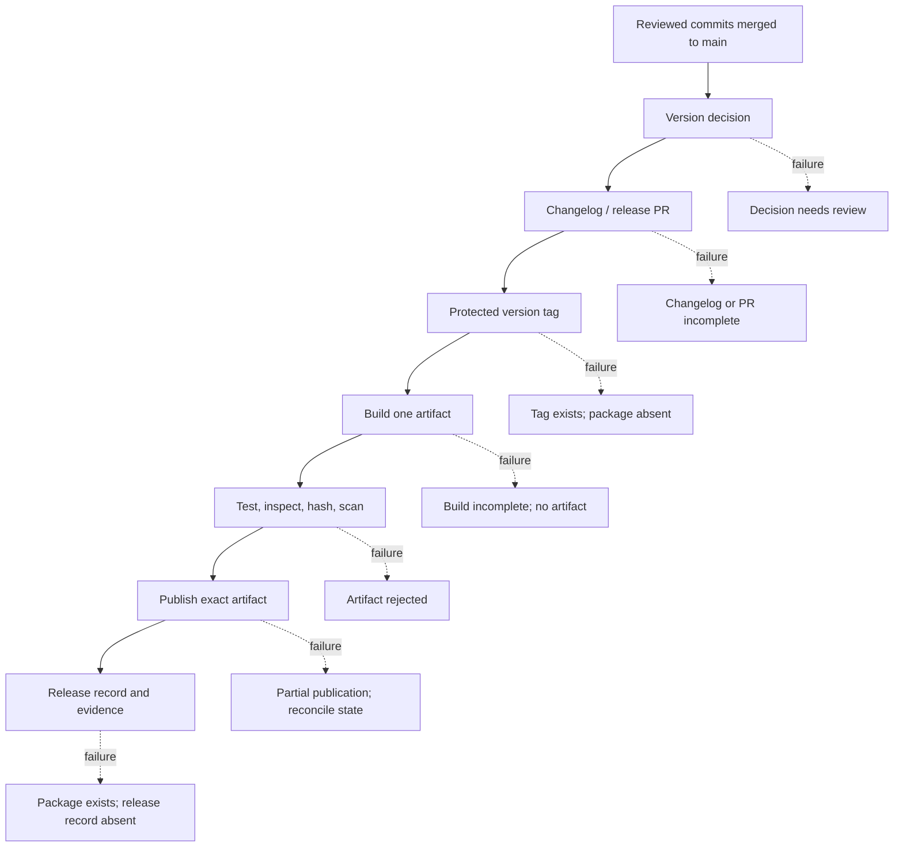
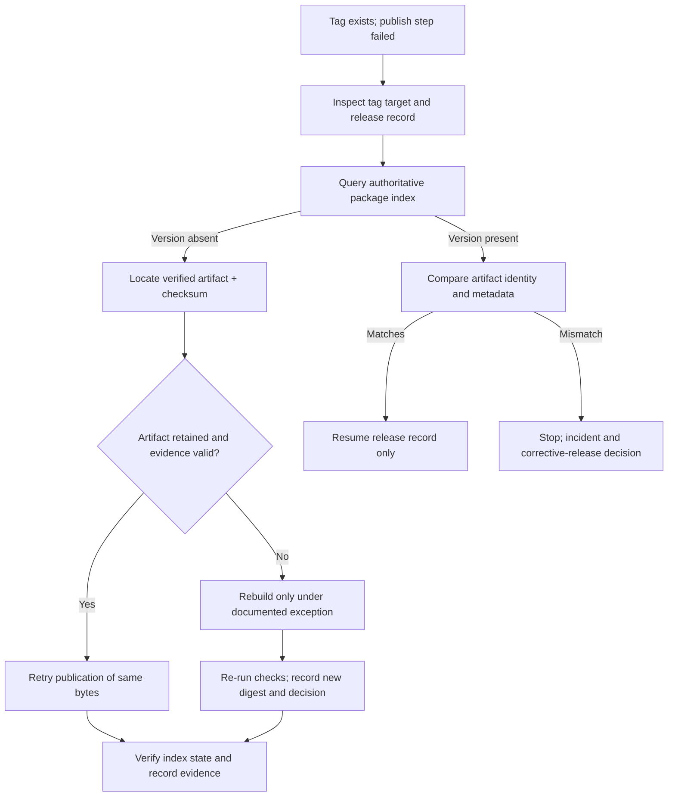

# Unit 8 — Semantic Versioning, Changelogs, and Release Automation

> A practical release-engineering lesson for Python services and packages: define version contracts, make release decisions reviewable, build reproducible evidence, and recover safely from partial publication.

**Module:** M02 — CI/CD Pipeline Engineering  
**Stage:** 2E — Production DevOps & Platform Engineering  
**Estimated time:** 10–14 hours, including labs and review  
**Prerequisites:** Git, Python packaging basics, M02 Units 1–7 concepts  
**Core tools:** Git, GitHub Actions, `pyproject.toml`, pytest, Python packaging/build tooling, Git tags, changelog files, release tooling  
**Awareness:** CalVer, `git-cliff`, `release-please`, `python-semantic-release`, `semantic-release`, `setuptools-scm`, `hatch-vcs`  
**Last reviewed:** 2026-10-24 (authoring date only; not a record of external documentation review)  
**Assumed tool baseline:** Python 3.11+, a recent Git, a recent `build` package, and GitHub Actions. Exact versions and current release-tool options must be verified against official documentation before adoption.  
**Content status:** `DRAFT-AUDITED` — human verification required.

## Table of contents

- [8.0 Why this matters in production](#80-why-this-matters-in-production)
- [8.1 Learning objectives](#81-learning-objectives)
- [8.2 Concept map and vocabulary](#82-concept-map-and-vocabulary)
- [8.3 Level 1 — Beginner](#83-level-1--beginner)
- [8.4 Level 2 — Intermediate](#84-level-2--intermediate)
- [8.5 Level 3 — Advanced](#85-level-3--advanced)
- [8.6 Level 4 — Expert](#86-level-4--expert)
- [8.7 SRE lens](#87-sre-lens)
- [8.8 Security lens](#88-security-lens)
- [8.9 Production checklist](#89-production-checklist)
- [8.10 Hands-on lab set](#810-hands-on-lab-set)
- [8.11 Self-check questions](#811-self-check-questions)
- [8.12 Evidence artifacts](#812-evidence-artifacts)
- [8.13 Common interview and design-review questions](#813-common-interview-and-design-review-questions)
- [8.14 Sources and verification notes](#814-sources-and-verification-notes)
- [Appendix A — Claim register](#appendix-a--claim-register)
- [Appendix B — Ten-pass audit](#appendix-b--ten-pass-audit)
- [Appendix C — Human verification checklist](#appendix-c--human-verification-checklist)
- [Appendix D — Limitations and sign-off](#appendix-d--limitations-and-sign-off)

---

## 8.0 Why this matters in production

A release is a controlled statement: “this exact source revision, packaged in this exact way, is the artifact consumers should use under this version.” If version numbers, tags, packages, and release notes disagree, operators lose the ability to tell what was actually shipped.

Imagine a Python FastAPI scoring service that depends on `risk-common`, a shared Python library. A release job creates Git tag `v1.4.2`, but the build step reads `1.4.1` from `pyproject.toml`; a later step uploads the wheel under a different version. Another consumer reads the changelog and assumes a bug fix is included, although the tag points to a commit before that fix. The system has multiple conflicting identities. Incident responders cannot confidently map a production deployment to source, and consumers cannot make safe upgrade decisions.

Release automation does not make these risks disappear. It makes the decision and its state transitions explicit, repeatable, and auditable. Good automation checks invariants before each irreversible step, avoids rebuilding a different artifact after publication, and provides a recovery path when a job stops halfway through.

The running example uses four independently versioned components:

- `risk-scoring-api`: a FastAPI service deployed as an OCI image.
- `risk-common`: a reusable Python library.
- `risk-etl`: a batch ETL package.
- `risk-eval`: a small ML evaluation job whose results are evidence about a model, not a replacement for a model registry or data lineage system.

These components may share a repository or live in separate repositories. A versioning policy must state which model applies to each component rather than assuming that one version scheme fits all artifacts.

---

## 8.1 Learning objectives

By the end of this unit, the learner can:

1. **Explain** SemVer major, minor, patch, prerelease, build metadata, and precedence rules. **[L1]**
2. **Create** a local Git history with Conventional Commits, an annotated tag, and a human-readable changelog. **[L1]**
3. **Configure and evaluate** a Python package version source in `pyproject.toml` or from Git tags, identifying the consequences of each choice. **[L2]**
4. **Compare** four release tools by their release model, source of truth, changelog workflow, and operational risks. **[L2]**
5. **Design** a secure release pipeline that tests, builds once, verifies, publishes only with explicit authorization, and retains artifact evidence. **[L3]**
6. **Defend** release-PR versus direct-release, prerelease, hotfix, backport, and monorepo versioning choices. **[L3]**
7. **Recover** a partial release without moving an already-published tag or claiming that an unpublished artifact exists. **[L4]**
8. **Validate** release invariants with a typed local script and use an audit trail to demonstrate what was released. **[L4]**

---

## 8.2 Concept map and vocabulary



A successful release is not one Boolean. It is a sequence of states with evidence. For example, a Git tag may exist while the package registry has no corresponding version. The correct recovery is to inspect the current state and resume the missing transition—not to blindly rerun the entire job.

| Term | Precise definition | Common misconception |
|---|---|---|
| Source commit | A Git commit object identifying a snapshot and parent history | “The commit is the package version.” |
| Git tag | A ref naming a Git object; annotated tags also store tag metadata and may be signed | “A tag is the same thing as a published package.” |
| Package version | Version metadata embedded in a distribution such as a wheel | “The Git tag always determines package metadata.” |
| Build | A process that transforms source and build inputs into artifacts | “Two builds of the same commit must be byte-identical.” |
| Artifact digest | A cryptographic hash of exact artifact bytes | “A matching version string proves identical contents.” |
| Release | A declared distribution event, often with notes and linked assets | “Creating a GitHub Release publishes a Python package automatically.” |
| Deployment | Running an artifact in an environment | “A successful release means production deployment succeeded.” |
| SemVer | A versioning specification for communicating public API compatibility | “SemVer alone proves behavior is backward compatible.” |
| Conventional Commit | A commit-message convention that conveys intent through structured prefixes | “The prefix automatically determines a safe release in every tool.” |
| Changelog | A curated record of notable user-facing changes | “A raw commit list is always a useful changelog.” |
| CalVer | A calendar-based version scheme | “CalVer is inherently less rigorous than SemVer.” |
| Yank | A registry-specific mechanism to discourage or prevent normal selection of a published release | “Yanking erases every copy already installed.” |
| Revert | A new change that counteracts an earlier change | “A revert removes the old artifact from consumers’ environments.” |
| Provenance | Evidence describing how an artifact was produced and from which inputs | “A checksum alone proves who built the artifact.” |

Acronyms: CI means continuous integration; CD means continuous delivery/deployment; SRE means site reliability engineering; OCI means Open Container Initiative; OIDC means OpenID Connect; SBOM means software bill of materials; SLI/SLO mean service-level indicator/objective.

---

## 8.3 Level 1 — Beginner

### SemVer 2.0.0: a compatibility promise

Semantic Versioning uses the shape `MAJOR.MINOR.PATCH`, such as `2.3.1`. The specification assumes a declared public API and a `0.y.z` development phase before the public API is considered stable. The important rules are:

- **PATCH** increments for backward-compatible bug fixes.
- **MINOR** increments for backward-compatible functionality additions.
- **MAJOR** increments for incompatible public API changes.
- A prerelease identifier, such as `2.4.0-rc.1`, communicates that the version is not final. Prereleases have lower precedence than the corresponding normal version.
- Build metadata, such as `2.4.0+build.17`, follows `+`. It does not affect SemVer precedence.
- Numeric prerelease identifiers are compared numerically; non-numeric identifiers are compared lexically under the specification’s rules. A numeric identifier has lower precedence than a non-numeric identifier when the compared identifiers differ in that way.
- A version with no prerelease identifier has higher precedence than its prerelease form. Thus `2.4.0-rc.1` is lower than `2.4.0`.
- Leading zeroes are not permitted in numeric major, minor, patch, or numeric prerelease identifiers (except the single digit `0`). Build metadata identifiers are treated differently by the specification.

A version number is a compatibility contract, not a proof. If a library changes a function’s required parameter or removes a documented public class, consumers may break even if the publisher labels it a patch. A release process can enforce declared rules, but only tests, API review, and consumer compatibility checks can provide evidence that the declaration is justified.

For a service, SemVer can describe API compatibility, but clients may also depend on latency, response fields, authentication behavior, and operational guarantees. For a data schema, the contract includes producers, consumers, and evolution rules. For an ML model, a version label does not encode evaluation quality, training data lineage, drift, or safety review.

### Version identity is not artifact identity

Keep these separate:

- `git commit`: source state.
- `v1.4.2`: a Git tag naming a commit by policy.
- `1.4.2`: package metadata inside the wheel.
- `risk_common-1.4.2-py3-none-any.whl`: a distribution filename.
- `sha256:...`: digest of exact bytes.
- GitHub Release: a release record, often associated with a tag and notes.
- Deployment record: which artifact digest was promoted to an environment.

Annotated tags include a tagger, date, message, and target object; they can also be signed. Lightweight tags are refs without that tag-object metadata. Annotated tags are usually preferable for release tags because they make intent and metadata explicit. The exact verification behavior of signed tags depends on the signing configuration and trust policy.

A released tag should be treated as immutable. Moving `v1.4.2` to a different commit can make source inspection disagree with artifacts already downloaded by consumers. If the release is wrong, publish a new corrective version or use a documented yank/revert strategy. Do not force-update a published version tag as a shortcut.

### Conventional Commits

Conventional Commits define a structured message convention. Common examples:

- `feat(api): add score explanation field`
- `fix(etl): preserve empty input partitions`
- `docs: clarify compatibility policy`
- `feat!: remove legacy response field`
- `fix(api): reject malformed payloads`

The `!` marker indicates a breaking change in the convention; a `BREAKING CHANGE:` footer can also communicate one. Tool behavior varies: a release tool may parse a subset of the convention or apply configurable rules. A message such as `updates` is ambiguous; `fix: stuff` has a prefix but poor explanatory value; `feat: remove field` is internally inconsistent unless the breaking nature is clearly declared and reviewed.

A commit convention is input to a decision, not an authorization mechanism. Reviewers must still decide whether a change is actually breaking and whether the public compatibility contract applies to the component.

### Keep a Changelog

A useful changelog is written for people deciding whether to upgrade. The Keep a Changelog convention commonly groups changes under headings such as `Added`, `Changed`, `Deprecated`, `Removed`, `Fixed`, and `Security`, and keeps an `Unreleased` section for work not yet released. The project should explain which categories it uses.

Good entry: “Fixed score requests with an empty optional feature list; the API now returns a valid response rather than a server error.”

Weak entry: “Fix bug.”

The first explains the affected behavior and the user-visible result. Changelogs should not expose secrets, internal incident details that are not approved for disclosure, or raw implementation noise. Security-sensitive releases may require a coordinated disclosure policy.

### Guided local lab: manual release

Use a disposable directory. Commands below are examples; expected output is representative, not observed execution.

```bash
# File: terminal
set -euo pipefail
mkdir semver-lab
cd semver-lab
git init
git config user.name "Release Lab"
git config user.email "release-lab@example.invalid"
mkdir -p src/risk_common tests
```

**Example — yours will differ**

```text
Initialized empty Git repository in .../semver-lab/.git/
```

Interpretation: the lab repository is isolated from your real project. On WSL2, paths may appear under `/mnt/c/...` or a Linux home directory; use a Linux filesystem for fewer cross-filesystem permission surprises.

```bash
# File: terminal
cat > src/risk_common/__init__.py <<'PY'
__version__ = "0.1.0"

def normalize_score(value: float) -> float:
    """Clamp a score into the closed interval [0, 1]."""
    return min(1.0, max(0.0, value))
PY
cat > tests/test_score.py <<'PY'
from risk_common import normalize_score

def test_normalize_score_clamps_values() -> None:
    assert normalize_score(-2.0) == 0.0
    assert normalize_score(0.5) == 0.5
    assert normalize_score(2.0) == 1.0
PY
cat > CHANGELOG.md <<'MD'
# Changelog

All notable changes to this project are documented here.

## [Unreleased]

### Added
- Initial score-normalization helper and unit tests.
MD
git add .
git commit -m "feat: add score normalization helper"
git tag -a v0.1.0 -m "Release risk-common 0.1.0"
git log --oneline --decorate
git show --no-patch --format=fuller v0.1.0
```

**Example — yours will differ**

```text
<commit-id> (HEAD -> main, tag: v0.1.0) feat: add score normalization helper
tag v0.1.0
Tagger: Release Lab <release-lab@example.invalid>
...
    Release risk-common 0.1.0
```

Interpretation: the tag points to a commit and the annotated tag contains release metadata. The commit ID will differ.

Run the test with a local import path:

```bash
# File: terminal
PYTHONPATH=src python -m pytest -q
git status --short
git tag --list
```

**Example — yours will differ**

```text
1 passed
v0.1.0
```

Interpretation: the local behavior is tested and the tag exists. This is not yet a built or published package.

**What just happened?** You created source, a test, a human-readable changelog, a commit, and an annotated tag. You have not demonstrated that a distributable wheel builds, that its metadata agrees with the tag, or that any registry contains it.

### Beginner mistakes → symptom → fix

| Mistake | Symptom | Fix |
|---|---|---|
| Tag created before the intended fix was committed | Tag points to old code | Inspect `git show <tag>` and release a new version if already published |
| Changelog says “all fixes” without specifics | Consumer cannot judge upgrade impact | Describe behavior and affected surface |
| Version in package metadata differs from tag | Install metadata and Git history disagree | Add an invariant check before publication |
| Lightweight release tag with no message | Weak release intent and audit metadata | Prefer annotated tags under the repository’s release policy |
| Treating `2.0.0-rc.1` as stable | Prerelease is selected or deployed unintentionally | Use explicit prerelease policy and stable-release gates |
| Reusing a published version | Registry rejects upload or consumers see conflicting provenance | Increment version; never overwrite immutable release identity |

---

## 8.4 Level 2 — Intermediate

### Minimal Python package

The following is a minimal example using a version stored in `pyproject.toml`. It is illustrative and uses a common PEP 621 project metadata shape. Confirm the current packaging backend and supported Python versions before using it in a real repository.

```toml
# File: pyproject.toml
[build-system]
requires = ["setuptools>=68", "wheel"]
build-backend = "setuptools.build_meta"

[project]
name = "risk-common"
version = "0.1.0"
description = "Shared utilities for risk scoring examples"
requires-python = ">=3.11"
dependencies = []

[project.optional-dependencies]
test = ["pytest"]

[tool.pytest.ini_options]
testpaths = ["tests"]
```

```python
# File: src/risk_common/__init__.py
def normalize_score(value: float) -> float:
    """Clamp a score into [0, 1]."""
    return min(1.0, max(0.0, value))
```

```python
# File: tests/test_score.py
from risk_common import normalize_score

def test_clamps_low_and_high_values() -> None:
    assert normalize_score(-1.0) == 0.0
    assert normalize_score(0.4) == 0.4
    assert normalize_score(2.0) == 1.0
```

```text
# File: CHANGELOG.md
# Changelog

## [Unreleased]

### Added
- Add a score-normalization helper for callers that require values in [0, 1].
```

Build tooling can create a source distribution and wheel from this package. In a real lab, install `build` and pytest in a virtual environment first, then run:

```bash
# File: terminal
python -m pip install build pytest
python -m pytest -q
python -m build
python -m pip install --force-reinstall dist/risk_common-0.1.0-py3-none-any.whl
python -m pip show risk-common
sha256sum dist/*
```

**Example — yours will differ**

```text
2 passed
Successfully built ...
Name: risk-common
Version: 0.1.0
<sha256>  dist/risk_common-0.1.0-py3-none-any.whl
```

Interpretation: the package can be built and its metadata inspected locally. The output and wheel tag depend on the environment and build backend. Do not infer reproducibility merely because a build succeeded once.

### Where should the version live?

| Model | Mechanism | Benefits | Risks / costs | Best fit |
|---|---|---|---|---|
| Static version in `pyproject.toml` | `version = "1.2.3"` | Obvious source of truth; simple for learners and release PRs | Automation must update the file and keep tag/changelog in sync | Small package, release PR model |
| Dynamic version from Git tags | `setuptools-scm` or `hatch-vcs` configured as a dynamic version source | Less duplicated version editing; tag can drive package version | Builds from archives or shallow clones may lack tag context; config and fallback behavior are tool-specific | Tag-driven package releases |
| Generated version file | Build hook or tool writes version during build | Can expose version at runtime | Risk of source tree mutation or metadata mismatch | Use only with clear build design |
| Service deployment identifier | Version plus commit/digest in deployment metadata | Maps running service to source and image | A single semantic version may not identify the exact artifact | Services and containers |

`setuptools-scm` and `hatch-vcs` have different configuration and fallback semantics. **[VERSION-SENSITIVE]** Verify current official documentation for the installed version, shallow clone behavior, local version strings, archive builds, and CI checkout depth. Do not configure a tag-derived version and also hard-code a competing version without understanding which value wins.

### Commit linting: useful, limited control

A commit-message linter can reject malformed messages before merge. Options include `commitlint` and ecosystem-specific plugins. **[VERIFY]** Check the current package installation instructions and supported config formats for the chosen tool. A linter can validate shape; it cannot reliably infer whether a change is truly breaking, whether a feature is user-visible, or whether the change warrants a major version. A team may lint pull request titles, squash-merge messages, or individual commits; choose the exact policy deliberately.

### Human changelog vs generated notes

| Approach | Strength | Risk | Good use |
|---|---|---|---|
| Human-maintained Keep a Changelog | Curated, understandable, can include migration guidance | Requires discipline; can be forgotten | Small libraries, service APIs, security/deprecation notes |
| Commit-derived changelog (`git-cliff` or similar) | Repeatable, fast, useful for structured histories | Output quality depends on commit quality and parser rules | Repositories with enforced commit conventions |
| Release PR tool (`release-please`) | Version/changelog proposal can be reviewed before release | Adds PR state and bot permissions to manage | Teams requiring reviewable release intent |
| Direct release automation | Fewer manual steps; fast delivery | A bad rule may publish without a human reviewing the generated narrative | Mature repositories with strong tests and governance |

These are not interchangeable product models. Tool capabilities, supported ecosystems, action inputs, and defaults change. Treat all rows below as an initial selection guide and verify current official documentation before pinning a workflow.

| Tool | Release model | Version source | Changelog behavior | PR/tag behavior | Strengths | Costs / risks | Best fit / `[VERIFY]` notes |
|---|---|---|---|---|---|---|---|
| `git-cliff` | Changelog generator; can be used inside a custom release process | Usually Git history/tags plus configuration | Generates notes from conventional or custom parsers | Does not by itself imply a complete publish lifecycle | Flexible generation, useful locally and in CI | You must design version selection, tagging, publishing, and recovery around it | Best when the team wants control. **[VERIFY]** current CLI options and config schema in official docs |
| `release-please` | Release PR / manifest-oriented workflow | Commit history and tool-managed release state; configuration can vary | Updates changelog/version files in a PR | Typically proposes release PRs and creates release/tag artifacts as part of its lifecycle | Human review before release; supports coordinated release practices | Bot permissions, PR backlog, manifest configuration and merge semantics add operational state | Best when reviewable release intent matters. **[VERIFY]** current action inputs, manifest mode, permissions, and release behavior |
| `python-semantic-release` | Python-focused versioning and release automation | Conventional Commit parsing plus project configuration; exact behavior depends on version/config | Can update configured version/changelog files | May create tags/releases and publish through configured providers | Python packaging integration | Version-specific config, plugin behavior, and publishing credentials need careful testing | Best when Python project conventions match its model. **[VERIFY]** current supported configuration and CLI |
| `semantic-release` | Plugin-based automated release lifecycle, historically popular in JavaScript ecosystems | Commit analysis and plugins/config | Plugin-driven release notes and changelog updates | Can publish and create releases according to configured plugins | Extensible lifecycle | Ecosystem assumptions and plugin chain may not suit Python packaging without deliberate integration | Best for repositories whose ecosystem and plugins are supported. **[VERIFY]** current core/plugin compatibility and Python publication path |

### Transparent local release-decision script

This script is intentionally a small, explicit policy example, not a clone of any release tool. It reads a supplied list of Conventional Commit subjects and computes a candidate version from a base version. It does not tag, push, build, or publish. Its simplified rules are: breaking change → major; otherwise `feat` → minor; otherwise `fix` or `perf` → patch; other types do not trigger a version increment. It treats `0.y.z` using the same arithmetic for demonstration; a real project must document whether pre-1.0 changes follow a different policy.

```python
# File: release_decision.py
from __future__ import annotations

import re
from dataclasses import dataclass
from typing import Iterable

VERSION_RE = re.compile(r"^(0|[1-9]\d*)\.(0|[1-9]\d*)\.(0|[1-9]\d*)$")

@dataclass(frozen=True)
class Change:
    subject: str
    kind: str
    breaking: bool

def parse_version(value: str) -> tuple[int, int, int]:
    match = VERSION_RE.fullmatch(value)
    if not match:
        raise ValueError(f"Expected stable MAJOR.MINOR.PATCH, got {value!r}")
    return tuple(int(part) for part in match.groups())  # type: ignore[return-value]

def parse_commit(subject: str) -> Change:
    match = re.match(
        r"^(?P<kind>[a-z]+)(?:\([^)]+\))?(?P<bang>!)?: .+$",
        subject,
    )
    if not match:
        raise ValueError(f"Invalid Conventional Commit subject: {subject!r}")
    return Change(subject, match.group("kind"), bool(match.group("bang")))

def next_version(base: str, subjects: Iterable[str]) -> str:
    major, minor, patch = parse_version(base)
    changes = [parse_commit(subject) for subject in subjects]
    if any(change.breaking for change in changes):
        major, minor, patch = major + 1, 0, 0
    elif any(change.kind == "feat" for change in changes):
        major, minor, patch = major, minor + 1, 0
    elif any(change.kind in {"fix", "perf"} for change in changes):
        major, minor, patch = major, minor, patch + 1
    return f"{major}.{minor}.{patch}"

if __name__ == "__main__":
    history = [
        "fix(api): reject invalid score payload",
        "feat(api): include score explanation",
        "docs: clarify response contract",
    ]
    print(next_version("1.4.1", history))
```

```python
# File: test_release_decision.py
import pytest
from release_decision import next_version

def test_feature_takes_minor_precedence_over_patch() -> None:
    assert next_version("1.4.1", [
        "fix(api): reject invalid payload",
        "feat(api): add explanation",
    ]) == "1.5.0"

def test_breaking_change_takes_major_precedence() -> None:
    assert next_version("1.4.1", [
        "feat!: remove old response field",
        "fix: correct score rounding",
    ]) == "2.0.0"

def test_invalid_subject_fails_closed() -> None:
    with pytest.raises(ValueError):
        next_version("1.4.1", ["updates"])
```

```bash
# File: terminal
python release_decision.py
python -m pytest -q
```

**Example — yours will differ**

```text
1.5.0
3 passed
```

Interpretation: a feature produces a minor candidate under this explicitly stated policy. The script deliberately does not parse `BREAKING CHANGE:` footers, prerelease identifiers, merge commits, or component-specific histories; those are limitations, not hidden features. Use a maintained release tool or expand and test the policy before production adoption.

### Pattern catalogue

| Pattern | When to use | When not to use |
|---|---|---|
| Release PR with version/changelog diff | Human review and traceability are important | Extremely frequent releases where the PR queue becomes a bottleneck without automation |
| Direct release after protected-main merge | Mature tests, deterministic policy, fast patch delivery | Release notes or compatibility decisions require human approval |
| Tag-derived package version | Git tags are reliably present in all build contexts | Source archives or shallow CI checkouts cannot provide needed tag metadata |
| Human changelog plus generated draft | User-facing nuance matters and commit history is structured | Team will not maintain either source and output becomes contradictory |
| Separate version per monorepo component | Components have independent APIs and consumers | Components are inseparable and always released as one unit |
| CalVer (for example, `2026.10`) | Time-based cadence, compatibility not naturally expressed by SemVer, date-based datasets | Consumers need the version itself to communicate compatibility without another policy |

### Anti-pattern catalogue

| Bad example | Why it hurts | Corrected approach |
|---|---|---|
| `v1.4.2` tag but package metadata says `1.4.1` | Tag and artifact identity disagree | Validate metadata and tag before publication |
| Build wheel, then rebuild after upload failure and publish the new wheel | Rebuild may differ due to timestamps, environment or dependencies | Retain and retry publication of the original verified artifact |
| “Release all commits since last tag” as the only notes | Internal refactors and noise obscure consumer impact | Curate user-facing notes and migration guidance |
| Publish from every pull request | Untrusted code may access secrets or create public artifacts | Build/test PRs with no publish credentials; publish only from protected release context |
| Force-move a published tag | Consumers and evidence now disagree about what the tag identifies | Create a new corrective version and document the incident |
| Use commit prefix as sole compatibility test | A `fix:` can still break an API | Combine policy, review, tests, and explicit breaking-change analysis |

### Lab: derive version, changelog and tag from a scripted history

In a throwaway repo, use the following history as a policy exercise:

1. `fix(etl): preserve empty partitions`
2. `feat(api): add explanation field`
3. `docs: clarify response example`
4. `perf(common): avoid repeated schema parsing`

Starting from `1.4.1`, the simplified script selects `1.5.0`: `feat` requires a minor increment, which subsumes patch changes in this release. `docs` does not trigger a version increment under this policy. The team must still decide whether `perf` is release-worthy and whether it belongs to the same component. If these commits belong to independently versioned packages in a monorepo, do not compute one version from the entire repository history.

A generated changelog draft might say:

```markdown
# Changelog

## [1.5.0] - YYYY-MM-DD

### Added
- Add an explanation field to the scoring API response.

### Fixed
- Preserve empty partitions in ETL inputs.

### Performance
- Reduce repeated schema parsing in the shared library.
```

`YYYY-MM-DD` is intentionally not filled with a fabricated release date. The notes must be split by component if each component has an independent version. The tag would be `v1.5.0` only if the repository policy uses a `v` prefix and the tag is created after the intended changelog/version change is committed.

---

## 8.5 Level 3 — Advanced

### The production release flow

A robust flow separates decision, artifact creation, publication, and deployment:

1. **Merge to protected `main`.** CI validates code and policy. The release workflow must not run with publication authority on untrusted pull-request code.
2. **Determine the candidate version.** Parse the relevant commits or use reviewed release metadata. Confirm the target component and compatibility decision.
3. **Prepare changelog and version metadata.** Use a release PR or a direct update, depending on the chosen model. Run tests against the exact candidate.
4. **Create a protected tag.** The tag must identify the source commit that the release claims to represent. Confirm it does not already exist.
5. **Build once.** Build the wheel, source distribution, or OCI image once in a controlled job. Record the source commit and build environment.
6. **Verify.** Run tests, inspect package metadata, calculate checksums, scan dependencies/artifacts, and produce evidence. A passing scan is not a proof of safety.
7. **Publish the exact verified artifact.** Upload the artifact already built and hashed. Avoid a second build in the publish job.
8. **Create the release record.** Attach accurate notes and the artifact/checksum evidence. A GitHub Release record and package-index upload are distinct operations.
9. **Request deployment/promotion.** Pass the immutable image digest or package identity to the deployment workflow. Full GitOps reconciliation and progressive delivery are covered elsewhere (M08); do not conflate release publication with production rollout.

```mermaid
stateDiagram-v2
    [*] --> Candidate
    Candidate --> Reviewed: version/changelog approved
    Reviewed --> Tagged: tag matches commit
    Tagged --> Built: artifact produced once
    Built --> Verified: tests + metadata + digest
    Verified --> Published: explicit publish authority
    Published --> Recorded: release evidence attached
    Recorded --> Promotable: deployment request created
    Tagged --> Recovery: build/publish fails
    Built --> Recovery: verification fails
    Published --> Recovery: release record fails
    Recovery --> Tagged: artifact absent; resume build only if no artifact was accepted
    Recovery --> Verified: verified artifact retained; resume publication
    Recovery --> Published: package exists; resume release record
```



The recovery arrows are illustrative state categories, not a complete tool implementation. In real automation, store state in durable records and inspect the package index/provider before retrying.

### Release PR versus direct release

| Option | Benefit | Cost | Risk | Choose when |
|---|---|---|---|---|
| Release PR | Version and changelog are visible for review; change is auditable before tag | Extra PR state and possible merge delay | Stale release PR or conflict if new commits land | Human approval of release notes/compatibility matters |
| Direct release | Fast, fewer manual steps | Review happens through policy and workflow rather than a dedicated diff | Bad release rules can act immediately | Strong tests, protected branch, and mature policy exist |
| Manual tag + manual publish | Simple initial learning path | Human error, poor repeatability, incomplete evidence | Tag, build, and upload can drift | Emergency fallback only with documented checklist |
| Scheduled release train | Predictable cadence and grouped changes | Changes wait for the train; coordination overhead | Large batch increases blast radius | Multiple teams coordinate releases |

### Prerelease channels

Examples: `1.5.0-alpha.1`, `1.5.0-beta.2`, and `1.5.0-rc.1`. SemVer precedence places prereleases below `1.5.0`. The labels are conventions; SemVer does not prescribe the quality bar for alpha, beta, or release candidate. Define entry/exit criteria, test environments, allowed consumers, and how promotion occurs.

Do not publish `1.5.0-rc.1` under a stable version alias or allow a workflow to strip prerelease metadata silently. A stable `1.5.0` should be built and verified according to the stable release policy. If the team promotes the exact same artifact from prerelease to stable, document whether package metadata can legally and technically remain unchanged; in typical Python packaging, the distribution version is part of the artifact identity, so changing from `rc` to stable generally means a distinct distribution build. **[VERIFY]** Confirm package-index and tooling behavior for the ecosystem you use.

### Hotfixes, backports, and maintained branches

A hotfix is a targeted correction to a released line. A backport applies a change to an older maintained branch. Example: `main` is at `2.3.0`, while customers still receive `1.9.x`. A security fix may be merged to `main` and cherry-picked or otherwise applied to the maintained `1.9` branch, producing `1.9.7` if that is the next valid patch. The fix must be tested against the older line because APIs and dependencies may differ.

Policy must state:
- which branches are maintained and for how long;
- who approves backports;
- whether the change is cherry-picked or reimplemented;
- how conflicts and equivalent changes are documented;
- which version line is released;
- whether the release is supported or merely an emergency exception.

Avoid assuming that cherry-picking preserves identical commit hashes. It normally creates a different commit object because parent history differs. Track the original change reference in the commit message or pull request.

### Version semantics by artifact type

| Artifact | What version should communicate | Additional identity/evidence | Limits of SemVer |
|---|---|---|---|
| FastAPI service | Public endpoint and behavior compatibility | OCI image digest, source commit, API schema, deployment environment | Operational behavior, latency, auth and data semantics may break without schema changes |
| Shared Python library | Public API compatibility and supported runtime range | Wheel metadata, dependency constraints, tests, hashes | Consumers may rely on undocumented behavior; compatibility must be tested |
| ETL package | CLI/config compatibility and output contract | Input/output schema versions, job config, data contract tests | Output data meaning may change even if Python API is stable |
| Data schema/contract | Producer-consumer compatibility and evolution | Schema ID, compatibility mode, migration plan, data validation | A numeric SemVer alone cannot prove historical data remains readable |
| ML model/evaluation job | Model/evaluation artifact lineage and intended use | Model registry ID, training dataset/version, code commit, metrics, evaluation report | Model quality, fairness, calibration, drift and safety need separate evidence |

For ML artifacts, version the model artifact and evaluation protocol explicitly. Preserve training data references and evaluation metrics; do not treat `model-v3.2.0` as proof that it is better than `v3.1.0`.

### Secure release jobs and build-once integrity

A release workflow should use narrowly scoped `permissions`. Read-only test jobs usually need much less authority than a job that creates tags or publishes packages. Separate build/test authority from publication authority where practical. Require protected branches and tag rules; use environment approvals if the repository’s risk model warrants them. For identity and short-lived credentials, see M09. For signing, provenance, and supply-chain controls, see M12. Exact GitHub settings, environment behavior, token permissions, and action syntax are **[VERIFY]** against current GitHub documentation and the repository’s plan.

An illustrative workflow skeleton is below; it is not a complete production workflow and intentionally has no publishing step or action SHA. Pin third-party actions to verified full commit SHAs in real use, and review each action’s code and permissions.

```yaml
# File: .github/workflows/release-check.yml
name: Release checks

on:
  push:
    branches: ["main"]
  workflow_dispatch:

permissions:
  contents: read

jobs:
  verify:
    runs-on: ubuntu-latest
    steps:
      - name: Check out source
        uses: actions/checkout@<VERIFIED_FULL_COMMIT_SHA>
        with:
          fetch-depth: 0
      - name: Set up Python
        uses: actions/setup-python@<VERIFIED_FULL_COMMIT_SHA>
        with:
          python-version: "3.11"
      - name: Run tests
        run: |
          python -m pip install --upgrade pip
          python -m pip install pytest build
          python -m pytest -q
          python -m build
```

**[VERIFY]** Replace the illustrative action references only after verifying official action repositories, full commit SHAs, and current supported inputs. The angle-bracket values are deliberate teaching markers, not valid references. This skeleton is not runnable until verified action references are substituted. A real release pipeline must also validate tag/version agreement, inspect artifacts, calculate hashes, and publish only after explicit authorization.

Build-once behavior matters because the source commit alone may not fully determine artifact bytes: build backend versions, dependency resolution, timestamps, environment variables, generated files, and external downloads can change output. Preserve the built artifact between verification and publication. For containers, retain the immutable digest from M01 rather than promoting a mutable tag alone. A checksum detects byte changes only if the checksum record is trustworthy; provenance/signatures add other evidence but still require a trust policy.

### Idempotent and resumable release state

Idempotency means retrying an operation does not create unintended additional effects. Not every release action is naturally idempotent. Define the state and preconditions before retrying.

| State reached | Safe retry behavior | Do not do |
|---|---|---|
| Version selected | Recompute only if source history/config has not changed; record decision inputs | Silently select a different version on retry |
| Changelog prepared | Compare expected diff and commit state; regenerate only from the same inputs or review changes | Append the same notes twice |
| Tag created | Verify tag target and tag object; if correct, resume downstream work | Move or force-update the tag |
| Artifact built | Reuse retained artifact and verify checksum | Rebuild and assume identical bytes |
| Artifact verified | Revalidate stored digest and evidence references | Publish a different file with the same version |
| Package published | Query the authoritative index for the version and compare artifact identity where possible | Re-upload blindly or assume a timeout means failure |
| Release record created | Inspect record and linked assets before retrying | Create duplicate records or overwrite notes without review |

A release controller should maintain a durable record keyed by component and version, with source commit, tag, build run, artifact filename, checksum, verification result, publication state, release record, and operator actions. The record must distinguish “request timed out” from “provider confirmed rejection.” Network timeouts often leave the remote outcome uncertain.

### Measurement

Track at least:
- release success ratio = successful releases / eligible release attempts;
- merge-to-release time, reported as p50 and p95;
- partial-release incidents per release attempt;
- median and p95 manual recovery time;
- rollback, yank, or corrective-release rate;
- manual intervention rate.

Define numerator, denominator, and time window. A repository with two releases and two successes has a 100% ratio but little evidence of long-term reliability. Separate retries from distinct release attempts, and avoid counting a release as successful before required evidence is present. A successful package upload followed by a failed release-record step may be “published but incompletely recorded,” not a fully successful release.

### Lab: defend a design decision

Choose release PR or direct release for `risk-common`, which has external consumers and needs migration notes. Write a one-page ADR (architecture decision record) covering review latency, rollback limitations, publication credentials, tag immutability, release-note quality, and how you will recover from “tag exists, package absent.” Include at least one rejected alternative and a measurable success criterion. A defensible choice is more important than selecting one universally correct model.

---

## 8.6 Level 4 — Expert

### Failure scenario: tag pushed, publication failed

**Symptom:** `v1.5.0` exists in Git, but the package index does not show `risk-common==1.5.0`. The release job failed during upload or timed out.

**Hypotheses:**
1. The upload was rejected before the package was accepted.
2. The package was accepted, but the client lost the response.
3. The credential expired or lacked permission.
4. The artifact metadata/version did not match the intended release.
5. The artifact was built but not retained between jobs.
6. The index has delayed visibility or a provider-specific processing state.

**Tests:** inspect the tag target, workflow logs, artifact retention, package metadata, checksums, and authoritative index state. Use read-only inspection before any mutation.

```bash
# File: terminal
git show --no-patch --format=fuller v1.5.0
git rev-parse v1.5.0^{commit}
git status --short
git tag --list 'v1.5.0'
```

**Example — yours will differ**

```text
<commit-id>
v1.5.0
```

Interpretation: this verifies local Git state only. It does not prove that the package was published or that the tag on a remote matches local state.

For a private test index, query the index using its documented client/API. Do not assume a universal package-index query command; provider APIs and auth methods differ. **[VERIFY]** Use the selected index’s official documentation. If the version is present, compare the uploaded artifact’s digest if the provider exposes sufficient evidence. If absent, locate the original verified wheel and checksum. If the artifact was never built or retained, decide whether a rebuild is acceptable under policy; record the reason and new digest. Do not pretend the original artifact was published.



### State-aware recovery runbook

1. **Freeze automated retries.** Disable or pause only the affected release path if it could create more side effects. Do not disable unrelated CI without reason.
2. **Read the evidence.** Record repository, component, intended version, tag commit, workflow run, package-index state, artifact name, digest, and timestamp.
3. **Classify the state.** Is the tag present? Is the exact artifact retained? Does the package exist? Does the release record exist?
4. **Check consistency.** Tag target, package metadata, changelog version, artifact digest, and release record must agree.
5. **Choose the smallest safe next transition.** If no package exists and the verified artifact is retained, retry publishing that artifact. If the package exists and matches, resume release-record creation. If a conflicting version exists, stop and escalate.
6. **Preserve the original tag.** Never move a published tag as a routine repair. If the tag points to the wrong commit, treat it as an incident; publish a new corrective version and clearly document the bad release.
7. **Verify externally.** Confirm the authoritative package index and release record reflect the intended state. Retain the evidence.
8. **Close the incident.** Document root cause, customer impact, corrective actions, owner, and a regression test or invariant.

### Other partial-release scenarios

- **Package published, release record failed:** query the index first, verify the artifact identity, then create or repair the release record without republishing.
- **Tag points to the wrong commit:** stop. Compare the target with the reviewed release commit. If already consumed, do not force-move the tag; issue a corrective release with an explicit note and evaluate whether to yank the bad package.
- **Changelog incomplete:** do not rewrite historical facts silently. If not published, correct the release PR before tagging. If published, add a documented correction or new release note according to policy.
- **Version already occupied:** inspect whether it is the expected artifact. Do not overwrite or attempt to “free” the version by deleting history. Select the next version or use the index’s documented correction process.
- **Credentials expire:** rotate/renew through the approved secret or identity flow, check audit logs, and retry only after confirming whether the previous request took effect. Never print the credential to diagnose it.
- **Workflow interrupted:** inspect the durable release record and provider state. Resume from the last verified state, not merely from the last green job step.

### Revert, yank, and delete

A **revert** is a new source change that counteracts a previous change. It does not remove the earlier package from users’ environments. A **yank** is a package-index-specific signal that a release should generally not be selected for new installs, while preserving some ability to resolve it explicitly; exact behavior varies by index and client. **[VERIFY]** Consult the target index’s official policy, especially for dependency resolution and security response. **Delete** removes a record or file where the provider permits it, but may be restricted and cannot erase copies already downloaded, cached, mirrored, or vendored. Do not assume that deletion is allowed or that it restores the version number for reuse.

A safer general policy is: preserve evidence, stop new promotion, assess whether yanking is appropriate, publish a corrective version, notify affected consumers where necessary, and record the decision. Public registry behavior must be verified before operational use.

### Monorepo versioning

In a monorepo, each component may have independent tags and changelogs, such as `risk-common-v1.5.0` and `risk-etl-v0.8.4`, or the repository may release all components under one version. Independent versioning reduces unnecessary upgrades but requires path-aware change classification, dependency graph analysis, and component-specific histories. Fixed/lockstep versioning simplifies coordinated releases but can create version churn. See M02 Unit 5, *Monorepo and Path-Based Pipelines*, using a relative link only if the file exists in the repository: `../05-monorepo-and-path-based-pipelines.md`.

A path filter alone is not sufficient: a shared utility change may affect downstream packages that do not live in the changed directory. Use a dependency graph and tests for affected dependents. For large repositories, release trains may coordinate components, while independent releases allow each component to move when ready. Both need ownership and compatibility rules.

### Expert release review checklist

- [ ] Version candidate is derived from the correct component history and reviewed policy.
- [ ] Breaking changes are documented and compatibility tests cover supported consumers.
- [ ] Changelog includes migration/deprecation/security notes as appropriate.
- [ ] Tag points to the reviewed source commit and is protected against unauthorized updates.
- [ ] Package metadata matches the intended version.
- [ ] Build inputs and artifact digest are recorded; the verified artifact is the one published.
- [ ] Release permissions are least-privilege and limited to trusted contexts.
- [ ] Existing tag, package, and release record states are checked before retry.
- [ ] Recovery instructions are state-aware and have an owner.
- [ ] Evidence includes source commit, workflow run, checksums, scan/test results, publication status, and release notes.
- [ ] Exceptions are approved, time-bounded, and recorded with a follow-up action.

### Exception policy and audit trail

An exception should record: the invariant that could not be met, business reason, affected component/version, risk assessment, approving owner, compensating control, expiry/review date, and follow-up issue. “Urgent” is not a permanent bypass. The audit trail should be append-oriented: retain workflow run links, tag object/commit, artifact checksums, release decision inputs, approval identity, package index outcome, and recovery actions. Do not store secrets in the audit trail.

### Runnable release invariant validator

This script validates local repository conditions that can be checked without publishing: clean worktree, tag existence and target, a matching `pyproject.toml` version, a version heading in the changelog, and an optional artifact checksum. It is not a complete correctness proof. It requires Python 3.11+ and Git. It reads the local checkout and never pushes or publishes.

```python
# File: validate_release.py
from __future__ import annotations

import argparse
import hashlib
import re
import subprocess
import sys
import tomllib
from pathlib import Path

def run_git(*args: str) -> str:
    result = subprocess.run(
        ["git", *args], check=True, capture_output=True, text=True
    )
    return result.stdout.strip()

def sha256_file(path: Path) -> str:
    digest = hashlib.sha256()
    with path.open("rb") as stream:
        for chunk in iter(lambda: stream.read(1024 * 1024), b""):
            digest.update(chunk)
    return digest.hexdigest()

def main() -> int:
    parser = argparse.ArgumentParser()
    parser.add_argument("--tag", required=True, help="Expected release tag, e.g. v1.5.0")
    parser.add_argument("--project", type=Path, default=Path("pyproject.toml"))
    parser.add_argument("--changelog", type=Path, default=Path("CHANGELOG.md"))
    parser.add_argument("--artifact", type=Path)
    parser.add_argument("--expected-sha256")
    args = parser.parse_args()

    failures: list[str] = []
    if run_git("status", "--porcelain"):
        failures.append("working tree is not clean")

    try:
        tag_commit = run_git("rev-parse", f"{args.tag}^{{commit}}")
    except subprocess.CalledProcessError:
        failures.append(f"tag {args.tag!r} does not resolve to a commit")
        tag_commit = ""

    try:
        with args.project.open("rb") as stream:
            project_data = tomllib.load(stream)
        version = project_data["project"]["version"]
        expected_tag = f"v{version}"
        if args.tag != expected_tag:
            failures.append(f"tag {args.tag!r} != expected {expected_tag!r}")
    except (OSError, KeyError, TypeError, tomllib.TOMLDecodeError) as exc:
        failures.append(f"cannot read static project version: {exc}")
        version = ""

    try:
        changelog = args.changelog.read_text(encoding="utf-8")
        if version and not re.search(
            rf"^## \[{re.escape(version)}\](?:\s|$)", changelog, re.MULTILINE
        ):
            failures.append(f"changelog has no heading for version {version}")
    except OSError as exc:
        failures.append(f"cannot read changelog: {exc}")

    if args.artifact:
        if not args.artifact.is_file():
            failures.append(f"artifact not found: {args.artifact}")
        elif args.expected_sha256:
            actual = sha256_file(args.artifact)
            if actual.lower() != args.expected_sha256.lower():
                failures.append("artifact checksum does not match expected SHA-256")

    if failures:
        print("FAIL")
        for failure in failures:
            print(f"- {failure}")
        return 1

    print(f"PASS tag={args.tag} commit={tag_commit} version={version}")
    if args.artifact:
        print(f"artifact_sha256={sha256_file(args.artifact)}")
    return 0

if __name__ == "__main__":
    sys.exit(main())
```

**Limitations:** this validator assumes a static PEP 621 version and a `v` tag prefix. It does not validate remote tags, protected-tag settings, signatures, test results, package-index state, artifact provenance, semantic correctness, or whether the changelog entry is accurate. For tag-derived versions, adapt the version check to the project’s documented source of truth rather than disabling consistency checks.

Example invocation:

```bash
# File: terminal
python validate_release.py --tag v1.5.0
```

**Example — yours will differ**

```text
FAIL
- working tree is not clean
```

Interpretation: a non-clean worktree blocks the local check. Fix or deliberately commit the intended release files before retrying; do not suppress the check just to get a green result.

---

## 8.7 SRE lens

Release automation is a production dependency. If the release pipeline is unavailable, teams may be unable to ship fixes; if it is wrong, it can distribute a defective artifact at scale. Measure both delivery speed and correctness.

| SLI | Definition | Example SLO framing |
|---|---|---|
| Successful release ratio | Releases meeting all required publication/evidence criteria divided by eligible attempts | Set a target only after defining what counts as an attempt and success |
| Merge-to-release latency | Time from merge to verified release, reported at p50/p95 | Separate normal releases from emergency hotfixes |
| Partial-release incident rate | Attempts that leave tag/package/release-record state inconsistent | Track by component and severity |
| Manual recovery time | Time from detected partial failure to reconciled state | Use incident records, not memory |
| Release pipeline availability | Time the release control path is usable when needed | Useful if the release pipeline is a critical operational dependency |

Do not choose an arbitrary numerical target without baseline data, risk tolerance, and sample size. A small project may have too few releases per month to support meaningful percentile claims. Publish denominator definitions alongside dashboards.

**Failure modes and blast radius**
- Wrong artifact published under the expected version can affect every new consumer.
- Missing release notes can lead consumers to miss migration requirements.
- Credential compromise can enable malicious publication.
- A moved tag can break auditability and source-to-artifact mapping.
- A stale or missing dependency lock can cause builds to drift.
- A release record failure can leave the package available but hard to discover or verify.

**Runbook snippet**

1. **Alert:** release attempt failed or invariants disagree.
2. **Triage:** identify component/version and freeze duplicate automation; inspect tag, artifact, package index, and release record.
3. **Mitigate:** resume only the missing safe transition; stop if identities conflict.
4. **Follow up:** preserve logs/checksums, identify root cause, add a regression check, and assign an owner.

Capacity and cost depend on CI provider, artifact size, retention, frequency, and plan. **[VERIFY]** Check current platform limits and billing terms in the provider’s official documentation; do not encode assumptions about free-tier quotas into a release policy. Each release path needs a named owner and an escalation route for failed security patches or blocked emergency releases.

---

## 8.8 Security lens

| Control | Threat reduced | Concrete verification step |
|---|---|---|
| Protected `main` and release tags | Unauthorized code/tag changes | Inspect repository rulesets/branch protection and attempt a safe test with a non-admin test identity |
| Least-privilege workflow `permissions` | Compromised job can mutate more than needed | Review each workflow’s permissions and confirm read-only jobs do not receive write scopes |
| Trusted release trigger | Untrusted PR code obtains publication authority | Confirm publish job only runs from approved protected context; test fork PR behavior in a private sandbox |
| Separate publish authority | Build/test code can steal publishing credentials | Inspect job boundaries and ensure untrusted build steps do not receive publish secrets |
| Short-lived identity/OIDC where supported | Long-lived credential exposure | Verify audience, subject/claim restrictions, provider trust policy, and repository/environment binding |
| Secret hygiene | Logs or artifacts expose credentials | Search logs/artifacts for test sentinel strings; never print secrets; rotate any exposed credential |
| Dependency integrity | Compromised dependency or build input | Review lockfiles, trusted sources, dependency review/scanning, and build input provenance |
| Artifact checksums and provenance | Confusion or undetected artifact substitution | Recompute digest from downloaded artifact and compare with retained manifest; verify provenance under M12 policy |
| Signed tags/releases where appropriate | Detects unauthorized alteration when trust is correctly configured | Verify signature with the expected trusted key and documented key-rotation policy |
| Immutable release evidence | Evidence silently changes after release | Store release manifest/log references in controlled, access-logged storage |

A signed tag does not prove that the artifact is safe. It proves a signature relationship under a trust model. A passing scan does not prove absence of vulnerabilities. OIDC is an identity mechanism, not authorization by itself: the relying service must correctly validate identity claims and grant only the intended permissions. Masking secrets in CI logs is a convenience, not a security boundary; malicious code can transform, encode, or exfiltrate secrets. Never use real credentials in this lesson’s labs.

---

## 8.9 Production checklist

Apply this checklist to one real repository and retain evidence for each checked item.

- [ ] The project declares whether it uses SemVer, CalVer, or another documented scheme.
- [ ] The public API and backward-compatibility contract are described.
- [ ] Conventional Commit rules and breaking-change notation are documented.
- [ ] Commit or PR-title linting runs at the intended enforcement point.
- [ ] Changelog categories, audience, and `Unreleased` policy are documented.
- [ ] Release notes contain user impact, migration/deprecation guidance, and security notes where appropriate.
- [ ] The package version source is unambiguous (`pyproject.toml` or configured tag-derived mechanism).
- [ ] Tag format, annotated-tag policy, signing expectations, and tag protection are documented.
- [ ] Version, changelog, tag target, and artifact metadata are checked for consistency.
- [ ] Protected branch and release-tag controls are enabled and verified.
- [ ] Build/test jobs do not receive unnecessary publication permissions.
- [ ] Publish credentials are scoped, protected, and never echoed.
- [ ] Release trigger excludes untrusted pull-request contexts from publication authority.
- [ ] The release flow builds once and publishes the verified artifact bytes.
- [ ] Artifact filename, source commit, digest, and verification evidence are retained.
- [ ] Prerelease promotion and stable-release rules are explicit.
- [ ] Hotfix/backport branches and support windows have owners.
- [ ] Retry logic checks current remote state before mutation.
- [ ] Tag/publish partial failure has a tested recovery runbook.
- [ ] Revert, yank, deletion, and corrective-release policies are documented for the target index.
- [ ] Monorepo component versioning accounts for dependency relationships, not only changed paths.
- [ ] Release success and partial-failure metrics have defined denominators.
- [ ] Exceptions are approved, time-bounded, and auditable.
- [ ] Ownership and escalation path are visible to the team.

---

## 8.10 Hands-on lab set

All labs are local/private and designed to avoid paid services. Never publish to public PyPI as part of a required lab. Real publication is disabled by default. Any outward-facing step is explicitly marked.

| ID | Goal | Prerequisites | Exact steps | Expected evidence | Cleanup | Stretch |
|---|---|---|---|---|---|---|
| L8-01 | Create a manual SemVer release | Git, Python, pytest | Follow the Level 1 lab; add a test; commit; tag; inspect tag and changelog | `git log`, `git show`, passing test output, changelog | Delete the disposable directory and any local tag by deleting the repository | Build a wheel and compare metadata |
| L8-02 | Derive a version from scripted Conventional Commits | Python 3.11+, pytest | Save `release_decision.py` and tests; run them; feed the four-commit scenario; write a changelog draft | Script output `1.5.0`, tests, documented decision per commit | Remove the lab directory/virtual environment | Add parsing of a `BREAKING CHANGE:` footer with tests |
| L8-03 **Mandatory** | Simulate tag-created / publish-failed partial release and recover safely | Git, Python, disposable local repo | Create commits and `v1.5.0`; create a local “verified artifact” file and checksum; deliberately skip publication; mark state as `TAGGED_NOT_PUBLISHED`; run the recovery checklist; confirm no remote publish occurred; resume only the missing local record step | Tag target, checksum manifest, failure note, recovery log showing package was not published, final reconciled state | Delete only the disposable repository and temporary files; no real token is created | Use a private test repository with publication disabled and practice an approved recovery review |
| L8-04 | Validate release invariants | Python 3.11+, Git, static-version package | Save `validate_release.py`; run it against a clean repo; create an intentional mismatch (e.g., wrong changelog heading) and verify it fails; repair and rerun | Failure output, repaired PASS output, test notes | Remove script and throwaway repo | Add tag signature verification as a separate, explicitly configured check |
| L8-05 | Defend release PR vs direct release | A component and its consumer contract | Write an ADR with chosen model, alternative, risks, SLO, permissions, and recovery behavior | ADR and reviewer checklist | No external resources; remove lab-only files if not needed | Apply the ADR to an independently versioned monorepo component |

### Mandatory lab L8-03: exact local steps

This lab deliberately simulates a failed publication without contacting any registry. `PUBLISHED` is never asserted. Use only a throwaway repository.

```bash
# File: terminal
set -euo pipefail
mkdir release-recovery-lab
cd release-recovery-lab
git init
git config user.name "Release Lab"
git config user.email "release-lab@example.invalid"
printf '# demo\n' > README.md
git add README.md
git commit -m "feat: add initial package"
git tag -a v1.5.0 -m "Release risk-common 1.5.0"
git rev-parse v1.5.0^{commit}
printf 'illustrative artifact bytes\n' > risk_common-1.5.0.whl
sha256sum risk_common-1.5.0.whl > SHA256SUMS
printf 'TAGGED_NOT_PUBLISHED\n' > RELEASE_STATE.txt
cat RELEASE_STATE.txt
```

**Example — yours will differ**

```text
<commit-id>
<sha256>  risk_common-1.5.0.whl
TAGGED_NOT_PUBLISHED
```

Interpretation: the local tag and a toy file exist. The file is not a real wheel, and no package was published. This is an intentional simulation of a partial state.

Now create a deliberate failure note and run read-only checks:

```bash
# File: terminal
printf 'Simulated failure: registry upload step was never executed.\n' > FAILURE.txt
git show --no-patch --format=fuller v1.5.0
sha256sum -c SHA256SUMS
test "$(cat RELEASE_STATE.txt)" = "TAGGED_NOT_PUBLISHED"
test ! -f PUBLISHED
```

**Example — yours will differ**

```text
risk_common-1.5.0.whl: OK
```

Interpretation: the local toy artifact still matches its checksum, and the state marker does not claim publication. The other commands may produce no output on success.

**Recovery decision:** because this lab never uploaded anything, the safe conclusion is “tag exists; package not published.” Do not move the tag and do not claim success. In a real system, query the authoritative registry first because a timeout could hide a successful upload. If the verified real artifact is retained and the index confirms absence, retry that exact artifact under the approved publication path. If it is not retained, follow a documented rebuild exception and record the new digest.

```bash
# File: terminal
printf 'RECOVERED_LOCAL_ONLY_NOT_PUBLISHED\n' > RELEASE_STATE.txt
grep -Fx 'RECOVERED_LOCAL_ONLY_NOT_PUBLISHED' RELEASE_STATE.txt
git rev-parse v1.5.0^{commit}
```

**Example — yours will differ**

```text
RECOVERED_LOCAL_ONLY_NOT_PUBLISHED
<commit-id>
```

Interpretation: local recovery is recorded, but no registry operation occurred. This is not a release success.

**Cleanup and verification:** leave the directory, then remove only the disposable lab repository. Confirm you are not in a valuable project before removing it.

```bash
# File: terminal
cd ..
test -d release-recovery-lab/.git
rm -rf -- release-recovery-lab
test ! -e release-recovery-lab
```

**Example — yours will differ**

```text
# No output when both test conditions succeed.
```

Interpretation: the throwaway repository is removed. The `rm -rf` command is destructive and must only target the named lab directory you just created. Never copy it blindly into a real project.

---

## 8.11 Self-check questions

1. **Does build metadata change SemVer precedence?**  
   **Answer:** No. SemVer build metadata follows `+` and does not affect precedence. A tempting wrong answer is “yes, because the string is different”; string identity and precedence are separate concepts.

2. **Does a Git tag prove that a Python package is published?**  
   **Answer:** No. A tag identifies a Git object. Package-index publication is a separate operation. Check the authoritative index.

3. **Why is `feat!:` not a substitute for compatibility testing?**  
   **Answer:** It declares intent according to a convention. It does not prove the scope of breakage or whether consumers can migrate safely.

4. **When might a release PR be preferable to direct release?**  
   **Answer:** When version/changelog changes and compatibility notes need human review before tagging or publication. The trade-off is additional PR state and possible delay.

5. **A publish command timed out. Should the workflow immediately retry upload?**  
   **Answer:** No. First query remote state and compare artifact identity. The request may have succeeded even though the response was lost.

6. **Why should a pipeline build once and publish the same artifact?**  
   **Answer:** Rebuilding can produce different bytes due to environment, dependency, generated-file, or timestamp differences. Preserve and verify the exact artifact that is published.

7. **Does yanking a package remove it from existing environments?**  
   **Answer:** No, not generally. Yank behavior is index/client-specific and does not erase already-downloaded copies. Verify the target index policy.

8. **Is a numeric version enough for an ML model release?**  
   **Answer:** No. Preserve model artifact identity, dataset/training lineage, evaluation protocol, metrics, and intended-use constraints.

9. **Can an independent monorepo package increment its version based only on changed paths?**  
   **Answer:** Not safely in all cases. Shared dependencies may affect downstream components; dependency graph and test impact must be considered.

---

## 8.12 Evidence artifacts

Save the following in a lab evidence folder or your repository’s approved learning-evidence location:

1. **Repository tree:** package source, tests, `pyproject.toml`, changelog, scripts, and lab notes.
2. **Commit history:** `git log --oneline --decorate` showing the scripted Conventional Commit history.
3. **Tag evidence:** annotated tag metadata and the commit ID the tag resolves to.
4. **Changelog:** initial `Unreleased` entry and reviewed release entry.
5. **Test output:** learner-collected pytest results; distinguish them from illustrative output in this lesson.
6. **Release dry-run output:** candidate version, the commits that caused it, and the policy applied.
7. **Checksum/manifest:** SHA-256 output for the artifact actually built; label the mandatory lab’s toy file as simulated, not a package.
8. **Failure reproduction:** `FAILURE.txt` or equivalent note explaining the intentional tag/publish interruption.
9. **Recovery evidence:** state inspection, index query if a private sandbox is used, selected recovery branch, and final state.
10. **Review checklist:** completed production checklist with evidence links or file paths.
11. **ADR:** release-PR versus direct-release decision with alternatives and consequences.
12. **Audit record:** source commit, tag, workflow run, artifact identity/digest, test/scan evidence, publication result, release record, approvals, and operator recovery actions.

Illustrative outputs in this lesson are examples only. Learner evidence must come from the learner’s own run and should include environment/tool versions where relevant. Do not save secrets, tokens, private keys, or unredacted credentials.

---

## 8.13 Common interview and design-review questions

1. **What are the SemVer edge cases that matter in a release pipeline?**  
   **Model answer:** Prereleases have lower precedence than the corresponding stable version; identifiers are compared by SemVer’s rules; build metadata does not affect precedence; numeric identifiers cannot have leading zeroes except `0`; and `0.y.z` communicates initial development rather than a stable public API contract. I would encode only the project’s intended policy in tooling and test boundary cases rather than assume every release tool parses them identically.

2. **When would you choose a release PR over direct release automation?**  
   **Model answer:** I would use a release PR when changelog quality, migration guidance, compatibility decisions, or regulated approval needs review before the tag and package become public. Direct release is reasonable when policy is mature, tests and compatibility gates are strong, and the generated release notes are reliable. I would measure lead time and partial-release rate rather than optimize for fewer clicks alone.

3. **A tag exists but package publication failed. What do you do?**  
   **Model answer:** Freeze duplicate retries, inspect tag target and workflow evidence, query the authoritative index, and locate the exact verified artifact and digest. If the index confirms absence and the artifact is retained, resume publication of those exact bytes. If the package exists, verify identity and resume the release record instead. I would not move a published tag or claim a package was published based only on a CI timeout.

4. **How do you version a monorepo with several Python packages?**  
   **Model answer:** First decide whether packages are released independently or in lockstep. Independent versions need component-scoped histories, changelogs, tags, dependency-graph impact analysis, and affected-component tests. Lockstep versions simplify coordination but cause more version churn. Path filters can help discovery, but they are not a substitute for understanding shared dependencies.

5. **How do you make release automation secure and idempotent?**  
   **Model answer:** Separate untrusted test jobs from publish authority, use least-privilege permissions and protected release contexts, validate tag/version/artifact invariants, build once, retain the verified artifact and digest, and inspect remote state before retries. Record each transition durably. Use OIDC only with a restrictive relying-party trust policy, and treat signatures/provenance as evidence that must be verified under an explicit trust model.

---

## 8.14 Sources and verification notes

This lesson is based on the named specifications and documentation families below. No live documentation pages or tool executions were consulted as part of generating this file; therefore, current CLI options, GitHub UI paths, action references, provider semantics, and plan limits remain open for human verification.

- **Semantic Versioning 2.0.0** — official specification: <https://semver.org/>. Verify version grammar, precedence, prerelease and build metadata rules.
- **Conventional Commits 1.0.0** — official specification: <https://www.conventionalcommits.org/en/v1.0.0/>. Verify the current spec and how the chosen release tool interprets messages.
- **Keep a Changelog** — <https://keepachangelog.com/en/1.1.0/>. Verify the current recommended headings and release-note format.
- **Git documentation: `git-tag`** — <https://git-scm.com/docs/git-tag>. Verify annotated/lightweight tag behavior, signing, and deletion/update implications.
- **GitHub Actions documentation** — <https://docs.github.com/en/actions>. Consult workflow syntax, `GITHUB_TOKEN` permissions, environments/deployment protection, secure use references, and release-related workflows. Exact controls vary by repository and plan. **[VERIFY]**
- **GitHub repository rulesets / branch protection** — official GitHub Docs. **[VERIFY]** Confirm current UI path and whether the repository’s plan supports the required controls.
- **Python Packaging User Guide: `pyproject.toml`, packaging projects, and `build`** — <https://packaging.python.org/>. Verify the selected backend, metadata, build, and distribution-inspection instructions.
- **Python Packaging Authority `build` documentation** — <https://build.pypa.io/>. Verify current command behavior and supported options.
- **`git-cliff` official documentation** — <https://git-cliff.org/>. **[VERIFY]** Current configuration schema, CLI options, and parser behavior.
- **`release-please` official repository/documentation** — <https://github.com/googleapis/release-please>. **[VERIFY]** Current action inputs, manifest configuration, token permissions, and tag/release lifecycle.
- **`python-semantic-release` documentation** — <https://python-semantic-release.readthedocs.io/>. **[VERIFY]** Current configuration keys, CLI behavior, supported Python/project metadata, and publishing plugins.
- **`semantic-release` documentation** — <https://semantic-release.gitbook.io/semantic-release/>. **[VERIFY]** Current core/plugin versions and suitability for a Python publishing workflow.
- **`setuptools-scm` documentation** — <https://setuptools-scm.readthedocs.io/>. **[VERIFY]** Tag-derived versioning, shallow clones, source archives, and fallback behavior.
- **`hatch-vcs` documentation** — <https://github.com/ofek/hatch-vcs>. **[VERIFY]** Current configuration and version-source behavior.
- **Package index policy** — consult the official documentation for the exact private/public index used. **[VERIFY]** Upload retries, immutability, yanking, deletion, visibility delays, and artifact retrieval differ by provider.
- **M01 image engineering** — use immutable OCI digests and the repository’s established registry workflow. Verify the exact sibling path before adding links.
- **M08 GitOps/progressive delivery, M09 secrets/OIDC, M10/M11 SLOs/observability, M12 supply-chain security/provenance, and M17 capstone** — follow those modules for deeper implementation; this lesson intentionally does not replace them.

### CalVer as an alternative

Calendar Versioning (CalVer) encodes release time, such as `2026.10` or `2026.10.24`. It can suit scheduled products, dated datasets, or systems where release chronology matters more than a version’s compatibility semantics. Define the exact date format, timezone, increment rules for multiple releases on one date, and how compatibility is communicated separately. Do not present the examples as a universal CalVer standard; CalVer is a family of schemes. Consumers may still need an API compatibility policy and deprecation guarantees.

---

## Appendix A — Claim register

Confidence reflects the general claim as stated, not whether a specific tool version has been live-checked. Tool- and provider-specific claims remain marked for verification.

| ID | Section | Claim | Source (spec/document + section/title) | Confidence | Tag/verification action |
|---|---|---|---|---|---|
| C01 | 8.3 | SemVer uses MAJOR.MINOR.PATCH for stable versions | Semantic Versioning 2.0.0, Specification | High | Verify against semver.org |
| C02 | 8.3 | PATCH denotes backward-compatible bug fixes under SemVer | Semantic Versioning 2.0.0, Specification | High | Check change classification against public API |
| C03 | 8.3 | MINOR denotes backward-compatible functionality additions | Semantic Versioning 2.0.0, Specification | High | Check change classification |
| C04 | 8.3 | MAJOR denotes incompatible public API changes | Semantic Versioning 2.0.0, Specification | High | Review compatibility policy |
| C05 | 8.3 | Prerelease versions have lower precedence than the corresponding stable version | Semantic Versioning 2.0.0, precedence rules | High | Verify edge-case tests |
| C06 | 8.3 | Build metadata does not affect SemVer precedence | Semantic Versioning 2.0.0, precedence rules | High | Verify edge-case tests |
| C07 | 8.3 | Numeric prerelease identifiers cannot have leading zeroes except `0` | Semantic Versioning 2.0.0, Specification | High | Verify parser behavior |
| C08 | 8.3 | Annotated tags include tag-object metadata; lightweight tags are refs without an annotated tag object | Git `git-tag` documentation | High | Inspect local tags with `git show` |
| C09 | 8.3 | A Git tag does not prove a package was published | Git and PyPA packaging model | High | Inspect registry independently |
| C10 | 8.3 | Conventional Commits uses a type and optional scope before a colon | Conventional Commits 1.0.0, Summary/Specification | High | Check chosen parser’s supported grammar |
| C11 | 8.3 | `!` and `BREAKING CHANGE:` can signal breaking changes in Conventional Commits | Conventional Commits 1.0.0, Specification | High | Verify release-tool interpretation |
| C12 | 8.3 | Keep a Changelog promotes user-facing categorized change records | Keep a Changelog, format | High | Review project’s selected headings |
| C13 | 8.4 | Static PEP 621 version can be declared in `[project]` metadata | PyPA packaging guide, `pyproject.toml` | High | Verify backend supports selected metadata |
| C14 | 8.4 | `setuptools-scm` can derive versions from SCM state | `setuptools-scm` documentation | High | **[VERIFY]** current config and checkout requirements |
| C15 | 8.4 | `hatch-vcs` integrates VCS-derived versioning with Hatchling | `hatch-vcs` official documentation | Medium | **[VERIFY]** current package/config details |
| C16 | 8.4 | `git-cliff` generates changelog content from Git history and configuration | `git-cliff` documentation | Medium | **[VERIFY]** current parser/config schema |
| C17 | 8.4 | `release-please` supports a release-PR-oriented workflow | Google `release-please` documentation | Medium | **[VERIFY]** current action and manifest behavior |
| C18 | 8.4 | `python-semantic-release` automates Python project version/release tasks | `python-semantic-release` documentation | Medium | **[VERIFY]** current commands and configuration |
| C19 | 8.4 | `semantic-release` uses configurable plugins for lifecycle steps | `semantic-release` documentation | Medium | **[VERIFY]** core/plugin versions and Python fit |
| C20 | 8.4 | Commit linting validates message format but cannot prove API compatibility | Conventional Commits plus engineering inference | High | Test linter policy; keep compatibility review |
| C21 | 8.5 | Release PR and direct-release models trade reviewability against release latency | Release engineering design principle | High | Validate against team workflow |
| C22 | 8.5 | SemVer does not itself encode model quality or data lineage | SemVer specification scope and ML lifecycle design | High | Retain model/data evidence separately |
| C23 | 8.5 | Protected branch/tag settings depend on repository configuration and provider features | GitHub Docs, rulesets and branch protection | Medium | **[VERIFY]** current UI and plan support |
| C24 | 8.5 | GitHub Actions workflow permissions should be scoped to required authority | GitHub Actions security hardening docs | High | Inspect workflow `permissions` |
| C25 | 8.5 | Third-party actions should be pinned to reviewed immutable references where feasible | GitHub Actions secure-use guidance | High | Verify full commit SHAs and action source |
| C26 | 8.5 | Building again can produce different artifact bytes if build inputs/environment differ | Packaging/build reproducibility principle | High | Compare artifact hashes across controlled builds |
| C27 | 8.5 | A checksum identifies bytes but does not by itself prove producer identity | Cryptographic hash and provenance concepts | High | Verify checksum record trust and provenance |
| C28 | 8.6 | A tag may exist even when package publication did not complete | Release workflow state model | High | Inspect index and CI evidence |
| C29 | 8.6 | Retrying after a timeout requires checking remote state first | Distributed systems/idempotency principle | High | Query authoritative provider state |
| C30 | 8.6 | Moving a published tag can break source-to-artifact auditability | Git tag semantics and release integrity | High | Use corrective version; preserve evidence |
| C31 | 8.6 | Yank semantics vary by package index and client | Provider package-index documentation | Medium | **[VERIFY]** exact index and client behavior |
| C32 | 8.6 | Deleting a package cannot remove copies already downloaded or mirrored | Distributed artifact distribution principle | High | Document residual consumer copies |
| C33 | 8.6 | Independent monorepo releases need component-aware history and dependency impact analysis | Monorepo release engineering design | High | Review Unit 5 dependency graph |
| C34 | 8.7 | Release success metrics require explicit numerator and denominator definitions | SRE measurement principle | High | Document metrics and sample size |
| C35 | 8.8 | OIDC provides identity assertions but does not independently define authorization policy | OpenID Connect and relying-party authorization model | High | Verify trust policy and granted scopes |
| C36 | 8.8 | A passing scan is not proof that an artifact is secure | Security assurance principle | High | Combine scanning with review, provenance, and response |
| C37 | 8.8 | Signed tags do not alone prove an artifact is safe | Git signing model and supply-chain security | High | Verify trusted key and artifact provenance separately |
| C38 | 8.8 | Secret masking is not a security boundary | GitHub Actions secure-use guidance | High | Never echo secrets; inspect logs/artifacts |
| C39 | 8.10 | The mandatory recovery lab performs no registry publication | This lesson’s lab design | High | Confirm lab commands contain no upload operation |
| C40 | 8.14 | Current tool options and provider plans may change | Official tool/provider docs require live review | High | Complete Appendix C before production use |

---

## Appendix B — Ten-pass audit

This is a static author self-audit of the lesson text. The code, commands, links, and live platform behavior have not been executed or live-verified during generation.

| Pass | Result (PASS/FIXED/OPEN) | Defects found | Fixes applied | Residual risk |
|---|---|---|---|---|
| 1. Completeness | PASS | Risk of omitting mandatory partial-failure lab and interview topics | Included sections 8.0–8.14, 5 labs, all named topic areas, and appendices | Human should compare against the upstream syllabus and repository tree |
| 2. Technical accuracy | FIXED | Risk of conflating Git tag, package, release record, and deployment | Defined each identity separately; marked provider/tool-specific semantics | Tool implementations may differ by version |
| 3. Executability | OPEN | Scripts and commands were authored but not executed in a clean environment | Added type hints, tests, local-only recovery lab, and expected-output examples | Run all code blocks in a disposable Linux/WSL2 environment; validator assumes static version |
| 4. Currency | OPEN | Release tools, GitHub UI, action inputs, and plan features can change | Added `[VERIFY]` notes and canonical documentation families | Current docs and exact versions not consulted |
| 5. Security correctness | FIXED | Release workflows can accidentally grant publish authority to untrusted contexts | Emphasized least privilege, trusted triggers, fake credentials, and no default publishing | Production workflow needs threat-model review and verified action SHAs |
| 6. Fabrication scan | FIXED | Risk of presenting illustrative output or current quotas as observed facts | Labeled expected outputs; omitted quotas/prices; disclosed no live checks | Human should verify current docs and local output |
| 7. Pedagogical consistency | PASS | Risk of jumping to automation before release concepts | Ordered beginner concepts before tool and pipeline design | Instructor may need to adapt pace to learner experience |
| 8. Cross-consistency | OPEN | Scripted examples may not represent a real independent-component release automatically | Stated simplified policy and monorepo caveats; separated API/library examples | Run consistency checks across the final repository’s actual policy |
| 9. Adversarial review | OPEN | Staff reviewer may challenge retry behavior, tag policy, build-once assumptions, or incomplete version grammar | Addressed those concerns in state tables and limitations below | See objections and mitigations immediately below |
| 10. Lab safety and feasibility | PASS | A release lab could accidentally publish publicly or destroy a real repo | Mandatory lab is local-only; publication disabled and no token required; cleanup scoped | Learner must confirm current directory before destructive cleanup |

### Ten likely staff release-engineer objections

1. **“The sample version script is not a production SemVer engine.”** Resolved: it is explicitly described as a simplified, tested teaching policy and lists unsupported cases.
2. **“A local file named `.whl` is not a real wheel.”** Resolved: the mandatory recovery lab labels it a toy artifact and never claims publication.
3. **“Tag prefix conventions differ.”** Resolved: the validator’s `v` prefix assumption is explicit and should be adapted to the repository policy.
4. **“The validator does not query remote state.”** Resolved: it is scoped to local invariants and explicitly does not prove publication.
5. **“Action references with placeholders are not runnable.”** Resolved: the workflow is labeled a skeleton, not a runnable production workflow, and requires verified SHAs.
6. **“A timeout may mean the upload succeeded.”** Resolved: the recovery runbook requires authoritative remote-state inspection before retry.
7. **“Yank behavior is not universal.”** Resolved: exact index/client semantics are marked `[VERIFY]`.
8. **“A passing scan or signed tag is insufficient.”** Resolved: the security lens states these are limited evidence and links to provenance/signing follow-up.
9. **“Commit messages cannot reliably classify compatibility.”** Resolved: linting is presented as shape validation; compatibility review and tests remain necessary.
10. **“The exact release tool might behave differently now.”** Resolved: tool comparisons are selection guides with official docs and explicit verification requirements.

---

## Appendix C — Human verification checklist

Complete this checklist before adapting the examples to a production repository. Evidence should be a documentation link, test output, screenshot with sensitive values removed, or reviewed configuration diff. The lesson’s generation did not include live documentation consultation or execution.

| Area | What needs checking | Official source to consult | Command or UI path | Expected evidence |
|---|---|---|---|---|
| Git / SemVer | Precedence, tag object, signing, deletion/update behavior | SemVer 2.0.0; Git `git-tag` documentation | `git show <tag>`; `git cat-file -t <tag>`; `git verify-tag <tag>` where signing is configured | Tag object type, target commit, signature result where applicable |
| Conventional Commits / changelog tools | Parser rules, breaking-change handling, changelog categories | Conventional Commits; Keep a Changelog; `git-cliff` docs | Run the chosen tool’s documented dry-run/preview command after checking `--help` | Candidate version and notes compared with hand-reviewed history |
| Python packaging / version sources | Backend configuration, static vs dynamic version, build metadata, wheel contents | PyPA Packaging User Guide; `build`; `setuptools-scm`; `hatch-vcs` | `python -m build`; inspect wheel metadata with a documented tool such as `python -m pip show` after installation | Wheel/sdist present; metadata version agrees with policy; hash recorded |
| GitHub Actions / repository protection | Workflow `permissions`, environment approvals, tag/branch protection, action SHA pinning, token scope | GitHub Actions secure-use, workflow syntax, environments, rulesets docs | Review `.github/workflows`; repository Settings → Rules / Environments (current UI may differ) | Reviewed permissions diff, rule configuration, approval policy, verified full SHAs |
| Publishing / package-index behavior | Version immutability, upload retry behavior, yank/delete rules, visibility delay | Official documentation for the exact index/provider | Use the provider’s documented read-only query/list command or UI before retry | Confirmed absent/present state, artifact identity/digest where available |
| Release tooling | Exact CLI flags, configuration keys, PR/tag/release behavior, permissions | Official docs for the selected tool and pinned version | Check `tool --help`, installed package version, and a private dry-run | Tool version, config schema, generated diff/output, documented permission needs |
| Security / provenance | Signature trust, OIDC claims, provenance format, SBOM and verification process | GitHub Actions security docs and M12’s approved supply-chain references | Verify tag signature and artifact digest; inspect OIDC trust policy in provider configuration | Trusted identity/key, digest match, provenance verification result |
| Free-tier constraints | Current runner/storage/retention and private repository capabilities | Current provider pricing/limits documentation | Review current account plan and repository settings; do not infer from historical docs | Dated link or captured policy evidence with sensitive details redacted |

**Expected evidence quality:** A statement such as “we use protected tags” is not sufficient. Save the actual rule or a reviewed test result demonstrating that an unauthorized test identity cannot update the release tag. Likewise, a checksum copied into a changelog is not enough unless the artifact and the checksum record are tied to the trusted release workflow.

---

## Appendix D — Limitations and sign-off

### Known limitations and assumptions

- This lesson teaches release engineering and version policy; it does not implement a full deployment controller, GitOps reconciliation, progressive delivery, full model registry, or complete software supply-chain attestation system.
- The local release-decision script is a transparent teaching example, not a replacement for SemVer libraries or mature release tools. It omits prerelease arithmetic, breaking-change footers, component-aware monorepo history, and many parser edge cases.
- The invariant validator assumes a static version in `pyproject.toml` and a `v`-prefixed tag. Tag-derived versioning requires a policy-specific validator.
- The GitHub Actions YAML contains intentional action-SHA markers and is not runnable until each action reference is verified and replaced. It contains no publication step by design.
- The mandatory partial-failure lab creates a toy file named with a `.whl` suffix only to model state transitions. It is not a valid Python wheel and is never published.
- Package index semantics for yanking, deletion, immutability, retry, and visibility are provider-specific and must be verified.
- GitHub UI, environment protection, workflow token defaults, action inputs, and free-tier limits may change. No current quota or price is asserted.
- WSL2 and native Linux can differ in filesystem path, permissions, line endings, and performance. Keep disposable repositories in a Linux filesystem when using WSL2, and inspect line endings if scripts fail unexpectedly.
- Relative sibling links should be checked against the actual repository tree before merging. The Unit 5 link is based on the neighboring lesson name specified in the curriculum prompt; confirm the exact file path.
- No commands, tests, release-tool workflows, or external documentation were executed/live-checked while generating this lesson.

**Content status:** `DRAFT-AUDITED`  
**Audit date:** 2026-10-24 (authoring/self-audit date)  
**Auditor:** `AI self-audit (requires human verification)`  
**Unverified items count:** 16 grouped verification areas remain open in the human verification checklist; individual tool/config/provider checks may be more numerous.

AI self-audit does not replace running the labs, checking current official documentation, validating the repository’s actual release policy, or obtaining human security and release-engineering review.
