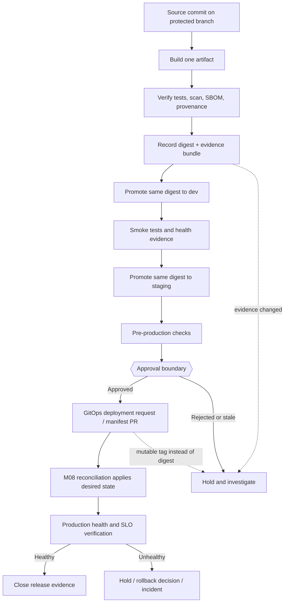
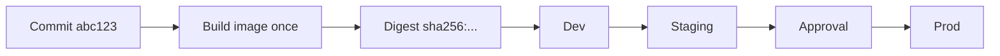

# Unit 9 — Environment Promotion, Approvals, and Protected Branches

Environment promotion is the controlled movement of one verified artifact through increasingly consequential environments, with evidence and authorization carried forward at every boundary. This lesson uses a FastAPI model-serving service, an ETL package, and a small ML evaluation job to teach protected branches, environment-scoped approvals, digest-based promotion, GitOps handoff, failure recovery, and auditable governance. The local lab simulates dev, staging, and production without a public registry or paid infrastructure; it demonstrates policy logic, not the security properties of a real production platform.

**Module:** M02 — CI/CD Pipeline Engineering  
**Stage:** 2E — Production DevOps & Platform Engineering  
**Estimated time:** 10–14 hours, including labs and review  
**Prerequisites:** Git, Linux shell, Python, pytest basics, container image build/push concepts from M01, GitHub Actions fundamentals, GitLab CI fundamentals, M02 Units 1–8  
**Core tools:** Git, GitHub Actions, GitHub branch protection/rulesets and Environments, GitLab CI/CD protected branches/tags/environments, Docker/BuildKit, image digests, shell, Python, `gh` CLI where applicable  
**Awareness:** policy-as-code, repository rules automation, SLSA provenance, OWASP CI/CD risks, GitOps and progressive delivery  
**Last reviewed:** 2026-10-24 (authoring date; external documentation was not live-checked)  
**Assumed tool baseline:** Git, Python 3.11+, Docker Engine with BuildKit or Docker Desktop with WSL2 integration, GitHub Actions, and GitLab CI/CD concepts. Current UI labels, APIs, plan capabilities, and product-specific semantics are `[VERIFY]`.

## Table of contents

- [9.0 Why this matters in production](#90-why-this-matters-in-production)
- [9.1 Learning objectives](#91-learning-objectives)
- [9.2 Concept map and vocabulary](#92-concept-map-and-vocabulary)
- [9.3 Level 1 — Beginner](#93-level-1--beginner)
- [9.4 Level 2 — Intermediate](#94-level-2--intermediate)
- [9.5 Level 3 — Advanced](#95-level-3--advanced)
- [9.6 Level 4 — Expert](#96-level-4--expert)
- [9.7 SRE lens](#97-sre-lens)
- [9.8 Security lens](#98-security-lens)
- [9.9 Production checklist](#99-production-checklist)
- [9.10 Hands-on lab set](#910-hands-on-lab-set)
- [9.11 Self-check questions](#911-self-check-questions)
- [9.12 Evidence artifacts](#912-evidence-artifacts)
- [9.13 Common interview and design-review questions](#913-common-interview-and-design-review-questions)
- [9.14 Sources and verification notes](#914-sources-and-verification-notes)
- [Appendix A — Claim Register](#appendix-a--claim-register)
- [Appendix B — Audit Report](#appendix-b--audit-report)
- [Appendix C — Human Verification Checklist](#appendix-c--human-verification-checklist)
- [Appendix D — Known Limitations and Assumptions](#appendix-d--known-limitations-and-assumptions)
- [Appendix E — Sign-off](#appendix-e--sign-off)

---

## 9.0 Why this matters in production

A team tests a FastAPI scoring service in staging, then rebuilds the image for production from the same mutable tag; a dependency has changed, so production runs bytes that never passed staging. In another incident, an approval is recorded against one digest but the deployment manifest is edited afterward to point to another image. A third team assumes a YAML `environment: production` declaration automatically enforces reviewer approval, even though the corresponding environment protection was never configured. Each failure is a breakdown in the relationship between artifact identity, evidence, authorization, and deployment state.

Environment promotion makes that relationship explicit: build once, verify the artifact, carry its immutable digest and evidence forward, obtain the required approval at the defined boundary, submit a deployment request, and check the deployed service’s health. Branch and environment protection reduce the chance that one actor or compromised job can silently change both the artifact and the controls intended to govern it. They are not absolute guarantees: privileged actors, misconfiguration, provider limitations, or compromised credentials can still bypass or undermine them.

This unit teaches the pipeline and governance controls required to create a verified deployment request. GitOps reconciliation is taught in M08; identity and secrets in M09; SLOs and observability in M10/M11; and signing, SBOMs, provenance, and supply-chain controls in M12.

---

## 9.1 Learning objectives

1. **Distinguish** a branch, tag, release, deployment, environment, artifact, and digest. **[L1]**
2. **Explain** why promotion by immutable digest is safer than rebuilding independently in each environment. **[L1]**
3. **Configure** required checks, review routing, and environment-scoped deployment controls for a repository. **[L2]**
4. **Compare** GitHub Actions and GitLab CI/CD protection models without assuming their semantics are identical. **[L2]**
5. **Implement** a local evidence manifest and fail-closed validator that rejects missing, malformed, inconsistent, or unapproved promotion. **[L2]**
6. **Design** a promotion flow that carries test, scan, SBOM, provenance, and model/data-contract evidence alongside one digest. **[L3]**
7. **Evaluate** approval boundaries, separation of duties, stale approvals, drift, and emergency exceptions. **[L3]**
8. **Diagnose** bypasses, skipped or renamed required checks, digest mismatches, and failed health gates from evidence. **[L4]**
9. **Automate** a governance review while documenting API/UI behavior that requires live verification. **[L4]**

---

## 9.2 Concept map and vocabulary



The approval boundary is a governance decision made using evidence. The approval itself does not prove that the artifact is safe or that the tests are correct. The GitOps handoff creates a version-controlled deployment request; this lesson does not teach cluster reconciliation in depth.

| Term | Precise definition | Common misconception |
|---|---|---|
| Environment | A named operating context such as development, staging, or production, with its own configuration, access, and data boundary | “A YAML environment name automatically creates all protections.” |
| Promotion | Advancing the same artifact identity to a higher-confidence or higher-impact environment | “Promotion means rebuilding from source for the target.” |
| Rebuild | Running the build process again, potentially producing different bytes | “Same commit always means identical artifact bytes.” |
| Artifact | A build output such as a wheel, container image, or model package | “A tag is the artifact.” |
| Digest | A cryptographic content identifier, commonly SHA-256 for OCI image content | “A human-readable tag is immutable.” |
| Branch | A movable Git reference to a commit | “A branch name permanently identifies source.” |
| Tag | A named Git reference, often used to identify a release commit | “A Git tag proves a container image was deployed.” |
| Release | A distribution event or record connecting version, notes, source, and artifacts | “A release record is the same as a deployment.” |
| Deployment | Applying/running an artifact in an environment | “Approved deployment request means healthy production.” |
| Required status check | A named result that must satisfy a repository rule before a protected action is allowed | “Any green check with a similar name satisfies the rule.” |
| Approval | An authorized human or policy decision to permit a specified transition | “Approval proves technical correctness.” |
| Protected branch/tag/environment | Platform-configured restrictions on who can change or deploy specific refs or environments | “Protection cannot be bypassed by privileged actors.” |
| Evidence bundle | Linked records of source, tests, scan, SBOM, provenance, digest, approvals, and health | “A folder of screenshots is automatically complete evidence.” |
| Deployment request | A reviewed manifest change, pull request, or authorized request to deploy an identified artifact | “The CI job must mutate the production cluster directly.” |
| Exception | A scoped, time-limited deviation with approval and compensating controls | “An emergency bypass can remain permanently enabled.” |
| Break-glass | A controlled emergency path used when ordinary controls are unavailable or too slow | “Break-glass removes the need for audit and follow-up.” |
| CODEOWNERS | A file mapping paths to suggested/review-requested owners; enforcement depends on repository rules | “CODEOWNERS alone always makes approval mandatory.” |
| SBOM | Software bill of materials describing components in an artifact | “An SBOM proves the artifact has no vulnerabilities.” |
| Provenance | Evidence about where and how an artifact was built | “Provenance guarantees that the source is trustworthy.” |

### The core invariant

For a given release candidate, record:

- source commit;
- build/workflow identity;
- artifact repository and digest;
- test, scan, and data/model evaluation evidence;
- SBOM and provenance/attestation references or explicit `not-generated`/`not-applicable` status;
- approval identity and timestamp;
- deployment request identity;
- post-deployment health evidence.

The digest is the artifact identity carried through dev, staging, and prod. A tag may help humans find an image, but the deployment manifest should resolve to a digest such as `registry.example.invalid/risk-scoring-api@sha256:<64-hex-digest>`. The placeholder is illustrative and is not a real image digest.

---

## 9.3 Level 1 — Beginner

### What each environment is for

- **Development** gives engineers rapid feedback. It may contain synthetic data and looser availability expectations, but should still use safe credentials and avoid production data unless explicitly governed.
- **Staging** is a controlled rehearsal environment. It should resemble production in relevant runtime configuration, dependencies, network paths, and integration contracts. It is not useful if every meaningful difference is hidden.
- **Production** serves users or business workflows. Access, data handling, deployment authorization, monitoring, and recovery expectations are stricter.

The environments are not merely three names. They have different trust boundaries, data sensitivity, identity, network access, and operational impact. The same artifact can be configured differently by environment, but those configuration differences must be explicit and reviewed. Do not bake environment-specific secrets into an image.

### Promotion versus rebuild

Suppose image tag `risk-scoring-api:1.8.0` points to digest `sha256:abc...` today. If the tag is later moved to another image, a deployment that uses the tag can resolve to different bytes. A digest identifies the content more precisely. The exact OCI digest is a cryptographic identifier for the referenced image manifest or index; platform and manifest-list details can matter for multi-platform images. **[VERIFY]** Consult the OCI image specification and Docker documentation for the exact reference semantics used by your tooling.

**Build once, promote many** means the image that passed dev checks is the image that proceeds to staging and production. Environment-specific configuration is injected at runtime or represented in deployment configuration. Do not rebuild the image merely because the target environment changed.



The digest in the diagram is deliberately abbreviated. A real digest has the algorithm prefix and full encoded value. Never copy a fabricated digest into a real deployment.

### Branch protection foundations

A protected default branch typically requires changes to arrive through a reviewable path, such as pull requests, and requires specified status checks to pass. Rules may also restrict force pushes and branch deletion. Optional controls can include signed-commit requirements, linear history, or review requirements from code owners. Exact behavior and availability vary by GitHub/GitLab product version, repository configuration, and plan. **[VERIFY: current GitHub/GitLab documentation and plan]**

Protection is a policy enforced by a platform, not a property of Git alone. A local Git repository does not automatically enforce remote branch protection. A local simulation can test your own validator logic but cannot prove that the remote rules are configured correctly.

### What approval proves—and does not prove

An approval records that an authorized reviewer permits a specific transition under the organization’s policy. A useful approval should be tied to the exact release candidate and its evidence. It does not prove the reviewer inspected every line, that the artifact is vulnerability-free, that the health checks are meaningful, or that the deployment will succeed.

Approvals can become stale. If the digest, manifest, evidence bundle, or target environment changes after approval, the policy should require re-review or make the change impossible. Avoid approval fatigue by defining risk-based gates and clear reviewer responsibilities rather than asking the same person to approve every low-risk change without meaningful context.

### Guided inspection: local Git state

Use a throwaway directory. These commands inspect local Git concepts; they do not configure remote branch protection.

```bash
# File: terminal
set -euo pipefail
mkdir promotion-basics
cd promotion-basics
git init
git config user.name "Promotion Lab"
git config user.email "promotion-lab@example.invalid"
printf 'hello\n' > README.md
git add README.md
git commit -m "docs: add lab readme"
git tag -a v0.1.0 -m "Lab tag"
git log --oneline --decorate
git show --no-patch --format=fuller v0.1.0
```

**Example — yours will differ**

```text
Initialized empty Git repository in .../promotion-basics/.git/
<commit-id> (HEAD -> main, tag: v0.1.0) docs: add lab readme
tag v0.1.0
Tagger: Promotion Lab <promotion-lab@example.invalid>
...
    Lab tag
```

Interpretation: the branch is a movable ref, and the annotated tag records release-oriented metadata. The commit ID and Git’s initialization message will differ. No image has been built or deployed.

```bash
# File: terminal
git status --short
git rev-parse HEAD
git rev-parse v0.1.0^{commit}
```

**Example — yours will differ**

```text
<same-commit-id>
<same-commit-id>
```

Interpretation: `HEAD` and the tag resolve to the same commit in this lab. In production, compare the intended tag, build provenance, and image digest rather than assuming a tag alone proves deployment identity.

### What just happened?

You created a local branch history and annotated tag. You did not configure required checks, reviewers, or deployment approvals. Those are remote platform settings. The lesson’s later local promotion lab simulates the gate and digest consistency, then explains which controls need actual GitHub/GitLab configuration.

### Beginner mistakes → symptom → fix

| Mistake | Symptom | Fix |
|---|---|---|
| Rebuild per environment | Dev and prod have different digests | Build once and carry the digest forward |
| Deploy by mutable tag only | Same tag resolves to different image content over time | Pin the full digest in deployment manifests |
| Assume YAML `environment: production` enforces approval | Workflow deploys without reviewer gate | Configure and verify the remote environment protection rules |
| Treat a green check as proof of safety | A required check passes while important tests are missing | Review the check definition and coverage, not just its name |
| Treat CODEOWNERS as a complete approval policy | A path owner is requested but merge is still possible under current rules | Configure required code-owner review in the platform’s repository rules |
| Approve before evidence is final | Approved digest differs from deployed digest | Bind approval to immutable digest and manifest revision; invalidate stale approvals |

---

## 9.4 Level 2 — Intermediate

### GitHub: branch rules, rulesets, environments

GitHub has branch protection and repository rulesets with overlapping but not identical configuration models. Depending on the repository and current product capabilities, controls can include required pull-request reviews, required status checks, restrictions on force pushes/deletions, linear history, signed commits, and bypass actors. **[VERIFY: current GitHub documentation and plan]** Do not assume every control is available to every repository type or plan.

Required status checks are sensitive to the check’s identity/name and the way workflows report success, failure, or skipped status. If a required check is renamed or no longer runs on the relevant path, merging may be blocked—or a poorly designed policy may fail to require the intended validation. Avoid duplicate ambiguous check names and test the exact pull-request path. If a workflow is skipped due to branch/path filters, required-check behavior can be unintuitive and is version/configuration-sensitive. **[VERIFY]**

GitHub Environments can scope environment secrets/variables and apply deployment protection rules such as required reviewers where supported. A YAML declaration like `environment: production` references an environment; it does not, by itself, define all protections. The corresponding environment must be configured and reviewed in the repository settings. Secrets should be referenced by name and never printed. Masking is not a security boundary.

CODEOWNERS routes review requests for matching paths. It becomes an enforceable merge gate only when repository rules require the relevant review. Keep the file itself protected by review.

### Example: pull-request verification workflow

The following is a valid-shape illustrative workflow using top-level least-privilege permissions. The action references are deliberately placeholders: replace them with verified full commit SHAs before using the workflow. Until then, the example is not executable. **[VERIFY: current official action repositories, SHAs, and supported inputs]**

```yaml
# File: .github/workflows/pr-verify.yml
name: PR verification

on:
  pull_request:

permissions:
  contents: read

jobs:
  test:
    name: test
    runs-on: ubuntu-latest
    steps:
      - name: Check out source
        uses: actions/checkout@<VERIFIED_FULL_COMMIT_SHA>
      - name: Set up Python
        uses: actions/setup-python@<VERIFIED_FULL_COMMIT_SHA>
        with:
          python-version: "3.11"
      - name: Install test dependencies and run tests
        run: |
          python -m pip install --upgrade pip
          python -m pip install pytest
          python -m pytest -q
```

**Example — yours will differ**

```text
Run python -m pytest -q
...
2 passed
```

Interpretation: this is representative output only. The workflow cannot run until the action placeholders are replaced with verified immutable references. Configure the exact `test` check as required in repository rules and verify it appears on pull requests.

### Example: protected deployment environment

```yaml
# File: .github/workflows/deploy-request.yml
name: Request production deployment

on:
  workflow_dispatch:
    inputs:
      image_digest:
        description: "Full immutable image reference ending in @sha256:..."
        required: true
        type: string

permissions:
  contents: read

jobs:
  deployment-request:
    runs-on: ubuntu-latest
    environment: production
    steps:
      - name: Validate image reference
        env:
          IMAGE_REF: ${{ inputs.image_digest }}
        run: |
          set -euo pipefail
          case "$IMAGE_REF" in
            *@sha256:*) ;;
            *) echo "Expected an immutable digest reference" >&2; exit 2 ;;
          esac
          printf 'Validated digest reference format.\n'
      - name: Create deployment request
        run: |
          echo "Illustrative handoff only; create a reviewed manifest PR here."
```

**Example — yours will differ**

```text
Validated digest reference format.
Illustrative handoff only; create a reviewed manifest PR here.
```

Interpretation: this workflow checks only that the string resembles a digest reference. It does not verify registry existence, signature, provenance, approval evidence, or deployment health. The configured `production` environment must separately have the intended protection rules. The sample does not mutate a cluster or open a pull request.

For a production workflow, validate the full digest syntax and registry policy using a tested parser, ensure the digest matches the release evidence bundle, and make the deployment request carry the same digest. Do not elevate `contents: write` or deployment permissions unless the job needs them. If a job opens a manifest PR, grant only the permissions required for that action and review the chosen mechanism.

### Secrets, variables, and identity

- **Repository secret:** available to workflows that are permitted to reference it. Broadly scoped secrets can increase blast radius.
- **Environment secret:** associated with a configured environment and made available under the platform’s environment rules. Exact exposure/approval semantics must be verified.
- **Variable:** configuration, not a secret. Do not place credentials in ordinary variables.
- **Short-lived identity:** an identity flow such as OIDC can exchange a workflow identity assertion for temporary provider credentials. Trust policy and authorization still matter; see M09.

Never put credentials in committed manifests, command-line arguments where process listings may reveal them, or logs. Do not echo secrets to check whether they are present. Masking can fail to protect transformed or exfiltrated values.

### GitLab comparison

GitLab has protected branches, protected tags, protected environments, deployment permissions, and manual jobs, but its rules and workflow semantics are not interchangeable with GitHub’s. Current field names, UI locations, and plan availability are **[VERIFY]** against the GitLab documentation for the deployed version.

| Concern | GitHub concept | GitLab concept | Important caveat |
|---|---|---|---|
| Protect default branch | Branch protection/rulesets | Protected branches | Role semantics and settings differ |
| Restrict release refs | Tag rules / rulesets | Protected tags | Tag patterns and permitted actors differ |
| Require deployment authorization | Environment protection/reviewers | Protected environments and deployment approvals/manual jobs | Availability and approval semantics vary by version/plan |
| Route code review | CODEOWNERS plus required review rules | CODEOWNERS and merge-request approval rules | Ownership routing is not always enforcement by itself |
| Require CI evidence | Required status checks | Pipeline/merge checks and approval policies | Check identity and skipped-job behavior differ |
| Manual deployment | Environment-gated workflow/job | Manual job or protected environment workflow | A manual action alone is not a complete policy |

### Pattern catalogue

| Pattern | When to use | When NOT to use |
|---|---|---|
| Protected `main` with pull-request checks | Most shared production repositories | As the only control for production credentials or runtime changes |
| Environment-scoped approval | Production has a meaningful human risk decision | For every low-risk internal change where approvals become rubber-stamps |
| CODEOWNERS plus required code-owner review | Sensitive paths such as workflow, deployment, and policy files | Assuming the CODEOWNERS file enforces approval without repository settings |
| Separate build and deployment jobs | Build code should not receive production secrets | If the split creates untracked artifact rebuilds or loses digest/evidence |
| Digest-pinned manifest | Reproducible promotion and auditability | Never use mutable tags as the deployment identity in a governed promotion flow |
| GitOps manifest PR | Desired state should be reviewed and reconciled from version control | If an emergency path is needed but no documented break-glass procedure exists |

### Anti-pattern catalogue

| Bad example | Why it hurts | Corrected version |
|---|---|---|
| `image: service:latest` in production | Mutable tag can change content without manifest diff | Use `service@sha256:<verified-digest>` |
| `environment: production` with no configured protection | Name alone may not create an approval gate | Configure and verify environment rules in platform settings |
| Give every workflow `contents: write` | Compromised test job can mutate repository state | Declare top-level minimal permissions and elevate only the job that needs it |
| Let deployment job rebuild image | Staging and prod may differ from the tested artifact | Promote the stored digest |
| CODEOWNERS without required-review rule | Review may be requested but not required | Enable the applicable enforcement rule and test it |
| Approve a manifest then edit the digest | Approval no longer corresponds to deployed artifact | Require reapproval on relevant changes and validate digest/evidence at deploy time |

### Lab: measure the effect of a digest gate

Create a small local manifest with a digest reference, then deliberately replace it with a tag-only reference. Run the validator introduced in section 9.5 and save the failure and corrected output. Evidence is a diff plus exit code, not a screenshot of a green workflow. Cleanup means removing only the lab directory and verifying that it is gone.

---

## 9.5 Level 3 — Advanced

### Complete digest-based promotion flow

The production design is a sequence of evidence-preserving state transitions:

1. A source commit is merged through the protected review path.
2. A trusted build job builds the image once and records the source commit, workflow run, build inputs, and image digest.
3. Verification jobs run tests, vulnerability scans, SBOM generation, data-contract checks, and model-evaluation gates as applicable. If a tool was not run, record `not-generated` or `not-applicable`, not a fabricated success.
4. An evidence manifest binds those results to the digest.
5. The exact digest is deployed to dev, tested, then promoted to staging without rebuilding.
6. The production approval boundary reviews the digest, evidence freshness, change risk, deployment window, and rollback/mitigation plan.
7. CI opens or updates a version-controlled manifest PR containing the exact digest and environment configuration.
8. M08’s GitOps process reconciles the approved desired state.
9. M10/M11 health and SLO signals determine whether to continue, hold, or roll back according to policy.

```mermaid
flowchart LR
    A[Commit + PR evidence] --> B[Build once]
    B --> C[Image digest]
    C --> D[Test + scan + SBOM + provenance]
    D --> E[Evidence manifest]
    E --> F[Dev deployment]
    F --> G[Smoke / contract checks]
    G --> H[Staging deployment]
    H --> I[Approval with evidence]
    I --> J[Manifest PR with digest]
    J --> K[M08 GitOps reconciliation]
    K --> L[Health / SLO verification]
```



### Worked example: evidence manifest

This JSON is a schema example for the lesson’s local simulation, not a universal standard. The digest uses a deliberately fake, syntactically illustrative value; it is not a real image. Test, scan, SBOM, and provenance fields explicitly state that no real scan or attestation was generated. Do not use this manifest to authorize a real deployment.

```json
{
  "component": "risk-scoring-api",
  "source_commit": "0123456789abcdef0123456789abcdef01234567",
  "workflow_run": "local-simulation-not-a-real-run",
  "image_ref": "risk-scoring-api@sha256:aaaaaaaaaaaaaaaaaaaaaaaaaaaaaaaaaaaaaaaaaaaaaaaaaaaaaaaaaaaaaaaa",
  "digest": "sha256:aaaaaaaaaaaaaaaaaaaaaaaaaaaaaaaaaaaaaaaaaaaaaaaaaaaaaaaaaaaaaaaa",
  "tests": {
    "status": "simulated-pass",
    "report": "not-generated"
  },
  "vulnerability_scan": {
    "status": "not-generated",
    "report": "not-generated"
  },
  "sbom": "not-generated",
  "provenance": "not-generated",
  "data_contract": "not-applicable",
  "model_evaluation": "not-applicable",
  "approval": {
    "status": "simulated-pending",
    "reviewer": "not-recorded",
    "timestamp": "not-recorded"
  }
}
```

**Example — yours will differ**

```text
The file should parse as JSON. Its fields are illustrative and do not represent a real successful build, scan, SBOM, or provenance statement.
```

Interpretation: the evidence record deliberately distinguishes simulated checks from real evidence. A real release manifest should include durable references to actual reports and an approved schema/version.

### Local directory simulation

This approach is selected instead of requiring Kubernetes or a registry. It fits the laptop budget and makes the invariant easy to inspect. It does not run the image, configure real access controls, or prove that a remote platform enforces approvals.

```text
promotion-lab/
├── evidence/
│   └── release-manifest.json
├── environments/
│   ├── dev/deployment.json
│   ├── staging/deployment.json
│   └── prod/deployment.json
├── approval/
│   └── prod-approved.txt
├── validate_promotion.py
└── test_validate_promotion.py
```

Each `deployment.json` contains an `image_ref` ending in the same full digest. The local approval file is a simulation. In a real platform, an approval must be recorded by the configured environment/repository control and tied to the exact manifest revision and digest.

### Typed digest and approval validator

The script below validates the local simulation. It fails closed if the digest is absent or malformed, if the environments do not match the evidence manifest, if the manifest is not supported by evidence status, or if the production approval file is absent. `simulated-pass` is accepted only because this is explicitly a local simulation; the script must not be used as a production gate. For a real pipeline, replace simulated statuses with references to verified reports and trusted attestations.

```python
# File: validate_promotion.py
from __future__ import annotations

import json
import re
import sys
from pathlib import Path
from typing import Any

DIGEST_RE = re.compile(r"^sha256:[0-9a-f]{64}$")
ENVIRONMENTS = ("dev", "staging", "prod")

def load_json(path: Path) -> dict[str, Any]:
    with path.open("r", encoding="utf-8") as stream:
        value = json.load(stream)
    if not isinstance(value, dict):
        raise ValueError(f"{path}: expected a JSON object")
    return value

def fail(message: str) -> int:
    print(f"FAIL: {message}", file=sys.stderr)
    return 1

def validate(root: Path) -> int:
    evidence_path = root / "evidence" / "release-manifest.json"
    try:
        evidence = load_json(evidence_path)
    except (OSError, json.JSONDecodeError, ValueError) as exc:
        return fail(f"cannot read evidence manifest: {exc}")

    digest = evidence.get("digest")
    if not isinstance(digest, str) or not DIGEST_RE.fullmatch(digest):
        return fail("evidence digest is absent or malformed")

    image_ref = evidence.get("image_ref")
    if not isinstance(image_ref, str) or not image_ref.endswith("@" + digest):
        return fail("image_ref does not end with the evidence digest")

    tests = evidence.get("tests")
    if not isinstance(tests, dict) or tests.get("status") not in {
        "simulated-pass", "verified-pass"
    }:
        return fail("test evidence is absent or not accepted")

    approval_file = root / "approval" / "prod-approved.txt"
    if not approval_file.is_file():
        return fail("production approval is absent")

    try:
        approval = approval_file.read_text(encoding="utf-8").strip()
    except OSError as exc:
        return fail(f"cannot read approval file: {exc}")
    if approval != digest:
        return fail("approval is not bound to the current digest")

    for environment in ENVIRONMENTS:
        path = root / "environments" / environment / "deployment.json"
        try:
            deployment = load_json(path)
        except (OSError, json.JSONDecodeError, ValueError) as exc:
            return fail(f"{environment}: cannot read deployment manifest: {exc}")
        env_digest = deployment.get("digest")
        env_ref = deployment.get("image_ref")
        if env_digest != digest:
            return fail(f"{environment}: digest differs from evidence")
        if not isinstance(env_ref, str) or not env_ref.endswith("@" + digest):
            return fail(f"{environment}: image_ref is not pinned to evidence digest")

    print(f"PASS: all environments use {digest}; local approval is bound to this digest")
    print("LIMITATION: local simulation only; no remote platform protection was verified")
    return 0

if __name__ == "__main__":
    raise SystemExit(validate(Path.cwd()))
```

```python
# File: test_validate_promotion.py
import json
import subprocess
import sys
from pathlib import Path

SCRIPT = Path(__file__).with_name("validate_promotion.py")
DIGEST = "sha256:" + ("a" * 64)

def create_lab(root: Path, approved: bool = True) -> None:
    (root / "evidence").mkdir(parents=True)
    (root / "approval").mkdir()
    for env in ("dev", "staging", "prod"):
        (root / "environments" / env).mkdir(parents=True)
    evidence = {
        "digest": DIGEST,
        "image_ref": f"risk-scoring-api@{DIGEST}",
        "tests": {"status": "simulated-pass", "report": "not-generated"},
    }
    (root / "evidence" / "release-manifest.json").write_text(
        json.dumps(evidence), encoding="utf-8"
    )
    for env in ("dev", "staging", "prod"):
        (root / "environments" / env / "deployment.json").write_text(
            json.dumps({"digest": DIGEST, "image_ref": f"risk-scoring-api@{DIGEST}"}),
            encoding="utf-8",
        )
    if approved:
        (root / "approval" / "prod-approved.txt").write_text(DIGEST, encoding="utf-8")

def run_validator(root: Path) -> subprocess.CompletedProcess[str]:
    return subprocess.run(
        [sys.executable, str(SCRIPT)], cwd=root, capture_output=True, text=True
    )

def test_matching_digest_succeeds(tmp_path: Path) -> None:
    create_lab(tmp_path)
    assert run_validator(tmp_path).returncode == 0

def test_mismatched_digest_fails(tmp_path: Path) -> None:
    create_lab(tmp_path)
    path = tmp_path / "environments" / "prod" / "deployment.json"
    path.write_text(json.dumps({"digest": "sha256:" + "b" * 64}), encoding="utf-8")
    assert run_validator(tmp_path).returncode == 1

def test_missing_digest_fails(tmp_path: Path) -> None:
    create_lab(tmp_path)
    path = tmp_path / "evidence" / "release-manifest.json"
    path.write_text(json.dumps({"image_ref": "risk-scoring-api"}), encoding="utf-8")
    assert run_validator(tmp_path).returncode == 1

def test_missing_approval_fails(tmp_path: Path) -> None:
    create_lab(tmp_path, approved=False)
    assert run_validator(tmp_path).returncode == 1
```

Run the tests from the directory containing the scripts and tests:

```bash
# File: terminal
python -m pytest -q
```

**Example — yours will differ**

```text
4 passed
```

Interpretation: the tests cover four local invariants. This output is expected, not a claim that the tests were executed during authoring. Add tests for malformed digests, stale evidence, wrong component, missing environment manifest, and untrusted evidence references before adapting the logic.

### Local environment manifests

```json
// File: environments/dev/deployment.json
{
  "environment": "dev",
  "image_ref": "risk-scoring-api@sha256:aaaaaaaaaaaaaaaaaaaaaaaaaaaaaaaaaaaaaaaaaaaaaaaaaaaaaaaaaaaaaaaa",
  "digest": "sha256:aaaaaaaaaaaaaaaaaaaaaaaaaaaaaaaaaaaaaaaaaaaaaaaaaaaaaaaaaaaaaaaa"
}
```

```json
// File: environments/staging/deployment.json
{
  "environment": "staging",
  "image_ref": "risk-scoring-api@sha256:aaaaaaaaaaaaaaaaaaaaaaaaaaaaaaaaaaaaaaaaaaaaaaaaaaaaaaaaaaaaaaaa",
  "digest": "sha256:aaaaaaaaaaaaaaaaaaaaaaaaaaaaaaaaaaaaaaaaaaaaaaaaaaaaaaaaaaaaaaaa"
}
```

```json
// File: environments/prod/deployment.json
{
  "environment": "prod",
  "image_ref": "risk-scoring-api@sha256:aaaaaaaaaaaaaaaaaaaaaaaaaaaaaaaaaaaaaaaaaaaaaaaaaaaaaaaaaaaaaaaa",
  "digest": "sha256:aaaaaaaaaaaaaaaaaaaaaaaaaaaaaaaaaaaaaaaaaaaaaaaaaaaaaaaaaaaaaaaa"
}
```

**Example — yours will differ**

```text
All three deployment.json files contain the same illustrative digest.
```

Interpretation: the directory model demonstrates the consistency invariant, not a running service. In a real pipeline, use a real image digest produced by the trusted build, and carry the actual digest value into all environment manifests.

### Approval boundary and bypass attempt

The local approval file contains the exact digest that was reviewed. To simulate a bypass attempt, remove the file or write a different digest. The validator should fail; do not weaken protections on a real repository to demonstrate bypass.

```bash
# File: terminal
set -euo pipefail
printf '%s\n' 'sha256:bbbbbbbbbbbbbbbbbbbbbbbbbbbbbbbbbbbbbbbbbbbbbbbbbbbbbbbbbbbbbbbb' > approval/prod-approved.txt
python validate_promotion.py
```

**Example — yours will differ**

```text
FAIL: approval is not bound to the current digest
```

Interpretation: the approval is stale or refers to a different artifact, so the local gate rejects promotion. This does not test a real GitHub/GitLab reviewer bypass; it tests local validation only.

Restore the exact digest from the evidence manifest only after confirming it is the intended candidate. The recovery should be an explicit review decision, not an automatic copy operation in a production pipeline.

### Trade-off table

| Option | Benefit | Cost | Risk | Choose when |
|---|---|---|---|---|
| Rebuild in each environment vs promote one immutable artifact | Rebuild can vary per target; promotion preserves tested bytes | Promotion requires artifact retention and evidence plumbing | Rebuild introduces drift; digest promotion can still carry a bad artifact if tests are weak | Prefer one immutable artifact for governed releases |
| Manual approval vs automated policy gate | Human can judge context; policy gate is consistent and fast | Human time vs policy maintenance | Rubber-stamp approvals or brittle automated rules | Use risk-based combinations; neither is a universal substitute |
| Pipeline directly deploys vs GitOps PR handoff | Direct deploy is simple; GitOps PR makes desired-state change reviewable | GitOps adds repository and reconciliation workflow | Direct credentials can be overpowered; PR can become stale | Prefer reviewed manifest handoff where desired state is version-controlled |
| One shared environment vs isolated environments | Shared is cheap and simple | Isolation costs resources and setup | Shared data/state collisions; isolated environments may drift | Isolate staging/prod and sensitive workloads; share only when risk is understood |
| Strict approvals vs risk-based approvals | Strict policy improves explicit oversight | Delay and approval fatigue | Blanket strictness can cause bypass culture; lax policy increases risk | Match approval level to impact, reversibility, and evidence quality |

### Approval governance in practice

- **Who may approve:** define roles independent of the change author for high-impact production transitions where feasible.
- **Four-eyes review:** require a second person or independent control for high-risk changes. The platform’s exact enforcement is `[VERIFY]`.
- **Time-boxed approvals:** approvals should expire or be re-evaluated when the digest, evidence, manifest, or risk context changes. Not every platform natively binds approval to every evidence field; add pipeline validation where necessary.
- **Approval fatigue:** show reviewers a concise diff, digest, evidence links, impact, rollback plan, and reason for the change.
- **Bypass visibility:** document who can bypass rules, how bypass events are logged, who reviews them, and how often access is reviewed.
- **Deploy windows:** a scheduled window can reduce coordination risk but is not evidence of correctness. Emergency windows should have explicit eligibility, approver, monitoring, and follow-up.
- **Health gates:** pre-deployment validation, smoke tests, health checks, and SLO signals provide technical evidence. Detailed SLO/observability design is deferred to M10/M11.

### Data and ML service gates

For `risk-etl`, verify input/output schema compatibility, data contracts, idempotency, and a safe replay plan. For `risk-scoring-api`, run API compatibility tests and smoke tests. For `risk-eval`, record the model artifact reference, dataset/version reference, evaluation protocol, metrics, and acceptance decision. Use `not-applicable` only when the gate genuinely does not apply. A metric threshold is not a complete MLOps control; model lineage and registry workflows are outside this unit.

### GitOps handoff

A CI job should update a deployment manifest or open a pull request that carries the exact digest and evidence references. The manifest PR should be reviewed under the appropriate rules. M08 owns reconciliation: it observes approved desired state and applies it. This unit does not recommend direct cluster mutation as the default. A GitOps PR that contains `risk-scoring-api:stable` instead of `risk-scoring-api@sha256:...` is not sufficiently pinned for this promotion invariant.

### Drift and stale evidence

Environment drift can arise from different configuration, secrets, policy, dependency services, or mutable tags. Some differences are intentional; document them as configuration-as-code and test them. Evidence becomes stale when the artifact digest or relevant build inputs change, when the target environment changes materially, or when approval was given for a different manifest. Recompute or invalidate evidence when its assumptions no longer hold.

### Design lab

Write an architecture decision record choosing how production promotion works for the FastAPI service. Compare direct deployment and GitOps PR handoff, manual approval and policy gate, and strict versus risk-based approval. Your decision must name the artifact identity, evidence bundle, approver role, stale-approval rule, bypass detection, health gate, rollback/hold behavior, and one measurable SLI. Include one rejected option and explain why it is worse for this system.

---

## 9.6 Level 4 — Expert

### Governance review checklist

A staff-level review should trace the complete chain from source change to running workload:

- Can the source commit and review record be identified?
- Are required checks stable, required, and actually executed for the changed paths?
- Does the build record identify the exact image digest?
- Are test, scan, SBOM, provenance, data-contract, and model-evaluation results bound to that digest?
- Is the same digest present in dev, staging, and production manifests?
- Is the approval authorized, current, and tied to the intended deployment request?
- Are production credentials unavailable to untrusted PR jobs?
- Can a privileged actor bypass controls, and are bypass events logged and reviewed?
- Does the post-deployment health result reference the deployed digest and target environment?
- Are exceptions time-limited and verified removed?

### Policy-as-code and configuration-as-code

Some controls can be represented as files: workflow permissions, CODEOWNERS, required check definitions where supported, deployment manifests, policy tests, and evidence validators. Other settings may live in provider UI/API state or have platform-specific semantics. Do not imply that a single repository file fully governs GitHub rulesets or GitLab protected environments in every configuration. Store the intended policy as code where practical, then audit the remote settings against that intent.

Use infrastructure-as-code or provider APIs only after verifying current schemas, endpoints, and permissions. The example below intentionally avoids inventing `gh api` endpoint fields. A read-only inspection of a known repository can be used after checking the current official API documentation.

```bash
# File: terminal
gh auth status
gh repo view --json nameWithOwner,defaultBranchRef
```

**Example — yours will differ**

```text
Logged in to github.com account <your-test-account>
...
{"defaultBranchRef":{"name":"main"},"nameWithOwner":"OWNER/REPO"}
```

Interpretation: this checks CLI authentication and identifies a repository. Output shape depends on the CLI version and repository. Do not run this against a repository you do not control, and do not paste authentication tokens into logs. **[VERIFY]** Check current `gh` CLI documentation for supported JSON fields and auth behavior.

### Audit script: local policy/evidence consistency

The validator in section 9.5 is intentionally local and portable. It checks digest consistency and the simulated approval binding. A production audit tool can additionally query repository rules, environment protection, workflow runs, reviews, and deployment records using official APIs, but the exact endpoint paths, permissions, and response fields are **[VERIFY]**. Do not add assumed JSON fields without consulting current documentation and testing against a private test repository.

A safe automation design has two layers:
1. **Local policy checks:** parse committed workflow/manifest files and validate invariant rules.
2. **Remote configuration audit:** query provider state read-only and compare it with the intended policy. Fail the audit if the API response is incomplete or the tool lacks permission; do not interpret “could not read” as “control is enabled.”

### Failure analysis matrix

| Failure | Symptom | Hypothesis | Test | Root cause pattern | Fix | Prevention |
|---|---|---|---|---|---|---|
| Approval bypassed by token or privileged actor | Production changed without expected approval | Token has broad write/deploy authority or actor is on bypass list | Inspect audit log, token scope, ruleset/environment configuration | Separation of duties not enforced or bypass not reviewed | Freeze affected path, revoke/rotate credential if needed, restore intended state through reviewed request | Least privilege, independent review, bypass alerts, periodic access review |
| Environment configured incorrectly | Workflow deploys without reviewer gate | YAML references an environment whose protection was never configured | Compare workflow declaration with remote environment settings | Name exists but rules are absent or incomplete | Hold release and configure the intended protection | Automated remote configuration audit |
| Production artifact rebuilt | Staging and prod digests differ | Deployment job builds from source instead of using retained artifact | Compare image digests and build run IDs | Pipeline lacks artifact handoff | Stop promotion; deploy the verified artifact or rebuild only under an approved exception | Build once, immutable digest, manifest validation |
| Long-lived secret available broadly | Secret present in unrelated jobs or environment | Repository-level secret scope too broad | Review secret references and job boundaries without printing values | Convenience overrides least privilege | Rotate if exposure is plausible; narrow scope | Environment-scoped secrets or short-lived identity |
| Required check missing/renamed/skipped | Merge blocked, or intended validation absent | Check identity changed or workflow did not run | Inspect PR check list and workflow conditions | Rule references stale name or path filtering skipped validation | Restore check or update rule through reviewed policy change | Stable check names, policy tests, controlled workflow changes |
| Mutable tag differs across environments | Same tag resolves to different image content | Tag moved or registry policy permits mutation | Resolve registry digest for each environment | Deployment identity is a tag rather than digest | Hold; reconcile to the approved digest | Digest-pinned manifests and immutable artifact policy |
| Approval is stale | Approval exists but evidence/digest changed | Artifact or manifest changed after review | Compare approval context with current manifest/evidence hashes | Approval is not bound to release candidate | Re-review current candidate | Invalidate approval on relevant changes |
| Health gate fails after promotion | Error rate/latency/health check regresses | Artifact or environment interaction causes failure | Compare deployed digest, smoke test, and M10/M11 signals | Gate missing, insufficient, or failed legitimately | Hold further rollout; rollback/mitigate according to service runbook | Health gate, staged rollout, tested recovery |
| GitOps PR uses a tag | Manifest points to `:stable` or `:latest` | Convenience tag used in desired state | Inspect manifest and resolve registry digest | Review does not validate artifact identity | Replace with verified digest and obtain review | CI policy rejects tag-only production references |
| Break-glass used without review | Emergency deployment has no follow-up record | Urgent path bypasses normal process | Inspect deployment/audit events and exception register | Emergency mechanism lacks owner/expiry | Open incident, reconcile state, assign reviewer and deadline | Break-glass runbook, alerts, expiring access, post-event review |

### Admin bypass and organizational governance

Branch protection is not unbypassable. Depending on platform settings, administrator privileges, bypass lists, organization-level policies, tokens, or service identities may override ordinary restrictions. The correct question is not “is bypass impossible?” but “who can bypass, under what circumstances, what evidence is emitted, who receives an alert, and how quickly is the event reviewed?”

At scale, central platform teams should own reusable policy templates, secure workflow patterns, documentation, and audit tooling. Product teams remain responsible for their service-specific tests, data contracts, model gates, and operational readiness. Roll out controls in stages: inventory existing repositories, classify risk, pilot rules on a noncritical repo, report violations, define exceptions, then enforce with a migration path. Avoid a big-bang policy rollout that blocks all releases without an emergency route.

### Exception process

Every exception must include:

1. **Owner:** named accountable person/team.
2. **Reason:** why the standard control cannot be met now.
3. **Scope:** repository, environment, component, version, and specific control.
4. **Compensating controls:** additional tests, second reviewer, reduced rollout, extra monitoring, or restricted time window.
5. **Expiry:** date/time or explicit maximum duration.
6. **Approval:** an authorized person independent of the requester where feasible.
7. **Audit record:** request, decision, implementation, and evidence.
8. **Removal verification:** proof that the exception was disabled or deleted by expiry.
9. **Follow-up:** remediation issue and owner.

An exception that has no expiry or removal evidence is a permanent policy hole. Break-glass should be limited to a documented emergency class and trigger follow-up review. Do not include instructions to weaken protections on a real repository.

### Progressive exposure awareness

Feature flags, canary deployments, and staged rollouts limit the number of users or systems exposed to a change. They do not replace artifact identity, approval, or evidence. A feature flag can hide a feature but cannot make a vulnerable binary safe. Complete rollout strategy, reconciliation, and automated rollback belong to M08; service-level decision thresholds and alerting belong to M10/M11.

---

## 9.7 SRE lens

A promotion pipeline is part of the service delivery system. It can fail closed and block a release, fail open and allow an unsafe release, or fail ambiguously and leave operators unsure whether production changed. Measure both control effectiveness and the time required to recover.

| SLI | Definition | SLO approach |
|---|---|---|
| Exact-digest promotion ratio | Production promotions using the same digest verified in earlier stages / all production promotions | Target should be near 100%; set only after defining valid exceptions |
| Complete evidence ratio | Promotions with all required evidence fields and valid references / all promotions | Define evidence completeness by risk tier |
| Approval wait time | Time from ready-for-approval to decision | Report p50/p95 by change risk; speed is not a safety proxy |
| Stale-approval rate | Promotions whose approval no longer matches current digest/manifest/evidence / promotions requiring approval | Aim to detect and block all stale approvals |
| Failed promotion rate | Promotion attempts that fail before completion / eligible attempts | Separate policy rejection from system failure |
| Deployment-gate failure rate | Deployments held or rolled back by smoke/health gates / deployment attempts | Investigate both true positives and false positives |
| Unauthorized/bypassed change detection time | Time from unauthorized change to alert/triage | Measure using audit event timestamps |
| Failed-promotion recovery time | Time from failure detection to a reconciled known state | Track p50/p95 and whether service impact occurred |
| Exception removal ratio | Exceptions removed before expiry / exceptions due to expire | Review overdue exceptions and owner accountability |

Targets must be based on the service’s risk and observed baseline. A high approval completion rate can be gamed by approving quickly without review. A low failed-promotion rate can indicate missing gates rather than better quality. A 100% evidence-completeness ratio is meaningless if required evidence fields are empty placeholders. Always define denominator, exclusions, and evidence validity.

**Failure modes and blast radius**
- Incorrect digest promotion can distribute an untested artifact to all production instances.
- Overbroad deployment credentials can allow a compromised CI job to alter production.
- Stale or absent health gates can prolong user impact.
- A skipped required check can make the merge gate weaker than its name implies.
- An unreviewed exception can become a recurring bypass path.

**Runbook: blocked or failed promotion**
1. **Alert:** promotion validator fails, approval is absent/stale, or health gate regresses.
2. **Triage:** identify component, environment, commit, digest, deployment request, and last known healthy state.
3. **Verify digest/evidence:** compare manifest digest against evidence bundle and previously tested digest; confirm scan/SBOM/provenance references.
4. **Check approval and policy:** verify reviewer identity, timestamp, current manifest revision, and any bypass/audit events.
5. **Mitigate:** hold further promotion; decide rollback, traffic reduction, or corrective release using the service runbook. Do not make an unreviewed manifest edit to “get green.”
6. **Follow up:** record root cause, evidence, owner, corrective control, and exception closure.

Cost/capacity depend on runner minutes, artifact retention, image size, scan tooling, and environment design. This unit assumes no paid resources. **[VERIFY]** Current free-tier limits and plan capabilities in the provider’s official documentation before choosing an implementation. WSL2 users should keep active repositories in the Linux filesystem where practical; Docker Desktop integration, file-system performance, path translation, and local Kubernetes resource usage can differ from native Linux.

---

## 9.8 Security lens

Relevant threat framing includes the OWASP Top 10 CI/CD Security Risks, such as insufficient flow control, inadequate identity and access management, dependency-chain abuse, poisoned pipeline execution, insufficient credential hygiene, and improper artifact integrity validation. The exact OWASP category labels and current list should be checked against the current official project. SLSA provides a framework for provenance and build integrity; it is not a universal certification that an artifact is safe.

| Threat/control | Concrete verification |
|---|---|
| Untrusted pull request accesses deployment authority | Inspect workflow triggers and job permissions; confirm PR jobs cannot access production environment secrets or publish credentials |
| Branch or tag rules are misconfigured | Review remote repository settings and test with a non-admin identity in a private test repository |
| Required check is skipped or renamed | Open a test PR and confirm the intended check runs and is enforced |
| Environment approval is missing | Inspect configured environment protection separately from the YAML environment name |
| Token has excessive scope | Inspect workflow `permissions`, token/identity trust policy, and audit logs; do not expose token values |
| Mutable tag used for production | Validate that production manifests contain `@sha256:` references and compare digest across environments |
| Evidence is detached from artifact | Check that the evidence manifest’s digest matches the deployment digest and reports reference the same build |
| SBOM/provenance missing or fabricated | Require real generated report references; use `not-generated` if absent; verify provenance under M12 policy |
| Secret exposed in logs or manifests | Search for known fake sentinel strings in lab output; review secret references without printing values; rotate real credentials if exposure is suspected |
| Break-glass abused | Alert on bypass events, require expiry and owner, and verify post-event review |

A green CI result proves only that the configured checks reported success. A scan result is bounded by scanner coverage and configuration. A signature proves a signature relationship under a trust policy; it does not prove the artifact is safe. A protected branch is a configured control that can still be bypassed by sufficiently privileged actors. OIDC provides identity assertions but does not itself define authorization; the relying party must validate claims and grant only intended permissions.

This unit does not implement a full SLSA build platform, artifact signing/verification system, or complete OWASP risk remediation program. Those topics are linked to M12 and must be implemented and reviewed in their own scope.

---

## 9.9 Production checklist

- [ ] Default and release branches have documented protection rules.
- [ ] Pull requests require the intended approvals and status checks.
- [ ] Required checks run for all relevant paths and are tested against skipped-workflow cases.
- [ ] Force-push/deletion restrictions are configured where required.
- [ ] CODEOWNERS covers workflow, deployment, security policy, and critical service paths.
- [ ] Repository rules require code-owner approval where policy depends on it.
- [ ] Release tags have a documented format and protection policy.
- [ ] GitHub/GitLab environment protection is configured separately from YAML declarations.
- [ ] Production reviewers and bypass actors are enumerated and periodically reviewed.
- [ ] Test jobs have no unnecessary production credentials or write permissions.
- [ ] Short-lived identity and trust restrictions are used where supported and reviewed.
- [ ] Build runs once and records source commit, workflow identity, artifact digest, and build inputs.
- [ ] Dev, staging, and production manifests use the same verified digest.
- [ ] The evidence bundle contains real test/scan/SBOM/provenance references or explicit non-generated statuses.
- [ ] Data-contract and model-evaluation gates are applied where relevant.
- [ ] Production approval is tied to the current digest and manifest/evidence revision.
- [ ] Stale approval behavior is tested.
- [ ] Deployment request is version-controlled and carries the exact digest.
- [ ] Production health checks and post-deployment evidence are linked to the deployed digest.
- [ ] Rollback/hold procedures are documented and tested.
- [ ] Bypass events are logged, alerted, and reviewed.
- [ ] Exceptions have owner, reason, scope, compensating controls, expiry, approval, and removal evidence.
- [ ] Current platform UI/API/plan-dependent controls have been verified against official docs.
- [ ] Audit evidence is retained without secrets.
- [ ] SLI/SLO definitions include denominators and exception handling.
- [ ] The platform team and service owner responsibilities are explicit.

---

## 9.10 Hands-on lab set

All labs are local/private, designed for a laptop, and do not require public repository creation or publication. The mandatory lab uses local manifest directories rather than Kubernetes so it remains feasible on a 4-core/8-GB WSL2 system. The local approval file and fake digest are simulation artifacts only.

| ID | Goal | Steps | Expected evidence | Cleanup | Stretch |
|---|---|---|---|---|---|
| L9-01 | Distinguish branch, tag, and commit | Create a throwaway Git repo, commit a file, create an annotated tag, inspect refs | `git log`, `git show`, matching commit IDs | Remove only the lab repo and verify absent | Compare annotated and lightweight tags |
| L9-02 | Configure review controls conceptually and measure gaps | Create example workflow and CODEOWNERS; use a private test repository only if available; document actual rules | Workflow diff, CODEOWNERS diff, control matrix, PR check evidence if run | Remove test repo/rules only after reviewing scope; revoke any created token | Automate read-only rules audit using verified API |
| L9-03 **Mandatory** | Promote one digest through local dev/staging/prod with approval and blocked bypass | Create evidence manifest, three environment manifests, validator and tests; validate success; change prod digest; remove approval; run checks; restore approved state | Test output, same-digest comparison, mismatch rejection, missing-approval rejection, evidence manifest | Delete local lab directory and verify it is gone | Build a real local image and record actual digest without publishing |
| L9-04 | Design governed GitOps handoff | Write an ADR comparing direct deployment and manifest PR; define approval and stale-evidence rules | ADR, diagram, reviewer checklist | Remove temporary files or retain as learning evidence | Add a policy test that rejects tag-only production references |
| L9-05 | Run a promotion failure tabletop | Pick one failure from the matrix; follow symptom → hypothesis → test → root cause → fix → prevention | Incident timeline, evidence links, owner and follow-up | Verify no real platform state was changed | Add a simulated bypass event and test alert ownership |

### Mandatory lab L9-03 — exact local steps

Create the directory tree shown in section 9.5. Save the validator and tests from that section. Use the same illustrative digest in the evidence manifest and all three environment files. Create the local approval file containing exactly that digest. This file simulates an approval; it is not an authenticated reviewer record.

```bash
# File: terminal
set -euo pipefail
mkdir promotion-lab
cd promotion-lab
mkdir -p evidence approval environments/dev environments/staging environments/prod
```

**Example — yours will differ**

```text
# No output is expected when directory creation succeeds.
```

Interpretation: the lab structure is local and has no external side effects.

Create `evidence/release-manifest.json` and the three environment manifests using the examples in section 9.5. Save `validate_promotion.py` and `test_validate_promotion.py` alongside them. Then run:

```bash
# File: terminal
python -m pytest -q
```

**Example — yours will differ**

```text
4 passed
```

Interpretation: the tests are expected to pass when files match the examples. This output is representative and was not executed during authoring.

Create the simulated approval and validate the current state:

```bash
# File: terminal
set -euo pipefail
printf '%s\n' 'sha256:aaaaaaaaaaaaaaaaaaaaaaaaaaaaaaaaaaaaaaaaaaaaaaaaaaaaaaaaaaaaaaaa' > approval/prod-approved.txt
python validate_promotion.py
```

**Example — yours will differ**

```text
PASS: all environments use sha256:aaaaaaaaaaaaaaaaaaaaaaaaaaaaaaaaaaaaaaaaaaaaaaaaaaaaaaaaaaaaaaaa; local approval is bound to this digest
LIMITATION: local simulation only; no remote platform protection was verified
```

Interpretation: the local manifests, evidence digest, and approval value match. The digest is intentionally fake, and no real image was pulled or deployed.

Now deliberately attempt a bypass by changing production’s digest while leaving the evidence and approval untouched:

```bash
# File: terminal
set -euo pipefail
python - <<'PY'
import json
from pathlib import Path

path = Path("environments/prod/deployment.json")
data = json.loads(path.read_text(encoding="utf-8"))
data["digest"] = "sha256:" + ("b" * 64)
data["image_ref"] = "risk-scoring-api@" + data["digest"]
path.write_text(json.dumps(data, indent=2) + "\n", encoding="utf-8")
PY
if python validate_promotion.py; then
  echo "ERROR: mismatch unexpectedly passed" >&2
  exit 1
else
  echo "Expected rejection: production digest differs from evidence."
fi
```

**Example — yours will differ**

```text
FAIL: prod: digest differs from evidence
Expected rejection: production digest differs from evidence.
```

Interpretation: the gate rejects an unapproved artifact identity. This is a local policy test, not a test of a remote administrator bypass.

Restore the production manifest to the same digest as evidence and verify all environments match:

```bash
# File: terminal
set -euo pipefail
python - <<'PY'
import json
from pathlib import Path

evidence = json.loads(Path("evidence/release-manifest.json").read_text(encoding="utf-8"))
digest = evidence["digest"]
path = Path("environments/prod/deployment.json")
path.write_text(
    json.dumps({"environment": "prod", "digest": digest, "image_ref": evidence["image_ref"]}, indent=2) + "\n",
    encoding="utf-8",
)
PY
python validate_promotion.py
```

**Example — yours will differ**

```text
PASS: all environments use sha256:aaaaaaaaaaaaaaaaaaaaaaaaaaaaaaaaaaaaaaaaaaaaaaaaaaaaaaaaaaaaaaaa; local approval is bound to this digest
LIMITATION: local simulation only; no remote platform protection was verified
```

Interpretation: the local invariant is restored. In a real system, restoration requires an authorized manifest change and review; do not copy values blindly or change production state outside the approved process.

Finally, remove the local lab and verify cleanup:

```bash
# File: terminal
cd ..
test -d promotion-lab
rm -rf -- promotion-lab
test ! -e promotion-lab
```

**Example — yours will differ**

```text
# No output when cleanup verification succeeds.
```

Interpretation: the throwaway directory is removed. `rm -rf` is destructive; verify the current directory and exact target before running it. No token was created, so no token revocation is required.

### WSL2 and native Linux notes

- With WSL2, Docker commands may run through Docker Desktop integration or a Linux Docker Engine; verify which daemon is active before building images.
- Prefer storing the lab in the WSL Linux filesystem for file-intensive operations; Windows-mounted paths can behave differently for permissions and performance.
- Native Linux may use different Docker socket permissions and group configuration.
- This required lab does not need kind. If you choose the optional kind stretch, check memory/disk availability first and delete the test cluster afterward. Local Kubernetes does not simulate real production access controls or organization-level approvals.

---

## 9.11 Self-check questions

1. **Why is a digest preferable to a mutable image tag for promotion?**  
   **Answer:** The digest identifies exact image content more precisely. A tag is a human-readable reference that can move. The tempting wrong answer is that a version-looking tag is automatically immutable; it is not unless the registry and process enforce that property.

2. **Does a GitHub Actions `environment: production` declaration guarantee reviewer approval?**  
   **Answer:** No. The workflow references an environment; protection rules must be configured and verified separately. The wrong answer confuses a name in YAML with remote policy state.

3. **Does CODEOWNERS alone guarantee a required approval?**  
   **Answer:** Not necessarily. It routes review, while enforcement depends on repository rules and configuration. Verify the actual merge gate.

4. **What should happen if the approved digest changes before deployment?**  
   **Answer:** Treat the approval/evidence as stale and require revalidation/reapproval according to policy. The wrong answer is to keep the approval because the version string did not change.

5. **What does a passing scan prove?**  
   **Answer:** Only that the configured scanner reported its result for the inputs it scanned. It does not prove absence of vulnerabilities or overall safety.

6. **Why is a GitOps manifest PR useful?**  
   **Answer:** It makes desired-state changes version-controlled and reviewable, while reconciliation is handled by the GitOps system. It does not remove the need for digest pinning or health verification.

7. **How should a privileged bypass be handled?**  
   **Answer:** Detect and log it, assess impact, preserve evidence, restore the intended state through a reviewed path, and perform follow-up review. Do not assume branch protection is impossible to bypass.

8. **Can the local approval file in the lab prove a real human approved production?**  
   **Answer:** No. It only simulates the binding between an approval marker and digest. A real platform must provide authenticated reviewer identity and a verifiable record.

9. **Why can approval wait time be a misleading SLI?**  
   **Answer:** Faster approvals can reflect low-quality rubber-stamping rather than safer delivery. Interpret wait time alongside stale-approval rate, incidents, evidence completeness, and risk tier.

---

## 9.12 Evidence artifacts

Save the following artifacts in an approved learning-evidence directory. Do not store secrets, tokens, private keys, or sensitive production information.

| Artifact | What to save | Validation command or inspection |
|---|---|---|
| Repository tree | Lab directories, validator, tests, manifests | `find . -maxdepth 4 -type f -print` |
| Source identity | Commit ID and tag output if using L9-01 | `git rev-parse HEAD`; `git show --no-patch <tag>` |
| Evidence manifest | Digest, source commit, workflow identity, test/scan/SBOM/provenance states | Parse JSON and compare digest with every environment file |
| Environment manifests | Dev, staging, prod deployment references | `python validate_promotion.py` |
| Test report | Learner-collected pytest output | `python -m pytest -q` and retain actual output |
| Blocked bypass evidence | Mismatched prod manifest and validator rejection | Run validator while mismatch is present; capture exit code |
| Approval binding | Local approval marker and digest comparison | Confirm approval value equals evidence digest; label as simulated |
| Policy review | Branch/ruleset/environment control matrix | Inspect actual private test repo settings if available |
| GitOps handoff design | ADR and sample manifest PR plan | Review that manifest carries `@sha256:` and not a mutable tag |
| Security review | Permissions, secret references, bypass actors, action pinning | Review workflow YAML and current platform settings |
| Health gate evidence | Smoke test and health/SLO result reference | Use service-specific test and M10/M11 guidance |
| Exception record | Owner, reason, scope, compensating controls, expiry, approver, removal proof | Check all required fields and confirm exception is removed by expiry |

`find` output is illustrative and will vary. To run the repository tree command:

```bash
# File: terminal
find . -maxdepth 4 -type f -print
```

**Example — yours will differ**

```text
./evidence/release-manifest.json
./environments/dev/deployment.json
./environments/staging/deployment.json
./environments/prod/deployment.json
./approval/prod-approved.txt
./validate_promotion.py
./test_validate_promotion.py
```

Interpretation: this lists local files; it does not validate their correctness. Use the validator and tests to establish the specific invariants they check.

Distinguish **illustrative output** in this lesson from **learner-collected evidence**. A copied sample output is not proof a lab was executed.

---

## 9.13 Common interview and design-review questions

1. **How would you design build-once, promote-many for a Python model-serving service?**  
   **Model answer:** Build the image from a reviewed source commit once, record the immutable digest and build identity, run tests and scans against that artifact, generate or reference SBOM/provenance, and create an evidence manifest. Promote the same digest through dev and staging. At the production boundary, validate evidence freshness, obtain the configured approval, and open a manifest PR that pins the digest. After M08 reconciliation, verify the deployed digest and health signals.

2. **What is the difference between branch protection and environment protection?**  
   **Model answer:** Branch protection governs changes to repository refs and merge conditions; environment protection governs deployment transitions or access to environment-scoped resources, depending on platform semantics. They address related but different boundaries. I would verify actual settings rather than infer protection from a workflow YAML declaration.

3. **How do you handle a production deployment where the digest differs from staging?**  
   **Model answer:** Hold further promotion, identify the deployed and approved digests, inspect build records and manifests, and determine whether the pipeline rebuilt or a mutable tag changed. Restore the approved artifact through the authorized process or issue a corrected release. Preserve evidence and add a validator that blocks digest drift. I would not treat matching version labels as sufficient.

4. **How should an organization manage administrator bypass and emergency exceptions?**  
   **Model answer:** Enumerate bypass actors, minimize their number, alert on bypass events, require a scoped exception with owner, reason, compensating controls, expiry, and approval, and verify removal. Emergency access should be auditable and reviewed afterward. A protection rule is not a guarantee against privileged misuse.

5. **What evidence would you require before approving production promotion?**  
   **Model answer:** Source commit and review record; exact artifact digest and build identity; passing relevant tests; scan results; SBOM and provenance references or explicit missing-status rationale; data-contract/model-evaluation evidence where applicable; current manifest diff; rollback/hold plan; and the expected health gate. Approval is a risk decision over evidence, not a substitute for technical checks.

---

## 9.14 Sources and verification notes

The following are authoritative documentation families for human verification. External pages and current UI behavior were not live-checked while generating this lesson; no claim should be interpreted as a record of live verification.

- **GitHub Actions documentation** — workflow syntax, workflow/job `permissions`, environments, deployment protection rules, concurrency, `GITHUB_TOKEN`, and secure use. Canonical entry point: <https://docs.github.com/en/actions>. **[VERIFY]** Check current field names, default token permissions, environment behavior, and plan availability.
- **GitHub branch protection and repository rulesets** — current GitHub Docs for required pull-request reviews, required status checks, force-push/deletion restrictions, bypass lists, and signed commits. Start at <https://docs.github.com/en/repositories>. **[VERIFY]** UI navigation and availability can change.
- **GitHub CODEOWNERS** — GitHub Docs, “About code owners.” **[VERIFY]** Confirm current matching rules and how required code-owner review is enforced.
- **GitHub CLI** — `gh` command reference and `gh api` documentation. **[VERIFY]** Check the installed CLI version, accepted JSON fields, endpoint permissions, and API response schema before writing audit automation.
- **GitLab CI/CD documentation** — protected branches, protected tags, protected environments, deployment approvals/manual jobs, and CI/CD variables. Entry point: <https://docs.gitlab.com/ee/ci/>. **[VERIFY]** Current field names and plan/version-specific controls.
- **OCI image specification** — image manifest and digest/reference semantics. Start at <https://github.com/opencontainers/image-spec>. Docker image reference and digest documentation is available from <https://docs.docker.com/>. **[VERIFY]** Manifest-list/platform behavior for the actual build/pull tooling.
- **SLSA specification** — provenance concepts and build levels: <https://slsa.dev/spec/>. **[VERIFY]** Current specification version and which properties the selected build system actually provides.
- **OWASP Top 10 CI/CD Security Risks** — official OWASP project: <https://owasp.org/www-project-top-10-ci-cd-security-risks/>. **[VERIFY]** Current category names and mapping to local controls.
- **M01 — Container Image Engineering:** build once, image metadata, immutable digests, registry workflow. Verify the exact sibling path in the repository.
- **M08 — GitOps and Progressive Delivery:** deployment manifest PR and reconciliation. This lesson hands off desired state rather than teaching reconciliation in depth.
- **M09 — Secrets and Identity:** OIDC, short-lived credentials, and trust policies.
- **M10/M11 — SLOs and Observability:** service health, smoke tests, and post-deployment signals.
- **M12 — Supply-Chain Security:** signing, SBOMs, attestations, provenance, and verification.
- **M17 — Capstone:** integrate promotion, evidence, policy, and operational readiness.

### Cross-module boundaries

This unit teaches promotion controls, approvals, protected branches/tags/environments, digest/evidence consistency, governance, local policy checks, and recovery reasoning. It defers cluster reconciliation and progressive delivery to M08; identity provider configuration and secret lifecycle to M09; full SLO/observability design to M10/M11; and full signing/provenance/SBOM implementation to M12. The capstone can integrate these systems but should not bypass their ownership boundaries.

---

## Appendix A — Claim Register

Confidence describes the general claim, not whether a current platform version was live-tested.

| ID | Section | Claim | Source document + section/title | Confidence | Tag or verification action |
|---|---|---|---|---|---|
| C01 | 9.2 | A branch is a movable Git ref and does not permanently identify a source snapshot | Git documentation, Branches and `git-branch` | High | Verify local refs with `git rev-parse` |
| C02 | 9.2 | A tag and a deployment are different concepts | Git documentation; deployment platform docs | High | Trace tag, artifact digest, and deployment record separately |
| C03 | 9.2 | A digest identifies referenced image content more precisely than a mutable tag | OCI image specification; Docker image references | High | **[VERIFY]** exact multi-platform manifest behavior |
| C04 | 9.3 | Build-once promotion avoids independent per-environment build drift | Release engineering principle; Docker/OCI docs | High | Compare recorded digests across environments |
| C05 | 9.3 | An environment name in workflow YAML does not necessarily configure all protection rules | GitHub Actions environments documentation | High | Inspect actual remote environment settings |
| C06 | 9.3 | Approval is a governance decision, not proof of artifact safety | Governance/security principle | High | Require separate technical evidence |
| C07 | 9.4 | GitHub branch protection and repository rulesets have overlapping but distinct models | GitHub Docs, branch protection and rulesets | Medium | **[VERIFY]** current settings and availability |
| C08 | 9.4 | Required status-check behavior depends on check identity and workflow behavior | GitHub Docs, required status checks | Medium | **[VERIFY]** test skipped/renamed check scenarios |
| C09 | 9.4 | CODEOWNERS routes review; enforcement depends on repository settings | GitHub Docs, “About code owners” | High | Verify required code-owner review rule |
| C10 | 9.4 | Environment-scoped secrets and deployment protection depend on configured environment policy | GitHub Actions environments documentation | Medium | **[VERIFY]** current plan and semantics |
| C11 | 9.4 | GitLab protected branches and tags are not semantically identical to GitHub controls | GitLab protected branches/tags docs; GitHub Docs | High | Compare current version-specific docs |
| C12 | 9.4 | Repository secrets can have a broader blast radius than narrowly scoped environment secrets | GitHub Actions security guidance | High | Inspect secret references and job boundaries |
| C13 | 9.4 | OIDC is an identity mechanism and does not independently define authorization | OpenID Connect model; GitHub Actions OIDC docs | High | Verify relying-party trust and granted permissions |
| C14 | 9.5 | A production manifest should carry the same verified digest used in earlier stages | OCI/Docker image reference docs; release engineering policy | High | Compare evidence and all environment manifests |
| C15 | 9.5 | Test, scan, SBOM, and provenance evidence should be linked to the artifact identity | SLSA provenance concepts; OWASP CI/CD risks | High | Verify report references identify same build/digest |
| C16 | 9.5 | An SBOM describes components but does not prove absence of vulnerabilities | SBOM/security assurance principles | High | Combine with scanning and response processes |
| C17 | 9.5 | Provenance provides build-origin information but does not prove source is trustworthy | SLSA specification concepts | High | Verify provenance under a defined trust policy |
| C18 | 9.5 | Approvals can become stale if artifact or deployment evidence changes | Release governance principle | High | Test digest/manifest mismatch rejection |
| C19 | 9.5 | A deploy window alone does not prove release safety | Operational risk management principle | High | Require technical gates and evidence |
| C20 | 9.5 | GitOps handoff can represent desired-state changes as version-controlled manifest changes | GitOps design; M08 boundary | High | Verify manifest PR carries exact digest |
| C21 | 9.5 | Data-contract and model-evaluation gates provide evidence for distinct data/ML risks | Data contract and ML evaluation practices | High | Check actual test/report references |
| C22 | 9.6 | Branch protection may be bypassable by privileged actors depending on configuration | GitHub/GitLab protection docs | Medium | **[VERIFY]** bypass lists, admin settings, audit logs |
| C23 | 9.6 | Remote repository settings cannot always be fully represented by one repository file | Provider rulesets/API documentation | High | **[VERIFY]** current IaC/API coverage |
| C24 | 9.6 | Read-only API audit should fail closed when required configuration cannot be read | Secure audit automation principle | High | Test API permission failure handling |
| C25 | 9.6 | Exceptions need owner, reason, scope, compensating controls, expiry, approval, audit, and removal verification | Governance control design | High | Check exception records for required fields |
| C26 | 9.6 | Break-glass use requires post-event review and expiry/removal evidence | Incident governance principle | High | Review emergency-access audit trail |
| C27 | 9.7 | Promotion SLI denominators must be explicitly defined | SRE measurement principle | High | Document denominator and exclusions |
| C28 | 9.7 | Approval speed is not a reliable proxy for release safety | SRE/governance measurement principle | High | Pair latency with quality and incident metrics |
| C29 | 9.8 | OWASP CI/CD risks provide a threat-framing taxonomy for pipeline controls | OWASP Top 10 CI/CD Security Risks | Medium | **[VERIFY]** current category names |
| C30 | 9.8 | A green CI result proves only the configured checks reported success | CI/security assurance principle | High | Review coverage and check definitions |
| C31 | 9.8 | A signed artifact/tag does not alone prove the artifact is safe | Git signing and supply-chain security concepts | High | Verify trust and artifact contents separately |
| C32 | 9.8 | A protected branch is not an absolute guarantee against privileged misuse | GitHub/GitLab protection docs | High | Verify privileged access and bypass logs |
| C33 | 9.10 | The mandatory lab’s fake digest and local approval file are simulation-only | Lesson lab design | High | Do not use local evidence to authorize production |
| C34 | 9.10 | The required lab does not publish to a public registry or mutate remote protections | Lesson lab commands | High | Inspect commands before execution |
| C35 | 9.12 | Learner-collected output is evidence; copied illustrative output is not | Evidence-management principle | High | Preserve actual command output with context |
| C36 | 9.14 | Current GitHub/GitLab UI, API, plan, and field behavior requires live verification | Official provider docs | High | Complete Appendix C |
| C37 | 9.14 | SLSA and OWASP references should be checked against their current official publications | Official SLSA and OWASP sites | High | **[VERIFY]** current versions and category names |
| C38 | 9.6 | GitOps reconciliation belongs to M08 rather than this unit’s detailed implementation scope | Roadmap cross-module boundary | High | Confirm repository syllabus |
| C39 | 9.6 | Secrets/OIDC, SLOs/observability, and supply-chain attestation have dedicated follow-on modules | Roadmap cross-module boundary | High | Confirm M09–M12 lesson placement |
| C40 | 9.5 | A local validator cannot prove remote branch/environment protection is enabled | Validator scope and platform model | High | Pair local checks with remote configuration audit |

---

## Appendix B — Audit Report

This is a static self-review of the authored lesson. No workflow, API call, GitHub/GitLab configuration, or lab was executed or live-verified during generation.

| Pass | Result (PASS/FIXED/OPEN) | Defects found | Fixes applied | Residual risk |
|---|---|---|---|---|
| 1. Completeness | PASS | Risk of missing one of the four levels or mandatory promotion lab | Included sections 9.0–9.14, five labs, worked example, and appendices A–E | Human should compare against the source curriculum |
| 2. Technical accuracy | FIXED | Risk of conflating digest, tag, approval, environment name, and remote protection | Defined terms and separated local simulation from platform controls | Current platform semantics still need verification |
| 3. Executability | OPEN | Python tests and shell snippets were not executed in a clean environment | Added typed validator, four tests, expected output, and cleanup | Run in a disposable WSL2/native Linux environment |
| 4. Currency | OPEN | UI labels, plan behavior, API fields, and GitHub/GitLab control semantics can change | Tagged version-sensitive details and provided official documentation families | No live docs consulted; Appendix C must be completed |
| 5. Security correctness | FIXED | Example workflows could be mistaken for complete production workflows | Top-level permissions included; action SHAs marked for verification; no real secrets or publish steps | Production implementation needs threat model and review |
| 6. Fabrication scan | FIXED | Risk of invented digest or successful scan evidence | Digest is explicitly fake; scan/SBOM/provenance are `not-generated`; outputs are representative | Human must ensure examples are not copied into real deployment |
| 7. Pedagogical consistency | PASS | Risk of using advanced governance before defining environments and refs | L1 concepts precede configuration, digest flow, and failure analysis | Instructor may adjust pacing |
| 8. Cross-consistency | OPEN | A local approval file could be mistaken for authenticated approval | Repeatedly labeled simulation-only; evidence and platform boundaries are explicit | Verify all repository links and policy integration |
| 9. Adversarial review | OPEN | Staff engineer may object that validator is not production authorization or remote audit | Validator limitations are explicit; remote API auditing requires verified schemas | Extend and test against the real target platform |
| 10. Lab safety and feasibility | PASS | Risk of paid resources, public publishing, or destructive real-repository actions | Required lab uses local directories only and no tokens; cleanup target is named | Learner must inspect current directory before `rm -rf` |

### Ten likely objections from a skeptical staff engineer

1. **“The digest is fake.”** Correct: it is a syntactically illustrative value for the local consistency test and is never presented as a real build output.
2. **“The local approval file is not an authenticated approval.”** Correct: it tests a policy invariant only; real reviewer identity and approval history come from the platform.
3. **“The validator accepts `simulated-pass`.”** Correct for the local lab only; the lesson explicitly says not to use it as a production gate. Production must validate real evidence references.
4. **“The validator does not verify signatures or provenance.”** Correct: signing/provenance are M12 scope; the validator checks only local digest and approval consistency.
5. **“The workflow action references are placeholders.”** Correct: they must be replaced with verified full SHAs; the workflow is labeled non-executable until then.
6. **“GitHub and GitLab controls differ.”** Correct: the comparison calls out non-equivalent semantics and marks current behavior for verification.
7. **“A required check may be skipped.”** Addressed by explicit skipped-workflow/missing-check discussion and the requirement to test actual PR behavior.
8. **“Admin bypass can defeat protection.”** Addressed by bypass enumeration, audit alerts, periodic access review, and exception governance.
9. **“The SLO targets are not numeric.”** Deliberate: no baseline measurements were supplied. The lesson defines metrics and requires targets to be selected from risk and observed data.
10. **“A GitOps PR can still contain a bad digest.”** Correct: the PR is a governance mechanism, not proof of safety; the evidence validator and post-deployment health gates remain necessary.

---

## Appendix C — Human Verification Checklist

This checklist is intended to be closed before production adoption. Time to complete depends on repository access and platform configuration; no fixed completion time is promised.

| Area | What to verify | Official document/section | Command or UI path | Expected evidence |
|---|---|---|---|---|
| GitHub | Branch rules, rulesets, bypass actors, required reviews/checks, force-push/deletion restrictions | Current GitHub Docs: branch protection, rulesets, required status checks | Repository Settings → Rules/Branches (current labels may differ) | Reviewed settings export/screenshot and test PR result |
| GitHub | Environment protection, reviewer gates, secret/variable scope | GitHub Actions Docs: environments and deployment protection | Repository Settings → Environments (current UI may differ) | Environment config and a test deployment blocked pending approval |
| GitHub | Workflow permission defaults, `GITHUB_TOKEN`, concurrency and secure-use behavior | GitHub Actions Docs: workflow syntax, permissions, secure use | Inspect workflow YAML; use a private test repo to verify behavior | Least-privilege permissions diff and run evidence |
| GitHub | CODEOWNERS enforcement | GitHub Docs: “About code owners” and required reviews | Inspect `.github/CODEOWNERS`; open test PR against owned path | Review request and merge blocked until required approval |
| GitLab | Protected branch/tag/environment, deployment approvals/manual jobs, CI/CD variables | Current GitLab CI/CD docs | Project Settings → Repository / CI/CD / Deployments (labels vary) | Settings evidence and test pipeline behavior |
| `gh` CLI/API | Supported CLI version, JSON fields, API endpoints and permission scopes | Official GitHub CLI command/API docs | `gh --version`; `gh auth status`; `gh repo view --json nameWithOwner,defaultBranchRef` | Version, repository identity, successful read-only query |
| `gh` CLI/API | Remote rules/environment audit endpoint and response schema | Current GitHub REST/GraphQL API docs for selected resource | Read-only `gh api` query after confirming endpoint and schema | Parsed response plus explicit failure if permission denied |
| OCI/Docker | Digest reference and multi-platform image semantics | OCI image-spec; Docker image reference/digest docs | Inspect image metadata with documented Docker tooling; compare registry digest | Full digest, manifest identity, and platform details if applicable |
| SLSA/OWASP | Current provenance concepts, build evidence, and OWASP CI/CD risk category names | Official SLSA specification; OWASP Top 10 CI/CD Security Risks | Review source docs; verify generated attestation using the selected tool | Current doc version and mapping from risks to controls |
| Local lab | Python version, pytest availability, JSON files, tests and cleanup | Python docs and pytest docs | `python --version`; `python -m pytest -q`; `python validate_promotion.py` | Actual test output, pass/fail cases, cleanup confirmation |
| Cross-module | Digest build, secrets/OIDC, health/SLO, provenance integration | M01, M08, M09, M10/M11, M12 syllabus/docs | Review the actual sibling lesson paths and implementation interfaces | Verified links and an integration boundary map |

For any remote audit script, use only endpoints and response fields confirmed in current official documentation. If an API returns an error or omits a field because the token lacks permission, report the audit as **unknown/fail-closed**, not as proof the control is configured.

---

## Appendix D — Known Limitations and Assumptions

- The mandatory promotion lab uses local JSON files and a fake digest. It does not build, pull, or deploy a real image.
- The local approval file simulates a reviewer decision. It is not authenticated, timestamped, or protected by a remote platform.
- The validator checks a small set of local invariants. It does not verify remote repository rules, authenticated approval identity, signatures, SBOM correctness, provenance, vulnerability scan quality, registry existence, deployment health, or SLOs.
- The sample GitHub workflow action references are intentionally placeholders and must be replaced with verified full commit SHAs. The examples are not complete production deployment workflows.
- GitHub/GitLab UI labels, plan availability, ruleset semantics, APIs, status-check behavior, protected environments, and token defaults are version-sensitive.
- The current free-tier quota or plan capabilities are not stated. Check current provider documentation before adopting an architecture.
- The sample digest is not a real artifact identity. Do not copy it into a production manifest.
- Full GitOps reconciliation and progressive delivery are deferred to M08.
- OIDC, short-lived identity, and secret lifecycle are deferred to M09.
- SLOs, monitoring, alerting, and detailed health-gate design are deferred to M10/M11.
- Signing, SBOM generation/verification, and full provenance implementation are deferred to M12.
- SOC 2-style evidence mapping is awareness only and is not a compliance certification.
- WSL2 Docker integration, path behavior, file-system performance, and local Kubernetes resource use can differ from native Linux. The required lab avoids requiring kind.
- No commands, scripts, workflows, provider API calls, or external documentation were executed/live-verified during authoring.

---

## Appendix E — Sign-off

**Content status:** `DRAFT-AUDITED`  
**Audit date:** 2026-10-24 (authoring/static self-review date)  
**Auditor:** `AI self-audit (requires human verification)`  
**Unverified items count:** 10 grouped areas in Appendix C; individual platform/API/tool checks may be more numerous.

AI self-audit does not replace a human running the labs, verifying current official documentation, testing the controls in a private repository, or reviewing the design with the organization’s security and platform owners.
