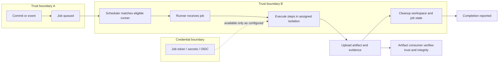
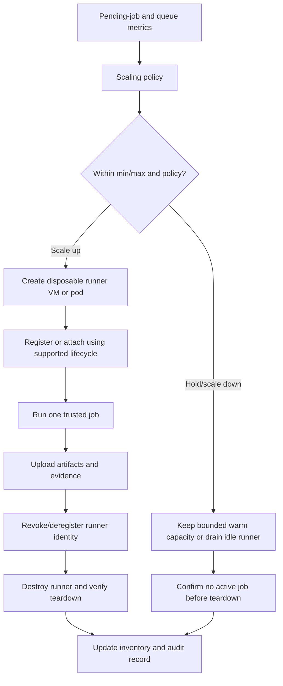

# Unit 10 — Self-Hosted Runners: Scaling and Security

Self-hosted CI runners can solve real engineering constraints—private-network integration, specialized native dependencies, large local caches, or hardware unavailable on hosted agents—but they also move the execution boundary into infrastructure the team owns. A runner that executes repository code can expose its host, network, credentials, caches, and neighboring jobs if isolation is weak. This lesson progresses from a safe private-repository exercise to threat modelling and a local-only capacity simulation; it does not turn a laptop into a production runner fleet.

> **Abstract:** Learn the mechanics and lifecycle of CI runners, safely register a local GitHub Actions runner in a private test repository, distinguish labels from authorization, evaluate persistent and ephemeral execution, threat-model untrusted changes and host access, and model queue-driven fleet capacity without provisioning paid infrastructure. The governing rule for this curriculum is: **never route public-fork pull requests or other untrusted code to your self-hosted runner.**

**Metadata**

- **Module:** M02 — CI/CD Pipeline Engineering
- **Stage:** 2E — Production DevOps & Platform Engineering
- **Target file:** `10-self-hosted-runners-scaling-and-security.md`
- **Estimated time:** 10–14 hours, including labs and review
- **Prerequisites:** M02 Units 1–9; Git, shell, Python, pytest, GitHub Actions workflow basics, container fundamentals, cache/artifact trust, release automation, and protected environments
- **Core tools:** Git, a private GitHub test repository, GitHub Actions, local shell, Python 3, pytest, Docker or Podman where available, optional `gh`
- **Awareness:** GitLab Runner autoscaling, GitHub Actions Runner Controller (ARC), disposable VM pools, gVisor, Firecracker, Kubernetes and cloud autoscalers
- **Assumed tool baseline:** WSL2 Ubuntu on a Windows laptop or native Linux; approximately 4 CPU cores, 8 GB RAM, and 30 GB free disk. Python 3.10+ is assumed for examples; verify your installed version.
- **Last reviewed:** 2026-10-24. This is an authored technical draft, not a claim of live documentation review or executed labs.

## Table of contents

- [10.0 Why this matters in production](#100-why-this-matters-in-production)
- [10.1 Learning objectives](#101-learning-objectives)
- [10.2 Concept map and vocabulary](#102-concept-map-and-vocabulary)
- [10.3 Level 1 — Beginner](#103-level-1--beginner)
- [10.4 Level 2 — Intermediate](#104-level-2--intermediate)
- [10.5 Level 3 — Advanced](#105-level-3--advanced)
- [10.6 Level 4 — Expert](#106-level-4--expert)
- [10.7 SRE lens](#107-sre-lens)
- [10.8 Security lens](#108-security-lens)
- [10.9 Production checklist](#109-production-checklist)
- [10.10 Hands-on lab set](#1010-hands-on-lab-set)
- [10.11 Self-check questions](#1011-self-check-questions)
- [10.12 Evidence artifacts](#1012-evidence-artifacts)
- [10.13 Common interview and design-review questions](#1013-common-interview-and-design-review-questions)
- [10.14 Sources and verification notes](#1014-sources-and-verification-notes)
- [Appendix A — Claim Register](#appendix-a--claim-register)
- [Appendix B — Audit Report](#appendix-b--audit-report)
- [Appendix C — Human Verification Checklist](#appendix-c--human-verification-checklist)
- [Appendix D — Known Limitations and Assumptions](#appendix-d--known-limitations-and-assumptions)
- [Appendix E — Sign-off](#appendix-e--sign-off)

### 10.0 Why this matters in production

An overloaded runner pool can turn a healthy deployment pipeline into a queueing incident, while an unpatched runner can become a foothold into internal systems. A persistent runner may carry modified tools, background processes, cache contents, or credentials from one job into another. A job that can access the host Docker socket or a private network may have more authority than its workflow YAML suggests. Finally, an autoscaler that provisions too slowly or tears down too early can increase queue time, lose evidence, or leave compromised capacity online. Runner engineering is therefore a joint problem in scheduling, reliability, isolation, supply-chain security, and cost—not merely a way to obtain a faster build machine.

### 10.1 Learning objectives

By the end of this unit, the learner will be able to:

1. **Explain** the queued-job-to-teardown lifecycle and distinguish hosted from self-hosted runners. **[L1]**
2. **Register, label, inspect, and safely remove** a local runner associated only with a private test repository. **[L2]**
3. **Demonstrate** persistent workspace state using a harmless marker and prove the cleanup procedure. **[L2]**
4. **Review** workflow event trust, token permissions, runner scope, cache/artifact paths, and network access before assigning a job. **[L3]**
5. **Choose and defend** an isolation model for trusted build jobs, explaining residual risk from containers, sockets, credentials, and the network. **[L3]**
6. **Calculate** a desired runner count using explicit minimum, maximum, pending-job, and concurrency assumptions. **[L4]**
7. **Define** runner SLIs and illustrative SLOs, diagnose queue/disk/offline/teardown symptoms, and document mitigations. **[L4]**
8. **Produce** a verifiable evidence bundle containing workflow review, local simulation tests, cleanup checks, and unresolved verification items. **[L1–L4]**

### 10.2 Concept map and vocabulary

| Term | Precise definition | Common misconception |
|---|---|---|
| Runner | Agent software and its execution environment that receives and runs CI jobs. | “The runner is just the YAML workflow.” |
| Hosted runner | Execution capacity provisioned and maintained by the CI provider under its service model. | “Hosted means every dependency and network path is available.” |
| Self-hosted runner | Runner software operated on infrastructure controlled by the repository owner or organization. | “Self-hosted is automatically cheaper, safer, or faster.” |
| Runner label / GitLab tag | Scheduling selector used to match a job to eligible runner capacity. | “A label is an access-control boundary.” |
| Runner group | A GitHub Actions mechanism for organizing runner access and controlling which repositories may use a runner pool; exact controls can depend on account plan and configuration. | “A group name alone proves the host is isolated.” |
| Persistent runner | A runner/host reused across multiple jobs or workflow runs. | “Deleting the checked-out directory resets the machine.” |
| Ephemeral runner | Capacity intended to serve a limited lifecycle—often one job—and then be destroyed or reset. | “Ephemeral means no risk during the job.” |
| JIT runner | Just-in-time registration/configuration approach used by supported runner-management designs; exact lifecycle/API is version-sensitive. | “JIT is a security boundary by itself.” |
| Executor | In GitLab Runner, the execution backend/model, such as shell, Docker, or Kubernetes; supported choices and behavior vary by version. | “A container executor means every host resource is inaccessible.” |
| Workspace | Checkout and working directory used by a job. | “Workspace cleanup removes all host state.” |
| Cache | Reusable data intended to speed future jobs; its writer/reader trust boundary matters. | “A cache is an authoritative build artifact.” |
| Artifact | Output explicitly preserved or transferred from a job, ideally with provenance and integrity controls. | “An artifact from any job is safe to publish.” |
| Queue time | Time between job becoming eligible/pending and the runner beginning the job. | “A long queue always means too few CPUs.” |
| Trust class | A policy classification for code and jobs, such as trusted internal branch versus untrusted external contribution. | “Different labels alone create different trust classes.” |
| OIDC | Short-lived identity assertion flow that can let a job request cloud credentials when the cloud trust policy authorizes it. | “Using OIDC automatically limits what the job can do.” |

#### Lifecycle and trust boundaries



The workflow scheduler is not the host isolation layer. The runner process, its OS identity, mounted paths, service account, container socket, network route, and credential broker determine what code can reach. Treat job code as executable code, including test commands, dependency install hooks, build scripts, generated scripts, and tools invoked indirectly. Artifacts cross another trust boundary: a later release job should validate the source and integrity of what it consumes.

### 10.3 Level 1 — Beginner

#### What a runner does

A workflow defines requested work; a runner supplies a machine and process environment where that work executes. The scheduler matches a pending job to an eligible runner using platform rules and selectors. The runner obtains the job definition, runs steps, streams logs, uploads configured artifacts or evidence, performs available cleanup, and reports completion. A runner may be online but not eligible for a job because its labels, group scope, platform, or concurrency state do not match.

Hosted capacity reduces the operator’s burden for host patching and capacity provisioning, but it does not guarantee access to your private network, custom hardware, or special dependencies. Self-hosting may be justified for a private integration endpoint, licensed/native tooling, a local device, specialized CPU/GPU, or a controlled network. Those requirements should be stated as requirements, not used as a blanket reason to give untrusted code access to the host.

| Dimension | Hosted runner | Self-hosted runner |
|---|---|---|
| Host control | Provider controls the underlying fleet within its service model | Operator controls host/image and is responsible for hardening |
| Private network | Usually requires supported network architecture or a different integration approach | Can reach networks the host can reach; this is both capability and risk |
| Hardware/tooling | Provider-defined options and images; verify current availability | Customizable, including native dependencies and specialized devices |
| Maintenance | Provider maintains the service infrastructure; workflow dependencies remain your responsibility | Operator patches OS, runner software, tools, images, certificates and inventory |
| Cost model | May be included or metered under current plan/usage rules | Hardware, electricity/cloud time, storage, maintenance and idle capacity |
| Isolation | Provider-defined execution boundary | Must be designed, tested and maintained by the operator |
| Scaling | Provider-managed capacity within service limits | Manual or automated provisioning, capacity and teardown are your responsibility |

#### Identity is layered

- **Runner service identity:** OS account or service identity used by the runner process; it may access local files and host resources allowed to that identity.
- **Job token / `GITHUB_TOKEN`:** A repository-scoped token provided to a workflow under GitHub’s permissions model. It is not the same as the runner’s OS identity.
- **Repository or deployment credentials:** Secrets deliberately exposed to a workflow or environment; they can be read by code that runs while they are available.
- **Cloud identity:** May be obtained through static credentials or a federation flow such as OIDC. Cloud-side trust conditions and permissions determine what is authorized.
- **Host privileges:** Root/administrator, group membership, mounted sockets, sudo rules, device access, and network reachability can exceed the permissions described by workflow YAML.

Top-level `permissions:` constrains the `GITHUB_TOKEN` capabilities available to the workflow. It does **not** sandbox the operating-system process, prevent access to files, revoke credentials already on the host, block network egress, or remove Docker socket authority.

#### Guided starter lab: inspect your local tools

This starter is local-only and does not register a runner. Run in WSL2 Ubuntu or native Linux.

```bash
# terminal: safe local inventory
set -euo pipefail
printf 'OS: '; uname -s
printf 'Architecture: '; uname -m
printf 'Python: '; python3 --version
printf 'Git: '; git --version
if command -v docker >/dev/null 2>&1; then docker --version; else echo 'Docker CLI not installed'; fi
if command -v podman >/dev/null 2>&1; then podman --version; else echo 'Podman CLI not installed'; fi
```

**Example — yours will differ**

```text
OS: Linux
Architecture: x86_64
Python 3.11.x
git version 2.x
Docker version ... (or Docker CLI not installed)
Podman version ... (or Podman CLI not installed)
```

Interpretation: this only records selected, non-secret tool information. Do not dump the complete environment, token variables, home-directory configuration, or runner diagnostic bundle into a public issue.

**What just happened?** You identified the environment in which later labs run. Under WSL2, files stored in the Linux filesystem generally behave more like native Linux files than files accessed through a Windows-mounted path; exact performance varies with workload and setup. Docker Desktop integration, Linux services, process lifetime, and file permissions differ by installation. WSL2 is not equivalent to a dedicated disposable VM: it shares a larger host boundary and should not be treated as a secure sandbox for untrusted jobs.

#### Beginner mistakes → symptom → fix

| Mistake | Symptom | Fix |
|---|---|---|
| Assuming online means eligible | Job remains queued | Check group scope, exact labels, platform and concurrency |
| Using labels as a security policy | Untrusted job can target a sensitive pool if access rules permit | Enforce repository scope and separate infrastructure/trust classes |
| Printing all environment variables | Logs may contain sensitive values or identifiers | Print only explicit safe values and version commands |
| Assuming checkout cleanup resets host | Later job sees files/processes/caches | Use disposable isolation and verify teardown |
| Assuming a container hides the host | Job can access mounted socket or host paths | Remove unnecessary mounts; use a stronger boundary when required |

### 10.4 Level 2 — Intermediate

#### Register only in a private test repository

**Safety rule:** Use only a repository you own and have made private for this lab. Do not use a production repository, organization-wide runner, public repository, or any runner that has access to sensitive networks or credentials. Never route public-fork pull requests or other untrusted code to this runner.

The official registration flow normally starts in repository settings under the Actions runner settings, where the platform presents operating-system-specific instructions and a temporary registration token. The UI labels, exact navigation, token lifetime and commands can change: **[VERIFY: current GitHub documentation “Adding self-hosted runners” and the settings page for your private test repository before proceeding.]** Generate the command in the UI, inspect it, and enter the temporary token only into the interactive registration prompt. Do not place the token in shell history, screenshots, source control, chat, or logs. Do not invent or reuse a token from an example.

Suggested test-repository preparation:

1. Create a private repository that contains no production secrets, deployment permissions, sensitive artifacts, or private-network access.
2. Ensure no public forks or external contributors can submit code to it during the exercise.
3. Create a disposable local working directory and keep the runner service under a dedicated, unprivileged OS user where practical.
4. Use the current official runner package and platform-generated configuration instructions. Verify checksums/signatures where the official documentation provides them.
5. Register a uniquely named runner such as `laptop-lab-runner` with a dedicated lab label such as `local-lab-only`. A label is a selector, not a security boundary.

**[VERSION-SENSITIVE]** The official UI may display a download URL, checksum and registration command that differ by operating system and runner release. Do not copy a command from an old blog post. Follow the current platform-generated instructions and keep the temporary token out of saved scripts.

#### Minimal harmless workflow

Create `.github/workflows/self-hosted-runner-smoke.yml` in the private test repository:

```yaml
# .github/workflows/self-hosted-runner-smoke.yml
name: Self-hosted runner smoke test

on:
  workflow_dispatch:

permissions:
  contents: read

jobs:
  smoke:
    # This label is a scheduling selector, not an authorization boundary.
    runs-on: [self-hosted, local-lab-only]
    timeout-minutes: 5
    steps:
      - name: Print selected tool versions
        shell: bash
        run: |
          set -euo pipefail
          uname -s
          uname -m
          python3 --version
          git --version
      - name: Write harmless evidence file
        shell: bash
        run: |
          set -euo pipefail
          mkdir -p runner-evidence
          printf 'runner-smoke-ok\n' > runner-evidence/status.txt
          cat runner-evidence/status.txt
      - name: Upload evidence
        uses: actions/upload-artifact@<VERIFIED_FULL_COMMIT_SHA>
        with:
          name: runner-smoke-evidence
          path: runner-evidence/status.txt
          if-no-files-found: error
```

Replace `<VERIFIED_FULL_COMMIT_SHA>` with a verified full commit SHA for the official upload-artifact action after consulting its release and security guidance. Do not commit the placeholder as if it were runnable. **[VERIFY: current action release and input compatibility.]** If you are not ready to verify and pin the action, omit the upload step and verify the harmless file in the runner workspace instead; do not silently use an unpinned placeholder.

**Example — yours will differ**

```text
Linux
x86_64
Python 3.11.x
git version 2.x
runner-smoke-ok
```

Interpretation: the job ran on a Linux runner and wrote a benign file. Confirm the job details show the expected runner name and labels. The workflow’s `contents: read` limits the job token to read access to repository contents; it does not limit the host process to that directory.

#### Labels, groups and scope

Labels describe properties used for scheduling (for example, `self-hosted`, an OS/architecture label, or a custom lab label). A job must request labels that match an eligible runner. GitLab Runner uses tags for analogous selection, subject to its own matching rules. **Neither labels nor tags are access-control boundaries.** Repository/org-level runner scope and group restrictions decide which repositories can schedule jobs to a pool. The availability and granularity of runner groups and policy controls can depend on plan and account configuration: **[VERIFY: current GitHub runner-group documentation and your account’s settings.]**

For sensitive jobs, combine access scoping with infrastructure isolation, job permissions, environment protections, network policy, and explicit workflow review. Never assume a secret-bearing deployment job is safe merely because it targets `runs-on: [self-hosted, production]`.

#### Workspace cleanup and limits

A job’s checkout may be cleaned between runs by the platform or by explicit cleanup steps, but this does not prove that the entire host has been reset. Files outside the workspace, background processes, shell history, tool caches, Docker images/layers, mounted volumes, service logs, credentials in configuration files, and modifications to `PATH` or installed binaries can persist. A malicious or simply broken job may leave a process running or fill a disk. Cleanup should be treated as one control, not a replacement for a disposable machine.

#### Containerized job versus container as boundary

Running commands inside a container may standardize dependencies and reduce accidental host variation, but the host still owns the container runtime, kernel, mounts, networks and any passed-through devices. A container with the host Docker socket can often ask the daemon to create containers with powerful host access; treat socket access as potentially equivalent to host control. A container with sensitive host paths, privileged mode, host networking or devices can cross intended boundaries. For higher-risk code, use a disposable VM or stronger isolation model and avoid giving the job host credentials.

#### Persistent versus ephemeral lifecycle

| Design | Benefit | Main residual risk |
|---|---|---|
| Persistent host and runner | Warm tools/cache, less startup overhead, simple lab setup | Cross-job contamination and long-lived credentials or processes |
| Persistent host, per-job container | Repeatable userspace; may constrain accidental file leakage | Shared kernel/runtime, unsafe mounts, socket and host-network exposure |
| Disposable container runner | Shorter persistence window and easier cleanup | Host and network remain exposed during job; container teardown may not remove host-side state |
| Disposable VM per job | Stronger boundary than a shared container in many designs | Image drift, provisioning latency, host/cloud control plane and network still require hardening |
| JIT/ephemeral managed pattern | Limits reuse of runner registration/capacity in supported designs | Version/configuration-sensitive; does not prevent in-job theft or downstream poisoning |

#### Runner maintenance and safe draining

Maintain a documented process for runner package updates, OS security updates, dependency/toolchain refresh, log review, disk monitoring, and removal of stale registrations. For a small local lab, stop the runner process using the documented stop mechanism for the installation, then remove its registration using the official settings/management flow. Do not kill unrelated processes or delete arbitrary directories. **[VERIFY: exact service names and stop/removal commands depend on installation method and runner version.]**

WSL2 note: a process launched in an interactive shell may end with that shell/session, while a configured service may have different lifetime behavior. Do not assume a Windows restart, WSL shutdown, or Docker Desktop restart has the same lifecycle on every setup. Confirm the process and service state explicitly.

### 10.5 Level 3 — Advanced

#### Central security rule

**Self-hosted runners must never execute untrusted code.** In this curriculum, do not route public-fork pull requests, untrusted external contributions, or unreviewed workflow changes to the learner’s self-hosted runner. If an organization has a justified need to evaluate untrusted code, it requires a deliberately designed, disposable low-trust environment with no secrets and no path to sensitive networks; that architecture is outside the learner’s hands-on setup.

A pull request is more than its visible workflow YAML. A test command can invoke attacker-controlled scripts; dependency installation can run hooks; build tooling can load plugins; package managers may execute lifecycle scripts; generated code can be executed; tests can alter files or spawn processes. A workflow that appears to run “only tests” can still execute arbitrary repository-controlled commands. Event semantics and token/secret availability vary by event and configuration, so review the trigger, checkout ref, permissions, and all code paths together.

#### Threat model and controls

| Threat | How it happens | Defensive control and evidence |
|---|---|---|
| Persistent contamination | Job leaves files, processes, binaries, `PATH` changes or local services | Prefer disposable runner; compare host state; inventory and teardown evidence |
| Credential exposure | Job can read available secrets, runner credentials, config files or cloud identity | Minimize secrets; use short-lived identity where possible; scope cloud trust; never log credentials |
| Docker socket abuse | Job can instruct host daemon through a mounted socket | Do not mount socket into untrusted jobs; separate builder/runner; test mounts and daemon access |
| Private-network reachability | Runner host can route to internal endpoints | Egress allowlists, segmented subnets, DNS/proxy controls, firewall policy, network telemetry |
| Cache poisoning | Untrusted job writes data later consumed by trusted release job | Separate cache namespaces and trust classes; do not treat cache as release input without integrity checks |
| Artifact poisoning | Untrusted or compromised job uploads malicious output | Verify source commit, provenance, digest, policy and approval before promotion |
| Excessive token scope | Workflow token can write packages, contents, deployments or checks unnecessarily | Set least-privilege `permissions:`; elevate only in narrowly scoped jobs |
| Long-lived credentials | Static cloud/registry token remains on host or in config | Remove static credentials from runner; prefer OIDC with narrow cloud trust and short lifetime |
| Runner registration abuse | Runner can accept jobs beyond intended repositories | Restrict repository/org scope, protect runner-management credentials, inventory registrations |
| Log leakage | Debug output reveals sensitive values or paths | Redact intentionally; avoid full environment dumps; treat masking as best-effort, not a guarantee |

#### OIDC and secret handling

OIDC can exchange a job identity assertion for short-lived cloud credentials when the cloud provider’s trust policy validates the issuer, audience, repository/workflow/ref/environment claims and other required conditions. OIDC does not automatically authorize only the intended operations: the cloud role’s permissions and trust policy remain decisive. Avoid broad trust such as accepting every repository or ref in an organization when only one release workflow should assume the role. Review M09 for identity and secret-management detail.

Do not put secrets in command-line arguments where process listings or logs may expose them; do not print environment dumps; do not write credentials to the workspace; and do not assume log masking catches every transformed or partial value. The safest secret is one never made available to the job.

#### Isolation decision table

| Option | Strength/use | Limitations and operational cost |
|---|---|---|
| Dedicated persistent host for trusted internal jobs | Simple, supports custom dependencies and local caches | Cross-job contamination; patching and incident response are mandatory |
| Per-job container without sensitive mounts | Helpful packaging and some filesystem separation | Shared host kernel/runtime; mounts, socket, network and device access can defeat separation |
| Rootless container runtime | Reduces some daemon/root exposure depending on configuration | Not a universal sandbox; kernel, filesystem and networking details still matter |
| Disposable VM per job | Stronger isolation from other jobs in many threat models | More provisioning and image maintenance; VM still needs egress, identity and control-plane safeguards |
| gVisor / Firecracker | Awareness: technologies used in some stronger isolation architectures | Integration and threat-model details vary; not a required laptop dependency |
| Kubernetes with ARC | Awareness: manages ephemeral runner capacity in a cluster | Cluster control plane, pod security, node isolation, secrets, network policy and scaling behavior become part of the boundary |
| Separate trusted and untrusted pools | Makes policy intent explicit | Labels alone do not enforce trust; pools must have distinct access, credentials, network and lifecycle controls |

#### Workflow security review checklist

Before allowing a job onto a self-hosted pool, verify each item:

- [ ] **Event type:** Is this `workflow_dispatch`, a trusted push, a release event, or a pull request? Could an external contributor influence the code?
- [ ] **Repository trust:** Is the repository private and controlled? Are branch and workflow changes reviewed?
- [ ] **Permissions:** Is `permissions:` explicit and minimal? Does any job require write access?
- [ ] **Secrets:** Which secrets are available, when, and to which jobs? Can untrusted code execute while secrets are present?
- [ ] **Runner scope:** Is repository/group access restricted? Are labels merely selectors, with real scope controls elsewhere?
- [ ] **Cache scope:** Can lower-trust jobs write caches consumed by trusted release jobs?
- [ ] **Artifact trust:** Are producer identity, source commit, digest and provenance checked before publishing?
- [ ] **Network:** Can the runner reach production databases, metadata endpoints, private package indexes, internal admin APIs or unrestricted internet egress?
- [ ] **Host resources:** Are Docker socket, privileged mode, host paths, devices and credentials absent unless justified?
- [ ] **Cleanup:** Does the lifecycle destroy/reset the whole intended boundary, not just the checkout?
- [ ] **Release/deployment:** Are environment approvals and protected branches in place? Are deploy credentials only exposed after gates?
- [ ] **Audit:** Can operators map a runner instance to jobs, repository, image version, network identity and teardown record?

#### Measurement method and defended design decision

For this laptop curriculum, the defended design is: use hosted runners for ordinary public or untrusted contributions; use the local self-hosted runner only for a manually dispatched smoke test in your own private repository; do not place production secrets on the runner; and do not use it for release/deployment. For production, start with the smallest pool that satisfies a documented requirement, separate trust classes physically or through a tested isolation architecture, and use disposable capacity for jobs where the threat model requires it.

Measure before optimizing: record job queue time, job duration, startup/provisioning delay, runner idle/busy time, failure attribution, disk usage, and teardown success. Compare percentiles over a stable window; do not optimize only average queue time. A low average can hide severe tail delays. A high utilization rate can be a sign of efficiency or insufficient headroom; interpret it with queue time and failure rate.

### 10.6 Level 4 — Expert

#### Autoscaling architecture



A real autoscaler must coordinate queue observation, provisioning, registration, job execution, evidence upload, credential revocation, deregistration, destruction and inventory updates. Scaling only on CPU misses jobs waiting for a runner. Scaling only on pending count can overreact to bursty or long-running jobs. The policy must account for startup delay, queue-time objectives, concurrency caps, job duration, provider/API limits, rate limits, and the cost of idle capacity. **[VERIFY: current GitHub/GitLab APIs, quotas, rate limits and platform-supported autoscaling patterns.]**

- **GitHub Actions Runner Controller (ARC):** Awareness / forward reference to M03. ARC manages runner scale sets in Kubernetes; exact installation and supported features are version-sensitive. Do not install a cluster merely to complete this unit.
- **GitLab Runner autoscaling:** Awareness/working conceptual comparison. GitLab Runner executor and autoscaling configuration varies across versions and integrations. Verify current executor documentation before implementing.
- **Disposable VM pools / cloud autoscalers:** Awareness. A cloud instance lifecycle is only one component; secure bootstrap, identity, network policy, image provenance, runner registration and teardown must be designed together.

#### Local scale-up / scale-down simulation

This model does not call GitHub or GitLab, register runners, or provision infrastructure. It treats each runner as able to execute a configurable number of jobs concurrently. The chosen concurrency is an illustrative assumption, not a benchmark.

Create `runner_capacity.py`:

```python
# runner_capacity.py
from __future__ import annotations

import argparse
from dataclasses import dataclass


@dataclass(frozen=True)
class CapacityDecision:
    pending_jobs: int
    current_runners: int
    min_runners: int
    max_runners: int
    jobs_per_runner: int
    desired_runners: int
    action: str
    reason: str


def desired_capacity(
    pending_jobs: int,
    current_runners: int,
    min_runners: int = 0,
    max_runners: int = 10,
    jobs_per_runner: int = 1,
) -> CapacityDecision:
    """Calculate a bounded runner target; this is a simulation only."""
    values = {
        "pending_jobs": pending_jobs,
        "current_runners": current_runners,
        "min_runners": min_runners,
        "max_runners": max_runners,
        "jobs_per_runner": jobs_per_runner,
    }
    if any(value < 0 for value in values.values()):
        raise ValueError("counts and bounds must be non-negative")
    if jobs_per_runner < 1:
        raise ValueError("jobs_per_runner must be at least 1")
    if max_runners < min_runners:
        raise ValueError("max_runners must be greater than or equal to min_runners")

    required = (pending_jobs + jobs_per_runner - 1) // jobs_per_runner
    desired = min(max(required, min_runners), max_runners)
    if desired > current_runners:
        action = "scale-up"
        reason = f"{pending_jobs} pending jobs require target {desired} under the configured concurrency and bounds"
    elif desired < current_runners:
        action = "scale-down"
        reason = f"target {desired} is below current count {current_runners}; drain active jobs before removal"
    else:
        action = "hold"
        reason = f"current count already equals target {desired}"
    return CapacityDecision(
        pending_jobs, current_runners, min_runners, max_runners,
        jobs_per_runner, desired, action, reason
    )


def main() -> int:
    parser = argparse.ArgumentParser(description="Local runner-capacity simulation; no infrastructure is changed.")
    parser.add_argument("--pending", type=int, required=True, help="number of pending jobs")
    parser.add_argument("--current", type=int, required=True, help="current runner count")
    parser.add_argument("--min-runners", type=int, default=0)
    parser.add_argument("--max-runners", type=int, default=10)
    parser.add_argument("--jobs-per-runner", type=int, default=1)
    args = parser.parse_args()
    try:
        decision = desired_capacity(
            args.pending, args.current, args.min_runners,
            args.max_runners, args.jobs_per_runner
        )
    except ValueError as exc:
        parser.error(str(exc))
    print(f"action={decision.action}")
    print(f"desired_runners={decision.desired_runners}")
    print(f"reason={decision.reason}")
    return 0


if __name__ == "__main__":
    raise SystemExit(main())
```

Create `test_runner_capacity.py`:

```python
# test_runner_capacity.py
import pytest

from runner_capacity import desired_capacity


@pytest.mark.parametrize(
    ("pending", "current", "minimum", "maximum", "concurrency", "expected", "action"),
    [
        (0, 0, 0, 10, 1, 0, "hold"),       # zero jobs
        (5, 1, 0, 10, 1, 5, "scale-up"),    # scale up
        (1, 5, 0, 10, 1, 1, "scale-down"),  # scale down
        (100, 2, 0, 8, 1, 8, "scale-up"),   # maximum bound
        (5, 1, 0, 10, 2, 3, "scale-up"),    # concurrency assumption
        (0, 0, 2, 10, 1, 2, "scale-up"),    # warm minimum
    ],
)
def test_capacity_cases(pending, current, minimum, maximum, concurrency, expected, action):
    result = desired_capacity(pending, current, minimum, maximum, concurrency)
    assert result.desired_runners == expected
    assert result.action == action


def test_invalid_bounds_rejected():
    with pytest.raises(ValueError):
        desired_capacity(1, 1, min_runners=5, max_runners=2)


def test_zero_concurrency_rejected():
    with pytest.raises(ValueError):
        desired_capacity(1, 1, jobs_per_runner=0)
```

Run the simulation:

```bash
# terminal: create an isolated working directory first
set -euo pipefail
python3 -m venv .venv
. .venv/bin/activate
python -m pip install --upgrade pip
python -m pip install pytest
pytest -q
python runner_capacity.py --pending 7 --current 2 --min-runners 1 --max-runners 6 --jobs-per-runner 1
python runner_capacity.py --pending 0 --current 4 --min-runners 1 --max-runners 6 --jobs-per-runner 1
```

**Example — yours will differ**

```text
........                                                                 [100%]
action=scale-up
desired_runners=6
reason=7 pending jobs require target 6 under the configured concurrency and bounds
action=scale-down
desired_runners=1
reason=target 1 is below current count 4; drain active jobs before removal
```

Interpretation: the first case is capped at six runners even though seven jobs are pending; at least one job remains queued if every runner can run one job. The second case targets the minimum, but a real system must drain active work and respect startup/shutdown delays. The displayed output is representative, not a claim this file was executed.

**Capacity model.** At a high level, required concurrency depends on job arrival rate and average duration. If jobs arrive faster than available slots complete them, the queue grows. Actual capacity planning also considers burstiness, duration distribution, retries, runner startup latency, service rate limits, job affinity, concurrency controls, and headroom. A simple utilization approximation is useful for reasoning but is not a substitute for measured queue and duration data. Mark all numerical planning assumptions `[ILLUSTRATIVE]`; do not invent provider prices. See M15 for capacity economics and FinOps.

#### Failure scenarios: symptom → hypothesis → test → root cause → fix → prevention

| Symptom | Hypothesis | Test | Root cause example | Fix | Prevention |
|---|---|---|---|---|---|
| Jobs queue while runners appear online | Labels or scope mismatch | Compare requested labels, runner labels, group/repository access and busy state | Job requests a label no eligible runner has | Correct selector or authorized scope | Validate workflow-to-pool mapping in review |
| Runner repeatedly offline | Service crash, host sleep, network/DNS issue | Inspect service status, runner logs and host/network telemetry | WSL session ended or host rebooted | Restart using documented process; restore host connectivity | Use managed lifecycle and health checks for production |
| Disk full | Workspace/cache/log/image accumulation | Check filesystem usage and largest owned directories | Persistent workspaces or container layers not pruned | Stop new jobs, preserve needed evidence, clean only understood data | Disk alerts, retention policy, disposable runners |
| Repeated failures on one host | Toolchain drift or contamination | Compare image/tool versions and reproduce on clean capacity | Mutable tools or background process | Drain host and rebuild from known-good image | Golden images, pinned toolchains, canary rollout |
| Teardown failed | Active job, deregistration error or cloud API failure | Inspect lifecycle state and instance inventory | Shutdown raced with evidence upload | Keep isolated; retry idempotent cleanup after checking active work | Reconciliation controller and orphan inventory |
| Suspected compromise | Unexpected process/network/credential use | Isolate and preserve logs; correlate jobs and audit trail | Malicious or compromised job altered host | Follow incident runbook below | Least privilege, egress control, disposable capacity |

#### Incident runbook: runner compromised

1. **Isolate:** Remove the runner from eligible scheduling and restrict its network at the infrastructure layer. Do not rely on changing a label alone.
2. **Disable/remove:** Disable or remove the runner registration using the documented platform flow. Preserve the runner ID/name and timestamps for correlation.
3. **Revoke and rotate:** Revoke runner-management credentials and rotate any repository, registry, cloud, deployment or service credentials that may have been accessible. Disable short-lived cloud roles or sessions where supported.
4. **Scope impact:** Identify jobs, repositories, branches, workflow files, artifacts, caches, private endpoints and networks touched during the suspected window.
5. **Preserve evidence:** Keep relevant platform audit logs, runner logs, host telemetry, image digest, process/network observations and job identifiers. Follow organizational incident-handling policy.
6. **Rebuild:** Recreate capacity from a known-good image. Do not trust a “cleaned” compromised host.
7. **Validate downstream outputs:** Rebuild suspect artifacts, validate provenance/digests, invalidate suspect caches, and assess releases or deployments produced by affected jobs.
8. **Communicate:** Record impact, timeline, owners, containment, recovery and follow-up actions. Preserve evidence before deletion when policy requires it.
9. **Prevent recurrence:** Add missing trust separation, egress restrictions, shorter credential lifetimes, stronger teardown verification, or alerting. Do not claim any single control makes the fleet secure.

### 10.7 SRE lens

#### Runner SLIs and potential SLOs

An SLI is a measured indicator; an SLO is a target over a stated window. The targets below are examples only and must be calibrated from actual workload data.

| SLI | How to measure | Potential target | Sampling caveat / gaming risk |
|---|---|---|---|
| Queue time p50/p95 | Job eligible timestamp to job start timestamp | `[ILLUSTRATIVE]` p95 below a team-agreed threshold | Exclude cancelled/never-started jobs and the metric looks better |
| Provisioning/startup latency | Capacity creation requested to runner ready/job pickup | `[ILLUSTRATIVE]` p95 within budget | Separate provider startup from queue delay |
| Successful job pickup | Eligible jobs picked up within timeout / eligible jobs | `[ILLUSTRATIVE]` at least 99% | Misclassified ineligible jobs distort denominator |
| Runner utilization | Busy runner-minutes / schedulable runner-minutes | Capacity range set from observed queue and cost | Maximizing utilization can worsen tail queue time |
| Runner-attributable failure rate | Jobs failed due to runner infrastructure / jobs attempted | Trend downward from baseline | Misattributing application failures hides infra defects |
| Teardown success | Ephemeral runners confirmed destroyed / ephemeral runners created | `[ILLUSTRATIVE]` 100% with orphan reconciliation | “API accepted delete” is not proof resources are gone |
| Patch compliance | Active runners on approved image/version / active runners | `[ILLUSTRATIVE]` 100% for critical fixes within policy window | Version inventory may be stale or incomplete |
| Stale runner count | Registered but unresponsive/outdated runners | Zero beyond agreed expiry window | Removing stale entries without investigating can lose evidence |
| Compromise isolation time | Detection-to-network isolation timestamp | Set from threat model and incident severity | Clock skew and delayed detection distort it |
| Intended trust-class placement | Jobs assigned to approved pool / jobs in each trust class | 100% for protected/release jobs | Labels alone can make a false sense of compliance |

Use platform job timestamps and runner inventory, runner/service logs, host metrics, infrastructure provisioning events, audit logs, and network telemetry. Keep a consistent time source. Measure by repository, workflow, event type, runner pool, OS image and trust class, but avoid exposing secret values or unnecessary personal data in dashboards.

#### Alert → triage → mitigation → follow-up

- **Queue buildup:** Alert on p95 queue time and pending-job age. Triage eligible labels, pool scope, active capacity, startup failures and job-duration changes. Mitigate by restoring healthy capacity or temporarily limiting non-critical work; do not bypass trust controls. Follow up with arrival/duration analysis and scaling-policy tests.
- **Runner offline:** Check platform status, host/service state, DNS/network, disk and update status. Remove it from scheduling if health is uncertain. Reconnect only after understanding the failure.
- **Disk full:** Stop new work on the host, preserve required logs, identify owned caches/images/workspaces, then clean using a documented policy. Avoid broad destructive cleanup on an incident host before evidence preservation.
- **Repeated job failure:** Compare failure distribution across runners and clean images; check toolchain drift, disk pressure, network and dependency availability. Do not repeatedly retry a possibly compromised host without containment.
- **Suspected compromise:** Use the incident runbook in 10.6; isolate first, preserve evidence, revoke credentials, scope downstream artifacts and rebuild.
- **Failed teardown:** Mark the resource quarantined, prevent new scheduling, reconcile registration and infrastructure state, and retry idempotently. Verify the resource is actually gone.

#### Capacity and cost notes

A fleet’s cost is not simply the number of jobs. It includes active compute time, idle headroom, startup overhead, failed/retried work, storage and logs, image build/refresh, engineering time, and the risk cost of overly broad access. A shared persistent host can look inexpensive until contamination or credential exposure causes an incident. A disposable pool can reduce persistence but may add startup and image-maintenance cost. Compare total cost against queue-time objectives and risk requirements. M15 covers detailed capacity economics; M03/M10 cover cluster and platform reliability.

### 10.8 Security lens

#### OWASP CI/CD risk framing and SLSA concepts

OWASP’s CI/CD Security Risks catalogue identifies classes of pipeline risk including insufficient flow control, improper identity and access management, dependency-chain abuse, poisoned pipeline execution, insufficient credential hygiene, and inadequate logging/visibility. Map controls to the current official OWASP list rather than assuming the list’s labels or numbering never change. Runner design intersects several categories: workflow trigger review, runner-group access, token minimization, dependency provenance, cache/artifact trust, network isolation and incident logging.

SLSA concepts help reason about build provenance, trusted build platforms, source identity and verifiable build outputs. A self-hosted runner is not automatically a trusted build platform simply because the organization owns it. Provenance claims are only as credible as the build process, identity controls, isolation, and evidence collection behind them. Consult M12 for supply-chain and provenance implementation.

**Out of scope:** this unit does not establish a production-grade multi-tenant sandbox, certify compliance, configure a real cloud autoscaler, install ARC, or prove a runner secure. It provides a safe local exercise, an architecture model, and a review framework. A security assessment must be tailored to the organization’s threat model and current platform behavior.

### 10.9 Production checklist

Mark each item complete only when evidence exists.

- [ ] Runner use has a documented business/technical requirement not satisfied by hosted capacity.
- [ ] Trusted and untrusted code paths are separated; no public-fork PR is routed to the self-hosted pool.
- [ ] Runner repository/group scope is restricted and reviewed.
- [ ] Labels/tags are treated as scheduling selectors, not authorization.
- [ ] OS identity is unprivileged; unnecessary sudo, devices, mounts and host sockets are absent.
- [ ] Workflow permissions are explicit and least-privilege; secrets are limited to jobs that need them.
- [ ] Cloud federation trust and role permissions are narrow; static long-lived credentials are avoided where feasible.
- [ ] Network egress and private-network routes are documented, restricted and monitored.
- [ ] Cache and artifact trust boundaries are explicit; untrusted writers cannot silently influence trusted release jobs.
- [ ] Persistent capacity has contamination controls and rebuild procedures; high-risk jobs use an appropriate disposable boundary.
- [ ] Runner software, OS, toolchains and base images have owners, patch SLAs and inventory.
- [ ] Queue time, pickup success, utilization, failure attribution, disk pressure and teardown are measured.
- [ ] Autoscaling has minimum/maximum bounds, concurrency limits, back-pressure and safe drain behavior.
- [ ] Logs and audit events allow correlation from job to runner, image, identity and network.
- [ ] Incident response includes isolate, disable, revoke/rotate, scope, preserve, rebuild and downstream validation.
- [ ] Cleanup has a verification step and orphan-resource reconciliation.
- [ ] Platform-specific behavior, rate limits, plan restrictions and current UI/API instructions have been verified against official docs.
- [ ] Design review includes residual risks; no single control is presented as a guarantee.

### 10.10 Hands-on lab set

All labs are local/free by design, but Lab A requires access to a private GitHub repository and whatever account features are currently available. **[VERIFY]** plan and policy restrictions before registering. Never add production credentials. Do not route public-fork PRs or untrusted code to the lab runner.

#### Lab A — Private test repository runner registration

**ID:** M02-U10-LAB-A  
**Goal:** Register a local runner to a private repository, run a harmless manually dispatched job, inspect evidence, and remove the runner.

**Steps**

1. Create or select your own private test repository. Confirm it contains no production secrets or deployment workflows.
2. Open the repository’s current Actions runner settings and follow the official “Adding self-hosted runners” instructions for your OS. **[VERIFY: current UI path, supported OS and commands.]**
3. Download the official runner package and verify integrity using the currently documented method. Run the platform-generated configuration command locally. Enter the temporary registration token only when prompted. Never paste it into a script or terminal transcript.
4. Assign a unique runner name and a lab-only label. Do not register it at organization scope for this exercise.
5. Add `.github/workflows/self-hosted-runner-smoke.yml` from section 10.4. Replace the upload-artifact action placeholder with a verified full commit SHA, or omit that upload step and inspect the local evidence file.
6. Trigger the workflow manually. Confirm the job details identify the expected runner, and inspect the safe version output and `runner-smoke-ok` evidence.
7. Stop the runner using the documented method for the installation and remove/deregister it through the current runner-management flow. Revoke any test credentials created during setup.
8. Verify the runner is no longer online/registered in the repository settings and that the local runner process/service has stopped.

**Expected evidence:** job URL/ID (keep private), runner name and labels, safe tool-version output, `runner-evidence/status.txt`, cleanup screenshot or written verification, and a note of documentation details verified.

**Cleanup verification:** no runner appears online; no runner process/service remains; no test credential remains; remove the local runner directory only after preserving required evidence and confirming the registration has been removed.

**Local fallback/simulation:** if you cannot register a runner, run the local tool inventory from 10.3 and the capacity simulation from Lab D. Record “registration unavailable” and the reason; do not claim the runner lab passed.

**Example — yours will differ**

```text
runner-smoke-ok
Runner status: offline or removed in repository settings
Local runner process: not running
```

Interpretation: these are the expected verification outcomes, not evidence that this lab has been executed.

#### Lab B — Persistent runner contamination demonstration (benign, controlled)

**ID:** M02-U10-LAB-B  
**Goal:** Observe that a persistent workspace can preserve harmless state between two manually dispatched jobs, then prove cleanup removes the marker. This is a controlled security exercise for your own private test repository only.

**Preconditions:** Use the private lab runner from Lab A only after the smoke test works. Do not use secrets, real credentials, production paths, exploit tools, or destructive commands. Do not expose the runner to external contributors.

Create `.github/workflows/persistence-lab.yml`:

```yaml
# .github/workflows/persistence-lab.yml
name: Controlled persistence lab

on:
  workflow_dispatch:
    inputs:
      mode:
        description: "Choose write, observe, or cleanup"
        type: choice
        required: true
        options:
          - write
          - observe
          - cleanup

permissions:
  contents: read

jobs:
  persistence:
    runs-on: [self-hosted, local-lab-only]
    timeout-minutes: 3
    steps:
      - name: Run selected benign action
        shell: bash
        env:
          MODE: ${{ inputs.mode }}
        run: |
          set -euo pipefail
          marker="${RUNNER_TEMP}/m02-u10-benign-marker.txt"
          case "${MODE}" in
            write)
              printf 'benign-lab-marker\n' > "${marker}"
              echo "marker_written"
              ;;
            observe)
              if [[ -f "${marker}" ]]; then
                echo "marker_present"
                cat "${marker}"
              else
                echo "marker_absent"
              fi
              ;;
            cleanup)
              rm -f -- "${marker}"
              if [[ -e "${marker}" ]]; then
                echo "cleanup_failed" >&2
                exit 1
              fi
              echo "marker_removed"
              ;;
            *)
              echo "unsupported mode" >&2
              exit 2
              ;;
          esac
```

This example intentionally uses `RUNNER_TEMP`, a runner-provided temporary location, but persistence behavior depends on platform and runner cleanup/version details. **[VERIFY]** its exact path and lifecycle semantics against current GitHub runner documentation and your setup. If the platform cleans that location between jobs, the `observe` step should report `marker_absent`; this is a valid result, not a failure.

**Steps:** Dispatch `write`, then dispatch `observe`, record the result, then dispatch `cleanup`. Run `observe` again and expect absence. If the marker never persists, do not weaken cleanup or broaden the experiment; record the platform behavior and use the local-only fallback below.

**Example — yours will differ**

```text
marker_written
marker_present
benign-lab-marker
marker_removed
marker_absent
```

Interpretation: the example demonstrates one possible persistent-host outcome. It is not guaranteed; workspace/temporary cleanup behavior may remove the marker earlier. The security lesson is that state can survive outside expected cleanup boundaries, so verify rather than assume.

**Local fallback:** In a disposable local directory, use a temporary file to understand persistence mechanics without a runner:

```bash
# terminal: benign local-only persistence model
set -euo pipefail
tmp_dir="$(mktemp -d)"
trap 'rm -rf -- "$tmp_dir"' EXIT
marker="${tmp_dir}/marker.txt"
printf 'benign-lab-marker\n' > "$marker"
test -f "$marker"
printf 'marker_present='
test -f "$marker" && echo yes
rm -f -- "$marker"
if test -e "$marker"; then echo 'cleanup_failed' >&2; exit 1; fi
echo 'marker_removed'
```

**Example — yours will differ**

```text
marker_present=yes
marker_removed
```

Interpretation: the local model proves file creation and removal only; it does not establish how a hosted or self-hosted runner manages its workspace.

**Cleanup:** Run the workflow’s cleanup mode, verify the marker is absent, remove the workflow when the exercise is complete, and deregister/stop the runner as described in Lab A. Do not claim that removing a marker proves the host is clean.

#### Lab C — Ephemeral container lifecycle (safe simulation)

**ID:** M02-U10-LAB-C  
**Goal:** Model one-job disposable execution and teardown without requiring a runner-in-container installation. Actual runner-in-container setup is platform/version-sensitive and not required.

A container can help package a one-job environment, but it shares the host kernel in typical Linux container designs and may retain state in mounted volumes, images, logs or host paths. Never mount the host Docker socket into untrusted job containers. Do not expose credentials to the container. For this lab, use a plain short-lived container only if Docker/Podman is already installed and you understand the local daemon; otherwise use the simulation.

**Container path (optional):**

```bash
# terminal: disposable container smoke test; no host socket or sensitive mounts
set -euo pipefail
if command -v docker >/dev/null 2>&1; then
  runtime=docker
elif command -v podman >/dev/null 2>&1; then
  runtime=podman
else
  echo 'No container runtime found; use the simulation fallback.'
  exit 0
fi
name="m02-u10-ephemeral-lab"
"$runtime" run --name "$name" --rm alpine:3.20 sh -ec 'printf "ephemeral-job-ok\n"; test ! -e /lab-marker'
```

**[VERIFY]** image availability and tag policy before relying on a specific image tag; pin a verified digest for repeatable work. This example uses a public image reference for demonstration and does not prove image provenance.

**Example — yours will differ**

```text
ephemeral-job-ok
```

Interpretation: the container exited after one command and `--rm` requests removal of the container object. It does not prove that image layers, daemon logs, host-side artifacts or network traces have disappeared.

**Simulation fallback:**

```bash
# terminal: disposable-directory lifecycle simulation
set -euo pipefail
tmp_dir="$(mktemp -d)"
marker="${tmp_dir}/marker.txt"
cleanup() { rm -rf -- "$tmp_dir"; }
trap cleanup EXIT
printf 'one-job-only\n' > "$marker"
test -f "$marker"
echo 'during_job=marker-present'
cleanup
trap - EXIT
if test -e "$tmp_dir"; then
  echo 'teardown_failed' >&2
  exit 1
fi
echo 'after_job=temporary-directory-removed'
```

**Example — yours will differ**

```text
during_job=marker-present
after_job=temporary-directory-removed
```

Interpretation: this verifies the simulation’s temporary directory was removed. It is not proof of complete host cleanup or a production runner lifecycle.

**Cleanup verification:** Confirm no lab container is running, the lab container object is gone, and no lab-created volume or credential exists. Do not delete unrelated containers, volumes or images. If you create any additional resources, list and remove only those resources by the exact lab name, then verify their absence.

#### Lab D — Local autoscaling simulation and tests

**ID:** M02-U10-LAB-D  
**Goal:** Implement and test bounded scale-up/scale-down decisions with typed Python code. No infrastructure or platform APIs are touched.

**Steps**

1. Create a fresh directory, then save `runner_capacity.py` and `test_runner_capacity.py` exactly as shown in section 10.6.
2. Create a virtual environment and install pytest there.
3. Run the tests, then invoke at least three CLI cases: scale-up, scale-down, and zero pending jobs.
4. Change `--max-runners` and `--jobs-per-runner` and explain how the desired count changes.
5. Add one test for invalid negative input or `max_runners < min_runners`; keep the function’s validation.
6. Save the test output and a short explanation of the cap, minimum warm capacity, and safe drain requirement.

**Example — yours will differ**

```text
8 passed
action=scale-up
desired_runners=6
...
action=scale-down
desired_runners=1
...
```

Interpretation: tests validate the local algorithm only. They do not validate a provider’s queue metric, rate limits, runner registration API, VM startup, or teardown behavior.

**Cleanup:** Deactivate the virtual environment; remove the lab directory when evidence is safely saved. Verify that no cloud resources, runner registrations, containers or credentials were created by this simulation.

#### Optional Lab E — Compare GitHub Actions and GitLab Runner

**ID:** M02-U10-LAB-E  
**Goal:** Build a one-page comparison of runner selection, execution model, access scope, cleanup and autoscaling using current official docs.

Compare GitHub labels/groups with GitLab tags/protected runner controls and executor types. Do not assume the controls are interchangeable. **[VERIFY]** current terminology, protected-runner behavior, executor support and autoscaling integration. This is a documentation exercise; no shared or production runner needs to be registered.

**Expected evidence:** comparison table with one source section per row, a trust-boundary diagram, and a list of unresolved version/plan questions.

**Cleanup:** No infrastructure should be created. Verify no runner registration or configuration change was made.

### 10.11 Self-check questions

1. **Why use a self-hosted runner?**  
   **Model answer:** A documented need such as private-network integration, specialized hardware or controlled native dependencies that hosted capacity cannot meet.  
   **Tempting wrong answer:** “It is always cheaper.” This ignores idle capacity, maintenance, security and incident costs.

2. **Do labels secure a runner?**  
   **Model answer:** No. Labels select eligible capacity; repository/group scope, identity, network and host isolation enforce policy.  
   **Tempting wrong answer:** “Only trusted workflows know the label.” Labels can be visible or copied into workflow changes and are not authorization.

3. **Why are fork pull requests unsafe on a self-hosted runner?**  
   **Model answer:** Repository-controlled scripts, dependencies and tests can execute attacker-controlled code against host resources.  
   **Tempting wrong answer:** “The workflow file looks harmless.” The executed code path extends beyond the YAML.

4. **Does `permissions: contents: read` sandbox the OS process?**  
   **Model answer:** No. It limits the workflow token’s repository permissions, not host filesystem, process, network or socket access.  
   **Tempting wrong answer:** “The token is the only credential.” Host and cloud identities may also exist.

5. **Does running a job in a container make it isolated?**  
   **Model answer:** It depends on mounts, runtime, kernel, network, privileges and credentials; Docker socket access can confer powerful host control.  
   **Tempting wrong answer:** “A container is a VM.” Standard containers share the host kernel.

6. **What does ephemeral execution improve?**  
   **Model answer:** It reduces cross-job persistence if the full execution boundary is destroyed and verified.  
   **Tempting wrong answer:** “It eliminates compromise.” In-job attacks, credential theft and poisoned outputs remain possible.

7. **Why can queue time rise with high utilization?**  
   **Model answer:** Available slots are occupied and bursts or long jobs create a queue; high utilization can indicate insufficient headroom.  
   **Tempting wrong answer:** “High utilization always means efficient capacity.” It may violate latency objectives.

8. **Why is a cache not an authoritative artifact?**  
   **Model answer:** It is a performance optimization whose contents may be influenced by prior jobs and trust classes; integrity and provenance must be verified.  
   **Tempting wrong answer:** “The cache key is unique.” Keys do not prove trusted origin or content integrity.

9. **What should happen after a runner is suspected compromised?**  
   **Model answer:** Isolate it, disable scheduling, revoke/rotate credentials, scope affected jobs and outputs, preserve evidence, rebuild from known-good image, and validate downstream artifacts.  
   **Tempting wrong answer:** “Delete the workspace and resume.” That does not establish host integrity.

10. **What does the autoscaling simulation prove?**  
    **Model answer:** Only that the local decision function follows its inputs, bounds and tests.  
    **Tempting wrong answer:** “It proves production scaling works.” It does not connect to provider APIs, queues or infrastructure.

### 10.12 Evidence artifacts

Store evidence privately and redact repository names, IDs, paths or host details that should not be shared. Do not capture or publish tokens.

| Artifact | Required contents | Verification |
|---|---|---|
| `runner-lab-notes.md` | Repository scope, OS, runner name/labels, steps followed, cleanup status | Confirm no token or secret appears in file |
| `runner-smoke-output.txt` | Safe tool versions and `runner-smoke-ok` output | Compare with job log; verify correct runner in job details |
| `persistence-observations.md` | Write/observe/cleanup outcomes and whether state persisted | Confirm both pre-cleanup and post-cleanup observations are recorded accurately |
| `ephemeral-lifecycle.md` | Container or simulation commands, outcome and limits | Verify no lab container is running and temporary directory is absent |
| `runner_capacity.py` | Typed bounded capacity model | Review input validation and no API/provisioning calls |
| `test_runner_capacity.py` | Scale-up/down, zero, max, concurrency and invalid-input tests | Run pytest locally and retain actual output |
| `capacity-simulation-output.txt` | Inputs, decisions, assumptions and interpretation | Ensure every numeric assumption is labelled illustrative |
| `workflow-security-review.md` | Event, trust, permissions, secrets, runner scope, cache/artifact, network, cleanup, deployment review | Every checklist row has evidence or an explicit open item |
| `claim-verification-notes.md` | Current docs checked, date, section/title, version/plan questions | No claim of verification without actual inspection |
| `runner-cleanup-checklist.md` | Runner registration/process, local files, containers/volumes and credentials checked | All applicable cleanup checks have a result |

### 10.13 Common interview and design-review questions

**1. A team wants self-hosted runners to reduce CI cost. What do you ask before approving?**  
Ask for measured hosted-runner queue/duration/cost baseline, workload constraints, expected utilization, idle headroom, maintenance ownership, security classification, network requirements, and incident cost. Compare total operating cost—not just compute rate. Run a limited, reversible pilot with queue and failure SLIs.

**2. How would you stop untrusted pull requests from compromising release runners?**  
Use hosted runners for untrusted contributions, explicit event/ref policies, minimal token permissions, no secrets on untrusted jobs, separate runner pools with real access boundaries, protected branches/environments, and independent artifact/provenance verification. Never rely on labels alone.

**3. Is an ephemeral container runner enough for a high-risk multi-tenant build?**  
Not necessarily. Evaluate shared kernel/runtime, host mounts, socket access, devices, network, credential availability and control plane. A disposable VM or stronger sandbox may be required. Verify teardown and downstream artifact trust; ephemeral lifecycle does not stop attacks during the job.

**4. How do you scale a fleet without oscillation or unsafe scale-down?**  
Use queue and job-duration signals, provisioning latency, bounded min/max capacity, concurrency caps, cooldown/hysteresis, back-pressure and a drain-before-destroy rule. Reconcile desired versus actual inventory and handle rate limits/errors. Test bursts and teardown failures in simulation before deploying.

**5. What evidence would you require after a runner compromise?**  
Containment timestamps, runner identity and image, job/repository/time window, credential inventory and rotations, network/audit logs, artifact/cache impact analysis, rebuild evidence, downstream release validation, stakeholder communication and corrective actions. Do not trust a cleaned host as restored.

### 10.14 Sources and verification notes

This lesson is based on established runner, CI/CD security, container and supply-chain concepts, but **current documentation was not live-consulted while authoring this draft and no lab or command is claimed to have been executed**. Use the official documentation below to verify current UI, command syntax, version support, plan restrictions, quotas, rate limits and security recommendations before running a lab or deploying a design.

- **GitHub Actions — Self-hosted runners:** official documentation covering runner setup, software, labels and lifecycle. Verify current section titled “Adding self-hosted runners” and runner communication/security guidance.
- **GitHub Actions — Using self-hosted runners:** verify the current sections on labels, runner groups, repository access and secure use.
- **GitHub Actions — Secure use reference:** verify workflow trigger risks, third-party action pinning, token permissions and untrusted input handling.
- **GitHub Actions — Events that trigger workflows:** verify pull-request event semantics, fork behavior and secret/token restrictions.
- **GitHub Actions — `GITHUB_TOKEN` permissions:** verify available permission names and defaults for the repository/account.
- **GitHub Actions — OIDC in cloud providers:** verify the provider-specific trust claims and role policy configuration.
- **GitHub Actions — Managing runners:** verify current runner removal, update and lifecycle details.
- **GitLab Runner documentation — Executors:** verify current shell, Docker, Kubernetes and other executor behavior.
- **GitLab Runner documentation — Tags and protected runners:** verify current scheduling and access semantics.
- **GitLab Runner documentation — Autoscaling / instance and cloud integrations:** verify version support, lifecycle and limits before implementation.
- **Docker documentation — Engine security and daemon attack surface:** verify daemon/socket access, rootless mode, namespaces, capabilities and network controls.
- **Podman documentation — Rootless containers and security:** verify behavior for your host configuration.
- **OWASP — Top 10 CI/CD Security Risks:** use the current official list and map the relevant risk categories to your threat model.
- **SLSA specification — Provenance and build platform concepts:** verify the current specification version and requirements.
- **Sibling lessons:** [Unit 2 — GitHub Actions workflows, runners, and reusable workflows](02-github-actions-workflows-runners-and-reusable-workflows.md); [Unit 4 — Build caching, parallelism, and pipeline speed](04-build-caching-parallelism-and-pipeline-speed.md); [Unit 6 — Test stages, quality gates, and flaky-test management](06-test-stages-quality-gates-and-flaky-test-management.md); [Unit 9 — Environment promotion, approvals, and protected branches](09-environment-promotion-approvals-and-protected-branches.md); M01 image pipeline lesson `01-hardened-optimized-image-pipeline-for-data-services.md`.

**Verification notes**

- `[VERIFY]` Current GitHub UI navigation, supported runner OS/package, registration/removal command, registration token behavior, update policy, runner group access controls, fork-event behavior, workflow token defaults, action inputs/SHAs, plan/usage limits and API rate limits.
- `[VERIFY]` GitLab Runner executor names/behavior, protected runner controls, cleanup settings and autoscaling integrations for the installed version.
- `[VERIFY]` Docker/Podman runtime configuration, socket path/permissions, rootless behavior, network mode and image digest for any optional container exercise.
- `[VERIFY]` OWASP list naming and SLSA specification version.
- `[ILLUSTRATIVE]` Any queue targets, concurrency examples, minimum/maximum fleet sizes and capacity calculations in this unit are teaching examples, not benchmarks or recommendations for a real workload.
- **Known limitation:** The capacity script is a deterministic local model. It does not query a platform queue, account for job durations, provision infrastructure, or perform safe draining.
- **Known limitation:** A local persistence marker is not a security exploit and does not prove a runner’s full cleanup behavior. It demonstrates why lifecycle assumptions need evidence.

## Appendix A — Claim Register

Confidence describes the general claim, not whether the latest platform details have been verified. All version-sensitive platform claims remain subject to the stated verification action.

| ID | Section | Claim | Source document + section/title | Confidence | Tag / verification action |
|---|---|---|---|---|---|
| C01 | 10.2 | A runner executes jobs assigned by a CI scheduler. | GitHub Actions — Self-hosted runners; GitLab Runner overview | High | General concept; verify platform-specific lifecycle |
| C02 | 10.3 | Hosted and self-hosted runners differ in infrastructure responsibility and control. | GitHub Actions — Self-hosted runners | High | Verify current hosted options and usage rules |
| C03 | 10.3 | Self-hosting can enable private-network or specialized hardware requirements. | GitHub Actions — Self-hosted runners | High | Design claim; validate actual network/hardware needs |
| C04 | 10.3 | Self-hosting does not inherently guarantee lower cost or better security. | OWASP Top 10 CI/CD Security Risks; operational cost model | High | Validate with organization-specific measurements |
| C05 | 10.2/10.4 | Labels select runner capacity but are not a security boundary. | GitHub Actions — Using self-hosted runners; GitLab Runner — Tags | High | Verify current selection semantics |
| C06 | 10.4 | GitHub runner registration uses a platform-managed flow and temporary token/credentials. | GitHub Actions — Adding self-hosted runners | Medium | `[VERIFY]` Current token behavior, UI and command |
| C07 | 10.4 | Runner group/repository scope can restrict which repositories schedule jobs. | GitHub Actions — Runner groups | Medium | `[VERIFY]` Plan-dependent controls and current settings |
| C08 | 10.4 | `GITHUB_TOKEN` permissions do not sandbox host OS access. | GitHub Actions — `GITHUB_TOKEN` permissions; runner architecture | High | Verify token permission defaults separately |
| C09 | 10.4 | Workspace cleanup does not prove all host state was removed. | GitHub Actions — Self-hosted runner security; OWASP CI/CD risks | High | Inspect installed runner cleanup behavior |
| C10 | 10.4 | Persistent runners can retain state between jobs. | GitHub Actions — Self-hosted runners; GitLab Runner — Executors | High | Verify paths/lifecycle for actual installation |
| C11 | 10.4 | Containerized jobs may still reach mounted host resources and share a kernel. | Docker — Engine security; Docker daemon attack surface | High | Verify runtime/mount/network configuration |
| C12 | 10.5 | Public-fork PRs must not be routed to the curriculum’s self-hosted runner. | GitHub Actions — Secure use; events that trigger workflows | High | Policy requirement for this curriculum |
| C13 | 10.5 | Workflow changes are not the only way repository code can execute commands. | OWASP Top 10 CI/CD Security Risks; GitHub secure use reference | High | Review build scripts and dependency hooks |
| C14 | 10.5 | Docker socket access may provide effective control over the host in many configurations. | Docker — Protect the Docker daemon socket | High | Verify socket and daemon configuration |
| C15 | 10.5 | Network access available to a runner can expose internal services to job code. | OWASP Top 10 CI/CD Security Risks; network security architecture | High | Verify egress routes, DNS, proxy and firewall |
| C16 | 10.5 | Untrusted cache writers can influence later trusted jobs if cache trust is shared. | GitHub Actions — Dependency caching; OWASP CI/CD risks | High | Verify cache scope/key/restore behavior |
| C17 | 10.5 | Artifacts require provenance/integrity checks before trusted release use. | SLSA — Provenance; M12 supply-chain module | High | Verify provenance format and policy |
| C18 | 10.5 | OIDC requires cloud-side trust and permission configuration. | GitHub Actions — OIDC in cloud providers | High | `[VERIFY]` Provider claims and role trust conditions |
| C19 | 10.5 | OIDC does not by itself constrain cloud actions to least privilege. | GitHub Actions — OIDC; cloud IAM documentation | High | Verify cloud role permissions |
| C20 | 10.5 | Ephemeral runners reduce cross-job persistence but do not eliminate in-job compromise. | GitHub Actions — Self-hosted runners / ephemeral runners | Medium | `[VERIFY]` Current ephemeral/JIT semantics |
| C21 | 10.5 | JIT runner management is lifecycle/configuration-sensitive. | GitHub Actions — Runner management/JIT configuration | Medium | `[VERIFY]` Current support and APIs |
| C22 | 10.5 | Labels alone do not enforce runner authorization. | GitHub Actions — Runner groups and labels | High | Verify repository/group access independently |
| C23 | 10.6 | Queue-driven autoscaling should account for provisioning delay and bounds. | GitHub Actions — ARC; GitLab Runner autoscaling docs | High | Design principle; verify integration details |
| C24 | 10.6 | ARC is a Kubernetes-based runner scaling approach. | GitHub Actions Runner Controller documentation | Medium | `[VERIFY]` Current release, support and configuration |
| C25 | 10.6 | GitLab executor and autoscaling behavior varies by supported version/integration. | GitLab Runner — Executors and autoscaling | Medium | `[VERIFY]` Installed version and provider integration |
| C26 | 10.6 | Scale-down should not destroy capacity while a job is active. | Runner lifecycle and autoscaling design | High | Verify drain semantics in chosen controller |
| C27 | 10.6 | API limits/rate limits can affect autoscaling control loops. | GitHub REST API rate limits; GitLab API rate limits | Medium | `[VERIFY]` Current limits and headers |
| C28 | 10.7 | Queue p50/p95 are useful runner service indicators. | SRE measurement practice; platform job timestamps | High | Establish a measured baseline |
| C29 | 10.7 | High utilization can increase queueing and tail latency. | Queueing theory / SRE capacity planning | High | Validate with observed job arrival/duration data |
| C30 | 10.7 | Teardown success must be verified against actual resource state. | Runner/cloud lifecycle documentation | High | Verify inventory reconciliation and delete semantics |
| C31 | 10.7 | Runner version and image inventory support patch compliance. | GitHub Actions — Managing self-hosted runners | High | `[VERIFY]` Current inventory/reporting methods |
| C32 | 10.8 | CI/CD security risk categories include identity, flow control, credential and pipeline-execution concerns. | OWASP Top 10 CI/CD Security Risks | High | `[VERIFY]` Current category names and numbering |
| C33 | 10.8 | Build provenance helps consumers reason about artifact origin and process. | SLSA specification — Provenance | High | `[VERIFY]` Current SLSA version and requirements |
| C34 | Lab A | A private test repository is the intended scope for runner registration. | Unit safety requirements; GitHub Actions runner docs | High | Confirm repository privacy and ownership |
| C35 | Lab B | A benign marker demonstrates state only if it survives the tested lifecycle. | Local experiment and runner lifecycle documentation | High | Record actual outcome; do not assume persistence |
| C36 | Lab C | Container removal does not prove all host-side artifacts disappeared. | Docker — Engine security and resource lifecycle | High | Verify containers, volumes, images and host state |
| C37 | Lab D | Capacity function bounds desired count by configured minimum and maximum. | `runner_capacity.py` local logic | High | Run tests locally; no execution claimed here |
| C38 | 10.4 | WSL2 is not equivalent to a dedicated disposable VM boundary. | Microsoft WSL documentation; virtualization architecture | High | `[VERIFY]` Current WSL/Docker integration setup |
| C39 | 10.4 | Runner update/service commands depend on install method and version. | GitHub Actions — Managing self-hosted runners | Medium | `[VERIFY]` Use current official commands |
| C40 | 10.7 | Runner cost includes idle capacity, operations and failure/retry load, not only compute. | M15 — Cost and capacity/FinOps | High | Replace estimates with measured cost data |
| C41 | 10.5 | Rootless containers reduce some privilege risks but are not universal sandboxes. | Docker rootless mode; Podman rootless documentation | High | Verify runtime-specific limitations |
| C42 | 10.6 | Rate-limited or failed teardown can leave orphaned resources. | Cloud/API lifecycle documentation; runner management docs | High | Verify reconciliation and alerting design |
| C43 | 10.4 | GitLab runner tags and executor types serve distinct purposes. | GitLab Runner — Tags and Executors | High | `[VERIFY]` Current terminology and matching rules |
| C44 | 10.8 | No single control such as OIDC, ephemeral runners or masking guarantees security. | OWASP CI/CD risks; GitHub secure use reference | High | Confirm layered controls in threat model |

## Appendix B — Audit Report

This is a static authoring audit. No runner was registered, no workflow was executed, no test suite was run, and no current official documentation was live-checked during generation.

| Pass | Result (PASS/FIXED/OPEN) | Defects found | Fixes applied | Residual risk |
|---|---|---|---|---|
| 1 — Completeness | PASS | Required section skeleton and appendices needed explicit coverage | Included 10.0–10.14, L1–L4, Labs A–D and optional E, Appendices A–E | Human should map every syllabus subtopic to the repository syllabus |
| 2 — Technical accuracy | OPEN | Platform UI, token lifecycle, action inputs, runner versions and APIs may change | Version-sensitive details marked `[VERIFY]`; action SHA placeholder called out | Current documentation and syntax need human verification |
| 3 — Executability | OPEN | Labs depend on local setup and current platform behavior; sample outputs are representative | Added inputs, expected output, cleanup, fallbacks and typed test examples | Commands and tests have not been executed |
| 4 — Currency | PASS | UI, plan and rate-limit details are not stable | Tagged current details and avoided price/quota claims | Human must verify current platform rules |
| 5 — Security correctness | PASS | Common risks include untrusted code, persistent state, sockets and credentials | Explicit no-fork-PR rule; least privilege; network/cache/artifact threat model | Real deployment requires architecture-specific security review |
| 6 — Fabrication scan | PASS | Risk of implying live verification or executed labs | Explicitly disclaimed live review and execution; examples labelled representative | Human should retain actual evidence when running labs |
| 7 — Pedagogical consistency | PASS | Risk of jumping from basics to fleet operations | L1–L4 progression and cross-module references included | Instructor may need to adapt to learner environment |
| 8 — Cross-consistency | PASS | Labs, checklist and evidence can drift | Evidence artifacts and cleanup steps cross-reference labs | Confirm local paths and runner settings during execution |
| 9 — Adversarial review | PASS | Likely objections: labels as security, containers as VMs, ephemeral as guarantee, OIDC as authorization, caches as trusted, cleanup as reset, queue as CPU-only, autoscaling as count-only, log masking as complete, local simulation as production proof | Each objection answered in the relevant sections and self-check | New platform features may introduce additional risks |
| 10 — Lab safety/feasibility | OPEN | Registration requires private repo access and current platform availability; optional container image/runtime varies | Private-only scope, local fallback, no paid infrastructure requirement, cleanup checks | Human must verify account capability and remove all created resources |

#### Ten likely staff-engineer objections and disposition

1. **“A custom label makes the pool secure.”** Resolved: labels schedule; scope and isolation enforce access.
2. **“A container means the job cannot reach the host.”** Resolved: mounts, socket, kernel, network and privileges matter.
3. **“Ephemeral means no compromise risk.”** Resolved: in-job access and downstream poisoning remain.
4. **“OIDC means no permissions problem.”** Resolved: cloud trust and role permissions are decisive.
5. **“The runner cleans its workspace, so it is clean.”** Resolved: external files, processes, caches and images can persist.
6. **“A cache is just a performance detail.”** Resolved: cache writers/readers cross a trust boundary.
7. **“Queue time is a CPU metric.”** Resolved: eligibility, startup, concurrency, duration, limits and scheduler state also matter.
8. **“Autoscaling is just adding a runner when jobs wait.”** Resolved: provisioning delay, bounds, rate limits, drain, evidence and teardown matter.
9. **“Masked logs prevent secret leakage.”** Resolved: masking is best-effort and does not prevent other exfiltration paths.
10. **“Passing the local simulation proves production readiness.”** Resolved: simulation tests logic only; platform integration and infrastructure need separate verification.

## Appendix C — Human Verification Checklist

### GitHub Actions

- [ ] **Check:** workflow `permissions:` names/defaults and `GITHUB_TOKEN` behavior. **Document:** GitHub Actions — `GITHUB_TOKEN` permissions. **Where:** repository settings and official permission reference.
- [ ] **Check:** `workflow_dispatch` and pull-request event semantics, fork behavior, and secret/token availability. **Document:** GitHub Actions — Events that trigger workflows; Secure use reference.
- [ ] **Check:** action release, input names, and verified full commit SHA for artifact upload. **Document:** official action repository release/security guidance. **Where:** replace the explicit placeholder in Lab A before use.
- [ ] **Check:** current ARC feature scope and version compatibility if pursuing the M03 forward reference. **Document:** GitHub Actions Runner Controller official docs.

### GitHub runner settings

- [ ] **Check:** current UI path for adding/removing a self-hosted runner, supported OS, registration token behavior and runner update instructions. **Document:** GitHub Actions — Adding self-hosted runners / Managing runners.
- [ ] **Check:** labels and runner groups, repository access, organization scope and plan-dependent controls. **Document:** GitHub Actions — Using self-hosted runners / Runner groups.
- [ ] **Check:** ephemeral/JIT runner behavior and cleanup guarantees for the chosen version. **Document:** official runner management documentation.
- [ ] **Check:** whether the private test repository and account can use the required settings without a paid feature. **Where:** current account/repository settings and official plan documentation; do not assume availability.

### GitLab Runner

- [ ] **Check:** tag matching and protected runner semantics. **Document:** GitLab Runner — Tags and protected runners.
- [ ] **Check:** executor support, container behavior, cleanup and autoscaling integration. **Document:** GitLab Runner — Executors and autoscaling documentation for the installed version.
- [ ] **Check:** registration/authentication and removal lifecycle for the chosen GitLab version. **Document:** official runner installation and management docs.

### Docker / Podman

- [ ] **Check:** daemon socket path and permissions, rootless mode, mounts, capabilities, network mode and resource controls. **Document:** Docker Engine security/daemon attack surface; Podman rootless/security docs.
- [ ] **Check:** image tag/digest and local runtime behavior before Lab C. **Where:** inspect `docker info` or `podman info` and official image metadata; do not expose sensitive output.
- [ ] **Check:** cleanup of only lab-created containers/volumes. **Where:** use exact container name and list resources before removing; avoid global prune commands.
- [ ] **Check:** WSL2 filesystem location, Docker integration and service lifetime. **Document:** Microsoft WSL documentation and Docker Desktop WSL integration documentation.

### OWASP / SLSA

- [ ] **Check:** current OWASP CI/CD risk category names and their applicability to this threat model. **Document:** OWASP Top 10 CI/CD Security Risks.
- [ ] **Check:** current SLSA specification version and provenance/build-platform concepts. **Document:** SLSA specification — Provenance.
- [ ] **Check:** downstream artifact policy and provenance verification requirements. **Document:** M12 supply-chain security/provenance lessons and the current SLSA specification.

### Local environment

- [ ] **Check:** Python and pytest versions, shell behavior and file paths. **Where:** `python3 --version`, `python -m pytest --version`, `uname -a`; outputs are local and may differ.
- [ ] **Check:** no test registration/process/service remains after Lab A. **Where:** current repository runner settings plus local process/service inspection appropriate to the installation.
- [ ] **Check:** marker, virtual environment and lab files are removed or intentionally retained as evidence. **Where:** inspect the lab directory; do not run broad cleanup.
- [ ] **Check:** no container/volume created solely for Lab C remains. **Where:** list named resources in the selected runtime.
- [ ] **Check:** no cloud resource was created by the local simulation. **Where:** simulation code should contain no API/provisioning integration; confirm no cloud credentials were configured.
- [ ] **Check:** actual test outputs are saved and clearly distinguished from representative outputs in this lesson.

## Appendix D — Known Limitations and Assumptions

1. **Free-tier caveats:** Account plans, runner access settings, public/private usage rules, quotas, billing and feature availability change. Verify current official terms; no paid service is required by the local simulations.
2. **Private runner registration:** Lab A is only for the learner’s own private test repository. If registration is unavailable, use the local fallback and record the limitation. Do not substitute a production or shared organization runner.
3. **Untrusted code:** No public-fork PR or untrusted external contribution may be routed to the lab self-hosted runner. A properly isolated untrusted-code sandbox is an advanced separate design, not a lab extension.
4. **Local hardware:** The assumed laptop has approximately 4 CPU cores, 8 GB RAM and 30 GB disk. A container runtime may be absent; Lab C has a shell-only simulation fallback.
5. **Tool baseline:** Python 3.10+, Git, Bash and pytest are assumed. Exact versions are not pinned here because the installed environment and current platform requirements must be verified.
6. **Runner software:** Download URLs, checksums, registration commands, service commands and JIT/ephemeral behavior are version-sensitive and must come from current official documentation.
7. **Local autoscaling simulation:** The script uses pending-job count, current count, configured bounds and a simplified jobs-per-runner assumption. It does not model job durations, heterogeneous labels, startup delays, API rate limits, quotas, queue telemetry, failure retries or real provisioning.
8. **Illustrative output:** Example outputs show the expected shape, not actual command execution. They must not be presented as evidence that a lab passed.
9. **Container lifecycle:** `--rm` removes a container object after exit; it does not prove image layers, daemon logs, host artifacts, network telemetry or other state disappeared. Do not use broad prune commands.
10. **WSL2:** WSL2 is useful for learning but is not a dedicated disposable VM security boundary. Service lifetime, paths and Docker integration depend on local configuration.
11. **Deferred to M03:** Kubernetes cluster operations and ARC implementation. This unit explains the architecture only.
12. **Deferred to M09:** Secret management, workload identity, OIDC and cloud IAM details beyond the runner-specific trust model.
13. **Deferred to M12:** Supply-chain controls, SBOMs, provenance generation/verification, artifact signing and release policy.
14. **Deferred to M15:** Detailed FinOps, fleet sizing, cost modelling and capacity optimization.
15. **Deferred to M10:** Broader platform reliability and operational practices.
16. **No certification claim:** Completion of these labs does not certify a production runner fleet or prove compliance with a security framework.

## Appendix E — Sign-off

- **Content status:** DRAFT-AUDITED
- **Audit date:** 2026-10-24
- **Auditor:** AI self-audit (requires human verification)
- **Unverified items count:** 20 grouped verification areas in Appendix C, plus current plan/API/version details listed in Appendix A and section 10.14; count is a tracking aid, not a formal test metric.
- **Execution status:** No commands, workflows, unit tests, runner registration, container lifecycle, platform APIs or labs were executed as part of authoring this file.
- **Sign-off condition:** Before treating this lesson as complete, a human reviewer must check the current official documentation, replace or remove action placeholders, run the safe local labs, verify cleanup, and record actual evidence. AI self-audit does not replace a human running the labs and checking current documentation.
