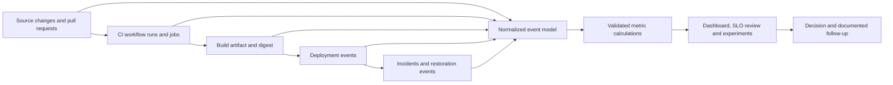
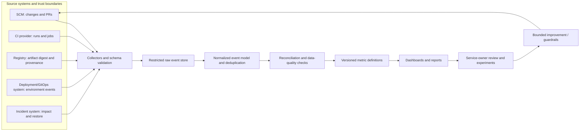

# Unit 11 — Pipeline observability and DORA delivery metrics

Delivery metrics are useful only when they describe the delivery system faithfully enough to support a decision. A fast pipeline is not necessarily a healthy delivery system, a successful workflow is not necessarily a deployment, and a retry that passes does not prove the original failure was flaky. This lesson builds a small, auditable measurement path from raw workflow and deployment events to normalized records, explicit calculations, tests, and a static report. The offline synthetic lab is the required path; collection from a private GitHub repository is optional and must never require sharing a token or production data.

**Metadata**

- **Module:** M02 — CI/CD Pipeline Engineering
- **Stage:** 2E — Production DevOps & Platform Engineering
- **Target file:** `11-pipeline-observability-and-dora-delivery-metrics.md`
- **Estimated time:** 12–16 hours
- **Prerequisites:** Git, Linux shell, Python, basic pytest, M01 container image engineering, M02 Units 1–10
- **Core tools:** Python 3, pandas, pytest, Git; optional `gh` CLI and GitHub Actions REST API
- **Awareness:** Prometheus, OpenTelemetry for CI, Four Keys, Sleuth, LinearB, Faros, GitHub/GitLab built-in insights
- **Assumed environment:** WSL2 Ubuntu or native Linux, approximately 4 CPU cores, 8 GB RAM and 30 GB free disk
- **Last reviewed:** 2026-10-24. The lesson has not been live-checked against current official documentation, and its code/tests have not been executed during authoring. Current platform details are marked `[VERIFY]`.

## Table of contents

- [11.0 Why this matters in production](#110-why-this-matters-in-production)
- [11.1 Learning objectives](#111-learning-objectives)
- [11.2 Concept map and vocabulary](#112-concept-map-and-vocabulary)
- [11.3 Level 1 — Beginner](#113-level-1--beginner)
- [11.4 Level 2 — Intermediate](#114-level-2--intermediate)
- [11.5 Level 3 — Advanced](#115-level-3--advanced)
- [11.6 Level 4 — Expert](#116-level-4--expert)
- [11.7 SRE lens](#117-sre-lens)
- [11.8 Security lens](#118-security-lens)
- [11.9 Production checklist](#119-production-checklist)
- [11.10 Hands-on lab set](#1110-hands-on-lab-set)
- [11.11 Self-check questions](#1111-self-check-questions)
- [11.12 Evidence artifacts](#1112-evidence-artifacts)
- [11.13 Common interview and design-review questions](#1113-common-interview-and-design-review-questions)
- [11.14 Sources and verification notes](#1114-sources-and-verification-notes)
- [Appendix A — Claim Register](#appendix-a--claim-register)
- [Appendix B — Ten-pass authenticity and quality audit](#appendix-b--ten-pass-authenticity-and-quality-audit)
- [Appendix C — Human verification checklist](#appendix-c--human-verification-checklist)
- [Appendix D — Limitations and assumptions](#appendix-d--limitations-and-assumptions)
- [Appendix E — Completion sign-off](#appendix-e--completion-sign-off)

### 11.0 Why this matters in production

Delivery observability gives teams evidence about how quickly and safely changes move from source control to a running service. Without it, teams may optimize the visible duration of a CI job while ignoring queue delays, failed deployments, slow restoration, or missing telemetry. In a data/AI environment, the build of a FastAPI model-serving image, a batch ETL workflow, and an ML evaluation run are distinct events; none automatically proves that a service was deployed or that a user-facing change reached production. Metrics need explicit event boundaries, stable identifiers, denominators, and missing-data rules. The purpose is to find system constraints and test improvements—not to rank individual engineers.

### 11.1 Learning objectives

1. **Define** the four DORA metrics using explicit event boundaries, cohorts and observation windows. **[L1]**
2. **Distinguish** DORA delivery metrics from CI operational metrics such as queue time, job duration and workflow success rate. **[L1]**
3. **Collect** workflow-run and job records from a private repository with the GitHub CLI or API while handling authentication, pagination and missing data. **[L2]**
4. **Normalize** event timestamps, identifiers and statuses, preserving raw extracts and record grain. **[L2]**
5. **Calculate and test** pipeline duration, queue time, success/failure rate, retry/re-run rate and a defensible test-flake measure. **[L2]**
6. **Evaluate** data quality, sampling bias, incomplete observation windows, percentiles and metric-gaming risks. **[L3]**
7. **Define** pipeline SLIs/SLOs and a recovery measure with an explicit eligible population, time window and owner. **[L3]**
8. **Design** an organization-level delivery-metrics architecture and a bounded improvement experiment with reliability guardrails. **[L4]**

### 11.2 Concept map and vocabulary

| Term | Precise definition | Common misconception |
|---|---|---|
| Delivery observability | Collection and interpretation of evidence about the path from a change to deployment and operational outcome. | “A dashboard alone creates observability.” |
| Deployment | A defined event in which a version/change is released to a specified environment. The exact boundary must be agreed locally. | “Every successful workflow is a deployment.” |
| Lead time for changes | Elapsed time between an explicitly selected change-start event and deployment to a defined environment. | “It is always commit-to-production with one universal definition.” |
| Change failure rate | Fraction of eligible deployments that result in a defined change-caused failure under the chosen attribution policy. | “Every incident is caused by the most recent deployment.” |
| Time to restore service | Elapsed time from a defined service-impacting failure start to the agreed restoration event. | “It is the same as fixing a broken CI workflow.” |
| Workflow run | One platform-recorded execution of a workflow. Re-runs/attempts may need separate treatment. | “One workflow run equals one code change.” |
| Job | A unit of work within a workflow run, with its own status and timing. | “Summing job durations gives wall-clock workflow duration.” |
| Queue time | Time between a job becoming eligible/queued and execution start, using the platform’s available timestamps or a documented proxy. | “Creation-to-start is always exact queue time.” |
| Retry / re-run | A repeated attempt at a job or workflow after an earlier attempt; definitions differ by platform and collection method. | “Any successful retry proves a flaky test.” |
| Flaky test | A test whose outcome varies under materially equivalent conditions, established through a repeat protocol and evidence. | “A test that failed once and passed once is conclusively flaky.” |
| Record grain | The real-world entity represented by one row, such as workflow run, attempt, job, deployment, incident or test case. | “Rows from different tables can be joined without checking cardinality.” |
| SLI / SLO | A service-level indicator is a measured quantity; an objective is a target for that quantity over a defined population/window. | “An SLO is just a number on a dashboard.” |
| Right-censoring | An event’s outcome is not yet observed by the end of the measurement window, such as an incident still unresolved. | “Unknown recovery duration is zero.” |
| Provenance | Evidence describing where an artifact/event came from and how it was produced. | “A CSV row is trustworthy because it exists.” |
| Goodhart’s law | When a measure becomes a target, people may optimize the measure in ways that undermine the underlying goal. | “A metric cannot be gamed if its formula is precise.” |



Each arrow is a relationship to prove, not an assumption. The join between a workflow and a deployment should use explicit identifiers or documented release metadata, not merely similar timestamps. The incident system is another source with its own permissions and quality limitations. A reporting workflow should not treat an event payload as authoritative simply because the CI platform delivered it.

### 11.3 Level 1 — Beginner

#### Why measure delivery?

Good delivery measurement answers questions such as:

- Are changes reaching the intended environment more frequently, without creating more failures?
- Is the delay caused by queueing, test execution, review, release approval, deployment or post-deployment verification?
- When a change causes a service impact, how long does restoration take?
- Did an intervention reduce waiting time while preserving quality and reliability?
- Is the dashboard based on complete, comparable records, or does it omit cancelled, failed or unresolved work?

A CI pipeline is a component of the delivery system, not the whole system. For a FastAPI service, a workflow might lint, test, build an image, and publish an artifact. A later GitOps controller or deployment system may roll out that image. For an ETL package, a scheduled workflow may validate code but not run a production data load. For an ML evaluation job, a passing evaluation may authorize a release but does not itself deploy the model. Track the event that actually occurred.

#### The four DORA metrics: definitions used here

DORA’s published terminology and metric set have evolved. This lesson covers the four metrics named in the syllabus and uses the following operational definitions for the labs. **[VERIFY: check the current official DORA research/publication for current names, definitions and recommended measurement guidance before adopting these definitions in an organization.]** In particular, do not silently substitute newer terminology for the historical phrase “time to restore service”; document the relationship and the definition your service owners approve.

**1. Deployment frequency**

- **Operational definition:** Count successful deployments to a named target environment in a specified observation window, then report the count or rate (for example, deployments per week).
- **Calculation:** `number of qualifying successful deployments / window length`. The numerator is deployment events, not workflow runs or artifact builds.
- **Unit:** Deployments per day/week/month, with environment and cohort named.
- **Example [ILLUSTRATIVE]:** 12 qualifying production deployments over 14 days = 6 deployments per week.
- **Can tell you:** How often the service delivers changes under the defined deployment policy.
- **Cannot tell you:** Whether deployments are safe, valuable, independent, or customer-visible.
- **Common mistake:** Counting every successful CI run. This overstates delivery frequency when many runs build artifacts without deployment.
- **Misleading interpretation:** “We doubled deployment frequency, so delivery improved.” If the team split one logical release into multiple events or raised failure rate, the conclusion is unsupported.

**2. Lead time for changes**

- **Operational definition:** Elapsed time from a chosen change-start event to the first qualifying deployment of that change to the target environment. Choose commit-created, commit-authored, merged, or another event explicitly; the choice changes the result.
- **Calculation:** For each qualifying change, `deployment timestamp − selected change-start timestamp`; summarize the distribution for a cohort/window.
- **Unit:** Hours or days per change; state whether median or a percentile is reported.
- **Example [ILLUSTRATIVE]:** A change merged Monday 10:00 UTC and deployed Tuesday 16:00 UTC has a merge-to-deployment lead time of 30 hours.
- **Can tell you:** How long changes wait and flow through the defined path.
- **Cannot tell you:** Whether the change was useful, low-risk, or the sole cause of the deployment.
- **Common mistake:** Mixing commit-to-deployment and merge-to-deployment records.
- **Misleading interpretation:** “Lead time fell after we changed the merge timestamp.” The event definition changed, so the metric may not reflect a real improvement.

**3. Change failure rate**

- **Operational definition:** Qualifying deployments that result in a defined change-caused failure divided by all eligible deployments in the same cohort/window.
- **Calculation:** `deployments attributed to a qualifying failure / eligible deployments × 100%`.
- **Unit:** Percentage, with attribution policy and observation delay stated.
- **Example [ILLUSTRATIVE]:** 2 qualifying failed deployments out of 40 eligible deployments = 5%.
- **Can tell you:** How often the delivery process produces a deployment that causes the defined adverse outcome.
- **Cannot tell you:** The severity of each failure or whether every incident has a single responsible deployment.
- **Common mistake:** Counting all incidents in the numerator while using deployments in the denominator, or excluding failures whose attribution is inconvenient.
- **Misleading interpretation:** “Our failure rate is zero because no incident was linked to a deployment.” Missing links are a data-quality problem, not evidence of no failures.

**4. Time to restore service**

- **Operational definition:** Elapsed time from the agreed start of a service-impacting failure to the agreed restoration event, for incidents in a defined cohort. The lesson uses incident-level elapsed durations and reports the median or another stated summary; unresolved incidents remain unknown/censored rather than being assigned zero.
- **Calculation:** `restoration timestamp − failure start timestamp` for each eligible incident; summarize the observed durations and report unresolved counts separately.
- **Unit:** Minutes or hours per incident, plus statistic and sample size.
- **Example [ILLUSTRATIVE]:** An impact begins 09:10 UTC and service is restored 10:40 UTC; restoration duration is 90 minutes.
- **Can tell you:** How quickly the service returns to its agreed usable state after a defined failure.
- **Cannot tell you:** The total customer impact, root cause, or whether a pipeline itself recovered.
- **Common mistake:** Using incident close time when service was restored much earlier, or silently excluding unresolved incidents.
- **Misleading interpretation:** “Restore time improved because we closed tickets sooner.” Ticket closure is not necessarily service restoration.

#### Delivery performance is not individual productivity

DORA-style measures describe outcomes of a delivery system and are most useful at service/team/system level. They are not valid as a simple ranking of individual engineers: a person may work on high-risk migrations, difficult services, or essential reliability work that reduces deployment frequency temporarily. Incentivizing a single metric encourages gaming, unsafe shortcuts and suppression of failure reports. Use metrics to locate friction, compare like-with-like cohorts, and test system changes. Pair speed measures with quality, reliability, and data-completeness guardrails.

### 11.4 Level 2 — Intermediate

#### CI pipeline operational metrics

These metrics answer a different question from DORA delivery metrics. Define the population and denominator before computing them.

| Metric | Definition and formula | Unit | Important limitation |
|---|---|---|---|
| Workflow duration | `completed_at − started_at` for a completed workflow run | Seconds/minutes | Does not include time before workflow start; parallel jobs mean it is not sum of job durations |
| Job duration | `job.completed_at − job.started_at` | Seconds/minutes | Missing timestamps require unknown, not zero |
| Queue-time proxy | `job.started_at − job.created_at` if `created_at` is the available proxy | Seconds | **Not necessarily exact queue time**; object creation may precede eligibility or scheduler queue time |
| Workflow success rate | Successful eligible terminal runs / eligible terminal runs × 100% | Percent | State how cancelled, skipped, timed-out and neutral runs are treated |
| Failure rate | Failed eligible terminal runs / eligible terminal runs × 100% | Percent | Report cancellations and skipped runs separately; never hide exclusions |
| Re-run rate | Unique workflow runs with one or more re-runs / unique eligible workflow runs × 100% | Percent | Different from attempt count or retried-job rate |
| Pipeline failure count | Count of eligible failed runs in a named window | Count/window | Compare against run volume and workflow composition |
| Test flake rate | Test cases with an outcome change across controlled repeated executions / test cases evaluated under the protocol | Percent | A single retry is a signal, not proof of flakiness |

**Status policy for the lab:** `success` and `failure` are terminal conclusions in the synthetic data; `cancelled`, `skipped`, `timed_out`, `neutral`, `unknown`, and in-progress records are separately counted. The denominator used by the sample success/failure rates is **eligible terminal runs with conclusion `success` or `failure`**. Cancelled and skipped runs are reported but excluded from that denominator. A real organization may choose a different policy, but it must publish it and use it consistently.

#### Data grain and timestamp rules

The central data engineering rule is: one row should represent one entity at one grain. Do not join workflow runs directly to multiple jobs and then sum run counts without deduplication. A run with five jobs can become five rows after the join, multiplying run counts. Keep raw extracts separate from normalized event tables, and use stable identifiers such as run ID, job ID, change ID, deployment ID and incident ID. Normalize timezone-aware timestamps to UTC for calculations; present a named local timezone only for display.

Unknown, zero, not applicable, inaccessible, and not-yet-observed are different values. A missing restoration timestamp may mean the incident is unresolved or that the source system was unavailable. It does not mean zero minutes. An API permission failure does not mean there were no runs. Preserve data-quality notes and fail visibly when required inputs are missing.

#### GitHub Actions collection: optional private-repository path

The offline synthetic lab below is complete and required. The live collection lab is optional and should be run only against a repository you own or are authorized to inspect. Use `gh auth login` or another approved credential mechanism; never paste tokens into chat, hard-code them, echo them, or commit them. The exact scopes/permissions, REST endpoints, field names, pagination behavior, and CLI JSON fields are version-sensitive: **[VERIFY: current GitHub REST API documentation for workflow runs and jobs, `gh run list`, `gh run view`, and the current authentication guidance.]**

Example command to confirm the repository explicitly:

```bash
# terminal: choose the authorized repository explicitly
set -euo pipefail
gh auth status
gh repo view OWNER/REPO --json nameWithOwner,isPrivate
```

**Representative expected output — your values may differ.**

```text
Logged in to github.com account ...
{"isPrivate":true,"nameWithOwner":"OWNER/REPO"}
```

Interpretation: the output confirms the selected repository metadata and CLI authentication status. Do not copy account identifiers into a public report. If authentication fails or access is denied, stop and record the failure; do not treat inaccessible data as zero.

A run can have multiple attempts/re-runs, and job records have their own status and timestamps. Preserve a raw response or a safe normalized subset for auditability. Use pagination when the API supports it; if the lab intentionally limits records, write the limit and collection window into the report. Handle API errors and rate limits with an actionable error message and a retry policy that respects provider guidance. Do not print authorization headers. A downstream `workflow_run` event can trigger a reporting workflow, but its payload is still data to validate. Limit permissions, avoid running untrusted code from artifacts, and avoid triggering a privileged reporter from a workflow whose event or artifacts can be influenced by an untrusted pull request.

#### JUnit XML

JUnit XML is a common test-result interchange format containing suites, test cases, and failure/error/skipped information. With pytest, a common approach is `pytest --junitxml=reports/junit.xml`; exact report details depend on pytest/plugins and the test setup. **[VERIFY: current pytest documentation for JUnit XML options and any plugin-specific fields.]** JUnit results complement run-level telemetry: they help identify failing tests and suite-level patterns, while workflow/job metadata explains execution and queueing.

Do not add every test retry as a distinct independent test case without recording attempt identity. A retry that succeeds after a failure can be an intermittent-failure signal; to estimate flakiness, define a repeat protocol, keep the same test/environment dimensions where possible, and report the denominator of tests actually repeated. A workflow re-run is not the same as a test retry.

### 11.5 Level 3 — Advanced

#### Define the events before calculating DORA

For this learner’s context, use these explicit working definitions in the synthetic lab:

- **Change:** a stable change record representing a merged source-control change or change set. A change may contain multiple commits.
- **Deployment:** a successful release of a version to a named target environment, represented by a deployment event and unique deployment ID. Building or publishing an image is not deployment.
- **Failure:** a service-impacting event attributed under a documented policy to one or more deployments or changes. Attribution may be uncertain or shared.
- **Restore:** the timestamp when the affected service meets the agreed restoration condition. Ticket closure is not automatically restore.

Source-control events provide change identifiers and timestamps but do not prove deployment. CI records describe builds/tests but can lack environment rollout evidence. Artifact metadata can provide image digest and build provenance. Deployment systems provide environment and rollout outcomes but may not contain source-change details. Incident systems provide impact and restoration data but often have delayed or incomplete change attribution. Combine them using explicit identifiers and documented joins.

Recommended correlation fields include commit SHA, PR/change ID, workflow run ID, job ID, artifact digest, deployment ID, environment, incident ID and service ID. One workflow can build multiple artifacts; one artifact can be deployed to multiple environments; one deployment can contain several changes; one incident can involve multiple deployments. Model these relationships instead of assuming one-to-one mapping.

#### Worked examples and honest denominators

| Metric | Numerator / input | Denominator / boundary | Result |
|---|---|---|---|
| Deployment frequency | 12 successful production deployment events | 14-day window | 6 deployments/week [ILLUSTRATIVE] |
| Lead time | 30 h from merge to qualifying deployment | One eligible change in example | 30 h [ILLUSTRATIVE] |
| Change failure rate | 2 deployments attributed to failure | 40 eligible deployments | 5% [ILLUSTRATIVE] |
| Time to restore service | Incident durations 30, 60, 90 min | 3 restored incidents in cohort | Median 60 min [ILLUSTRATIVE] |
| Workflow success rate | 18 successful terminal runs | 20 success-or-failure terminal runs | 90%; cancellations/skips reported separately [ILLUSTRATIVE] |
| Re-run rate | 3 unique runs with at least one re-run | 30 eligible unique runs | 10% [ILLUSTRATIVE] |

The examples are deliberately small to make the arithmetic visible. They are not statistically reliable performance estimates. If the observation window ends while an incident remains unresolved, show it as right-censored/unknown for restoration-duration summaries and report the unresolved count. If you exclude it from the duration percentile, say so; otherwise readers may believe the unresolved incidents were fast.

#### Bias, missing events and comparability

- **Sampling bias:** a partial API history may overrepresent recent or successful runs.
- **Survivorship bias:** completed deployments are easy to measure; abandoned, cancelled or failed attempts may disappear from the dataset.
- **Right-censoring:** unresolved incidents or changes not yet deployed by the window end have incomplete duration.
- **Denominator selection:** excluding failed/cancelled attempts can improve a success rate without changing system behavior.
- **Duplicate events:** webhooks may be delivered more than once; use stable event IDs and idempotent ingestion.
- **Multiple deployments per change:** choose whether lead time is to first deployment, every deployment, or a specific environment; do not mix.
- **Hotfixes and rollbacks:** classify them explicitly; a rollback is a deployment event but may also be the response to a failure.
- **Unlinked failures:** an incident without a deployment link is unknown attribution, not automatically a non-change-related incident.
- **Time zones:** normalize to UTC, and make daylight-saving/display rules explicit.
- **Service mix:** comparing a low-risk internal tool with a regulated model-serving service without context is misleading.

#### Mean, median and percentiles

The mean is sensitive to long delays. The median describes the middle observed record; p75, p90 and p95 describe higher portions of the observed distribution under the chosen percentile method. Percentile algorithms can differ slightly between tools, so record the method if exact reproducibility matters. A p95 computed from a handful of records is unstable; display sample size and avoid false precision. Prefer enough observations across a representative window, and show distributions or cohort breakdowns when one number hides a long tail.

#### Goodhart’s law and metric gaming

A metric becomes dangerous when people are rewarded for the number instead of the underlying outcome. Examples include splitting one release into multiple deployment records to increase frequency, reclassifying a failed deployment as a non-deployment, suppressing incidents to lower change failure rate, optimizing only easy changes, or shortening pipeline duration by removing meaningful tests. Guardrails include agreed event definitions, source reconciliation, independent incident data, audit trails, quality indicators, and periodic review of unexpected metric shifts. Never use a single metric as a proxy for individual performance.

#### Pipeline SLI/SLO and recovery time

A pipeline SLO needs a service boundary, eligible event population, numerator/denominator, window, target rationale, exclusions and owner. Candidate SLIs include p95 queue time, p95 end-to-end pipeline duration, eligible main-branch run success rate, telemetry freshness, and telemetry completeness. Example only: **[ILLUSTRATIVE]** “At least 95% of eligible main-branch runs start within five minutes over a rolling 28-day window.” This is not a universal target; it should follow measured user/team needs and capacity constraints.

A pipeline failure recovery measure is separate from service restoration. Define pipeline failure start (for example, the first confirmed time a shared runner or dependency prevents eligible runs) and recovery (the time a representative canary run succeeds and the service is usable again). `pipeline_recovery_duration = recovery_timestamp − failure_start_timestamp`. State whether the statistic is median or percentile and which incidents are included. Do not use the service incident’s restoration timestamp to claim that the CI pipeline recovered.

A useful error-budget-style decision can be based on the fraction of eligible pipeline events meeting the SLO. If the budget is being consumed unusually quickly, pause risky pipeline changes and focus on reliability. Choose alert windows and thresholds from the service’s impact and historical behavior; no universal burn-rate threshold is specified here.

#### OpenTelemetry awareness

OpenTelemetry provides a vendor-neutral model for traces, metrics and logs, with context/correlation helping connect related operations. CI instrumentation conventions and semantic attributes may change; **[VERIFY: current OpenTelemetry documentation and any CI-specific conventions before implementing them.]** This lesson does not claim to implement a standard OpenTelemetry CI semantic convention. Start with stable IDs and event timestamps, then adopt instrumentation that your chosen tools support and that can be validated against raw records.

#### Bounded local Prometheus exporter

The following optional exporter demonstrates only two low-cardinality metrics from a local JSON file. It is not a full telemetry collector and does not query GitHub. Do not use commit SHA, user ID, run ID or arbitrary repository name as metric labels: unbounded labels can cause high cardinality and excessive storage. Use only bounded labels whose possible values are controlled.

Create `metrics_exporter.py`:

```python
# metrics_exporter.py
from __future__ import annotations

import json
from http.server import BaseHTTPRequestHandler, HTTPServer
from pathlib import Path

DATA_PATH = Path("reports/summary.json")


def load_summary() -> dict:
    if not DATA_PATH.exists():
        raise FileNotFoundError(f"summary file not found: {DATA_PATH}")
    data = json.loads(DATA_PATH.read_text(encoding="utf-8"))
    required = {"eligible_terminal_runs", "successful_runs", "p95_queue_seconds"}
    missing = required - data.keys()
    if missing:
        raise ValueError(f"summary missing keys: {sorted(missing)}")
    return data


class Handler(BaseHTTPRequestHandler):
    def do_GET(self) -> None:
        if self.path != "/metrics":
            self.send_error(404)
            return
        try:
            data = load_summary()
            eligible = int(data["eligible_terminal_runs"])
            successful = int(data["successful_runs"])
            p95_queue = float(data["p95_queue_seconds"])
            if eligible < 0 or successful < 0 or successful > eligible or p95_queue < 0:
                raise ValueError("summary values are outside valid bounds")
        except (OSError, ValueError, json.JSONDecodeError) as exc:
            self.send_error(503, explain=str(exc))
            return
        body = (
            "# HELP pipeline_eligible_terminal_runs Eligible terminal workflow runs in the summary.\n"
            "# TYPE pipeline_eligible_terminal_runs gauge\n"
            f"pipeline_eligible_terminal_runs {eligible}\n"
            "# HELP pipeline_successful_runs Successful eligible terminal workflow runs.\n"
            "# TYPE pipeline_successful_runs gauge\n"
            f"pipeline_successful_runs {successful}\n"
            "# HELP pipeline_p95_queue_seconds P95 queue-time proxy in seconds for the summary cohort.\n"
            "# TYPE pipeline_p95_queue_seconds gauge\n"
            f"pipeline_p95_queue_seconds {p95_queue}\n"
        ).encode("utf-8")
        self.send_response(200)
        self.send_header("Content-Type", "text/plain; version=0.0.4; charset=utf-8")
        self.send_header("Content-Length", str(len(body)))
        self.end_headers()
        self.wfile.write(body)

    def log_message(self, fmt: str, *args: object) -> None:
        # Keep local demo logs minimal; never log tokens or raw telemetry.
        super().log_message(fmt, *args)


if __name__ == "__main__":
    server = HTTPServer(("127.0.0.1", 9108), Handler)
    print("Local demo exporter listening on http://127.0.0.1:9108/metrics")
    server.serve_forever()
```

This is a local demonstration using the Python standard library. The values are gauges representing a precomputed snapshot; they are not event counters and do not update unless the summary file changes. A production exporter would need lifecycle, concurrency, authentication/network controls, metric freshness, error handling, and monitoring. Keep it bound to localhost for the lab. Prometheus scrape behavior and exposition conventions should be checked against current official docs if this is extended.

### 11.6 Level 4 — Expert

#### Organization-level architecture



**Source boundary:** SCM, CI, registry, deployment and incident systems have distinct identities, permissions, retention and data quality. Collectors should use least privilege and preserve enough provenance to explain where each row came from.

**Raw/normalized boundary:** Keep raw extracts restricted and immutable where feasible; normalize timestamps, statuses and identifiers in a separate stage. Deduplicate using stable source IDs or idempotency keys. Do not overwrite a missing value with a guessed value during normalization.

**Metric-definition boundary:** Version definitions, cohort rules, denominator choices, exclusions and code. If a definition changes, either recalculate history consistently or mark the discontinuity in the dashboard.

**Decision boundary:** Dashboards inform decisions; they do not make causality obvious. Service owners must interpret trends alongside incidents, changes in service criticality, release strategy and customer impact.

Failure modes include API outage, stale collector, changed schema, duplicated events, missing deployment links, delayed incident updates, and dashboards displaying a recent-looking chart from stale data. Track freshness/completeness alongside performance metrics.

#### Vendor-neutral tool landscape

| Tool/category | Role in the landscape | Evaluation questions |
|---|---|---|
| Four Keys | Open-source DORA-style data model/measurement project associated with delivery metrics | Is it maintained for your source systems? Which events and assumptions does its current implementation use? |
| Sleuth | Delivery intelligence product example | What integrations, definitions, privacy controls and costs apply today? **[VERIFY]** |
| LinearB | Engineering/delivery analytics product example | How are metrics defined, attributed and presented to teams? What data is collected? **[VERIFY]** |
| Faros | Engineering intelligence/data integration product example | What sources, deployment models, retention and current features are supported? **[VERIFY]** |
| GitHub/GitLab built-in insights | Platform-provided workflow/CI analytics and related insights | Which metrics are available, at what grain, under what plan, and with what retention? **[VERIFY]** |
| Local Python/pandas + CSV/HTML | Transparent, low-cost learning and audit path | Can every value be traced to raw records and reproducible code? |
| Prometheus/Grafana | Optional local metrics storage/visualization | Is a time-series dashboard needed, and can cardinality and operational cost be controlled? |

These are examples, not endorsements. No current feature, price, availability or plan claim is made here. Verify vendor documentation and contractual/privacy requirements before selecting a tool.

#### Cohorts and trend analysis

Useful cohorts may include service, repository, team, criticality tier, deployment type, environment, release strategy and time period. Compare like with like: an internal batch job deployed weekly and a latency-sensitive customer API deployed many times daily have different constraints. Avoid organization-wide league tables that rank teams without adjusting for service context and data completeness. Show sample size and unknown attribution alongside every cohort.

When measuring a trend, keep the event definition, time zone, eligibility, exclusions and source systems stable. If a service moves from manual deployment to GitOps, instrument the new deployment source and mark the transition. Do not interpret a data-source change as an engineering improvement.

#### Improvement loop

1. **Identify the constraint:** use queue/job/deployment/incident records to locate the largest measured delay or reliability problem.
2. **Form a hypothesis:** for example, “dependency installation causes most queue-to-completion time variance.”
3. **Select a bounded intervention:** cache a verified dependency layer, parallelize an independent test stage, or improve a flaky test’s determinism.
4. **Define guardrails:** test coverage/quality, change failure rate, service SLOs, restore time, security and cost.
5. **Set comparable windows:** choose baseline and post-change windows with similar traffic, service mix and deployment strategy.
6. **Measure and reconcile:** compare raw counts to normalized records and inspect missing-data changes.
7. **Inspect side effects:** faster pipeline but more failed deployments is not success.
8. **Document decision:** keep, revise or roll back the intervention with evidence and owner.

#### Incident scenario: “metrics improved but outcomes got worse”

**Symptoms:** A dashboard shows lower median pipeline duration and higher deployment frequency, but production incidents increase and restoration takes longer. The following values are **[ILLUSTRATIVE]**, not measured data.

**Competing hypotheses:**

- Tests were removed or weakened to shorten the pipeline.
- Deployment frequency rose because one logical release was split into multiple deployment records.
- Change failure attribution is missing or delayed.
- A new deployment strategy increased the number of partial rollouts.
- Incident restoration data is incomplete or ticket closure is being used as a proxy.
- The service mix changed toward higher-risk workloads.

**Evidence to gather:** compare workflow/test-stage history, quality gates, artifact digests, deployment IDs, environment rollout outcomes, incident timelines, rollbacks, and telemetry completeness before/after. Inspect whether definitions or source systems changed. Join through stable IDs, not timestamp proximity alone.

**Root-cause analysis:** determine whether the apparent speed improvement came from a real reduction in waiting/execution time, a changed denominator, removed work, or incomplete event capture. Compare change failure rate and restoration duration by service/release strategy, while keeping unresolved incidents visible.

**Remediation:** restore essential quality gates if they were weakened; repair deployment/incident correlation; change the release process only through a bounded experiment; add a guardrail that stops rollout when failure or SLO indicators worsen. Follow up with a stable measurement window and source reconciliation.

### 11.7 SRE lens

#### Pipeline SLIs and SLO construction

| Candidate SLI | Definition | Possible target style |
|---|---|---|
| Queue-time p95 | p95 of eligible job start minus documented queue-time timestamp/proxy | `[ILLUSTRATIVE]` p95 under an agreed duration over a rolling window |
| End-to-end duration p95 | p95 of eligible workflow start-to-completion duration | Target set from feedback needs and measured baseline |
| Main-branch successful run rate | Successful eligible terminal main-branch runs / eligible terminal runs | Target includes a clear cancelled/skipped policy |
| Telemetry freshness | Time since latest expected source event was successfully ingested | Alert when freshness exceeds a service-owner threshold |
| Telemetry completeness | Expected source records successfully normalized / expected records collected | Define source-specific reconciliation method |
| Pipeline recovery duration | Defined pipeline failure start to verified representative recovery | Report sample size and recovery definition |
| Test flake rate | Tests meeting a repeat-protocol flake definition / tests evaluated under that protocol | Pair with test volume and repeat policy |

An SLO must name the service boundary, eligible events, numerator and denominator, window, target rationale, exclusions and owner. **[ILLUSTRATIVE]** Example: “At least 95% of eligible main-branch workflow runs start within five minutes over a rolling 28-day window.” It is not a universal default. A target that cannot be measured reliably is not operationally useful; improve instrumentation before promising precision.

Alert on actionable impact, not every noisy metric change. Use error-budget-style reasoning to decide when reliability work should take priority, but set thresholds based on observed failure patterns and impact. Avoid paging on a small-sample p95 fluctuation without corroborating signals.

#### Runbook: alert → scope → diagnose → mitigate → verify → learn

1. **Alert:** determine which SLI/SLO is breached and whether the telemetry itself is fresh.
2. **Establish scope:** identify repositories, workflows, branches, runner pools, services and time window affected.
3. **Check provider and queue:** inspect provider status, queue depth/age, runner capacity, concurrency limits and API errors.
4. **Inspect recent failures:** separate provider-wide, runner-specific, dependency-related and repository-specific failure patterns.
5. **Check data integrity:** compare raw source counts, normalized rows, duplicates, missing fields and event timestamps.
6. **Mitigate safely:** restore known-good pipeline configuration, pause risky rollout, or route work to healthy eligible capacity without weakening trust controls.
7. **Verify recovery:** run a representative canary and confirm source telemetry reflects the recovery.
8. **Follow up:** document timeline, root cause, owner, prevention and any metric-definition changes.

Failure modes include provider outage, runner saturation, dependency outage, API rate limiting, broken telemetry, schema drift, missing deployment events and stale dashboards. A broken dashboard must not silently display old values as current.

#### Cost and capacity

Queue delay and execution time are different. More concurrency may reduce queue time but increase compute cost, contention or external API pressure. Telemetry also has cost: raw-event retention, high-cardinality labels and unused dashboards consume storage and operator attention. Collect metrics that inform decisions, keep raw data access controlled, and choose retention according to audit needs. M15 covers deeper FinOps; M10 covers service SLOs; M11 covers broader observability.

### 11.8 Security lens

- **Least privilege:** use read-only access for collection where possible. Separate workflow permissions for collection and report publication. **[VERIFY]** current GitHub CLI/API permission requirements for the selected endpoints.
- **Secrets:** never print tokens, authorization headers or complete environments. Do not put credentials in CSV, HTML, exception messages, screenshots or artifacts. Masking is best-effort, not a security boundary.
- **Privacy:** avoid collecting usernames, commit messages, email addresses or repository details unless there is a defined need and access policy. Prefer aggregate metrics and restricted raw data.
- **Reporting workflow trust:** protect the reporting workflow from untrusted pull-request code. Validate `workflow_run` payload fields and repository/ref identity. Do not execute scripts or binaries downloaded from workflow artifacts.
- **Event integrity:** use stable source event IDs, deduplicate repeated deliveries, track source timestamps, and reconcile deployment/incident events against authoritative systems. A forged or incomplete deployment record can distort metrics.
- **Retention:** define who can read raw telemetry, where it is stored, how long it is retained, and how exports are removed.
- **Supply chain:** artifact digests and provenance help establish identity, but this lesson does not implement full signing or supply-chain security. See M12.
- **Secrets and identity:** deeper credential lifecycle, OIDC and access policy belong to M09.
- **General observability:** broader metrics/logs/traces, storage, dashboards and alerting belong to M11.

**Concrete verification:** before sharing a report, scan it for secrets and PII; compare its repository/service scope with the authorized collection scope; inspect workflow permissions; confirm no artifact is executed; and verify raw exports are stored only in the intended restricted directory.

### 11.9 Production checklist

- [ ] Metric definitions are approved by service owners, including deployment/change/failure/restore boundaries.
- [ ] DORA metrics and CI operational metrics are clearly separated.
- [ ] Every metric has unit of analysis, cohort, time window, source, denominator and exclusions.
- [ ] Raw source extracts are preserved separately from normalized/calculated outputs.
- [ ] Event correlation uses stable IDs and documented one-to-many relationships.
- [ ] Timestamps are timezone-aware, normalized to UTC and checked for impossible ordering.
- [ ] Missing, zero, unknown, inaccessible and not-yet-observed are distinct.
- [ ] Cancelled, skipped, timed-out, neutral and re-run semantics are documented.
- [ ] Retry/re-run rate and test flake rate use separate defensible denominators.
- [ ] Incomplete incidents are marked unresolved/censored, not assigned zero restore duration.
- [ ] Sample sizes and data freshness/completeness appear with dashboards.
- [ ] Percentiles are shown only with appropriate sample-size context.
- [ ] Dashboard has an owner, access policy and a documented refresh/retention policy.
- [ ] Alerts route to a team that can act and include a runbook.
- [ ] Anti-gaming guardrails pair delivery speed with failure, quality and service reliability.
- [ ] Raw event counts reconcile to normalized records; duplicates and missing links are reported.
- [ ] API permissions are least-privilege; tokens and PII are not exposed in logs/reports.
- [ ] Definitions and code are versioned; definition changes are annotated in trends.
- [ ] Metrics are not used to rank individual engineers or unlike services.
- [ ] Current DORA definitions, API fields and tool behavior have been verified before production adoption.

### 11.10 Hands-on lab set

The required offline route uses synthetic data and local Python/pandas. The optional live collection route uses only a private repository the learner owns or is authorized to inspect. All values marked synthetic are **[ILLUSTRATIVE]**. No sample below represents a real company or live repository.

#### Lab A — Synthetic delivery-metrics dataset

**ID:** M02-U11-LAB-A  
**Goal:** Create linked synthetic changes, deployments, incidents and workflow runs; calculate all four DORA metrics and core pipeline metrics without network access.  
**Estimated time:** 2–3 hours.

**Directory tree to create**

```text
pipeline-observability-lab/
├── data/
│   ├── synthetic_changes.csv
│   ├── synthetic_deployments.csv
│   ├── synthetic_incidents.csv
│   └── synthetic_workflow_runs.json
├── src/
│   └── calculate_metrics.py
├── tests/
│   └── test_calculate_metrics.py
├── reports/
└── requirements.txt
```

**Prerequisites and install**

```bash
# terminal: create disposable lab directory
set -euo pipefail
mkdir -p pipeline-observability-lab/{data,src,tests,reports}
cd pipeline-observability-lab
python3 -m venv .venv
. .venv/bin/activate
python -m pip install pandas pytest
python -m pip freeze > requirements.txt
```

**Representative expected output — your values may differ.**

```text
Successfully installed pandas ... pytest ...
```

Interpretation: installation output depends on your platform and package versions. `pip freeze` records what is installed in this local environment; it is not proof that those versions were tested by the lesson author. In a controlled project, review and pin dependencies deliberately.

Create `data/synthetic_changes.csv`:

```csv
change_id,merged_at_utc,service
CH-101,2026-10-01T10:00:00Z,api
CH-102,2026-10-02T12:00:00Z,etl
CH-103,2026-10-03T09:00:00Z,api
CH-104,2026-10-04T08:00:00Z,ml-eval
CH-105,2026-10-05T14:00:00Z,api
CH-106,2026-10-06T11:00:00Z,etl
```

Create `data/synthetic_deployments.csv`:

```csv
deployment_id,change_id,environment,deployed_at_utc,status
DEP-201,CH-101,production,2026-10-01T12:00:00Z,success
DEP-202,CH-102,production,2026-10-02T16:00:00Z,success
DEP-203,CH-103,production,2026-10-03T10:00:00Z,success
DEP-204,CH-104,staging,2026-10-04T10:00:00Z,success
DEP-205,CH-105,production,2026-10-05T15:00:00Z,success
DEP-206,CH-106,production,2026-10-06T13:00:00Z,success
DEP-207,CH-103,production,2026-10-03T13:00:00Z,success
```

Create `data/synthetic_incidents.csv`:

```csv
incident_id,deployment_id,service,started_at_utc,restored_at_utc,qualifying_change_failure
INC-301,DEP-203,api,2026-10-03T10:20:00Z,2026-10-03T11:20:00Z,true
INC-302,DEP-205,api,2026-10-05T15:10:00Z,2026-10-05T16:40:00Z,true
INC-303,DEP-206,etl,2026-10-06T13:30:00Z,,true
```

Create `data/synthetic_workflow_runs.json`:

```json
[
  {"run_id": "RUN-1", "attempt": 1, "workflow": "api-ci", "status": "completed", "conclusion": "success", "created_at": "2026-10-01T09:00:00Z", "started_at": "2026-10-01T09:02:00Z", "completed_at": "2026-10-01T09:08:00Z", "rerun": false},
  {"run_id": "RUN-2", "attempt": 1, "workflow": "etl-ci", "status": "completed", "conclusion": "failure", "created_at": "2026-10-02T11:00:00Z", "started_at": "2026-10-02T11:05:00Z", "completed_at": "2026-10-02T11:12:00Z", "rerun": false},
  {"run_id": "RUN-2", "attempt": 2, "workflow": "etl-ci", "status": "completed", "conclusion": "success", "created_at": "2026-10-02T11:00:00Z", "started_at": "2026-10-02T11:14:00Z", "completed_at": "2026-10-02T11:20:00Z", "rerun": true},
  {"run_id": "RUN-3", "attempt": 1, "workflow": "api-ci", "status": "completed", "conclusion": "cancelled", "created_at": "2026-10-03T08:00:00Z", "started_at": "2026-10-03T08:01:00Z", "completed_at": "2026-10-03T08:02:00Z", "rerun": false},
  {"run_id": "RUN-4", "attempt": 1, "workflow": "ml-eval", "status": "completed", "conclusion": "success", "created_at": "2026-10-04T07:00:00Z", "started_at": "2026-10-04T07:03:00Z", "completed_at": "2026-10-04T07:18:00Z", "rerun": false},
  {"run_id": "RUN-5", "attempt": 1, "workflow": "api-ci", "status": "completed", "conclusion": "skipped", "created_at": "2026-10-05T13:00:00Z", "started_at": null, "completed_at": "2026-10-05T13:00:00Z", "rerun": false},
  {"run_id": "RUN-6", "attempt": 1, "workflow": "api-ci", "status": "completed", "conclusion": "success", "created_at": "2026-10-06T10:00:00Z", "started_at": "2026-10-06T10:02:00Z", "completed_at": "2026-10-06T10:10:00Z", "rerun": false}
]
```

This data intentionally includes a cancelled run, a failed workflow attempt followed by a successful re-run, a deployment that triggered an incident, an unresolved incident, a staging deployment, and multiple deployments associated with one change. It also shows why a workflow run must not be counted as a deployment: the workflow dataset has more/other records than the production deployment event table.

Create `src/calculate_metrics.py`:

```python
# src/calculate_metrics.py
from __future__ import annotations

import json
from pathlib import Path
import sys

import pandas as pd

ROOT = Path(__file__).resolve().parents[1]
DATA = ROOT / "data"
REPORTS = ROOT / "reports"


def read_utc(value: object) -> pd.Timestamp:
    if value is None or pd.isna(value) or value == "":
        return pd.NaT
    stamp = pd.to_datetime(value, utc=True, errors="coerce")
    return stamp if not pd.isna(stamp) else pd.NaT


def require_columns(frame: pd.DataFrame, required: set[str], name: str) -> None:
    missing = required - set(frame.columns)
    if missing:
        raise ValueError(f"{name} missing required columns: {sorted(missing)}")


def main() -> int:
    REPORTS.mkdir(parents=True, exist_ok=True)
    changes = pd.read_csv(DATA / "synthetic_changes.csv")
    deployments = pd.read_csv(DATA / "synthetic_deployments.csv")
    incidents = pd.read_csv(DATA / "synthetic_incidents.csv")
    runs = pd.DataFrame(json.loads((DATA / "synthetic_workflow_runs.json").read_text(encoding="utf-8")))

    require_columns(changes, {"change_id", "merged_at_utc", "service"}, "changes")
    require_columns(deployments, {"deployment_id", "change_id", "environment", "deployed_at_utc", "status"}, "deployments")
    require_columns(incidents, {"incident_id", "deployment_id", "started_at_utc", "restored_at_utc", "qualifying_change_failure"}, "incidents")
    require_columns(runs, {"run_id", "attempt", "status", "conclusion", "created_at", "started_at", "completed_at", "rerun"}, "workflow runs")

    for frame, columns in [
        (changes, ["merged_at_utc"]),
        (deployments, ["deployed_at_utc"]),
        (incidents, ["started_at_utc", "restored_at_utc"]),
        (runs, ["created_at", "started_at", "completed_at"]),
    ]:
        for column in columns:
            frame[column] = frame[column].map(read_utc)

    if changes["change_id"].duplicated().any():
        raise ValueError("duplicate change_id in changes")
    if deployments["deployment_id"].duplicated().any():
        raise ValueError("duplicate deployment_id in deployments")
    if incidents["incident_id"].duplicated().any():
        raise ValueError("duplicate incident_id in incidents")

    # DORA definitions for this synthetic cohort:
    # production successful deployments only; lead time from merge to each qualifying production deployment;
    # failure rate uses qualifying failed deployments / eligible production deployments;
    # restore duration uses only incidents with known restore timestamp, with unresolved count shown separately.
    production = deployments[
        (deployments["environment"] == "production") & (deployments["status"] == "success")
    ].copy()
    if not set(production["change_id"]).issubset(set(changes["change_id"])):
        raise ValueError("deployment references an unknown change_id")
    joined = production.merge(changes, on="change_id", how="left", validate="many_to_one")
    joined["lead_time_hours"] = (
        joined["deployed_at_utc"] - joined["merged_at_utc"]
    ).dt.total_seconds() / 3600

    qualifying_failures = incidents[incidents["qualifying_change_failure"].astype(str).str.lower() == "true"]
    failed_deployment_ids = set(qualifying_failures["deployment_id"].dropna())
    eligible_deployment_ids = set(production["deployment_id"])
    attributed_failed = len(failed_deployment_ids & eligible_deployment_ids)
    change_failure_rate = attributed_failed / len(production) if len(production) else None

    incidents["restore_minutes"] = (
        incidents["restored_at_utc"] - incidents["started_at_utc"]
    ).dt.total_seconds() / 60
    if (incidents["restore_minutes"].dropna() < 0).any():
        raise ValueError("incident restoration timestamp precedes incident start")
    restored = incidents[incidents["restored_at_utc"].notna()]
    restore_median = restored["restore_minutes"].median() if not restored.empty else None
    unresolved_incidents = int(incidents["restored_at_utc"].isna().sum())

    runs["duration_seconds"] = (runs["completed_at"] - runs["started_at"]).dt.total_seconds()
    runs["queue_proxy_seconds"] = (runs["started_at"] - runs["created_at"]).dt.total_seconds()
    if (runs["duration_seconds"].dropna() < 0).any():
        raise ValueError("workflow completion precedes start")
    if (runs["queue_proxy_seconds"].dropna() < 0).any():
        raise ValueError("workflow start precedes created timestamp")

    terminal = runs[runs["status"].eq("completed")].copy()
    eligible = terminal[terminal["conclusion"].isin(["success", "failure"])]
    success_count = int(eligible["conclusion"].eq("success").sum())
    failure_count = int(eligible["conclusion"].eq("failure").sum())
    eligible_count = len(eligible)
    success_rate = success_count / eligible_count if eligible_count else None
    failure_rate = failure_count / eligible_count if eligible_count else None
    unique_runs = runs["run_id"].drop_duplicates()
    rerun_ids = set(runs.loc[runs["rerun"].astype(str).str.lower().eq("true"), "run_id"])
    rerun_rate = len(rerun_ids) / len(unique_runs) if len(unique_runs) else None
    cancellations = int(terminal["conclusion"].eq("cancelled").sum())
    skipped = int(terminal["conclusion"].eq("skipped").sum())
    queue_values = runs["queue_proxy_seconds"].dropna()
    duration_values = runs["duration_seconds"].dropna()

    window_start = production["deployed_at_utc"].min()
    window_end = production["deployed_at_utc"].max()
    window_days = (
        (window_end - window_start).total_seconds() / 86400
        if pd.notna(window_start) and pd.notna(window_end) and window_end > window_start
        else None
    )
    deployment_frequency_per_week = (
        len(production) / window_days * 7 if window_days and window_days > 0 else None
    )

    summary = {
        "cohort": "synthetic example; successful production deployments and all supplied workflow attempts",
        "deployment_count": int(len(production)),
        "deployment_window_start_utc": window_start.isoformat() if pd.notna(window_start) else None,
        "deployment_window_end_utc": window_end.isoformat() if pd.notna(window_end) else None,
        "deployment_window_days": window_days,
        "deployment_frequency_per_week": deployment_frequency_per_week,
        "lead_time_hours_median": float(joined["lead_time_hours"].median()) if not joined.empty else None,
        "eligible_production_deployments": int(len(production)),
        "attributed_failed_deployments": attributed_failed,
        "change_failure_rate": change_failure_rate,
        "restored_incidents": int(len(restored)),
        "unresolved_incidents": unresolved_incidents,
        "restore_time_minutes_median": float(restore_median) if restore_median is not None and not pd.isna(restore_median) else None,
        "eligible_terminal_runs": int(eligible_count),
        "successful_runs": success_count,
        "failed_runs": failure_count,
        "workflow_success_rate": success_rate,
        "workflow_failure_rate": failure_rate,
        "cancelled_runs_excluded": cancellations,
        "skipped_runs_excluded": skipped,
        "unique_workflow_ids": int(len(unique_runs)),
        "unique_runs_with_rerun": int(len(rerun_ids)),
        "workflow_rerun_rate": rerun_rate,
        "workflow_duration_seconds_median": float(duration_values.median()) if not duration_values.empty else None,
        "queue_proxy_seconds_median": float(queue_values.median()) if not queue_values.empty else None,
        "queue_proxy_records": int(len(queue_values)),
        "unknown_queue_records": int(runs["queue_proxy_seconds"].isna().sum()),
        "synthetic": True,
    }
    pd.DataFrame([summary]).to_csv(REPORTS / "summary.csv", index=False)
    (REPORTS / "summary.json").write_text(json.dumps(summary, indent=2), encoding="utf-8")
    joined.to_csv(REPORTS / "production_deployment_lead_times.csv", index=False)
    print(f"synthetic={summary['synthetic']}")
    print(f"production_deployments={summary['deployment_count']}")
    print(f"eligible_terminal_runs={summary['eligible_terminal_runs']}")
    print(f"successful_runs={summary['successful_runs']}")
    print(f"failed_runs={summary['failed_runs']}")
    print(f"cancelled_excluded={summary['cancelled_runs_excluded']}")
    print(f"skipped_excluded={summary['skipped_runs_excluded']}")
    print(f"unresolved_incidents={summary['unresolved_incidents']}")
    print(f"report={REPORTS / 'summary.csv'}")
    return 0


if __name__ == "__main__":
    try:
        raise SystemExit(main())
    except (OSError, ValueError, json.JSONDecodeError, KeyError) as exc:
        print(f"ERROR: {exc}", file=sys.stderr)
        raise SystemExit(2)
```

Create `tests/test_calculate_metrics.py`:

```python
# tests/test_calculate_metrics.py
import pandas as pd
import pytest

from src.calculate_metrics import read_utc


def test_timezone_normalized_to_utc():
    stamp = read_utc("2026-10-01T12:00:00+02:00")
    assert stamp == pd.Timestamp("2026-10-01T10:00:00Z")


def test_missing_timestamp_remains_missing():
    assert pd.isna(read_utc(None))
    assert pd.isna(read_utc("not-a-timestamp"))


def test_duration_math_and_missing_recovery():
    start = read_utc("2026-10-03T10:00:00Z")
    restored = read_utc("2026-10-03T11:30:00Z")
    assert (restored - start).total_seconds() / 60 == 90
    unresolved = read_utc("")
    assert pd.isna(unresolved)


def test_many_to_one_join_contract():
    deployments = pd.DataFrame({"change_id": ["CH-1", "CH-1"], "deployment_id": ["D-1", "D-2"]})
    changes = pd.DataFrame({"change_id": ["CH-1"], "service": ["api"]})
    result = deployments.merge(changes, on="change_id", validate="many_to_one")
    assert len(result) == 2


def test_duplicate_change_keys_detectable():
    changes = pd.DataFrame({"change_id": ["CH-1", "CH-1"]})
    assert changes["change_id"].duplicated().any()
```

**Run commands in order**

```bash
# terminal: run offline synthetic calculation and tests
set -euo pipefail
python -m pytest -q
python src/calculate_metrics.py
cat reports/summary.csv
```

**Representative expected output — your values may differ.**

```text
5 passed
synthetic=True
production_deployments=6
eligible_terminal_runs=5
successful_runs=4
failed_runs=1
cancelled_excluded=1
skipped_excluded=1
unresolved_incidents=1
report=.../reports/summary.csv
```

Interpretation: outputs are representative, not a claim of execution. The sample counts reflect the stated cohort: staging is excluded from production deployments; the workflow denominator includes only success/failure terminal attempts; cancelled and skipped records are disclosed separately. A re-run attempt is represented as a separate attempt row, while the re-run rate counts unique workflow IDs with one or more re-runs.

**Expected cautions — write at least three into your lab notes:**

1. A production deployment may be linked to an incident, but incident attribution may be delayed or shared; the failure rate depends on the documented attribution rule.
2. The unresolved incident has no restore timestamp, so it is not assigned a zero duration. The median among restored incidents can look better than the full unresolved cohort.
3. Deployment frequency from a small, short synthetic window is not a reliable trend and can be changed by deployment-event granularity.
4. Workflow success rate does not imply service reliability; it measures the selected CI terminal-run population.
5. Queue time uses `created_at` as a proxy, not a guaranteed exact platform queue timestamp.

**Troubleshooting**

| Symptom | Likely cause | Diagnostic | Fix |
|---|---|---|---|
| `ModuleNotFoundError: pandas` | Wrong Python environment | `python -m pip show pandas` | Activate `.venv` and install requirements |
| Missing column error | CSV header changed | Inspect first row and `require_columns` message | Restore expected schema or update code/tests together |
| Negative duration | Bad timestamp ordering/timezone | Inspect raw source strings | Correct source data; do not clamp negative values to zero |
| Duplicate ID error | Duplicate source records | Compare stable source IDs | Deduplicate using a documented rule and preserve raw data |
| Summary file missing | Script failed before output | Read the first error and inspect `reports/` | Fix input issue; do not fabricate an empty summary |

**Cleanup:** Preserve evidence if needed, then deactivate the virtual environment and remove only the disposable `pipeline-observability-lab/` directory. Verify the working directory before any removal; do not use a broad wildcard or delete unrelated files.

**Stretch:** Add a service-level cohort table and tests for duplicate deployment IDs, unknown change IDs, unresolved incidents, and an empty input dataset. Explain why a missing deployment table is not the same as zero deployments.

#### Lab B — Collect from your own private GitHub repository (optional)

**ID:** M02-U11-LAB-B  
**Goal:** Export a bounded workflow-run sample and its job metadata from a repository you own or are authorized to inspect.  
**Estimated time:** 1–2 hours. If you lack access, skip this lab; Lab A is fully offline.

**Prerequisites:** GitHub CLI installed, an authorized private test repository, and current official documentation checked. Do not use production data unless your organization authorizes the collection and report storage.

**Commands**

```bash
# terminal: authenticate using the documented interactive flow
set -euo pipefail
gh auth login
gh auth status
gh repo view OWNER/REPO --json nameWithOwner,isPrivate
```

**Representative expected output — your values may differ.**

```text
Logged in to github.com account ...
{"isPrivate":true,"nameWithOwner":"OWNER/REPO"}
```

Interpretation: confirm the repository is the intended authorized private repository. The `OWNER/REPO` value is a placeholder, not a literal repository. If authentication or access fails, stop and record it; do not treat missing access as an empty dataset.

**Collect a bounded run sample**

```bash
# terminal: save a bounded safe JSON extract
set -euo pipefail
mkdir -p raw
gh run list --repo OWNER/REPO --limit 100 \
  --json databaseId,workflowName,status,conclusion,createdAt,updatedAt,headSha,event \
  > raw/workflow_runs.json
```

**[VERIFY]** The exact `gh run list --json` field names and availability depend on the current CLI version; confirm with `gh run list --help` and current GitHub CLI documentation. If a field is not supported, change the requested fields based on the installed CLI’s help. The command intentionally limits the sample to 100 and does not imply complete history.

**Representative expected output — your values may differ.**

```text
# On success, raw/workflow_runs.json contains a JSON array.
# On authentication, permission, repository or rate-limit failure, gh exits non-zero.
```

Interpretation: raw extract should be retained separately and access-controlled. Do not include token values or broad user/profile data. Use the API or CLI job-detail command documented for the current version to collect jobs; preserve raw responses and record collection time and sample limit.

For larger collections, use documented pagination and respect API rate-limit responses. Do not assume a single page is complete. A workflow-run sample alone is insufficient for trustworthy DORA deployment/failure/restore metrics; deployment and incident events must also be captured or a clearly documented proxy must be used.

**Troubleshooting**

| Symptom | Likely cause | Diagnostic | Fix |
|---|---|---|---|
| Authentication failed | CLI not authenticated or expired session | `gh auth status` | Re-run documented login flow |
| Repository not found | Wrong owner/name or insufficient access | `gh repo view OWNER/REPO` | Confirm authorized repository explicitly |
| JSON field error | CLI field not supported | `gh run list --help` | Use current supported fields; mark schema |
| Rate limit or API error | Too many requests or service limit | Inspect safe error text and provider guidance | Wait/back off, reduce request rate, document partial sample |
| Empty result | No visible runs in selected window or access issue | Check repository UI and query parameters | Investigate before interpreting as zero |

**Cleanup:** Keep raw exports in the intended private lab directory. Remove them when no longer needed according to your retention policy; verify no secrets or unnecessary personal data were captured. Log out only if appropriate for your shared machine and follow the current CLI guidance.

**Stretch:** Add a collection manifest with repository identifier, collection timestamp, query/sample limit, API/CLI version, number of returned records and known missing fields.

#### Lab C — CSV/HTML report and interpretation

**ID:** M02-U11-LAB-C  
**Goal:** Create a report that makes definitions, sample sizes, exclusions, missing data and trends visible.  
**Estimated time:** 1–2 hours.

Use Lab A’s `reports/summary.csv` and `reports/production_deployment_lead_times.csv`. Add this file `src/render_report.py`:

```python
# src/render_report.py
from __future__ import annotations

from html import escape
from pathlib import Path
import pandas as pd

ROOT = Path(__file__).resolve().parents[1]
SUMMARY = ROOT / "reports" / "summary.csv"
LEAD = ROOT / "reports" / "production_deployment_lead_times.csv"
OUT = ROOT / "reports" / "index.html"


def main() -> int:
    if not SUMMARY.exists() or not LEAD.exists():
        raise SystemExit("Required report inputs are missing; run calculate_metrics.py first.")
    summary = pd.read_csv(SUMMARY)
    lead = pd.read_csv(LEAD)
    if len(summary) != 1:
        raise SystemExit("Expected exactly one summary row for this lab.")
    values = summary.iloc[0].to_dict()
    rows = []
    for key, value in values.items():
        rows.append(f"<tr><th>{escape(str(key))}</th><td>{escape(str(value))}</td></tr>")
    lead_table = lead[["deployment_id", "change_id", "environment", "lead_time_hours"]].to_html(
        index=False, escape=True, border=0
    )
    html = f"""<!doctype html>
<html lang="en">
<head><meta charset="utf-8"><title>Pipeline Observability Lab</title>
<style>body{{font-family:system-ui,sans-serif;max-width:1000px;margin:2rem auto;padding:0 1rem}}
table{{border-collapse:collapse;width:100%}}td,th{{border:1px solid #ccc;padding:.45rem;text-align:left}}
small{{color:#555}}</style></head>
<body><h1>Pipeline observability — synthetic lab</h1>
<p><strong>Data status:</strong> synthetic, illustrative; not production telemetry.</p>
<p><strong>Definitions:</strong> successful production deployments only; lead time from merge to deployment;
change-failure numerator uses the linked qualifying incidents; restore duration includes only incidents
with known restore timestamps. Cancelled and skipped workflow runs are reported separately.</p>
<h2>Summary metrics</h2><table>{''.join(rows)}</table>
<h2>Production deployment lead times</h2>{lead_table}
<h2>Interpretation cautions</h2><ul>
<li>Sample size is small and is not a stable performance estimate.</li>
<li>Unresolved incidents are unknown/censored, not zero-duration recoveries.</li>
<li>Workflow run counts are not deployment counts.</li>
<li>Queue time is a creation-to-start proxy, not a guaranteed exact queue timestamp.</li>
</ul><small>Generated locally from the synthetic dataset.</small></body></html>"""
    OUT.write_text(html, encoding="utf-8")
    print(f"report={OUT}")
    print(f"summary_rows={len(summary)}")
    print(f"lead_time_rows={len(lead)}")
    return 0


if __name__ == "__main__":
    raise SystemExit(main())
```

Run:

```bash
# terminal: generate and inspect the static report
set -euo pipefail
python src/render_report.py
test -s reports/index.html
python -c "import pandas as pd; print('summary_rows=', len(pd.read_csv('reports/summary.csv')))"
```

**Representative expected output — your values may differ.**

```text
report=.../reports/index.html
summary_rows=1
lead_time_rows=6
summary_rows= 1
```

Interpretation: the HTML is a static report; open it locally in a browser. It contains synthetic data only. It does not prove the metric definitions are appropriate for a production service.

**Required written interpretation:** identify one likely bottleneck; note at least three ways the metrics can mislead; propose a measurable experiment; name one guardrail metric; state the baseline and post-change windows; and explain how raw event counts reconcile to normalized rows.

**Troubleshooting**

| Symptom | Likely cause | Diagnostic | Fix |
|---|---|---|---|
| Report inputs missing | Lab A has not completed | List `reports/` | Run the calculator and inspect its error |
| HTML table malformed | Unexpected schema or HTML escaping change | Inspect generated source | Keep escaping enabled and validate columns |
| Lead time rows differ | Dataset/cohort changed | Compare eligible deployment filter | Document the new cohort and update expected output |
| Report leaks details | Real data copied into fixture | Inspect source CSV/HTML | Replace with synthetic data and remove sensitive export |

**Cleanup:** Keep or remove generated reports according to your learning notes. Verify report contains only synthetic data before sharing it.

**Stretch:** Add a breakdown by workflow or service, include sample size per cohort, and add median/p90 only when sample-size caveats are visible. Reconcile row counts before and after each join.

#### Lab D — Pipeline SLI/SLO or local Prometheus exporter (optional)

**ID:** M02-U11-LAB-D  
**Goal:** Define one pipeline SLI and a non-universal illustrative target; optionally expose a small precomputed snapshot to Prometheus.  
**Estimated time:** 1–2 hours.

Example SLI: `queue_proxy_seconds` for eligible jobs with both creation and start timestamps. Example target: **[ILLUSTRATIVE]** “95% of eligible main-branch jobs have a creation-to-start proxy at or below 300 seconds over 28 days.” This target is an exercise, not an industry standard. Define how missing timestamps and non-main-branch jobs are treated before calculating compliance.

For the optional exporter, create `reports/summary.json` from Lab A and save `metrics_exporter.py` from section 11.5. Start it:

```bash
# terminal: start the localhost-only demonstration exporter
set -euo pipefail
python metrics_exporter.py
```

**Representative expected output — your values may differ.**

```text
Local demo exporter listening on http://127.0.0.1:9108/metrics
```

In another terminal:

```bash
# terminal: inspect the local metrics endpoint
set -euo pipefail
curl --fail --silent --show-error http://127.0.0.1:9108/metrics
```

**Representative expected output — your values may differ.**

```text
# HELP pipeline_eligible_terminal_runs Eligible terminal workflow runs in the summary.
# TYPE pipeline_eligible_terminal_runs gauge
pipeline_eligible_terminal_runs 5
# HELP pipeline_successful_runs Successful eligible terminal workflow runs.
# TYPE pipeline_successful_runs gauge
pipeline_successful_runs 4
# HELP pipeline_p95_queue_seconds P95 queue-time proxy in seconds for the summary cohort.
# TYPE pipeline_p95_queue_seconds gauge
pipeline_p95_queue_seconds 120.0
```

Interpretation: exact values depend on the generated summary. The exporter publishes a snapshot, not a continuously updated event stream. It binds only to localhost. Stop it with Ctrl+C. If the summary is missing or invalid, the endpoint should return an error instead of inventing zero-valued metrics.

**Troubleshooting**

| Symptom | Likely cause | Diagnostic | Fix |
|---|---|---|---|
| Connection refused | Exporter not running or wrong port | Inspect terminal and URL | Start locally and use the documented port |
| HTTP 503 | Missing/invalid summary | Inspect `reports/summary.json` | Run Lab A; do not fabricate defaults |
| Invalid metric output | Wrong type or malformed data | Inspect response and values | Validate schema and non-negative values |
| Port already in use | Another local process uses port | Check local listener using OS tools | Stop only the process you own or choose a documented alternate port |

**Cleanup:** Stop the local server with Ctrl+C. Verify no exporter process remains and do not expose it on a public interface. No Prometheus server is required for this lab.

**Stretch:** Add a freshness metric and a unit test for invalid summary data. Keep labels bounded; never add commit SHA, user ID or run ID as a metric label.

### 11.11 Self-check questions

1. **Why is a successful workflow not a deployment?**  
   **Answer:** A workflow can test, build or publish an artifact without releasing it to an environment. Deployment frequency must count deployment events.  
   **Tempting wrong answer:** “Every green main-branch run ships code.” Deployment may be separate or absent.

2. **A service has 40 eligible production deployments and 2 attributable failed deployments. What is the change failure rate under the stated definition?**  
   **Answer:** \(2/40 \times 100 = 5\%\).  
   **Tempting wrong answer:** Dividing incidents by workflow runs mixes different grains and denominators.

3. **A workflow has 18 successful and 2 failed eligible terminal runs, plus 3 cancelled and 4 skipped. What is success rate under this lesson’s policy?**  
   **Answer:** \(18/(18+2)=90\%\); cancelled and skipped are reported separately.  
   **Tempting wrong answer:** Including every cancellation/skip without a declared policy changes the denominator silently.

4. **An incident has no restore timestamp at the end of the reporting window. What value should be used?**  
   **Answer:** Unknown/censored, with unresolved count shown; not zero.  
   **Tempting wrong answer:** Zero would falsely imply instant restoration.

5. **Why is creation-to-start only a queue-time proxy?**  
   **Answer:** The platform may not expose the exact timestamp when a job became eligible/queued; creation can precede queue eligibility.  
   **Tempting wrong answer:** Treating an available timestamp as exact without verifying semantics creates false precision.

6. **A failed test passes on a workflow re-run. Does that prove flakiness?**  
   **Answer:** No. It is a signal requiring a repeat protocol and investigation of environment, dependency and test determinism.  
   **Tempting wrong answer:** A pass after failure can also follow a code/dependency/environment change.

7. **Why can a p95 from eight observations be misleading?**  
   **Answer:** The estimate is unstable and sensitive to individual observations; show sample size and avoid false precision.  
   **Tempting wrong answer:** A percentile label does not make a small sample statistically robust.

8. **A dashboard improves while production incidents increase. What do you check first?**  
   **Answer:** Definitions, source freshness/completeness, denominators, event links, test-gate changes, deployment strategy and incident/restore records.  
   **Tempting wrong answer:** Assuming causality from the dashboard or dismissing incident data as noise.

9. **Why use stable IDs and validate join cardinality?**  
   **Answer:** Multiple jobs per run or deployments per change can multiply rows and inflate counts if joined naively.  
   **Tempting wrong answer:** Joining by timestamp proximity is not a reliable identity relationship.

10. **Why should delivery metrics not rank individual engineers?**  
    **Answer:** Metrics reflect system context, service risk, work type and measurement choices; individual ranking invites gaming and suppresses necessary reliability work.  
    **Tempting wrong answer:** A formula can be precise while the interpretation remains invalid.

### 11.12 Evidence artifacts

| Artifact | Contents | Verification |
|---|---|---|
| `data/*.csv` and `data/*.json` | Synthetic source events and linked IDs | Confirm values are labelled synthetic and no real data was copied |
| `reports/summary.csv` | Calculated pipeline and DORA-style metrics | Recompute selected values by hand and compare with raw data |
| `reports/summary.json` | Structured snapshot for the optional exporter | Validate required fields, unknown handling and non-negative values |
| `reports/production_deployment_lead_times.csv` | Production deployment/change join and lead times | Confirm many-to-one change join and deployment cohort |
| `reports/index.html` | Static report with definitions and cautions | Open locally; inspect for PII/secrets and correct labels |
| `tests/test_calculate_metrics.py` | Timestamp, missing-value, join and duplicate checks | Run tests locally and record actual output |
| `collection-manifest.md` | Optional live collection window, repository scope, CLI/API version and count | Verify no token or unnecessary personal data is included |
| `metric-definitions.md` | Local definitions, denominator, exclusions, units and owners | Obtain service-owner review before production use |
| `interpretation.md` | Bottleneck hypothesis, three cautions, experiment and guardrail | Confirm hypothesis is testable and guardrail covers side effects |
| `reconciliation.md` | Raw/normalized row counts, duplicates, unknowns and exclusions | Explain every count difference |
| `human-verification.md` | Current DORA/API/tool checks and unresolved items | Do not mark a claim verified without evidence |

### 11.13 Common interview and design-review questions

**1. How would you measure lead time and deployment frequency in a system with multiple services and deployment strategies?**  
Define deployment boundaries per service/environment, select a consistent change-start event, and correlate source changes to deployment IDs and artifact digests. Report deployment frequency per service and environment, with cohorts for rollout strategy. If one change deploys to multiple services, state whether lead time is calculated per service deployment or per change’s first qualifying deployment. Preserve comparability by documenting definition changes.

**2. Why can a team’s DORA metrics improve while reliability worsens?**  
The team may split deployments, weaken tests, change denominators, omit incidents, change attribution, or measure a different service mix. Compare deployment and incident records, quality-gate history, restoration duration, rollback rates and data completeness. Pair delivery speed with service reliability guardrails and inspect raw source events before claiming improvement.

**3. How do you calculate change failure rate when incidents are delayed, shared across services, or not linked to one deployment?**  
Define an attribution policy before calculating. Keep deployment and incident records separate, permit one-to-many/many-to-many links when justified, and track unknown/shared attribution explicitly. Report both attributed failure rate and the percentage of incidents/deployments with unknown linkage. Do not force every incident into a single deployment or silently count unlinked incidents as non-failures.

**4. How would you define pipeline duration and queue-time SLOs and alert without causing alert fatigue?**  
Choose an eligible population, timestamps, denominator, rolling window, target rationale and exclusions. Use queue-time proxies only when exact queue timestamps are unavailable and label them. Establish a baseline and alert on sustained user/team impact or rapid budget consumption, with sample-size and telemetry-freshness checks. Route alerts to an owner with a runbook; do not page on every small-sample percentile fluctuation.

**5. How would you design a trustworthy, privacy-aware organization-level delivery metrics architecture?**  
Use least-privilege collectors for SCM, CI, registry, deployment and incident systems; preserve restricted raw extracts; normalize with stable IDs and UTC timestamps; deduplicate and validate joins; version metric definitions; expose aggregate dashboards with sample size and missing-data status; restrict raw access and retention; and review cohort comparability with service owners. Audit raw-to-report reconciliation and do not use metrics for individual rankings.

### 11.14 Sources and verification notes

**Source status:** Current official documentation was not live-consulted while authoring this draft. No CLI command, script, test, exporter, API request or lab is claimed to have been executed. The lesson uses established concepts and explicitly marks current-publication/platform details for human verification.

- **DORA — official research and delivery metrics publications:** verify the current metric names and definitions, including the relationship between historical “time to restore service” and current terminology. **[VERIFY]** Use the current official DORA site/publication rather than secondary summaries.
- **GitHub REST API — Workflow runs:** verify current endpoints, fields, pagination and permission requirements for listing workflow runs.
- **GitHub REST API — Workflow jobs:** verify current endpoints, job timestamps/status/conclusion fields, pagination and permission requirements.
- **GitHub CLI manual — `gh run list`, `gh run view`, `gh auth login`, `gh auth status`:** verify installed CLI field names, output formats and auth behavior.
- **GitHub Actions — `workflow_run` event and secure use:** verify current event payload, trigger behavior, permission boundaries and risks when downstream workflows consume artifacts or event data.
- **pytest documentation — JUnit XML:** verify current `--junitxml` behavior and report options.
- **pandas documentation — time series and datetime parsing:** verify timezone-aware parsing, missing values, percentile behavior and CSV output details.
- **Prometheus documentation — exposition format and instrumentation practices:** verify metric type semantics, naming, scrape behavior and cardinality recommendations before extending the local example.
- **OpenTelemetry documentation — signals and semantic conventions:** awareness-level only; verify any current CI-specific convention before implementation.
- **OWASP Top 10 CI/CD Security Risks:** use current official category names for pipeline threat modelling.
- **SLSA specification:** use current provenance/build-platform concepts; this lesson does not implement complete SLSA compliance.
- **Sibling lessons:** [Unit 2 — GitHub Actions workflows, runners, and reusable workflows](02-github-actions-workflows-runners-and-reusable-workflows.md); [Unit 4 — Build caching, parallelism, and pipeline speed](04-build-caching-parallelism-and-pipeline-speed.md); [Unit 6 — Test stages, quality gates, and flaky-test management](06-test-stages-quality-gates-and-flaky-test-management.md); [Unit 9 — Environment promotion, approvals, and protected branches](09-environment-promotion-approvals-and-protected-branches.md); [Unit 10 — Self-hosted runners: scaling and security](10-self-hosted-runners-scaling-and-security.md).
- **Cross-module boundaries:** M01 teaches image identity, build context and registry hygiene; M03 Kubernetes runtime operations; M06 Helm/Kustomize; M08 GitOps/progressive delivery; M09 secrets and identity/OIDC; M10 SRE/SLOs; M11 general observability; M12 supply-chain security; M15 FinOps; M16 platform engineering; M17 integrated capstone. This unit does not teach full GitOps, Kubernetes operations, enterprise incident management or comprehensive OpenTelemetry instrumentation.

#### Version and reproducibility notes

- **[VERIFY] DORA:** current metric terminology and definitions before organization-wide reporting.
- **[VERIFY] GitHub API/CLI:** endpoint fields, timestamps, attempt/re-run semantics, pagination, permission scopes, rate-limit handling and output schema.
- **[VERIFY] workflow_run:** event payload and secure downstream workflow patterns.
- **[VERIFY] pytest/pandas:** installed versions and exact report/parsing behavior.
- **[VERIFY] Prometheus/OpenTelemetry:** metric types, exposition conventions, scrape behavior and any CI-specific semantic conventions.
- Synthetic dataset timestamps and all numeric examples are **[ILLUSTRATIVE]**. They are not measured platform data.
- `created_at` to `started_at` is a documented queue-time proxy in this lesson, not a guaranteed exact queue timestamp.
- The simple calculator is an educational lab, not a certified DORA implementation. It does not resolve complex multi-service attribution or implement production data governance.
- Dependency versions should be pinned and tested by the learner before use in a controlled environment.

## Appendix A — Claim Register

No claim below is marked `VERIFIED` because current source pages and executable tests were not checked during authoring. `ASSUMPTION` denotes an explicitly chosen teaching definition or synthetic model. `OPEN [VERIFY]` requires the named source or test to be checked before production use.

| Claim ID | Claim | Category | Evidence or source | Verification method | Status | Impact if wrong |
|---|---|---|---|---|---|---|
| A01 | Deployment frequency counts qualifying deployment events, not workflow runs. | DORA definition | Current official DORA publication; local event model | Verify current DORA definition and deployment boundary | OPEN [VERIFY] | Delivery frequency may be overstated |
| A02 | Lead time requires explicit start and end events. | DORA definition | Current official DORA publication | Agree event boundaries with service owners | OPEN [VERIFY] | Trends become incomparable |
| A03 | Change failure rate requires an eligible deployment denominator and attribution policy. | DORA definition | Current official DORA publication | Verify current definition and local attribution rules | OPEN [VERIFY] | Failure rate biased |
| A04 | Restore time uses defined failure start and restoration end. | DORA definition | Current official DORA publication | Verify terminology and source incident semantics | OPEN [VERIFY] | Restoration claims misleading |
| A05 | DORA terminology/metric sets have evolved. | DORA definition | Current official DORA publications | Compare current and historical official definitions | OPEN [VERIFY] | Wrong labels/definitions adopted |
| A06 | Workflow run, job, deployment, change, incident and test are different record grains. | Calculation | GitHub API docs; local schema | Review IDs and joins | ASSUMPTION | Counts multiplied or misattributed |
| A07 | Creation-to-start may be only a queue-time proxy. | API behavior | GitHub workflow/job API docs | Verify timestamp semantics for chosen API fields | OPEN [VERIFY] | Queue SLI has false precision |
| A08 | Workflow success rate needs an explicit terminal-run denominator. | Calculation | Local status policy | Recalculate from raw run records | ASSUMPTION | Success rate incomparable |
| A09 | Cancelled/skipped records should be reported separately under this lesson’s sample policy. | Calculation | Local metric policy | Inspect code and test status cases | ASSUMPTION | Denominator interpretation changes |
| A10 | Re-run rate can count unique runs with one or more re-runs. | Calculation | Local synthetic model; GitHub API docs | Verify platform attempt identity and compare raw runs | ASSUMPTION | Retry metric misreported |
| A11 | Test flake rate requires a repeat protocol and test-level denominator. | Calculation | pytest test-result docs; measurement design | Review test repeat methodology | ASSUMPTION | Flakiness over/underestimated |
| A12 | JUnit XML represents test-suite/case results and complements run telemetry. | Tool behavior | pytest JUnit XML docs | Check current pytest docs and generated file | OPEN [VERIFY] | Test data interpreted incorrectly |
| A13 | API pagination must be handled or sample limitation disclosed. | API behavior | GitHub REST API docs; gh CLI docs | Inspect current endpoint pagination | OPEN [VERIFY] | Partial history presented as complete |
| A14 | Missing/inaccessible data must not silently become zero. | Calculation | Data-quality policy in this lesson | Unit-test missing inputs and inspect report | ASSUMPTION | False improvement or false absence |
| A15 | Timestamps should be normalized to UTC for calculations. | Calculation | pandas datetime docs; timestamp design | Test offset-aware timestamps | OPEN [VERIFY] | Durations wrong across time zones |
| A16 | A merge-to-deployment duration differs from commit-to-deployment duration. | Calculation | Metric definition and source events | Compare chosen timestamp fields | ASSUMPTION | Lead-time trend shifts without real change |
| A17 | One change can have multiple deployments. | Calculation | Event relationship model | Inspect deployment/change join cardinality | ASSUMPTION | Frequency and lead-time counts distorted |
| A18 | One incident may have uncertain or shared deployment attribution. | DORA definition | Incident and deployment source models | Review service incident policy | ASSUMPTION | Failure rate unfairly assigned |
| A19 | Unresolved incident duration is censored/unknown rather than zero. | Calculation | Statistical handling of incomplete observations | Test unresolved record behavior | ASSUMPTION | Restore time falsely shortened |
| A20 | Mean can hide long-tail delays; percentiles require sample-size context. | SRE | Statistical principles | Inspect distribution and sample count | ASSUMPTION | Tail latency hidden |
| A21 | Metric targets can create gaming incentives. | SRE | Goodhart’s law; metric-governance design | Review incentives and guardrails | ASSUMPTION | Unsafe optimization |
| A22 | Pipeline recovery time is distinct from service restoration time. | SRE | Local event boundary definitions | Verify incident and CI outage start/end events | ASSUMPTION | Wrong system credited for recovery |
| A23 | Pipeline SLO requires population, numerator/denominator, window, target and owner. | SRE | SLO design principles; M10 | Review SLO definition with owner | ASSUMPTION | Target cannot be operated |
| A24 | Workflow-run history alone cannot produce trustworthy deployment/restore metrics. | Calculation | Source coverage model | Compare workflow data to deployment/incident sources | ASSUMPTION | CI activity mistaken for delivery |
| A25 | `gh run list --json` fields may be version-sensitive. | API/tool behavior | GitHub CLI manual | Check installed `gh run list --help` | OPEN [VERIFY] | Collector command fails |
| A26 | GitHub API permissions and rate limits must be verified for selected endpoints. | API behavior | GitHub REST API docs | Check current endpoint permission and limit docs | OPEN [VERIFY] | Collection incomplete or unauthorized |
| A27 | `workflow_run` event payload should be validated before downstream use. | Security | GitHub Actions event/security docs | Review current secure-use guidance | OPEN [VERIFY] | Untrusted event data affects privileged workflow |
| A28 | Reporting workflows should not execute downloaded artifacts. | Security | GitHub Actions secure-use guidance | Inspect workflow design and artifact steps | OPEN [VERIFY] | Supply-chain execution risk |
| A29 | Raw telemetry can contain private repository/user information. | Security | Source API schemas and privacy review | Inspect raw sample and report output | ASSUMPTION | Privacy exposure |
| A30 | Least-privilege collection reduces exposure. | Security | GitHub token/API permissions documentation | Review configured permissions | OPEN [VERIFY] | Excessive access if wrong |
| A31 | Stable source IDs support deduplication and auditability. | Calculation | Event model | Test duplicate-event ingestion | ASSUMPTION | Duplicate counts |
| A32 | Joins should validate expected cardinality. | Calculation | pandas merge validation and event model | Run tests against one-to-many fixtures | OPEN [VERIFY] | Row multiplication |
| A33 | The synthetic dataset includes a cancelled run and a failed attempt followed by success. | Calculation | Lab A fixture | Inspect JSON fixture | ASSUMPTION | Edge cases not exercised |
| A34 | The synthetic dataset includes an unresolved incident. | Calculation | Lab A incident fixture | Inspect CSV and summary | ASSUMPTION | Missing recovery behavior not demonstrated |
| A35 | Static HTML report escapes inserted values. | Security/tool behavior | Python `html.escape`; pandas HTML output | Review source and test untrusted strings | OPEN [VERIFY] | HTML injection risk |
| A36 | The local exporter is bound to localhost. | Security/tool behavior | `HTTPServer(("127.0.0.1", 9108), Handler)` | Inspect runtime binding on host | ASSUMPTION | Unexpected network exposure |
| A37 | Metric labels with unbounded IDs can create high cardinality. | SRE | Prometheus instrumentation guidance | Verify current Prometheus docs | OPEN [VERIFY] | Storage and performance problems |
| A38 | Prometheus gauges in the example represent a precomputed snapshot, not event counters. | Tool behavior | Exporter code in section 11.5 | Inspect metric definitions and source file | ASSUMPTION | Wrong rate/aggregation calculations |
| A39 | OpenTelemetry CI conventions must be checked before claiming standard semantics. | Tool behavior | Current OpenTelemetry docs | Check current semantic conventions | OPEN [VERIFY] | Non-portable instrumentation |
| A40 | Current vendor product features/pricing are not asserted. | Recommendation | Tool landscape table | Check official vendor docs before procurement | ASSUMPTION | Selection based on stale assumptions |
| A41 | Synthetic numeric values are illustrative, not live data. | Calculation | Lab fixtures | Verify all fixtures are labelled synthetic | ASSUMPTION | Fabricated performance claims |
| A42 | Current platform documentation was not live-checked during authoring. | Process | Authoring status | Human must perform checklist | ASSUMPTION | Readers may over-trust examples |
| A43 | The lesson does not implement full DORA attribution for complex multi-service organizations. | Limitation | Appendix D and lab code | Compare implementation against local needs | ASSUMPTION | Overstated compliance |
| A44 | A static report does not provide continuous telemetry or alerting. | Limitation | Lab C design | Inspect report-generation path | ASSUMPTION | Dashboard mistaken for live monitoring |

## Appendix B — Ten-pass authenticity and quality audit

This is a static self-audit of the authored content. It does not imply that commands, tests, API calls or reports were executed.

| Pass | Result | Sections checked | Defects found | Corrections made | Residual risk |
|---|---|---|---|---|---|
| 1. Roadmap completeness | PASS WITH OPEN ITEMS | 11.0–11.14; Labs A–D; Appendices A–E | Current repository roadmap and authoritative syllabus files were not independently opened in this generation step | Followed the detailed uploaded specification and its stated module boundaries | Human should compare against actual syllabus/roadmap files |
| 2. Technical accuracy | PASS WITH OPEN ITEMS | 11.3–11.6; Lab A code; Appendix A | DORA publication and current API fields not live-verified | Definitions made explicit; unknowns kept separate; version-sensitive fields marked | Current official docs and formulas require human review |
| 3. Executability | PASS WITH OPEN ITEMS | Labs A–D | No execution performed; dependencies and example output may vary | Included file contents, commands, offline path, tests and troubleshooting | Run tests and compare outputs before relying on them |
| 4. Currency | PASS WITH OPEN ITEMS | 11.4, 11.5, 11.14 | DORA terminology, CLI/API fields and tool versions may have changed | Added `[VERIFY]` notes and a concrete verification checklist | Human must check current sources |
| 5. Security | PASS WITH OPEN ITEMS | 11.4, 11.8, Labs B–D | Live collection could expose private metadata if broadened carelessly | Private-repository scope, no token logging, least privilege, localhost exporter and no artifact execution guidance included | Human must inspect actual permissions and outputs |
| 6. Fabrication scan | PASS | Whole lesson | Risk of synthetic data being mistaken for live measurement | Explicit synthetic labels and no execution claims | Preserve these labels if adapting the lesson |
| 7. Pedagogy | PASS | 11.0–11.13 | Risk of formulas without event definitions | Added glossary, hand examples, code, troubleshooting and answer keys | Learner may need instructor support for statistical interpretation |
| 8. Cross-consistency | PASS WITH OPEN ITEMS | Lab A data, calculator, tests, report and exporter | Exact computed outputs not executed; some test coverage remains basic | Shared schema and definitions used across files; output is explicitly representative | Run tests and reconcile expected values |
| 9. Adversarial review | PASS | 11.5–11.8; Appendix A | Dashboard could hide denominator changes, missing incidents, duplicate events or high-cardinality labels | Added unknown/censored handling, reconciliation, anti-gaming guardrails and privacy controls | Complex attribution needs service-specific design |
| 10. Safety and feasibility | PASS WITH OPEN ITEMS | Labs A–D; 11.8; Appendix D | Live API lab depends on account access and current CLI support | Offline synthetic path is primary; live collection optional; local exporter binds to localhost | Verify cleanup, package versions and platform access locally |

#### Adversarial review notes

- **Could a dashboard improve because events are missing?** Yes. Include freshness/completeness and reconcile source counts.
- **Could a join inflate counts?** Yes. Keep grains separate and validate join cardinality.
- **Could a denominator be gamed?** Yes. Publish eligibility/exclusions and report cancelled/skipped/unknown records separately.
- **Could a retry hide a real defect?** Yes. Track attempts and use a repeat protocol before classifying a test as flaky.
- **Could a faster pipeline reduce safety?** Yes. Pair duration/frequency with failure rate, restore time, quality gates and service SLOs.
- **Could a report leak private information?** Yes. Minimize collection, restrict raw exports and inspect generated output.
- **Does the sample calculator prove current DORA compliance?** No. It is an educational example and requires human review of definitions and data lineage.

## Appendix C — Human verification checklist

### DORA definitions and metric governance

- [ ] Open the current official DORA research/publication and verify the current metric names and definitions.
- [ ] Confirm whether the organization uses the historical “time to restore service” term or a newer related measure; document the relationship rather than silently renaming it.
- [ ] Obtain service-owner agreement on deployment, change, failure and restore events, environment, attribution policy, cohort and observation window.
- [ ] Confirm handling for multiple deployments per change, shared incidents, hotfixes, rollbacks and unresolved incidents.
- [ ] Confirm that metrics are not used to rank individual engineers or unlike services.

### GitHub Actions and CLI/API

- [ ] Check current workflow-run and workflow-job API endpoints, fields, timestamp meanings, pagination, authentication and required permissions.
- [ ] Check `gh run list --help`, `gh run view --help` and `gh auth status` on the installed CLI version.
- [ ] Verify the exact fields used in `--json`; remove unsupported fields and record any change.
- [ ] Verify rate-limit response handling and safe backoff behavior before collecting larger histories.
- [ ] Confirm repository is explicitly selected and the user is authorized to inspect it.
- [ ] Check `workflow_run` event security guidance before building a downstream reporting workflow.
- [ ] Confirm no token, authorization header or sensitive environment output is written to logs.

### Python, pandas and pytest

- [ ] Create the disposable lab directory and run `python -m pytest -q`.
- [ ] Run `python src/calculate_metrics.py` and inspect all generated CSV/JSON values.
- [ ] Manually recalculate deployment frequency, lead time, change failure rate, restore duration, success rate and re-run rate from the fixture.
- [ ] Add tests for empty data, duplicate deployment IDs, unknown change IDs, cancelled/skipped runs, missing timestamps, invalid timestamp order, and incomplete incident recovery.
- [ ] Confirm UTC normalization and that missing timestamps remain missing.
- [ ] Verify dependencies and versions in the local environment; do not claim versions are tested until tests have actually run.

### Report and privacy

- [ ] Open `reports/index.html` locally and compare values with `summary.csv` and raw records.
- [ ] Check that sample size, observation window, definitions, exclusions and unresolved incidents are visible.
- [ ] Search generated artifacts for tokens, usernames, email addresses, private repository identifiers, commit messages and other unnecessary personal data.
- [ ] Confirm raw exports are stored in a restricted location and retention/removal is documented.
- [ ] Confirm report values reconcile to raw records and every count difference is explained.

### Prometheus/OpenTelemetry (optional)

- [ ] Verify current Prometheus metric exposition and instrumentation guidance before extending the local exporter.
- [ ] Confirm exporter is bound only to localhost during the lab and stop it afterward.
- [ ] Verify labels are bounded and do not include commit SHA, run ID or user ID.
- [ ] Check current OpenTelemetry documentation before claiming any CI-specific semantic convention.

### Operational adoption

- [ ] Define owner, alert routing, refresh cadence, telemetry freshness and failure handling.
- [ ] Choose targets based on observed baselines and impact, not the illustrative examples.
- [ ] Pair pipeline speed metrics with service reliability, change-failure and restoration guardrails.
- [ ] Document definition changes and avoid comparing periods with incompatible instrumentation.
- [ ] Keep unresolved `[VERIFY]` items open until a human has checked the current source and/or run the test.

## Appendix D — Limitations and assumptions

1. **Synthetic data only:** Lab A fixtures and all numeric examples are fabricated teaching data marked illustrative. They are not measured from a real company, GitHub repository or production service.
2. **No live documentation review:** Current DORA terminology, API fields, CLI behavior and tool versions were not checked during authoring.
3. **No execution claim:** Scripts, tests, API commands, HTML generation and exporter have not been executed by the authoring process. Representative outputs are examples only.
4. **Simplified DORA implementation:** The calculator implements a deliberately narrow synthetic cohort. It does not solve complex multi-service attribution, partial rollout semantics, shared incidents, all historical DORA methodology or compliance.
5. **Deployment frequency window:** The example uses the first and last qualifying deployment timestamps as a span; production reporting should usually use an explicitly defined calendar/rolling window and avoid inferring a stable weekly rate from a tiny sample.
6. **Change failure calculation:** The sample counts qualifying linked incidents against eligible production deployments. Real policy must define whether a deployment with multiple incidents counts once or multiple times and how shared attribution works.
7. **Restore duration:** Only incidents with known restore timestamps enter the sample median; unresolved incidents are reported separately. This can create survivorship bias.
8. **Queue time:** The calculator uses creation-to-start as a proxy. Verify platform timestamp semantics before using it as an SLI.
9. **Re-run rate:** The synthetic example defines it as unique workflow IDs with at least one `rerun=true` row divided by unique workflow IDs. Platform collection must verify attempt semantics.
10. **Flake rate:** The fixture does not claim to calculate a real test-level flake rate; the lesson defines the methodology and cautions against equating a workflow re-run with a flaky test.
11. **Prometheus exporter:** The optional exporter is a local snapshot endpoint, not a complete production exporter, collector or alerting system.
12. **Zero-budget constraint:** The required path uses local Python and synthetic files. The optional GitHub CLI lab requires an authorized account/repository but no paid service is required by the lesson. Current free-tier limits/features must be checked.
13. **WSL2:** Filesystem performance, process lifetime and Docker integration differ between WSL2 and native Linux. Neither the lab nor this lesson is a security certification.
14. **Deferred modules:** M01 covers container image identity/build/registry hygiene; M03 Kubernetes operations; M06 Helm/Kustomize; M08 GitOps/progressive delivery; M09 secrets and identity/OIDC; M10 deeper SRE/SLO practice; M11 general observability; M12 supply-chain security; M15 FinOps; M16 platform engineering; M17 integrated capstone.
15. **No compliance or performance-ranking use:** The sample is not a certified DORA implementation and should not be used for compliance attestation or individual engineer performance ranking.

## Appendix E — Completion sign-off

| Acceptance item | Status | Notes |
|---|---|---|
| Required sections 11.0–11.14 | Present | Section order follows the requested skeleton |
| L1–L4 coverage | Present | Foundations, collection, honest measurement and organization-level design |
| Four DORA metrics | Present with open verification | Definitions/formulas/examples/limitations included; current DORA publication must be checked |
| CI operational metrics | Present | Duration, queue proxy, success/failure, retries, flake methodology and pipeline recovery |
| GitHub CLI/API collection | Present, optional | Current fields, permissions, pagination and rate limits require verification |
| JUnit XML | Present | Current pytest behavior requires verification |
| Synthetic dataset | Present in lesson | Includes cancellation, re-run, incident, unresolved restore, staging deployment and multiple deployments per change |
| Required labs | Present | Offline synthetic lab, optional private repo collection, report, optional exporter |
| Code/tests/expected output | Present | Expected output is representative; code/tests were not executed |
| SRE/security/production checklist | Present | Includes SLI/SLO, runbook, privacy, least privilege and reconciliation |
| Cross-module links | Present | Links known M02 sibling files; other modules are described as boundaries without invented file paths |
| Claim Register | Present | 44 entries; all marked ASSUMPTION or OPEN [VERIFY], none falsely marked VERIFIED |
| Ten-pass audit | Present | Open items are disclosed |
| Open `[VERIFY]` items | Present | DORA, GitHub API/CLI, pytest/pandas, Prometheus/OpenTelemetry |
| Files changed | Only intended output | This generation created only the requested lesson file; repository state was not independently inspected or verified |

**Content status:** DRAFT-AUDITED — HUMAN VERIFICATION REQUIRED  
**Audit date:** 2026-10-24  
**Auditor:** AI self-audit; requires human verification  
**Execution status:** No scripts, tests, API calls or labs were executed during authoring. Human verification is required before production adoption.
