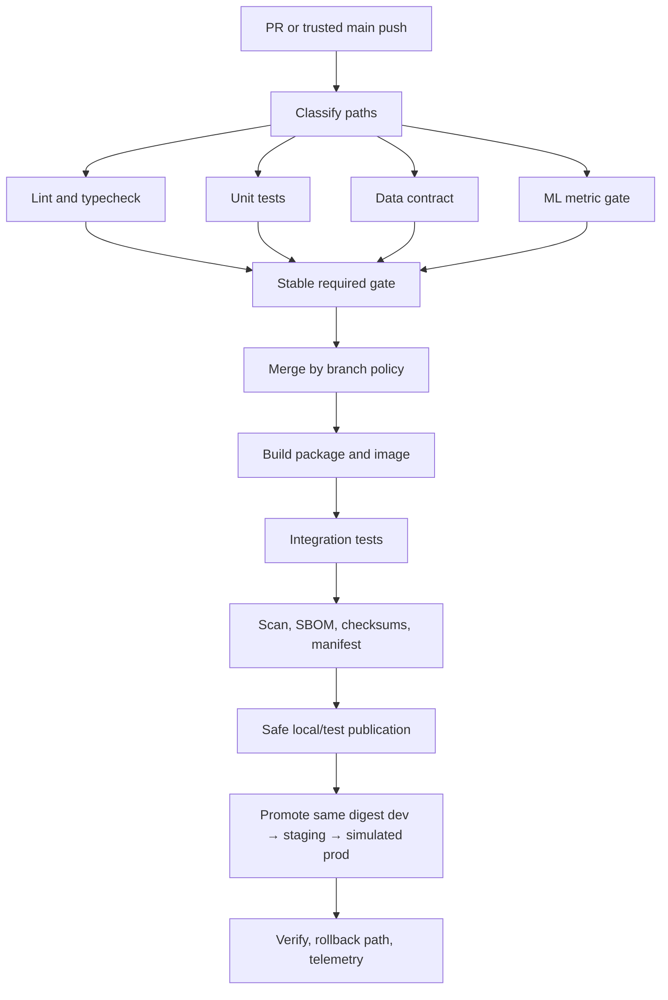
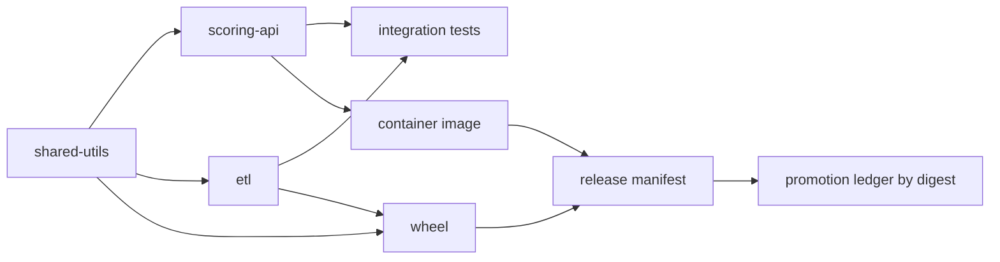

# Multi-Stage CI/CD Pipeline for a Data and ML Service

> **Stage 2E / M02 — CI/CD Pipeline Engineering**  
> Target: `Projects/01-multi-stage-ci-cd-pipeline-for-data-and-ml-service.md`  
> Estimated effort: 30–45 hours (estimate, not measured) · Last reviewed: 2026-10-24  
> Status: **DRAFT-AUDITED — HUMAN EXECUTION REVIEW REQUIRED**

## Abstract and metadata

This capstone builds a three-component monorepo delivery system: FastAPI scoring API, shared Python library, and ETL package. It covers local/CI parity, GitHub Actions PR checks, reusable workflow and composite action, path-based component selection with a stable aggregate gate, cache measurement, test/flakiness policy, wheel/image/SBOM/checksum/manifest, SemVer dry-run, digest-based promotion, GitLab equivalent intent, runner safety, metrics, ADRs, runbooks, evidence, and a defense rubric.

This is a learning lab, **not a production deployment blueprint to copy blindly**. The scenario's “about 50 minutes” is illustrative, not a measured baseline. No workflow, tests, package/image build, SBOM, GitLab lint, or release was executed during authoring. Provider syntax, plan limits, action revisions, UI behavior, and runner features require current-doc verification. The authoritative syllabus prompt and roadmap tree were inspected; all sibling lessons were not independently re-read line by line.

### Table of contents

1. [Project brief](#1-project-brief-and-learning-outcomes)
2. [Prerequisites and safety](#2-prerequisites-tools-zero-budget-safety-and-lab-setup)
3. [Concept primer](#3-concept-primer-cicd-and-delivery-architecture)
4. [Architecture and repository tree](#4-target-architecture-and-repository-tree)
5. [Milestones](#5-milestone-plan)
6. [Three components](#6-build-the-three-components)
7. [Developer interface](#7-build-the-local-developer-interface)
8. [GitHub PR workflow](#8-github-actions-pull-request-pipeline)
9. [Reuse abstractions](#9-reusable-workflow-and-composite-action)
10. [Main delivery](#10-main-branch-delivery-and-release-candidate)
11. [Path filters and gate](#11-monorepo-path-filters-and-required-aggregate-gate)
12. [Caching and performance](#12-caching-and-performance-measurement)
13. [Quality and flakes](#13-quality-gates-and-flaky-tests)
14. [Artifacts and manifest](#14-artifact-publication-sbom-checksums-and-release-manifest)
15. [Versioning and release](#15-semantic-versioning-and-release-automation)
16. [Promotion and rollback](#16-environment-promotion-by-digest-and-rollback)
17. [GitLab equivalent](#17-gitlab-ci-equivalent)
18. [Self-hosted runner lab](#18-ephemeral-self-hosted-runner-lab)
19. [Metrics](#19-pipeline-observability-and-dora-metrics)
20. [ADRs](#20-architecture-decision-records)
21. [Runbooks](#21-incident-runbooks)
22. [Readiness review](#22-production-readiness-review)
23. [Measurements](#23-measurements-and-results)
24. [Evidence](#24-evidence-folder-structure-and-submission)
25. [Rubric](#25-rubric-common-failure-points-and-stretch-goals)
26. [Demo](#26-demo-and-design-defense-script)
27. [Troubleshooting](#27-troubleshooting-guide)
28. [Traceability](#28-self-review-checklist-and-acceptance-traceability)
29. [Glossary](#29-glossary)
30. [Sources and audit](#30-sources-version-sensitive-notes-and-final-audit-report)

---

## 1. Project brief and learning outcomes

### Scenario

A team owns a FastAPI scoring service, shared Python utility library, and ETL package. Current process: manual builds, an approximately 50-minute serial pipeline (scenario statement only), flaky tests, broad secrets, unrestricted `main`, manually edited versions, and no delivery metrics. Build a safer, faster, auditable workflow locally and then in a private test repository.

### Acceptance contract

| # | Required outcome | Implementation | Proof |
|---:|---|---|---|
| 1 | Three packages, metadata, reproducible dependency strategy, tests, ownership | 4, 6 | package metadata and test logs |
| 2 | Implemented Make targets: lint/typecheck/test/data-check/ml-gate/build/scan/package/release-dry-run/metrics | 7 | command logs |
| 3 | PR lint, type, unit, data, ML gates block merge | 8 | CI run and failure drill |
| 4 | Main build/integration/package/scan/safe publish, separate promotion | 10, 14, 16 | manifest and local registry evidence |
| 5 | GitHub Actions least privilege, full-SHA pins, concurrency, timeouts, safe events, artifacts | 8–10 | lint/security review |
| 6 | Reusable workflow and composite action, at least two consumers | 9 | caller workflows and CI run |
| 7 | Path-based monorepo execution and always-reporting aggregate gate | 8, 11 | path fixture matrix |
| 8 | Cache keys, cold/warm benchmark, p50/p95 caveats, speed SLO | 12 | benchmark CSV |
| 9 | Flake reporting and quarantine owner/reason/created/expiry/reference | 13 | validator report |
| 10 | Wheel, local package destination, image/local registry, checksum, SBOM, digest, manifest | 14 | hashes, SBOM, manifest |
| 11 | SemVer/changelog/dry-run, opt-in private-repo release | 15 | dry-run report |
| 12 | Same-digest dev/staging/simulated-prod, blocked unauthorized promotion | 16 | promotion ledger and negative test |
| 13 | GitLab equivalent PR pipeline and mapping | 17 | lint and event matrix |
| 14 | Ephemeral runner plan/lab, least privilege, teardown | 18 | threat model; no fork PRs |
| 15 | Four DORA metrics plus pipeline SLIs, report, synthetic/real distinction | 19 | metrics report |
| 16 | Diagram and four or more filled ADRs | 4, 20 | ADR files |
| 17 | Four incident runbooks | 21 | runbooks/tabletop notes |
| 18 | Production-readiness review | 22 | evidence-backed checklist |
| 19 | Blank measured before/after template | 23 | learner measurements only |
| 20 | 6–7 milestones, 100-point rubric, stretch goals, evidence tree, demo | 5, 24–26 | submission package |

### Bad design → improved design

- One serial pipeline: use a DAG and parallelize independent checks.
- Broad repository secrets: PR jobs read-only; publish credentials only in a trusted, narrow job.
- Rebuild for each environment: build once and promote by immutable digest.
- Workflow-level path filtering: keep a stable aggregate status and conditionally skip component jobs.
- Retry until green: record first-attempt failures; quarantine only with owner and expiry.
- Manual version edits: SemVer policy, changelog draft, dry-run, protected opt-in release.
- Count workflow success as deployment: define and correlate actual deployment events.

## 2. Prerequisites, tools, zero-budget safety, and lab setup

Use WSL2 Ubuntu or native Linux, Git, Python 3.11 (or one documented supported version), venv/pip, Make, Docker/BuildKit, and a private GitHub test repository. Optional: `gh`, actionlint, yamllint, Syft, local registry from M01, GitLab CI lint/runner, and a workflow simulator. Verify current free-tier entitlements and limits in official provider docs; do not assume a paid plan.

```bash
git --version
python3 --version
make --version
docker version
docker buildx version
gh auth status
```

**Expected output (representative; yours will differ):** each available command prints a version/status; Docker client and daemon should both be available for image labs. If Docker is unavailable, record image/runner work as OPEN instead of claiming it passed.

Safety: never paste tokens into chat or source; never print secrets; never enable shell tracing around secrets; never publish to public PyPI/public registry by default; inspect resources before cleanup; no broad host mounts or Docker socket in runner lab; untrusted fork pull requests must never execute on the self-hosted runner. Exact UI/plan/CLI behavior is `[VERIFY]`.

## 3. Concept primer: CI/CD and delivery architecture

- **CI:** integrate frequently and automatically validate.
- **Continuous delivery:** keep changes release-ready; production can require approval.
- **Continuous deployment:** qualifying changes automatically release after policy gates.
- **DAG:** dependency graph; independent jobs can run in parallel.
- **Artifact:** explicit build/test output or handoff; **cache** is disposable acceleration.
- **Build once, promote many:** same tested bytes progress across environments.
- **Digest:** content identity; a tag can be mutable.
- **Data contract:** declared input schema/quality rules.
- **ML gate:** deterministic small metric check; not production model validation.
- **SLI/SLO:** measured indicator/target over a defined window.
- **DORA metrics:** deployment frequency, lead time for changes, change failure rate, time to restore.



## 4. Target architecture and repository tree

```text
.
├── .github/workflows/{pr.yml,reusable-python-checks.yml,main-delivery.yml}
├── .github/actions/setup-python-project/action.yml
├── services/scoring-api/{pyproject.toml,Dockerfile,src/scoring_api/app.py,tests/test_app.py}
├── libs/shared-utils/{pyproject.toml,src/shared_utils/scoring.py,tests/test_scoring.py}
├── pipelines/etl/{pyproject.toml,src/etl_pipeline/contracts.py,tests/test_contracts.py}
├── tests/{test_data_contract.py,test_integration.py}
├── scripts/{classify_changes.py,ml_gate.py,check_quarantine.py,create_release_manifest.py,promote_digest.py,release_dry_run.py,benchmark_pipeline.py,metrics_report.py}
├── release/{version.txt,changelog.md,quarantine.json,release-manifest.schema.json}
├── runner-lab/{README.md,docker-compose.yml}
├── docs/adr/ADR-001..004.md
├── docs/runbooks/{secret-leaked.md,partial-release.md,flaky-tests.md,runner-compromise.md}
├── evidence/{local,ci,packages,images,metrics,promotion,review}/
├── .gitlab-ci.yml
├── .gitignore
├── Makefile
├── pyproject.toml
└── README.md
```



Source/config belongs in Git. Build outputs, logs, test reports, SBOM, checksums, manifest, benchmark/metrics reports belong under `evidence/` or CI artifacts; do not commit secrets or raw personal data.

## 5. Milestone plan

| Milestone | Effort | Tasks | Done/evidence | Recovery |
|---|---:|---|---|---|
| 1 Components | 4–6 h | packages, fixtures, tests | local tests/builds | implement shared library first |
| 2 Local gates | 2–3 h | Makefile and validators | all targets run | execute targets separately |
| 3 PR and path gate | 5–7 h | workflows, reusable workflow/action, aggregate gate | failure/docs/shared path cases | start with all components, optimize later |
| 4 Artifacts | 5–7 h | wheel/image, scan, manifest, local destination | hashes/digest reconcile | disable publish, validate prior steps |
| 5 Release/promotion | 3–5 h | SemVer dry-run and digest promotion | idempotent dry-run and negative test | local simulation only |
| 6 GitLab/runner | 4–6 h | equivalent pipeline and threat model | lint and no-fork policy | mark variable runner work OPEN |
| 7 Evidence/defense | 6–8 h | metrics, ADRs, runbooks, review | evidence bundle and demo | use synthetic data but label it |

Times are estimates, not measured completion times.

## 6. Build the three components

### 6.1 Dependency and lock strategy

Each component has `pyproject.toml`. The root metadata defines developer tools. Version ranges are not a lockfile: choose a lock tool, generate and commit its real lock/constraints file, record tool/version, and make CI install from it. Do not fabricate lockfile content because resolution varies by platform/Python/index. Exact lock tool behavior is `[VERIFY]`.

```toml
# File: pyproject.toml
[build-system]
requires = ["setuptools>=68", "wheel"]
build-backend = "setuptools.build_meta"

[project]
name = "data-ml-cicd-capstone-dev"
version = "0.1.0"
requires-python = ">=3.11"
dependencies = []

[project.optional-dependencies]
dev = ["pytest>=8,<9", "ruff>=0.6,<1", "mypy>=1.11,<2", "coverage[toml]>=7,<8", "build>=1,<2", "httpx>=0.27,<1", "fastapi>=0.112,<1"]

[tool.pytest.ini_options]
testpaths = ["libs/shared-utils/tests", "pipelines/etl/tests", "services/scoring-api/tests", "tests"]
addopts = "-ra"

[tool.ruff]
line-length = 100
target-version = "py311"

[tool.ruff.lint]
select = ["E", "F", "I", "UP", "B"]

# Root project is a tooling meta-package; component packages are installed separately.
[tool.setuptools]
packages = []

[tool.mypy]
python_version = "3.11"
warn_return_any = true
warn_unused_configs = true
no_implicit_optional = true
check_untyped_defs = true
```

```toml
# File: libs/shared-utils/pyproject.toml
[build-system]
requires = ["setuptools>=68", "wheel"]
build-backend = "setuptools.build_meta"
[project]
name = "shared-utils-capstone"
version = "0.1.0"
requires-python = ">=3.11"
dependencies = []
[tool.setuptools.packages.find]
where = ["src"]
```

```python
# File: libs/shared-utils/src/shared_utils/scoring.py
def score_row(feature_a: float, feature_b: float) -> float:
    """Deterministic toy score; not a trained production model."""
    if not 0 <= feature_a <= 1 or not 0 <= feature_b <= 1:
        raise ValueError("features must be in [0, 1]")
    return round(0.7 * feature_a + 0.3 * feature_b, 6)
```

```python
# File: libs/shared-utils/src/shared_utils/__init__.py
from .scoring import score_row
__all__ = ["score_row"]
```

```python
# File: libs/shared-utils/tests/test_scoring.py
import pytest
from shared_utils import score_row

def test_score_is_deterministic():
    assert score_row(0.8, 0.4) == score_row(0.8, 0.4) == 0.68

@pytest.mark.parametrize("a,b", [(-1, 0), (2, 0), (0, -1), (0, 2)])
def test_out_of_range_fails(a, b):
    with pytest.raises(ValueError):
        score_row(a, b)
```

```toml
# File: pipelines/etl/pyproject.toml
[build-system]
requires = ["setuptools>=68", "wheel"]
build-backend = "setuptools.build_meta"
[project]
name = "etl-pipeline-capstone"
version = "0.1.0"
requires-python = ">=3.11"
dependencies = []
[tool.setuptools.packages.find]
where = ["src"]
```

```python
# File: pipelines/etl/src/etl_pipeline/contracts.py
from collections.abc import Mapping
from typing import Any

REQUIRED = {"record_id", "feature_a", "feature_b"}

def validate_record(row: Mapping[str, Any]) -> list[str]:
    errors: list[str] = []
    missing = REQUIRED - set(row)
    if missing:
        return [f"missing columns: {', '.join(sorted(missing))}"]
    if not isinstance(row["record_id"], str) or not row["record_id"].strip():
        errors.append("record_id must be a non-empty string")
    for key in ("feature_a", "feature_b"):
        value = row[key]
        if isinstance(value, bool) or not isinstance(value, (int, float)):
            errors.append(f"{key} must be numeric")
        elif not 0 <= value <= 1:
            errors.append(f"{key} must be in [0, 1]")
    return errors
```

```python
# File: pipelines/etl/src/etl_pipeline/__init__.py
"""ETL package for the M02 capstone."""
```

```python
# File: pipelines/etl/tests/test_contracts.py
from etl_pipeline.contracts import validate_record

def test_valid_row():
    assert validate_record({"record_id": "r1", "feature_a": 0.2, "feature_b": 0.8}) == []

def test_missing_column_fails():
    assert validate_record({"record_id": "r1", "feature_a": 0.2})

def test_null_and_range_fail():
    errors = validate_record({"record_id": "", "feature_a": None, "feature_b": 1.2})
    assert len(errors) >= 3
```

```toml
# File: services/scoring-api/pyproject.toml
[build-system]
requires = ["setuptools>=68", "wheel"]
build-backend = "setuptools.build_meta"
[project]
name = "scoring-api-capstone"
version = "0.1.0"
requires-python = ">=3.11"
dependencies = ["fastapi>=0.112,<1", "uvicorn>=0.30,<1"]
[tool.setuptools.packages.find]
where = ["src"]
```

```python
# File: services/scoring-api/src/scoring_api/app.py
from fastapi import FastAPI
from pydantic import BaseModel, Field
from shared_utils import score_row

app = FastAPI(title="Scoring API capstone", version="0.1.0")

class ScoreRequest(BaseModel):
    record_id: str = Field(min_length=1)
    feature_a: float = Field(ge=0, le=1)
    feature_b: float = Field(ge=0, le=1)

@app.get("/health")
def health() -> dict[str, str]:
    return {"status": "ok"}

@app.post("/score")
def score(request: ScoreRequest) -> dict[str, object]:
    return {"record_id": request.record_id, "score": score_row(request.feature_a, request.feature_b)}
```

```python
# File: services/scoring-api/src/scoring_api/__init__.py
"""Scoring API package."""
```

```python
# File: services/scoring-api/tests/test_app.py
from fastapi.testclient import TestClient
from scoring_api.app import app

client = TestClient(app)

def test_health():
    assert client.get("/health").json() == {"status": "ok"}

def test_score():
    r = client.post("/score", json={"record_id": "r1", "feature_a": 0.8, "feature_b": 0.4})
    assert r.status_code == 200
    assert r.json()["score"] == 0.68

def test_invalid_range():
    assert client.post("/score", json={"record_id": "r1", "feature_a": 2, "feature_b": 0.4}).status_code == 422
```

```python
# File: tests/test_data_contract.py
from etl_pipeline.contracts import validate_record

def test_valid_fixture():
    assert validate_record({"record_id": "seed1", "feature_a": 0.25, "feature_b": 0.75}) == []

def test_invalid_fixture():
    assert validate_record({"record_id": "", "feature_a": None, "feature_b": 1.4})
```

```python
# File: tests/test_integration.py
from fastapi.testclient import TestClient
from scoring_api.app import app
from etl_pipeline.contracts import validate_record

client = TestClient(app)

def test_valid_etl_record_can_be_scored():
    row = {"record_id": "i1", "feature_a": 0.5, "feature_b": 0.5}
    assert validate_record(row) == []
    assert client.post("/score", json=row).json()["score"] == 0.5
```

```python
# File: scripts/ml_gate.py
import json
import sys
from pathlib import Path
from shared_utils import score_row

CASES = [(0.0, 0.0, 0.0), (1.0, 0.0, 0.7), (0.0, 1.0, 0.3), (0.8, 0.4, 0.68)]
THRESHOLD = 0.00001

def main() -> int:
    errors = [abs(score_row(a, b) - expected) for a, b, expected in CASES]
    report = {"dataset": "seeded-toy-fixture-v1", "rows": len(CASES),
              "metric": "maximum absolute deviation from declared reference",
              "max_absolute_error": max(errors), "threshold": THRESHOLD,
              "pass": max(errors) <= THRESHOLD,
              "limitation": "toy fixture; not production model validation"}
    Path("evidence/local").mkdir(parents=True, exist_ok=True)
    Path("evidence/local/ml-gate.json").write_text(json.dumps(report, indent=2) + "\n")
    print(json.dumps(report, indent=2))
    return 0 if report["pass"] else 1

if __name__ == "__main__":
    sys.exit(main())
```

Install and run:

```bash
python3 -m venv .venv
. .venv/bin/activate
python -m pip install --upgrade pip
python -m pip install -e '.[dev]'
python -m pip install -e ./libs/shared-utils -e ./pipelines/etl -e ./services/scoring-api
pytest
```

**Expected output (representative; yours will differ):** pytest reports passing shared-utils, ETL, API, and integration tests. Deliberately change expected score `0.68` to `0.69`; the test must fail. Restore and rerun. Do not use `|| true`.

## 7. Build the local developer interface

```makefile
# File: Makefile
SHELL := /bin/bash
PYTHON ?= python

.PHONY: install lint typecheck test data-check ml-gate build scan package release-dry-run metrics

install:
	$(PYTHON) -m pip install -e '.[dev]'
	$(PYTHON) -m pip install -e ./libs/shared-utils -e ./pipelines/etl -e ./services/scoring-api

lint:
	$(PYTHON) -m ruff check libs pipelines services tests scripts

typecheck:
	$(PYTHON) -m mypy libs/shared-utils/src pipelines/etl/src services/scoring-api/src scripts

test:
	mkdir -p evidence/local
	$(PYTHON) -m pytest --junitxml=evidence/local/junit.xml

data-check:
	$(PYTHON) -c "from etl_pipeline.contracts import validate_record; r=validate_record({'record_id':'seed1','feature_a':0.2,'feature_b':0.8}); print(r); raise SystemExit(bool(r))"

ml-gate:
	$(PYTHON) scripts/ml_gate.py

build:
	$(PYTHON) -m build ./libs/shared-utils
	$(PYTHON) -m build ./pipelines/etl
	$(PYTHON) -m build ./services/scoring-api

scan:
	@command -v syft >/dev/null || { echo "Syft unavailable; scan OPEN"; exit 2; }
	mkdir -p evidence/packages
	syft dir:. -o cyclonedx-json=evidence/packages/source.sbom.cdx.json

package: build
	$(PYTHON) scripts/create_release_manifest.py --out evidence/packages/release-manifest.json

release-dry-run:
	$(PYTHON) scripts/release_dry_run.py

metrics:
	$(PYTHON) scripts/metrics_report.py --input evidence/metrics/events.json --out-dir evidence/metrics/report
```

`scan` is not a fake pass: Syft creates an SBOM, not a vulnerability verdict. If unavailable, record OPEN. Run `make install lint typecheck test data-check ml-gate build`. Expected output: each target exits zero after fixes; reports appear under `evidence/local/`. A report file is not success if the command returned failure.

## 8. GitHub Actions pull-request pipeline

Use broad workflow triggers and job-level path decisions; a workflow-level path filter can prevent the required status from existing. Use `contents: read` for validation, `concurrency`, bounded `timeout-minutes`, artifacts, safe shell handling, and no PR secrets. **Every action SHA below is a blocking placeholder; do not enable until replaced with verified full 40-character SHA values. Never invent a SHA.**

```python
# File: scripts/classify_changes.py
import json
import subprocess
import sys
from pathlib import Path

PREFIXES = {
    "shared": ("libs/shared-utils/",),
    "etl": ("pipelines/etl/",),
    "api": ("services/scoring-api/",),
}
GLOBAL = (".github/", "scripts/", "tests/", "pyproject.toml", "Makefile", ".gitlab-ci.yml", "release/")

def classify(paths: list[str]) -> dict:
    docs_only = bool(paths) and all(p.startswith(("docs/", "evidence/")) or p.endswith((".md", ".rst")) for p in paths)
    affected = set()
    for p in paths:
        known = any(p.startswith(prefix) for group in PREFIXES.values() for prefix in group)
        if any(p.startswith(GLOBAL) or p == "README.md" for _ in [0]):
            affected.update(PREFIXES)
        for name, prefixes in PREFIXES.items():
            if p.startswith(prefixes):
                affected.add(name)
        if not known and not p.startswith(("docs/", "evidence/")) and not p.endswith((".md", ".rst")):
            affected.update(PREFIXES)
    if "shared" in affected:
        affected.update({"api", "etl"})
    if docs_only and not any(p.startswith(GLOBAL) for p in paths):
        affected.clear()
    return {"components": sorted(affected), "docs_only": docs_only, "paths": sorted(paths)}

def main() -> int:
    base, head, output = sys.argv[1:4]
    try:
        paths = subprocess.check_output(["git", "diff", "--name-only", f"{base}...{head}"], text=True).splitlines()
    except subprocess.CalledProcessError as exc:
        print(f"Cannot classify; fetch base history first: {exc}", file=sys.stderr)
        return 2
    result = classify(paths)
    Path(output).parent.mkdir(parents=True, exist_ok=True)
    Path(output).write_text(json.dumps(result, indent=2) + "\n")
    print(json.dumps(result))
    return 0

if __name__ == "__main__":
    raise SystemExit(main())
```

```yaml
# File: .github/workflows/pr.yml
name: PR validation
on:
  pull_request:
  push:
    branches: [main]
  workflow_dispatch:

permissions:
  contents: read

concurrency:
  group: pr-${{ github.workflow }}-${{ github.event.pull_request.number || github.ref }}
  cancel-in-progress: true

jobs:
  classify:
    runs-on: ubuntu-latest
    timeout-minutes: 5
    outputs:
      components: ${{ steps.paths.outputs.components }}
    steps:
      - uses: actions/checkout@<VERIFY_FULL_40_CHAR_SHA>
        with:
          fetch-depth: 0
      - id: paths
        env:
          BASE_SHA: ${{ github.event.pull_request.base.sha || github.event.before }}
          HEAD_SHA: ${{ github.event.pull_request.head.sha || github.sha }}
        shell: bash
        run: |
          set -euo pipefail
          git fetch --no-tags origin "$BASE_SHA"
          python scripts/classify_changes.py "$BASE_SHA" "$HEAD_SHA" evidence/local/paths.json
          value="$(python -c "import json;print(','.join(json.load(open('evidence/local/paths.json'))['components']))")"
          echo "components=$value" >> "$GITHUB_OUTPUT"
      - if: always()
        uses: actions/upload-artifact@<VERIFY_FULL_40_CHAR_SHA>
        with:
          name: path-classification
          path: evidence/local/paths.json
          if-no-files-found: warn

  shared:
    needs: classify
    if: contains(needs.classify.outputs.components, 'shared')
    uses: ./.github/workflows/reusable-python-checks.yml
    with:
      component: shared
    permissions:
      contents: read

  etl:
    needs: classify
    if: contains(needs.classify.outputs.components, 'etl')
    uses: ./.github/workflows/reusable-python-checks.yml
    with:
      component: etl
    permissions:
      contents: read

  api:
    needs: classify
    if: contains(needs.classify.outputs.components, 'api')
    uses: ./.github/workflows/reusable-python-checks.yml
    with:
      component: api
    permissions:
      contents: read

  root-checks:
    needs: classify
    if: always() && needs.classify.result == 'success'
    runs-on: ubuntu-latest
    timeout-minutes: 15
    steps:
      - uses: actions/checkout@<VERIFY_FULL_40_CHAR_SHA>
      - uses: ./.github/actions/setup-python-project
      - run: make lint typecheck test data-check ml-gate

  required-gate:
    name: required-gate
    if: always()
    needs: [classify, shared, etl, api, root-checks]
    runs-on: ubuntu-latest
    timeout-minutes: 3
    steps:
      - env:
          CLASSIFY: ${{ needs.classify.result }}
          COMPONENTS: ${{ needs.classify.outputs.components }}
          SHARED: ${{ needs.shared.result }}
          ETL: ${{ needs.etl.result }}
          API: ${{ needs.api.result }}
          ROOT: ${{ needs.root-checks.result }}
        shell: bash
        run: |
          set -euo pipefail
          [[ "$CLASSIFY" == success && "$ROOT" == success ]] || exit 1
          [[ ",$COMPONENTS," != *",shared,"* || "$SHARED" == success ]] || exit 1
          [[ ",$COMPONENTS," != *",etl,"* || "$ETL" == success ]] || exit 1
          [[ ",$COMPONENTS," != *",api,"* || "$API" == success ]] || exit 1
          echo "All required checks for affected components passed."
```

This is a design sketch that must be validated: current reusable-workflow conditions, skipped-job result semantics, expression behavior, artifact paths, and required-check status handling are `[VERIFY]`. Add a CI guard that fails if `VERIFY_FULL_40_CHAR_SHA` remains. Do not configure `required-gate` as required until the docs-only and relevant-job failure tests pass in a private repo.

Never do `run: echo "${{ github.event.pull_request.title }}"`. Instead pass untrusted fields via `env:` and quote them as data. Never use `pull_request_target` to execute untrusted PR code.

## 9. Reusable workflow and composite action

```yaml
# File: .github/workflows/reusable-python-checks.yml
name: Reusable component checks
on:
  workflow_call:
    inputs:
      component:
        required: true
        type: string
permissions:
  contents: read
jobs:
  test:
    runs-on: ubuntu-latest
    timeout-minutes: 15
    steps:
      - uses: actions/checkout@<VERIFY_FULL_40_CHAR_SHA>
      - uses: ./.github/actions/setup-python-project
      - env:
          COMPONENT: ${{ inputs.component }}
        shell: bash
        run: |
          set -euo pipefail
          case "$COMPONENT" in
            shared) python -m pytest libs/shared-utils/tests ;;
            etl) python -m pytest pipelines/etl/tests ;;
            api) python -m pytest services/scoring-api/tests ;;
            *) echo "Unsupported component"; exit 2 ;;
          esac
```

```yaml
# File: .github/actions/setup-python-project/action.yml
name: Setup Python capstone
description: Install the capstone tooling and editable packages
inputs:
  python-version:
    required: false
    default: "3.11"
runs:
  using: composite
  steps:
    - uses: actions/setup-python@<VERIFY_FULL_40_CHAR_SHA>
      with:
        python-version: ${{ inputs.python-version }}
        cache: pip
        cache-dependency-path: |
          pyproject.toml
          libs/shared-utils/pyproject.toml
          pipelines/etl/pyproject.toml
          services/scoring-api/pyproject.toml
    - shell: bash
      run: |
        set -euo pipefail
        python -m pip install -e '.[dev]'
        python -m pip install -e ./libs/shared-utils -e ./pipelines/etl -e ./services/scoring-api
```

Composite action is step-level reuse; reusable workflow owns jobs/runners/permissions. Both are consumed from more than one workflow/job. Keep publishing and deployment visible in dedicated jobs, not hidden in a setup abstraction.

## 10. Main-branch delivery and release candidate

```yaml
# File: .github/workflows/main-delivery.yml
name: Main delivery candidate
on:
  push:
    branches: [main]
  workflow_dispatch:
permissions:
  contents: read
concurrency:
  group: main-delivery-${{ github.ref }}
  cancel-in-progress: false
jobs:
  candidate:
    runs-on: ubuntu-latest
    timeout-minutes: 25
    steps:
      - uses: actions/checkout@<VERIFY_FULL_40_CHAR_SHA>
        with:
          fetch-depth: 0
      - uses: ./.github/actions/setup-python-project
      - run: make lint typecheck test data-check ml-gate build
      - name: Build image
        run: docker build -f services/scoring-api/Dockerfile -t scoring-api:${GITHUB_SHA} .
      - name: Generate SBOM
        run: |
          command -v syft
          mkdir -p evidence/images
          syft scoring-api:${GITHUB_SHA} -o cyclonedx-json=evidence/images/scoring-api.sbom.cdx.json
      - name: Create candidate manifest
        env:
          SOURCE_COMMIT: ${{ github.sha }}
          IMAGE_TAG: scoring-api:${{ github.sha }}
        run: python scripts/create_release_manifest.py --source-commit "$SOURCE_COMMIT" --image-tag "$IMAGE_TAG" --out evidence/packages/release-manifest.json
      - if: always()
        uses: actions/upload-artifact@<VERIFY_FULL_40_CHAR_SHA>
        with:
          name: candidate-${{ github.sha }}
          path: |
            libs/shared-utils/dist/
            pipelines/etl/dist/
            services/scoring-api/dist/
            evidence/
          if-no-files-found: warn
```

This builds a candidate; it does not publish the hosted runner's local image to a persistent registry and does not deploy. Hosted-runner Docker support and SBOM tool availability require validation. If Syft is unavailable, the job should fail/open rather than claim an SBOM passed. The local registry flow in Section 14 demonstrates safe local publication.

```dockerfile
# File: services/scoring-api/Dockerfile
FROM python:3.11-slim
ENV PYTHONDONTWRITEBYTECODE=1 PYTHONUNBUFFERED=1
WORKDIR /app
COPY libs/shared-utils/pyproject.toml /app/shared-utils-src/pyproject.toml
COPY libs/shared-utils/src /app/shared-utils-src/src
COPY services/scoring-api/pyproject.toml /app/pyproject.toml
COPY services/scoring-api/src /app/src
RUN python -m pip install --no-cache-dir "fastapi>=0.112,<1" \
    && python -m pip install --no-cache-dir /app/shared-utils-src
EXPOSE 8000
CMD ["python", "-m", "uvicorn", "scoring_api.app:app", "--host", "0.0.0.0", "--port", "8000"]
```

This Dockerfile is a teaching starting point, not production hardened: validate its package-install layout; pin base image digest and dependencies, run as non-root, and use a controlled wheelhouse before production. Do not claim it built until tested.

```bash
docker build -f services/scoring-api/Dockerfile -t scoring-api:capstone-local .
docker run --rm -d --name scoring-api-lab -p 127.0.0.1:18080:8000 scoring-api:capstone-local
curl --fail http://127.0.0.1:18080/health
docker stop scoring-api-lab
```

Expected (representative): health endpoint returns `{"status":"ok"}`. The port binds to loopback. Inspect `docker ps --filter name=scoring-api-lab` before stopping; do not use broad prune commands.

## 11. Monorepo path filters and required aggregate gate

| Changed paths | Checks | Reason |
|---|---|---|
| `services/scoring-api/**` | API + root gates | direct service change |
| `pipelines/etl/**` | ETL + root gates | contract change |
| `libs/shared-utils/**` | shared + API + ETL + root | shared consumers depend on it |
| `.github/**`, scripts, root config, Makefile | all | pipeline/tooling can affect all |
| docs-only | aggregate gate, no component jobs if policy proves safe | status still reports |
| unknown path/classification error | all or fail closed | avoid false negatives |

Workflow-level path filters may prevent a workflow from running; job-level decisions let a stable aggregate gate report. A skipped component job is valid only when the classifier says it is irrelevant. Configure branch protection to require `required-gate` only after verifying current provider semantics.

Test API-only, ETL-only, shared, root config, workflow/script, docs-only, unknown file, missing base SHA, force-push, and merge queue cases. Store expected vs observed job sets in `evidence/ci/path-matrix.csv`. Classifier failure must not be interpreted as no affected components.

## 12. Caching and performance measurement

Cache keys should include OS/Python and a lockfile hash (and architecture if relevant). Never use secrets in keys or let untrusted PR cache writes become trusted release inputs. Cold build must work. Do not cache release artifacts as the authoritative handoff.

```python
# File: scripts/benchmark_pipeline.py
import argparse
import csv
import statistics
from pathlib import Path

def main() -> int:
    p = argparse.ArgumentParser()
    p.add_argument("--input", required=True, help="CSV: mode,duration_seconds,queue_seconds")
    p.add_argument("--out", default="evidence/metrics/benchmark-summary.csv")
    a = p.parse_args()
    groups = {}
    with open(a.input, newline="", encoding="utf-8") as f:
        for row in csv.DictReader(f):
            groups.setdefault(row["mode"], []).append(float(row["duration_seconds"]))
    Path(a.out).parent.mkdir(parents=True, exist_ok=True)
    with open(a.out, "w", newline="", encoding="utf-8") as f:
        w = csv.writer(f); w.writerow(["mode", "n", "p50_seconds", "p95_seconds", "p95_status"])
        for mode, vals in sorted(groups.items()):
            p95 = sorted(vals)[round((len(vals)-1)*0.95)] if len(vals) >= 20 else ""
            w.writerow([mode, len(vals), statistics.median(vals), p95,
                        "reported" if len(vals) >= 20 else "insufficient sample"])
    return 0

if __name__ == "__main__":
    raise SystemExit(main())
```

Use at least five comparable runs for a rough median; collect 20+ before reporting this script's rough p95. Record runner, commit, cache state, Python, queue and execution time separately. Example SLO to adopt only after baseline: “90% of default-branch runs finish within 15 minutes from workflow start to aggregate gate over a rolling 30-day window.” This is a proposed target, not a measured result. Breach response: inspect queue, critical path, retries, cache misses, and capacity before considering any gate change.

## 13. Quality gates and flaky tests

A test that passes only on retry is not “fixed.” Preserve first-attempt outcomes. Core unit tests remain blocking. Quarantine is temporary and requires owner, reason, created date, expiry date, issue reference, and allowed policy.

```json
// File: release/quarantine.json
{
  "schema_version": 1,
  "tests": [
    {
      "test_id": "tests.integration.test_external_dependency",
      "owner": "team-data-platform",
      "reason": "Intermittent sandbox timeout under investigation",
      "created_date": "2026-10-24",
      "expiry_date": "2026-11-07",
      "issue_reference": "https://example.invalid/issues/123",
      "allowed_policy": "advisory-only; core unit suite remains blocking"
    }
  ]
}
```

```python
# File: scripts/check_quarantine.py
import json
import sys
from datetime import date
from pathlib import Path

FIELDS = {"test_id", "owner", "reason", "created_date", "expiry_date", "issue_reference", "allowed_policy"}

def main() -> int:
    doc = json.loads(Path("release/quarantine.json").read_text())
    errors = []
    if doc.get("schema_version") != 1 or not isinstance(doc.get("tests"), list):
        errors.append("invalid quarantine schema")
    for item in doc.get("tests", []):
        if not isinstance(item, dict) or FIELDS - item.keys():
            errors.append("entry missing required fields"); continue
        try:
            created = date.fromisoformat(item["created_date"])
            expiry = date.fromisoformat(item["expiry_date"])
            if expiry <= created or expiry < date.today():
                errors.append(f"{item['test_id']}: expired or invalid expiry")
        except ValueError:
            errors.append(f"{item['test_id']}: dates must be YYYY-MM-DD")
        if any(not str(item[k]).strip() for k in ("owner", "reason", "issue_reference")):
            errors.append(f"{item['test_id']}: owner/reason/reference required")
    if errors:
        print("\n".join(errors), file=sys.stderr); return 1
    print("Quarantine metadata valid")
    return 0

if __name__ == "__main__":
    raise SystemExit(main())
```

Validate quarantine metadata in a blocking job. Expired entries fail until removed or renewed through review; never auto-extend indefinitely. Detection can run a selected integration suite repeatedly and record each attempt, but the loop itself is not a statistical guarantee. Record test ID, attempt, environment, first failure, retry outcome, and owner.

## 14. Artifact publication, SBOM, checksums, and release manifest

Build wheels:

```bash
python -m build ./libs/shared-utils
python -m build ./pipelines/etl
python -m build ./services/scoring-api
find libs pipelines services -path '*/dist/*' -type f -print
```

Expected (representative): wheel and source distribution files appear under each `dist/` directory. Verify by installing a wheel in a clean venv; source imports alone do not prove packaging correctness.

Safe local destination:

```bash
mkdir -p evidence/packages/local-index
find libs pipelines services -path '*/dist/*.whl' -type f -exec cp -n {} evidence/packages/local-index/ \;
find evidence/packages/local-index -type f -name '*.whl' -print0 | sort -z | xargs -0 -r sha256sum > evidence/packages/SHA256SUMS
sha256sum --check evidence/packages/SHA256SUMS
```

The directory is not a real package index or immutable store. For a local PyPI-compatible index, use a tool such as devpi only after verifying its current official quickstart and binding/authentication behavior. Never publish to public PyPI as a required step.

SBOM example (if Syft is installed; verify current CLI syntax):

```bash
syft dir:libs/shared-utils -o cyclonedx-json=evidence/packages/shared-utils.sbom.cdx.json
```

An SBOM inventories components; it does not prove they are safe. A checksum detects byte changes against a trusted expected hash; it does not prove publisher identity or testing.

```json
// File: release/release-manifest.schema.json
{
  "$schema": "https://json-schema.org/draft/2020-12/schema",
  "type": "object",
  "required": ["schema_version", "source_commit", "created_at_utc", "packages", "image", "checksums", "sbom_files"],
  "properties": {
    "schema_version": {"const": 1},
    "source_commit": {"type": "string", "minLength": 7},
    "created_at_utc": {"type": "string", "format": "date-time"},
    "packages": {"type": "array", "items": {"type": "object", "required": ["name", "version", "file", "sha256"]}},
    "image": {"type": "object", "required": ["tag", "digest"], "properties": {"tag": {"type": "string"}, "digest": {"type": ["string", "null"]}}},
    "checksums": {"type": "string"},
    "sbom_files": {"type": "array", "items": {"type": "string"}}
  }
}
```

```python
# File: scripts/create_release_manifest.py
import argparse
import hashlib
import json
import os
import subprocess
from datetime import datetime, timezone
from pathlib import Path

def sha256(path: Path) -> str:
    h = hashlib.sha256()
    with path.open("rb") as f:
        for chunk in iter(lambda: f.read(1024 * 1024), b""):
            h.update(chunk)
    return h.hexdigest()

def image_digest(tag: str):
    try:
        value = subprocess.check_output(["docker", "image", "inspect", "--format", "{{index .RepoDigests 0}}", tag], text=True).strip()
        return value.rsplit("@", 1)[1] if "@" in value else None
    except (subprocess.CalledProcessError, FileNotFoundError):
        return None

def main() -> int:
    p = argparse.ArgumentParser()
    p.add_argument("--source-commit", default=os.getenv("SOURCE_COMMIT", "LOCAL-UNCOMMITTED"))
    p.add_argument("--image-tag", default=os.getenv("IMAGE_TAG", "scoring-api:capstone-local"))
    p.add_argument("--out", default="evidence/packages/release-manifest.json")
    a = p.parse_args()
    packages = []
    for root in ("libs/shared-utils/dist", "pipelines/etl/dist", "services/scoring-api/dist"):
        for f in sorted(Path(root).glob("*.whl")):
            packages.append({"name": f.name, "version": "read-wheel-metadata-before-release",
                             "file": str(f), "sha256": sha256(f)})
    manifest = {"schema_version": 1, "source_commit": a.source_commit,
                "created_at_utc": datetime.now(timezone.utc).isoformat(),
                "packages": packages, "image": {"tag": a.image_tag, "digest": image_digest(a.image_tag)},
                "checksums": "evidence/packages/SHA256SUMS",
                "sbom_files": sorted(str(f) for f in Path("evidence").rglob("*.sbom.cdx.json"))}
    out = Path(a.out); out.parent.mkdir(parents=True, exist_ok=True)
    out.write_text(json.dumps(manifest, indent=2) + "\n")
    print(f"Wrote {out}; packages={len(packages)}; digest={manifest['image']['digest']}")
    return 0

if __name__ == "__main__":
    raise SystemExit(main())
```

The generator is deliberately a minimal scaffold: before using it for release, parse actual wheel metadata rather than the placeholder version and validate against the schema. A missing image digest must block promotion. A local image ID is not a registry digest.

Local registry example (adapt to M01 and inspect your registry before use):

```bash
docker tag scoring-api:capstone-local localhost:5000/scoring-api:capstone-local
docker push localhost:5000/scoring-api:capstone-local
docker image inspect --format='{{json .RepoDigests}}' localhost:5000/scoring-api:capstone-local
```

Expected: a registry digest appears if the registry/runtime is configured accordingly. Exact behavior is `[VERIFY]`. If no digest exists, stop rather than substituting the image ID.

## 15. Semantic versioning and release automation

SemVer: MAJOR for incompatible public API changes, MINOR for backward-compatible features, PATCH for backward-compatible bug fixes. Prerelease identifiers sort before the final release; build metadata does not affect precedence. Conventional Commit prefixes suggest intent but cannot prove compatibility.

```text
# File: release/version.txt
0.1.0
```

```markdown
<!-- File: release/changelog.md -->
# Changelog
## Unreleased
- Add reviewed entries here.
## 0.1.0
- Initial educational capstone baseline.
```

```python
# File: scripts/release_dry_run.py
import json
import re
from pathlib import Path

VERSION = re.compile(r"^(0|[1-9]\d*)\.(0|[1-9]\d*)\.(0|[1-9]\d*)(?:-[0-9A-Za-z.-]+)?(?:\+[0-9A-Za-z.-]+)?$")

def main() -> int:
    version = Path("release/version.txt").read_text().strip()
    changelog = Path("release/changelog.md").read_text()
    report = {"mode": "dry-run", "version": version, "semver_shape_valid": bool(VERSION.fullmatch(version)),
              "unreleased_section": "## Unreleased" in changelog,
              "would_create_tag": f"v{version}", "would_publish": False, "would_create_remote_release": False}
    print(json.dumps(report, indent=2))
    return 0 if report["semver_shape_valid"] and report["unreleased_section"] else 1

if __name__ == "__main__":
    raise SystemExit(main())
```

Run twice; it must have no external side effects. It validates only basic shape, not full compatibility. A real GitHub Release path must be opt-in, limited to the private test repo, gated on verified action SHAs and protected refs, and off by default. Verify `gh release` flags and permissions against current docs `[VERIFY]`. If tag creation succeeds but publication fails, inspect state and resume only the missing idempotent step; do not force-move the tag.

## 16. Environment promotion by digest and rollback

```python
# File: scripts/promote_digest.py
import argparse
import json
import re
import sys
from datetime import datetime, timezone
from pathlib import Path

DIGEST = re.compile(r"^sha256:[a-f0-9]{64}$")
NEXT = {"dev": {"staging"}, "staging": {"production"}, "production": set()}

def promote(manifest: dict, source: str, target: str, actor: str, approved: bool) -> dict:
    digest = manifest.get("image", {}).get("digest")
    if not isinstance(digest, str) or not DIGEST.fullmatch(digest):
        raise ValueError("valid immutable image digest required")
    if target not in NEXT.get(source, set()):
        raise ValueError("invalid environment transition")
    if target == "production" and not approved:
        raise PermissionError("production requires explicit approval")
    if actor.strip().lower() in {"", "anonymous", "untrusted-pr"}:
        raise PermissionError("actor unauthorized")
    return {"from": source, "to": target, "actor": actor, "digest": digest,
            "approved": approved, "timestamp_utc": datetime.now(timezone.utc).isoformat()}

def main() -> int:
    p = argparse.ArgumentParser()
    p.add_argument("--manifest", required=True)
    p.add_argument("--from-env", required=True, choices=["dev", "staging"])
    p.add_argument("--to-env", required=True, choices=["staging", "production"])
    p.add_argument("--actor", required=True)
    p.add_argument("--approved", action="store_true")
    p.add_argument("--ledger", default="evidence/promotion/ledger.jsonl")
    a = p.parse_args()
    manifest = json.loads(Path(a.manifest).read_text())
    try:
        entry = promote(manifest, a.from_env, a.to_env, a.actor, a.approved)
    except (ValueError, PermissionError) as e:
        print(f"BLOCKED: {e}", file=sys.stderr); return 1
    ledger = Path(a.ledger); ledger.parent.mkdir(parents=True, exist_ok=True)
    with ledger.open("a") as f:
        f.write(json.dumps(entry) + "\n")
    print(json.dumps(entry, indent=2)); return 0

if __name__ == "__main__":
    raise SystemExit(main())
```

Test unauthorized actor, invalid digest, invalid transition, and production without `--approved`; each must fail. A fake digest may be used only in unit tests and must not be represented as real artifact evidence. The `--approved` flag is a local simulation, not remote authorization.

Promotion is dev → staging → simulated production using the same digest. Record previous/current digest, actor, approval evidence, and time. Rollback re-promotes a known-good digest; it does not rebuild old source. Configure remote environment approvals only after verifying plan/UI behavior `[VERIFY]`.

## 17. GitLab CI equivalent

```yaml
# File: .gitlab-ci.yml
stages: [validate, aggregate]

default:
  image: python:3.11-slim
  interruptible: true

variables:
  PIP_CACHE_DIR: "$CI_PROJECT_DIR/.cache/pip"

cache:
  key:
    files:
      - pyproject.toml
      - libs/shared-utils/pyproject.toml
      - pipelines/etl/pyproject.toml
      - services/scoring-api/pyproject.toml
    prefix: "python311"
  paths:
    - .cache/pip/

validate:
  stage: validate
  script:
    - python -m pip install -e '.[dev]'
    - python -m pip install -e ./libs/shared-utils -e ./pipelines/etl -e ./services/scoring-api
    - make lint typecheck test data-check ml-gate
  artifacts:
    when: always
    paths: [evidence/local/]
    expire_in: 7 days
  rules:
    - if: '$CI_PIPELINE_SOURCE == "merge_request_event"'
    - if: '$CI_COMMIT_BRANCH == $CI_DEFAULT_BRANCH'

aggregate:
  stage: aggregate
  needs: [validate]
  script:
    - test -d evidence/local
    - echo "Validation job completed"
  rules:
    - if: '$CI_PIPELINE_SOURCE == "merge_request_event"'
    - if: '$CI_COMMIT_BRANCH == $CI_DEFAULT_BRANCH'
```

This GitLab baseline runs the whole quality suite rather than selective component jobs. It is safer to validate broad execution first, then add a tested classifier while retaining a stable aggregate gate. `rules`, MR base SHA availability, artifacts, and runner behavior are version-sensitive `[VERIFY]`.

| Intent | GitHub Actions | GitLab CI | Caveat |
|---|---|---|---|
| Trigger | `on:` | `workflow:rules` / `rules` | event semantics differ |
| Job dependency | `needs` | `needs` | verify artifact transfer behavior |
| Runner | `runs-on` | runner assignment/tags | labels/tags are not isolation |
| Cache | setup/cache action | `cache` | scopes/fallbacks differ |
| Artifact | upload-artifact | `artifacts` | retention/access differ |
| Reuse | reusable workflow/composite | includes/templates/components | interfaces differ |
| Required gate | branch protection check | MR status policy | actual enforcement must be tested |

Validate with GitLab CI lint and private test events. Local runner availability/features are `[VERIFY]`; local simulation is not equivalent to hosted execution.

## 18. Ephemeral self-hosted runner lab

**Untrusted fork pull requests must never execute on this self-hosted runner.**

Threats include persistence, workspace/cache contamination, credential theft, network lateral movement, and artifact tampering. Preferred lab: disposable VM or isolated Linux machine with no sensitive data, no production credentials, restricted egress, narrow runner scope, and one-job/ephemeral lifecycle where supported. Exact registration flags/lifecycle features are version-sensitive; use current official runner docs rather than guessing commands.

Checklist: (1) private test repo; (2) disposable VM; (3) inspect for sensitive files; (4) restrict network; (5) register only to test repo/narrow group; (6) allow only trusted refs; (7) run benign tool-version job; (8) verify lifecycle; (9) revoke registration credential/remove runner; (10) destroy only identified lab resources after preserving evidence. Do not mount `/var/run/docker.sock` or broad host directories. A local lifecycle simulation can model `created → assigned → complete → destroyed`, but does not prove remote isolation.

On suspected compromise: remove runner from scheduling, isolate it, preserve logs, revoke/rotate exposed credentials, inspect egress and audit logs, rebuild from trusted image, assess artifacts/caches, and restore only after validation. Rebooting or deleting workspace alone is insufficient.

## 19. Pipeline observability and DORA metrics

### Definitions

- **Deployment frequency:** successful production deployment events per declared window.
- **Lead time for changes:** chosen change-start event to successful production deployment of that change.
- **Change failure rate:** production deployments associated with failure requiring remediation/rollback/hotfix divided by the defined deployment denominator and attribution window.
- **Time to restore service:** declared failure onset/detection to restored service.
- **Pipeline SLIs:** duration, queue time where available, success/failure/cancelled/skipped outcomes, first-attempt flake/retry indicators, cache hit rate only where measured, and collector coverage.

Consult official DORA material before comparing to external benchmarks `[VERIFY]`. A workflow completion is not automatically a production deployment. Missing telemetry is unknown, not zero.

```json
// File: evidence/metrics/events.json — synthetic fixture, not real repository history
{
  "synthetic": true,
  "events": [
    {"event_id":"d1","type":"deployment","timestamp":"2026-10-01T10:00:00Z","commit":"a111111","outcome":"success"},
    {"event_id":"i1","type":"incident","timestamp":"2026-10-01T11:00:00Z","deployment_id":"d1","detected_at":"2026-10-01T11:00:00Z","restored_at":"2026-10-01T11:20:00Z","deployment_caused":true},
    {"event_id":"p1","type":"pipeline","timestamp":"2026-10-01T09:00:00Z","outcome":"success","duration_seconds":480,"queue_seconds":35,"first_attempt_failures":1,"retries":1,"cache_hits":3,"cache_misses":2}
  ]
}
```

```python
# File: scripts/metrics_report.py
import argparse
import csv
import json
import statistics
from datetime import datetime
from pathlib import Path

def dt(s): return datetime.fromisoformat(s.replace("Z", "+00:00"))

def calculate(doc):
    events = doc.get("events", [])
    deployments = [e for e in events if e.get("type") == "deployment" and e.get("outcome") == "success"]
    incidents = [e for e in events if e.get("type") == "incident"]
    attributed = [e for e in incidents if e.get("deployment_caused") is True]
    restores = [(dt(e["restored_at"])-dt(e["detected_at"])).total_seconds()/60 for e in incidents if e.get("detected_at") and e.get("restored_at")]
    pipes = [e for e in events if e.get("type") == "pipeline"]
    durations = [float(e["duration_seconds"]) for e in pipes if "duration_seconds" in e]
    queues = [float(e["queue_seconds"]) for e in pipes if "queue_seconds" in e]
    hits = sum(int(e.get("cache_hits", 0)) for e in pipes)
    misses = sum(int(e.get("cache_misses", 0)) for e in pipes)
    return {
        "synthetic": bool(doc.get("synthetic")),
        "event_count": len(events),
        "successful_deployments": len(deployments),
        "deployment_frequency": len(deployments),
        "change_failure_rate_proxy": len(attributed)/len(deployments) if deployments else None,
        "time_to_restore_minutes_mean": statistics.mean(restores) if restores else None,
        "lead_time_minutes": None,
        "lead_time_status": "unavailable: no change-start event in fixture",
        "pipeline_duration_seconds_p50": statistics.median(durations) if durations else None,
        "queue_seconds_mean": statistics.mean(queues) if queues else None,
        "first_attempt_failures": sum(int(e.get("first_attempt_failures",0)) for e in pipes),
        "retries": sum(int(e.get("retries",0)) for e in pipes),
        "cache_hit_rate": hits/(hits+misses) if hits+misses else None,
        "limitations": ["synthetic tiny sample", "deployment frequency lacks normalized window",
          "failure rate is a simplified attribution proxy", "lead time unavailable without change-start events"]
    }

def main():
    p = argparse.ArgumentParser()
    p.add_argument("--input", default="evidence/metrics/events.json")
    p.add_argument("--out-dir", default="evidence/metrics/report")
    a = p.parse_args()
    report = calculate(json.loads(Path(a.input).read_text()))
    out = Path(a.out_dir); out.mkdir(parents=True, exist_ok=True)
    (out/"summary.json").write_text(json.dumps(report, indent=2)+"\n")
    with (out/"summary.csv").open("w", newline="") as f:
        w = csv.writer(f); w.writerow(["metric","value"])
        for k,v in report.items():
            if not isinstance(v,(dict,list)): w.writerow([k,v])
    (out/"index.html").write_text("<html><body><h1>Metrics</h1><pre>"+json.dumps(report,indent=2)+"</pre></body></html>")
    print(json.dumps(report, indent=2))
    return 0

if __name__ == "__main__":
    raise SystemExit(main())
```

This is a teaching adapter, not a complete DORA system. Lead time is unavailable unless you add and correlate `change_started_at`. Deployment frequency is a count without a normalized observation window. For own-repo history, use current documented `gh`/API commands, record collection time and coverage, and do not coerce API errors into zero. Avoid individual scorecards (Goodhart risk). Means can hide tails; tiny samples produce unstable rates.

## 20. Architecture decision records

### ADR-001 — GitHub Actions primary

- **Context:** complete event-driven workflow and reusable abstractions are needed.
- **Decision:** GitHub Actions is primary; GitLab is comparison.
- **Alternatives:** GitLab-first or local scripts only.
- **Consequences:** concrete practice, but syntax/entitlements are provider-specific.
- **Revisit triggers:** employer platform changes, security issue, or usage limits.
- **Evidence:** private workflow run and permission review.

### ADR-002 — Path decisions plus aggregate gate

- **Context:** selective checks must not strand required status.
- **Decision:** run workflow, classify paths, conditionally run components, always evaluate stable aggregate gate.
- **Alternatives:** run all components every time; workflow-level path filter.
- **Consequences:** more efficient, classifier correctness becomes critical.
- **Revisit triggers:** false-negative classification or provider status behavior change.
- **Evidence:** docs/shared/root/unknown path matrix.

### ADR-003 — Promotion by digest

- **Context:** rebuilds can change tested bytes.
- **Decision:** build once, record digest/hash, promote same content.
- **Alternatives:** mutable tag or rebuild per environment.
- **Consequences:** stronger traceability, registry digest required.
- **Revisit triggers:** artifact format/registry changes or signed provenance adoption.
- **Evidence:** manifest, digest, promotion ledger, mismatch rejection.

### ADR-004 — No fork PRs on self-hosted runners

- **Context:** job code can access runner resources.
- **Decision:** never run untrusted fork PRs on self-hosted runner.
- **Alternatives:** shared persistent runner or labels-only segregation.
- **Consequences:** lower risk; trusted routing and disposable lifecycle needed.
- **Revisit triggers:** security review of a materially different isolation model; no-fork rule remains.
- **Evidence:** runner policy and negative test.

### ADR-005 — Disposable cache, governed quarantine

- **Context:** cache/retries can hide broken dependencies or flaky tests.
- **Decision:** cold builds must pass; quarantine needs owner/reason/date/expiry/reference; core suite stays blocking.
- **Alternatives:** cache all outputs, retry until green, indefinite quarantine.
- **Consequences:** more work but more trustworthy results.
- **Revisit triggers:** recurring flakes or cache integrity issue.
- **Evidence:** cold/warm benchmark and quarantine validator.

## 21. Incident runbooks

### A. Secret leaked in logs

- **Alert:** credential appears in logs/artifact.
- **Contain:** stop affected workflow; restrict artifact access; revoke credential immediately; rotate dependent credentials.
- **Investigate:** scope, exposure window, affected runs/artifacts, audit logs and downstream use.
- **Recover:** fix logging, issue least-privilege replacement only if necessary; prefer short-lived identity.
- **Evidence:** run IDs, exposure window, revocation record, fixed commit; never copy the secret into the incident.
- **Owner/communication:** security and credential owner via incident ticket/channel.
- **Prevent:** no secret echo/tracing; narrow scope; secret scanning and review.

### B. Partial/broken release

- **Alert:** tag exists but package/image publication timed out or digest differs.
- **Contain:** freeze promotion; do not force-move tag or overwrite.
- **Investigate:** tag target, registry state, release object, manifest/hash, logs and audit records.
- **Recover:** resume only missing idempotent step with verified bytes; stop if state ambiguous.
- **Evidence:** commit, artifact, manifest, checksum, timestamps and registry response.
- **Owner/communication:** release owner and package consumers.
- **Prevent:** preflight, immutable versions, failure injection and recovery runbook.

### C. Flaky-test epidemic

- **Alert:** first-attempt failures rise; retries pass; queue/duration increases.
- **Contain:** preserve first-attempt results; isolate shared resource; temporary quarantine only with owner/expiry; core suite remains blocking.
- **Investigate:** group by test, runner, order, seed, dependency and resource.
- **Recover:** fix shared state/timing/cleanup, rerun randomized repeated tests.
- **Evidence:** JUnit, attempt history, environment versions, seed and issue.
- **Owner/communication:** assign test owner and target date; report flake rate separately.
- **Prevent:** deterministic fixtures, isolation, bounded retries, expiry enforcement.

### D. Self-hosted runner compromised

- **Alert:** unexpected process/network activity, persistent state, or credential exposure.
- **Contain:** remove from scheduling, isolate, preserve logs, revoke/rotate credentials.
- **Investigate:** event/ref, runner scope, workspace, caches, egress, audit logs and published artifacts.
- **Recover:** rebuild from trusted image; restore only after integrity review.
- **Evidence:** runner/job IDs, timestamps, audit events, network evidence and rotation record.
- **Owner/communication:** security/platform owner and affected service owners.
- **Prevent:** ephemeral lifecycle, restricted egress, least privilege, no broad mounts, no fork PRs.

## 22. Production-readiness review

Mark PASS only when evidence exists; otherwise OPEN/FAIL.

| Control | Pass condition | Evidence | Initial status |
|---|---|---|---|
| Architecture | explicit DAG, gates and rollback | architecture note | OPEN |
| Local/CI parity | Make targets match CI | command logs | OPEN |
| PR gate | lint/type/unit/data/ML failures block | failing run | OPEN |
| Aggregate | docs/shared/root/unknown path behavior verified | path matrix | OPEN |
| Action pins | verified full SHA; no placeholders | workflow review | OPEN |
| Permissions | read-only default, narrow writes | permissions matrix | OPEN |
| Trust | no unsafe `pull_request_target`; no fork runner | workflow review | OPEN |
| Cache | lock-based key and cold build pass | benchmark | OPEN |
| Flakes | first-attempt data and expiry enforcement | report | OPEN |
| Packages/image | wheel/image built and smoke-tested | logs | OPEN |
| SBOM/hash/digest | generated and independently checked | files | OPEN |
| Release | dry-run safe, live path opt-in | report | OPEN |
| Promotion | same digest and bypass rejected | ledger/test | OPEN |
| GitLab | lint and event matrix | lint evidence | OPEN |
| Runner | isolation and teardown verified | runner review | OPEN |
| Metrics | definitions and missingness correct | report | OPEN |
| Docs | ADRs/runbooks/traceability complete | review | OPEN |
| Rollback | known-good digest recorded | drill | OPEN |

## 23. Measurements and results

**Leave blank until you measure.** The 50-minute scenario value is not a baseline.

| Metric | Baseline | After | Source | n | Window | Caveat |
|---|---:|---:|---|---:|---|---|
| Duration p50 |  |  |  |  |  | workflow start → aggregate gate |
| Duration p95 |  |  |  |  |  | report method and sample size |
| Queue time p50/p95 |  |  |  |  |  | only if source exposes timestamps |
| First-attempt flake rate |  |  |  |  |  | first failures / attempts |
| Cache hit rate |  |  |  |  |  | only with trustworthy signal |
| Change failure rate proxy |  |  |  |  |  | define deployment and attribution |
| Lead time |  |  |  |  |  | chosen change start → production |
| Restore time |  |  |  |  |  | declared failure start → restored |
| Collection coverage |  |  |  |  |  | observed / expected events |

Collect comparable runs, separate queue from execution, include failed/cancelled/skipped/retried outcomes, record environment/cache/commit, and annotate missing telemetry. Do not claim causal speedup unless the experiment isolates the change.

## 24. Evidence folder structure and submission

```text
evidence/
├── tool-versions.txt
├── local/{command-log.txt,junit.xml,coverage.xml,ml-gate.json,change-classification.json}
├── ci/{workflow-run-links.md,path-matrix.csv,permissions-review.md,workflow-lint.txt}
├── packages/{SHA256SUMS,release-manifest.json,*.sbom.cdx.json}
├── images/{image-digest.txt,scoring-api.sbom.cdx.json}
├── metrics/{events.json,benchmark-input.csv,benchmark-summary.csv,report/}
├── promotion/ledger.jsonl
└── review/{production-readiness.md,before-after.csv,acceptance-traceability.csv,demo-notes.md,open-items.md}
```

Preserve logs, run IDs, tool versions, failed-test drills, and path/promotion negative tests. Remove tokens, private data and unnecessary environment dumps. Label synthetic fixtures. Do not commit huge build outputs unless policy requires it.

## 25. Rubric, common failure points, and stretch goals

### 100-point rubric

| Dimension | Points | Poor | Adequate | Strong | Exemplary |
|---|---:|---|---|---|---|
| Components/local parity | 12 | not runnable | basic tests | three packages and targets work | clean wheel installs and deterministic setup |
| PR/gate | 14 | missing/unsafe | main checks run | stable gate and edge cases tested | negative status tests and branch evidence |
| Security | 12 | secrets/broad access | basic restrictions | least privilege and verified pins | negative tests and trust review |
| Paths/cache | 10 | false negatives | basic rules | shared dependencies/cold warm tested | SLO and fail-closed classifier |
| Tests/flakes | 10 | masked tests | basic quarantine | owner/expiry and first-attempt data | root-cause regression prevention |
| Artifacts/SBOM | 12 | mutable tag only | build attempted | hashes, digest, manifest, SBOM | clean installs/provenance limits documented |
| Release/promotion | 10 | public by default | dry-run/simulation | idempotence and same digest | failure injection and rollback drill |
| GitLab/runner | 6 | omitted/unsafe | comparison drafted | lint and threat model | negative cases and differences |
| Metrics | 6 | fabricated | synthetic report | honest definitions and coverage | own-repo adapter and bias analysis |
| Docs/defense | 8 | missing | core docs | ADRs/runbooks/traceability | evidence-led trade-offs |
| **Total** | **100** | | | | |

Bands: Poor 0–59; Adequate 60–74; Strong 75–89; Exemplary 90–100. A mandatory safety failure overrides the score. Stretch goals: signed provenance, dependency/license policy, multi-arch image, locked offline build, private package index, OIDC, mutation tests, rollout-health adapter, SLO burn alerts.

Common failure symptoms: imports fail in CI (install mismatch); required check pending (workflow skipped); shared change misses consumers (dependency map); cold build fails (undeclared dependency); flake disappears after retry (first-attempt hidden); tag matches but bytes differ (digest mismatch); release rerun collides (partial state); missing API events become zero (invalid telemetry). Diagnose before changing gates.

## 26. Demo and design-defense script

1. Show tree and DAG.
2. Run local lint/type/test/data/ML gates.
3. Introduce one failing assertion and show non-zero exit; restore.
4. Show API-only/shared/docs/unknown path cases.
5. Show private CI aggregate status and artifacts.
6. Build wheel/image locally; verify checksum and digest if registry is available.
7. Attempt unauthorized promotion and show rejection.
8. Show synthetic metrics and explain limitations.
9. Show blank before/after table and OPEN items.

Defense questions: why is aggregate gate stable? What happens if merge base is missing? Why does shared code trigger consumers? What proves staging received tested bytes? Why are fork PRs prohibited on self-hosted runners? What is unknown vs zero in metrics? How does partial release recover? What evidence remains OPEN?

Incident drill: tag exists, digest differs from manifest, and metrics show apparent duration improvement during API collection errors. Correct response: freeze promotion, preserve evidence, verify hashes and registry state, mark metrics incomplete, and do not claim success.

## 27. Troubleshooting guide

| Symptom | Likely cause | Diagnostic | Safe fix / prevention |
|---|---|---|---|
| YAML parse error | syntax/schema | workflow linter | correct schema; lint in PR |
| action fails to resolve | placeholder SHA | search `VERIFY_FULL_40_CHAR_SHA` | verify intended release and replace; guard against placeholders |
| required check missing | workflow path filter/event mismatch | run history/checks | broad trigger, job conditions, stable gate |
| gate passes with skipped relevant job | wrong result logic | inspect component set and `needs` results | compare expected jobs/results explicitly |
| diff fails | shallow/missing base | inspect Git object and history | fetch base; fail closed |
| import fails | package not installed | interpreter/package metadata | same install command locally/CI |
| cache always cold | key unstable | inspect key and lock input | key OS/Python/lockfile |
| cold build fails | hidden dependency | clean venv without cache | fix declaration and test cold build |
| flaky test hidden | retry-only reporting | inspect attempt history | report first attempt and bound retries |
| wheel missing | build metadata/path mismatch | inspect build output | fix metadata; clean wheel install |
| checksum mismatch | artifact changed/wrong file | independently hash | freeze promotion; investigate, don't rewrite expected hash |
| digest null | not pushed/resolved | registry inspect | capture canonical registry digest |
| SBOM missing | tool unavailable/command changed | tool version and official docs | mark OPEN until rerun |
| release rerun collision | partial state | inspect tag and registry | reconcile and resume missing step |
| GitLab job absent | `rules` mismatch | lint and pipeline source | test MR/push/default branch |
| runner has unexpected state | persistent host/shared mount | isolate and inspect | revoke credentials, rebuild, tighten lifecycle |
| metrics zero during API error | missingness treated as zero | collection errors/coverage | mark incomplete, retry/backfill |
| p95 implausibly good | tiny sample/method mismatch | raw observations and n | disclose method and collect more |

## 28. Self-review checklist and acceptance traceability

### Checklist

- [ ] Three packages and tests work.
- [ ] All Make targets implemented and exercised.
- [ ] Lock strategy selected and generated.
- [ ] PR workflow not suppressed by top-level path filter.
- [ ] All action placeholders replaced only after verification; otherwise workflow stays disabled.
- [ ] Aggregate fails on classification/root/relevant component failure.
- [ ] Docs/shared/root/unknown/missing-base cases tested.
- [ ] Reusable workflow and composite action each have multiple consumers.
- [ ] No unsafe expression interpolation or PR secrets.
- [ ] Cold build passes; cache uses lock/runtime inputs.
- [ ] Quarantine has owner/reason/date/expiry/reference; expiry blocks.
- [ ] Wheel and container built and smoke-tested.
- [ ] SBOM actually generated; checksum validated; digest recorded.
- [ ] Manifest with missing digest blocks promotion.
- [ ] Release dry-run has no external effects.
- [ ] Same-digest promotion and unauthorized negative test pass.
- [ ] GitLab config linted; event differences documented.
- [ ] No fork PR path to self-hosted runner.
- [ ] Metrics definitions and missingness documented.
- [ ] Before/after values are measured or blank.
- [ ] Four ADRs, four runbooks, evidence, readiness review and demo exist.

### Cross-file consistency

| Interface | Producer | Consumer | Validation |
|---|---|---|---|
| `score_row(a,b)` | shared-utils | API/ML gate | deterministic expected score |
| `validate_record(row)` | ETL | data/integration tests | empty list passes |
| Make targets | Makefile | workflows | exact target names |
| component set | classifier | reusable workflow/gate | only shared/etl/api |
| image tag/digest | build/registry | manifest/promotion | null digest rejected |
| package hashes | checksum command | manifest/reviewer | independent check |
| quarantine schema | JSON | validator | required fields and expiry |
| metrics events | JSON | report script | fields and definitions match |
| promotion ledger | validator | reviewer | digest/actor/transition recorded |
| required status | `required-gate` | branch protection | exact check name verified |

### Traceability matrix

| Syllabus unit | Implementation | Evidence | Status |
|---|---|---|---|
| 1 Architecture | 3, 4, 8, 10, 16 | DAG, ADR, failure drill | OPEN |
| 2 GitHub Actions | 8–11 | lint/run/permissions | OPEN; SHA placeholders |
| 3 GitLab CI | 17 | CI lint/event matrix | OPEN |
| 4 Cache/speed | 12 | benchmark/SLO | OPEN |
| 5 Monorepo paths | 8, 11 | path matrix/gate runs | OPEN |
| 6 Tests/flakes | 6, 8, 13 | test reports/quarantine | OPEN |
| 7 Artifacts | 10, 14 | wheel/hash/SBOM/manifest | OPEN |
| 8 Release automation | 15 | dry-run/idempotence | OPEN |
| 9 Promotion/protection | 16, 22 | ledger/negative test | OPEN |
| 10 Runner security | 18, 21 | policy/tabletop | OPEN |
| 11 Metrics | 12, 19, 23 | report/own measurements | OPEN |

## 29. Glossary

- **Aggregate gate:** stable job representing all required checks for the classified change.
- **Artifact:** explicit output/handoff, unlike disposable cache.
- **Attestation/provenance:** evidence about how/where artifact was built; checksum alone is not provenance.
- **Cache poisoning:** untrusted state later consumed by trusted job.
- **DAG:** directed acyclic dependency graph.
- **Digest:** content-addressed artifact identity.
- **Flaky test:** outcome varies under equivalent conditions.
- **Hermeticity:** controlled declared inputs without hidden state.
- **Idempotence:** repeating operation does not create conflicting state.
- **SLO:** target for a defined indicator and window.
- **Unknown vs zero:** unknown means incomplete observation; zero means complete observation found none.

## 30. Sources, version-sensitive notes, and final audit report

### Official references to consult

Live docs were **not opened during authoring**. Consult current official docs and record exact URL/version/date in your evidence.

| Subject | Official documentation | Verify |
|---|---|---|
| GitHub Actions syntax | GitHub Docs: workflow syntax, events, contexts, permissions | `needs`, conditions, artifacts, concurrency, timeouts |
| Secure workflows | GitHub Docs: security hardening for Actions | full-SHA pinning, fork trust, `pull_request_target`, injection |
| Environments | GitHub Docs: deployment environments/protection | approvals, bypass, plan/UI behavior |
| GitHub CLI | official `gh` manual | auth, run export, release commands |
| GitLab | GitLab CI/CD docs: rules, needs, cache, artifacts, runners | MR base variables, job behavior |
| Packaging | Python Packaging User Guide | `pyproject.toml`, wheel/sdist, build/install |
| Testing/lint | pytest, Ruff, mypy official docs | flags/config/report semantics |
| Containers | Docker/BuildKit docs | image digest, registry, build support |
| SBOM | Syft official docs | command/output format |
| Versioning | SemVer 2.0.0 spec | compatibility and prerelease rules |
| DORA | DORA official research/metrics material | operational definitions |
| Metrics stretch | Prometheus/OpenTelemetry docs | instrumentation/cardinality/export |

### Claim register

| ID | Claim | Source to consult | Confidence | Status/action |
|---|---|---|---|---|
| C01 | Full SHA pins action revision | GitHub security hardening | High | VERIFY each intended release; placeholders block enablement |
| C02 | Read-only permissions are preferred for PR validation | GitHub permissions docs | High | review every job scope |
| C03 | Untrusted code must not execute in privileged `pull_request_target` context | GitHub security docs | High | never use it for fork code |
| C04 | Workflow-level path skips can strand required checks | GitHub workflow/branch protection docs | High | test docs-only PR in private repo |
| C05 | Reusable workflows and composite actions differ in scope | GitHub reuse docs | High | lint/validate caller syntax |
| C06 | Cache is not release artifact storage | GitHub/GitLab cache/artifact docs | High | verify cache boundary |
| C07 | Cache key should follow compatible runtime/lock inputs | package manager/cache docs | High | test invalidation |
| C08 | Source commit alone does not identify built bytes | supply-chain/provenance docs | High | record hash/digest |
| C09 | Tags may be mutable; digest identifies content | Docker/OCI docs | High | verify registry digest |
| C10 | Checksum does not prove publisher identity/safety | crypto/supply-chain docs | High | trust the reference manifest |
| C11 | SBOM is inventory, not safety proof | Syft/SBOM docs | High | scan separately if required |
| C12 | Commit prefixes cannot prove SemVer compatibility | SemVer spec | High | review API changes |
| C13 | DORA needs explicit events/definitions | DORA docs | High | declare denominator and window |
| C14 | Missing telemetry is not zero | observability/data-quality practice | High | expose coverage/errors |
| C15 | Small samples make p95 weak | statistical practice | High | disclose n/method |
| C16 | Local approval flag is not remote approval enforcement | platform security docs | High | verify actual protection settings |
| C17 | Runner code requires trust/isolation boundary | runner security docs | High | no fork PRs; review lifecycle |
| C18 | Docker socket can grant powerful host control | Docker security docs | High | do not mount in runner lab |
| C19 | Free-tier limits/UI can change | provider billing docs | High | verify before remote use |
| C20 | Tiny seeded ML gate is not production validation | project scope/evaluation practice | High | limitation remains visible |

### Ten-pass audit

| Pass | Result | Risk | Human action |
|---|---|---|---|
| 1 Scope/source fidelity | PASS WITH OPEN ITEMS | source prompts/tree inspected; not every sibling lesson re-read | cross-check lesson boundaries |
| 2 Section completeness | PASS WITH OPEN ITEMS | 30 major sections included; all code must be copied into learner repo | reconcile each deliverable with tree |
| 3 Code consistency | OPEN | snippets have not been executed together; Docker packaging and manifest metadata need validation | run tests, package builds, image build, schema validation |
| 4 CI semantics | OPEN | YAML not linted; skipped/reusable-workflow semantics need actual test | replace pins, lint, test all path cases |
| 5 Security | PASS WITH OPEN ITEMS | no real credentials; release is dry-run/local; pins are placeholders | verify SHAs, permissions, runner/registry boundary |
| 6 Reproducibility | OPEN | no lockfile generated; tool versions vary | select lock tool, generate lock, cold-build |
| 7 Metrics integrity | PASS WITH OPEN ITEMS | synthetic data labelled; lead time and normalized frequency unavailable | validate own-repo adapter; keep before/after blank |
| 8 Pedagogy/evidence | PASS WITH OPEN ITEMS | milestones, drills, rubric, traceability included | gather evidence for every row |
| 9 Claims/sources | PASS WITH OPEN ITEMS | official references listed, live docs not consulted | verify version-sensitive items and record URLs/date |
| 10 Final delivery | PASS WITH OPEN ITEMS | standalone Markdown lesson only; repository unchanged | run workflows/tests/builds/security checks privately |

### Sign-off

- **Content status:** DRAFT-AUDITED.
- **Auditor:** AI self-audit; human execution review still required.
- **Checks actually executed:** static structure check of this document only; no Python tests, workflows, package/image builds, SBOM, GitLab lint, API calls, or remote release.
- **Not executed / human verification:** all project commands; clean wheel install; Dockerfile and local registry; GitHub/GitLab syntax and status behavior; full-SHA pins; Syft; promotion tests; metrics adapter; runner isolation/teardown; current free-tier entitlements.
- **Open items:** 10 audit areas contain human verification actions, plus the individual code/config checks listed above.
- AI review cannot replace running workflows, tests, package builds, image builds, SBOM/security checks, and promotion tests in a private test repository.

**Definition of done:** one coherent lesson maps all 20 outcomes and 11 syllabus units to evidence; release defaults are safe and opt-in; metrics are honest; open risks are explicit; and no other repository file is modified by this artifact-generation task.
