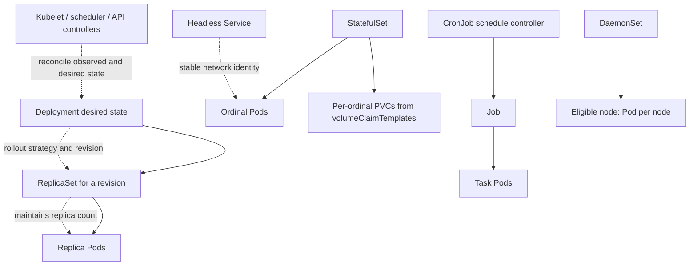

# Deployments, StatefulSets, Jobs, and CronJobs in Production

**Module:** Stage 2E — Production DevOps & Platform Engineering / M03  
**Unit:** 4  
**Target file:** `04-deployments-statefulsets-jobs-and-cronjobs-in-production.md`  
**Estimated time:** 14–18 hours, including labs, evidence capture, and review  
**Prerequisites:** Linux and shell basics; Git and Docker; basic Pods and Deployments; M01 container-image fundamentals; M02 CI/CD basics; M03 Unit 1 cluster architecture; Unit 2 namespaces/resource governance; Unit 3 probes and recovery  
**Core tools:** `kubectl`, `kind`, Docker or a compatible container runtime, YAML editor, shell, Python 3 for optional toy tasks  
**Awareness:** Deployment/ReplicaSet reconciliation, persistent volumes, StatefulSet identity, batch retry semantics, CronJob scheduling, schema migration, manifest validation tools, progressive delivery  
**Last reviewed:** 2026-10-25; not live-verified against current official documentation  
**Kubernetes baseline assumed:** `apps/v1` Deployments/StatefulSets and `batch/v1` Jobs/CronJobs, as used in current Kubernetes releases; version-sensitive features including CronJob `timeZone`, Indexed Jobs, Job pod failure policy, and StatefulSet PVC retention require `[VERIFY]` against the exact target cluster minor version and API reference.

> **Execution status:** This is a teaching artifact. Commands and labs have not been executed while writing it. All sample outputs are representative, not observed. Use only a disposable local `kind` cluster. Replace all image placeholders with images you control; no image is asserted to exist or be pullable.

---

## 1. Why This Matters in Production

Workload controllers are the mechanisms that keep declared application state aligned with observed cluster state, but they do not understand business correctness. A bad Deployment can replace every healthy API replica with an image that never starts; a StatefulSet scale-down can remove an identity that owns important data; and a CronJob can start overlapping ETL runs that load the same partition twice. These failures often come from treating YAML fields as isolated settings rather than as a contract among controllers, application behavior, storage, and data semantics. This unit teaches how to select the right workload controller, deploy changes safely, diagnose stalled rollouts, and design batch jobs so retries and schedules do not corrupt data.

## 2. Learning Objectives

1. **[L1]** Trace the Deployment → ReplicaSet → Pod ownership chain and explain reconciliation.
2. **[L1]** Use rollout status/history/undo and inspect events, selectors, and controller state.
3. **[L2]** Configure Deployment update strategy, surge/unavailable budgets, readiness, revision history, and rollout timing.
4. **[L2]** Explain StatefulSet ordinal identity, headless Services, per-replica PVCs, update partitions, and storage assumptions.
5. **[L2]** Configure Jobs and CronJobs with bounded retries/deadlines and explain their scheduling/completion semantics.
6. **[L3]** Diagnose failed rollouts, selector mistakes, StatefulSet scale-down risks, retry storms, and overlapping scheduled jobs.
7. **[L3]** Design idempotent ETL behavior and distinguish Kubernetes retry controls from exactly-once data processing.
8. **[L4]** Propose a safe expand/contract schema migration and identify rollback boundaries.
9. **[L4]** Design workload templates, manifest validation gates, ownership, and exception processes for a fleet.
10. **[L4]** Produce evidence-based incident analysis and defend rollout, stateful, and batch-workload trade-offs.

## 3. Prerequisites and Scope Boundaries

### Prerequisites

- A disposable local `kind` cluster and working `kubectl` context.
- Docker or a compatible runtime configured for kind.
- Familiarity with namespaces, requests/limits, and probes.
- A local image-building workflow from M01. This unit does not assume a pre-existing image.
- Understanding that a Pod restart, Pod replacement, rollout, and application-level data recovery are different operations.

### Taught in this unit

Deployment/ReplicaSet/Pod reconciliation; StatefulSet identity and update partitioning; Job retry and deadline behavior; CronJob scheduling and concurrency; rollout diagnosis and rollback; ConfigMap rollout concepts; schema compatibility; policy and template governance.

### Deliberately deferred

- Image construction, provenance implementation, and non-root image hardening: M01.
- Release pipeline engineering: M02.
- Probe semantics in depth: Unit 3.
- PodDisruptionBudgets and graceful shutdown: Unit 5.
- Autoscaling: Unit 6.
- Node placement: Unit 7.
- Cluster upgrades: Unit 8.
- RBAC and Pod Security Standards: Unit 9.
- Deep networking and traffic management: M04.
- Persistent-storage internals, CSI, operators, and backup: M05.
- Helm/Kustomize: M06.
- GitOps, canary/blue-green traffic shifting, and automated progressive promotion: M08.
- Secret management and workload identity: M09.
- Formal SLOs and incident management: M10.
- Observability stack: M11.
- Supply-chain security implementation: M12.
- Backup and disaster recovery: M13.
- Full capacity/FinOps: M15.

These boundaries do not mean the unit ignores the interfaces between topics. It explains enough about probes, storage, schema migration, and capacity to make workload-controller decisions safely.

## 4. Concept Map and Vocabulary

### Controller hierarchy



The diagram is conceptual. Each controller reconciles its own API objects asynchronously. The Deployment owns ReplicaSets; a ReplicaSet owns Pods. A StatefulSet directly manages its Pods and associated identity/storage patterns. A CronJob creates Jobs on schedule; the Job controller manages task Pods. The scheduler assigns unscheduled Pods to feasible nodes; the kubelet manages containers on its node. These mechanisms are related but not interchangeable.

### Vocabulary

| Term | Precise definition | Common misconception |
|---|---|---|
| Desired state | The target configuration declared in an API object. | It means the system is already in that state. |
| Reconciliation | A controller repeatedly compares observed and desired state and takes actions to reduce the difference. | It is one synchronous transaction. |
| Deployment | A workload controller that manages ReplicaSets and declarative updates for stateless, replicated applications. | It is the Pod itself. |
| ReplicaSet | A controller maintaining a desired number of matching Pods for a revision. | It is the best default object to edit directly for application rollouts. |
| Rolling update | An update strategy that replaces old Pods with new ones over time, subject to availability/surge rules. | It guarantees zero downtime. |
| Selector | A label query that determines which objects match a workload. | Any arbitrary label change is safe after creation. |
| StatefulSet | A controller for Pods needing stable ordinal identity and commonly stable per-replica storage/network identity. | It turns a database into a highly available database automatically. |
| Headless Service | A Service with `clusterIP: None`, often used for stable per-Pod discovery. | It provides a load-balanced virtual IP. |
| PVC | PersistentVolumeClaim, a request for storage. | A PVC is a backup or a guarantee of durability. |
| Job | A controller that runs task Pods toward a completion target, with retry/failure behavior. | A completed Job proves side effects happened exactly once. |
| CronJob | A controller that creates Jobs according to a schedule. | The schedule guarantees one execution at an exact wall-clock instant. |
| `concurrencyPolicy` | CronJob policy controlling whether Jobs created by that CronJob may overlap. | It provides global locking across manual Jobs or other CronJobs. |
| Idempotency | Repeating an operation does not create unintended additional effects. | Kubernetes retries make a task idempotent. |
| Expand/contract | A migration approach that first adds backward-compatible schema, then switches usage, and contracts only after old code is gone. | A Deployment rollback also reverses database changes. |
| Progressive delivery | Controlled promotion of a change based on stages, traffic policy, and/or metrics. | Vanilla Deployment rolling update is a full canary system. |
| DaemonSet | A controller ensuring a Pod runs on each eligible node (or selected subset). | It is a generic replacement for Deployments. |

## 5. Level 1 — Beginner: Workload Controllers and Rollout Basics

### L1.1 Choose the controller by workload semantics

**Deployment** is the normal choice for stateless APIs and workers whose instances can be replaced without preserving a unique ordinal identity. It manages ReplicaSets and updates the Pod template declaratively. A scoring API with multiple interchangeable replicas is a typical Deployment.

**StatefulSet** is for workloads that need stable Pod identity, ordered or controlled updates, and/or stable per-replica storage. It is not automatically the right choice just because an application uses a database. Stateful systems still need replication, recovery, backup, and consistency design.

**Job** represents a finite task expected to complete, such as a bounded ETL partition or one-time data validation. **CronJob** creates Jobs on a schedule, such as a nightly refresh. Neither object guarantees exactly-once external side effects.

**DaemonSet** is for node-level agents that should run on eligible nodes, such as log/metrics agents or carefully designed node services. Because it distributes code across nodes, its privileges, host mounts, resource use, and update policy deserve heightened review.

### L1.2 Deployment → ReplicaSet → Pod

A Deployment declares a Pod template and desired replica count. When the template changes, the Deployment controller creates or updates a ReplicaSet revision and coordinates replacement according to the configured strategy. Each ReplicaSet creates Pods that match its template and attempts to maintain its replica target. A Pod's readiness and availability are influenced by probes and timing fields; the controller does not know whether the scoring model's output is semantically correct.

Inspect the hierarchy:

```bash
kubectl config current-context
kubectl get deployments,replicasets,pods -n <namespace>
kubectl describe deployment <deployment-name> -n <namespace>
```

Purpose: verify the active context, see the Deployment/ReplicaSet/Pod chain, and inspect rollout conditions/events. Prerequisite: read access to the selected namespace.

**Example — yours will differ**:

```text
NAME                          READY   UP-TO-DATE   AVAILABLE   AGE
deployment.apps/scoring-api   2/2     2            2           6m

NAME                                     DESIRED   CURRENT   READY   AGE
replicaset.apps/scoring-api-7c8d...      2         2         2       6m
```

Interpretation: the output suggests the Deployment and a ReplicaSet report two ready replicas. It does not prove user-visible latency, correctness, or external dependency health. Confirm the Pod details and application outcome.

### L1.3 Rolling updates and rollout commands

A rolling update gradually creates new Pods and scales down old Pods, constrained by the update strategy and readiness/availability. The controller is asynchronous: a command returning does not mean the rollout has completed.

```bash
kubectl rollout status deployment/<deployment-name> -n <namespace> --timeout=120s
kubectl rollout history deployment/<deployment-name> -n <namespace>
kubectl rollout history deployment/<deployment-name> --revision=<revision> -n <namespace>
kubectl rollout undo deployment/<deployment-name> -n <namespace>
kubectl rollout pause deployment/<deployment-name> -n <namespace>
kubectl rollout resume deployment/<deployment-name> -n <namespace>
```

- `rollout status` waits for the selected rollout to reach the controller's completion condition or for the command timeout. It is not a business-correctness test.
- `rollout history` shows recorded Deployment revisions and, where available, change-cause information. Do not assume every field was recorded automatically.
- `rollout undo` rolls the Deployment Pod template back to a prior revision. It does not revert database migrations, external side effects, ConfigMap/Secret contents, or data.
- `pause` and `resume` allow a controlled sequence of Deployment template changes; use them deliberately and document why the rollout is paused.

**Example — yours will differ**:

```text
deployment "scoring-api" successfully rolled out
```

This is representative only. Inspect current status and Pods rather than relying on the string alone.

### L1.4 Labels and selectors

A workload selector matches Pods by labels. A selector that is too broad can cause ownership conflicts or unexpected matching; a selector that is too narrow or mismatched can leave a controller unable to manage the intended Pods. For `apps/v1` Deployments, the selector is immutable after creation. Plan stable identity labels separately from labels that change per release.

Use consistent labels:

```yaml
metadata:
  labels:
    app.kubernetes.io/name: scoring-api
    app.kubernetes.io/component: api
spec:
  selector:
    matchLabels:
      app.kubernetes.io/name: scoring-api
  template:
    metadata:
      labels:
        app.kubernetes.io/name: scoring-api
        app.kubernetes.io/component: api
```

The selector's `matchLabels` must match labels on the Pod template. If the immutable selector must change, create a deliberately migrated workload under a new name/selector, move traffic or ownership safely, and retire the old object only after validation. Do not try to patch an immutable selector in place.

### L1.5 Failure scenarios: first pass

| Symptom | Hypothesis | Test | Root cause candidate | Fix | Prevention |
|---|---|---|---|---|---|
| New Deployment never becomes ready | New image/config/probe is broken | `rollout status`, `describe`, events, logs | Bad image, bad config, startup failure, unschedulable Pods | Correct or rollback the Pod template | Validate image/config and canary |
| No Pods match expected workload | Selector mismatch or namespace error | Inspect selector and Pod labels | Labels do not match or command targets wrong namespace | Correct through a safe workload migration if selector is immutable | Policy check selector/template consistency |
| Old Pods remain during rollout | New Pods are not available or strategy/capacity constrains progress | Inspect desired/updated/available counts and events | Readiness failure, resource shortage, quota, image pull | Fix underlying cause or rollback | Test under realistic capacity |
| `rollout undo` appears to restore app but requests still fail | External state/schema changed | Inspect application/data compatibility and revision | Deployment template rollback did not reverse external change | Apply compatible forward fix or data recovery plan | Expand/contract migration and rollback design |

## 6. Level 2 — Intermediate: Production Workload Configuration

### L2.1 A production-shaped Deployment

This manifest is an illustrative template for a FastAPI scoring API. The image reference is a placeholder and is not pullable as written. Replace it with a digest from an image registry you control or build/load a local image through the M01 workflow. The digest must be a real 64-hex digest when used; pinning improves reproducibility but does not prove provenance or trust.

```yaml
apiVersion: apps/v1
kind: Deployment
metadata:
  name: scoring-api
  namespace: workload-lab
  labels:
    app.kubernetes.io/name: scoring-api
spec:
  replicas: 2
  revisionHistoryLimit: 5
  minReadySeconds: 10
  progressDeadlineSeconds: 300
  strategy:
    type: RollingUpdate
    rollingUpdate:
      maxSurge: 1
      maxUnavailable: 0
  selector:
    matchLabels:
      app.kubernetes.io/name: scoring-api
  template:
    metadata:
      labels:
        app.kubernetes.io/name: scoring-api
      annotations:
        # Optional illustrative checksum: replace with a real rendered config checksum.
        config.example.invalid/checksum: "REPLACE_WITH_CONFIG_CHECKSUM"
    spec:
      containers:
        - name: api
          image: registry.example.invalid/team/scoring-api@sha256:REPLACE_WITH_64_HEX_DIGEST
          imagePullPolicy: IfNotPresent
          ports:
            - name: http
              containerPort: 8000
          resources:
            requests:
              cpu: "100m"
              memory: "128Mi"
            limits:
              cpu: "500m"
              memory: "512Mi"
          startupProbe:
            httpGet:
              path: /health/startup
              port: http
            periodSeconds: 5
            timeoutSeconds: 2
            failureThreshold: 24
          readinessProbe:
            httpGet:
              path: /health/ready
              port: http
            periodSeconds: 5
            timeoutSeconds: 2
            failureThreshold: 2
          livenessProbe:
            httpGet:
              path: /health/live
              port: http
            periodSeconds: 10
            timeoutSeconds: 2
            failureThreshold: 3
```

**Purpose and important fields**

- `replicas` declares the target number of interchangeable API Pods.
- `maxSurge` limits extra Pods above desired replica count during a rolling update; `maxUnavailable` limits how many replicas can be unavailable due to the update strategy. Exact counting/rounding behavior for percentages and API semantics should be checked in the target version's Deployment docs.
- `maxUnavailable: 0` aims to preserve availability during the update, but the rollout can stall if new Pods never become available. It can also require extra cluster capacity.
- `minReadySeconds` requires a Pod to remain ready for a period before being considered available.
- `progressDeadlineSeconds` affects how long the Deployment controller waits without progress before reporting a stalled rollout. It does not automatically roll back the change.
- `revisionHistoryLimit` controls retained old ReplicaSet history; it is not an application-data backup.
- Probe timing is illustrative. Unit 3 covers probe design; measure startup/latency and follow the application's actual health contract.

**Verify after replacing the image:**

```bash
kubectl config current-context
kubectl -n workload-lab apply -f scoring-api.yaml
kubectl -n workload-lab rollout status deployment/scoring-api --timeout=300s
kubectl -n workload-lab get deployment,replicaset,pods -o wide
kubectl -n workload-lab describe deployment scoring-api
kubectl -n workload-lab get events --sort-by=.metadata.creationTimestamp
```

**Example — yours will differ**:

```text
deployment "scoring-api" successfully rolled out
```

Interpretation: the controller reports rollout completion. Confirm actual replica readiness, image digest, logs, request success, and latency. The placeholder manifest will not work until the image and checksum placeholders are replaced.

### L2.2 `maxSurge`, `maxUnavailable`, and strategy selection

For a Deployment using `RollingUpdate`, `maxSurge` and `maxUnavailable` define the update's availability/capacity trade-off. `maxSurge` allows temporary extra Pods and therefore needs spare CPU/memory and possibly quota headroom. `maxUnavailable` permits some desired replicas to be unavailable during the update. A zero-unavailable setting can preserve serving capacity but may block if there is no room to schedule additional Pods.

`Recreate` terminates existing Pods before creating the new version according to its strategy behavior. It can be suitable when versions cannot safely run concurrently, but it creates an outage window for that workload. `RollingUpdate` is usually preferred for compatible stateless services; it is unsafe if old and new versions cannot coexist or if the application cannot tolerate overlapping initialization and external side effects.

| Option | Benefit | Cost | Risk | Choose when |
|---|---|---|---|---|
| `RollingUpdate`, low `maxUnavailable` | Preserves more serving capacity during rollout | May require spare capacity and take longer | Rollout can stall on an unready new Pod | Old/new versions are compatible and availability matters |
| `RollingUpdate`, higher `maxUnavailable` | Faster replacement with less surge capacity | Temporary reduced capacity | Error/latency increase under load | Service has enough spare serving capacity and a tested risk budget |
| `Recreate` | Avoids concurrent old/new versions | Downtime while replacing Pods | Outage if startup is slow or new version fails | Concurrent versions are unsafe and downtime is accepted |
| Paused rollout | Allows inspection before continuing | Holds the system in a mixed state | Forgetting to resume or leaving mixed versions too long | A deliberate staged change has explicit stop/go criteria |
| `revisionHistoryLimit` higher | More template rollback choices | More API objects/history | Can create a false sense that data is reversible | Useful rollback history is worth retaining; state backup is handled separately |

### L2.3 Rollback is not time travel

A Deployment rollback restores a previous Pod template revision. It does not automatically revert:

- database schema changes or data backfills;
- external API calls, messages, or customer notifications;
- mutable ConfigMap or Secret contents not captured in the old Pod template;
- PVC contents or stateful data;
- an image tag that points to different content, unless the old immutable digest is retained;
- a one-way model/data migration;
- side effects performed by a Job or CronJob.

Rollback plans must name the state boundary. If a new application version writes a schema that the old version cannot read, rolling back only the image may make the outage worse. Expand/contract migration is discussed in L4.

### L2.4 StatefulSet identity, headless Service, and PVCs

StatefulSets give Pods stable ordinal names such as `stateful-demo-0`, `stateful-demo-1`, and so on. They are useful when each replica has a distinct identity or per-replica storage. A headless Service (`clusterIP: None`) is commonly used for stable network discovery. `volumeClaimTemplates` requests a PVC for each StatefulSet Pod identity.

This is not a complete database architecture. A StatefulSet does not automatically provide consensus, replication, failover, backup, schema management, or safe recovery. Those responsibilities often require a database operator or system-specific orchestration; M05 covers storage and operators.

**Illustrative StatefulSet plus headless Service:**

```yaml
apiVersion: v1
kind: Service
metadata:
  name: stateful-demo
  namespace: workload-lab
spec:
  clusterIP: None
  selector:
    app.kubernetes.io/name: stateful-demo
  ports:
    - name: tcp
      port: 8080
      targetPort: tcp
---
apiVersion: apps/v1
kind: StatefulSet
metadata:
  name: stateful-demo
  namespace: workload-lab
spec:
  serviceName: stateful-demo
  replicas: 2
  podManagementPolicy: OrderedReady
  updateStrategy:
    type: RollingUpdate
  selector:
    matchLabels:
      app.kubernetes.io/name: stateful-demo
  template:
    metadata:
      labels:
        app.kubernetes.io/name: stateful-demo
    spec:
      containers:
        - name: app
          image: registry.example.invalid/team/stateful-demo@sha256:REPLACE_WITH_64_HEX_DIGEST
          ports:
            - name: tcp
              containerPort: 8080
          resources:
            requests:
              cpu: "50m"
              memory: "64Mi"
            limits:
              cpu: "250m"
              memory: "256Mi"
          readinessProbe:
            tcpSocket:
              port: tcp
            periodSeconds: 5
            timeoutSeconds: 2
  volumeClaimTemplates:
    - metadata:
        name: data
      spec:
        accessModes: ["ReadWriteOnce"]
        resources:
          requests:
            storage: 256Mi
```

This image is a placeholder, not a runnable database. The manifest demonstrates object relationships only. A real image must listen on the declared port and satisfy the health contract. `ReadWriteOnce` semantics and local storage provisioning depend on the storage implementation; they do not mean a universal single-process lock across all circumstances.

**Storage stop condition:** before applying, check whether a default StorageClass exists and whether kind's configured provisioner supports dynamic PVC provisioning:

```bash
kubectl config current-context
kubectl get storageclass
kubectl -n workload-lab get statefulset,pods,pvc
```

**Example — yours will differ**:

```text
NAME                 PROVISIONER             RECLAIMPOLICY   VOLUMEBINDINGMODE
standard (example)   example.invalid/...     Delete          WaitForFirstConsumer
```

This is illustrative only. If there is no suitable StorageClass, PVCs may remain pending and the Pods may not become ready. Do not delete data-bearing claims to force a lab forward. Use the inspection path and document the storage limitation.

### L2.5 Ordered versus parallel StatefulSet Pod management

`podManagementPolicy: OrderedReady` is the default-style ordered behavior in which Pod creation/deletion follows the StatefulSet's ordering/readiness constraints. `Parallel` relaxes ordering for creation/deletion operations, which can improve speed for workloads that do not require ordered peer startup. It does not remove the need for the application to handle membership and storage correctly. `[VERIFY]` Confirm exact semantics and supported values in the target StatefulSet API reference.

Use ordered behavior when ordinal dependencies and readiness ordering matter. Use parallel only when the workload's bootstrapping and membership protocol are explicitly safe without the ordering guarantee.

### L2.6 StatefulSet partitioned update

A partitioned rolling update allows a staged update by ordinal. With a partition value, only Pods whose ordinal is at or above the partition are updated by the rolling update process; lower ordinals remain on the previous revision. This makes a simple canary possible, but it is not traffic-weighted progressive delivery and does not replace health/error monitoring.

Illustrative patch for a StatefulSet with replicas `3`:

```bash
kubectl -n workload-lab patch statefulset stateful-demo --type=merge \
  -p '{"spec":{"updateStrategy":{"type":"RollingUpdate","rollingUpdate":{"partition":2}}}}'
```

Then update the Pod template's image digest using a reviewed manifest and inspect:

```bash
kubectl -n workload-lab get statefulset,pods -o wide
kubectl -n workload-lab describe statefulset stateful-demo
```

**Example — yours will differ**:

```text
stateful-demo-0   ...   # ordinal below partition: expected to remain old revision
stateful-demo-1   ...   # ordinal below partition: expected to remain old revision
stateful-demo-2   ...   # ordinal at/above partition: eligible for update
```

Do not assume an update occurred merely because the patch succeeded. Verify each Pod's image/revision and readiness. The example's exact behavior must be checked against the target version and current StatefulSet strategy documentation.

### L2.7 PVC retention and scale-down risk

PVC lifecycle is separate from StatefulSet Pod lifecycle. A StatefulSet's deletion or scale-down does not mean the data is safe to discard or automatically cleaned up in every configuration. PVC retention policy fields are version-sensitive and need `[VERIFY]` against the target API. StorageClass reclaim policy and provisioner behavior further affect the underlying PersistentVolume lifecycle.

Before scaling down a data-bearing StatefulSet:

1. Identify exactly which ordinal will be removed and what data it owns.
2. Verify the application's replication/quorum/member-removal procedure.
3. Check PVC names, PV bindings, reclaim policy, snapshots/backups, and recovery procedure.
4. Confirm whether the application supports removing that member without data loss.
5. Capture current state and approval.
6. Scale down only through a reviewed procedure, then verify surviving membership and data consistency.
7. Do not assume scaling back up restores a removed replica's original data or identity correctly without inspecting the PVC.

### L2.8 Job semantics and bounded batch work

A Job is for finite work. Key fields include:

- `completions`: how many successful completions are required.
- `parallelism`: how many Pods may run concurrently for the Job.
- `backoffLimit`: retry budget for failed Pods/attempts according to Job semantics.
- `activeDeadlineSeconds`: time bound for the Job's active execution; verify the exact behavior against the target API.
- `ttlSecondsAfterFinished`: optional TTL-after-finished cleanup of completed Job objects, when the relevant controller/feature is available and enabled.
- Pod `restartPolicy`: Job Pods conventionally use `Never` or `OnFailure`, with different retry/diagnostic implications.

With `restartPolicy: Never`, a failed Pod remains available for inspection while the Job controller can create another attempt within its policy. With `OnFailure`, the container can restart within the same Pod, which can complicate log interpretation and retry accounting. Exact retry accounting depends on Job behavior/version; `[VERIFY]` consult the current Job docs before setting production policy.

**Illustrative ETL Job:**

```yaml
apiVersion: batch/v1
kind: Job
metadata:
  name: etl-partition-demo
  namespace: workload-lab
spec:
  completions: 1
  parallelism: 1
  backoffLimit: 2
  activeDeadlineSeconds: 300
  ttlSecondsAfterFinished: 3600
  template:
    metadata:
      labels:
        app.kubernetes.io/name: etl-partition-demo
    spec:
      restartPolicy: Never
      containers:
        - name: etl
          image: registry.example.invalid/team/etl-task@sha256:REPLACE_WITH_64_HEX_DIGEST
          args: ["--partition", "2026-10-25"]
          resources:
            requests:
              cpu: "100m"
              memory: "128Mi"
            limits:
              cpu: "500m"
              memory: "512Mi"
```

This image is a placeholder; the task must implement the shown argument and idempotency contract. TTL cleanup can remove evidence if the learner waits too long, so capture logs/events before expiry or temporarily omit TTL in the lab.

Inspect:

```bash
kubectl -n workload-lab get jobs,pods
kubectl -n workload-lab describe job etl-partition-demo
kubectl -n workload-lab logs <job-pod-name>
kubectl -n workload-lab get events --sort-by=.metadata.creationTimestamp
```

**Example — yours will differ**:

```text
NAME                     STATUS     COMPLETIONS   DURATION   AGE
job.batch/etl-partition-demo Complete 1/1           8s         1m
```

Interpretation: the Job controller reports the requested successful completion. This is not proof that an external sink was updated exactly once or that the output is correct.

### L2.9 Retry multiplication and idempotency

Retries may exist at several layers: application code, client library, Job controller, queue redelivery, and a scheduled retry workflow. If each layer independently retries, total attempts can multiply unexpectedly. A task that writes a row and crashes before recording completion may write the same row again on retry.

Use a stable work identity, idempotency key, deduplication record, transaction boundary, or checkpoint appropriate to the storage system. Make poison inputs explicit: classify permanent schema/validation errors, record them safely, and avoid retrying them forever. The precise implementation depends on the data store and queue; this lesson does not claim a generic exactly-once solution.

**Anti-pattern:** “The Job succeeded, so the ETL ran exactly once.”  
**Correction:** verify durable output, deduplication, checkpoint/acknowledgement ordering, and input-to-output completeness independently.

### L2.10 CronJob semantics

CronJob schedules Job creation. It does not run the task directly and does not guarantee exact wall-clock start times. Controller downtime, reconciliation delay, concurrency policy, starting deadlines, and workload startup all affect actual execution.

Key fields:

- `schedule`: cron-form schedule string.
- `timeZone`: timezone for interpreting the schedule; `[VERIFY]` confirm availability and exact API behavior in the target version. Avoid assuming every cluster supports every timezone behavior.
- `concurrencyPolicy`: `Allow`, `Forbid`, or `Replace` for Jobs created by the same CronJob.
- `startingDeadlineSeconds`: bounds how late a missed schedule may still be started, subject to controller semantics.
- `suspend`: stops future Job creation while suspended; it does not necessarily cancel already running Jobs.
- `successfulJobsHistoryLimit` and `failedJobsHistoryLimit`: history retention controls for Jobs created by the CronJob.

`Allow` permits overlapping Jobs from the same CronJob. `Forbid` prevents a new scheduled Job from starting while a previous Job from that CronJob is still running; schedule occurrences can be skipped rather than queued indefinitely. It is not a global lock across manual Jobs, another CronJob, or an external execution path. `Replace` attempts to replace a currently running Job with a new scheduled run; this can terminate in-flight work and is unsafe if the task cannot safely resume or roll back.

**Illustrative CronJob:**

```yaml
apiVersion: batch/v1
kind: CronJob
metadata:
  name: refresh-demo
  namespace: workload-lab
spec:
  schedule: "*/1 * * * *"
  # [VERIFY] timeZone field support and exact behavior in target cluster.
  timeZone: "Etc/UTC"
  concurrencyPolicy: Forbid
  startingDeadlineSeconds: 45
  suspend: false
  successfulJobsHistoryLimit: 2
  failedJobsHistoryLimit: 3
  jobTemplate:
    spec:
      backoffLimit: 1
      activeDeadlineSeconds: 90
      template:
        metadata:
          labels:
            app.kubernetes.io/name: refresh-demo
        spec:
          restartPolicy: Never
          containers:
            - name: task
              image: registry.example.invalid/team/refresh-task@sha256:REPLACE_WITH_64_HEX_DIGEST
              args: ["--sleep-seconds", "75", "--write-timestamps"]
              resources:
                requests:
                  cpu: "50m"
                  memory: "64Mi"
                limits:
                  cpu: "250m"
                  memory: "256Mi"
```

The image placeholder is not pullable as written. The toy task must record timestamps and sleep for a bounded duration. The one-minute schedule and 75-second task are intended to make overlap observable, but controller timing and cluster scheduling can affect the observation. Do not invent timestamps or claim overlap unless the actual Jobs/Pods show it.

### L2.11 Indexed Jobs and Pod failure policy

Indexed Jobs can assign completion indexes to Pods for partitioned work; Pod failure policy can classify Pod failures and influence Job retry handling. Both are version-sensitive features and should not be copied without verifying the target Kubernetes minor and API schema. `[VERIFY]` Check official Job documentation and API references for `completionMode`, indexed completion fields, `podFailurePolicy`, supported conditions/actions, and feature availability.

Use these features only when the partitioning and failure classification are clear. For a beginner lab, a single-completion Job is easier to reason about. Never assume that an indexed task is idempotent simply because each Pod has an index.

## 7. Level 3 — Advanced: Rollout Safety, Stateful Workloads, and Batch Reliability

### L3.1 Diagnose a stalled rollout

When a rollout stalls, first collect read-only evidence:

```bash
kubectl config current-context
kubectl -n workload-lab get deployments,replicasets,pods -o wide
kubectl -n workload-lab rollout status deployment/scoring-api --timeout=60s
kubectl -n workload-lab rollout history deployment/scoring-api
kubectl -n workload-lab describe deployment scoring-api
kubectl -n workload-lab get events --sort-by=.metadata.creationTimestamp
kubectl -n workload-lab logs <pod-name> --all-containers=true
```

Purpose: compare desired, updated, ready, and available replicas; inspect rollout history; identify events; and read logs. Replace placeholders with exact names. Commands require access to the intended namespace. The logs command assumes the selected container has started; if it has not, inspect Pod events and container state.

`ProgressDeadlineExceeded` indicates the Deployment controller has not observed rollout progress within the configured deadline. It does not itself identify the root cause and does not automatically mean Kubernetes rolled back the Deployment. Possible causes include image-pull errors, startup/readiness failures, quota or capacity constraints, unschedulable Pods, a selector/template defect, bad configuration, or an application bug.

**Diagnostic sequence**

1. Confirm current context and namespace.
2. Compare `spec.replicas`, updated replicas, ready replicas, and available replicas.
3. Inspect the newest ReplicaSet and its Pod template/image.
4. Inspect Pod events and container states: image pull, scheduling, init failure, probe failure, OOM, or process exit.
5. Check quota/resource capacity and rollout strategy constraints.
6. Compare the previous revision and application/data compatibility.
7. Mitigate through a reviewed correction or rollback; preserve evidence first where possible.
8. Verify user-visible health and data correctness after recovery.

### L3.2 Safe rollback criteria

Rollback is appropriate when the new revision is demonstrably causing material harm and the previous revision remains compatible with current external state. Define criteria before rollout, such as a sustained request error increase, readiness capacity below an agreed threshold, or an unacceptable rollout delay. The values are service-specific; this unit does not prescribe universal SLO thresholds.

Before undoing, ask:

- Did the new version write an incompatible schema or data format?
- Did it publish irreversible messages or external side effects?
- Did a ConfigMap/Secret change independently of the Deployment template?
- Is the old image digest still available and trusted?
- Is the previous version compatible with any database migration already applied?
- Will rollback restore service or only return to a known broken state?

If compatibility is uncertain, stop and use the incident/change process rather than blindly rolling back.

### L3.3 Selector mismatch and immutable selectors

A selector mismatch can produce unexpected controller behavior, and Deployment selectors are immutable after creation in `apps/v1`. A common mistake is to put a version label such as `version: v2` into the immutable selector and later change it. Instead, select on stable application identity and put release/version labels on the Pod template for observation.

If the selector must change, plan a migration to a new workload object and coordinate Service selectors, traffic, and ownership. Avoid having two controllers unintentionally target the same Pods. Verify the actual `spec.selector` and `spec.template.metadata.labels` before applying changes.

### L3.4 StatefulSet partition canary and scaling down data-bearing replicas

A partitioned StatefulSet update lets you expose a chosen ordinal to a new template while leaving lower ordinals unchanged. That is useful for a controlled canary when each replica's behavior can be evaluated independently. However, ordinal position is not automatically equivalent to low risk: ordinal `N` may own important data, lead a cluster-specific role, or have replication responsibilities. Consult the application-specific operator/runbook before choosing a canary ordinal.

Scaling down a StatefulSet can delete a Pod whose identity maps to a PVC. The PVC may remain, but that is not equivalent to a safe application-level member removal. For databases or replicated stateful services, remove membership according to the database's documented procedure, check quorum and replication, ensure a recoverable backup/snapshot exists, then scale down. PVC retention settings and storage reclaim policy are separate concerns. `[VERIFY]` check `persistentVolumeClaimRetentionPolicy` availability and semantics in the target API version.

### L3.5 Job failure modes and poison inputs

| Symptom | Hypothesis | Test | Root cause candidate | Fix | Prevention |
|---|---|---|---|---|---|
| Job retries until `BackoffLimitExceeded` | Repeated task failure exceeded retry budget | `describe job`, Pod logs/events, exit code | Bad input/config, dependency error, code bug | Correct cause; rerun only with idempotency protection | Input validation, bounded retry, poison-input path |
| Job stops at active deadline | Task exceeded configured runtime budget | Inspect Job conditions, Pod state, timestamps | Runtime underestimated, dependency hung, task too large | Tune only after measurement or split work | Duration distribution and explicit deadline review |
| Job Pod cannot start | Image/config/resources invalid | Describe Pod/events | Pull error, unschedulable resource, bad secret reference | Fix start-up cause | Validate image and resource policy |
| Job says complete but output is missing/duplicated | Controller completion differs from data correctness | Reconcile inputs, output keys, checkpoints, and logs | Side effect/checkpoint order defect | Repair output safely and implement idempotency | Durable deduplication and completion validation |

Retries should be bounded and classified. An application retry loop nested inside a Job retry policy can multiply attempts. If each of three layers allows `r` attempts, the worst-case number of attempts can be much larger than any one layer's configured limit; calculate the real composition instead of assuming limits are shared. Avoid endless retry for permanent schema errors or poison input.

### L3.6 CronJob overlap, missed schedules, and duplicates

CronJob scheduling is a request to create work, not a durable business ledger. A schedule can be missed due to controller unavailability, starting deadlines, or controller reconciliation behavior. Time zones and daylight-saving changes can produce surprising local-time schedules; `[VERIFY]` check `timeZone` support and the schedule's intended timezone in the target version. Prefer UTC for many backend refreshes unless business requirements require a local civil time.

`Forbid` applies to Jobs created by that CronJob and is not a substitute for a durable lock or deduplication at the data sink. Manual invocations, another CronJob, or an external orchestrator can still run the same logical partition. `Replace` can terminate a running Job, potentially halfway through writes. `Allow` can be correct for independent partitions but unsafe for overlapping full-table loads.

A robust scheduled ETL should use a logical run key (for example, dataset + partition date + source snapshot), idempotent output writes, durable completion status, and a reconciliation path for partial runs. Concurrency policy is one layer of defense, not the correctness mechanism.

### L3.7 ConfigMap and Secret rollout behavior

Environment variables populated from ConfigMaps or Secrets are read into a process environment when the container starts; updating the source object does not mutate an already-running process's environment in place. Mounted ConfigMap volumes have different update behavior and timing, and applications must reload files safely if they rely on live changes. `[VERIFY]` check current ConfigMap/Secret documentation for exact volume and immutable-object behavior.

A common pattern is to add a checksum of non-secret configuration to the Pod template annotation. When rendered configuration changes, the checksum changes, producing a new Deployment revision. Do not print secret values or place a raw secret hash in an unsafe public location; use a controlled configuration/release system and consider whether even a checksum could leak information about low-entropy secret content. Secret management itself is M09.

Immutable ConfigMaps can support change control by requiring a new object name/version rather than in-place mutation. The trade-off is lifecycle complexity: old and new references must be managed, and the rollout must update the Pod template. An immutable ConfigMap is not a substitute for version control, review, or secret management.

### L3.8 DaemonSet awareness

A DaemonSet is appropriate for node-level agents that should run on eligible nodes. It may use node selectors, tolerations, and other placement controls, but those details belong primarily to Unit 7. Be especially careful with hostPath mounts, host namespaces, privileged mode, broad service accounts, and agents that consume resources on every node. A DaemonSet update can have cluster-wide impact, so stage and observe changes rather than treating it as a harmless sidecar.

## 8. Level 4 — Expert: Progressive Delivery, Schema Evolution, and Fleet Standards

### L4.1 What vanilla Deployments cannot do

A Deployment rolling update manages Pod-template revisions and replica availability. It does not natively provide a complete traffic-weighted canary, blue/green traffic switch, automatic metric-based promotion, or progressive analysis policy. Those capabilities commonly require routing integrations, controllers, or GitOps/promotion workflows covered in M08.

A StatefulSet partition can expose an ordinal to a new template, but it is not equivalent to a traffic canary. A partition does not automatically route a small percentage of user requests to one version, evaluate SLOs, or roll back based on business metrics. Statefulness and ordinal role can make an ordinal canary more dangerous than a stateless API canary.

### L4.2 Expand/contract schema migration

A safe database migration supports coexistence between old and new application versions during rollout and rollback. The exact SQL and compatibility guarantees depend on the database and schema; this is a design pattern, not a promise that every DDL operation is online.

**Stage 1 — Expand**

Add backward-compatible schema elements, such as a nullable column or a new table. Avoid immediately removing or renaming fields still used by the old version. Verify the migration can be applied safely and that old code continues to work.

**Stage 2 — Deploy compatible application code**

Deploy code that can operate with both old and expanded schema. During a rolling Deployment, old and new Pods may coexist, so both versions must tolerate the shared schema. Observe error rate, latency, and data consistency.

**Stage 3 — Backfill and verify**

Backfill existing rows or data partitions with bounded, restart-safe work. Use checkpoints and idempotent updates. Validate row counts, constraints, and application read behavior. Do not infer completion from a Job status alone.

**Stage 4 — Switch usage**

Move reads/writes to the new representation in a controlled release. Confirm no old Pods, workers, or scheduled jobs still require the old schema. Monitor output correctness.

**Stage 5 — Contract**

Only after compatibility is proven and rollback no longer requires the old schema, remove obsolete columns/tables/paths. Contract is often the least reversible stage; it requires explicit approval and a recovery plan.

**Rollback boundaries**

- Before contract, rolling back application code may be possible if the expanded schema remains backward-compatible.
- After new-format writes, old code may be unable to interpret the data; use a compatibility layer or forward fix.
- After destructive contract, Deployment rollback alone cannot restore removed schema/data.
- Data backfill and external side effects need their own checkpoints and reversal/repair strategy.

### L4.3 Incident — “CronJob concurrency produced duplicate ETL loads”

**[ILLUSTRATIVE INCIDENT — timestamps and counts below are hypothetical, not observed]**

**Service:** nightly feature-table refresh.  
**Symptom:** downstream scoring results include duplicated records and the ETL run duration varies.

| Time | Illustrative evidence | Interpretation |
|---|---|---|
| 01:00 | Scheduled refresh Job A starts for partition `2026-10-24` | First run begins |
| 01:01 | Job A is still running; source query is slower than expected | Run exceeds schedule interval |
| 01:02 | A second scheduled Job B starts because policy is `Allow` | Overlap is permitted |
| 01:04 | Both Jobs write the same logical partition without a unique run key | Duplicate writes become possible |
| 01:08 | Job A reports complete; Job B later reports complete | Job success does not reveal duplicate business effects |
| 01:15 | Consumer observes duplicate feature rows and inconsistent counts | Data-quality issue becomes visible |

#### Hypotheses and tests

1. **Hypothesis:** two Jobs ran concurrently for the same logical partition.  
   **Test:** inspect CronJob, Jobs, Pods, creation timestamps, and task logs; correlate the logical partition/run key.
2. **Hypothesis:** the sink lacks deduplication or idempotent upsert.  
   **Test:** inspect output keys, row counts, and write semantics; compare source partitions to output.
3. **Alternative:** retries within one Job duplicated effects.  
   **Test:** inspect Job Pod attempts, exit codes, retries, and application logs.
4. **Alternative:** two different orchestration paths ran the same ETL.  
   **Test:** compare CronJob Jobs with manual runs and other schedulers; `Forbid` does not globally lock external execution.

#### Root cause

The CronJob allowed overlapping runs, while the task's output write was not idempotent for a stable logical partition. Concurrency policy exposed the flaw but was not the only correctness failure.

#### Immediate mitigation

- Suspend future scheduling if needed, after confirming the exact CronJob and impact. Suspension does not necessarily terminate existing Jobs.
- Inspect active Jobs and coordinate a safe stop or completion plan; do not blindly delete Pods while writes are in flight.
- Prevent further duplicate writes using an application/data-sink guard or reviewed pause.
- Reconcile affected partitions from authoritative input, using a documented repair plan.

#### Durable fix

- Select an appropriate concurrency policy (`Forbid` for a single CronJob where overlap is undesirable) and verify its actual scope.
- Implement a durable run key and idempotent write/upsert/deduplication strategy.
- Make backfill/retry behavior safe and checkpointed.
- Add an alert or report for overlapping logical run keys and duplicate output counts.
- Test slow-run and retry scenarios before re-enabling the schedule.

#### Post-incident actions

Preserve Job/Pod timestamps, events, logs, input partition IDs, output reconciliation, and the decision record. Update the runbook and template policy. Do not claim `Forbid` alone guarantees exactly-once execution.

### L4.4 Standard workload templates and policy checks

A platform team should define approved templates for APIs, stateful services, finite Jobs, and scheduled Jobs. Templates should include consistent labels/selectors, resource governance, probe contracts, image reference policy, rollout fields, bounded retry/deadline behavior, and ownership metadata. Templates are starting points, not a substitute for workload-specific review.

Potential validation tools include **kubeconform**, **kube-linter**, and **kube-score**. Their exact capabilities, schema version support, installation method, and current maintenance status must be checked `[VERIFY]` before adoption. Schema validation can detect invalid fields; linting can flag suspicious patterns; neither can prove idempotency, data correctness, or safe rollback. Policy should distinguish a hard failure (e.g., selector mismatch) from a warning requiring a documented exception.

Recommended governance:

1. Version templates and assign an owner.
2. Validate rendered manifests against the target Kubernetes schema.
3. Run policy checks in CI before deployment.
4. Require workload owners to document stateful-data and batch-idempotency assumptions.
5. Canary changes and observe readiness, errors, Job outcomes, and duplicate-processing indicators.
6. Require exception owner, rationale, risk, expiry date, and test evidence.
7. Review supported Kubernetes versions and deprecations on a regular schedule.
8. Keep production change records and rollback criteria with the release.
9. Test old/new application compatibility for schema changes.
10. Avoid a shared default that turns one incorrect assumption into a fleet-wide incident.

### L4.5 Pattern catalogue

| Pattern | Use when | Avoid when |
|---|---|---|
| Deployment with immutable image digest | Stateless interchangeable API/worker instances | You cannot resolve/retain the digest or verify image trust |
| Rolling update with explicit availability budget | Old and new versions can safely coexist | Versions are incompatible or external side effects cannot coexist |
| Recreate strategy | Concurrent old/new processes are unsafe and downtime is accepted | The service needs continuous availability |
| StatefulSet with headless Service and PVC template | Per-replica stable identity/storage is a real requirement | The app is stateless or needs database-operator behavior not supplied by StatefulSet |
| Partitioned StatefulSet update | An ordinal can be safely tested before updating other replicas | Ordinal roles/data make the selected replica uniquely risky or there is no validation plan |
| Bounded Job with idempotent writes | Finite ETL, validation, or batch processing | The work is unbounded or retries are unsafe |
| CronJob `Forbid` plus durable idempotency | Scheduled work should not overlap within one CronJob | Global mutual exclusion across multiple schedulers is required without a separate lock |
| CronJob `Allow` with partitioned run keys | Runs are independent and safe concurrently | Runs mutate the same unprotected logical dataset |
| Config checksum annotation | Pod must restart when rendered non-secret config changes | The checksum leaks low-entropy secret information or config reload is already safe and intentional |
| Expand/contract migration | Old/new application versions must coexist during rollout | The change cannot be made backward-compatible and no maintenance window is planned |

### L4.6 Advanced trade-offs

| Option | Benefit | Cost | Risk | Choose when |
|---|---|---|---|---|
| `maxSurge: 1`, `maxUnavailable: 0` | Tries to preserve availability during a small rollout | Needs spare capacity; may take longer | Rollout can stall if new Pods cannot schedule or become ready | Small stateless service with capacity headroom |
| `Recreate` | Avoids mixed-version concurrency | Downtime | Failed new revision can extend outage | Versions cannot coexist and downtime is accepted |
| StatefulSet `OrderedReady` | Predictable ordinal startup/update order | Slower rollouts; one blocked ordinal can delay others | Readiness dependency can block progression | Ordered identity is meaningful |
| StatefulSet `Parallel` | Faster create/delete behavior | Application must handle concurrent lifecycle changes | Unsafe bootstrap or membership changes | Workload explicitly supports parallel operations |
| Job `restartPolicy: Never` | Failed Pod evidence remains available | More Pods may be created for retries | Log/event cleanup can remove evidence later | Diagnosis and explicit attempt tracking matter |
| Job `restartPolicy: OnFailure` | Container may retry within same Pod | More complex logs and attempt accounting | Repeated side effects in same Pod | Application handles retries safely and process restart is appropriate |
| CronJob `Forbid` | Avoids overlapping Jobs from that CronJob | A scheduled occurrence can be skipped while previous work runs | Not a global lock; long run can skip schedule times | Same CronJob runs must not overlap |
| CronJob `Allow` | Maximizes schedule concurrency | Requires independent/idempotent work | Duplicate writes and resource contention | Each run is isolated by partition/key |
| CronJob `Replace` | New schedule can replace an old in-progress Job | Can terminate work | Partial writes and lost checkpoints | Task is interruption-safe and replacement semantics are tested |
| Immutable ConfigMap versioning | Makes configuration rollout explicit | More objects and reference management | Stale references or accidental removal | Controlled release and auditability are priorities |
| Progressive delivery via M08 tooling | Traffic-aware staged exposure and automated analysis | More components and operational complexity | Misconfigured analysis/promotion policy | Risk warrants traffic-weighted canary or blue/green |

## 9. SRE Lens

### 9.1 Workload controllers reconcile state, not business correctness

A Deployment can be fully rolled out while returning wrong scores. A Job can be complete while producing duplicate rows. A StatefulSet can have all Pods running while its database has no healthy quorum. Controller status is necessary evidence but not a business-level SLI.

Useful indicators should be defined with explicit windows and denominators:

- **Rollout duration:** time from rollout start to stable available replica count, with the start/end events defined consistently.
- **Failed rollout rate:** failed or aborted rollouts divided by all rollout attempts during a stated window.
- **Ready-capacity ratio:** ready/available capacity divided by required capacity; replica count is only a proxy if replicas have comparable capacity.
- **Job success rate:** Jobs reaching expected completion divided by Jobs started, with retried attempts and canceled Jobs classified explicitly.
- **Job duration:** completion timestamp minus start timestamp; segment by task/partition size.
- **Schedule delay:** actual Job creation/start time minus intended schedule time, with timezone and controller delay clearly defined.
- **Duplicate-processing incident rate:** logical runs requiring duplicate repair divided by logical runs in the observation window.
- **Recovery time:** time from incident start to restored correct service/data, not merely Pod readiness.

These are descriptive indicators, not universal built-in metric names. Full SLO and observability implementations belong to M10/M11.

### 9.2 Runbook format

**Symptom:** rollout stalls, Jobs fail/retry, CronJob overlap, or stateful replica changes.

1. **Initial read-only triage:** confirm context/namespace; capture controller status, child resources, events, timestamps, and logs.
2. **Hypothesis:** classify as image/config, selector, readiness, capacity/quota, storage, retry, concurrency, or schema compatibility.
3. **Test:** use the narrowest read-only test that can distinguish the hypotheses. Compare actual object templates, Pod states, Job attempts, logical run IDs, and data output.
4. **Mitigation:** use a reviewed rollback, suspend scheduling, or stop further unsafe writes only when the exact impact is understood. Avoid broad deletes.
5. **Verification:** check serving capacity and user outcomes, stateful membership/storage, or ETL output correctness—not just controller status.
6. **Follow-up:** preserve scrubbed evidence, add a regression test, update the template/runbook, and assign an owner.

### 9.3 Capacity and blast radius

A rollout with `maxSurge` needs capacity for extra Pods; quota and scheduling constraints can stall it. Setting `maxUnavailable: 0` is not free if the cluster cannot place the surge Pod. A high `maxUnavailable` can temporarily reduce capacity and worsen latency under load. Jobs can consume a large amount of parallel CPU/memory or overwhelm a shared database; set bounded parallelism and resources. CronJob overlap can multiply load, while `Forbid` may skip scheduled occurrences when a run is long. Capacity/autoscaler details are deferred to Unit 6 and M15, but resource budgets are still part of this unit's design.

## 10. Security Lens

- **Context and least privilege:** verify `kubectl config current-context` before mutations; use a dedicated namespace and only the permissions required for the task.
- **Image trust:** digest pinning makes content references more reproducible, but does not by itself prove who built the image, whether it is vulnerable, or whether it is approved. M01/M12 cover deeper image and supply-chain controls.
- **Non-root/hardening:** follow M01 and Unit 9 policy; do not add privileged mode or host access to make a workload “work” without a reviewed requirement.
- **Secrets:** never place credentials in YAML, image layers, command-line arguments, logs, timestamps, or evidence files. Use a placeholder rather than a real secret. Secret management is M09.
- **DaemonSets:** scrutinize hostPath, host namespaces, privileged mode, broad service accounts, and node-level permissions. A DaemonSet may expand the blast radius to every eligible node.
- **Jobs/CronJobs:** scheduled code may execute unattended. Pin the image, bound resource use/retries/deadlines, review the service account, and avoid arbitrary input-driven shell commands.
- **Rollout controllers are not security controls:** a successful rollout does not validate image trust, authorization, network isolation, or data integrity.
- **Policy tools:** kubeconform, kube-linter, and kube-score can be useful awareness-level tools; `[VERIFY]` check current releases, supported schemas, and what each tool actually detects. They do not prove runtime safety.

### Security verification

```bash
kubectl config current-context
kubectl -n workload-lab get deployment,statefulset,job,cronjob,daemonset -o yaml
kubectl -n workload-lab get serviceaccount
```

Purpose: inspect workload templates and associated service accounts. These commands may reveal sensitive metadata; review locally and redact before sharing. They do not prove image provenance or that the app handles secrets safely.

Sources to consult: Kubernetes documentation for **Workload Resources**, **Security**, and **Pod Security Standards**; **NSA/CISA, “Kubernetes Hardening Guidance”**; and the applicable **CIS Kubernetes Benchmark**. `[VERIFY]` confirm the current document edition and exact section before attributing a specific control. No current security guidance was live-checked during drafting.

## 11. Hands-On Labs

### Lab A — Safe Deployment rollout and rollback

**Goal:** Observe the Deployment/ReplicaSet/Pod hierarchy, induce a bounded failed revision, diagnose it, and roll back.

**Approximate footprint:** 1–2 CPU, 1–2 GB RAM, 2–4 GB disk including image cache. Actual use depends on runtime and host.

**Prerequisites:** disposable kind cluster, `kubectl`, an image you control that runs a small HTTP service, and namespace `workload-lab`. Do not use the placeholder image below as a real image.

**Context guard**

```bash
kubectl config current-context
kubectl get nodes -o wide
```

Proceed only when the context is the intended disposable `kind` cluster. Stop if it is a shared/production context or you cannot identify it.

**Step 1 — Create namespace and working Deployment**

Use the Deployment manifest from Section 6.1 after replacing the image with a verified local image/digest. If using a local image, build/load it through M01's workflow and set `imagePullPolicy: IfNotPresent`. Save the manifest as `scoring-api-working.yaml` in your own lab directory; this lesson does not create it.

```bash
kubectl create namespace workload-lab
kubectl -n workload-lab apply -f scoring-api-working.yaml
kubectl -n workload-lab rollout status deployment/scoring-api --timeout=300s
kubectl -n workload-lab get deployments,replicasets,pods -o wide
```

**Example — yours will differ**:

```text
deployment "scoring-api" successfully rolled out
```

Interpretation: the controller reports rollout completion. Capture the actual output and inspect replica readiness.

**Step 2 — Apply a deliberately failing revision**

**ANTI-PATTERN — DO NOT COPY INTO PRODUCTION.** This intentionally invalid image reference is used only in the disposable namespace.

```yaml
apiVersion: apps/v1
kind: Deployment
metadata:
  name: scoring-api
  namespace: workload-lab
spec:
  replicas: 2
  selector:
    matchLabels:
      app.kubernetes.io/name: scoring-api
  template:
    metadata:
      labels:
        app.kubernetes.io/name: scoring-api
    spec:
      containers:
        - name: api
          image: registry.example.invalid/does-not-exist/scoring-api:deliberately-invalid
          ports:
            - name: http
              containerPort: 8000
```

Save this as `scoring-api-failing.yaml` and apply only after repeating the context guard. The failure is expected because the image reference is a placeholder/invalid test reference. Exact failure reason depends on runtime and registry/network behavior; do not claim it will always show one specific event string.

```bash
kubectl config current-context
kubectl -n workload-lab apply -f scoring-api-failing.yaml
kubectl -n workload-lab rollout status deployment/scoring-api --timeout=60s
kubectl -n workload-lab rollout history deployment/scoring-api
kubectl -n workload-lab describe deployment scoring-api
kubectl -n workload-lab get events --sort-by=.metadata.creationTimestamp
kubectl -n workload-lab get deployments,replicasets,pods -o wide
```

**Example — yours will differ**:

```text
Waiting for deployment "scoring-api" rollout to finish: 1 of 2 updated replicas are available...
error: timed out waiting for the condition
```

This is representative, not guaranteed. The rollout command may time out; the controller may continue reconciling in the background. Inspect events and the new ReplicaSet's Pod states. If the invalid image is rejected differently by your runtime, record actual behavior and use an equally isolated failing revision.

**Step 3 — Roll back**

```bash
kubectl -n workload-lab rollout undo deployment/scoring-api
kubectl -n workload-lab rollout status deployment/scoring-api --timeout=300s
kubectl -n workload-lab rollout history deployment/scoring-api
kubectl -n workload-lab get deployments,replicasets,pods -o wide
```

**Expected vs observed**

| Item | Expected pattern | Actual evidence to capture |
|---|---|---|
| Working revision | Pods become ready | `get`, `describe`, rollout status |
| Failing revision | New Pods fail to start or become available | Events, Pod state, image reference |
| Rollback | Prior template revision becomes active | History, current image, readiness |
| External state | Not automatically rolled back | Document what was not changed/reversed |

**Interpretation questions:** What proves the failure was the image rather than a probe? Did the rollback restore the prior image digest? What external data would not be reverted?

**Success criteria:** identify the failed revision, show the relevant evidence, roll back, and verify ready capacity and actual image reference.

**Cleanup and verification**

```bash
kubectl config current-context
kubectl -n workload-lab delete deployment scoring-api --ignore-not-found
kubectl -n workload-lab get deployments,replicasets,pods
```

Verify the named Deployment and its child resources are gone before reusing the namespace. Do not use wildcard deletes.

**Stretch:** pause a harmless rollout in a separate test Deployment, inspect the mixed state, then resume. Do not leave a rollout paused unintentionally.

**kind caveat:** local image-pull and timing behavior depends on Docker, WSL2, network, and image caching; this is not a production rollout benchmark.

### Lab B — StatefulSet identity and partitioned update

**Goal:** inspect ordinal identity, PVC associations, and partitioned template updates without deleting data.

**Approximate footprint:** 1–2 CPU, 1–2 GB RAM, 2–5 GB disk if local storage is provisioned.

**Prerequisites:** disposable kind cluster; a test image that actually listens on the declared port; StorageClass if PVC provisioning is to be exercised. The placeholder image in Section 6.4 is not runnable.

**Context guard**

```bash
kubectl config current-context
kubectl get nodes -o wide
kubectl get storageclass
```

If there is no suitable StorageClass or you cannot verify the test image, stop before applying. Use the inspection-only path and record the limitation.

**Steps**

1. Save the StatefulSet/headless Service manifest from Section 6.4, replacing the image with a test image that satisfies the port/probe contract.
2. Apply it in `workload-lab`, then inspect state:

   ```bash
   kubectl -n workload-lab apply -f stateful-demo.yaml
   kubectl -n workload-lab get statefulset,pods,pvc -o wide
   kubectl -n workload-lab describe statefulset stateful-demo
   kubectl -n workload-lab get events --sort-by=.metadata.creationTimestamp
   ```

3. Verify ordinal names and PVC names. Confirm which claim belongs to which Pod; do not infer the exact PVC name without inspecting the object.
4. Set a partition of `2` on a three-replica StatefulSet, then update the Pod template to a new valid image digest. Use the patch example in Section 6.6.
5. Observe which ordinals change image/revision and whether the update is blocked by readiness.
6. Record whether storage was dynamically provisioned, whether Pods became ready, and which operations were not possible in the local environment.

**Example — yours will differ**:

```text
NAME              READY   AGE
stateful-demo-0   1/1     ...
stateful-demo-1   1/1     ...
stateful-demo-2   1/1     ...
```

This is illustrative. A placeholder image, pending PVC, or non-listening test image will not produce this state.

**Interpretation questions:** Which ordinal was eligible for update under the partition? Did the PVC identity remain associated? What does this local test not prove about durability, replication, or backup?

**Success criteria:** record actual Pod revisions/images, PVC associations, partition value, and storage-class behavior. No data-bearing claim is deleted to force success.

**Cleanup and verification**

First confirm the namespace contains only disposable lab resources. If PVCs contain anything you need, preserve them and stop. For a disposable cluster only:

```bash
kubectl config current-context
kubectl -n workload-lab delete statefulset stateful-demo --ignore-not-found
kubectl -n workload-lab delete service stateful-demo --ignore-not-found
kubectl -n workload-lab get pvc
```

PVCs may remain after deleting the StatefulSet. Delete claims only if you have confirmed they contain no needed data and understand the storage implications. Use exact PVC names, never a wildcard. Verify the exact resources are absent.

**Stretch:** document an ordinal removal checklist for a hypothetical replicated database, including quorum, membership removal, backup, and validation.

**kind caveat:** local PVC behavior does not prove production CSI durability, snapshots, replication, failover, or backup recovery.

### Lab C — Job retries and idempotency

**Goal:** run a bounded ETL-like Job and observe success/failure/retry behavior without external side effects.

**Approximate footprint:** under 1 CPU, 0.5–1 GB RAM, under 1 GB disk beyond the cluster/image.

**Prerequisites:** disposable kind cluster; a tiny image you control that writes deterministic local output or prints a partition key and exits. The Job manifest in Section 6.8 is a template, not a runnable image.

**Context guard**

```bash
kubectl config current-context
kubectl get nodes -o wide
```

**Steps**

1. Create a toy task that accepts a partition argument, logs a stable idempotency key, and can fail once based on a lab flag without modifying external systems.
2. Save the Job manifest from Section 6.8 with a valid image/digest and bounded settings.
3. Apply it and inspect completion:

   ```bash
   kubectl -n workload-lab apply -f etl-job.yaml
   kubectl -n workload-lab get jobs,pods
   kubectl -n workload-lab describe job etl-partition-demo
   kubectl -n workload-lab get events --sort-by=.metadata.creationTimestamp
   ```

4. Capture the Pod name, logs, exit status, attempt count, and Job conditions. If TTL is enabled, capture evidence before cleanup.
5. Run a second controlled version that fails once then succeeds, using a deterministic local flag. Keep the retry count and deadline bounded.
6. Explain how `restartPolicy: Never` exposes failed Pod attempts, while `OnFailure` may restart the container within the same Pod. Do not infer exact retry count without inspecting Job/Pod evidence and target-version semantics.
7. Show that an in-memory idempotency key is not durable across process restart. Describe the durable store/transaction needed for a real ETL.

**Expected evidence:** Job YAML, Job description, Pod events/logs, exit code/retry observations, logical partition key, and an explanation of what is and is not idempotent. Outputs are representative until captured.

**Success criteria:** learner can distinguish Job completion from output correctness and can state a restart-safe write/checkpoint design.

**Cleanup and verification**

```bash
kubectl config current-context
kubectl -n workload-lab delete job etl-partition-demo --ignore-not-found
kubectl -n workload-lab get jobs,pods
```

Verify the exact Job and its Pods are absent. Do not delete other jobs.

**Stretch:** simulate a poison input and show how it is classified and quarantined rather than retried indefinitely.

**kind caveat:** a local toy task does not prove a real queue's delivery guarantees or database transaction semantics.

### Lab D — CronJob concurrency with timestamps

**Goal:** compare `Allow` and `Forbid` using a bounded task whose duration exceeds its schedule interval, then inspect actual timestamps.

**Approximate footprint:** 1 CPU, 0.5–1.5 GB RAM, 1–2 GB disk for the task image/cache.

**Prerequisites:** disposable kind cluster; a toy task image that logs start/end timestamps and sleeps for a bounded interval; verify CronJob `timeZone` support. No external database is required.

**Context guard**

```bash
kubectl config current-context
kubectl get nodes -o wide
```

**Steps**

1. Build a local task that logs a unique run ID, UTC start timestamp, UTC end timestamp, and a fixed bounded sleep. It must not write external data.
2. Apply the CronJob template in Section 6.10 with `concurrencyPolicy: Allow`, a schedule interval shorter than the task duration, and a bounded `activeDeadlineSeconds`.
3. Inspect actual Job/Pod creation times and task logs. Capture more than one schedule occurrence if the controller/laptop allows.
4. Replace the policy with a separate manifest or reviewed patch using `Forbid`; do not keep two conflicting values in the same manifest.
5. Repeat the observation. Compare created Jobs, running Jobs, skipped/missed occurrences where observable, and start/end timestamps.
6. Explain `Replace` conceptually and why it may terminate in-flight work. Do not execute it unless the task is strictly local, bounded, and interruption-safe.
7. Do not fabricate timestamps. If the interval is too short, the controller is delayed, or the local clock makes overlap unreliable, report that limitation and use inspection of actual Job/Pod timestamps as the alternative.

**Example — yours will differ**:

```text
run_id=refresh-001 start=2026-10-25T01:00:04Z
run_id=refresh-001 end=2026-10-25T01:01:19Z
```

This is a format example only, not a real observation.

**Inspect**

```bash
kubectl -n workload-lab get cronjobs,jobs,pods -o wide
kubectl -n workload-lab describe cronjob refresh-demo
kubectl -n workload-lab get events --sort-by=.metadata.creationTimestamp
kubectl -n workload-lab logs <task-pod-name>
```

**Interpretation questions:** Did the actual runs overlap under `Allow`? Did `Forbid` prevent a new Job from starting while a prior Job was active? Were any schedule occurrences missed? Why is neither policy a global lock or exactly-once guarantee?

**Success criteria:** a timestamp-backed comparison, explicit distinction between expected and observed behavior, and a durable idempotency recommendation.

**Cleanup and verification**

```bash
kubectl config current-context
kubectl -n workload-lab delete cronjob refresh-demo --ignore-not-found
kubectl -n workload-lab get cronjobs,jobs,pods
```

Verify the named CronJob and its disposable Jobs/Pods are gone. Delete remaining Jobs by exact name only.

**Stretch:** add a durable logical run key in the toy design and explain how an external lock would need ownership/expiry/recovery semantics.

**kind caveat:** controller scheduling, laptop load, and clock behavior affect the observed interval. The exercise is not a scheduler precision benchmark.

### Optional Lab E — Expand/contract release design

**Goal:** model compatibility and rollback boundaries without requiring a paid or production database.

**Approximate footprint:** under 1 CPU, under 0.5 GB RAM, negligible disk.

**Steps**

1. Write a tiny schema contract with old code reading `customer_id` and new code able to read both `customer_id` and a new nullable `customer_key`.
2. Simulate the expand stage by adding the new field without removing the old one.
3. Define a compatibility test for old code against expanded schema and new code against both old/new records.
4. Define a bounded idempotent backfill with checkpoint and validation.
5. Specify the switch stage and a verification gate before contract.
6. Identify the exact point after which rolling back the application image alone is unsafe.
7. Document an approval, data-validation, and repair plan.

This is a design simulation, not proof of zero downtime. No actual schema is modified.

**Success criteria:** the learner can explain old/new compatibility and state what the rollback does not reverse.

**Cleanup:** no cluster resources are required; keep or remove local notes according to the learner's own evidence policy.

## 12. Production Checklist

Mark an item complete only when supported by evidence or an explicit design review. Checklist completion does not guarantee production safety.

### Workload type and template

- [ ] **Design review:** controller type matches workload semantics: Deployment, StatefulSet, Job, CronJob, or DaemonSet.
- [ ] **Command/review:** labels and selectors match; Deployment selector immutability is understood.
- [ ] **Command/review:** resources and probes are coherent with namespace governance (Unit 2) and health semantics (Unit 3).
- [ ] **Review:** image digest is immutable, available for rollback, and trust/provenance is reviewed separately.
- [ ] **Review:** no placeholder image, digest, checksum, or secret remains in the rendered production manifest.
- [ ] **Review:** workload ownership, service account, and change approver are known.

### Deployment rollout

- [ ] **Review:** strategy, `maxSurge`, `maxUnavailable`, `minReadySeconds`, `progressDeadlineSeconds`, and revision history have a rationale.
- [ ] **Command:** rollout status/history, desired/updated/ready/available replicas, events, and Pods are inspected.
- [ ] **Review:** abort/rollback criteria and maximum tolerated capacity reduction are defined.
- [ ] **Review:** previous image/template revision is available and compatible with current external schema/data.
- [ ] **Review:** rollback limits for external side effects, ConfigMaps/Secrets, and data migrations are explicit.
- [ ] **Review:** canary/progressive-delivery needs beyond vanilla Deployment are routed to M08.

### StatefulSet and storage

- [ ] **Command:** headless Service, StatefulSet selector, Pod labels, and `serviceName` are consistent.
- [ ] **Command/review:** ordinal identities and PVC-to-Pod associations are recorded.
- [ ] **Review:** storage class, provisioner, reclaim policy, PVC retention behavior, and backup/restore assumptions are verified.
- [ ] **Review:** partitioned update strategy identifies the intended ordinal and a validation gate.
- [ ] **Review:** scale-down procedure includes application membership/quorum, data ownership, backup, and explicit approval.
- [ ] **Review:** StatefulSet is not being treated as a substitute for a database operator.

### Job and CronJob

- [ ] **Review:** Job `completions`, `parallelism`, `backoffLimit`, `activeDeadlineSeconds`, TTL/history, and `restartPolicy` have rationale.
- [ ] **Review:** task has idempotency/deduplication/checkpoint semantics and a poison-input path.
- [ ] **Review:** retries across application, client, Job, and scheduler layers are bounded as a combined system.
- [ ] **Command/review:** Job logs, exit codes, events, completion conditions, and output correctness are checked.
- [ ] **Review:** CronJob timezone is explicit and supported by the target version.
- [ ] **Review:** `Allow`/`Forbid`/`Replace`, missed schedules, `startingDeadlineSeconds`, suspend, and history limits are understood.
- [ ] **Review:** `Forbid` is not treated as a global lock or exactly-once guarantee.
- [ ] **Review:** scheduled tasks use a stable logical run key and safe duplicate handling.

### Configuration, migration, and operations

- [ ] **Review:** ConfigMap/Secret update semantics match the application's reload/restart behavior.
- [ ] **Review:** checksum annotations do not expose sensitive values and change the Pod template only when intended.
- [ ] **Review:** expand/contract stages include compatibility, backfill verification, switch criteria, and contract approval.
- [ ] **Review:** Unit 5 PDB/graceful-shutdown and Unit 6 autoscaling interactions are considered where relevant.
- [ ] **Review:** events/logs/timestamps and rollback evidence are captured and scrubbed.
- [ ] **Review:** policy/lint tools are version-checked and their limitations understood.
- [ ] **Review:** DaemonSet privileges/host access have a specific security justification.
- [ ] **Review:** local kind limitations are recorded; no production durability or timing claim is inferred from the lab.

## 13. Self-Check Questions and Answer Key

### Q1 — Failed rollout [L1/L3]

A new Deployment revision has `ProgressDeadlineExceeded`. Does Kubernetes automatically roll back, and what do you inspect?

**Answer:** The condition reports lack of rollout progress; it does not itself imply automatic rollback. Inspect Deployment status/history, ReplicaSets, Pod events/states, image/config, probes, scheduling, quota/capacity, and logs. Roll back only after confirming the prior revision is compatible with external state.

**Tempting wrong answer:** “The controller always undoes a failed revision.” Rollback is an operational decision unless a separate delivery mechanism implements it.

### Q2 — Selector immutability [L1/L3]

Why should a Deployment selector use stable labels rather than a release version label?

**Answer:** The `apps/v1` Deployment selector is immutable. A version-specific selector can make future releases require workload migration instead of a normal Pod-template update. Keep stable identity labels in the selector and use version labels for observation.

**Tempting wrong answer:** “Just patch the selector when the version changes.” That is not a supported in-place selector update.

### Q3 — StatefulSet partition and PVC [L2/L3]

A three-replica StatefulSet has partition `2`. Which ordinal is eligible for a rolling template update, and can you delete the PVC for ordinal 0 after scale-down?

**Answer:** Ordinal 2 is at or above partition 2 and is eligible for update; ordinals below it remain on the previous revision under the partitioned update behavior. Do not delete the PVC merely because the Pod was scaled down. Confirm retention semantics, data ownership, application membership, backup, and recovery first.

**Tempting wrong answer:** “Partition 2 means update two Pods.” It is an ordinal threshold, not a replica count.

### Q4 — Job retries and idempotency [L2/L3]

A Job reports complete, but a downstream table has duplicate rows. What failed?

**Answer:** Job completion indicates controller-level completion, not exactly-once external effects. Inspect retry attempts and output writes; implement stable idempotency keys/deduplication and safe checkpoint/transaction ordering.

**Tempting wrong answer:** “Lower `backoffLimit` to zero.” This may reduce retries but does not make partial effects safe or prove data completeness.

### Q5 — `Never` versus `OnFailure` [L2]

Why might a batch team choose `restartPolicy: Never` for diagnostic clarity?

**Answer:** Failed attempts can remain as terminated Pods for inspection while the Job controller creates subsequent attempts within its retry policy. `OnFailure` may restart the container in the same Pod, which can complicate attempt/log interpretation. Both require application-safe retry behavior.

**Tempting wrong answer:** “Never means the Job will never retry.” It describes the Pod's container restart behavior; the Job controller can still create retry Pods according to Job policy.

### Q6 — CronJob concurrency [L2/L3]

`Forbid` is set, but a manual Job overlaps with a scheduled run. Is Kubernetes violating the policy?

**Answer:** Not necessarily. `Forbid` controls overlap among Jobs created by that CronJob; it is not a global lock across manual Jobs, another CronJob, or an external orchestrator. Use durable idempotency or a separately designed lock if global mutual exclusion is required.

**Tempting wrong answer:** “Forbid guarantees only one copy of the task exists anywhere.” Its scope is narrower.

### Q7 — Timezone and missed schedules [L2/L3]

Why should a scheduled refresh specify its intended timezone and inspect actual timestamps?

**Answer:** CronJob schedule interpretation and supported `timeZone` behavior are version-sensitive; controller delays and daylight-saving changes can affect civil-time expectations. Check target-version docs, record actual Job creation/start timestamps, and use a stable logical partition/run key.

**Tempting wrong answer:** “A cron expression always runs at an exact wall-clock instant.” It does not guarantee exact start time.

### Q8 — Schema migration rollback [L3/L4]

The new application adds a column and writes only the new format. A rollout rollback restores the old image. Is that enough?

**Answer:** Not necessarily. Old code may not understand the new-format data. Use expand/contract compatibility, validate old/new coexistence, backfill safely, and identify the point where data/schema changes make image-only rollback unsafe.

**Tempting wrong answer:** “Deployment revision history includes the database schema.” It does not.

### Q9 — CronJob duplicate ETL incident [L4]

Two scheduled Jobs loaded the same partition. What are the durable fixes beyond switching to `Forbid`?

**Answer:** Establish a stable logical run key, idempotent sink writes or deduplication, checkpointed recovery, explicit handling of partial writes, and monitoring for duplicate logical runs. Investigate manual/other scheduler paths because `Forbid` is not a global lock.

**Tempting wrong answer:** “`Replace` is safer because it stops the old Job.” It may terminate a run mid-write and create partial side effects.

### Q10 — Manifest linting and security [L4]

A manifest passes schema validation and a linter. Does that prove production readiness?

**Answer:** No. Schema/lint checks can catch some invalid fields and suspicious patterns but cannot prove data correctness, idempotency, safe schema compatibility, image trust, operational rollback, or runtime SLOs. Combine static checks with workload-specific review, canary evidence, and runtime validation.

**Tempting wrong answer:** “Passing CI means the rollout is safe.” CI checks only the conditions actually tested.

## 14. Evidence Artifacts

Suggested learner-created evidence directory. This lesson does not create it automatically:

```text
evidence/
└── m03-unit-04-workload-controllers/
    ├── environment-and-context.txt
    ├── deployment-working.yaml
    ├── rollout-failure-events.txt
    ├── rollout-history-before-after.txt
    ├── rollback-verification.txt
    ├── statefulset-and-headless-service.yaml
    ├── statefulset-partition-observations.txt
    ├── pvc-lifecycle-notes.txt
    ├── job-success-failure-retries.txt
    ├── cronjob-allow-timestamps.txt
    ├── cronjob-forbid-timestamps.txt
    ├── incident-duplicate-etl-loads.md
    ├── expand-contract-review.md
    └── learner-design-decisions.md
```

| Artifact | What it should contain | Review notes |
|---|---|---|
| `environment-and-context.txt` | Date, OS/runtime, kind/kubectl/Kubernetes versions, cluster name/context, node count, namespace, StorageClass | Never include credentials or private tokens |
| `deployment-working.yaml` | Exact working manifest and image digest/tag used | Redact sensitive metadata; do not leave placeholders in claimed working config |
| `rollout-failure-events.txt` | Actual events and Pod descriptions from the intentionally failing revision | Label actual output and include capture time |
| `rollout-history-before-after.txt` | Rollout history/revision details before failure and after rollback | Explain which template revision became active |
| `rollback-verification.txt` | Current image, readiness, rollout status, and user-level validation if available | State what rollback did not reverse |
| `statefulset-and-headless-service.yaml` | Exact Service/StatefulSet manifest used | Include image reference and storage assumptions |
| `statefulset-partition-observations.txt` | Partition value, ordinal images/revisions, readiness timeline | Distinguish expected from observed |
| `pvc-lifecycle-notes.txt` | StorageClass, PVC/PV associations, retention/reclaim assumptions, cleanup decisions | Do not delete claims merely to clean up a lab |
| `job-success-failure-retries.txt` | Job conditions, Pod attempts, logs, exit codes, retry observations, logical run key | State that Job completion is not exactly-once proof |
| `cronjob-allow-timestamps.txt` | Actual Job/Pod creation and task start/end times under Allow | Do not fabricate schedule observations |
| `cronjob-forbid-timestamps.txt` | Same evidence under Forbid and any skipped/missed observations | State limitations if overlap did not occur during the observation window |
| `incident-duplicate-etl-loads.md` | Timeline, hypotheses, evidence, root cause, mitigation, durable fix, follow-up | Clearly label illustrative data vs actual lab data |
| `expand-contract-review.md` | Compatibility matrix, stages, verification gates, rollback boundaries | Do not claim a design simulation proves zero downtime |
| `learner-design-decisions.md` | Workload choice, strategy/retry/concurrency rationale, open verification items | Include trade-offs and assumptions |

Evidence should distinguish **expected/representative output** from **actual learner-observed output** and from **interpretation**. Scrub tokens, credentials, connection strings, customer data, and unnecessary stack traces before sharing. Keep enough context to reproduce the observation without exposing secrets.

## 15. Interview and Design-Review Questions

### 1. A Deployment is stalled after a release, but the previous version may be incompatible with a database migration. How do you decide whether to roll back?

**Senior-level model answer:** I would establish the immediate failure mode from Deployment/ReplicaSet/Pod status, events, image reference, configuration, probes, resource pressure, and application logs. In parallel I would map the schema/data changes made by the release and verify whether the old code can safely read data written by the new version. If compatibility is proven, a template rollback may be the fastest mitigation; if not, I would prefer a forward fix or a planned compatibility repair. I would preserve evidence, define explicit abort criteria, verify user-visible outcomes and data integrity, and record the rollback boundary. A Deployment revision is not a database transaction.

### 2. When is a StatefulSet appropriate, and what extra safety checks are required before scaling it down?

**Senior-level model answer:** A StatefulSet is appropriate when stable ordinal identity, per-replica storage, or ordered lifecycle semantics are part of the workload contract. Before scale-down, I would identify the exact ordinal/PVC, inspect the application's membership/quorum/replication state, follow the system-specific member-removal procedure, verify recoverable backup/snapshot and retention behavior, and confirm how the removed identity can be restored. I would not assume the StatefulSet itself handles database failover, data redistribution, or safe PVC deletion. Those domain-specific functions often require an operator or explicit runbook.

### 3. A Job succeeds, but the ETL sink contains duplicates after a retry. How would you redesign the task?

**Senior-level model answer:** I would trace all retry layers and identify the crash window between side effect and checkpoint/acknowledgement. Each logical partition/run should have a stable identity; writes should be idempotent or deduplicated durably, and checkpoint ordering must match the sink/queue transaction guarantees. I would classify poison inputs, bound retries/deadlines, and reconcile output against authoritative input. I would not infer exactly-once semantics from Job completion or simply set `backoffLimit: 0`, because that can turn duplicates into lost work without solving correctness.

### 4. A CronJob using `Forbid` still produces duplicate logical runs. Why can this happen?

**Senior-level model answer:** `Forbid` only prevents overlapping Jobs created by that CronJob under its documented behavior. Manual Jobs, another CronJob, an external orchestrator, retries, or partial side effects from a terminated Job can still duplicate work. I would inspect Job creation/start/end timestamps, logical partition/run IDs, retry logs, and output keys. Durable idempotency/deduplication and a run ledger are needed when the data contract requires one logical result. I would verify timezone and missed-schedule behavior against the target Kubernetes version.

### 5. What should a platform team require before approving a new shared workload template?

**Senior-level model answer:** I would require schema validation against supported Kubernetes versions, policy/lint checks with known limitations, workload-specific selectors/resources/probes, immutable image references and trust review, explicit rollout/rollback criteria, stateful-data or batch-idempotency assumptions, and safe defaults for retries/deadlines/concurrency. The template should have an owner, versioning/deprecation policy, an exception process, and a canary plan. Static checks do not prove data correctness or runtime reliability, so evidence from a disposable test and controlled rollout is still required.

## 16. Sources, Claim Register, and Verification Notes

### Source status

No live documentation browsing or cluster execution was performed while drafting this lesson. The following official primary sources are recommended for verification. Canonical URLs are provided where known; confirm current page content and the exact target Kubernetes minor before using version-sensitive claims in production.

1. Kubernetes documentation, **“Deployments”** — rollout strategies, revisions, availability, and progress.  
   `https://kubernetes.io/docs/concepts/workloads/controllers/deployment/`
2. Kubernetes documentation, **“Updating a Deployment”** and **“Rolling Back a Deployment”** — rollout commands and behavior.  
   `https://kubernetes.io/docs/concepts/workloads/controllers/deployment/`
3. Kubernetes documentation, **“StatefulSets”** — stable identity, headless Services, update strategies, and PVC concepts.  
   `https://kubernetes.io/docs/concepts/workloads/controllers/statefulset/`
4. Kubernetes documentation, **“Jobs”** — completions, parallelism, retry behavior, deadlines, and cleanup.  
   `https://kubernetes.io/docs/concepts/workloads/controllers/job/`
5. Kubernetes documentation, **“CronJobs”** — schedule, concurrency, deadlines, suspension, and history.  
   `https://kubernetes.io/docs/concepts/workloads/controllers/cron-jobs/`
6. Kubernetes documentation, **“DaemonSet”** — node-level workload purpose and rollout behavior.  
   `https://kubernetes.io/docs/concepts/workloads/controllers/daemonset/`
7. Kubernetes API reference — Deployment, StatefulSet, PVC retention, JobSpec, CronJobSpec, and version-specific fields.  
   `https://kubernetes.io/docs/reference/kubernetes-api/`
8. Kubernetes documentation, **“ConfigMaps”** and **“Immutable ConfigMaps”** — environment/mount update behavior and immutability.  
   `https://kubernetes.io/docs/concepts/configuration/configmap/`
9. Kubernetes documentation, **“Persistent Volumes”** — PVC/PV lifecycle and reclaim policy.  
   `https://kubernetes.io/docs/concepts/storage/persistent-volumes/`
10. Kubernetes documentation, **“Version Skew Policy”** — supported client/control-plane/node combinations.  
    `https://kubernetes.io/releases/version-skew-policy/`
11. kind documentation, **Quick Start**, cluster configuration, image loading, and local limitations.  
    `https://kind.sigs.k8s.io/`
12. Google, **Site Reliability Engineering** book/workbook — safe change, incident response, and reliability practices.  
    `https://sre.google/books/`
13. NSA/CISA, **“Kubernetes Hardening Guidance”** and CIS **“Kubernetes Benchmark”** — security claims only where supported; verify the current edition and exact section.
14. kubeconform, kube-linter, kube-score — awareness-level manifest validation/linting tools. `[VERIFY]` check current maintenance, versions, supported schemas, and documented checks.

### Claim Register

Confidence labels describe confidence in the general claim, not evidence that the current official source was checked live. Since live verification was not performed for this artifact, version-sensitive items remain open.

| ID | Claim | Source document + section/title | Confidence | Tag / verification needed |
|---|---|---|---|---|
| C01 | A Deployment manages ReplicaSets and declarative updates for a replicated application. | Kubernetes, “Deployments” | High | `[VERIFY]` confirm current controller details |
| C02 | ReplicaSets maintain desired Pod replica counts for matching selectors. | Kubernetes, “ReplicaSets” / “Deployments” | High | Verify current docs |
| C03 | Deployment selectors in `apps/v1` are immutable after creation. | Kubernetes Deployment API reference | High | Verify exact API constraints for target minor |
| C04 | A rolling update coordinates old/new ReplicaSets subject to strategy constraints. | Kubernetes, “Deployments” | High | Verify surge/unavailable semantics and rounding |
| C05 | `maxSurge` and `maxUnavailable` trade temporary capacity for rollout availability/speed. | Kubernetes, “Deployments” | High | `[VERIFY]` check percentage rounding and current schema |
| C06 | `minReadySeconds` influences when a Pod is considered available by a Deployment. | Kubernetes Deployment API reference | High | Verify exact current definition |
| C07 | `progressDeadlineSeconds` reports lack of rollout progress and does not itself prove root cause or imply automatic rollback. | Kubernetes, “Deployments” | High | Verify current controller behavior |
| C08 | `revisionHistoryLimit` controls retained ReplicaSet history, not application-data backups. | Kubernetes Deployment API reference | High | Verify current semantics |
| C09 | `kubectl rollout undo` reverts a Deployment template revision, not database or external side effects. | Kubernetes, “Rolling Back a Deployment”; inference from object scope | High | Verify CLI semantics; document external boundaries |
| C10 | A StatefulSet provides stable ordinal Pod identity and related stable identity patterns. | Kubernetes, “StatefulSets” | High | Verify current docs |
| C11 | A headless Service can support per-Pod network discovery for a StatefulSet. | Kubernetes, “StatefulSets”; “Services” | High | Verify DNS details in M04/current docs |
| C12 | `volumeClaimTemplates` can create PVCs associated with StatefulSet Pod identities. | Kubernetes, “StatefulSets” | High | Verify current API behavior and storage assumptions |
| C13 | `podManagementPolicy` changes StatefulSet Pod creation/deletion ordering behavior. | StatefulSet API reference | High | `[VERIFY]` check supported values and exact behavior |
| C14 | StatefulSet update partition controls which ordinals are eligible for rolling update. | Kubernetes, “StatefulSets” | High | `[VERIFY]` check exact ordinal semantics in target minor |
| C15 | PVC retention policy is version-sensitive and should not be generalized across all configurations. | StatefulSet API reference; Persistent Volumes docs | High | `[VERIFY]` check `persistentVolumeClaimRetentionPolicy` support and behavior |
| C16 | Scaling down a data-bearing StatefulSet requires application-level membership/data safety checks. | Reliability inference; StatefulSet docs | High | Verify database/operator-specific procedure |
| C17 | Job `completions` and `parallelism` describe target successful completions and concurrency. | Kubernetes, “Jobs” | High | Verify current Job API semantics |
| C18 | Job `backoffLimit` and Pod `restartPolicy` participate in retry behavior. | Kubernetes, “Jobs” | High | `[VERIFY]` exact accounting and version behavior |
| C19 | Job `activeDeadlineSeconds` bounds active execution according to Job semantics. | Kubernetes Job API reference | High | Verify exact timer/condition behavior |
| C20 | `ttlSecondsAfterFinished` supports cleanup of finished Job objects when the feature/controller is available. | Kubernetes, “Jobs” / TTL-after-finished docs | Medium | `[VERIFY]` check feature availability and controller status |
| C21 | Indexed Jobs support indexed completions, but fields/support must be verified against target minor. | Kubernetes, “Indexed Jobs” / Job API reference | Medium | `[VERIFY]` check `completionMode` and index behavior |
| C22 | Pod failure policy is version-sensitive and can classify Job Pod failures. | Kubernetes Job API reference | Medium | `[VERIFY]` verify `podFailurePolicy` fields/feature support |
| C23 | A Job reaching completion does not prove exactly-once external side effects. | Kubernetes Job semantics; application data-integrity inference | High | Validate task idempotency and sink semantics |
| C24 | CronJob creates Jobs on a schedule; actual start timing is not an exact wall-clock guarantee. | Kubernetes, “CronJobs” | High | Verify current controller scheduling details |
| C25 | CronJob `Allow`, `Forbid`, and `Replace` govern concurrency for Jobs created by that CronJob. | Kubernetes, “CronJobs” | High | `[VERIFY]` check current semantics and limitations |
| C26 | `Forbid` is not a global lock across manual Jobs, other CronJobs, or external schedulers. | Kubernetes CronJob scope; inference | High | Verify documented concurrency scope |
| C27 | CronJob `timeZone` availability/behavior is version-sensitive and should be verified. | CronJob API reference | High | `[VERIFY]` check target minor and supported timezone handling |
| C28 | `startingDeadlineSeconds`, `suspend`, and history limits affect CronJob scheduling/retention behavior. | Kubernetes, “CronJobs” | High | `[VERIFY]` check exact semantics for target version |
| C29 | `Replace` can interrupt an in-progress Job and is risky for non-checkpointed work. | Kubernetes, “CronJobs”; data-integrity inference | High | Verify exact termination behavior and task safety |
| C30 | ConfigMap environment values do not mutate an already-running process environment in place. | Kubernetes, “ConfigMaps” | High | Verify current docs and distinguish mounted-file updates |
| C31 | ConfigMap checksum annotations can change a Pod template to trigger a rollout when configuration changes. | Kubernetes Deployment behavior; common manifest pattern | High | Verify implementation-specific checksum generation |
| C32 | Expand/contract migrations reduce compatibility risk during old/new version coexistence. | Database migration design pattern; Google SRE safe-change concepts | High | Validate database-specific DDL/backfill behavior |
| C33 | Vanilla Deployment does not by itself provide a complete traffic-weighted progressive-delivery system. | Kubernetes Deployment docs; progressive-delivery boundary | High | Verify any installed routing/controller capabilities separately |
| C34 | DaemonSets distribute Pods across eligible nodes and may have a broad security blast radius. | Kubernetes, “DaemonSet”; security inference | High | Verify exact node eligibility and rollout behavior |
| C35 | Digest pinning improves content-reference reproducibility but does not alone prove image trust/provenance. | Container image digest semantics; M01/M12 boundary | High | Verify registry/provenance controls separately |
| C36 | kind storage/node behavior does not prove production storage durability or node-failure fidelity. | kind docs; local simulation limitation | High | `[VERIFY]` inspect current kind docs and actual runtime |
| C37 | Manifest validators/linters catch only the classes of issues they implement; they cannot prove business correctness. | kubeconform/kube-linter/kube-score documentation; inference | High | `[VERIFY]` check current tool versions and documented rules |
| C38 | CronJob concurrency policy alone cannot prevent duplicate external effects from independent execution paths. | Kubernetes CronJob scope; idempotency design inference | High | Verify system-specific scheduler and sink behavior |

## 17. Final Self-Audit and Sign-Off

This is a content self-audit, not evidence of live documentation verification, manifest validation, or lab execution.

| Pass | Result (PASS / FIXED / OPEN) | Defects found | Corrections applied | Residual risk |
|---|---|---|---|---|
| 1. Syllabus and scope completeness | FIXED | Risk of omitting controller families, advanced rollout, schema, and CronJob incident topics | Included Deployment, StatefulSet, Job, CronJob, DaemonSet awareness, labs, incident, checklist, claim register | Human reviewer should compare against the authoritative syllabus and roadmap tree |
| 2. Kubernetes API/field accuracy | OPEN | Several fields are version-sensitive and were not live-checked | Marked `timeZone`, Indexed Jobs, Pod failure policy, PVC retention, and related behavior `[VERIFY]` | Verify all fields against the target Kubernetes API reference |
| 3. Manifest consistency and selectors | OPEN | Placeholder images are not runnable; storage requires a real provisioner | Explicitly labeled image/digest placeholders and storage stop conditions | Replace placeholders, validate manifests, and apply in disposable kind |
| 4. Command and lab reproducibility | OPEN | Commands/labs were not executed | Added context guards, exact resource names, expected-vs-observed guidance, and cleanup verification | Run all labs safely and capture actual outputs |
| 5. Version-sensitive features | OPEN | Current version-skew and feature support not live-verified | Added verification notes for CronJob timezone, Indexed Jobs, Pod failure policy, PVC retention, and tooling | Verify cluster minor, API fields, and controller configuration |
| 6. Security and supply-chain accuracy | FIXED | Digest pinning could be mistaken for full image trust; DaemonSet blast radius needs attention | Explicitly separated digest reproducibility from provenance and added least-privilege/security checks | Validate actual image provenance and policy tool behavior |
| 7. Retry, idempotency, and data integrity | FIXED | Risk of implying Job/CronJob controller guarantees exactly-once work | Added retry multiplication, run keys, idempotency, checkpoint, poison-input, and incident analysis | Validate chosen sink/queue transaction and delivery guarantees |
| 8. Teaching progression and module boundaries | PASS | Risk of overexpanding storage, autoscaling, GitOps, and secret management | Kept these as interfaces/forward references to M05/M06/M08/M09/M15 | Confirm exact module naming/order against the roadmap |
| 9. Adversarial production/SRE review | FIXED | Rollback, selector, stateful scale-down, and CronJob duplicate risks needed explicit treatment | Added failure tables, rollback criteria, incident runbook, and template governance | Production behavior depends on actual app, storage, and controller versions |
| 10. Lab safety and laptop resource feasibility | OPEN | Storage provisioning and timing may vary on WSL2/kind | Added stop conditions, modest resource targets, no wildcard deletes, and simulation caveats | Execute only in a disposable cluster; stop if context/image/storage is uncertain |

### Required review points

1. Unit 4 topics are represented, but a human should compare the lesson against the authoritative syllabus before approval.
2. Deployment → ReplicaSet → Pod ownership and asynchronous reconciliation are explained.
3. Rollout commands and rollback limitations are stated.
4. `maxSurge`, `maxUnavailable`, `minReadySeconds`, `progressDeadlineSeconds`, and revision history are covered.
5. Selector matching and immutability are covered.
6. StatefulSet identity, headless Service, PVCs, partitions, update strategies, and retention are covered with version verification notes.
7. StatefulSet scale-down is not presented as automatically safe for data-bearing replicas.
8. Job retry/deadline/restart behavior is covered without exactly-once claims.
9. CronJob concurrency policies, missed schedules, timezone, and duplicate side effects are covered.
10. ConfigMap rollout and checksum behavior are explained without overstating them.
11. Expand/contract schema migration identifies compatibility and rollback boundaries.
12. Progressive delivery, autoscaling, storage internals, and secret management are bounded to later modules.
13. Labs include context guards, cleanup, and cleanup verification.
14. Expected output is labeled representative and is not claimed as observed.
15. No paid cloud service or external production system is required.
16. Source verification gaps are explicit.
17. The artifact is one Markdown lesson only; no companion file is requested.

**Content status:** DRAFT-AUDITED  
**Audit date:** 2026-10-25; not live-verified  
**Auditor:** AI self-audit (human verification required)  
**Open verification items:** 10 review passes retain open verification or residual risk; see audit table for specific actions  
**Execution status:** Commands/labs not executed unless explicitly evidenced

A self-audit is not a substitute for applying and validating the manifests in a disposable `kind` cluster and checking version-sensitive details against current official Kubernetes documentation. Before production use, replace every placeholder, validate the manifests against the exact target Kubernetes version, run the labs safely, and review actual evidence with a human SRE/platform engineer.
