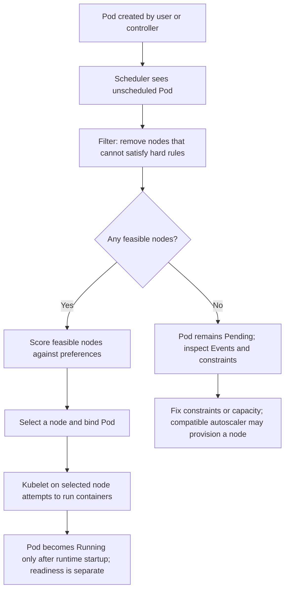

# Unit 7 — Node Pools, Taints, Affinity, and Workload Placement

## Lesson metadata

| Field | Value |
|---|---|
| Target filename | `07-node-pools-taints-affinity-and-workload-placement.md` |
| Module / unit | Stage 2E, M03 — Production Kubernetes Operations, Unit 7 |
| Level range | L1–L4: beginner through expert |
| Estimated learning time | 5–7 hours, including the lab and evidence review |
| Prerequisites | Linux shell, Git, Docker, basic Pods/Deployments, labels/selectors, resource requests and limits, and Units 1–6 of M03 |
| Core tools | `kubectl`, `kind`, Docker or compatible container runtime, YAML editor, Kubernetes Events |
| Awareness-only tools | Cluster Autoscaler/Karpenter, descheduler, Kyverno/OPA Gatekeeper, RuntimeClass, GPU device plugins, provider-specific node groups |
| Kubernetes baseline assumed | Supported Kubernetes minor chosen by the learner; set `<NODE_IMAGE_TAG>` after checking support and version-skew policy `[VERIFY]` |
| Last reviewed | 2026-10-25; links were checked during preparation, but the complete lab was not executed |
| Cost constraint | Zero-budget local laptop; no paid cloud cluster or cloud account required |

**Repository context:** the supplied roadmap and M03 syllabus-generation prompt identify this as Unit 7, between Unit 6 autoscaling and Unit 8 upgrades. This standalone lesson was prepared from those supplied materials. The repository tree is represented in the supplied roadmap, but the actual repository directory and a working-tree diff were not available in the current filesystem; this artifact is therefore saved as `/mnt/data/07-node-pools-taints-affinity-and-workload-placement.md` for download, not written into an unmounted repository path.

**Evidence standard:** commands and manifests below are designed for review and local use. They have not been executed as a complete lab in this environment. Exact Events, scheduling decisions, image availability, and feature support depend on the selected cluster version and environment. Record your actual observations rather than copying illustrative output as evidence.

## Why this matters in production

A Kubernetes scheduler can place every replica of a service on the same node unless the workload declares constraints that make other placements preferable or required. If that node fails, a service that appeared highly replicated can become unavailable. Conversely, overly strict affinity, taints, topology rules, or resource requests can make every candidate node ineligible and leave a rollout stuck in `Pending`. Placement is therefore a reliability, capacity, cost, and isolation design problem—not simply a way to “choose a machine.” On a data platform, the API, queue consumer, batch ETL, memory-heavy transform, and GPU inference service may have different resource and failure-domain requirements.

## Learning objectives

By the end of this unit, the learner can:

- **[L1] Explain** the scheduler's simplified filter → score → bind model and identify which decisions are scheduler decisions versus node provisioning.
- **[L1] Inspect and configure** node labels, `nodeSelector`, and simulated node pools without assuming worker names.
- **[L2] Distinguish and configure** `NoSchedule`, `PreferNoSchedule`, and `NoExecute` taints with matching tolerations.
- **[L2] Compare and diagnose** required/preferred node affinity, Pod affinity/anti-affinity, and topology spread constraints.
- **[L2] Interpret** Pod conditions and `FailedScheduling` Events, then identify which constraints eliminate eligible nodes.
- **[L3] Design** a placement model for general API, batch, memory-intensive, platform, and awareness-level GPU workloads.
- **[L3] Evaluate** capacity, fragmentation, autoscaler, PDB, DaemonSet, PVC-topology, and rollout interactions.
- **[L4] Plan and validate** failure-domain-aware placement and a reversible workload migration between pools.
- **[L4] Produce** an evidence-based incident analysis for replica co-location and a practical Pending-Pod runbook.

## Concept map and glossary

### The placement decision



This is a teaching model. The real scheduler uses a plugin framework with additional extension points and phases; it is not literally one universal three-function implementation. Scheduling a Pod to a node is also different from pulling its image, starting containers, passing readiness checks, or provisioning a new machine.

### Glossary

| Term | Precise definition | Common misconception |
|---|---|---|
| Scheduler | Control-plane component that chooses a node for an unscheduled Pod. | It does not create cloud VMs by itself. |
| Filtering | Evaluates whether a node is feasible for a Pod under hard requirements and current constraints. | A node with the highest preference cannot bypass a hard constraint. |
| Scoring | Ranks feasible nodes using scheduler scoring plugins and preferences. | A score is not a promise of resilience or performance. |
| Binding | Records the Pod-to-node assignment through the API. | Binding does not mean the application is ready. |
| Node label | Key/value metadata attached to a Node object. | Any label is not automatically trustworthy as a security boundary. |
| Node pool / node group | Operational grouping of similar worker machines, usually managed by a provider or infrastructure system. | Kubernetes core does not define a universal cloud node-pool API. |
| `nodeSelector` | A map of labels all of which must exactly match the candidate node. | It is not a soft preference. |
| Node affinity | Pod rule based on node labels; supports hard and preferred rules. | It does not repel unrelated Pods from a node. |
| Pod affinity | Rule based on labels of other Pods in a topology domain. | It is not the same as selecting a node by node labels. |
| Pod anti-affinity | Rule preferring or requiring separation from matching Pods in a topology domain. | Hard anti-affinity can make scheduling impossible if capacity/domains are insufficient. |
| Taint | Node metadata that repels Pods unless they have a matching toleration, depending on effect. | A taint does not select the workload that should use that node. |
| Toleration | Pod permission to be scheduled onto or remain on a node with a matching taint. | It does not attract the Pod to that node. |
| Topology spread | Constraint controlling distribution of matching Pods across labeled topology domains. | It cannot manufacture independent failure domains. |
| Topology key | Node-label key used to group nodes into domains, such as hostname or zone. | A label named “zone” is not proof of a real availability zone. |
| `maxSkew` | Maximum allowed difference between matching-Pod counts in eligible domains for a spread constraint. | It is not simply a target replica count per node. |
| `NoSchedule` | Taint effect that prevents new non-tolerating Pods from scheduling on the node. | It does not evict already-running Pods by itself. |
| `PreferNoSchedule` | Best-effort instruction to avoid placing non-tolerating Pods on the node. | It is not a hard exclusion. |
| `NoExecute` | Taint effect that prevents non-tolerating Pods from staying; matching `tolerationSeconds` can delay eviction. | It is not a harmless scheduling preference. |
| Pending | Pod phase/status indicating it has not yet reached Running; it can be waiting for scheduling or other prerequisites. | Every Pending Pod is a scheduler failure; image pulling and volume setup can also be involved depending on status. |
| `FailedScheduling` | Event reason commonly emitted when the scheduler cannot find a feasible node. | Exact event text is not a stable API contract. |
| Preemption | Scheduler-related mechanism that may remove lower-priority Pods to make room for a higher-priority Pod. | It is not a capacity guarantee and cannot solve every constraint conflict. |
| DaemonSet | Controller that ensures a Pod runs on eligible nodes, often for node-level agents. | DaemonSet Pods necessarily tolerate every custom taint. |
| Node allocatable | Resource amount Kubernetes makes available for Pods after node/system reservations. | It is not the raw physical machine capacity. |
| PVC topology | Storage provisioning or binding constraints that can restrict which nodes can use a volume. | A Pod can always move to any node if its manifest permits it. |
| Device plugin | Node component that advertises special hardware resources, such as GPUs, to Kubernetes. | A GPU label alone allocates or exposes a GPU device. |

### Rule selection at a glance

| Mechanism | Main question it answers | Hard/soft | What it does not do |
|---|---|---|---|
| `nodeSelector` | “Which nodes must have these exact labels?” | Hard | Does not repel other Pods or create pools. |
| Node affinity | “Which node-label expressions must/preferably should match?” | Hard or soft | Does not dedicate a node by itself. |
| Taint/toleration | “Which Pods may use this tainted node?” | Effect-dependent repulsion/permission | A toleration does not attract; a taint does not select intended workloads. |
| Pod affinity | “Should/must this Pod be near matching Pods?” | Hard or soft | Does not guarantee the dependency is healthy. |
| Pod anti-affinity | “Should/must this Pod be away from matching Pods?” | Hard or soft | Does not guarantee separate physical failure domains unless labels and infrastructure represent them. |
| Topology spread | “How imbalanced may matching Pods be across eligible domains?” | Hard or soft | Does not create capacity or real zones. |
| Resource requests | “How much schedulable resource should be reserved for placement calculations?” | Feasibility input | Cannot correct understated requests or actual runtime spikes. |

## Scheduling lifecycle: filter, score, bind

1. **A controller or user creates a Pod.** For example, a Deployment controller creates a ReplicaSet and the ReplicaSet creates Pods. The scheduler does not create the Deployment or decide how many replicas the application needs.
2. **The scheduler filters candidate nodes.** Hard constraints can include node selectors, required node affinity, taints without matching tolerations, resource requests versus allocatable capacity, volume constraints, and Pod/topology rules. Other filters and plugins also participate.
3. **The scheduler scores feasible candidates.** Preferences and configured scoring plugins influence which feasible node wins. A soft preference may be ignored if no better option exists.
4. **The scheduler binds the Pod to one node.** The node name becomes visible in `kubectl get pod -o wide`.
5. **The kubelet and container runtime attempt to start it.** Image pull, volume mount, container startup, and readiness are later concerns. A Pod can be scheduled but not Running/Ready.

**Important boundary:** “Pending” is a broad status. Use `.status.conditions`, `.spec.nodeName`, Events, container state, and volume events to distinguish “no feasible node” from “scheduled but not started.” A compatible cluster autoscaler may observe unschedulable Pods and request more nodes; the scheduler itself does not provision machines. `kind` has no cloud node provisioner.

### First diagnostic commands

```bash
kubectl config current-context
kubectl get nodes -o wide
kubectl get pods -A -o wide
kubectl describe pod <pod-name> -n <namespace>
kubectl get events -n <namespace> --sort-by=.metadata.creationTimestamp
kubectl get nodes --show-labels
kubectl describe node <node-name>
```

Use the namespace and object names actually present in your environment. Do not copy a destructive command from a runbook until the context and target are verified.

## L1 — Beginner: labels, nodeSelector, and node pools

### Labels are metadata; selectors turn metadata into a rule

A node label is a key/value pair such as `platform.example.com/pool=general`. Labels are useful only when a workload rule refers to them. Labels can be applied by infrastructure automation, a cluster administrator, or a provider integration. Standard labels include `kubernetes.io/hostname` and often `topology.kubernetes.io/zone`; actual values and availability depend on the environment.

Use organization-controlled label keys and governance for production placement. Kubernetes documentation describes protected label prefixes for node isolation, but a label by itself is not a security boundary. The identity and authorization model must prevent an untrusted node or tenant from changing security-sensitive labels. See the official node-isolation guidance in the references.

### `nodeSelector`: simple exact-match selection

All key/value entries in `nodeSelector` must match the candidate node. If the Pod says `platform.example.com/pool: general`, nodes labeled `pool=batch` do not match. If no node matches, the Pod remains unscheduled until a feasible node appears or the rule changes.

Complete example:

```yaml
apiVersion: v1
kind: Pod
metadata:
  name: api-placement-demo
  labels:
    app: api-placement-demo
spec:
  nodeSelector:
    platform.example.com/pool: general
  containers:
    - name: web
      image: registry.k8s.io/pause:3.10
      resources:
        requests:
          cpu: 25m
          memory: 32Mi
        limits:
          cpu: 100m
          memory: 64Mi
```

`registry.k8s.io/pause:3.10` is an illustrative image tag, not a statement that it is the newest image. Check image availability and organizational policy before use. This small Pod is for scheduler observation, not a production API.

Apply and inspect:

```bash
kubectl apply -f api-placement-demo.yaml
kubectl get pod api-placement-demo -o wide
kubectl describe pod api-placement-demo
kubectl get events --sort-by=.metadata.creationTimestamp
```

If the cluster has no node with the required label, `describe` should provide scheduler diagnostics. Do not assume exact wording. Correct the label or the selector intentionally; do not add broad tolerations or remove constraints blindly.

### Node pools and node groups

**Core Kubernetes:** Node objects, labels, taints, resource capacity, and scheduling constraints.

**Provider-specific:** managed node groups, machine families, purchase models, autoscaling groups, zone placement, spot/preemptible lifecycle, and provider APIs. AWS, Azure, GCP, and other platforms expose different operational abstractions; these are not one universal Kubernetes object.

**Simulation:** on `kind`, label different worker containers as if they belonged to general, batch, or memory pools. This tests manifest logic only. It does not create different CPU/memory hardware, independent machines, real zones, or a cloud autoscaler.

### Trace Pending → Scheduled → Running

```bash
kubectl get pod api-placement-demo -o wide
kubectl describe pod api-placement-demo
kubectl get events --sort-by=.metadata.creationTimestamp
kubectl get nodes --show-labels
```

Read the evidence in this order:

- `spec.nodeName`: empty means the Pod has not been bound to a node.
- Pod conditions and Events: look for scheduler reasons and timestamps.
- Node labels/taints: compare them with the Pod's selectors and tolerations.
- Requests versus allocatable resources: a node can have low observed usage but still lack schedulable requested capacity.
- If a node is assigned, inspect container states, image-pull errors, volume mounts, and readiness separately.

### Beginner failure modes

| Symptom | Likely cause | First safe fix |
|---|---|---|
| Pod never leaves Pending | Selector key/value has no matching node | Compare exact labels; fix intended label or selector. |
| Pod is assigned but not Running | Image pull, volume, or container startup issue | Inspect `describe` and container state; do not blame the scheduler without evidence. |
| Label exists but Pod does not match | Typo, different value/case, or wrong node | Compare exact strings in node labels and manifest. |
| Every Pod is forced onto one node | Same selector targets one node or only one eligible node exists | Check eligible-node count and capacity; add valid candidates and deliberate spread policy. |

**Bridge to L2:** `nodeSelector` is simple but cannot express preferences, pod-to-pod relationships, or the permission/repulsion behavior of taints.

## L2 — Intermediate: taints, tolerations, affinity, and topology spread

### Taints and tolerations

A taint is placed on a node; a toleration is placed in the Pod spec. A toleration matches the relevant taint key, operator/value, and effect according to the API's matching rules. Tolerating a taint allows a Pod to be considered for that node, but other constraints and capacity still apply.

| Effect | Operational meaning | Typical use |
|---|---|---|
| `NoSchedule` | New Pods that do not tolerate the taint are not scheduled there. Existing Pods are not evicted solely because this taint is added. | Dedicated batch or memory worker pool. |
| `PreferNoSchedule` | Scheduler tries to avoid placing non-tolerating Pods there, but it is not a hard ban. | Soft avoidance when alternatives may be limited. |
| `NoExecute` | Non-tolerating Pods cannot remain; existing Pods may be evicted. A matching toleration with `tolerationSeconds` can delay eviction. | Controlled demonstration or specific node-condition behavior; use carefully. |

Example batch placement needs both **permission** and **selection**:

```yaml
apiVersion: batch/v1
kind: Job
metadata:
  name: etl-batch-demo
spec:
  backoffLimit: 1
  activeDeadlineSeconds: 300
  template:
    metadata:
      labels:
        app: etl-batch-demo
        workload-type: batch
    spec:
      restartPolicy: Never
      nodeSelector:
        platform.example.com/pool: batch
      tolerations:
        - key: workload.example.com/class
          operator: Equal
          value: batch
          effect: NoSchedule
      containers:
        - name: etl
          image: registry.k8s.io/pause:3.10
          resources:
            requests:
              cpu: 50m
              memory: 48Mi
            limits:
              cpu: 200m
              memory: 96Mi
```

The `pause` image does not perform ETL; it only demonstrates placement and Job lifecycle mechanics. Replace it with a reviewed ETL image to run real work. A real ETL process must be idempotent or checkpointed because Jobs may retry.

**Why all three mechanisms matter for strict dedication:**

- **Toleration alone is insufficient:** it permits the batch Pod on a tainted node but does not attract it there; it could land on a general node.
- **Selector/affinity alone is insufficient:** it directs the batch Pod to labeled batch nodes, but unrelated Pods can still land there unless the nodes repel them.
- **Taint alone is insufficient:** it repels non-tolerating Pods, but it does not identify which workload is the intended tenant.
- **Together:** taint + matching toleration + pool selector/required affinity express “only Pods with permission may enter, and this workload should target this pool.” Additional RBAC/admission controls are needed if labels or tolerations are security-sensitive.

### Node affinity

Node affinity uses node labels and expressions. Two principal rule types are:

- `requiredDuringSchedulingIgnoredDuringExecution`: a hard scheduling requirement.
- `preferredDuringSchedulingIgnoredDuringExecution`: a soft preference with a weight; the scheduler can still schedule elsewhere if necessary.

`IgnoredDuringExecution` means that if the node's labels change after the Pod is scheduled, Kubernetes does not automatically evict that Pod merely because the affinity rule is no longer satisfied. It is not a promise that the Pod will stay healthy.

Example with hard pool selection plus a soft preference:

```yaml
apiVersion: v1
kind: Pod
metadata:
  name: preferred-memory-demo
spec:
  affinity:
    nodeAffinity:
      requiredDuringSchedulingIgnoredDuringExecution:
        nodeSelectorTerms:
          - matchExpressions:
              - key: platform.example.com/pool
                operator: In
                values: ["memory"]
      preferredDuringSchedulingIgnoredDuringExecution:
        - weight: 50
          preference:
            matchExpressions:
              - key: platform.example.com/cache-local
                operator: In
                values: ["true"]
  containers:
    - name: example
      image: registry.k8s.io/pause:3.10
      resources:
        requests:
          cpu: 25m
          memory: 32Mi
```

Within a `nodeSelectorTerm`, expressions are combined with AND; separate terms are OR alternatives. If both `nodeSelector` and node affinity are present, both must be satisfied.

### Pod affinity and anti-affinity

Pod affinity/anti-affinity uses labels on other Pods and a `topologyKey` on nodes to express locality or separation. For example, an API replica might prefer to be near a cache replica for latency, while API replicas might be required to avoid co-locating on the same hostname.

- `requiredDuringSchedulingIgnoredDuringExecution` is a hard rule; no feasible topology can leave Pods Pending.
- `preferredDuringSchedulingIgnoredDuringExecution` is a soft rule and may be relaxed.
- `topologyKey: kubernetes.io/hostname` asks about node-level domains, provided nodes have that label.
- `topologyKey: topology.kubernetes.io/zone` asks about zone-level domains only when the labels represent real zones in the environment.

Hard Pod anti-affinity can create deadlocks: if each new replica must avoid matching replicas on every eligible hostname but only one eligible node exists, additional replicas cannot schedule. Carefully check namespace, label selectors, topology labels, replica count, and available nodes. For many stateless services, topology spread is easier to reason about than a large collection of hard anti-affinity rules.

Example of soft anti-affinity by hostname:

```yaml
apiVersion: apps/v1
kind: Deployment
metadata:
  name: api-soft-anti-affinity
spec:
  replicas: 2
  selector:
    matchLabels:
      app: api-soft-anti-affinity
  template:
    metadata:
      labels:
        app: api-soft-anti-affinity
    spec:
      affinity:
        podAntiAffinity:
          preferredDuringSchedulingIgnoredDuringExecution:
            - weight: 100
              podAffinityTerm:
                topologyKey: kubernetes.io/hostname
                labelSelector:
                  matchLabels:
                    app: api-soft-anti-affinity
      containers:
        - name: web
          image: registry.k8s.io/pause:3.10
          resources:
            requests:
              cpu: 25m
              memory: 32Mi
            limits:
              cpu: 100m
              memory: 64Mi
```

### Topology spread constraints

A topology spread constraint expresses the maximum acceptable skew of matching Pods among eligible topology domains. Common fields:

- `maxSkew`: maximum permitted difference between matching Pod counts in eligible domains under the constraint's counting rules.
- `topologyKey`: node-label key that defines the domains.
- `whenUnsatisfiable: DoNotSchedule`: hard behavior; do not schedule a Pod if it would violate the constraint.
- `whenUnsatisfiable: ScheduleAnyway`: soft behavior; still schedule, preferring nodes that reduce skew.
- `labelSelector`: identifies the Pods counted for this constraint. Ensure it matches the intended Pod template labels.
- Eligible domains matter: nodes missing the topology label are not usable for that constraint. Node affinity/selectors and taints can affect which nodes are eligible for spread calculations. `[VERIFY]` the precise behavior and available fields for the chosen Kubernetes version.

Example:

```yaml
apiVersion: apps/v1
kind: Deployment
metadata:
  name: api-spread-demo
spec:
  replicas: 3
  selector:
    matchLabels:
      app: api-spread-demo
  template:
    metadata:
      labels:
        app: api-spread-demo
    spec:
      topologySpreadConstraints:
        - maxSkew: 1
          topologyKey: topology.kubernetes.io/zone
          whenUnsatisfiable: DoNotSchedule
          labelSelector:
            matchLabels:
              app: api-spread-demo
      containers:
        - name: web
          image: registry.k8s.io/pause:3.10
          resources:
            requests:
              cpu: 25m
              memory: 32Mi
            limits:
              cpu: 100m
              memory: 64Mi
```

This example is valid only when enough eligible nodes carry the topology key and the selected constraint semantics are supported. In `kind`, fake labels can simulate domains, but those domains are not real zones. If only one eligible domain exists, `DoNotSchedule` may block later replicas rather than creating another domain.

### How the mechanisms complement one another

| Need | Preferred mechanism | Why it is not interchangeable with the others |
|---|---|---|
| Require a workload to use a labeled pool | `nodeSelector` or required node affinity | Taints do not select a pool; tolerations alone do not attract. |
| Repel ordinary workloads from dedicated nodes | Taint with appropriate effect | Node labels alone do not repel unrelated Pods. |
| Prefer a class of node but allow fallback | Preferred node affinity | `nodeSelector` is hard, not soft. |
| Co-locate related Pods | Pod affinity | Node affinity only sees node labels, not other Pods. |
| Separate replicas by host/domain | Pod anti-affinity or topology spread | Anti-affinity and spread have different counting/feasibility semantics. |
| Limit imbalance across domains | Topology spread | A toleration is not a distribution rule. |

### Decode scheduler Events

Start with:

```bash
kubectl describe pod <pod-name> -n <namespace>
kubectl get events -n <namespace> --sort-by=.metadata.creationTimestamp
kubectl get nodes --show-labels
kubectl describe node <candidate-node>
```

A `FailedScheduling` Event may report that nodes didn't match a selector/affinity, had untolerated taints, lacked CPU/memory, or violated topology constraints. The exact phrasing, grouping, and node counts can vary by version and concurrent cluster state. Treat the Event as diagnostic evidence, not a stable API contract. Correlate it with the actual Pod spec and node state.

## L3 — Advanced: data-platform placement design and scheduler interactions

### Conceptual pool model

| Pool | Workload examples | Placement intent | Operational trade-offs |
|---|---|---|---|
| System/platform | DNS, metrics, ingress, logging/monitoring agents | Preserve capacity for essential cluster services; provider/add-on requirements may apply | Over-isolation can starve system components; review DaemonSet tolerations and resource requests. |
| General-purpose | API, control services, low/medium resource consumers | Broad eligible capacity and predictable scheduling | Shared nodes can create noisy-neighbor risk; use requests, quotas, and observability. |
| Memory-optimized | In-memory joins, pandas transforms, feature generation | Larger memory per node, deliberate memory requests and limits | High memory requests can fragment capacity; a label does not change the hardware type. |
| Batch / spot-like | ETL, backfills, retryable workers | Isolate bursty/retryable work and optionally use lower-cost interruptible capacity | Spot/preemptible semantics and termination notices are provider-specific; workloads need retries/checkpoints. |
| GPU | Model inference/training | Hardware/resource-specific scheduling, typically with device plugin or provider integration | Awareness only here. GPU labels alone do not allocate devices; quotas, drivers, device plugins, and runtime compatibility matter. |

A real node pool normally has infrastructure configuration behind it: machine shape, image, zone, autoscaling bounds, upgrade strategy, and lifecycle policies. Kubernetes scheduling constraints consume labels, taints, resource capacity, volumes, and other API state. Do not confuse the policy metadata with the underlying infrastructure.

### Requests, allocatable capacity, and fragmentation

The scheduler reasons about declared resource requests and node allocatable capacity—not simply instantaneous usage from `kubectl top`. A node with low CPU utilization may still be full from the scheduler's perspective because requests reserve most allocatable CPU. Conversely, understated requests can cause a Pod to fit on paper but overload the node at runtime.

Capacity planning should include:

1. **Steady-state requests:** sum Pod requests on each eligible node.
2. **Rollout headroom:** account for `maxSurge`, terminating Pods, and new replicas during deployment.
3. **Failure headroom:** determine whether surviving nodes can fit the service after a node/domain loss.
4. **System DaemonSets:** reserve resources for per-node agents.
5. **Fragmentation:** a cluster may have enough total CPU/memory but no single eligible node with enough of the requested resources.
6. **Placement intersections:** taints, affinity, topology rules, PVC topology, and requests can reduce the eligible set simultaneously.

A node autoscaler can add capacity only if a compatible integration recognizes the unschedulable Pod and can provision a pool that satisfies its constraints. A Pod that requires a nonexistent label or has contradictory affinity may remain Pending forever even if a new node is added. `kind` does not create new worker containers automatically in response to Pending Pods.

### Interactions with other M03 topics

- **Unit 5 — PDB and voluntary disruption:** PDBs influence eviction-based voluntary disruptions, such as drain. They do not make a placement policy feasible and do not prevent involuntary node failures. If topology rules and replica count leave no replacement location, a drain may block.
- **Unit 6 — HPA/VPA/autoscaling:** HPA changes replica count; placement constraints determine where those replicas may fit. VPA may change requests and thus scheduling feasibility. Cluster Autoscaler/Karpenter are provider/infrastructure integrations, not core scheduler behavior.
- **DaemonSets:** node-level agents often need to run on nodes regardless of workload pool. Review their tolerations, node selectors, and resource requests before adding taints.
- **PVC topology (forward reference M05):** a volume may be zone-bound or otherwise constrained. The Pod must be schedulable where the volume can be attached/mounted. Do not force a Pod to a different pool without checking storage binding and CSI behavior.
- **Rollouts and graceful migration:** replicas, readiness, surge capacity, PDBs, and topology rules interact. A new template that has no eligible nodes can stall a rollout while old replicas continue to run—or become unavailable if the old placement is removed too soon.
- **RuntimeClass / sandboxed Pods — Awareness:** runtime selection may add scheduling/resource constraints and depends on installed runtimes and node configuration.
- **GPU/device plugins — Awareness:** extended resources must be advertised by the node/plugin and requested correctly. A generic `gpu=true` label is not a substitute for device allocation.
- **Priority/preemption — Awareness:** priority may allow a higher-priority Pod to preempt lower-priority Pods if preemption can make a node feasible. It does not fix incompatible labels, missing devices, volume topology, or every anti-affinity conflict. PDB interaction and exact preemption behavior should be checked against current documentation.
- **Descheduler — Optional add-on:** scheduler placement is primarily evaluated when a Pod is scheduled. A descheduler can evict Pods under configured policies to rebalance or correct placement, after which controllers may recreate them. Eviction can cause disruption and must be designed with PDBs, capacity, and policy. Do not assume it is installed.

### Version-sensitive fields

`matchLabelKeys` and `nodeAffinityPolicy` are **[VERSION-SENSITIVE]**. Check the selected API server version, official API reference, feature-gate history, and current documentation before using them. The current official topology-spread documentation describes their availability/history, but cluster distributions and feature-gate configuration can differ. This lesson's core lab deliberately avoids depending on these fields. Also review `nodeTaintsPolicy` if using it. Never copy version-sensitive fields into a production manifest without verifying support and intended semantics.

### Spread versus anti-affinity

Topology spread is often a direct way to bound distribution imbalance across selected domains. Pod anti-affinity expresses a relational constraint between Pods, and a hard rule can prevent placement altogether. Both can be useful, but neither guarantees high availability unless there are enough real independent domains, enough replicas, sufficient capacity, and healthy application behavior.

Design questions:

- Are domains actually independent (different hosts, racks, zones, power/network boundaries)?
- Do all eligible domains have enough capacity for the workload and rollout surge?
- Does the label selector match only the intended workload and namespace?
- What should happen when one domain is unavailable: block new replicas (`DoNotSchedule`) or allow imbalance (`ScheduleAnyway`)?
- Is the cost of idle headroom justified by the required recovery objective?

## L4 — Expert: failure domains, capacity, policy, and safe migration

### Failure-domain-aware placement

In production, use labels whose values are managed and verified by the infrastructure layer. A hostname label can represent a Kubernetes node; a zone label should represent a real provider zone only when the provider integration and inventory support that interpretation. **`kind` has no real availability zones.** Fake `zone-a`, `zone-b`, and `zone-c` labels are a scheduling exercise only; they do not create independent VMs, racks, networks, power supplies, or regional failure boundaries.

### Bin-packing versus spreading

| Dimension | Bin-packing tendency | Spreading tendency | Review question |
|---|---|---|---|
| Cost/utilization | Packs workloads onto fewer nodes, potentially allowing fewer machines | Leaves more nodes active/partially utilized | Is infrastructure cost or resilience the primary constraint? |
| Resilience | Co-location can increase blast radius | Can reduce correlated loss if domains are truly independent | Can surviving domains carry the failed domain's load? |
| Latency | Co-location may reduce network hops or improve cache locality | May increase cross-node/network traffic | Does the workload benefit from locality? |
| Capacity fragmentation | Can concentrate free capacity into fewer nodes, but leave no room for large Pods elsewhere | Can fragment free resources across more nodes | Do large memory/CPU requests still fit after spreading? |
| Workload fit | Useful for low-risk, batch, or utilization-sensitive workloads | Useful for stateless replicas and failure-sensitive services | What is the recovery objective and interruption tolerance? |

Neither strategy is universally superior. A mature design may bin-pack batch jobs while spreading API replicas across independent failure domains.

### Placement policy-as-code — Awareness

Admission policy can enforce guardrails such as: production workloads must declare an approved pool label, sensitive pools require reviewed tolerations, or critical Deployments must include a topology policy. Kyverno and OPA Gatekeeper are optional add-ons, not prerequisites for this unit's core labs. A policy can reject an invalid Pod spec; it does not create capacity or guarantee runtime resilience.

Illustrative policy intent (not ready-to-apply policy syntax):

```yaml
# PSEUDOCODE ONLY — [VERIFY] exact syntax against the selected policy engine/version.
rule: production-workloads-require-approved-placement
when:
  namespace has label environment=production
then:
  require nodeSelector or required nodeAffinity from approved pool labels
  reject unapproved tolerations
```

Do not apply this pseudocode. If implementing a real policy, use the official Kyverno or Gatekeeper documentation, test it against positive and negative fixtures, and plan an emergency exception path with audit logging.

### Incident walkthrough: all replicas landed on one node and a single node loss took the service down

#### 1. Impact and initial signals

Observed impact may include API errors, elevated latency, failed readiness checks, missing endpoints, or all replicas restarting after one node becomes unavailable. Gather actual incident timestamps and metrics from monitoring; do not invent them. The immediate question is whether all replicas were co-located and whether the service had enough healthy eligible capacity elsewhere.

#### 2. Evidence timeline

| Stage | Evidence to collect | Questions |
|---|---|---|
| Detect | Alert, user impact, SLI/SLO graph, Pod readiness | Is the service actually unavailable, or only degraded? |
| Establish placement | `kubectl get pods -o wide`, Deployment/ReplicaSet status | Were replicas on the same node/domain before failure? |
| Inspect constraints | Pod template, labels, affinity, spread rules, taints/tolerations | Was there no policy, only a soft preference, or a hard rule that could not be satisfied? |
| Inspect capacity | Node allocatable, Pod requests, DaemonSet overhead, pending replicas | Could remaining nodes accept replacements? |
| Inspect domains | Node labels and infrastructure inventory | Do topology labels represent independent production failure domains? |
| Mitigate | Add feasible capacity, restore node, or temporarily relax a rule after review | What is the lowest-risk way to restore service? |
| Validate | Ready replicas, endpoint health, distribution, SLI recovery | Did the mitigation restore capacity without creating a second risk? |

Commands:

```bash
kubectl get deploy,rs,pods -n <namespace> -o wide
kubectl describe deploy <deployment> -n <namespace>
kubectl get pods -n <namespace> -l app=<app-label> -o wide
kubectl get nodes -o wide --show-labels
kubectl describe node <affected-node>
kubectl get events -n <namespace> --sort-by=.metadata.creationTimestamp
kubectl get pdb -n <namespace>
```

#### 3. Root-cause branches

- **Absent or weak topology policy:** no spread constraint, or only a soft preference that did not ensure distribution.
- **Too few eligible nodes/domains:** selectors, taints, or node affinity restricted placement to one node.
- **Insufficient capacity:** surviving nodes existed but requests, memory size, volume constraints, or rollout surge made them infeasible.
- **Misleading labels:** fake or incorrect topology labels made the design appear diverse when the underlying infrastructure shared a failure domain.
- **Application/controller issue:** replicas could not become Ready, the application was not stateless, or replacement startup required unavailable dependencies.

Separate the initiating event (node loss) from contributing design causes (co-location, no headroom, or readiness problems).

#### 4. Immediate mitigation and risks

Possible mitigations, chosen from evidence:

1. Restore or replace the failed node if safe and supported.
2. Provision/add capacity through the real infrastructure mechanism, ensuring it has the required labels and tolerates the intended workloads.
3. Temporarily relax a blocking placement constraint only after confirming the risk and documenting the rollback. This can restore replicas but may increase co-location.
4. Reduce rollout surge or stop a rollout if it is consuming the remaining capacity.
5. Restore the last known-good Deployment template if a recent change caused infeasible placement.

Do not remove all taints, apply broad tolerations, or delete unrelated Pods as a reflex. Each can increase blast radius or hide the original constraint conflict.

#### 5. Durable correction and validation

- Use `topologySpreadConstraints` or justified Pod anti-affinity that matches the workload labels.
- Decide whether the service should block new replicas when spread is impossible (`DoNotSchedule`) or permit degraded spread (`ScheduleAnyway`).
- Ensure there are enough eligible, genuinely independent domains and enough capacity to survive the loss of one.
- Include rollout surge, system overhead, PVC topology, and PDB/drain behavior in capacity calculations.
- Test placement with a controlled maintenance/failure drill in an appropriate non-production environment.
- Verify actual node distribution, Ready replicas, error rate, and recovery time after the change.
- Roll back if readiness, SLI, or scheduling feasibility degrades beyond the change's agreed abort threshold.

**Simulation warning:** deleting or stopping a `kind` worker container is not equivalent to losing an independent cloud VM or availability zone. The control plane, Docker host, and remaining nodes share the laptop and its failure domain.

#### 6. Prevention and after-action review

Record: impact; detection; exact timeline; contributing constraints; capacity assumptions; what worked; what increased risk; recovery objective achieved; permanent owner; action items with deadlines; and evidence links. Prevention may include a placement policy check in CI, alerts for replica concentration, a pre-deployment capacity check, topology-label verification, and a recurring disruption drill.

### Safe migration between pools without downtime

1. **Inventory:** identify current replicas, node selectors/affinity, taints, PVCs, PDBs, resource requests, and controller rollout strategy.
2. **Capacity gate:** confirm destination nodes have sufficient allocatable CPU/memory and required devices/volumes; include rollout surge and system agents.
3. **Prepare destination:** create or scale the real pool through the infrastructure process; verify node readiness, labels, taints, CNI/CSI/runtime, and monitoring.
4. **Test a canary:** deploy a small replica or test workload with the intended selector, toleration, and affinity; verify it becomes Ready and works end-to-end.
5. **Move gradually:** change workload placement through a reviewed template rollout or controlled replica migration. Observe scheduling, readiness, error rate, latency, and resource use.
6. **Preserve service capacity:** ensure old replicas are not removed before new replicas are Ready. Review PDB and termination behavior, and confirm the service has enough healthy endpoints.
7. **Abort criteria:** stop if Pods remain Pending beyond the agreed window, readiness/error-rate SLI degrades, volume attachment fails, or destination capacity is insufficient.
8. **Rollback:** restore the previous template and confirm old nodes still accept the workload. Do not remove the old pool until validation is complete and rollback is no longer needed.
9. **Retire old placement:** remove old labels/taints or scale down infrastructure only after workload owners, storage owners, and operations confirm no remaining dependency.

### Production review framework

| Dimension | Review prompts |
|---|---|
| Availability | Are replicas on independent real failure domains? What is the behavior after losing one domain? |
| Blast radius | Can one node/pool failure take out every replica or critical dependency? |
| Capacity | Are requests, allocatable capacity, surge, DaemonSets, and failure headroom modeled? |
| Cost | Is the design deliberately trading utilization for resilience? Are spot interruptions acceptable? |
| Security/tenant isolation | Who can edit node labels and Pod tolerations? Are admission, RBAC, network, and runtime controls also present? |
| Complexity | Can on-call staff explain the eligible-node set and safely change it? |
| Observability | Can operators see Pod placement, Pending reasons, node pressure, and spread imbalance? |
| Recovery | Are replacement capacity, PVC topology, PDBs, and rollback tested? |

## Worked example: API, worker, batch ETL, and memory-intensive processing

This example uses a consistent data-platform vocabulary. The manifests use `pause` only where the purpose is scheduler behavior; it is not an API, queue consumer, ETL implementation, or memory benchmark. Replace the image and command with reviewed application images before production use.

### API: general pool, with replica spread

```yaml
apiVersion: apps/v1
kind: Deployment
metadata:
  name: scoring-api-placement
  labels:
    app: scoring-api-placement
spec:
  replicas: 3
  selector:
    matchLabels:
      app: scoring-api-placement
  template:
    metadata:
      labels:
        app: scoring-api-placement
    spec:
      nodeSelector:
        platform.example.com/pool: general
      topologySpreadConstraints:
        - maxSkew: 1
          topologyKey: kubernetes.io/hostname
          whenUnsatisfiable: ScheduleAnyway
          labelSelector:
            matchLabels:
              app: scoring-api-placement
      containers:
        - name: placeholder
          image: registry.k8s.io/pause:3.10
          resources:
            requests:
              cpu: 25m
              memory: 32Mi
            limits:
              cpu: 100m
              memory: 64Mi
```

This constrains the API to the general pool and asks the scheduler to prefer hostname-level balance. It does not guarantee three separate nodes if fewer eligible nodes exist or constraints/capacity prevent it. Use `DoNotSchedule` only when blocking an unsatisfiable placement is the intended availability trade-off.

### Queue worker: general pool unless its operational profile requires a dedicated pool

A consumer that needs queue connectivity and idempotent processing may use the general pool initially. If queue bursts or CPU-heavy transforms justify a batch pool, add a reviewed selector and matching toleration together. Do not use tolerations as a substitute for a placement target.

### Batch ETL: batch pool

Use the `Job` manifest in L2. A real ETL Job should include a bounded deadline, retries suited to idempotency, observability, and checkpoint/duplicate handling. If the pool uses spot/preemptible machines, implement interruption handling through the provider's documented mechanism; Kubernetes does not define one universal spot lifecycle.

### Memory-intensive transform: memory pool

```yaml
apiVersion: batch/v1
kind: Job
metadata:
  name: memory-transform-placement
spec:
  backoffLimit: 1
  activeDeadlineSeconds: 600
  template:
    metadata:
      labels:
        app: memory-transform-placement
        workload-type: memory
    spec:
      restartPolicy: Never
      nodeSelector:
        platform.example.com/pool: memory
      tolerations:
        - key: workload.example.com/class
          operator: Equal
          value: memory
          effect: NoSchedule
      containers:
        - name: transform-placeholder
          image: registry.k8s.io/pause:3.10
          resources:
            requests:
              cpu: 100m
              memory: 128Mi
            limits:
              cpu: 500m
              memory: 256Mi
```

The requests are intentionally small for a laptop lab and do not represent a recommended production pandas/ML sizing profile. Production sizing must be based on observed working-set peaks and failure/retry behavior. A memory-pool label is not a memory guarantee; the actual nodes must have suitable hardware and sufficient allocatable memory.

### GPU inference — Awareness only

A production GPU workload typically needs the right node pool, node labels/affinity, taints/tolerations where appropriate, a compatible driver/runtime stack, and a device plugin or other supported resource allocation integration. The Pod must request the extended resource exposed by the cluster. Do not invent a GPU resource name: inspect the node's advertised resources and the provider/device-plugin documentation. This lesson does not require a GPU or GPU software stack.

## Hands-on lab: simulated node pools on kind

### Lab objectives and boundaries

In this lab, label three `kind` workers as general, batch, and memory; taint batch and memory workers; deploy small workloads; create and diagnose a deliberately Pending Pod; correct it; demonstrate spread over fake topology labels; and demonstrate `NoExecute` eviction on an isolated lab worker.

**Simulation boundaries:** `kind` nodes are containers, not independent VMs. Fake pools do not change node hardware, and fake zones do not create real zones. WSL2/Docker Desktop CPU, memory, cgroups, and filesystem behavior may affect observed results. This lab uses no cloud autoscaler and no GPU.

**Resource budget:** one control plane plus three workers can be heavy on an 8 GB laptop. Close unnecessary containers and IDE workloads. If the laptop is memory constrained, use two workers and record that three distinct pools plus multi-domain spread may not be fully demonstrable. Do not run optional monitoring/policy components during this lab.

### 1. Preflight and safety

Check tools:

```bash
kind version
kubectl version --client
docker version
kubectl config current-context
kind get clusters
kubectl get nodes -o wide
```

If a command is unavailable, install it using its official documentation before proceeding. Do not switch contexts or delete clusters as a workaround without understanding the target.

Use the dedicated cluster name `placement-lab`. Before **every** mutating action, confirm the target context:

```bash
kubectl config current-context
kubectl cluster-info
```

The context name created by kind is commonly `kind-placement-lab`, but verify it rather than assuming. If `placement-lab` already exists, stop and inspect it. Do not overwrite or delete it without explicit confirmation that it is a disposable lab cluster and contains no valuable work.

### 2. Create or inspect the kind cluster

Save the following as a personal lab file named `placement-kind.yaml` outside the repository if desired. Replace `<NODE_IMAGE_TAG>` with an image tag chosen after checking supported Kubernetes versions and version-skew policy `[VERIFY]`.

```yaml
kind: Cluster
apiVersion: kind.x-k8s.io/v1alpha4
name: placement-lab
nodes:
  - role: control-plane
    image: kindest/node:<NODE_IMAGE_TAG>
  - role: worker
    image: kindest/node:<NODE_IMAGE_TAG>
  - role: worker
    image: kindest/node:<NODE_IMAGE_TAG>
  - role: worker
    image: kindest/node:<NODE_IMAGE_TAG>
```

The placeholder is intentionally not a runnable image reference. Replace it before running. Use a supported image tag common to all nodes. The `kind` configuration API version is separate from the Kubernetes version in the node image.

Only if `kind get clusters` confirms that `placement-lab` does **not** exist and you intend to create it:

```bash
kind create cluster --config placement-kind.yaml --wait 120s
kubectl config current-context
kubectl get nodes -o wide
```

If you already have an appropriate disposable cluster, you may reuse it only after verifying its node count and context. Do not delete/recreate an existing cluster automatically. `kind`'s documented multi-node configuration explicitly warns that containerized nodes provide limited isolation and do not add real compute capacity.

### 3. Discover and label workers

First inspect names and roles:

```bash
kubectl get nodes -o wide
kubectl get nodes --show-labels
```

Discover worker names from the output; do not assume a naming pattern. Choose exactly three worker nodes and record the mapping:

| Role | Actual Node name to record |
|---|---|
| general | `<worker-A>` |
| batch | `<worker-B>` |
| memory | `<worker-C>` |

Before applying labels, confirm the current context again. Replace placeholders with the exact discovered node names:

```bash
kubectl label node <worker-A> platform.example.com/pool=general --overwrite
kubectl label node <worker-B> platform.example.com/pool=batch --overwrite
kubectl label node <worker-C> platform.example.com/pool=memory --overwrite

kubectl label node <worker-A> topology.kubernetes.io/zone=sim-zone-a --overwrite
kubectl label node <worker-B> topology.kubernetes.io/zone=sim-zone-b --overwrite
kubectl label node <worker-C> topology.kubernetes.io/zone=sim-zone-c --overwrite

kubectl get nodes --show-labels
```

Do not label the control-plane node as one of the three worker pools. Fake zone values are **simulation only**. The lab uses the hostname key for the final spread proof because each worker should have its own node identity; the fake zone labels teach how a topology key maps to domains but are not evidence of real zone resilience.

### 4. Taint the batch and memory workers

Confirm the target context and node mapping, then apply:

```bash
kubectl taint node <worker-B> workload.example.com/class=batch:NoSchedule
kubectl taint node <worker-C> workload.example.com/class=memory:NoSchedule

kubectl describe node <worker-B>
kubectl describe node <worker-C>
```

These taints are lab-owned and should not exist before the lab. If the command reports that the taint already exists, inspect it before deciding whether to continue. Do not remove taints owned by another operator or tool.

### 5. Create a dedicated namespace

```bash
kubectl config current-context
kubectl create namespace placement-lab
kubectl label namespace placement-lab purpose=placement-training
kubectl get namespace placement-lab --show-labels
```

If the namespace already exists, inspect it and verify that it is disposable before continuing. All workloads below use this namespace.

### 6. Deploy a general baseline, batch Job, and memory Job

Save this manifest as `placement-workloads.yaml` in your personal lab workspace:

```yaml
apiVersion: v1
kind: Pod
metadata:
  name: general-baseline
  namespace: placement-lab
  labels:
    app: general-baseline
spec:
  nodeSelector:
    platform.example.com/pool: general
  containers:
    - name: pause
      image: registry.k8s.io/pause:3.10
      resources:
        requests:
          cpu: 25m
          memory: 32Mi
        limits:
          cpu: 100m
          memory: 64Mi
---
apiVersion: batch/v1
kind: Job
metadata:
  name: batch-placeholder
  namespace: placement-lab
spec:
  backoffLimit: 1
  activeDeadlineSeconds: 180
  template:
    metadata:
      labels:
        app: batch-placeholder
        workload-type: batch
    spec:
      restartPolicy: Never
      nodeSelector:
        platform.example.com/pool: batch
      tolerations:
        - key: workload.example.com/class
          operator: Equal
          value: batch
          effect: NoSchedule
      containers:
        - name: pause
          image: registry.k8s.io/pause:3.10
          resources:
            requests:
              cpu: 25m
              memory: 32Mi
            limits:
              cpu: 100m
              memory: 64Mi
---
apiVersion: batch/v1
kind: Job
metadata:
  name: memory-placeholder
  namespace: placement-lab
spec:
  backoffLimit: 1
  activeDeadlineSeconds: 180
  template:
    metadata:
      labels:
        app: memory-placeholder
        workload-type: memory
    spec:
      restartPolicy: Never
      nodeSelector:
        platform.example.com/pool: memory
      tolerations:
        - key: workload.example.com/class
          operator: Equal
          value: memory
          effect: NoSchedule
      containers:
        - name: pause
          image: registry.k8s.io/pause:3.10
          resources:
            requests:
              cpu: 25m
              memory: 32Mi
            limits:
              cpu: 100m
              memory: 64Mi
```

These placeholder Jobs do not do ETL or memory-heavy computation; the Pod template demonstrates scheduling. Because `pause` runs continuously, the Jobs may not complete. They are intentionally short-lived lab objects and are cleaned up later.

Apply only after checking the context:

```bash
kubectl config current-context
kubectl apply -f placement-workloads.yaml
kubectl get pods,jobs -n placement-lab -o wide
kubectl describe pod general-baseline -n placement-lab
```

Expected observation: the baseline targets the general-labeled worker; the batch and memory Pods have both a matching selector and toleration, so they can target their respective tainted workers. Actual scheduling can still fail if the node is NotReady, resources are unavailable, or another constraint intervenes. Record what happened.

### 7. Demonstrate a Pending Pod from a known mismatch

Create a Pod that selects the batch pool but does **not** tolerate its taint:

```yaml
apiVersion: v1
kind: Pod
metadata:
  name: intentionally-pending
  namespace: placement-lab
  labels:
    app: intentionally-pending
spec:
  nodeSelector:
    platform.example.com/pool: batch
  containers:
    - name: pause
      image: registry.k8s.io/pause:3.10
      resources:
        requests:
          cpu: 25m
          memory: 32Mi
        limits:
          cpu: 100m
          memory: 64Mi
```

Save it as `pending-mismatch.yaml`. Confirm context, then apply:

```bash
kubectl config current-context
kubectl apply -f pending-mismatch.yaml
kubectl get pod intentionally-pending -n placement-lab -o wide
kubectl describe pod intentionally-pending -n placement-lab
kubectl get events -n placement-lab --sort-by=.metadata.creationTimestamp
```

**Expected diagnostic, not literal output:** the scheduler should report that the batch node is excluded by an untolerated taint, unless another constraint or environment issue is reported first. Other nodes should fail the `pool=batch` selector. Exact wording and the number of candidate nodes vary by Kubernetes version and cluster state.

Capture the real `FailedScheduling` event in your evidence notes. If it schedules anyway, stop and inspect actual node labels and taints: likely the intended taint was not applied, the Pod was given a toleration, or the selector targeted a different node.

### 8. Correct the mismatch with a controlled change

Add this toleration to `spec` in `pending-mismatch.yaml`:

```yaml
  tolerations:
    - key: workload.example.com/class
      operator: Equal
      value: batch
      effect: NoSchedule
```

Apply the corrected manifest:

```bash
kubectl config current-context
kubectl apply -f pending-mismatch.yaml
kubectl get pod intentionally-pending -n placement-lab -o wide
kubectl describe pod intentionally-pending -n placement-lab
```

Expected behavior: once the new Pod spec is accepted and the taint matches, the Pod becomes eligible for the batch worker, subject to resources and other constraints. Some Pod spec fields are immutable; if changing the existing Pod is rejected, delete **only** `placement-lab/intentionally-pending` after verifying context and recreate it from the corrected manifest. Do not delete a broader workload or namespace to fix this exercise.

### 9. Prove replica spread across workers

Apply this Deployment as `spread-deployment.yaml`:

```yaml
apiVersion: apps/v1
kind: Deployment
metadata:
  name: spread-demo
  namespace: placement-lab
spec:
  replicas: 3
  selector:
    matchLabels:
      app: spread-demo
  template:
    metadata:
      labels:
        app: spread-demo
    spec:
      topologySpreadConstraints:
        - maxSkew: 1
          topologyKey: kubernetes.io/hostname
          whenUnsatisfiable: DoNotSchedule
          labelSelector:
            matchLabels:
              app: spread-demo
      containers:
        - name: pause
          image: registry.k8s.io/pause:3.10
          resources:
            requests:
              cpu: 25m
              memory: 32Mi
            limits:
              cpu: 100m
              memory: 64Mi
```

This constraint can spread across all eligible nodes that have the hostname label, including the control-plane node if it is eligible. If the goal is to spread across **workers only**, add a worker label to each worker and a matching node selector/required affinity to the Pod template. However, because batch and memory workers are tainted, the spread workload must tolerate those taints if it is intended to use those workers. For the cleanest three-worker proof, use a dedicated worker-only pool policy with appropriate tolerations or temporarily remove the lab taints after recording their original values. Do not assume the spread will be across workers merely because three workers exist.

**Recommended worker-only variation:** label all three workers with `platform.example.com/lab-worker=true`, add `nodeSelector: {platform.example.com/lab-worker: "true"}` to the Pod template, and add matching `NoSchedule` tolerations for both `workload.example.com/class=batch` and `workload.example.com/class=memory`. This makes all three workers eligible while preserving the pool labels. This variation is for the spread demonstration only and does not imply a production API should tolerate every dedicated-pool taint.

```bash
kubectl config current-context
kubectl apply -f spread-deployment.yaml
kubectl rollout status deployment/spread-demo -n placement-lab --timeout=120s
kubectl get pods -n placement-lab -l app=spread-demo -o wide
kubectl describe deployment spread-demo -n placement-lab
```

If applying the worker-only variation, save it as a separate manifest and use it in place of the simpler manifest. Confirm all intended workers have the `lab-worker=true` label and the Pod template contains the selector and matching tolerations before applying.

Repeatable placement count (uses only `kubectl` and shell tools):

```bash
kubectl get pods -n placement-lab -l app=spread-demo -o wide \
  --no-headers | awk '{print $7}' | sort | uniq -c
```

Check the actual `NODE` column in your `kubectl` output before relying on the field number; output formats can differ. If needed, use a more stable JSONPath to print node names:

```bash
kubectl get pods -n placement-lab -l app=spread-demo \
  -o jsonpath='{range .items[*]}{.metadata.name}{"\t"}{.spec.nodeName}{"\n"}{end}'
```

For `maxSkew: 1`, the intended outcome is no more than a one-Pod difference among eligible hostname domains, assuming the constraint's selector matches the Pod labels and the nodes are eligible. If distribution is impossible because only one worker is eligible or a taint/selector blocks nodes, diagnose and document the limitation rather than claiming success. If the cluster is three workers plus one control plane and all are eligible, the scheduler may distribute across four domains; that is still a valid demonstration of hostname-level spread, but record the actual domain count.

### 10. Demonstrate `NoExecute` eviction safely

Use only a worker that is part of this disposable lab. Do not taint the control-plane node or a shared/production node. First confirm the target node and list lab Pods on it:

```bash
kubectl config current-context
kubectl get pods -A -o wide
kubectl describe node <worker-A>
```

Create a small Pod pinned to the general worker without a toleration:

```yaml
apiVersion: v1
kind: Pod
metadata:
  name: noexecute-victim
  namespace: placement-lab
  labels:
    app: noexecute-victim
spec:
  nodeSelector:
    platform.example.com/pool: general
  containers:
    - name: pause
      image: registry.k8s.io/pause:3.10
      resources:
        requests:
          cpu: 25m
          memory: 32Mi
        limits:
          cpu: 100m
          memory: 64Mi
```

Save as `noexecute-victim.yaml`, verify the general worker is the intended target, then apply and wait for it to become Running:

```bash
kubectl config current-context
kubectl apply -f noexecute-victim.yaml
kubectl wait --for=condition=Ready pod/noexecute-victim -n placement-lab --timeout=120s
kubectl get pod noexecute-victim -n placement-lab -o wide
```

Now apply the temporary taint to that **specific lab general worker**:

```bash
kubectl config current-context
kubectl taint node <worker-A> lab.example.com/evict-demo=now:NoExecute
```

Observe with a bounded wait:

```bash
kubectl get pod noexecute-victim -n placement-lab -w
```

Stop the watch after the Pod disappears or after 60 seconds. Then inspect Events:

```bash
kubectl describe pod noexecute-victim -n placement-lab
kubectl get events -n placement-lab --sort-by=.metadata.creationTimestamp
kubectl get pods -n placement-lab -o wide
```

A Pod without a matching `NoExecute` toleration is expected to be evicted from the tainted node. A bare Pod may then remain Pending because its node selector still points to the tainted general worker and it has no toleration; this is a useful follow-on observation. If eviction is not visible immediately, inspect Events and the Pod's deletion state. Do not claim success unless you captured the actual evidence.

If `tolerationSeconds` is introduced, it is a time allowance before eviction for a matching `NoExecute` taint, not a guarantee that the node will recover. This lab deliberately does not set it.

**Undo immediately after recording evidence:**

```bash
kubectl config current-context
kubectl taint node <worker-A> lab.example.com/evict-demo=now:NoExecute-
kubectl get node <worker-A> -o jsonpath='{.spec.taints}{"\n"}'
```

The trailing `-` removes the exact taint key/effect entry. If the command says the taint does not exist, inspect the node and confirm the actual taint before taking further action. Do not remove any other taints.

### 11. Verification and cleanup

Evidence table to complete with actual observations:

| Action | Expected observation | Actual observation to record | Pass/fail | Notes |
|---|---|---|---|---|
| Inspect cluster/context | Correct disposable cluster and expected nodes |  |  |  |
| Label workers | General/batch/memory labels visible |  |  |  |
| Apply batch/memory taints | Intended taints visible only on selected workers |  |  |  |
| Deploy baseline and pool Jobs | Pod placement matches selector/toleration constraints |  |  |  |
| Apply mismatch Pod | Pending with an observed scheduling reason |  |  |  |
| Correct mismatch | Pod becomes eligible and starts or a new blocker is identified |  |  |  |
| Apply spread Deployment | Replica node distribution recorded |  |  |  |
| Apply `NoExecute` | Non-tolerating Pod eviction/deletion observed |  |  |  |
| Remove temporary taint | Temporary taint absent |  |  |  |
| Clean lab objects | Only lab-owned resources/labels/taints removed |  |  |  |

Before cleanup, verify context and list all resources:

```bash
kubectl config current-context
kubectl get all -n placement-lab -o wide
kubectl get nodes --show-labels
kubectl describe node <worker-A>
kubectl describe node <worker-B>
kubectl describe node <worker-C>
```

Delete only named lab resources and manifests:

```bash
kubectl config current-context
kubectl delete pod general-baseline intentionally-pending noexecute-victim \
  -n placement-lab --ignore-not-found
kubectl delete job batch-placeholder memory-placeholder -n placement-lab --ignore-not-found
kubectl delete deployment spread-demo -n placement-lab --ignore-not-found
kubectl delete namespace placement-lab --wait=true
```

Namespace deletion is destructive to every object in that namespace. Run it only after confirming `placement-lab` is the disposable namespace created for this lesson. If you reused an existing namespace, do not delete it; delete only the explicitly named resources.

Remove only labels created by this lab after verifying they were not present before the exercise and are no longer needed:

```bash
kubectl config current-context
kubectl label node <worker-A> platform.example.com/pool-
kubectl label node <worker-B> platform.example.com/pool-
kubectl label node <worker-C> platform.example.com/pool-
kubectl label node <worker-A> topology.kubernetes.io/zone-
kubectl label node <worker-B> topology.kubernetes.io/zone-
kubectl label node <worker-C> topology.kubernetes.io/zone-
```

If you added `platform.example.com/lab-worker=true`, remove it from the three workers only after confirming it was lab-created:

```bash
kubectl label node <worker-A> platform.example.com/lab-worker-
kubectl label node <worker-B> platform.example.com/lab-worker-
kubectl label node <worker-C> platform.example.com/lab-worker-
```

Remove the two lab pool taints only if they were added by this lab and no lab workloads remain:

```bash
kubectl config current-context
kubectl taint node <worker-B> workload.example.com/class=batch:NoSchedule-
kubectl taint node <worker-C> workload.example.com/class=memory:NoSchedule-
```

If a dedicated cluster was created solely for this lesson and you want to remove it, verify the context and cluster name first. `kind delete cluster --name placement-lab` deletes that entire cluster and its local resources. Do not run it if the cluster contains anything you want to keep. No broad cleanup commands are needed.

**Recovery if a worker cannot be restored:** inspect its current labels and taints with `kubectl get node <node> --show-labels` and `kubectl describe node <node>`. Remove only the exact lab-owned key/value/effect you added. If the worker is NotReady, investigate Docker/container runtime state and `kind` logs before deleting anything. Preserve evidence and stop if ownership of a label or taint is unclear.

## Troubleshooting and incident runbooks

### Diagnostic matrix

| Symptom | Likely causes | Evidence to collect | Safe diagnostic commands | Remediation | Prevention |
|---|---|---|---|---|---|
| Pod stays Pending with no eligible nodes | Selector/required affinity mismatch; untolerated taints; topology conflict | Pod Events/spec; node labels/taints | `describe pod`; `get nodes --show-labels`; `describe node` | Fix the smallest incorrect constraint or add truly compatible capacity | Validate placement policy in CI and review eligible-node count |
| `FailedScheduling` due to insufficient CPU/memory | Requests exceed per-node allocatable capacity; fragmentation; rollout surge | Requests, allocatable, current scheduled requests, Events | `describe pod`; `describe node`; `get pods -A -o wide` | Add suitable capacity or right-size requests based on evidence | Capacity plan includes surge and system Pods |
| Pod tolerates taint but lands on wrong pool | Toleration used without selector/required affinity | Pod spec and assigned node labels | `get pod -o wide`; `get pod -o yaml` | Add the intended selector/affinity | Standard pool template includes both permission and target |
| Selector/required affinity matches no nodes | Typo, missing label, contradictory hard rules | Exact expressions and labels | `get nodes --show-labels`; `describe pod` | Correct the label/rule or provision a compatible node | Label catalog and pre-deploy validation |
| Required Pod anti-affinity blocks scheduling | Too few eligible domains or matching Pods occupy all allowed domains | Replica count, topology labels, selector, Events | `describe pod`; `get pods -o wide`; `get nodes --show-labels` | Add eligible nodes or relax the hard rule after risk review | Model replica count and domain count together |
| Topology spread blocks replicas | `DoNotSchedule`, `maxSkew`, selector, or eligible-domain mismatch | Actual matching Pods by domain, labels, node affinity/taints | `describe pod`; `get pods -l <selector> -o wide` | Restore domain eligibility or consciously change spread policy | Test degraded-domain behavior before production |
| All replicas on one node/domain | No spread policy, soft-only preference, only one eligible node, or false topology labels | Placement history, node labels, infrastructure inventory | `get pods -o wide`; `get nodes --show-labels` | Restore service; then add feasible spread/capacity | Alert on replica concentration and review failure-domain mapping |
| `NoExecute` unexpectedly evicts workload | New taint; missing/mismatched toleration; `tolerationSeconds` expired | Node taints, Pod tolerations, Events | `describe node`; `describe pod`; `get events` | Remove only unintended taint or add justified toleration | Govern taint changes and review eviction impact |
| DaemonSet does not tolerate a node taint | DaemonSet template lacks matching toleration or node selector excludes node | DaemonSet template/status, taints | `describe ds`; `get pods -o wide`; `describe node` | Update reviewed DaemonSet tolerations/selection | Test platform agents before pool taint rollout |
| PVC/storage topology prevents placement | Bound volume zone/node constraints or CSI topology | PVC/PV events, topology, StorageClass, Pod Events | `describe pvc`; `describe pv`; `describe pod` | Schedule compatible with volume or follow storage migration plan | Storage and platform owners review placement together |
| PDB or resource pressure blocks drain/migration | Insufficient healthy replicas, PDB too strict, no destination capacity | PDB status, replicas, requests, node conditions | `get pdb`; `describe pdb`; `get pods -o wide` | Add capacity/replicas or use approved disruption procedure | Rehearse drains and ensure real headroom |
| Autoscaler does not add node for Pending Pod | `kind` has no node provisioner; incompatible labels/pool config; limits reached; autoscaler unsupported | Events, autoscaler logs/config, pool template | `describe pod`; inspect autoscaler logs per provider runbook | Fix constraints or configure compatible provider integration | Test scale-from-zero and node-template labels in staging |

### Ordered Pending-Pod workflow

1. **Confirm context:** `kubectl config current-context`; verify the target cluster and namespace.
2. **Inspect status and Events:** `kubectl get pod ... -o wide`, `kubectl describe pod ...`, `kubectl get events ...`.
3. **Inspect labels and taints:** compare Pod selector/affinity/tolerations to actual nodes.
4. **Inspect requests and allocatable capacity:** include CPU, memory, extended resources, and per-node fit.
5. **Inspect topology constraints:** selectors, topology keys, eligible domains, skew, hard versus soft rules.
6. **Inspect owner/controller and rollout state:** Deployment, ReplicaSet, Job, rollout surge, desired/current/ready replicas.
7. **Assess disruption and storage:** PDB, drain/eviction, PVC/PV/StorageClass topology, DaemonSet compatibility.
8. **Make the smallest reversible change:** prefer a reviewed manifest or capacity correction over removing all constraints.
9. **Verify and document:** check scheduling, readiness, placement, Events, service SLI, and change log.

### Runbook: failed toleration or affinity

- Capture the Pod YAML and exact Event before editing.
- Confirm whether the Pod needs to target a pool or merely tolerate its taint.
- Check selector and affinity against the same node-label source.
- Confirm each toleration's key/operator/value/effect matches the actual taint.
- Verify resources and topology after correcting the rule; a corrected taint match does not guarantee the Pod fits.
- Roll back if the change makes the workload eligible for unintended nodes or weakens isolation beyond the approved design.

### Runbook: migration blocked by capacity or PDB

- Stop further pool removal/cordon actions.
- Confirm old replicas are healthy and the service is meeting its SLI.
- Inspect destination-node readiness, allocatable capacity, requests, PVC topology, and rollout surge.
- Inspect PDB allowed disruptions and healthy replica count; do not delete the PDB blindly.
- Add capacity or stage the migration in smaller steps. If a PDB override is necessary, use the organization's approved emergency process and record the risk.
- Resume only when replacement Pods are Ready and placement is verified. Abort and roll back if readiness or service SLI crosses the agreed threshold.

## Production placement checklist

### Pre-deployment design review

- [ ] Placement intent and node-pool ownership are documented.
- [ ] Labels and taints are governed; authorized owners can change them.
- [ ] Dedicated-pool workloads use a toleration **and** an explicit selector/required affinity.
- [ ] Requests fit on every eligible node, including DaemonSets and rollout surge.
- [ ] Hard versus soft affinity decisions have documented rationale.
- [ ] Topology spread selector, topology key, `maxSkew`, and unsatisfiable behavior are verified.
- [ ] Production failure-domain labels are verified against infrastructure inventory; fake labels are not accepted as proof.
- [ ] DaemonSet and platform-agent compatibility is reviewed before tainting a pool.
- [ ] PDB and drain behavior are reviewed for voluntary disruptions.
- [ ] PVC topology and storage ownership are checked with M05/storage owners.
- [ ] Autoscaler support, node templates, limits, and scale-from-zero behavior are understood.
- [ ] Rollback, cleanup, and emergency exception paths are rehearsed.
- [ ] Admission policy, evidence, and operational ownership are documented.

### Rollout and migration

- [ ] Destination nodes are Ready and carry correct labels/taints.
- [ ] Destination capacity includes resource requests, system overhead, and surge.
- [ ] Canary workload becomes Ready and passes application-level checks.
- [ ] Old replicas are retained until replacement replicas are Ready.
- [ ] PDB, storage attachment, and termination behavior are understood.
- [ ] Abort criteria and rollback owner are explicit.
- [ ] Actual placement and service SLIs are monitored throughout.

### Incident review

- [ ] Exact Events and Pod conditions were preserved.
- [ ] Actual node placement and infrastructure failure domain were verified.
- [ ] Root cause separates absent policy, infeasible constraints, capacity shortage, and false topology assumptions.
- [ ] Mitigation risk and permanent correction are recorded.
- [ ] Evidence and follow-up owners are tracked.

## SRE, security, reliability, and cost review

### Placement is a reliability control—not an HA guarantee

A Deployment with multiple replicas does not guarantee that replicas are distributed across nodes or zones. High availability depends on sufficient replicas, eligible nodes, capacity, health, real failure-domain independence, correct application behavior, and a recovery mechanism. Hard spread can protect distribution but may leave Pods Pending when a domain is unavailable; soft spread can preserve scheduling but accept concentration. The choice should follow an explicit SLO and failure model.

### Security and tenant isolation

Taints and labels help control placement but are not a complete security boundary. A tenant that can create arbitrary Pods with broad tolerations, or an identity that can alter node labels, may bypass intended placement policy. Combine scheduling with RBAC, admission policy, namespace policy, network controls, and runtime restrictions where appropriate. Security-sensitive labels need appropriate node authorization and admission configuration; follow the official NodeRestriction guidance rather than assuming a custom label is protected.

### Capacity and cost

- Set requests based on measurements and failure/rollout requirements, not guesses.
- Distinguish cluster-wide free capacity from per-node eligible capacity.
- Include replacement headroom if a node/domain fails.
- Understand that spreading can increase the number of active nodes and reduce bin-packing efficiency.
- Understand that dedicated pools can strand capacity if workloads cannot spill safely.
- Treat spot/preemptible behavior as provider-specific; batch jobs need retry, checkpoint, and duplicate protection.
- Never claim a scheduler policy can compensate for incorrect resource requests or nonexistent capacity.

### Disruption and observability

A node drain can be blocked by PDBs or by the lack of a feasible replacement location. A node failure is generally involuntary and PDBs do not prevent it. Observe placement with `kubectl get pods -o wide`, inspect Events and Pod conditions, and connect placement changes to service-level indicators such as availability, error rate, and latency. Keep a change log and record the actual node/domain distribution before and after rollout.

### GPU and RuntimeClass boundaries

GPU device allocation and RuntimeClass/sandbox scheduling are Awareness-only topics here. These features depend on node configuration, device/runtime integrations, and version-specific behavior. Verify the installed implementation and official docs; do not install extra components merely to complete the core lab.

## Common mistakes and anti-patterns

| Anti-pattern | Why it fails | Better approach |
|---|---|---|
| Toleration without selector/affinity for a dedicated pool | Pod may land on any otherwise-feasible node. | Pair toleration with a hard pool target. |
| Selector without taint on dedicated nodes | Unrelated workloads can consume the dedicated capacity. | Add a reviewed taint and matching toleration for intended workloads. |
| Taint without toleration on intended workload | Intended Pod is repelled and can remain Pending. | Match the taint key/value/effect and verify other constraints. |
| Hard anti-affinity with too few domains | Replicas cannot schedule. | Model replicas/domains/capacity; use topology spread or soft policy if appropriate. |
| `DoNotSchedule` without capacity planning | New replicas can block during domain loss or rollout. | Test degraded-domain scenarios and reserve headroom. |
| `ScheduleAnyway` described as guaranteed spread | It only influences scoring; imbalance may remain. | Inspect actual distribution and define alerts/acceptance criteria. |
| Fake `zone` labels treated as real HA | Shared host failure can take down all simulated nodes. | Verify production labels against independent infrastructure domains. |
| Tainting a pool before checking DaemonSets | Logging, monitoring, networking, or storage agents may no longer run there. | Inventory platform DaemonSets and validate tolerations first. |
| Assuming Pending triggers new nodes in `kind` | `kind` has no node-provisioning integration. | Teach the signal locally; test provisioning only in a compatible real environment. |
| Using `kubectl top` as scheduler capacity proof | Current usage is not the same as requested resource reservations. | Inspect requests and node allocatable, then compare observed usage separately. |
| Editing labels without recording ownership | Cleanup may remove labels created by an operator/provider. | Record pre-state and remove only lab-owned labels. |
| Broad toleration such as `operator: Exists` without review | Pod may become eligible for nodes it should not use. | Use the narrowest key/value/effect required. |
| Applying version-sensitive topology fields without checking | API support and feature-gate behavior vary. | Verify current API docs and target cluster version; test before production. |

## Self-check questions and answer key

### Questions

1. A Pod has `nodeSelector: {platform.example.com/pool: batch}` and the batch node has `workload.example.com/class=batch:NoSchedule`. Why can the Pod remain Pending?
2. A Pod tolerates the batch taint but has no selector or affinity. Does that guarantee it will run on a batch node? Explain.
3. A Deployment has three replicas and a hostname topology spread constraint with `maxSkew: 1` and `DoNotSchedule`. Only one hostname domain is eligible. What should the operator investigate before weakening the constraint?
4. What is the difference between `requiredDuringSchedulingIgnoredDuringExecution` and `preferredDuringSchedulingIgnoredDuringExecution`?
5. Why is `NoExecute` materially different from `NoSchedule`? What does `tolerationSeconds` change?
6. A `FailedScheduling` event mentions insufficient memory. `kubectl top nodes` shows low current memory use. Why can both observations be true?
7. All replicas were on one node, but the manifest had `preferredDuringSchedulingIgnoredDuringExecution` anti-affinity. Why did this not prevent co-location?
8. Why are fake `topology.kubernetes.io/zone` labels useful in `kind`, and why are they not evidence of production availability-zone resilience?
9. A rollout is blocked after changing a workload to a memory pool. List at least four interacting causes to investigate.
10. A `kind` Pod remains Pending and the learner expects a new worker to appear automatically. What assumption is wrong?

### Answers and reasoning

1. The selector only narrows the candidate nodes; it does not tolerate the taint. The scheduler rejects the batch node for the untolerated taint. Add the matching toleration if this workload is authorized for the pool, then inspect other constraints.
2. No. A toleration permits the Pod to use a tainted node but does not attract it. Without selector/required affinity, it may schedule on any other feasible node. Strict dedication uses taint + toleration + pool target.
3. Check that the selector matches the Pod template, all intended nodes have the topology key, node selectors/affinity and taints do not exclude domains, and there is enough per-node capacity. Determine whether the rule should block scheduling or allow degraded spread during a domain loss.
4. `required...` is a hard requirement for scheduling. `preferred...` is a weighted preference; the scheduler can choose another feasible node if the preferred one is unavailable. `IgnoredDuringExecution` means label changes after placement do not automatically evict the Pod solely for violating that rule.
5. `NoSchedule` prevents new non-tolerating Pods from being scheduled, while `NoExecute` also causes existing non-tolerating Pods to be evicted. A matching `tolerationSeconds` allows a limited stay before eviction; it does not guarantee recovery.
6. The scheduler evaluates requests against allocatable capacity, not just instantaneous memory usage. Requests from already scheduled Pods, system reservations, and per-node fragmentation can make the node infeasible even when observed usage is low.
7. Preferred anti-affinity is soft. If other constraints or capacity favor one node, the scheduler may still co-locate Pods. Use a deliberate hard topology policy only when blocking placement is an acceptable trade-off and enough eligible domains exist.
8. Fake labels let learners see how topology keys and spread rules group nodes. `kind` worker containers share the same host/runtime and are not independent zones or physical failure domains.
9. Investigate destination labels and taints, tolerations, required affinity, memory requests versus node allocatable, rollout surge, DaemonSet overhead, PVC/zone binding, PDB constraints, and whether the pool has any Ready nodes. Check Events before changing multiple rules.
10. The scheduler does not provision nodes. A compatible Cluster Autoscaler/Karpenter/provider integration may react to unschedulable Pods in a real cluster. `kind` does not create new worker machines automatically.

## Senior interview and design-review questions

### 1. How would you enforce strict isolation for a memory-optimized pool without accidentally allowing ordinary API Pods to land there?

**Answer rubric:** use a governed pool label and a taint; target intended workloads with a narrow matching toleration plus selector/required affinity; explain why each mechanism alone is insufficient; protect label/toleration changes with RBAC/admission policy; validate DaemonSet compatibility and resource capacity; describe rollback and monitoring. Strong answers distinguish scheduling isolation from a security boundary.

### 2. When would you choose bin-packing over spreading, and how would you defend the choice under capacity constraints?

**Answer rubric:** compare utilization/cost, blast radius, latency/locality, fragmentation, failure headroom, and workload retryability; state explicit SLO/failure assumptions; include rollout surge and per-node fit; avoid claiming one strategy is universally best. Batch may be packed when interruption is safe; critical stateless replicas commonly need deliberate spreading across independent domains.

### 3. A Pending Pod should trigger a new node, but it also mounts a PVC and has a strict PDB. How do scheduling, autoscaler, PVC topology, and PDB interact?

**Answer rubric:** distinguish scheduler feasibility from infrastructure provisioning; verify node-template labels/taints/resources; inspect volume binding/topology and CSI behavior; understand PDBs govern voluntary disruption rather than scheduling; ensure enough capacity and replacement replicas; note that adding a node cannot fix contradictory selectors or impossible volume topology. Strong answers separate core behavior from provider-specific autoscaler mechanics.

### 4. After a single-node loss took down a service whose replicas were all co-located, what is your incident response and durable remediation?

**Answer rubric:** establish impact and timeline; inspect actual placement, Events, Pod conditions, node state, requests, labels, constraints, and real infrastructure domains; mitigate safely; root-cause absent/weak spread, too few eligible nodes, capacity shortage, or misleading labels; implement feasible topology policy plus headroom; verify SLI and recovery; record prevention and after-action items.

### 5. How would you migrate a production workload from a general pool to a dedicated batch/memory pool without downtime?

**Answer rubric:** inventory constraints/PVCs/PDBs/requests; provision and validate destination capacity and platform agents; canary; apply selector/toleration together; move in stages while observing readiness and SLI; retain old capacity until new replicas are Ready; define abort/rollback criteria; retire old pool only after owner sign-off. Strong answers mention provider-specific interruption behavior and avoid broad taint/toleration changes.

## Evidence artifacts and completion criteria

Save evidence in personal notes (suggested only; do not create these files as part of the repository task), for example `evidence/unit-07/`:

- Sanitized `kubectl get nodes --show-labels` output.
- A mapping of actual lab worker names to general/batch/memory labels and lab taints.
- The manifests used for baseline, batch, memory, Pending mismatch, corrected Pod, spread Deployment, and `NoExecute` victim.
- The Pending Pod's actual `kubectl describe` and Events output.
- Before/after placement table with Pod name, node name, pool label, and topology label.
- Proof of replica spread from `kubectl get pods -o wide` and JSONPath/summary output.
- `NoExecute` eviction evidence and confirmation that the temporary taint was removed.
- Cleanup confirmation showing lab resources and lab-owned labels/taints are gone.
- A short design note comparing bin-packing and spreading for the API and batch workload.
- Incident analysis for “all replicas landed on one node,” plus the runbook checklist.

### Pass/fail criteria

**Pass** when the learner can show actual evidence that: (1) worker labels/taints were applied only to the intended nodes; (2) the mismatch Pod's actual Pending diagnostic was captured; (3) the corrected Pod became eligible or a different blocker was accurately diagnosed; (4) the spread outcome and eligible domains were recorded honestly; (5) the `NoExecute` test was observed or a concrete environmental blocker was documented; (6) all temporary taints and lab-owned labels were removed; and (7) the learner can explain why toleration is permission rather than attraction and why `kind` does not prove real-zone resilience.

**Fail / incomplete** if outputs are fabricated, the target context is uncertain, unrelated workloads were mutated, the spread claim is made without checking actual node placement, or cleanup left a lab taint behind. If the environment prevents a step, record the limitation and the evidence collected; do not mark it passed.

## Sources, version notes, and claim register

### Authoritative sources

The links below are primary documentation entry points. Kubernetes documentation is updated over time; re-check the page against the target cluster version before production use. Links were opened during preparation, but no cluster-side validation was performed.

1. [Assigning Pods to Nodes — Kubernetes](https://kubernetes.io/docs/concepts/scheduling-eviction/assign-pod-node/) — `nodeSelector`, node affinity, Pod affinity/anti-affinity, labels, node isolation.
2. [Taints and Tolerations — Kubernetes](https://kubernetes.io/docs/concepts/scheduling-eviction/taint-and-toleration/) — taint effects, matching tolerations, `NoExecute`, eviction and `tolerationSeconds`.
3. [Pod Topology Spread Constraints — Kubernetes](https://kubernetes.io/docs/concepts/scheduling-eviction/topology-spread-constraints/) — `maxSkew`, `topologyKey`, `whenUnsatisfiable`, eligible domains, selector behavior, version-sensitive fields.
4. [Scheduling, Preemption and Eviction — Kubernetes](https://kubernetes.io/docs/concepts/scheduling-eviction/) — scheduling concepts, preemption, eviction, disruption.
5. [Nodes — Kubernetes](https://kubernetes.io/docs/concepts/architecture/nodes/) — Node objects, node components, node management.
6. [Well-Known Labels, Annotations and Taints — Kubernetes](https://kubernetes.io/docs/reference/labels-annotations-taints/) — standard labels and taints. Verify exact values against the target environment.
7. [DaemonSets — Kubernetes](https://kubernetes.io/docs/concepts/workloads/controllers/daemonset/) — node-level workloads and scheduling behavior.
8. [Resource Management for Pods and Containers — Kubernetes](https://kubernetes.io/docs/concepts/configuration/manage-resources-containers/) — requests, limits, resource semantics.
9. [Node-pressure Eviction — Kubernetes](https://kubernetes.io/docs/concepts/scheduling-eviction/node-pressure-eviction/) — resource pressure and eviction context.
10. [Persistent Volumes — Kubernetes](https://kubernetes.io/docs/concepts/storage/persistent-volumes/) — PV/PVC lifecycle; topology and CSI behavior also depend on the storage implementation.
11. [kind configuration — kind](https://kind.sigs.k8s.io/docs/user/configuration/) — multi-node cluster configuration and limitations of containerized nodes.
12. [kind quick start — kind](https://kind.sigs.k8s.io/docs/user/quick-start/) — creating and managing disposable local clusters.
13. [Kubernetes version skew policy](https://kubernetes.io/releases/version-skew-policy/) — check supported component/version combinations.
14. [Kyverno documentation](https://kyverno.io/docs/) and [OPA Gatekeeper documentation](https://open-policy-agent.github.io/gatekeeper/website/docs/) — optional admission policy engines; consult only if implementing policy-as-code.

### Version and environment notes

- The lesson intentionally uses `<NODE_IMAGE_TAG>` in the kind config. Choose a supported Kubernetes image and check version-skew policy before creating the cluster.
- `matchLabelKeys`, `nodeAffinityPolicy`, and `nodeTaintsPolicy` are **[VERSION-SENSITIVE]**. Verify current API support, feature-gate state, and release history; core labs do not depend on them.
- `topologySpreadConstraints` behavior depends on the selected topology labels, eligible domains, selectors, taints, node affinity, and version-specific fields. Read the current official documentation for the target version.
- Event messages and scheduler diagnostic wording are not treated as stable output contracts.
- Provider node pools, spot/preemptible behavior, autoscaler provisioning, real zones, CSI topology, GPU allocation, and RuntimeClass setup are provider/add-on dependent.
- No complete lab execution, schema validation, policy-engine validation, or live cluster test was performed for this artifact.

### Claim register

| ID | Claim or decision | Type (core/provider/add-on/version-sensitive/simulation) | Authoritative source | Verification required | Lesson section |
|---|---|---|---|---|---|
| C01 | Scheduler selects a node for an unscheduled Pod; node provisioning is a separate concern. | Core | [Scheduling, Preemption and Eviction](https://kubernetes.io/docs/concepts/scheduling-eviction/) | Verify target cluster's scheduler/provisioner integration | Scheduling lifecycle |
| C02 | Filter → score → bind is a simplified teaching model, not the complete scheduler implementation. | Core/conceptual | [Scheduling framework](https://kubernetes.io/docs/concepts/scheduling-eviction/scheduling-framework/) | Confirm current scheduler architecture if describing plugins in detail | Scheduling lifecycle |
| C03 | All entries in `nodeSelector` must match node labels. | Core | [Assigning Pods to Nodes](https://kubernetes.io/docs/concepts/scheduling-eviction/assign-pod-node/) | Validate manifest against target labels | L1 |
| C04 | Required node affinity is hard; preferred node affinity is soft. | Core | [Assigning Pods to Nodes](https://kubernetes.io/docs/concepts/scheduling-eviction/assign-pod-node/) | Check exact rule and selector logic | L2 |
| C05 | `IgnoredDuringExecution` does not automatically evict a Pod solely because node labels later stop matching. | Core | [Assigning Pods to Nodes](https://kubernetes.io/docs/concepts/scheduling-eviction/assign-pod-node/) | Review version-specific docs for any related feature changes | L2 |
| C06 | Tolerations allow matching tainted nodes but do not attract Pods by themselves. | Core | [Taints and Tolerations](https://kubernetes.io/docs/concepts/scheduling-eviction/taint-and-toleration/) | Verify key/operator/value/effect in each manifest | L2 |
| C07 | `NoSchedule` blocks new non-tolerating Pods but does not by itself evict existing Pods. | Core | [Taints and Tolerations](https://kubernetes.io/docs/concepts/scheduling-eviction/taint-and-toleration/) | Check exact taint effect | L2 |
| C08 | `PreferNoSchedule` is a best-effort avoidance effect, not a hard exclusion. | Core | [Taints and Tolerations](https://kubernetes.io/docs/concepts/scheduling-eviction/taint-and-toleration/) | Verify cluster behavior through Events if diagnosing | L2 |
| C09 | `NoExecute` can evict existing Pods that do not tolerate the taint. | Core | [Taints and Tolerations](https://kubernetes.io/docs/concepts/scheduling-eviction/taint-and-toleration/) | Use only a dedicated lab node; record actual eviction | L2/lab |
| C10 | A matching `tolerationSeconds` can delay eviction under a `NoExecute` taint. | Core | [Taints and Tolerations](https://kubernetes.io/docs/concepts/scheduling-eviction/taint-and-toleration/) | Verify timer behavior in target version/environment | L2 |
| C11 | Pod affinity/anti-affinity uses Pod label selectors and topology keys. | Core | [Assigning Pods to Nodes](https://kubernetes.io/docs/concepts/scheduling-eviction/assign-pod-node/) | Validate selectors and topology labels | L2 |
| C12 | Hard anti-affinity can make scheduling infeasible when eligible domains/capacity are insufficient. | Core/conceptual | [Assigning Pods to Nodes](https://kubernetes.io/docs/concepts/scheduling-eviction/assign-pod-node/) | Test replica/domain combinations | L2/L3 |
| C13 | Topology spread uses `maxSkew`, topology key, unsatisfiable behavior, and a selector for matching Pods. | Core | [Pod Topology Spread Constraints](https://kubernetes.io/docs/concepts/scheduling-eviction/topology-spread-constraints/) | Verify selector, eligible domains, and target version | L2 |
| C14 | `DoNotSchedule` may leave Pods Pending when spread cannot be satisfied. | Core | [Pod Topology Spread Constraints](https://kubernetes.io/docs/concepts/scheduling-eviction/topology-spread-constraints/) | Reproduce only in a disposable environment; capture Events | L2/lab |
| C15 | `ScheduleAnyway` prioritizes improved spread but does not guarantee exact balance. | Core | [Pod Topology Spread Constraints](https://kubernetes.io/docs/concepts/scheduling-eviction/topology-spread-constraints/) | Inspect actual placement | L2 |
| C16 | `topology.kubernetes.io/zone` and `kubernetes.io/hostname` values must be interpreted in environment context. | Core/provider-dependent | [Well-Known Labels](https://kubernetes.io/docs/reference/labels-annotations-taints/) | Verify against provider inventory and node labels | L2/L4 |
| C17 | `matchLabelKeys` availability and behavior are version-sensitive. | Version-sensitive | [Pod Topology Spread Constraints](https://kubernetes.io/docs/concepts/scheduling-eviction/topology-spread-constraints/) | Check API version, feature-gate history and cluster configuration | L3 |
| C18 | `nodeAffinityPolicy` availability and behavior are version-sensitive. | Version-sensitive | [Pod Topology Spread Constraints](https://kubernetes.io/docs/concepts/scheduling-eviction/topology-spread-constraints/) | Check target version and feature-gate state | L3 |
| C19 | `nodeTaintsPolicy` availability and behavior are version-sensitive. | Version-sensitive | [Pod Topology Spread Constraints](https://kubernetes.io/docs/concepts/scheduling-eviction/topology-spread-constraints/) | Check target version and feature-gate state | L3 |
| C20 | Node pools/node groups are commonly provider/infrastructure abstractions, not one universal core Kubernetes object. | Provider-specific | Provider's official node-pool docs; [Nodes](https://kubernetes.io/docs/concepts/architecture/nodes/) | Verify exact platform abstraction | L1/L3 |
| C21 | `kind` multi-node clusters use containerized nodes and do not create independent real VMs or zones. | Simulation | [kind configuration](https://kind.sigs.k8s.io/docs/user/configuration/) | Review current kind limitations | L1/lab/L4 |
| C22 | `kind` does not automatically provision new worker machines when a Pod is Pending. | Simulation | [kind quick start](https://kind.sigs.k8s.io/docs/user/quick-start/) | Verify no separately configured node-provisioning integration exists | L3/lab |
| C23 | Node allocatable capacity and Pod requests influence scheduler feasibility. | Core | [Resource Management](https://kubernetes.io/docs/concepts/configuration/manage-resources-containers/) | Inspect actual node allocatable and Pod requests | L3 |
| C24 | `kubectl top` usage is not a substitute for inspecting requests and allocatable capacity. | Core/conceptual | [Resource Management](https://kubernetes.io/docs/concepts/configuration/manage-resources-containers/) | Compare usage metrics with scheduling data | L3/runbook |
| C25 | DaemonSet Pods may have controller-added tolerations for specific node conditions, but custom taints still require review. | Core | [DaemonSets](https://kubernetes.io/docs/concepts/workloads/controllers/daemonset/) and [Taints and Tolerations](https://kubernetes.io/docs/concepts/scheduling-eviction/taint-and-toleration/) | Inspect actual DaemonSet Pod template and resulting Pod | L3 |
| C26 | Priority/preemption may help higher-priority Pods displace lower-priority Pods but is not a capacity guarantee. | Core | [Pod Priority and Preemption](https://kubernetes.io/docs/concepts/scheduling-eviction/pod-priority-preemption/) | Verify interactions with topology and PDBs in target version | L3 |
| C27 | Descheduler is an optional component that can evict Pods under configured policies to influence placement. | Optional add-on | [Descheduler](https://kubernetes.io/docs/concepts/scheduling-eviction/descheduler/) | Confirm installation, version, policies, and disruption impact | L3 |
| C28 | PDBs influence voluntary eviction flows but do not prevent involuntary node failures. | Core | [Disruptions](https://kubernetes.io/docs/concepts/workloads/pods/disruptions/) | Inspect actual PDB and eviction path | L3/L4 |
| C29 | PVC/PV topology can constrain where a Pod can run. | Core/provider/add-on dependent | [Persistent Volumes](https://kubernetes.io/docs/concepts/storage/persistent-volumes/) | Verify StorageClass, PV topology, and CSI implementation | L3 |
| C30 | Compatible autoscalers may react to unschedulable Pods, but provider provisioning is separate from core scheduling. | Provider/add-on | Provider's official autoscaler docs; [Scheduling](https://kubernetes.io/docs/concepts/scheduling-eviction/) | Verify pool templates, limits, and scheduler-compatible labels | L3 |
| C31 | A GPU label alone does not allocate GPU devices; resource/plugin integration is required. | Provider/add-on | [Device Plugins](https://kubernetes.io/docs/concepts/extend-kubernetes/compute-storage-net/device-plugins/) | Verify device plugin and advertised resource names | L3 |
| C32 | RuntimeClass availability depends on configured runtime handlers and cluster support. | Core/provider-dependent | [RuntimeClass](https://kubernetes.io/docs/concepts/containers/runtime-class/) | Verify handler exists on eligible nodes | L3 |
| C33 | A policy engine can enforce admission guardrails but cannot create capacity or guarantee availability. | Optional add-on | [Kyverno](https://kyverno.io/docs/) / [Gatekeeper](https://open-policy-agent.github.io/gatekeeper/website/docs/) | Exact policy syntax must be tested against selected version | L4 |
| C34 | A toleration plus target selector/affinity and a taint provide complementary placement controls. | Core/conceptual | [Assigning Pods to Nodes](https://kubernetes.io/docs/concepts/scheduling-eviction/assign-pod-node/) and [Taints and Tolerations](https://kubernetes.io/docs/concepts/scheduling-eviction/taint-and-toleration/) | Review workload and pool intent; add authorization controls | L3 |
| C35 | A spread policy does not guarantee high availability without eligible independent domains, replicas, capacity, and application health. | Core/conceptual | [Pod Topology Spread Constraints](https://kubernetes.io/docs/concepts/scheduling-eviction/topology-spread-constraints/) | Verify real infrastructure and test failure behavior | L4 |
| C36 | Scheduler Event wording is diagnostic and can vary; it should not be treated as a stable API contract. | Core/conceptual | [Scheduling, Preemption and Eviction](https://kubernetes.io/docs/concepts/scheduling-eviction/) | Capture actual Events for each cluster version | L1/L2 |
| C37 | `kind` fake zone labels simulate topology calculations but do not establish real availability-zone independence. | Simulation | [kind configuration](https://kind.sigs.k8s.io/docs/user/configuration/) | Record the simulated nature in evidence | Lab/L4 |
| C38 | The sample `pause` image demonstrates scheduling but does not implement API, ETL, queue consumption, or memory-heavy processing. | Simulation/example decision | Kubernetes official pause image / cluster image policy | Verify image availability; replace with reviewed app image for application testing | Worked example/lab |
| C39 | Pool migration should preserve healthy replicas until destination replicas are Ready and validated. | Operational design | [Deployments](https://kubernetes.io/docs/concepts/workloads/controllers/deployment/) and [Disruptions](https://kubernetes.io/docs/concepts/workloads/pods/disruptions/) | Validate rollout strategy, readiness, PDB, and service SLI | L4 |
| C40 | A `NoExecute` lab must target only a dedicated disposable node and remove only its exact lab-owned taint. | Safety decision | [Taints and Tolerations](https://kubernetes.io/docs/concepts/scheduling-eviction/taint-and-toleration/) | Verify context, node, and pre-existing taints before mutation | Lab |

### Claim status summary

- **Verified against official documentation during preparation:** the cited official documentation entry points were opened and relevant concepts checked. This is not equivalent to validating every YAML manifest or running the lab.
- **Stable conceptual explanations:** scheduler flow as a teaching model, the distinction between permission and attraction, and the need to combine placement rules with capacity and real failure-domain assumptions.
- **Provider-specific:** real node pools/groups, spot/preemptible lifecycle, machine types, zone inventory, autoscaler provisioning, CSI topology, GPU integrations.
- **[VERIFY] version-sensitive:** `matchLabelKeys`, `nodeAffinityPolicy`, `nodeTaintsPolicy`, chosen kind node image, and exact behavior under the target Kubernetes version/configuration.
- **Simulation-only:** fake pools and zones on `kind`; no claim is made that the lab proves real VM/AZ resilience.

## Ten-pass authenticity and completeness audit

| Pass | Status | Evidence / remaining issue |
|---|---|---|
| 1. Roadmap fidelity | PASS WITH LIMITATION | Supplied `Roadmap_ptree` and M03 prompt identify Unit 7 in the required position and filename. The generated syllabus artifact itself was not supplied; the M03 syllabus-generation prompt was used as the authoritative scope source. |
| 2. Coverage completeness | PASS | L1–L4 concepts, mandatory lab sequence, incident scenario, checklist, troubleshooting matrix, evidence criteria, and required interactions are included. |
| 3. Kubernetes accuracy | NEEDS ATTENTION | Core semantics are aligned to official documentation; manifests were reviewed structurally but not applied or schema-validated. |
| 4. Version authenticity | PASS WITH LIMITATION | Version-sensitive fields are marked `[VERSION-SENSITIVE]`/`[VERIFY]` and avoided in core lab. The chosen cluster image is a placeholder. |
| 5. Manifest consistency | NEEDS ATTENTION | Selectors/labels/tolerations are aligned by inspection; the worker-only spread variation and all YAML need execution/schema validation in the target cluster. |
| 6. Lab reproducibility and safety | NEEDS ATTENTION | Ordered preflight, context checks, scoped mutations, bounded waits, cleanup, and recovery are included. No live lab execution confirmed reproducibility. |
| 7. Diagnostic honesty | PASS | Expected results are labeled illustrative; no fabricated command output, timestamps, metrics, or successful lab execution are claimed. |
| 8. Production realism | PASS | Provider pools, real zones, autoscaler provisioning, PVC topology, DaemonSets, GPU, and RuntimeClass are distinguished from core behavior or local simulation. |
| 9. SRE/security/cost review | PASS | Blast radius, capacity, PDB/drain, tenant boundary, bin-packing/spreading, migration, cost, and rollback are covered. |
| 10. Editorial and evidence quality | PASS WITH LIMITATION | Required 22 headings are present in order; 10 self-checks with answers; exactly five senior interview questions; 40 claim-register entries; source links and completion criteria included. The repository diff was unavailable. |

### Audit interpretation

“PASS” means the lesson contains the requested teaching/evidence structure and is consistent with the reviewed sources at the level stated. It does **not** mean the manifests passed `kubectl apply --dry-run`, a schema linter, or a live cluster lab. Items marked “NEEDS ATTENTION” require local validation before production reuse. The first pass has a limitation because the actual generated syllabus file and repository checkout were not available, although the supplied roadmap and syllabus-generation prompt were inspected.

## Sign-off and known limitations

**Delivered artifact:** `07-node-pools-taints-affinity-and-workload-placement.md`

**Saved path:** `/mnt/data/07-node-pools-taints-affinity-and-workload-placement.md`

**Scope basis inspected:** the uploaded Unit 7 generation prompt, the supplied `Roadmap_ptree` excerpt showing the full M03 unit tree, and `/mnt/data/PROMPT-Production-Kubernetes-Operations(3).md`, whose Unit 7 specification matches the requested unit title, sequence, and mandatory lab themes.

**Source check:** official Kubernetes and kind documentation links were opened during preparation. This was a documentation review, not a full verification of every claim against every supported Kubernetes minor.

**Not performed:** no `kind` cluster was created; no `kubectl` command, manifest apply, eviction, migration, or cleanup lab was executed; no YAML schema validator or policy engine was run; no actual production cluster or provider-specific node-pool implementation was inspected.

**Remaining `[VERIFY]` items:** select a supported `<NODE_IMAGE_TAG>`; confirm version-skew policy; verify topology-spread feature support and feature-gate behavior; check exact Event wording and provider/add-on behavior in the target environment; validate manifests and command ordering in a disposable cluster before production adaptation.

**Repository safety:** the supplied roadmap shows the intended repository destination, but the actual repository directory and target file were not present in the available filesystem. This lesson was written as the standalone download at `/mnt/data/07-node-pools-taints-affinity-and-workload-placement.md`. No other repository file was intentionally edited or created. Because a repository checkout/diff was unavailable, I cannot independently verify the state of other repository files or claim a clean working-tree diff.
