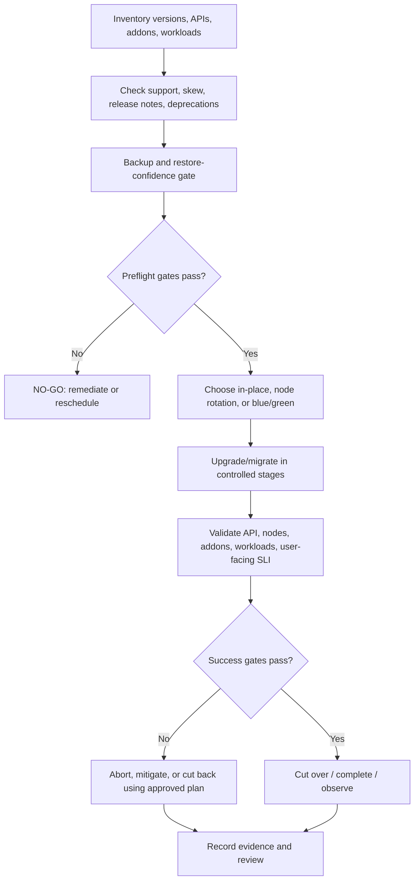

# Unit 8 — Cluster Upgrades and Version Compatibility

## Lesson metadata

| Field | Value |
|---|---|
| Target filename | `08-cluster-upgrades-and-version-compatibility.md` |
| Module / unit | Stage 2E — Production DevOps & Platform Engineering, M03 Unit 8 |
| Level | L1–L4, beginner through expert |
| Estimated learning time | 6–8 hours including both required labs and evidence review |
| Prerequisites | Linux, Git, Docker, `kubectl`, basic Kubernetes objects and Deployments, M03 Units 1–7, M02 CI/CD fundamentals |
| Core tools | `kubectl`, `kind`, Docker/compatible container runtime, shell, YAML editor, official Kubernetes release/version docs |
| Awareness-only tools | Pluto or kubent, managed Kubernetes provider tooling, fleet conformance systems |
| Kubernetes baseline | Select supported `<OLD_SUPPORTED_MINOR_TAG>` and `<NEW_SUPPORTED_MINOR_TAG>` at execution time; check current release and version-skew policies `[VERIFY]` |
| Environment | Zero-budget laptop, WSL2 Ubuntu or native Linux; approximately 4 CPU, 8 GB RAM, 30 GB disk |
| Last reviewed | 2026-10-25; official source pages were checked during preparation |
| Production caveat | No cluster upgrade, manifest scan, or lab command was executed as part of authoring this document |

**Repository context inspected:** the supplied roadmap tree contains M03 Units 1–11 and places Unit 8 between `07-node-pools-taints-affinity-and-workload-placement.md` and `09-kubernetes-rbac-and-pod-security-standards.md`. The available M03 syllabus-generation prompt's Unit 8 specification agrees with this title, sequence, and the required deprecation-scan, blue/green kind, and optional kubeadm-inspection labs. The actual repository checkout was not available, so this lesson is delivered as a standalone file at `/mnt/data/08-cluster-upgrades-and-version-compatibility.md`, rather than written into an unmounted repository path.

## Why this matters in production

A Kubernetes upgrade changes a platform contract used by every workload, controller, operator, admission webhook, network/storage add-on, deployment pipeline, and cluster administrator. A cluster can be “upgraded” while user-facing workloads are broken, a CI pipeline can no longer create a resource because its API version was removed, or an admission webhook can reject otherwise valid API requests. Upgrade success therefore cannot be defined as a version number changing or `kubectl rollout status` returning successfully.

A safe upgrade is a controlled change with a supported version path, an inventory of API and add-on dependencies, proven backup/recovery where applicable, enough capacity for disruptions, layered health checks, an explicit go/no-go decision, and a rollback or cutback strategy whose limits are understood. In this unit, the running example is a data platform with a stateless API, queue worker, batch ETL Job, and optional stateful storage/add-ons.

**Important boundary:** a blue/green `kind` rehearsal is a cluster migration rehearsal, not an in-place production control-plane or virtual-machine node upgrade. `kind` nodes are containers sharing the laptop's host/runtime. It does not prove cloud load-balancer behavior, persistent-data migration, multi-AZ availability, managed-control-plane behavior, or production node replacement.

## Learning objectives

After completing the unit, the learner can:

- **[L1] Explain** Kubernetes release structure, support policy, version skew, API deprecation, and API removal without relying on stale version numbers.
- **[L1] Inspect** official release notes, the deprecation guide, version-skew policy, and add-on compatibility evidence for a proposed target.
- **[L2] Detect** obsolete API use by combining static manifest scanning, API-server metrics, runtime observations, and CI validation while explaining each method's blind spots.
- **[L2] Build** a pre-upgrade inventory, compatibility matrix, backup gate, and go/no-go checklist.
- **[L3] Compare** in-place kubeadm upgrade, node-pool rotation/surge, and blue/green cluster migration against workload, data, capacity, downtime, and rollback constraints.
- **[L3] Plan and verify** workload readiness, PDBs, node drain, CRDs/operators, admission webhooks, CNI/CSI, ingress, and feature-gate compatibility.
- **[L4] Design** a fleet upgrade program using canaries/rings, maintenance windows, measurable upgrade SLOs, automated evidence, and explicit approvals.
- **[L4] Diagnose** a removed API breaking a deployment pipeline and an admission webhook failing after an API-server upgrade.
- **[L4] Produce** an auditable upgrade decision record, runbook, post-upgrade review, and honest lab evidence.

## Concept map and glossary

### Upgrade decision flow



### Glossary

| Term | Precise definition | Common misconception |
|---|---|---|
| Minor release | Kubernetes release component between major and patch components, conventionally represented as `1.y` in current Kubernetes releases. | A newer minor is automatically a supported direct upgrade target from any older minor. |
| Patch release | A release within a minor line, conventionally `1.y.z`, commonly containing fixes. | Patch upgrades have no compatibility or operational risk. |
| Support window | Period during which a project branch or provider version receives defined maintenance/support. | Every vendor's support window matches upstream Kubernetes policy. |
| Version skew | Supported version difference between Kubernetes components and clients. | All components must always have identical versions, or any difference is safe. |
| API deprecation | A published lifecycle state warning that an API is scheduled for eventual removal under project policy. | “Deprecated” means the API has already disappeared. |
| API removal | An API version stops being served by the API server in a release. | Persisted objects necessarily vanish when an API version stops being served. |
| Release notes | Version-specific record of changes, fixes, feature changes, deprecations, and upgrade concerns. | A generic blog post is a substitute for target-version release notes. |
| API discovery | API-server information describing served API groups, versions, and resources. | Discovery alone proves all deployed manifests are compatible. |
| Deprecated API metric | `apiserver_requested_deprecated_apis`, a metric describing deprecated APIs requested from an API server. | No metric series means no dormant manifest or external client will ever use an obsolete API. |
| Static scanner | Tool that examines manifest files or related artifacts for API/version findings. | A static scan observes every runtime API request. |
| CRD | CustomResourceDefinition that extends Kubernetes API discovery with a custom resource type. | Updating the API server automatically upgrades every CRD and operator safely. |
| Admission webhook | An external service invoked during API admission to validate or mutate requests. | A healthy API server implies all webhooks are compatible and reachable. |
| CNI | Container Network Interface implementation/integration providing Pod networking. | A CNI version can be upgraded independently of Kubernetes compatibility. |
| CSI | Container Storage Interface integration for storage operations. | All storage drivers support all Kubernetes versions and upgrade sequences. |
| Control plane | Components that expose and reconcile cluster state, including the API server and controllers/scheduler. | Updating control-plane components updates worker nodes and all add-ons automatically. |
| kubelet | Node agent that manages Pods and containers on its node and communicates with the API server. | A kubelet can be newer than the API server without policy constraints. |
| `drain` | Operation that marks a node unschedulable and evicts eligible Pods, subject to flags and disruption constraints. | Drain always succeeds or is a harmless synonym for deleting a node. |
| `cordon` | Marks a node unschedulable for new ordinary Pod scheduling. | Cordon evicts existing Pods. |
| `uncordon` | Marks a node schedulable again. | Uncordon proves the node and its workloads are healthy. |
| PDB | PodDisruptionBudget that constrains some voluntary disruptions for selected Pods. | A PDB prevents involuntary node failures or guarantees availability. |
| Node-pool rotation | Replacing old worker nodes with new compatible nodes, then draining/retiring old nodes. | Rotation is one universal Kubernetes command across cloud providers. |
| Blue/green cluster | Two clusters/environments are prepared so traffic or clients can move from old to new after validation. | Creating a second `kind` cluster automatically moves traffic or state. |
| Rollback | Recovery action whose exact meaning depends on what changed: workload config, nodes, cluster, data, or control plane. | Reverting a Deployment manifest downgrades the Kubernetes control plane. |
| Cutover / cutback | Moving clients/traffic to the new environment, or returning to the old environment. | Switching contexts on one laptop is equivalent to changing production traffic. |
| Go/no-go | Explicit decision to proceed or stop based on pre-agreed gates and evidence. | A scheduled maintenance window means the change must proceed. |
| Upgrade SLO | Measurable target for upgrade program outcomes, such as success rate, duration, or error budget impact. | “Upgrade completed” is sufficient without user-impact measures. |
| Canary / ring rollout | Progressively upgrading a small representative group before broader fleet waves. | A single canary guarantees all clusters have identical dependencies. |
| etcd backup | Snapshot or backup of Kubernetes state with a documented restore procedure. | An etcd snapshot includes PV data, external secrets, cloud resources, or every external dependency. |
| Feature gate | Configuration controlling availability of certain Kubernetes features, with lifecycle depending on the feature/release. | Alpha, beta, and GA features have universal defaults that never change. |
| API compatibility matrix | Evidence-backed record of which component versions support the target Kubernetes version and required APIs. | A component's version number alone proves compatibility. |

### Version vocabulary and safe reading

Kubernetes release documentation uses version strings such as `1.y.z`, where `y` is the minor and `z` is the patch. Treat that as the current convention, not a promise about every future versioning rule. The official release/version pages are the authority for the current release cadence and support policy. The upstream project maintains a rolling set of supported release branches; the exact currently supported branches and dates are volatile and must be checked when planning.

Read the [Kubernetes Release Versioning](https://kubernetes.io/releases/version-skew-policy/) and [Version Skew Policy](https://kubernetes.io/releases/version-skew-policy/) pages as a pair with the actual release notes for both the current and target minor. The version-skew policy page is operationally important because supported differences depend on the component: `kube-apiserver`, kubelet, kube-proxy, controller-manager, scheduler, and `kubectl` do not all have identical constraints. Provider distributions may add stricter constraints. **Do not copy a skew bound from memory into a change plan.** Record the source URL and date checked.

## L1 — Beginner: versions, support, and compatibility

### Release cadence and support

**Core Kubernetes:** upstream release policy defines release branches, patch maintenance, and supported version relationships. Specific dates and support-window details change over time. Check the official [Kubernetes releases](https://kubernetes.io/releases/) page and [version-skew policy](https://kubernetes.io/releases/version-skew-policy/) immediately before a change.

**Provider-specific:** managed Kubernetes services can define separate support tiers, extended-support charges, maintenance policies, target availability, and allowed upgrade sequences. Do not assume upstream policy equals provider support. A cluster may be technically running but outside the provider's supported window.

For each target, record:

- Current cluster/distribution and exact server version.
- Target minor and patch, selected from the currently supported set.
- Allowed path from current to target, including whether each intermediate minor is required.
- Upstream and provider support deadlines, if applicable.
- Security/compliance exposure while remaining on the old version.
- Owner, planned date, and exception/waiver expiry if upgrade is delayed.

### Version skew: read the actual matrix

Version skew is a compatibility contract between components. For example, the API server's version affects the supported versions of kubelet and kube-proxy; `kubectl` has its own supported skew; HA API-server instances impose additional restrictions. The policy may permit some components to be one or more minor versions apart, but those bounds are component-specific and may be narrower in an HA upgrade sequence.

Procedure:

1. Open the official [Version Skew Policy](https://kubernetes.io/releases/version-skew-policy/).
2. Identify every relevant component in the cluster: control-plane components, kubelet per node, kube-proxy if used, and `kubectl` used by operators/CI.
3. Check the current and intended version pair for each component, including any distribution-specific rules.
4. Capture the policy source/date and the inventory values in the change record.
5. If any component's version is unknown or unsupported, stop the upgrade plan until resolved.

Read-only inventory:

```bash
kubectl config current-context
kubectl version
kubectl get nodes -o wide
kubectl get pods -A -o wide
```

`kubectl version` output format differs between client versions. Record the actual output; do not parse it with an unreviewed one-liner in a production runbook. For self-managed clusters, obtain control-plane and node package/image versions from the supported administrative method. For managed clusters, use the provider's control-plane and node-pool inventory.

### Deprecation versus removal

An API can be deprecated in one release and removed in a later release according to the project's API deprecation policy. Once removed, the old API endpoint is no longer served; manifests or clients that still submit that API version can fail even if the resource kind itself still exists under a replacement API. A migration can also change field names or semantics, so replacing only `apiVersion` may not be enough.

Use three distinct checks:

1. **Static artifacts:** search repository manifests, Helm charts, Kustomize overlays, generated YAML, scripts, and deployment templates.
2. **Observed runtime use:** inspect API-server deprecated API metrics/logs/audit evidence where available. Runtime observation sees requests that actually occurred during the observation period, not dormant workloads.
3. **Dependency ownership:** check operators, controllers, admission webhooks, and CI tools that construct API requests dynamically or generate manifests.

Official starting points:
- [Deprecated API Migration Guide](https://kubernetes.io/docs/reference/using-api/deprecation-guide/)
- [API Deprecation Policy](https://kubernetes.io/docs/reference/using-api/deprecation-policy/)
- [Kubernetes release notes](https://kubernetes.io/releases/)

### Deliberately obsolete manifest example — training only

The following is a **static training fixture**, not a deployable baseline. `apps/v1beta1` for a Deployment was historically served but was removed in Kubernetes 1.16; verify this against the official deprecation guide before running the lab. Never apply this fixture to a live or shared cluster.

```yaml
# TRAINING FIXTURE ONLY — intentionally obsolete API; do not apply.
apiVersion: apps/v1beta1
kind: Deployment
metadata:
  name: obsolete-api-fixture
spec:
  replicas: 1
  selector:
    matchLabels:
      app: obsolete-api-fixture
  template:
    metadata:
      labels:
        app: obsolete-api-fixture
    spec:
      containers:
        - name: placeholder
          image: registry.k8s.io/pause:3.10
```

A current pattern uses `apps/v1` and requires a selector that matches the Pod template labels:

```yaml
# Example replacement shape; verify it against the target API server before use.
apiVersion: apps/v1
kind: Deployment
metadata:
  name: api-fixture-migrated
spec:
  replicas: 1
  selector:
    matchLabels:
      app: api-fixture-migrated
  template:
    metadata:
      labels:
        app: api-fixture-migrated
    spec:
      containers:
        - name: placeholder
          image: registry.k8s.io/pause:3.10
          resources:
            requests:
              cpu: 10m
              memory: 16Mi
            limits:
              cpu: 50m
              memory: 32Mi
```

The replacement example uses a current stable API shape, but you must still validate it against the chosen cluster, image policy, and organizational requirements. The `pause` image is only a low-resource placeholder; it is not an application.

### Compatibility is a graph, not one version number

An upgrade affects the whole platform:

| Component | What to check | Evidence source |
|---|---|---|
| Workload manifests/charts | Removed APIs, changed fields, schema validation, generated resources | Static scan, target-version CI, API discovery |
| Operators/controllers | Kubernetes API support, CRD versions, reconciliation behavior | Official project compatibility matrix/release notes |
| CRDs | Served/storage versions, conversion webhook health, migration steps | CRD docs, API server discovery, operator docs |
| Admission webhooks | API request versions, `matchPolicy`, service endpoints, TLS/CA, timeout/failure behavior | Webhook docs, configuration, logs, release notes |
| CNI | Target Kubernetes version, node lifecycle, network policy, datapath compatibility | CNI vendor/project compatibility matrix |
| CSI/storage | Target Kubernetes version, sidecars, snapshot/expansion behavior, volume topology | CSI/provider compatibility matrix |
| Ingress/Gateway | API version, controller support, traffic behavior | Controller release notes and compatibility docs |
| Metrics server/autoscaling | API compatibility and supported Kubernetes range | Official project docs and target cluster tests |
| Policy engines | Admission API, CRDs, rule behavior, fail-open/fail-closed implications | Engine docs, fixtures, staging tests |
| `kubectl` and CI tooling | Supported client skew, schema validators, generators, deployment plugin versions | Version-skew policy and tool release notes |

A component matrix template appears later in this lesson. Do not invent a supported combination where the project has not published one.

## L2 — Intermediate: preparation and deprecation detection

### Upgrade order and why it matters

For applicable self-managed kubeadm upgrades, the official procedure coordinates the control plane and node components to stay within the supported version-skew policy. A common conceptual sequence is to upgrade the control plane using the supported kubeadm process, then drain/upgrade/uncordon nodes in controlled batches, validating capacity and health as you go. The exact command sequence depends on whether the cluster is single-control-plane or HA, current/target minor, operating system, package manager, and distribution. **[VERIFY]** current kubeadm documentation before executing any step.

For managed Kubernetes, the provider may control the API-server upgrade and prescribe node-pool sequencing, maintenance windows, surge settings, or temporary compatibility requirements. Follow the provider's exact upgrade path; do not transplant kubeadm package commands into a managed cluster.

**One minor at a time is the safe default for a planned path.** Kubernetes policy and distribution procedures may prohibit skipping minors; the exact allowed path must be checked. If the current cluster is too far behind, plan intermediate upgrades, compatibility gates, and support-risk treatment instead of guessing that a direct jump is allowed.

### Deprecation detection methods and their limits

#### Static manifest scanning

Static scanning can find old API versions in files that exist in the scanned paths. It may miss generated manifests, external repositories, templated output, operator-generated requests, runtime clients, or files omitted by the scan. A clean static scan is evidence, not proof that every runtime client is clean.

Common Awareness tools include [Pluto](https://github.com/FairwindsOps/pluto) and [kubent](https://github.com/doitintl/kube-no-trouble). Their current installation instructions, release versions, input formats, and target-version options must be checked in their official project documentation `[VERIFY]`. Do not make an unverified package installation a prerequisite for understanding the core lesson.

#### API-server metric

The metric `apiserver_requested_deprecated_apis` is documented in the official [Kubernetes metrics reference](https://kubernetes.io/docs/reference/instrumentation/metrics/). It reports deprecated APIs requested from an API server, with labels such as group, version, resource, subresource, and removed release. Availability and access depend on cluster monitoring and metrics configuration.

The metric has important limits:

- It describes requests observed by that API server, not every manifest sitting unused in Git.
- A short observation window can miss scheduled jobs, infrequent deployments, dormant clusters, or clients that run only during an incident.
- It may not identify the owning source repository without correlating identity/audit/client evidence.
- A metric absence must not be interpreted as proof that an old manifest is safe.

If permitted, inspect the API server's metrics endpoint using the cluster's approved monitoring route. `kubectl get --raw` can query supported API paths, but the API server's `/metrics` access path and authorization vary by cluster. Check the target environment and do not assume every cluster exposes metrics through the same route.

```bash
# Read-only: inspect API discovery; output is version- and cluster-dependent.
kubectl api-versions
kubectl api-resources
kubectl get --raw /metrics
```

The last command may be denied or unavailable; that is an environment result, not proof that the metric does not exist. In production, use the approved monitoring/metrics collection path and access controls. Do not paste raw metrics containing sensitive labels or infrastructure detail into public issue trackers.

#### `kubectl convert`: limited, version-dependent

Do not assume `kubectl convert` is a universal built-in command for all API migrations. Historically, conversion support has depended on the relevant plugin/tool distribution and the source/target resource versions. Check the current official `kubectl` command reference and available plugins in the environment `[VERIFY]`. Even when a converter exists, it cannot automatically understand every semantic field change, custom resource, Helm template, or application dependency. Treat conversion output as a proposed edit that must be reviewed, not as an approved migration.

#### Release notes and API lifecycle review

For each current-to-target minor step:

1. Read the release notes for the target version and all intermediate minors required by the upgrade path.
2. Read the deprecation guide for APIs removed in those versions.
3. Compare the cluster's live API requests and static manifests.
4. Check CRDs/operators and all admission/network/storage/ingress add-ons.
5. Run target-version validation in CI or a disposable cluster.
6. Record each finding, owner, migration, and evidence. Do not leave “not checked” findings implicitly approved.

### Pre-upgrade checklist

Before a real cluster change, verify all of the following:

- Current context, distribution, exact versions, node inventory, and allowed target path.
- Official release notes, deprecation guide, version-skew policy, and provider maintenance guidance reviewed.
- Static manifests and runtime deprecated API use scanned with known coverage limits.
- CRDs/operators, admission webhooks, CNI, CSI, ingress/Gateway, metrics-server, policy engines, and client tooling have evidence-backed target compatibility.
- API server, nodes, DNS/networking, storage, and critical workloads are healthy before the window.
- Enough capacity exists for drain/rotation and rollout surge; PDBs and topology constraints are feasible.
- Stateful data, schema changes, external dependencies, secrets, certificates, and storage migration are addressed.
- Backup exists where applicable and restore confidence is demonstrated; refer to Unit 10 for etcd health/backup/recovery. A `kind` cluster export or manifest dump is not a production-grade backup.
- Security controls and admission webhooks have a tested emergency escalation plan; no blanket disablement is pre-authorized.
- Owners, stakeholder notice, maintenance window/freeze, start/stop criteria, go/no-go approver, abort conditions, and recovery path are documented.
- Validation covers API/control plane, nodes, add-ons, workloads, user-facing smoke tests, and monitoring.
- Evidence capture and post-upgrade observation period are defined.

### CI preflight and ephemeral kind

Link to M02 rather than rebuilding the CI/CD module here. A useful pipeline can render Helm/Kustomize output, scan for removed APIs, validate schemas against the target version, deploy a small fixture to an ephemeral `kind` cluster, and run smoke tests. Record the tested Kubernetes image tag and scanner version. A passing kind pipeline improves confidence in manifest portability, but does not prove managed-provider behavior, production CNI/CSI compatibility, real storage migration, multi-AZ resilience, or performance under production load.

## L3 — Advanced: upgrade strategies and rollback

### Strategy comparison

| Strategy | How it works | Best fit | Main risks | Rollback reality |
|---|---|---|---|---|
| In-place kubeadm/self-managed | Upgrade control-plane components and then node components in the supported order; drain/uncordon nodes where required. | Clusters with a tested supported path, operational ownership, and acceptable maintenance risk. | API incompatibility, failed components, drain blocks, node skew, capacity loss, control-plane downgrade constraints. | Workload rollback is separate from control-plane rollback; restore may be complex and must follow official recovery procedure. |
| Node-pool rotation/surge | Create compatible new nodes, validate them, migrate workloads, then retire old nodes. | Infrastructure can provision replacement capacity and workloads can move safely. | Extra temporary cost, pool-template mismatch, PVC topology, insufficient spare capacity, workload disruption. | Often can keep old nodes until validation, but stateful workloads/data and provider mechanics complicate reversal. |
| Blue/green cluster migration | Create a second cluster at target version, deploy compatible platform/workloads, migrate state and traffic, then cut over. | API compatibility uncertainty, major platform changes, or need for a clean fallback environment. | Duplicate infrastructure, data replication/consistency, secrets/config drift, traffic/DNS/LB complexity, hidden external dependencies. | Cut back to old cluster only while old environment and data remain compatible and current. |

Managed Kubernetes offerings (EKS/GKE/AKS and others) are **Awareness only** here. Their upgrade paths, control-plane/node-pool ordering, support windows, surge behavior, and rollback options differ. Use provider documentation and an approved provider runbook; this zero-budget lesson does not require cloud accounts.

### In-place kubeadm sequence — conceptual only

The official [Upgrading kubeadm clusters](https://kubernetes.io/docs/tasks/administer-cluster/kubeadm/kubeadm-upgrade/) guide is the authority for the exact procedure. A high-level flow can include:

1. Verify cluster health, supported path, version skew, add-on compatibility, backup/recovery, and capacity.
2. Review `kubeadm upgrade plan` output.
3. Update the kubeadm package using the distribution's supported package instructions.
4. Apply the supported control-plane upgrade step for the first control-plane node, then follow the documented sequence for additional control-plane nodes if HA.
5. Drain nodes where the procedure requires it; respect PDBs, DaemonSets, local storage, and workload readiness.
6. Upgrade kubelet and other node components in the supported order; restart where required.
7. Uncordon nodes only after their version and health are verified.
8. Validate API, node readiness, add-ons, workloads, and user-facing behavior.

Every concrete command and package pin is **[VERIFY]** against the current kubeadm guide, OS package instructions, and exact target minor. Do not copy an old command block as a generic recipe. Do not use the optional kind inspection lab to execute `kubeadm upgrade apply` inside a kind node.

### Node-pool rotation/surge

A safe rotation is a capacity and migration operation, not just an image update:

1. Create the new pool with supported Kubernetes/node image and compatible CNI/CSI/runtime configuration.
2. Verify labels, taints, allocatable capacity, networking, storage, observability, and security agents.
3. Schedule a canary workload; test readiness and application-level behavior.
4. Cordon/drain old nodes in small batches using the provider's documented workflow. Inspect PDBs and workloads that use local storage or have no controller.
5. Watch Pending Pods, rollout progress, node conditions, service SLIs, and storage attachment.
6. Keep old capacity until new workloads are healthy and the rollback window expires.
7. Retire old nodes only after sign-off.

The exact autoscaling, surge settings, replacement process, and termination notices are provider-specific. A pool may have enough aggregate CPU but not enough per-node memory or compatible volume topology.

### Blue/green cluster migration and rollback reality

Blue/green means the old and new environments coexist long enough to validate the new one and preserve a fallback. It is often a better rehearsal for `kind` because `kind` clusters are created at a chosen node image version rather than treated as a production in-place upgrade target.

A production blue/green plan must explicitly handle:

- Cluster-scoped resources and CRDs.
- Namespaces, RBAC, admission webhooks, secrets, certificates, and policy.
- CNI/CSI/ingress/metrics and external integrations.
- Persistent volumes and application data consistency.
- DNS, load balancer, service discovery, credentials, and client routing.
- Background workers and duplicate processing during overlap.
- Schema/data changes that may make old and new applications incompatible.
- Cutback time, owner, and exact conditions under which it remains safe.

**Rollback vocabulary matters:**

- **Workload rollback:** restore an earlier Deployment/Job/configuration manifest.
- **Node rollback:** return traffic/workloads to retained old nodes or pool.
- **Cluster cutback:** move traffic or clients back to the old cluster.
- **Control-plane downgrade:** generally unsupported or constrained; check current official documentation and distribution policy `[VERIFY]`.
- **etcd restore:** a recovery operation requiring a carefully designed procedure and compatible state; it is not a casual “undo” button.
- **Backup restore:** restores only the data/state covered by the backup, not necessarily external services or PV data.

Never promise a Kubernetes control-plane downgrade unless the exact distribution's official supported procedure explicitly allows it. A successful application rollback does not prove the cluster control plane can be downgraded.

### Workload readiness and disruption dependencies

Before drain, node rotation, or cutover, check:

- **Unit 3:** readiness/liveness/startup probes and application recovery behavior.
- **Unit 4:** controller ownership, replica count, Job retry/idempotency, StatefulSet behavior.
- **Unit 5:** PDB, graceful shutdown, `preStop`, termination grace, and drain constraints.
- **Unit 7:** node pool, affinity, tolerations, topology spread, and destination capacity.
- **Unit 10:** etcd health/backup/restore confidence for self-managed control-plane recovery.
- **M02:** CI validation and evidence gates.

A PDB constrains certain voluntary disruptions; it does not guarantee availability and cannot make an impossible scheduling topology feasible. `kubectl drain` can be blocked by PDBs, unmanaged Pods, DaemonSets, local data, finalizers, or insufficient capacity. Do not bypass a blocked drain without understanding the reason and obtaining the appropriate approval.

### Add-ons, CRDs, feature gates, and webhooks

Build a compatibility matrix instead of assuming that “the chart installed” proves the component is supported. Verify each CNI, CSI, ingress controller, metrics-server, policy engine, operator, CRD, webhook, and client tool against the target minor. Include release notes and migration steps. Check CRD served/storage versions and conversion webhooks; API-server upgrades do not automatically migrate every custom resource or operator.

Feature lifecycle terms such as alpha, beta, and GA describe stages of maturity, but availability, default state, and removal/change rules are feature- and release-specific. For a named feature gate, verify the target version's official documentation and release notes `[VERIFY]`. Do not assume a feature's default remains unchanged.

Admission webhooks are a high-risk dependency: the API server may send resource representations that changed across releases. Verify that webhook code can handle the versions and fields sent by the target API server, that its Service has healthy endpoints, and that TLS/CA trust and networking work. A `failurePolicy` or timeout changes availability/security trade-offs; do not casually weaken admission as an emergency shortcut.

## L4 — Expert: fleet upgrade governance and incidents

### Fleet-wide upgrade program

Treat upgrades as a portfolio of controlled changes across clusters, not as a one-time ticket.

1. **Inventory and ownership:** maintain a canonical list of clusters, distributions, versions, owners, environments, workloads, add-ons, and support status.
2. **Risk tiering:** prioritize end-of-life exposure, security risk, public exposure, business criticality, and compatibility complexity.
3. **Canary:** upgrade representative non-production clusters that exercise common add-ons and workload patterns.
4. **Rings:** progress from development/test to staging, low-risk production, then critical production. Each ring has entry/exit criteria and a hold point.
5. **Compatibility gates:** require API scan, target-version CI, addon matrix, backup/restore evidence, PDB/capacity review, and application smoke tests.
6. **Maintenance/freeze windows:** define business blackout periods, change freezes, incident overrides, and communications.
7. **Upgrade SLOs:** measure upgrade success rate, failed/aborted change rate, duration, customer-impact minutes, post-upgrade incidents, and time to remediate unsupported clusters. Define thresholds from business needs; do not invent universal targets.
8. **Automated evidence:** retain cluster version, node readiness, scanner output, addon versions, test results, approval, change ID, and post-upgrade health.
9. **Exceptions/waivers:** every exception needs a risk owner, compensating controls, expiry date, target date, and periodic review.
10. **Fleet conformance:** report clusters on supported versions, clusters with unknown inventory, and overdue high-risk exceptions.

### End-of-life risk management

A cluster outside support may miss security fixes and may no longer have a supported path through all intermediate versions. The risk register should contain the affected service, exposure, data sensitivity, owner, current/target version, official support source/date checked, compensating controls, migration milestones, and exception expiry. Communicate risk in business terms: likelihood/impact, compliance exposure, and consequences of an incident—not only a version string.

### Runbook quality and maintenance communication

A production upgrade runbook needs an owner/on-call, approved window, current/target inventory, exact commands from the distribution/provider docs, preconditions, expected observations, go/no-go gates, abort points, recovery/cutback, communication templates, validation, observation period, and closure. Each step should identify who executes it, what evidence proves success, and what stops the next step.

## Incident walkthroughs

### Incident 1 — A removed API version broke the deployment pipeline after upgrade

#### Impact and initial signals

Illustrative symptoms include a CI deployment job failing with “no matches for kind/version,” an API server rejecting a manifest, a Helm release failing, or an operator failing to reconcile a resource. These are examples, not observed incident metrics.

#### Timeline and evidence template

| Stage | Facts to collect | Actual evidence |
|---|---|---|
| Detect | Change ID, pipeline/job, error, affected environments |  |
| Scope | Target/current cluster versions, API resource/version, first failing deployment |  |
| Locate source | Repository manifests, Helm output, Kustomize output, generated resources, operator/client logs |  |
| Confirm removal | Official target release notes/deprecation guide and API discovery |  |
| Mitigate | Stop pipeline/rollout, select compatible path or verified migration |  |
| Validate | Target-version schema/API test, canary deploy, smoke test |  |
| Close | User impact, permanent fix, owners, follow-up dates |  |

Read-only diagnostics (adapt the namespace/context and avoid exposing secrets):

```bash
kubectl config current-context
kubectl version
kubectl api-versions
kubectl api-resources
kubectl get events -A --sort-by=.metadata.creationTimestamp
```

Search local source files using the team's normal repository tools for the affected `apiVersion`, kind, Helm chart, Kustomize overlay, or generated manifest. Re-render templates before scanning; scanning only source templates can miss the rendered output, while scanning only rendered output can miss dormant environment-specific overlays.

#### Root cause and mitigation

Likely root cause: a deprecated API was not found or migrated before the cluster upgrade, or an external controller/client still submits it. Distinguish static manifests from runtime clients/operators: a repository search may find a manifest, but it may not identify a dynamic client; an API metric may reveal runtime use but cannot prove every dormant file is clean.

Immediate options, ordered by safety:

1. Stop or pause the affected pipeline/rollout to prevent repeated failures.
2. If the old cluster/environment is still supported and rollback/cutback is safe, route the deployment back through the approved compatible path while retaining evidence.
3. Migrate the manifest/client to a verified supported API and review semantic field changes.
4. Validate against the target API server and run a canary before resuming broad deployment.

Do not downgrade the cluster casually just to restore a pipeline. A control-plane downgrade may be unsupported. Do not re-enable an obsolete API unless the exact distribution officially supports that recovery path and the risk owner approves it.

#### Durable prevention and communication

Add static scanning of rendered manifests, target-version validation in CI, release-note/deprecation review to upgrade gates, an owner for every operator/CRD/client, and an exception process. Communicate what failed, affected environments, temporary mitigation, residual risk, next update time, and the final verification result. After the incident, ask: Which signal should have detected it? Which source was not scanned? Who owns the dependency? Which gate will prevent recurrence?

### Incident 2 — An admission webhook was incompatible with the new API server

#### Impact and initial signals

Illustrative symptoms include API create/update requests timing out, admission failures, deployment controllers failing to create Pods, or a webhook returning an error when it receives a resource representation it does not understand. The failure can affect only selected kinds/namespaces or a broad portion of the API depending on the webhook's rules and failure policy.

#### Evidence collection

```bash
kubectl config current-context
kubectl get validatingwebhookconfigurations,mutatingwebhookconfigurations
kubectl get pods,services,endpoints -A -o wide
kubectl get events -A --sort-by=.metadata.creationTimestamp
kubectl describe validatingwebhookconfiguration <name>
kubectl describe mutatingwebhookconfiguration <name>
```

Some resource/API fields and output formats vary by cluster version. Inspect the actual webhook configuration, namespace/service, endpoint readiness, certificate/CA bundle, timeout, `failurePolicy`, selectors/rules, logs, and target API-server release notes. Use approved API audit logs or monitoring if available. Avoid pasting private keys, secret data, or sensitive request payloads into incident notes.

#### Separate possible causes

- **Backend unavailable:** webhook Pods are not Ready, Service endpoints are absent, or a rollout failed.
- **Network/DNS/TLS failure:** API server cannot reach the service, resolve its address, or trust the certificate.
- **API-version/field incompatibility:** webhook code assumes an older resource representation or mishandles newly introduced fields.
- **Overly broad scope:** webhook intercepts unrelated resources or namespaces, increasing blast radius.
- **Latency/capacity:** webhook is overloaded or timeout settings do not fit request latency.
- **Policy behavior:** webhook rejects requests intentionally, which is different from a transport failure.

#### Safe mitigation and recovery

1. Declare the incident and identify which API operations are blocked; pause risky rollouts.
2. Restore the webhook backend, endpoints, network, or certificate if the evidence supports that path.
3. Roll back the webhook/controller to a version explicitly compatible with the new API server if that rollback is supported.
4. If an emergency change to webhook scope or failure behavior is considered, require an authorized incident commander/security owner, narrowest possible scope, written risk review, audit trail, expiry/reversal time, and official documentation verification. Do not blindly disable a security admission control or set a broad fail-open policy.
5. Validate with representative allowed and denied requests, then deploy a canary workload and check service SLIs.
6. Keep the change window open until the agreed observation period completes; communicate residual risk and follow-up actions.

#### Durable prevention

Test webhook compatibility against the target API version in a staging/canary cluster; use versioned releases and rollback artifacts; monitor latency, errors, and timeouts; review webhook scope/selectors and failure policy; keep redundant/healthy backends where appropriate; and include webhooks in the compatibility matrix. The post-incident review should record affected API operations, time to detect/recover, root cause, security implications, and the gate that will catch the issue next time.

## Worked example: planning an upgrade for a data platform

A platform runs a stateless scoring API, queue worker, scheduled ETL Job, and a stateful data service using PVCs. It also has a CNI, CSI driver, ingress controller, metrics-server, a policy engine, and an operator with CRDs.

The upgrade is not approved until the team can answer:

1. Which exact current and target versions are supported, and what intermediate path is required?
2. Do rendered manifests and live API requests use any APIs removed by the target or intermediate versions?
3. Are CRDs, conversion webhooks, operator, ingress, CNI, CSI, metrics-server, and policy engine compatible with the target?
4. Can the API and worker maintain readiness while nodes drain? Are PDBs and topology spread feasible with remaining capacity?
5. Can ETL Jobs retry safely without duplicate side effects? Are schedules paused or controlled during migration?
6. How is stateful data migrated? Is storage portable to the new cluster? Is schema/data change reversible?
7. What exactly will switch traffic, clients, and background consumers? How will duplicate processing be prevented?
8. What evidence allows the approver to say go? What exact condition triggers abort/cutback?
9. What does the backup include, and has restore been tested? Unit 10 covers etcd recovery; application/PV data needs its own backup strategy.
10. Who owns the final cutover and who can declare rollback?

### Example strategy decision

Choose **blue/green cluster migration** when API compatibility is uncertain and there is capacity to run a second environment, provided state and traffic migration are designed explicitly. Choose **node-pool rotation** when the control plane upgrade is handled separately and workloads can move safely to replacement nodes. Choose **in-place kubeadm** when the distribution's supported path is clear, the team has proven backups and recovery, and the expected disruption/capacity profile is acceptable.

This is a decision framework, not a universal recommendation. If stateful data cannot be replicated or reversed safely, the team may need a separate data migration plan, a maintenance window, or a staged application/schema compatibility release before cluster cutover.

## Lab A — API deprecation scan

### Purpose and safety boundary

This required lab teaches the difference between static manifest scanning and observed API-server usage. The obsolete manifest is a local text fixture only. **Never apply it to a live or shared cluster.** This lab can be completed without a cluster or paid service.

### 1. Preflight

```bash
pwd
git status --short
kubectl config current-context
kubectl cluster-info
kubectl version
```

These commands are diagnostic. Confirm the repository working directory and target cluster. The obsolete fixture must never be applied, even if the current context appears disposable. If you are not in the expected repository, do not create files there accidentally. The fixture can live in a temporary personal lab directory outside the repository.

### 2. Verify the deprecated API pair

The lesson's training fixture uses `apps/v1beta1` for a Deployment, an API version historically removed in Kubernetes 1.16. Confirm this against the [official Deprecated API Migration Guide](https://kubernetes.io/docs/reference/using-api/deprecation-guide/) and target release notes before performing the exercise. If that source does not support the claim for your selected target, replace the fixture with a verified pair or use `<VERIFIED_REMOVED_API_VERSION>` as a placeholder until verification is complete.

Create a temporary directory and fixture:

```bash
mkdir -p "$HOME/k8s-upgrade-lab/deprecation"
cd "$HOME/k8s-upgrade-lab/deprecation"
cat > obsolete-deployment.yaml <<'YAML'
# TRAINING FIXTURE ONLY. Never apply this manifest.
apiVersion: apps/v1beta1
kind: Deployment
metadata:
  name: obsolete-api-fixture
spec:
  replicas: 1
  selector:
    matchLabels:
      app: obsolete-api-fixture
  template:
    metadata:
      labels:
        app: obsolete-api-fixture
    spec:
      containers:
        - name: placeholder
          image: registry.k8s.io/pause:3.10
YAML
```

The fixture is intentionally old. Do not run `kubectl apply -f obsolete-deployment.yaml`. The folder is outside the repository by default; verify `pwd` before creating any local files.

### 3. Static scan

Choose Pluto or kubent only after reviewing its official project instructions and verifying the version/install method `[VERIFY]`. Tool flags and supported input formats can change. A generic command pattern is:

```bash
# PSEUDOCODE: replace with the syntax documented by the installed scanner version.
<SCANNER_COMMAND> <SCANNER_OPTIONS_FOR_LOCAL_FILES> obsolete-deployment.yaml
```

If the scanner supports a directory/file input, use its documented static-file mode. Record the scanner name/version, exact command, source API, target version, finding, and output. Do not copy a sample finding into evidence as though it was produced by your run. If no scanner can be safely installed, complete the source-review portion manually and record that the automated scan was not performed.

### 4. Static findings versus runtime metrics

| Method | Can help detect | Cannot prove |
|---|---|---|
| Static file scan | Obsolete API versions present in scanned files | Generated/remote manifests, runtime clients, or omitted paths are clean |
| Rendered Helm/Kustomize scan | Obsolete APIs in the rendered output for that configuration | Every environment overlay or runtime-generated request is covered |
| API-server deprecated API metric | Deprecated API requests observed by that server during the observation period | Dormant manifests or future scheduled jobs will not use them |
| API audit/client logs | Observed requests with potentially useful identity/context | That all request paths are logged or every client is easy to attribute |
| Target-version test cluster | Whether the tested manifests/flows work in that tested environment | Production provider, storage, traffic, and workload scale behavior |

Where available, the metric is `apiserver_requested_deprecated_apis`; consult the [metrics reference](https://kubernetes.io/docs/reference/instrumentation/metrics/). Accessing `/metrics` with `kubectl get --raw /metrics` may be denied or unsupported by the cluster's authorization/monitoring setup. Use the approved metrics route rather than weakening security controls.

### 5. Corrected pattern and validation

Review the current `apps/v1` example in L1. Do not perform a blind `apiVersion` substitution: selectors and field semantics may differ for other resource kinds. Validate the corrected manifest against the target version using the team's supported schema validator and/or a disposable target-version API server. A `kubectl apply --dry-run=server` check can be useful only against a server that supports the target API and has the required CRDs/admission dependencies; it does not replace full integration testing.

### 6. Evidence table

| Field | Actual value to record |
|---|---|
| Source version and target version |  |
| Official source and date checked |  |
| Scanner name/version or “manual review only” |  |
| Exact command and input paths |  |
| Finding and affected manifest |  |
| Replacement API/version and migration notes |  |
| Validation command and actual result |  |
| Remaining risk / uncovered paths |  |

### 7. Cleanup

Remove only the local fixture/output created for this lab after retaining evidence:

```bash
pwd
ls -la
rm -f obsolete-deployment.yaml scanner-output.txt
```

Run `rm` only after verifying `pwd` points to the dedicated lab directory and that the named files are lab-owned. If you used different output filenames, remove only those exact files. Do not delete the whole home directory, repository, or cluster to clean up this lab.

## Lab B — Blue/green kind upgrade rehearsal

### What this lab proves—and does not prove

This required lab creates an old-version cluster, deploys a small stateless workload, creates a second cluster with the next supported minor, re-applies reviewed manifests, validates the new environment, and rehearses a cutback decision. It is a **cluster migration rehearsal**, not an in-place Kubernetes upgrade.

It can test manifest portability and the learner's migration checklist. It does not prove real production traffic switching, PV data migration, managed-control-plane behavior, independent availability zones, cloud node replacement, or performance under production load.

### 1. Preflight and safety gate

Check tools and resource availability:

```bash
kind version
kubectl version --client
docker version
docker info
kind get clusters
kubectl config get-contexts
kubectl config current-context
df -h
```

Check CPU and memory using the host's available tools (for example `nproc`, `free -h` on Linux/WSL2). Docker Desktop/WSL2 resource limits may differ from host physical capacity. Two clusters consume more memory/disk than one; do not run both concurrently if the laptop is already near its limits.

Choose `<OLD_SUPPORTED_MINOR_TAG>` and `<NEW_SUPPORTED_MINOR_TAG>` only after checking the official supported release list, version-skew policy, and kind node-image availability. The new tag should be the next allowed supported minor for the rehearsal; if the real supported path requires an intermediate minor, choose that instead. Do not guess tags or skip minors for convenience.

List existing clusters and contexts. If either `upgrade-lab-old` or `upgrade-lab-new` already exists, **stop** and choose a new unique name. Never delete a cluster that existed before the lab. Before every create, apply, switch, or delete operation, verify the exact context and cluster name.

### 2. Create the old cluster

Save as `kind-old.yaml` in your personal lab workspace:

```yaml
kind: Cluster
apiVersion: kind.x-k8s.io/v1alpha4
name: upgrade-lab-old
nodes:
  - role: control-plane
    image: kindest/node:<OLD_SUPPORTED_MINOR_TAG>
  - role: worker
    image: kindest/node:<OLD_SUPPORTED_MINOR_TAG>
```

The placeholder must be replaced with a verified supported kind node image tag before execution. A tag is not a digest; if your image policy requires immutability, resolve and pin the exact official digest for the chosen image and record it. Do not invent a digest.

Before creation, verify the cluster name is unused:

```bash
kind get clusters
kubectl config get-contexts
```

Only if the name is absent and you confirm this is a new disposable lab cluster:

```bash
kind create cluster --config kind-old.yaml --wait 120s
kubectl config current-context
kubectl cluster-info
kubectl get nodes -o wide
kubectl version
```

The context is commonly `kind-upgrade-lab-old`, but confirm the actual value. Verify node readiness and server version before continuing.

### 3. Deploy sample workload and service

The sample image `registry.k8s.io/pause:3.10` is a clearly replaceable low-resource placeholder. It is not an HTTP API. To perform an HTTP smoke test, replace it with an approved, pinned demo web-server image and use its documented container port and readiness endpoint; do not invent a digest. The core lab's portable smoke check uses Pod readiness, Service/endpoints, and logs/events, and an optional request test if a suitable image is available.

Save as `upgrade-sample.yaml`:

```yaml
apiVersion: v1
kind: Namespace
metadata:
  name: upgrade-demo
  labels:
    purpose: cluster-upgrade-rehearsal
---
apiVersion: apps/v1
kind: Deployment
metadata:
  name: upgrade-demo
  namespace: upgrade-demo
  labels:
    app: upgrade-demo
spec:
  replicas: 2
  selector:
    matchLabels:
      app: upgrade-demo
  template:
    metadata:
      labels:
        app: upgrade-demo
    spec:
      containers:
        - name: placeholder
          image: registry.k8s.io/pause:3.10 # Replace with reviewed immutable app image for HTTP testing.
          resources:
            requests:
              cpu: 10m
              memory: 16Mi
            limits:
              cpu: 50m
              memory: 32Mi
---
apiVersion: v1
kind: Service
metadata:
  name: upgrade-demo
  namespace: upgrade-demo
spec:
  selector:
    app: upgrade-demo
  ports:
    - name: placeholder
      port: 80
      targetPort: 80
```

**Service caveat:** the pause placeholder does not listen on port 80, so this Service is for selector/endpoint configuration inspection only and is not an HTTP-serving service. For a real HTTP smoke test, replace the image and port with a reviewed web-server image and its documented port. Do not interpret an endpoint object as proof that an application request succeeds.

Confirm context, then apply:

```bash
kubectl config current-context
kubectl cluster-info
kubectl apply -f upgrade-sample.yaml
kubectl rollout status deployment/upgrade-demo -n upgrade-demo --timeout=120s
kubectl get deploy,rs,pods,svc,endpoints -n upgrade-demo -o wide
kubectl describe deployment upgrade-demo -n upgrade-demo
kubectl get events -n upgrade-demo --sort-by=.metadata.creationTimestamp
kubectl version
```

Record actual output and whether both replicas are Ready. If using an HTTP-capable image, add a documented request test, such as a `kubectl port-forward` to the Service followed by a local HTTP request, and record the actual response. Do not fabricate successful output.

### 4. Export reviewed manifests and document dependencies

Exporting live YAML can help with inspection, but it does not capture all external state, CRDs, Secrets, PV data, cloud resources, identity configuration, or provider-side dependencies. Keep a copy of the reviewed source manifest and record the cluster-specific dependencies separately.

```bash
kubectl config current-context
kubectl get namespace upgrade-demo -o yaml
kubectl get deployment upgrade-demo -n upgrade-demo -o yaml
kubectl get service upgrade-demo -n upgrade-demo -o yaml
kubectl get pods -n upgrade-demo -o wide
```

Use the source `upgrade-sample.yaml` as the clean declarative artifact for this simple lab. Do not reapply exported YAML blindly: it can include generated metadata/status and cluster-specific fields. In production, use the organization's source-of-truth deployment process (for example GitOps/CI) and explicitly migrate secrets/configuration/data.

### 5. Create the new cluster

Save as `kind-new.yaml`:

```yaml
kind: Cluster
apiVersion: kind.x-k8s.io/v1alpha4
name: upgrade-lab-new
nodes:
  - role: control-plane
    image: kindest/node:<NEW_SUPPORTED_MINOR_TAG>
  - role: worker
    image: kindest/node:<NEW_SUPPORTED_MINOR_TAG>
```

Before creation, verify `upgrade-lab-new` does not exist and that the new image tag is a verified supported next-minor image. If both clusters would exceed available memory, use the sequential variant below instead of forcing two clusters to run.

```bash
kind get clusters
kubectl config get-contexts
```

Only if the name is unused and the resource budget is acceptable:

```bash
kind create cluster --config kind-new.yaml --wait 120s
kubectl config current-context
kubectl cluster-info
kubectl get nodes -o wide
kubectl version
kubectl api-versions
kubectl api-resources
```

Record actual server version, nodes and readiness, API discovery, and any image/pull issues. Check the target cluster's add-ons and dependencies before applying application resources.

### 6. Migrate and verify

Switching context changes where `kubectl` commands are sent; it does not move traffic or state. Confirm the new context before applying:

```bash
kubectl config current-context
kubectl config get-contexts
```

After verifying that the current context is the new lab cluster, apply the reviewed source manifest:

```bash
kubectl apply -f upgrade-sample.yaml
kubectl rollout status deployment/upgrade-demo -n upgrade-demo --timeout=120s
kubectl get deploy,rs,pods,svc,endpoints -n upgrade-demo -o wide
kubectl get events -n upgrade-demo --sort-by=.metadata.creationTimestamp
kubectl logs -n upgrade-demo deployment/upgrade-demo --all-pods=true
kubectl version
```

The logs command may produce little or no application output for the pause placeholder. That is expected for a non-application container; record the actual result. For an HTTP-capable replacement, perform the documented request smoke test. Check both replicas' readiness, Service selector/endpoints, logs/events, and any installed metrics/monitoring. Record all results.

Production traffic migration is provider/infrastructure-specific: it may use DNS, load balancers, ingress/Gateway, service mesh, client configuration, or a routing control plane. The local `kind` clusters do not automatically expose a production traffic switch. A production cutover also needs a plan for writes, queue consumers, duplicate processing, and state replication.

### 7. Go/no-go and cutback plan

**Go** only when:

- Target version and upgrade path are supported and documented.
- API deprecation scan and add-on compatibility findings have owners/resolutions.
- Target cluster nodes are Ready and the workload reaches desired Ready replicas.
- Service/endpoints select the intended Pods.
- The chosen smoke test passes with actual evidence.
- Logs/events and monitoring show no unexplained critical issue.
- State/secret/config dependencies are migrated or explicitly out of scope.
- The cutback owner and cutback procedure are available.

**No-go / abort** if target API compatibility is unknown, required CRDs/add-ons are missing, Pods cannot become Ready, the smoke test fails, state is inconsistent, or the rollback path is no longer safe. Keep the old cluster intact until the agreed observation period and cutover checks pass.

For this lab, rollback means returning to the old context for subsequent commands and, in a real system, moving traffic/clients back using the approved routing mechanism. It does not undo writes or data migrations performed against the new environment. If both clusters are writing to a shared external database or queue, define ownership/fencing before switching.

### 8. Before/after evidence

| Field | Old cluster actual value | New cluster actual value | Pass criteria |
|---|---|---|---|
| Context and cluster name |  |  | Names/contexts unambiguously identified |
| Server version |  |  | Matches chosen, verified image |
| Node readiness |  |  | All expected nodes Ready |
| API discovery findings |  |  | No unexplained compatibility blocker |
| Deployment desired/ready replicas |  |  | Desired replicas Ready |
| Service selector/endpoints |  |  | Selects intended workload |
| Smoke test |  |  | Actual successful response or documented placeholder limitation |
| Events/logs |  |  | No unexplained critical failures |
| Add-on compatibility |  |  | In scope dependencies have evidence |
| Known limitations |  |  | Explicitly recorded |

### 9. Sequential low-resource variant

If two clusters exceed laptop capacity:

1. Complete old-cluster inventory, workload validation, and manifest export.
2. Record all old-cluster evidence.
3. Confirm the old cluster is disposable and no needed data remains.
4. Delete only the old cluster by exact name, after verifying it did not exist before the lab and was created by you.
5. Create the new cluster and apply the same reviewed manifest.
6. Compare recorded observations.

This variant weakens side-by-side comparison and does not test simultaneous coexistence, traffic switching, or shared-dependency behavior. It is still useful for manifest portability and target-version validation. Do not delete the old cluster before evidence is saved and the name/context is confirmed.

### 10. Cleanup

Keep the clusters until evidence is recorded. Before deletion, confirm names and contexts:

```bash
kind get clusters
kubectl config get-contexts
kubectl config current-context
```

Delete only clusters created by this lab and only after confirming each exact name:

```bash
# DESTRUCTIVE: verify the name exists and was created by this lab before running.
kind delete cluster --name upgrade-lab-new

# DESTRUCTIVE: verify the name exists and was created by this lab before running.
kind delete cluster --name upgrade-lab-old
```

If a name was already present before the lab, do not delete it. If using a unique alternate name, substitute only after confirming ownership. The deletion commands remove those clusters and their local resources; they do not clean up arbitrary Docker containers or other clusters.

## Lab C — Optional kubeadm upgrade-plan inspection (inspection only)

**OPTIONAL — INSPECTION ONLY. Do not perform an in-place upgrade.**

`kind` uses kubeadm during cluster creation, but a kind node is a containerized lab node, not a normal production kubeadm-managed host. Whether the installed kubeadm version and configuration make `kubeadm upgrade plan` meaningful depends on the chosen image/version. This optional lab must not run `kubeadm upgrade apply`, replace packages, or upgrade kubelet inside the kind node.

### No-change preflight

```bash
kind get clusters
kubectl config current-context
kubectl get nodes -o wide
```

Choose only a disposable kind cluster created for this lesson. Confirm the exact control-plane container name using `docker ps` and the `kind` cluster/node naming pattern shown by your environment. Do not guess or enter an unknown container.

Inspect binaries and versions only:

```bash
# Replace <control-plane-container> with the exact verified container name.
docker exec <control-plane-container> sh -c 'command -v kubeadm; kubeadm version; command -v kubelet; kubelet --version'
```

If kubeadm is absent or the command is not meaningful for that image, stop and use the official [kubeadm upgrade guide](https://kubernetes.io/docs/tasks/administer-cluster/kubeadm/kubeadm-upgrade/) for a conceptual walkthrough. If it is present, you may inspect the plan only if the official documentation and cluster state indicate that the read-only command is appropriate:

```bash
# INSPECTION ONLY — do not follow this with apply/package/kubelet changes.
docker exec <control-plane-container> kubeadm upgrade plan
```

**[VERIFY]** exact applicability to the chosen kind image. A command returning an error is not permission to try `kubeadm upgrade apply`. Do not run package managers, replace binaries, edit static Pod manifests, or restart kubelet as part of this exercise.

### No-change validation and exit

```bash
kubectl get nodes -o wide
kubectl get pods -A -o wide
kubectl version
```

Record whether the inspection command ran, its actual output/error, and whether the cluster remained healthy. Exit without mutation. If any accidental mutation occurred, stop and follow the disposable-cluster recovery procedure; do not improvise an in-place upgrade inside kind.

## Upgrade runbook and go/no-go checklist

### Reusable runbook template

| Field | Fill before change |
|---|---|
| Change/ticket ID |  |
| Cluster/distribution and environment |  |
| Current and target versions |  |
| Official supported path and source/date checked |  |
| Upgrade method: in-place / node rotation / blue-green |  |
| Change owner and on-call |  |
| Approver / go-no-go owner |  |
| Maintenance window / freeze exceptions |  |
| Stakeholders and communication channels |  |
| Backup location and restore evidence |  |
| API deprecation findings and owners |  |
| Add-on/CRD/webhook compatibility evidence |  |
| Capacity, PDB, readiness, topology review |  |
| Step sequence and exact source docs |  |
| Expected observations and evidence locations |  |
| Abort points and triggers |  |
| Recovery/cutback steps and owner |  |
| Smoke tests / SLIs / observation period |  |
| Closure owner and post-upgrade review date |  |

### Go/no-go gates

| Gate | GO evidence | NO-GO / abort condition |
|---|---|---|
| Supported path | Current official policy and distribution/provider procedure recorded | Target/path unsupported or unknown |
| API compatibility | Static scan and runtime review complete; removed APIs migrated | Known removed API still used or scan coverage unknown without risk acceptance |
| Add-ons | Compatibility matrix has official evidence or tested mitigation | Critical CNI/CSI/webhook/operator compatibility unknown |
| Backup/recovery | Required backups exist and restore procedure is proven for relevant data | Backup absent, corrupt, or restore path untested for a critical system |
| Workload health | Baseline readiness/SLI healthy; replica and PDB plan feasible | Existing incidents, unhealthy replicas, no disruption headroom |
| Capacity | Enough eligible capacity for drains, surge, and failure recovery | Replacement nodes cannot fit workloads |
| Security | Admission, identity, policy, and emergency process reviewed | Proposed shortcut would silently bypass security control |
| Change readiness | Owners, window, communication, commands, aborts and rollback documented | No owner or no safe recovery path |
| Validation | API, nodes, addons, workloads, smoke tests, and monitoring defined | Only version number/rollout status planned as success proof |

### Post-upgrade observation and closure

Do not close immediately after the last component reports the target version. Observe for the pre-agreed period and validate:

- API-server availability/latency and relevant errors.
- All nodes Ready and kubelet versions within policy.
- CNI/CSI/ingress/DNS/metrics/policy/operator health.
- CRD discovery and conversion, admission webhook latency/errors.
- Deployments, StatefulSets, Jobs, and scheduled ETL behavior.
- Application-level smoke tests and business SLIs.
- Autoscaling, scheduling, PVC attachment, node drains, and logging/monitoring.
- CI/CD deploy and rollback path against the new cluster version.
- Security controls, certificates, and audit/monitoring pipelines.

Record findings, incident links, remaining exceptions, owners, and deadlines. A successful `kubectl rollout status` proves only that the observed workload rollout reached its controller's success condition; it does not prove cluster-wide upgrade success.

## Production readiness checklist

### Version and compatibility

- [ ] Supported target and allowed upgrade path verified from official sources.
- [ ] Version-skew rules checked for API servers, kubelet, kube-proxy, controller components, and `kubectl`.
- [ ] Release notes and deprecation guide reviewed for every required minor step.
- [ ] Static manifests and live deprecated API requests scanned, with limitations documented.
- [ ] CRDs/operators, admission webhooks, CNI, CSI, ingress/Gateway, metrics-server, policy engines, and CI tools mapped to compatibility evidence.
- [ ] Feature gates and alpha/beta/GA lifecycle changes reviewed for named features.

### Reliability, data, and recovery

- [ ] Backup exists and restore path is tested where applicable; PV/application data covered separately.
- [ ] API, nodes, DNS/network, storage, and critical workloads are healthy before change.
- [ ] Readiness, replica count, PDBs, topology spread, drain behavior, and capacity reviewed.
- [ ] Stateful data/schema changes are compatible or have a tested migration/cutback plan.
- [ ] CNI/CSI/ingress and webhook dependencies have a tested recovery path.
- [ ] Rollback/cutback limits are explicit; no unsupported control-plane downgrade is assumed.

### Change management and evidence

- [ ] Upgrade strategy selected with documented rationale.
- [ ] Canary/ring order, maintenance window, freeze rules, and stakeholder communications approved.
- [ ] Go/no-go owner and abort triggers are explicit.
- [ ] CI target-version validation and ephemeral kind tests are available where appropriate.
- [ ] Evidence includes versions, scan findings, compatibility matrix, readiness, smoke tests, events, and approvals.
- [ ] Post-upgrade observation period and closure criteria are defined.
- [ ] All exceptions have owner, compensating controls, expiry, and target remediation date.

## Common mistakes and anti-patterns

| Mistake | Why it fails | Better practice |
|---|---|---|
| Upgrading directly across minors without checking path | May violate upstream/distribution upgrade rules and skip required migrations | Follow the official supported sequence; use intermediate minors when required. |
| Treating deprecated as already removed—or safe forever | Deprecation warns of future removal; support depends on target release | Check target and intermediate release notes/deprecation guide. |
| Relying only on static scanning | Misses runtime clients, generated resources, and omitted paths | Combine static, runtime, dependency-owner, and target-version testing evidence. |
| Relying only on API metrics | Dormant manifests and rare jobs may not run during observation | Scan repositories and rendered artifacts as well. |
| Assuming `kubectl convert` converts everything | Availability and coverage are tool/version dependent; semantic migrations may be missed | Verify tool support and manually review output. |
| Assuming a backup is good because a file exists | It may be incomplete, corrupt, inaccessible, or unrestorable | Test restore and define what data/state is covered. |
| Assuming PDB guarantees availability | PDB only constrains some voluntary disruptions | Plan replicas, capacity, topology, and involuntary failure behavior. |
| Running `drain` without checking local storage/PDB/DaemonSets | Drain may block or disrupt stateful/unmanaged workloads | Inventory workload ownership and disruption effects first. |
| Assuming control-plane downgrade is a normal rollback | Downgrade may be unsupported or require recovery-specific procedures | Prefer tested cutback/restore plans and verify exact support. |
| Treating a manifest export as a complete cluster backup | It misses external state, data, secrets/config dependencies, and provider resources | Use a complete inventory and dedicated data/cluster backup procedures. |
| Assuming `kind` blue/green proves production failover | No real provider load balancer, independent AZs, or production storage migration | Label the exercise as a rehearsal and test provider behavior separately. |
| Disabling a webhook to “get the upgrade through” | May bypass security or policy enforcement and expand blast radius | Restore compatibility; any emergency change requires authorization, narrow scope, audit, expiry, and reversal. |
| Upgrading all fleet clusters at once | One issue can create correlated outages | Use canary/rings, gates, hold points, and measured upgrade SLOs. |
| Treating a successful rollout as full success | Rollout status does not validate API server, add-ons, external dependencies, or user-facing behavior | Layer control-plane, node, add-on, workload, smoke-test, and SLI checks. |

## Self-check questions and answer key

### Questions

1. What is the difference between API deprecation and API removal, and which official artifacts should you consult before an upgrade?
2. Why is version skew a component-specific policy rather than a rule that all Kubernetes components must have the same version?
3. A static scan finds no removed APIs, but the API-server metric records requests to a deprecated API. What does this imply, and what should happen next?
4. Why can a clean API-server deprecated-API metric not prove every repository manifest is safe?
5. Why is a supported one-minor-at-a-time path safer than guessing that a multi-minor jump will work?
6. A node drain is blocked by a PDB. Why is deleting the PDB or force-deleting Pods not a neutral fix?
7. What is the difference between workload rollback and control-plane downgrade?
8. Why does a successful blue/green kind lab not prove production traffic cutover or PV data migration?
9. A webhook times out after the API-server upgrade. Name at least four distinct hypotheses and evidence sources before changing its failure policy.
10. An upgrade completed and all Deployments report successful rollout, but the API server's deprecated API metric and application smoke test show issues. Is the upgrade successful? Explain the go/no-go reasoning.

### Answers and reasoning

1. Deprecation is a lifecycle warning; removal means the API version is no longer served. Read target/intermediate release notes, the official deprecation guide, API deprecation policy, version-skew policy, and addon/provider docs.
2. Each component has different compatibility requirements. Kubelet, kube-proxy, controller components, and `kubectl` have distinct allowed relationships with the API server, and HA/control-plane transitions can narrow the supported combinations.
3. Runtime use was observed even though the scanned files did not show it. Identify the requester/owner using approved audit/log/client evidence, find dynamic/generated sources, migrate the client, and validate against the target version.
4. The metric observes requests made during the observation window; dormant manifests, scheduled jobs, future deployments, or unexecuted clients may not have made a request.
5. Supported paths may require intermediate control-plane/API migrations and component ordering. Skipping versions can violate upstream or provider policy and miss required compatibility steps.
6. PDBs encode disruption budgets for availability. Deleting them or force-deleting Pods can cause an outage or data loss and hides the actual capacity/readiness problem. Diagnose healthy replicas, replacement capacity, and ownership first.
7. Workload rollback restores application manifests/configuration. Control-plane downgrade changes Kubernetes components and may be unsupported or constrained. They require different recovery plans.
8. Kind uses containerized nodes and does not provide production traffic routing, real independent zones, provider control planes, or stateful storage migration. The lab validates a process and manifest portability only.
9. Backend Pod/Service endpoints; network/DNS reachability; TLS/CA trust; API-version/field incompatibility; webhook scope/rules; timeout/overload. Inspect webhook config, service/endpoints, logs, certificates, release notes, Events, and audit/monitoring evidence.
10. No. Upgrade success is layered. A deprecated API signal and failed smoke test violate compatibility/user-facing gates. Stop further rollout/cutover, diagnose and mitigate, and declare success only after approved gates pass.

## Senior interview and design-review questions

### 1. How do you choose between in-place upgrade, node-pool rotation, and blue/green cluster migration for a production data platform?

**Answer rubric:** compare supported path, API/add-on uncertainty, stateful data, spare capacity, downtime tolerance, provider capabilities, operational complexity, and rollback/cutback. In-place needs a proven distribution-specific sequence and recovery; rotation needs capacity and workload migration safety; blue/green needs dependency/data/traffic migration and can retain the old environment. Strong answers distinguish workload rollback from control-plane downgrade.

### 2. How would you manage version skew and API deprecation risk across hundreds of clusters?

**Answer rubric:** inventory every cluster/component and owner; verify upstream/provider support and skew rules; use target/intermediate release notes; scan rendered manifests and runtime API use; map add-ons/CRDs/webhooks; upgrade in canary/rings with automated gates, evidence, exception expiry, and upgrade SLOs. Strong answers explain metric/static-scan blind spots.

### 3. A removed API version breaks the deployment pipeline after a cluster upgrade. What is your response?

**Answer rubric:** stop the failing rollout; capture exact version/error and source; inspect rendered manifests, repository, operators, runtime clients, API discovery, and official deprecation docs; migrate to a verified API; validate in target-version CI/canary; use old-cluster cutback only if supported and data-safe; create prevention gates and communicate residual risk.

### 4. An admission webhook becomes incompatible with the new API server. How do you restore service without weakening security blindly?

**Answer rubric:** scope impact; inspect webhook rules/configuration, service endpoints, Pod logs, TLS/CA, network, API representation compatibility, latency, timeout/failure policy; restore compatible backend or rollback to supported webhook release; any emergency scope/failure-policy change requires authorized owner, narrow scope, audit, expiry, and reversal; validate allowed/denied requests and monitor.

### 5. Design a canary/ring upgrade program with measurable SLOs and rollback gates.

**Answer rubric:** choose representative canaries; define entry/exit gates for version support, API scans, add-on matrix, backup, capacity, and workload SLI; progress through rings with hold points/freeze windows; measure success rate, duration, customer-impact minutes, failed/aborted changes, and post-upgrade incidents; automate evidence and approvals; define abort/cutback owners and post-upgrade observation. Do not invent universal SLO targets.

## Evidence artifacts and completion criteria

Retain evidence in personal lab notes or the repository's existing evidence location; this lesson does not create additional repository evidence files. Suggested artifact names are examples only.

| Artifact | What it proves | Actual evidence to record | Pass criteria |
|---|---|---|---|
| Version/context inventory | Old/new cluster identity and version | Context names, `kubectl version`, nodes and readiness | Values recorded and consistent with selected tags |
| Support/skew source record | Target path was checked | Official URL, date checked, allowed path and constraints | Source supports selected path; no unsupported leap assumed |
| API deprecation scan | Static/runtime findings were investigated | Input files, scanner/tool version, command, actual output, findings | Findings have owner and replacement/mitigation |
| Compatibility matrix | Add-on dependencies have evidence | Component/current version/target source/action/owner | Critical dependencies are checked or block go decision |
| Pre-upgrade checklist and ADR | Decision was explicit | Risks, options, chosen method, backup/capacity/data/rollback | Decision rationale and approver recorded |
| Old-cluster workload validation | Baseline works before migration | Ready replicas, endpoints, logs/events, smoke test | Actual results recorded; placeholders disclosed |
| New-cluster validation | Target environment works for tested scope | Version, nodes, API discovery, rollout, smoke test | All defined lab gates pass or limitation documented |
| Cutover/cutback plan | Reversal is thought through | Owner, exact routing/context steps, data assumptions | Does not confuse context switch with production traffic |
| Cleanup confirmation | Only lab-owned clusters removed | `kind get clusters`, context inventory | Pre-existing clusters untouched |
| Incident walkthroughs | Diagnostic reasoning and prevention | Evidence timeline, root cause, mitigation, actions | Causes distinguished; owners and prevention gates named |

### Completion criteria

**Pass** when the learner can provide actual evidence that: (1) the support/skew path was checked; (2) the obsolete API fixture was never applied and its source/version was verified; (3) static scan limits and runtime metric limits are explained; (4) the old/new kind contexts and versions are unambiguous; (5) the sample workload was validated on both clusters or a limitation was recorded; (6) the cutback plan distinguishes context from traffic/data rollback; (7) cleanup targeted only lab-owned clusters; and (8) both incidents have evidence-led diagnosis, mitigation, and durable prevention.

**Incomplete** if version tags were guessed, output was fabricated, an obsolete manifest was applied, the target context was unclear, a pre-existing cluster was deleted, or success was declared solely because a rollout completed. If an environment limitation prevents a step, record the limitation and the evidence available; do not mark it passed.

## Sources, version notes, and claim register

### Authoritative sources consulted

The official pages below were opened during preparation. Their live content can change; re-check the target version's documentation and record the date used in a production change.

1. [Kubernetes Releases](https://kubernetes.io/releases/) — current release information and links to release notes.
2. [Kubernetes Version Skew Policy](https://kubernetes.io/releases/version-skew-policy/) — support policy for component/client version relationships and upgrade order.
3. [Kubernetes Release Versioning](https://kubernetes.io/releases/versioning/) — release/versioning conventions.
4. [Deprecated API Migration Guide](https://kubernetes.io/docs/reference/using-api/deprecation-guide/) — version-specific API removals and migration guidance.
5. [API Deprecation Policy](https://kubernetes.io/docs/reference/using-api/deprecation-policy/) — lifecycle policy.
6. [Kubernetes Metrics Reference](https://kubernetes.io/docs/reference/instrumentation/metrics/) — `apiserver_requested_deprecated_apis` and metric stability information.
7. [Upgrading kubeadm clusters](https://kubernetes.io/docs/tasks/administer-cluster/kubeadm/kubeadm-upgrade/) — supported kubeadm upgrade procedure and recovery notes.
8. [Safely Drain a Node](https://kubernetes.io/docs/tasks/administer-cluster/safely-drain-node/) — drain behavior and disruption considerations.
9. [Pod disruptions](https://kubernetes.io/docs/concepts/workloads/pods/disruptions/) — PDB and voluntary disruption behavior.
10. [kind configuration](https://kind.sigs.k8s.io/docs/user/configuration/) — node image/configuration and multi-node limitations.
11. [kind quick start](https://kind.sigs.k8s.io/docs/user/quick-start/) — create/manage/delete local clusters.
12. [Pluto](https://github.com/FairwindsOps/pluto) — optional scanner; verify current release and CLI syntax.
13. [kubent / kube-no-trouble](https://github.com/doitintl/kube-no-trouble) — optional scanner; verify current release and CLI syntax.
14. [Kubernetes API concepts](https://kubernetes.io/docs/reference/using-api/) — API groups, versions, and discovery.
15. For concrete CNI/CSI/ingress/operator/webhook versions, use the selected project's or provider's official compatibility matrix and release notes. No specific third-party version combination is asserted in this lesson.

### Version and execution notes

- Do not treat the current release list in a web result as a durable recommendation. Select supported tags when executing the lab.
- `<OLD_SUPPORTED_MINOR_TAG>` and `<NEW_SUPPORTED_MINOR_TAG>` are placeholders, not literal tags. Choose a valid, supported path; do not skip minors unless the official path permits it.
- The `apps/v1beta1` Deployment fixture is deliberately obsolete and is for static scanning only. Verify the removal claim against the official deprecation guide and never apply the fixture.
- `kubectl get --raw /metrics`, `kubectl convert`, scanner commands, `kubeadm upgrade plan` inside kind, provider node-pool rotation, webhook emergency behavior, and add-on compatibility depend on version/configuration and are marked `[VERIFY]` where appropriate.
- No cluster or lab was executed; no actual scanner output, upgrade result, or measured RTO/RPO is claimed.

### Claim register

| ID | Claim or decision | Type (core/self-managed/provider/add-on/version-sensitive/simulation) | Authoritative source | Verification required | Lesson section |
|---|---|---|---|---|---|
| C01 | Kubernetes versions are expressed in a major/minor/patch-like `x.y.z` form under the current release convention. | Core | [Release versioning](https://kubernetes.io/releases/versioning/) | Recheck current versioning docs before making future-facing claims | L1 |
| C02 | Supported release branches and support details are time-sensitive and should be checked before planning. | Core | [Kubernetes releases](https://kubernetes.io/releases/) | Record current support status and date checked | L1 |
| C03 | Version-skew constraints differ by component and can be narrowed by HA/control-plane transition state. | Core | [Version skew policy](https://kubernetes.io/releases/version-skew-policy/) | Check exact current bounds for each component and distribution | L1 |
| C04 | Provider support and upgrade paths can add constraints beyond upstream policy. | Provider-specific | Selected provider's official upgrade/support docs | Verify distribution-specific requirements | L1/L2 |
| C05 | Deprecated APIs may later be removed from serving; clients using removed versions can fail. | Core | [Deprecated API guide](https://kubernetes.io/docs/reference/using-api/deprecation-guide/) | Verify the exact API and target release | L1 |
| C06 | `apps/v1beta1` Deployment was removed in Kubernetes 1.16 and is used only as a static training fixture. | Core/example | [Deprecated API guide](https://kubernetes.io/docs/reference/using-api/deprecation-guide/) | Recheck source before lab; never apply fixture | L1/Lab A |
| C07 | Static scanning can miss runtime-generated clients or files outside scanned paths. | Conceptual | [API deprecation policy](https://kubernetes.io/docs/reference/using-api/deprecation-policy/) and scanner docs | Record scanner coverage and input paths | L2/Lab A |
| C08 | `apiserver_requested_deprecated_apis` records deprecated API requests observed by an API server. | Core/metrics | [Metrics reference](https://kubernetes.io/docs/reference/instrumentation/metrics/) | Verify metric availability and collection path | L2 |
| C09 | Absence of a deprecated API metric signal does not prove dormant manifests are clean. | Conceptual | [Metrics reference](https://kubernetes.io/docs/reference/instrumentation/metrics/) | Define observation window and combine with static scan | L2/Lab A |
| C10 | `kubectl get --raw /metrics` may be denied/unavailable depending on cluster access/configuration. | Version/configuration-sensitive | [kubectl get](https://kubernetes.io/docs/reference/kubectl/generated/kubectl_get/) and cluster metrics docs | Test approved access path; do not weaken access controls | L2 |
| C11 | `kubectl convert` is not assumed to be a universal built-in converter for every migration. | Tool/version-sensitive | [kubectl reference](https://kubernetes.io/docs/reference/kubectl/) | Verify current tool/plugin availability and supported resources | L2 |
| C12 | Kubeadm upgrade steps and commands depend on current version, OS, and cluster topology. | Self-managed/version-sensitive | [Upgrading kubeadm clusters](https://kubernetes.io/docs/tasks/administer-cluster/kubeadm/kubeadm-upgrade/) | Follow exact target-version procedure | L2/L3/Lab C |
| C13 | The safe planned upgrade path should follow the supported version sequence rather than assuming arbitrary minor skips. | Core/provider-specific | [Version skew policy](https://kubernetes.io/releases/version-skew-policy/) and provider docs | Verify allowed path from current to target | L1/L2 |
| C14 | PDBs constrain certain voluntary disruptions but do not prevent involuntary failures or guarantee availability. | Core | [Pod disruptions](https://kubernetes.io/docs/concepts/workloads/pods/disruptions/) | Inspect PDB and actual eviction path | L2/L3 |
| C15 | `kubectl drain` can be blocked by PDBs, unmanaged Pods, DaemonSets, local storage, or capacity constraints. | Core/operational | [Safely Drain a Node](https://kubernetes.io/docs/tasks/administer-cluster/safely-drain-node/) | Inspect exact flags and workload behavior before change | L3 |
| C16 | Node-pool rotation mechanics, surge capacity, and termination behavior are provider-specific. | Provider-specific | Selected provider's official node-pool docs | Verify node pool API, lifecycle, and surge semantics | L3 |
| C17 | A blue/green cluster migration requires explicit state and traffic migration; cluster creation alone does not move either. | Operational/conceptual | [kind configuration](https://kind.sigs.k8s.io/docs/user/configuration/) and system architecture | Verify external dependencies and data consistency | L3/Lab B |
| C18 | Control-plane downgrade is generally unsupported or constrained and must be checked for the exact distribution. | Version-sensitive/self-managed | [kubeadm upgrade guide](https://kubernetes.io/docs/tasks/administer-cluster/kubeadm/kubeadm-upgrade/) and provider docs | Do not attempt unless official supported recovery path exists | L3 |
| C19 | An etcd backup does not automatically cover PV/application data or all external dependencies. | Self-managed/operational | [Operating etcd clusters](https://kubernetes.io/docs/tasks/administer-cluster/configure-upgrade-etcd/) and storage docs | Verify scope of every backup type and test restore | L2/L3 |
| C20 | CRDs, operators, and conversion webhooks need their own compatibility checks. | Core/add-on | [Custom resources](https://kubernetes.io/docs/concepts/extend-kubernetes/api-extension/custom-resources/) | Check each operator's target-version support | L1/L3 |
| C21 | Admission webhooks can affect API request availability and must handle requests sent by the target API server. | Core/add-on | [Dynamic admission control](https://kubernetes.io/docs/reference/access-authn-authz/extensible-admission-controllers/) and version-skew policy | Verify API compatibility, endpoint, TLS, scope, timeout, and failure policy | L3/Incident 2 |
| C22 | CNI, CSI, ingress, metrics-server, and policy engine compatibility is project/provider-specific. | Add-on/provider-specific | Selected add-on's official compatibility matrix | Record official target compatibility evidence | L1/L3 |
| C23 | Alpha/beta/GA lifecycle and feature-gate defaults are feature/release-specific. | Version-sensitive | Target release notes and feature documentation | Verify named feature's lifecycle and default | L3 |
| C24 | `kind` nodes are containers and do not provide real independent cloud VMs or AZ failure domains. | Simulation | [kind configuration](https://kind.sigs.k8s.io/docs/user/configuration/) | Mark limitations in all lab conclusions | L1/Lab B |
| C25 | `kind` blue/green rehearsal does not prove provider traffic switching, PV migration, or managed-control-plane behavior. | Simulation | [kind quick start](https://kind.sigs.k8s.io/docs/user/quick-start/) | Validate production mechanisms separately | Lab B |
| C26 | Kind node image tags must be selected from available supported images and are not assumed current. | Simulation/version-sensitive | [kind configuration](https://kind.sigs.k8s.io/docs/user/configuration/) | Check image availability and supported release path at execution | Lab B |
| C27 | A manifest export alone does not capture all cluster state, Secrets/external state, CRDs, PV data, or provider resources. | Operational/conceptual | [Kubernetes API concepts](https://kubernetes.io/docs/reference/using-api/) and storage docs | Inventory dependencies and backup scope | Lab B/L3 |
| C28 | A successful workload rollout is not sufficient proof of cluster upgrade success. | Operational/conceptual | [Deployments](https://kubernetes.io/docs/concepts/workloads/controllers/deployment/) and health-check docs | Validate API, nodes, addons, workload, smoke tests, and SLIs | L3/runbook |
| C29 | Static scanner CLI syntax and installation instructions can change between tool releases. | Add-on/tool-sensitive | [Pluto](https://github.com/FairwindsOps/pluto), [kubent](https://github.com/doitintl/kube-no-trouble) | Verify tool release, install method, flags, and input format | Lab A |
| C30 | Emergency webhook scope/failure-policy changes can weaken admission/security behavior. | Core/security-sensitive | [Dynamic admission control](https://kubernetes.io/docs/reference/access-authn-authz/extensible-admission-controllers/) | Require authorization, narrow scope, audit, expiry, and reversal plan | Incident 2 |
| C31 | A safe upgrade program uses canaries/rings and measurable gates to reduce correlated fleet risk. | Operational design | Organization-specific SRE/change policy | Define business-specific SLOs and gates; no universal numeric target | L4 |
| C32 | End-of-life exception records need an owner, compensating controls, expiry, and target remediation. | Governance | Organization security/compliance policy and official support docs | Verify policy and current support status | L4 |
| C33 | Backup existence is not equivalent to proven recovery; restore confidence requires testing. | Operational/self-managed | [kubeadm upgrade guide](https://kubernetes.io/docs/tasks/administer-cluster/kubeadm/kubeadm-upgrade/) and etcd docs | Record restore-test evidence and covered data | L2/L3 |
| C34 | The optional kubeadm kind-node exercise must remain inspection-only; no `upgrade apply` or package/kubelet mutation is permitted. | Simulation/safety | [kind configuration](https://kind.sigs.k8s.io/docs/user/configuration/) and kubeadm docs | Verify command applicability; stop on uncertainty | Lab C |
| C35 | API discovery shows served APIs but does not prove every workload/client is compatible. | Core/conceptual | [Kubernetes API concepts](https://kubernetes.io/docs/reference/using-api/) | Combine discovery with source and runtime checks | L1/L2 |
| C36 | Blue/green cutback may be unsafe after irreversible data/schema changes or writes to a shared dependency. | Operational design | Application/database migration procedure | Verify data compatibility, write ownership, and reversal plan | L3/Lab B |

### Claim status summary

- **Checked against official documentation during preparation:** release/version-skew policy, kubeadm upgrade guide, deprecated API guide, metrics reference, and kind configuration/limitations.
- **Conceptual/operational guidance:** layered validation, canary/ring deployment, evidence collection, and decision records; these should be adapted to the organization's SLOs and change policy.
- **[VERIFY] version-sensitive:** target support windows, allowed upgrade path, exact skew bounds at execution, API removals for selected intermediate versions, scanner syntax, kubeadm commands, provider upgrade behavior, and add-on compatibility.
- **Provider/add-on dependent:** managed Kubernetes procedures, node-pool surge/rotation, CNI/CSI/ingress/operator/webhook compatibility, storage migration, traffic cutover, and support tiers.
- **Simulation-only:** kind cluster creation at chosen node-image tags and local blue/green manifest migration. No production upgrade behavior is claimed.

## Ten-pass authenticity and completeness audit

| Pass | Status | Evidence / limitation |
|---|---|---|
| 1. Roadmap fidelity | PASS WITH LIMITATION | The supplied roadmap tree and M03 syllabus-generation prompt were inspected; Unit 8 filename/sequence and scope agree. The actual repository checkout was not available. |
| 2. Coverage completeness | PASS | L1–L4, three lab options, required templates, both incidents, runbooks, checklists, and evidence criteria are present. |
| 3. Kubernetes/version accuracy | PASS WITH LIMITATION | Core claims were checked against official docs; exact version-dependent commands/tags remain `[VERIFY]`. |
| 4. Source authenticity | PASS WITH LIMITATION | Official sources were opened during preparation. No target-version support matrix for a concrete selected release was asserted. |
| 5. Lab A safety and reproducibility | PASS WITH LIMITATION | Obsolete fixture is local/static only; no apply command; scanner syntax is intentionally `[VERIFY]`. Lab not executed. |
| 6. Lab B safety and reproducibility | PASS WITH LIMITATION | Both tags are placeholders; unique cluster names, context checks, smoke tests, cutback, resource-aware alternative, and scoped cleanup are included. Lab not executed. |
| 7. Lab C safety | PASS | Explicitly inspection-only; `kubeadm upgrade apply`, package replacement, and kubelet upgrade are prohibited. |
| 8. Production realism | PASS | Self-managed, provider, add-on, data, and kind simulation behaviors are distinguished. |
| 9. SRE/security/change management | PASS | Backup, readiness, PDBs, capacity, webhooks, communications, go/no-go, abort, and rollback limitations are covered. |
| 10. Editorial and evidence quality | PASS | Required 23 headings are in order; 10 self-checks with answers; exactly five senior interview questions; 36 claim-register entries; source links and templates included. |

**Audit interpretation:** these statuses describe document coverage and source review, not proof that the labs ran. No YAML validator, cluster, scanner, webhook, or upgrade was executed. Any step depending on an unselected version/provider remains unverified until the learner records actual evidence.

## Sign-off and known limitations

**Delivered artifact:** `08-cluster-upgrades-and-version-compatibility.md`

**Saved path:** `/mnt/data/08-cluster-upgrades-and-version-compatibility.md`

**Files inspected:** the attached Unit 8 generation prompt, `/mnt/data/Roadmap_ptree(20261025-042622).md` for the M03 unit tree, and `/mnt/data/PROMPT-Production-Kubernetes-Operations(3).md` for the authoritative Unit 8 scope. The roadmap tree and syllabus prompt agree on the Unit 8 title, filename, sequence, and mandatory lab themes.

**Sources checked:** official Kubernetes release/version-skew, deprecation, metrics, kubeadm-upgrade, and kind configuration pages were opened during preparation. This is documentation review, not live validation of a specific selected target version.

**Not performed:** no kind cluster was created; no obsolete manifest was applied; no scanner, `kubectl`, or kubeadm command was executed; no workload migration, webhook incident, or production upgrade was performed; no YAML/schema validator was run.

**Remaining `[VERIFY]` items:** choose supported old/new kind image tags; confirm the allowed version path and exact component skew; verify the obsolete API example against the selected target; check scanner install/CLI syntax; check target add-on/provider compatibility; verify whether kubeadm plan inspection is meaningful for the chosen kind image.

**Repository safety:** the actual repository checkout and target directory were not available in the mounted filesystem. The lesson was created as a standalone file under `/mnt/data`. No other repository file was intentionally edited or created. Because a repository working-tree diff was unavailable, the state of other repository files could not be independently verified.
